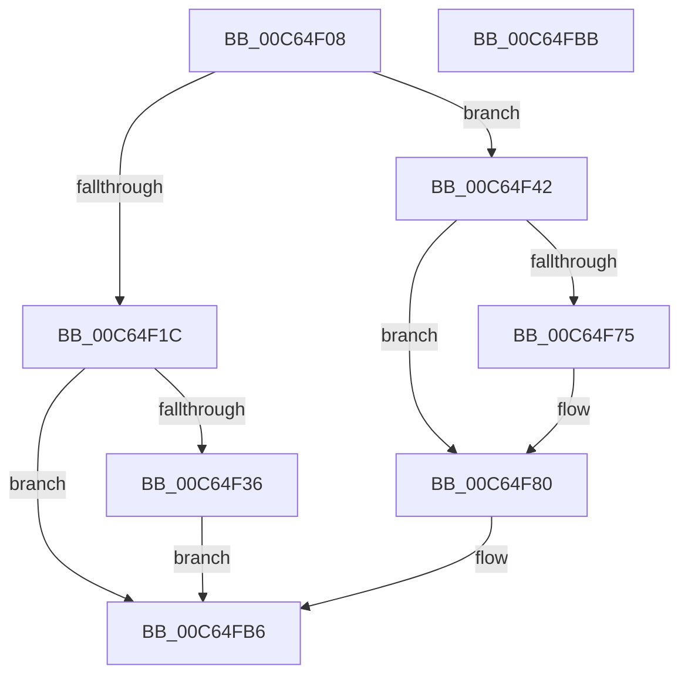

# MmInitializeImageViewExtension

- RVA: `0x00C64F08`–`0x00C64FBC` (길이 `180` bytes)
- VA: `0x0000000140C64F08`
- 실행 섹션: `INIT`
- PDB 이름 있음: `예`; PDB Function 태그: `아니요`
- unwind 정보 RVA: `0x0005D2F4`
- 디코드: `39`개 명령, `180/180` bytes 표시
- 미해석 바이트: `0` (있으면 어셈블리에 `.byte`로 보존)

> 이 문서는 커널 이미지의 기계어와 PDB 기호를 분석해 생성했습니다. 4번과 5번은 함수 원형과 자료형을 바이너리 사용 방식에서 추정한 C 해석이며 원본 소스 복구 결과는 아닙니다.

## 1. Dependencies

- 직접 호출 지점: **5**; 고유 호출 대상: **5**
- 직접 호출자로 확인된 함수: **2**
- RIP 상대 이미지 참조: **9**

### Outgoing calls
- `0x00C64F6C` → [MiMapSecurePureReserveView](../../page/A4/MiMapSecurePureReserveView_function_00A49114.md) (function, `0x00A49114`)
- `0x00C64F7A` → [MxInstallMoreMemory](../../text/67/MxInstallMoreMemory_function_00671A04.md) (function, `0x00671A04`)
- `0x00C64F85` → [MmUnsecureVirtualMemory](../../page/88/MmUnsecureVirtualMemory_function_0088A2A0.md) (function, `0x0088A2A0`)
- `0x00C64F9E` → [MiUnmapViewOfSection](../../page/88/MiUnmapViewOfSection_function_0088A4C4.md) (function, `0x0088A4C4`)
- `0x00C64FA5` → [MmInitializeImageViewExtensionCfg](MmInitializeImageViewExtensionCfg_function_00C64FC4.md) (function, `0x00C64FC4`)

### Direct callers
- [IoInitSystemPreDrivers](../C2/IoInitSystemPreDrivers_function_00C2AC3C.md) at `0x00C2BD62`
- [MiInitSystem](../C5/MiInitSystem_function_00C5E6C0.md) at `0x00C5E868`

### Static image references
- `0x00C64F12` → RVA `0x00E375AC` (`.data`; read)
- `0x00C64F1C` → RVA `0x00E2D8A0` (`.data`; read/write)
- `0x00C64F28` → RVA `0x00E2D8B0` (`.data`; write)
- `0x00C64F36` → RVA `0x00E2D8A8` (`.data`; write)
- `0x00C64F42` → RVA `0x00E2D800` (`.data`; read)
- `0x00C64F4E` → RVA `0x00FC6AB0` (`ALMOSTRO`; read)
- `0x00C64F60` → RVA `0x00E2DB88` (`.data`; read)
- `0x00C64FAA` → RVA `0x00E2D8B0` (`.data`; read)
- `0x00C64FB0` → RVA `0x00E2D8AC` (`.data`; write)

## 2. Other-region calls and transfers

- 다른 실행 섹션으로 향하는 call: **4**
  - `0x00C64F6C` → [MiMapSecurePureReserveView](../../page/A4/MiMapSecurePureReserveView_function_00A49114.md) (`INIT` → `PAGE`)
  - `0x00C64F7A` → [MxInstallMoreMemory](../../text/67/MxInstallMoreMemory_function_00671A04.md) (`INIT` → `.text`)
  - `0x00C64F85` → [MmUnsecureVirtualMemory](../../page/88/MmUnsecureVirtualMemory_function_0088A2A0.md) (`INIT` → `PAGE`)
  - `0x00C64F9E` → [MiUnmapViewOfSection](../../page/88/MiUnmapViewOfSection_function_0088A4C4.md) (`INIT` → `PAGE`)
- 별도 외부 분기/꼬리 이동을 확인하지 못했습니다.

## 3. Assembly (complete function range)

```asm
00C64F08  48 83 EC 38                     sub rsp, 0x38
00C64F0C  48 83 64 24 48 00               and qword ptr [rsp + 0x48], 0
00C64F12  8B 15 94 26 1D 00               mov edx, dword ptr [rip + 0x1d2694]
00C64F18  85 C9                           test ecx, ecx
00C64F1A  75 26                           jne 0x140c64f42
00C64F1C  21 0D 7E 89 1C 00               and dword ptr [rip + 0x1c897e], ecx
00C64F22  8D 82 00 10 00 00               lea eax, [rdx + 0x1000]
00C64F28  89 05 82 89 1C 00               mov dword ptr [rip + 0x1c8982], eax
00C64F2E  85 D2                           test edx, edx
00C64F30  0F 84 80 00 00 00               je 0x140c64fb6
00C64F36  C7 05 68 89 1C 00 00 10 00 00   mov dword ptr [rip + 0x1c8968], 0x1000
00C64F40  EB 74                           jmp 0x140c64fb6
00C64F42  48 8B 15 B7 88 1C 00            mov rdx, qword ptr [rip + 0x1c88b7]
00C64F49  48 8D 44 24 48                  lea rax, [rsp + 0x48]
00C64F4E  48 8B 0D 5B 1B 36 00            mov rcx, qword ptr [rip + 0x361b5b]
00C64F55  4C 8D 4C 24 50                  lea r9, [rsp + 0x50]
00C64F5A  48 83 64 24 50 00               and qword ptr [rsp + 0x50], 0
00C64F60  4C 8D 05 21 8C 1C 00            lea r8, [rip + 0x1c8c21]
00C64F67  48 89 44 24 20                  mov qword ptr [rsp + 0x20], rax
00C64F6C  E8 A3 41 DE FF                  call 0x140a49114
00C64F71  85 C0                           test eax, eax
00C64F73  79 0B                           jns 0x140c64f80
00C64F75  B9 31 00 00 00                  mov ecx, 0x31
00C64F7A  E8 85 CA A0 FF                  call 0x140671a04
00C64F7F  CC                              int3
00C64F80  48 8B 4C 24 48                  mov rcx, qword ptr [rsp + 0x48]
00C64F85  E8 16 53 C2 FF                  call 0x14088a2a0
00C64F8A  48 8B 15 F7 8B 1C 00            mov rdx, qword ptr [rip + 0x1c8bf7]
00C64F91  45 33 C9                        xor r9d, r9d
00C64F94  48 8B 0D 15 1B 36 00            mov rcx, qword ptr [rip + 0x361b15]
00C64F9B  45 33 C0                        xor r8d, r8d
00C64F9E  E8 21 55 C2 FF                  call 0x14088a4c4
00C64FA3  B1 01                           mov cl, 1
00C64FA5  E8 1A 00 00 00                  call 0x140c64fc4
00C64FAA  8B 05 00 89 1C 00               mov eax, dword ptr [rip + 0x1c8900]
00C64FB0  89 05 F6 88 1C 00               mov dword ptr [rip + 0x1c88f6], eax
00C64FB6  48 83 C4 38                     add rsp, 0x38
00C64FBA  C3                              ret
00C64FBB  CC                              int3
```

## 4. C-style interpretation (structured pseudocode)

```c
__int64 __fastcall MmInitializeImageViewExtension(int a1)
{
    __int64 result;
    __int64 v_rsp;
    unsigned __int64 v_stack_m18;
    unsigned __int64 v_stack_p10;
    unsigned __int64 v_stack_p18;

    v_rsp = (v_rsp) - (56);
    if (a1 != 0) goto loc_00C64F42;
    *(unsigned int *)(v_rip + 1870210) = (unsigned int)((unsigned int)(*(unsigned int *)(v_rip + 1910420)) + 4096);
    if ((unsigned int)((unsigned int)(*(unsigned int *)(v_rip + 1910420))) == 0) goto loc_00C64FB6;
    *(unsigned int *)(v_rip + 1870184) = 0x1000ULL;
    goto loc_00C64FB6;
loc_00C64F42:
    v_stack_m18 = v_stack_p10;
    result = MiMapSecurePureReserveView(*(unsigned __int64 *)(v_rip + 3545947), *(unsigned __int64 *)(v_rip + 1870007), v_rip + 1870881, v_stack_p18);
    if (sign_flag) {
        a1 = 49;
        result = MxInstallMoreMemory(a1, *(unsigned __int64 *)(v_rip + 1870007), v_rip + 1870881, v_stack_p18);
    }
    result = MmUnsecureVirtualMemory(v_stack_p10, *(unsigned __int64 *)(v_rip + 1870007), v_rip + 1870881, v_stack_p18);
    a4 = 0;
    a3 = 0;
    result = MiUnmapViewOfSection(*(unsigned __int64 *)(v_rip + 3545877), *(unsigned __int64 *)(v_rip + 1870839), a3, a4);
    result = MmInitializeImageViewExtensionCfg(1, *(unsigned __int64 *)(v_rip + 1870839), a3, a4);
    *(unsigned int *)(v_rip + 1870070) = (unsigned int)((unsigned int)(*(unsigned int *)(v_rip + 1870080)));
loc_00C64FB6:
    v_rsp = (v_rsp) + (56);
    return (unsigned int)(*(unsigned int *)(v_rip + 1870080));
}
```

## 5. (Beta) C Style

```c
int64_t MmInitializeImageViewExtension(int32_t Arg1)
{
    int64_t result;
    int64_t local_rsp;
    uint64_t v_stack_m18;
    uint64_t v_stack_p10;
    uint64_t v_stack_p18;

    local_rsp = (local_rsp) - (56);
    if (Arg1 != 0) goto loc_00C64F42;
    *(uint32_t *)(v_rip + 0x1C8982) = (uint32_t)((uint32_t)(*(uint32_t *)(v_rip + 0x1D2694)) + 4096);
    if ((uint32_t)((uint32_t)(*(uint32_t *)(v_rip + 0x1D2694))) == 0) goto loc_00C64FB6;
    *(uint32_t *)(v_rip + 0x1C8968) = 0x1000ULL;
    goto loc_00C64FB6;
loc_00C64F42:
    v_stack_m18 = v_stack_p10;
    result = MiMapSecurePureReserveView(*(uint64_t *)(v_rip + 0x361B5B), *(uint64_t *)(v_rip + 0x1C88B7), v_rip + 1870881, v_stack_p18);
    if (sign_flag) {
        Arg1 = 49;
        result = MxInstallMoreMemory(Arg1, *(uint64_t *)(v_rip + 0x1C88B7), v_rip + 1870881, v_stack_p18);
    }
    result = MmUnsecureVirtualMemory(v_stack_p10, *(uint64_t *)(v_rip + 0x1C88B7), v_rip + 1870881, v_stack_p18);
    a4 = 0;
    a3 = 0;
    result = MiUnmapViewOfSection(*(uint64_t *)(v_rip + 0x361B15), *(uint64_t *)(v_rip + 0x1C8BF7), a3, a4);
    result = MmInitializeImageViewExtensionCfg(1, *(uint64_t *)(v_rip + 0x1C8BF7), a3, a4);
    *(uint32_t *)(v_rip + 0x1C88F6) = (uint32_t)((uint32_t)(*(uint32_t *)(v_rip + 0x1C8900)));
loc_00C64FB6:
    local_rsp = (local_rsp) + (56);
    return (uint32_t)(*(uint32_t *)(v_rip + 0x1C8900));
}
```

## 6. Execution-region graph

[열기: 2D/3D 그래프와 함수 탐색 컨트롤 패널](../../../control-panel.html?section=init&rva=0x00C64F08&view=graph)

- 2D 그래프는 위에서 아래로 흐르고, 3D 그래프는 빈 공간을 드래그해 회전합니다. Shift+드래그는 이동, 휠은 확대·축소, 함수 노드 선택은 대상 보고서 이동입니다.

### Static fallback


