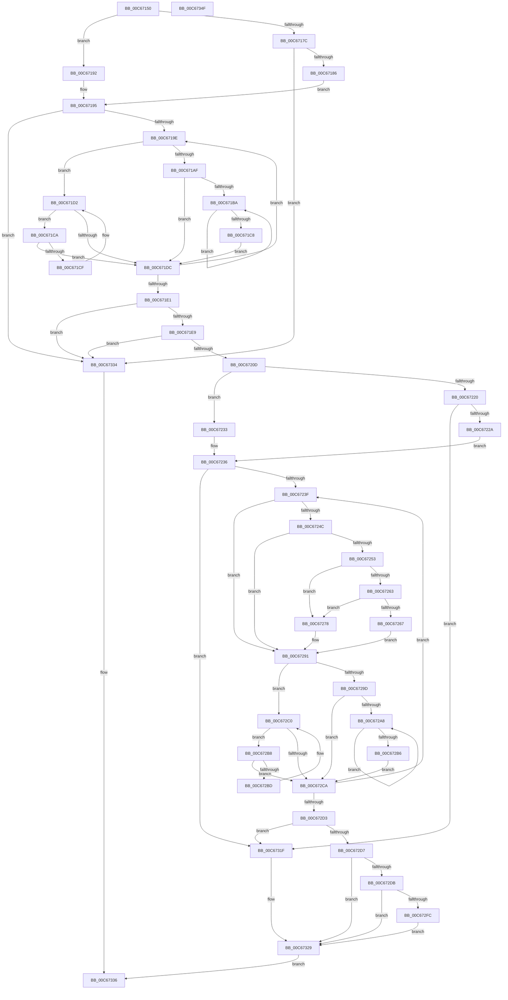

# MmInitializeMemoryLimits

- RVA: `0x00C67150`–`0x00C67350` (길이 `512` bytes)
- VA: `0x0000000140C67150`
- 실행 섹션: `INIT`
- PDB 이름 있음: `예`; PDB Function 태그: `아니요`
- unwind 정보 RVA: `0x00060300`
- 디코드: `157`개 명령, `512/512` bytes 표시
- 미해석 바이트: `0` (있으면 어셈블리에 `.byte`로 보존)

> 이 문서는 커널 이미지의 기계어와 PDB 기호를 분석해 생성했습니다. 4번과 5번은 함수 원형과 자료형을 바이너리 사용 방식에서 추정한 C 해석이며 원본 소스 복구 결과는 아닙니다.

## 1. Dependencies

- 직접 호출 지점: **4**; 고유 호출 대상: **3**
- 직접 호출자로 확인된 함수: **3**
- RIP 상대 이미지 참조: **0**

### Outgoing calls
- `0x00C671FC` → [MiAllocatePool](../../text/35/MiAllocatePool_function_0035B540.md) (function, `0x0035B540`)
- `0x00C672EF` → [MiAllocatePool](../../text/35/MiAllocatePool_function_0035B540.md) (function, `0x0035B540`)
- `0x00C6730B` → [memcpy](../../text/6C/memcpy_function_006C6840.md) (function, `0x006C6840`)
- `0x00C67315` → [ExFreePoolWithTag](../../poolcode/B8/ExFreePoolWithTag_function_00B82870.md) (function, `0x00B82870`)

### Direct callers
- [IopInitCrashDumpDuringSysInit](../C2/IopInitCrashDumpDuringSysInit_function_00C2CAE4.md) at `0x00C2CB7E`
- [IopInitializeResourceMap](../C3/IopInitializeResourceMap_function_00C33198.md) at `0x00C3328F`
- [IopInitializeResourceMap](../C3/IopInitializeResourceMap_function_00C33198.md) at `0x00C332DD`
- [MiInitializePhysicalMemoryBlocks](MiInitializePhysicalMemoryBlocks_function_00C60920.md) at `0x00C60976`

### Static image references
- 디코드된 RIP-relative 메모리 참조가 없습니다.

## 2. Other-region calls and transfers

- 다른 실행 섹션으로 향하는 call: **4**
  - `0x00C671FC` → [MiAllocatePool](../../text/35/MiAllocatePool_function_0035B540.md) (`INIT` → `.text`)
  - `0x00C672EF` → [MiAllocatePool](../../text/35/MiAllocatePool_function_0035B540.md) (`INIT` → `.text`)
  - `0x00C6730B` → [memcpy](../../text/6C/memcpy_function_006C6840.md) (`INIT` → `.text`)
  - `0x00C67315` → [ExFreePoolWithTag](../../poolcode/B8/ExFreePoolWithTag_function_00B82870.md) (`INIT` → `POOLCODE`)
- 별도 외부 분기/꼬리 이동을 확인하지 못했습니다.

## 3. Assembly (complete function range)

```asm
00C67150  48 89 5C 24 08                  mov qword ptr [rsp + 8], rbx
00C67155  48 89 6C 24 10                  mov qword ptr [rsp + 0x10], rbp
00C6715A  48 89 74 24 18                  mov qword ptr [rsp + 0x18], rsi
00C6715F  57                              push rdi
00C67160  41 56                           push r14
00C67162  41 57                           push r15
00C67164  48 83 EC 20                     sub rsp, 0x20
00C67168  48 8D 99 60 01 00 00            lea rbx, [rcx + 0x160]
00C6716F  33 ED                           xor ebp, ebp
00C67171  48 8B 43 08                     mov rax, qword ptr [rbx + 8]
00C67175  4C 8B FA                        mov r15, rdx
00C67178  A8 01                           test al, 1
00C6717A  74 16                           je 0x140c67192
00C6717C  48 83 F8 01                     cmp rax, 1
00C67180  0F 84 AE 01 00 00               je 0x140c67334
00C67186  48 8B CB                        mov rcx, rbx
00C67189  48 83 C9 01                     or rcx, 1
00C6718D  48 33 C8                        xor rcx, rax
00C67190  EB 03                           jmp 0x140c67195
00C67192  48 8B C8                        mov rcx, rax
00C67195  48 85 C9                        test rcx, rcx
00C67198  0F 84 96 01 00 00               je 0x140c67334
00C6719E  48 8B 41 08                     mov rax, qword ptr [rcx + 8]
00C671A2  48 8B D1                        mov rdx, rcx
00C671A5  44 8B C5                        mov r8d, ebp
00C671A8  FF C5                           inc ebp
00C671AA  48 85 C0                        test rax, rax
00C671AD  74 23                           je 0x140c671d2
00C671AF  48 8B 10                        mov rdx, qword ptr [rax]
00C671B2  48 8B C8                        mov rcx, rax
00C671B5  48 85 D2                        test rdx, rdx
00C671B8  74 22                           je 0x140c671dc
00C671BA  48 8B 02                        mov rax, qword ptr [rdx]
00C671BD  48 8B CA                        mov rcx, rdx
00C671C0  48 8B D0                        mov rdx, rax
00C671C3  48 85 C0                        test rax, rax
00C671C6  75 F2                           jne 0x140c671ba
00C671C8  EB 12                           jmp 0x140c671dc
00C671CA  48 39 11                        cmp qword ptr [rcx], rdx
00C671CD  74 0D                           je 0x140c671dc
00C671CF  48 8B D1                        mov rdx, rcx
00C671D2  48 8B 49 10                     mov rcx, qword ptr [rcx + 0x10]
00C671D6  48 83 E1 FC                     and rcx, 0xfffffffffffffffc
00C671DA  75 EE                           jne 0x140c671ca
00C671DC  48 85 C9                        test rcx, rcx
00C671DF  75 BD                           jne 0x140c6719e
00C671E1  85 ED                           test ebp, ebp
00C671E3  0F 84 4B 01 00 00               je 0x140c67334
00C671E9  49 8D 50 02                     lea rdx, [r8 + 2]
00C671ED  B9 40 00 00 00                  mov ecx, 0x40
00C671F2  48 C1 E2 04                     shl rdx, 4
00C671F6  41 B8 4D 6D 4D 6C               mov r8d, 0x6c4d6d4d
00C671FC  E8 3F 43 6F FF                  call 0x14035b540
00C67201  48 8B F8                        mov rdi, rax
00C67204  48 85 C0                        test rax, rax
00C67207  0F 84 27 01 00 00               je 0x140c67334
00C6720D  89 28                           mov dword ptr [rax], ebp
00C6720F  33 F6                           xor esi, esi
00C67211  48 8B 43 08                     mov rax, qword ptr [rbx + 8]
00C67215  45 33 F6                        xor r14d, r14d
00C67218  49 83 C9 FF                     or r9, 0xffffffffffffffff
00C6721C  A8 01                           test al, 1
00C6721E  74 13                           je 0x140c67233
00C67220  48 83 F8 01                     cmp rax, 1
00C67224  0F 84 F5 00 00 00               je 0x140c6731f
00C6722A  48 83 CB 01                     or rbx, 1
00C6722E  48 33 D8                        xor rbx, rax
00C67231  EB 03                           jmp 0x140c67236
00C67233  48 8B D8                        mov rbx, rax
00C67236  48 85 DB                        test rbx, rbx
00C67239  0F 84 E0 00 00 00               je 0x140c6731f
00C6723F  8B 43 18                        mov eax, dword ptr [rbx + 0x18]
00C67242  25 FF FF FF 1F                  and eax, 0x1fffffff
00C67247  83 F8 2F                        cmp eax, 0x2f
00C6724A  73 45                           jae 0x140c67291
00C6724C  42 80 3C 38 00                  cmp byte ptr [rax + r15], 0
00C67251  74 3E                           je 0x140c67291
00C67253  4C 8B 43 28                     mov r8, qword ptr [rbx + 0x28]
00C67257  48 8B 53 20                     mov rdx, qword ptr [rbx + 0x20]
00C6725B  4D 03 F0                        add r14, r8
00C6725E  49 3B D1                        cmp rdx, r9
00C67261  75 15                           jne 0x140c67278
00C67263  85 F6                           test esi, esi
00C67265  74 11                           je 0x140c67278
00C67267  8D 4E FF                        lea ecx, [rsi - 1]
00C6726A  48 03 C9                        add rcx, rcx
00C6726D  4C 01 44 CF 18                  add qword ptr [rdi + rcx*8 + 0x18], r8
00C67272  4C 03 4B 28                     add r9, qword ptr [rbx + 0x28]
00C67276  EB 19                           jmp 0x140c67291
00C67278  8B CE                           mov ecx, esi
00C6727A  48 03 C9                        add rcx, rcx
00C6727D  FF C6                           inc esi
00C6727F  48 89 54 CF 10                  mov qword ptr [rdi + rcx*8 + 0x10], rdx
00C67284  48 8B 43 28                     mov rax, qword ptr [rbx + 0x28]
00C67288  48 89 44 CF 18                  mov qword ptr [rdi + rcx*8 + 0x18], rax
00C6728D  4C 8D 0C 10                     lea r9, [rax + rdx]
00C67291  48 8B 43 08                     mov rax, qword ptr [rbx + 8]
00C67295  48 8B CB                        mov rcx, rbx
00C67298  48 85 C0                        test rax, rax
00C6729B  74 23                           je 0x140c672c0
00C6729D  48 8B 08                        mov rcx, qword ptr [rax]
00C672A0  48 8B D8                        mov rbx, rax
00C672A3  48 85 C9                        test rcx, rcx
00C672A6  74 22                           je 0x140c672ca
00C672A8  48 8B 01                        mov rax, qword ptr [rcx]
00C672AB  48 8B D9                        mov rbx, rcx
00C672AE  48 8B C8                        mov rcx, rax
00C672B1  48 85 C0                        test rax, rax
00C672B4  75 F2                           jne 0x140c672a8
00C672B6  EB 12                           jmp 0x140c672ca
00C672B8  48 39 0B                        cmp qword ptr [rbx], rcx
00C672BB  74 0D                           je 0x140c672ca
00C672BD  48 8B CB                        mov rcx, rbx
00C672C0  48 8B 5B 10                     mov rbx, qword ptr [rbx + 0x10]
00C672C4  48 83 E3 FC                     and rbx, 0xfffffffffffffffc
00C672C8  75 EE                           jne 0x140c672b8
00C672CA  48 85 DB                        test rbx, rbx
00C672CD  0F 85 6C FF FF FF               jne 0x140c6723f
00C672D3  85 F6                           test esi, esi
00C672D5  74 48                           je 0x140c6731f
00C672D7  3B EE                           cmp ebp, esi
00C672D9  76 4E                           jbe 0x140c67329
00C672DB  8D 56 FF                        lea edx, [rsi - 1]
00C672DE  41 B8 4D 6D 4D 6C               mov r8d, 0x6c4d6d4d
00C672E4  48 83 C2 02                     add rdx, 2
00C672E8  8D 4B 40                        lea ecx, [rbx + 0x40]
00C672EB  48 C1 E2 04                     shl rdx, 4
00C672EF  E8 4C 42 6F FF                  call 0x14035b540
00C672F4  48 8B D8                        mov rbx, rax
00C672F7  48 85 C0                        test rax, rax
00C672FA  74 2D                           je 0x140c67329
00C672FC  44 8B C6                        mov r8d, esi
00C672FF  48 8D 57 10                     lea rdx, [rdi + 0x10]
00C67303  49 C1 E0 04                     shl r8, 4
00C67307  48 8D 48 10                     lea rcx, [rax + 0x10]
00C6730B  E8 30 F5 A5 FF                  call 0x1406c6840
00C67310  33 D2                           xor edx, edx
00C67312  48 8B CF                        mov rcx, rdi
00C67315  E8 56 B5 F1 FF                  call 0x140b82870
00C6731A  48 8B FB                        mov rdi, rbx
00C6731D  EB 0A                           jmp 0x140c67329
00C6731F  48 83 67 10 00                  and qword ptr [rdi + 0x10], 0
00C67324  48 83 67 18 00                  and qword ptr [rdi + 0x18], 0
00C67329  89 37                           mov dword ptr [rdi], esi
00C6732B  48 8B C7                        mov rax, rdi
00C6732E  4C 89 77 08                     mov qword ptr [rdi + 8], r14
00C67332  EB 02                           jmp 0x140c67336
00C67334  33 C0                           xor eax, eax
00C67336  48 8B 5C 24 40                  mov rbx, qword ptr [rsp + 0x40]
00C6733B  48 8B 6C 24 48                  mov rbp, qword ptr [rsp + 0x48]
00C67340  48 8B 74 24 50                  mov rsi, qword ptr [rsp + 0x50]
00C67345  48 83 C4 20                     add rsp, 0x20
00C67349  41 5F                           pop r15
00C6734B  41 5E                           pop r14
00C6734D  5F                              pop rdi
00C6734E  C3                              ret
00C6734F  CC                              int3
```

## 4. C-style interpretation (structured pseudocode)

```c
__int64 __fastcall MmInitializeMemoryLimits(__int64 a1, __int64 a2, __int64 a3, __int64 a4)
{
    __int64 result;
    __int64 v_r14;
    __int64 v_rbp;
    __int64 v_rbx;
    __int64 v_rsi;
    __int64 v_rsp;
    unsigned __int64 v_stack_p10;
    unsigned __int64 v_stack_p18;
    unsigned __int64 v_stack_p8;

    v_stack_p8 = v_rbx;
    v_stack_p10 = v_rbp;
    v_stack_p18 = v_rsi;
    v_rsp = (v_rsp) - (32);
    v_rbp = 0;
    if ((((unsigned __int8)(*(unsigned __int64 *)(a1 + 352 + 8))) & (1)) == 0) goto loc_00C67192;
    if ((*(unsigned __int64 *)(a1 + 352 + 8)) == 1) goto loc_00C67334;
    a1 = (a1 + 352) | (1);
    a1 = (a1) ^ (*(unsigned __int64 *)(a1 + 352 + 8));
    goto loc_00C67195;
loc_00C67192:
loc_00C67195:
    if (*(unsigned __int64 *)(a1 + 352 + 8) == 0) goto loc_00C67334;
loc_00C6719E:
    v_rbp = (unsigned int)((v_rbp) + 1);
    if (*(unsigned __int64 *)(*(unsigned __int64 *)(a1 + 352 + 8) + 8) == 0) goto loc_00C671D2;
    if (*(unsigned __int64 *)(*(unsigned __int64 *)(*(unsigned __int64 *)(a1 + 352 + 8) + 8)) == 0) goto loc_00C671DC;
loc_00C671BA:
    if (*(unsigned __int64 *)(*(unsigned __int64 *)(*(unsigned __int64 *)(*(unsigned __int64 *)(a1 + 352 + 8) + 8))) != 0) goto loc_00C671BA;
    goto loc_00C671DC;
loc_00C671CA:
    if ((*(unsigned __int64 *)(*(unsigned __int64 *)(*(unsigned __int64 *)(*(unsigned __int64 *)(a1 + 352 + 8) + 8)))) == (*(unsigned __int64 *)(*(unsigned __int64 *)(*(unsigned __int64 *)(*(unsigned __int64 *)(a1 + 352 + 8) + 8))))) goto loc_00C671DC;
loc_00C671D2:
    a1 = (*(unsigned __int64 *)(*(unsigned __int64 *)(*(unsigned __int64 *)(*(unsigned __int64 *)(a1 + 352 + 8) + 8)) + 16)) & (-4);
    if (condition_is_not_equal) goto loc_00C671CA;
loc_00C671DC:
    if (a1 != 0) goto loc_00C6719E;
    if ((unsigned int)(v_rbp) == 0) goto loc_00C67334;
    a2 = (0 + 2) << (4);
    result = MiAllocatePool(64, a2, (unsigned int)(0x6C4D6D4DULL), a4);
    if (result == 0) goto loc_00C67334;
    *(unsigned int *)(result) = (unsigned int)(v_rbp);
    v_rsi = 0;
    v_r14 = 0;
    a4 = (a4) | (-1);
    if ((((unsigned __int8)(*(unsigned __int64 *)(a1 + 352 + 8))) & (1)) == 0) goto loc_00C67233;
    if ((*(unsigned __int64 *)(a1 + 352 + 8)) == 1) goto loc_00C6731F;
    v_rbx = (a1 + 352) | (1);
    v_rbx = (v_rbx) ^ (*(unsigned __int64 *)(a1 + 352 + 8));
    goto loc_00C67236;
loc_00C67233:
loc_00C67236:
    if (*(unsigned __int64 *)(a1 + 352 + 8) == 0) goto loc_00C6731F;
loc_00C6723F:
    result = (unsigned int)(((unsigned int)(*(unsigned int *)(*(unsigned __int64 *)(a1 + 352 + 8) + 24))) & (0x1FFFFFFFULL));
    if (((unsigned int)(result)) >= 47) goto loc_00C67291;
    if ((*(unsigned __int8 *)(result + a2 * 1)) == 0) goto loc_00C67291;
    v_r14 = (v_r14) + (*(unsigned __int64 *)(*(unsigned __int64 *)(a1 + 352 + 8) + 40));
    if ((*(unsigned __int64 *)(*(unsigned __int64 *)(a1 + 352 + 8) + 32)) != a4) goto loc_00C67278;
    if (0 == 0) goto loc_00C67278;
    a1 = (v_rsi - 1) + (v_rsi - 1);
    a4 = (a4) + (*(unsigned __int64 *)(*(unsigned __int64 *)(a1 + 352 + 8) + 40));
    goto loc_00C67291;
loc_00C67278:
    a1 = (0) + (0);
    v_rsi = (unsigned int)((v_rsi) + 1);
    *(unsigned __int64 *)(result + a1 * 8 + 16) = *(unsigned __int64 *)(*(unsigned __int64 *)(a1 + 352 + 8) + 32);
    *(unsigned __int64 *)(result + a1 * 8 + 24) = *(unsigned __int64 *)(*(unsigned __int64 *)(a1 + 352 + 8) + 40);
loc_00C67291:
    if (*(unsigned __int64 *)(*(unsigned __int64 *)(a1 + 352 + 8) + 8) == 0) goto loc_00C672C0;
    if (*(unsigned __int64 *)(*(unsigned __int64 *)(*(unsigned __int64 *)(a1 + 352 + 8) + 8)) == 0) goto loc_00C672CA;
loc_00C672A8:
    if (*(unsigned __int64 *)(*(unsigned __int64 *)(*(unsigned __int64 *)(*(unsigned __int64 *)(a1 + 352 + 8) + 8))) != 0) goto loc_00C672A8;
    goto loc_00C672CA;
loc_00C672B8:
    if ((*(unsigned __int64 *)(*(unsigned __int64 *)(*(unsigned __int64 *)(*(unsigned __int64 *)(a1 + 352 + 8) + 8)))) == (*(unsigned __int64 *)(*(unsigned __int64 *)(*(unsigned __int64 *)(*(unsigned __int64 *)(a1 + 352 + 8) + 8))))) goto loc_00C672CA;
loc_00C672C0:
    v_rbx = (*(unsigned __int64 *)(*(unsigned __int64 *)(*(unsigned __int64 *)(*(unsigned __int64 *)(a1 + 352 + 8) + 8)) + 16)) & (-4);
    if (condition_is_not_equal) goto loc_00C672B8;
loc_00C672CA:
    if (v_rbx != 0) goto loc_00C6723F;
    if ((unsigned int)(v_rsi) == 0) goto loc_00C6731F;
    if (((unsigned int)(v_rbp)) <= ((unsigned int)(v_rsi))) goto loc_00C67329;
    a2 = (v_rsi - 1) + (2);
    a2 = (a2) << (4);
    result = MiAllocatePool(v_rbx + 64, a2, (unsigned int)(0x6C4D6D4DULL), *(unsigned __int64 *)(*(unsigned __int64 *)(a1 + 352 + 8) + 40) + *(unsigned __int64 *)(*(unsigned __int64 *)(a1 + 352 + 8) + 32) * 1);
    if (result == 0) goto loc_00C67329;
    a3 = ((unsigned int)((unsigned int)(v_rsi))) << (4);
    result = memcpy(result + 16, result + 16, a3, *(unsigned __int64 *)(*(unsigned __int64 *)(a1 + 352 + 8) + 40) + *(unsigned __int64 *)(*(unsigned __int64 *)(a1 + 352 + 8) + 32) * 1);
    a2 = 0;
    result = ExFreePoolWithTag(result, a2, a3, *(unsigned __int64 *)(*(unsigned __int64 *)(a1 + 352 + 8) + 40) + *(unsigned __int64 *)(*(unsigned __int64 *)(a1 + 352 + 8) + 32) * 1);
    goto loc_00C67329;
loc_00C6731F:
loc_00C67329:
    *(unsigned int *)(result) = (unsigned int)(v_rsi);
    *(unsigned __int64 *)(result + 8) = v_r14;
    goto loc_00C67336;
loc_00C67334:
    result = 0;
loc_00C67336:
    v_rsp = (v_rsp) + (32);
    return result;
}
```

## 5. (Beta) C Style

```c
int64_t MmInitializeMemoryLimits(void *Arg1, int64_t Arg2, int64_t Arg3, int64_t Arg4)
{
    uint8_t *arg1 = (uint8_t *)Arg1;

    int64_t result;
    int64_t local_r14;
    int64_t local_rbp;
    int64_t local_rbx;
    int64_t local_rsi;
    int64_t local_rsp;
    uint64_t v_stack_p10;
    uint64_t v_stack_p18;
    uint64_t v_stack_p8;

    v_stack_p8 = local_rbx;
    v_stack_p10 = local_rbp;
    v_stack_p18 = local_rsi;
    local_rsp = (local_rsp) - (32);
    local_rbp = 0;
    if ((((uint8_t)(*(uint64_t *)(arg1 + 0x160 + 0x8))) & (1)) == 0) goto loc_00C67192;
    if ((*(uint64_t *)(arg1 + 0x160 + 0x8)) == 1) goto loc_00C67334;
    Arg1 = (Arg1 + 352) | (1);
    Arg1 = (Arg1) ^ (*(uint64_t *)(arg1 + 0x160 + 0x8));
    goto loc_00C67195;
loc_00C67192:
loc_00C67195:
    if (*(uint64_t *)(arg1 + 0x160 + 0x8) == 0) goto loc_00C67334;
loc_00C6719E:
    local_rbp = (uint32_t)((local_rbp) + 1);
    if (*(uint64_t *)(*(uint64_t *)(arg1 + 0x160 + 0x8) + 0x8) == 0) goto loc_00C671D2;
    if (*(uint64_t *)(*(uint64_t *)(*(uint64_t *)(arg1 + 0x160 + 0x8) + 0x8)) == 0) goto loc_00C671DC;
loc_00C671BA:
    if (*(uint64_t *)(*(uint64_t *)(*(uint64_t *)(*(uint64_t *)(arg1 + 0x160 + 0x8) + 0x8))) != 0) goto loc_00C671BA;
    goto loc_00C671DC;
loc_00C671CA:
    if ((*(uint64_t *)(*(uint64_t *)(*(uint64_t *)(*(uint64_t *)(arg1 + 0x160 + 0x8) + 0x8)))) == (*(uint64_t *)(*(uint64_t *)(*(uint64_t *)(*(uint64_t *)(arg1 + 0x160 + 0x8) + 0x8))))) goto loc_00C671DC;
loc_00C671D2:
    Arg1 = (*(uint64_t *)(*(uint64_t *)(*(uint64_t *)(*(uint64_t *)(arg1 + 0x160 + 0x8) + 0x8)) + 0x10)) & (-4);
    if (condition_is_not_equal) goto loc_00C671CA;
loc_00C671DC:
    if (Arg1 != NULL) goto loc_00C6719E;
    if ((uint32_t)(local_rbp) == 0) goto loc_00C67334;
    Arg2 = (0 + 2) << (4);
    result = MiAllocatePool(64, Arg2, (uint32_t)(0x6C4D6D4DULL), Arg4);
    if (result == 0) goto loc_00C67334;
    *(uint32_t *)(result) = (uint32_t)(local_rbp);
    local_rsi = 0;
    local_r14 = 0;
    Arg4 = (Arg4) | (-1);
    if ((((uint8_t)(*(uint64_t *)(arg1 + 0x160 + 0x8))) & (1)) == 0) goto loc_00C67233;
    if ((*(uint64_t *)(arg1 + 0x160 + 0x8)) == 1) goto loc_00C6731F;
    local_rbx = (Arg1 + 352) | (1);
    local_rbx = (local_rbx) ^ (*(uint64_t *)(arg1 + 0x160 + 0x8));
    goto loc_00C67236;
loc_00C67233:
loc_00C67236:
    if (*(uint64_t *)(arg1 + 0x160 + 0x8) == 0) goto loc_00C6731F;
loc_00C6723F:
    result = (uint32_t)(((uint32_t)(*(uint32_t *)(*(uint64_t *)(arg1 + 0x160 + 0x8) + 0x18))) & (0x1FFFFFFFULL));
    if (((uint32_t)(result)) >= 47) goto loc_00C67291;
    if ((*(uint8_t *)(result + Arg2 * 1)) == 0) goto loc_00C67291;
    local_r14 = (local_r14) + (*(uint64_t *)(*(uint64_t *)(arg1 + 0x160 + 0x8) + 0x28));
    if ((*(uint64_t *)(*(uint64_t *)(arg1 + 0x160 + 0x8) + 0x20)) != Arg4) goto loc_00C67278;
    if (0 == 0) goto loc_00C67278;
    Arg1 = (local_rsi - 1) + (local_rsi - 1);
    Arg4 = (Arg4) + (*(uint64_t *)(*(uint64_t *)(arg1 + 0x160 + 0x8) + 0x28));
    goto loc_00C67291;
loc_00C67278:
    Arg1 = (0) + (0);
    local_rsi = (uint32_t)((local_rsi) + 1);
    *(uint64_t *)(result + arg1 * 8 + 0x10) = *(uint64_t *)(*(uint64_t *)(arg1 + 0x160 + 0x8) + 0x20);
    *(uint64_t *)(result + arg1 * 8 + 0x18) = *(uint64_t *)(*(uint64_t *)(arg1 + 0x160 + 0x8) + 0x28);
loc_00C67291:
    if (*(uint64_t *)(*(uint64_t *)(arg1 + 0x160 + 0x8) + 0x8) == 0) goto loc_00C672C0;
    if (*(uint64_t *)(*(uint64_t *)(*(uint64_t *)(arg1 + 0x160 + 0x8) + 0x8)) == 0) goto loc_00C672CA;
loc_00C672A8:
    if (*(uint64_t *)(*(uint64_t *)(*(uint64_t *)(*(uint64_t *)(arg1 + 0x160 + 0x8) + 0x8))) != 0) goto loc_00C672A8;
    goto loc_00C672CA;
loc_00C672B8:
    if ((*(uint64_t *)(*(uint64_t *)(*(uint64_t *)(*(uint64_t *)(arg1 + 0x160 + 0x8) + 0x8)))) == (*(uint64_t *)(*(uint64_t *)(*(uint64_t *)(*(uint64_t *)(arg1 + 0x160 + 0x8) + 0x8))))) goto loc_00C672CA;
loc_00C672C0:
    local_rbx = (*(uint64_t *)(*(uint64_t *)(*(uint64_t *)(*(uint64_t *)(arg1 + 0x160 + 0x8) + 0x8)) + 0x10)) & (-4);
    if (condition_is_not_equal) goto loc_00C672B8;
loc_00C672CA:
    if (local_rbx != 0) goto loc_00C6723F;
    if ((uint32_t)(local_rsi) == 0) goto loc_00C6731F;
    if (((uint32_t)(local_rbp)) <= ((uint32_t)(local_rsi))) goto loc_00C67329;
    Arg2 = (local_rsi - 1) + (2);
    Arg2 = (Arg2) << (4);
    result = MiAllocatePool(local_rbx + 64, Arg2, (uint32_t)(0x6C4D6D4DULL), *(uint64_t *)(*(uint64_t *)(arg1 + 0x160 + 0x8) + 0x28) + *(uint64_t *)(*(uint64_t *)(arg1 + 0x160 + 0x8) + 0x20) * 1);
    if (result == 0) goto loc_00C67329;
    Arg3 = ((uint32_t)((uint32_t)(local_rsi))) << (4);
    result = memcpy(result + 16, result + 16, Arg3, *(uint64_t *)(*(uint64_t *)(arg1 + 0x160 + 0x8) + 0x28) + *(uint64_t *)(*(uint64_t *)(arg1 + 0x160 + 0x8) + 0x20) * 1);
    Arg2 = 0;
    result = ExFreePoolWithTag(result, Arg2, Arg3, *(uint64_t *)(*(uint64_t *)(arg1 + 0x160 + 0x8) + 0x28) + *(uint64_t *)(*(uint64_t *)(arg1 + 0x160 + 0x8) + 0x20) * 1);
    goto loc_00C67329;
loc_00C6731F:
loc_00C67329:
    *(uint32_t *)(result) = (uint32_t)(local_rsi);
    *(uint64_t *)(result + 0x8) = local_r14;
    goto loc_00C67336;
loc_00C67334:
    result = 0;
loc_00C67336:
    local_rsp = (local_rsp) + (32);
    return result;
}
```

### 관측된 메모리 오프셋

구조체 형식이 확인되지 않은 접근은 인자 기준의 오프셋으로만 기록했습니다.

| 기준 인자 | 오프셋 표현 | 폭 (bit) | 접근 |
|---|---:|---:|---|
| `Arg1` | `+ 0x8` | `64` | `R` |
| `Arg1` | `+ 0x160` | `64` | `R` |

## 6. Execution-region graph

[열기: 2D/3D 그래프와 함수 탐색 컨트롤 패널](../../../control-panel.html?section=init&rva=0x00C67150&view=graph)

- 2D 그래프는 위에서 아래로 흐르고, 3D 그래프는 빈 공간을 드래그해 회전합니다. Shift+드래그는 이동, 휠은 확대·축소, 함수 노드 선택은 대상 보고서 이동입니다.

### Static fallback


