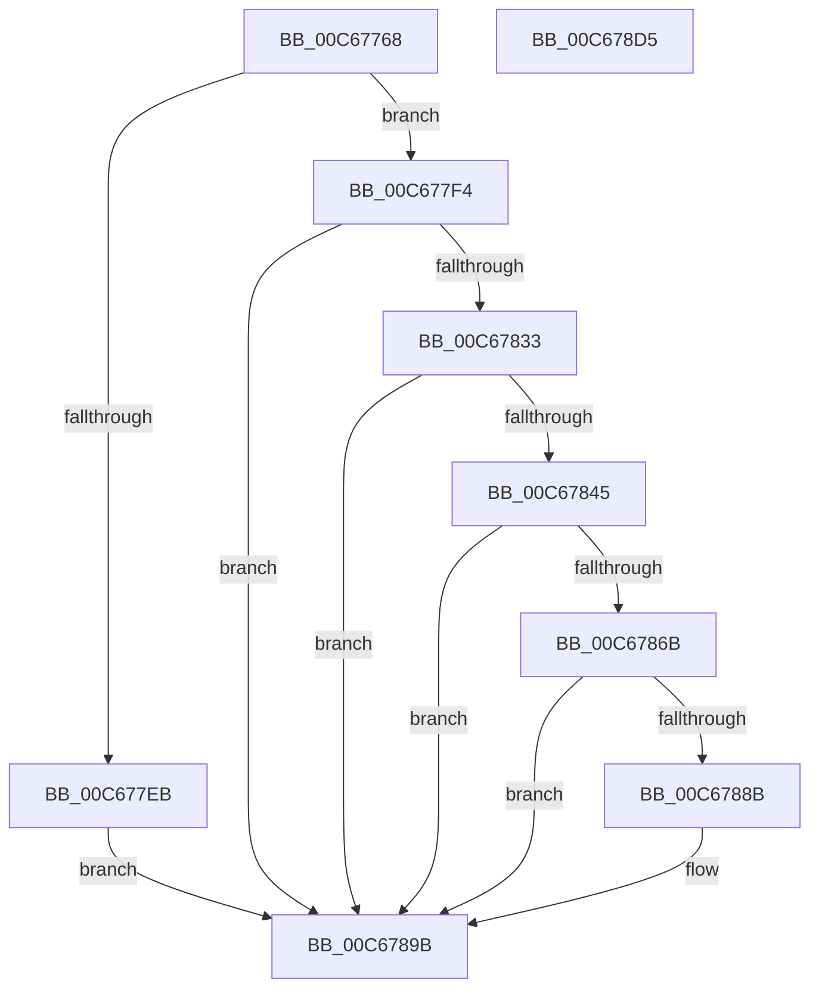

# MmReapplyBootPatchImports

- RVA: `0x00C67768`–`0x00C678D6` (길이 `366` bytes)
- VA: `0x0000000140C67768`
- 실행 섹션: `INIT`
- PDB 이름 있음: `예`; PDB Function 태그: `아니요`
- unwind 정보 RVA: `0x000D873C`
- 디코드: `104`개 명령, `366/366` bytes 표시
- 미해석 바이트: `0` (있으면 어셈블리에 `.byte`로 보존)

> 이 문서는 커널 이미지의 기계어와 PDB 기호를 분석해 생성했습니다. 4번과 5번은 함수 원형과 자료형을 바이너리 사용 방식에서 추정한 C 해석이며 원본 소스 복구 결과는 아닙니다.

## 1. Dependencies

- 직접 호출 지점: **17**; 고유 호출 대상: **10**
- 직접 호출자로 확인된 함수: **1**
- RIP 상대 이미지 참조: **0**

### Outgoing calls
- `0x00C67799` → [memset](../../text/6C/memset_function_006C6C40.md) (function, `0x006C6C40`)
- `0x00C677A7` → [memset](../../text/6C/memset_function_006C6C40.md) (function, `0x006C6C40`)
- `0x00C677B3` → [MiAcquireLoadLock](../../text/2A/MiAcquireLoadLock_function_002A3950.md) (function, `0x002A3950`)
- `0x00C677BE` → [MmFindDataTableEntryByAddress](../../text/2A/MmFindDataTableEntryByAddress_function_002A3C0C.md) (function, `0x002A3C0C`)
- `0x00C677CE` → [MiInitializeDriverPatchState](../../page/AB/MiInitializeDriverPatchState_function_00AB07A4.md) (function, `0x00AB07A4`)
- `0x00C677DA` → [MiInitializeDriverPatchState](../../page/AB/MiInitializeDriverPatchState_function_00AB07A4.md) (function, `0x00AB07A4`)
- `0x00C67803` → [MiInitializeDriverPatchState](../../page/AB/MiInitializeDriverPatchState_function_00AB07A4.md) (function, `0x00AB07A4`)
- `0x00C6780F` → [MiInitializeDriverPatchState](../../page/AB/MiInitializeDriverPatchState_function_00AB07A4.md) (function, `0x00AB07A4`)
- `0x00C67816` → [MiGetAnyMultiplexedVm](../../text/44/MiGetAnyMultiplexedVm_function_00448BD0.md) (function, `0x00448BD0`)
- `0x00C67826` → [MiPrepareDriverPatchState](../../page/7F/MiPrepareDriverPatchState_function_007F8C8C.md) (function, `0x007F8C8C`)
- `0x00C6783A` → [MiPrepareDriverPatchState](../../page/7F/MiPrepareDriverPatchState_function_007F8C8C.md) (function, `0x007F8C8C`)
- `0x00C67860` → [MiLockDriverPageRange](../../text/67/MiLockDriverPageRange_function_00670160.md) (function, `0x00670160`)
- `0x00C67880` → [MiLockDriverPageRange](../../text/67/MiLockDriverPageRange_function_00670160.md) (function, `0x00670160`)
- `0x00C6788F` → [VslReapplyBootIndirectPatches](../C2/VslReapplyBootIndirectPatches_function_00C29D68.md) (function, `0x00C29D68`)
- `0x00C6789E` → [MmReleaseLoadLock](../../text/4D/MmReleaseLoadLock_function_004D36D0.md) (function, `0x004D36D0`)
- `0x00C678A8` → [MiUnlockDriverPages](../../page/A4/MiUnlockDriverPages_function_00A4BA6C.md) (function, `0x00A4BA6C`)
- `0x00C678B1` → [MiUnlockDriverPages](../../page/A4/MiUnlockDriverPages_function_00A4BA6C.md) (function, `0x00A4BA6C`)

### Direct callers
- [IopInitializeBuiltinDriver](../C7/IopInitializeBuiltinDriver_function_00C7625C.md) at `0x00C7663F`

### Static image references
- 디코드된 RIP-relative 메모리 참조가 없습니다.

## 2. Other-region calls and transfers

- 다른 실행 섹션으로 향하는 call: **16**
  - `0x00C67799` → [memset](../../text/6C/memset_function_006C6C40.md) (`INIT` → `.text`)
  - `0x00C677A7` → [memset](../../text/6C/memset_function_006C6C40.md) (`INIT` → `.text`)
  - `0x00C677B3` → [MiAcquireLoadLock](../../text/2A/MiAcquireLoadLock_function_002A3950.md) (`INIT` → `.text`)
  - `0x00C677BE` → [MmFindDataTableEntryByAddress](../../text/2A/MmFindDataTableEntryByAddress_function_002A3C0C.md) (`INIT` → `.text`)
  - `0x00C677CE` → [MiInitializeDriverPatchState](../../page/AB/MiInitializeDriverPatchState_function_00AB07A4.md) (`INIT` → `PAGE`)
  - `0x00C677DA` → [MiInitializeDriverPatchState](../../page/AB/MiInitializeDriverPatchState_function_00AB07A4.md) (`INIT` → `PAGE`)
  - `0x00C67803` → [MiInitializeDriverPatchState](../../page/AB/MiInitializeDriverPatchState_function_00AB07A4.md) (`INIT` → `PAGE`)
  - `0x00C6780F` → [MiInitializeDriverPatchState](../../page/AB/MiInitializeDriverPatchState_function_00AB07A4.md) (`INIT` → `PAGE`)
  - `0x00C67816` → [MiGetAnyMultiplexedVm](../../text/44/MiGetAnyMultiplexedVm_function_00448BD0.md) (`INIT` → `.text`)
  - `0x00C67826` → [MiPrepareDriverPatchState](../../page/7F/MiPrepareDriverPatchState_function_007F8C8C.md) (`INIT` → `PAGE`)
  - `0x00C6783A` → [MiPrepareDriverPatchState](../../page/7F/MiPrepareDriverPatchState_function_007F8C8C.md) (`INIT` → `PAGE`)
  - `0x00C67860` → [MiLockDriverPageRange](../../text/67/MiLockDriverPageRange_function_00670160.md) (`INIT` → `.text`)
  - `0x00C67880` → [MiLockDriverPageRange](../../text/67/MiLockDriverPageRange_function_00670160.md) (`INIT` → `.text`)
  - `0x00C6789E` → [MmReleaseLoadLock](../../text/4D/MmReleaseLoadLock_function_004D36D0.md) (`INIT` → `.text`)
  - `0x00C678A8` → [MiUnlockDriverPages](../../page/A4/MiUnlockDriverPages_function_00A4BA6C.md) (`INIT` → `PAGE`)
  - `0x00C678B1` → [MiUnlockDriverPages](../../page/A4/MiUnlockDriverPages_function_00A4BA6C.md) (`INIT` → `PAGE`)
- 별도 외부 분기/꼬리 이동을 확인하지 못했습니다.

## 3. Assembly (complete function range)

```asm
00C67768  48 8B C4                        mov rax, rsp
00C6776B  48 89 58 08                     mov qword ptr [rax + 8], rbx
00C6776F  48 89 70 10                     mov qword ptr [rax + 0x10], rsi
00C67773  48 89 78 18                     mov qword ptr [rax + 0x18], rdi
00C67777  55                              push rbp
00C67778  41 56                           push r14
00C6777A  41 57                           push r15
00C6777C  48 8D 68 D8                     lea rbp, [rax - 0x28]
00C67780  48 81 EC 10 01 00 00            sub rsp, 0x110
00C67787  48 8B D9                        mov rbx, rcx
00C6778A  BF 68 00 00 00                  mov edi, 0x68
00C6778F  44 8B C7                        mov r8d, edi
00C67792  48 8D 4C 24 30                  lea rcx, [rsp + 0x30]
00C67797  33 D2                           xor edx, edx
00C67799  E8 A2 F4 A5 FF                  call 0x1406c6c40
00C6779E  44 8B C7                        mov r8d, edi
00C677A1  48 8D 4D A0                     lea rcx, [rbp - 0x60]
00C677A5  33 D2                           xor edx, edx
00C677A7  E8 94 F4 A5 FF                  call 0x1406c6c40
00C677AC  BF 01 00 00 00                  mov edi, 1
00C677B1  8B CF                           mov ecx, edi
00C677B3  E8 98 C1 63 FF                  call 0x1402a3950
00C677B8  48 8B CB                        mov rcx, rbx
00C677BB  4C 8B F8                        mov r15, rax
00C677BE  E8 49 C4 63 FF                  call 0x1402a3c0c
00C677C3  48 8D 54 24 30                  lea rdx, [rsp + 0x30]
00C677C8  48 8B C8                        mov rcx, rax
00C677CB  48 8B F0                        mov rsi, rax
00C677CE  E8 D1 8F E4 FF                  call 0x140ab07a4
00C677D3  48 8D 55 A0                     lea rdx, [rbp - 0x60]
00C677D7  48 8B CE                        mov rcx, rsi
00C677DA  E8 C5 8F E4 FF                  call 0x140ab07a4
00C677DF  48 8D 8E 00 01 00 00            lea rcx, [rsi + 0x100]
00C677E6  48 39 09                        cmp qword ptr [rcx], rcx
00C677E9  75 09                           jne 0x140c677f4
00C677EB  33 FF                           xor edi, edi
00C677ED  8B DF                           mov ebx, edi
00C677EF  E9 A7 00 00 00                  jmp 0x140c6789b
00C677F4  48 8B 9E F8 00 00 00            mov rbx, qword ptr [rsi + 0xf8]
00C677FB  48 8D 54 24 30                  lea rdx, [rsp + 0x30]
00C67800  48 8B CE                        mov rcx, rsi
00C67803  E8 9C 8F E4 FF                  call 0x140ab07a4
00C67808  48 8D 55 A0                     lea rdx, [rbp - 0x60]
00C6780C  48 8B CB                        mov rcx, rbx
00C6780F  E8 90 8F E4 FF                  call 0x140ab07a4
00C67814  8B CF                           mov ecx, edi
00C67816  E8 B5 13 7E FF                  call 0x140448bd0
00C6781B  48 8B D0                        mov rdx, rax
00C6781E  48 8D 4C 24 30                  lea rcx, [rsp + 0x30]
00C67823  4C 8B F0                        mov r14, rax
00C67826  E8 61 14 B9 FF                  call 0x1407f8c8c
00C6782B  33 FF                           xor edi, edi
00C6782D  8B D8                           mov ebx, eax
00C6782F  85 C0                           test eax, eax
00C67831  78 68                           js 0x140c6789b
00C67833  49 8B D6                        mov rdx, r14
00C67836  48 8D 4D A0                     lea rcx, [rbp - 0x60]
00C6783A  E8 4D 14 B9 FF                  call 0x1407f8c8c
00C6783F  8B D8                           mov ebx, eax
00C67841  85 C0                           test eax, eax
00C67843  78 56                           js 0x140c6789b
00C67845  44 8B 44 24 48                  mov r8d, dword ptr [rsp + 0x48]
00C6784A  44 8D 77 03                     lea r14d, [rdi + 3]
00C6784E  41 FF C8                        dec r8d
00C67851  48 89 7C 24 20                  mov qword ptr [rsp + 0x20], rdi
00C67856  45 8B CE                        mov r9d, r14d
00C67859  48 8D 4C 24 30                  lea rcx, [rsp + 0x30]
00C6785E  33 D2                           xor edx, edx
00C67860  E8 FB 88 A0 FF                  call 0x140670160
00C67865  8B D8                           mov ebx, eax
00C67867  85 C0                           test eax, eax
00C67869  78 30                           js 0x140c6789b
00C6786B  44 8B 45 B8                     mov r8d, dword ptr [rbp - 0x48]
00C6786F  48 8D 4D A0                     lea rcx, [rbp - 0x60]
00C67873  41 FF C8                        dec r8d
00C67876  48 89 7C 24 20                  mov qword ptr [rsp + 0x20], rdi
00C6787B  45 8B CE                        mov r9d, r14d
00C6787E  33 D2                           xor edx, edx
00C67880  E8 DB 88 A0 FF                  call 0x140670160
00C67885  8B D8                           mov ebx, eax
00C67887  85 C0                           test eax, eax
00C67889  78 10                           js 0x140c6789b
00C6788B  48 8B 4E 30                     mov rcx, qword ptr [rsi + 0x30]
00C6788F  E8 D4 24 FC FF                  call 0x140c29d68
00C67894  85 C0                           test eax, eax
00C67896  8B D8                           mov ebx, eax
00C67898  0F 49 DF                        cmovns ebx, edi
00C6789B  49 8B CF                        mov rcx, r15
00C6789E  E8 2D BE 86 FF                  call 0x1404d36d0
00C678A3  48 8D 4C 24 30                  lea rcx, [rsp + 0x30]
00C678A8  E8 BF 41 DE FF                  call 0x140a4ba6c
00C678AD  48 8D 4D A0                     lea rcx, [rbp - 0x60]
00C678B1  E8 B6 41 DE FF                  call 0x140a4ba6c
00C678B6  4C 8D 9C 24 10 01 00 00         lea r11, [rsp + 0x110]
00C678BE  8B C3                           mov eax, ebx
00C678C0  49 8B 5B 20                     mov rbx, qword ptr [r11 + 0x20]
00C678C4  49 8B 73 28                     mov rsi, qword ptr [r11 + 0x28]
00C678C8  49 8B 7B 30                     mov rdi, qword ptr [r11 + 0x30]
00C678CC  49 8B E3                        mov rsp, r11
00C678CF  41 5F                           pop r15
00C678D1  41 5E                           pop r14
00C678D3  5D                              pop rbp
00C678D4  C3                              ret
00C678D5  CC                              int3
```

## 4. C-style interpretation (structured pseudocode)

```c
__int64 __fastcall MmReapplyBootPatchImports(__int64 a1, int a2)
{
    __int64 result;
    __int64 v_rbx;
    __int64 v_rdi;
    __int64 v_rsp;
    unsigned __int64 v_stack_m108;
    unsigned __int64 v_stack_m18;
    unsigned int v_stack_mE0;
    unsigned __int64 v_stack_mF8;

    *(unsigned __int64 *)(v_rsp + 8) = v_rbx;
    *(unsigned __int64 *)(v_rsp + 16) = v_rsi;
    *(unsigned __int64 *)(v_rsp + 24) = v_rdi;
    v_rsp = (v_rsp) - (272);
    a2 = 0;
    result = memset(v_stack_mF8, a2, 104, a4);
    a2 = 0;
    result = memset(v_rsp - 40 - 96, a2, 104, a4);
    result = MiAcquireLoadLock(1, a2, 104, a4);
    result = MmFindDataTableEntryByAddress(a1, a2, 104, a4);
    result = MiInitializeDriverPatchState(result, v_stack_mF8, 104, a4);
    result = MiInitializeDriverPatchState(result, v_rsp - 40 - 96, 104, a4);
    if ((*(unsigned __int64 *)(result + 256)) != (result + 256)) goto loc_00C677F4;
    v_rdi = 0;
    goto loc_00C6789B;
loc_00C677F4:
    result = MiInitializeDriverPatchState(result, v_stack_mF8, 104, a4);
    result = MiInitializeDriverPatchState(*(unsigned __int64 *)(result + 248), v_rsp - 40 - 96, 104, a4);
    result = MiGetAnyMultiplexedVm(0, v_rsp - 40 - 96, 104, a4);
    result = MiPrepareDriverPatchState(v_stack_mF8, result, 104, a4);
    v_rdi = 0;
    if (sign_flag) goto loc_00C6789B;
    result = MiPrepareDriverPatchState(v_rsp - 40 - 96, result, 104, a4);
    if (sign_flag) goto loc_00C6789B;
    a3 = (unsigned int)(((unsigned int)(v_stack_mE0)) - 1);
    v_stack_m108 = 0;
    a2 = 0;
    result = MiLockDriverPageRange(v_stack_mF8, a2, a3, (unsigned int)((unsigned int)(v_rdi + 3)));
    if (sign_flag) goto loc_00C6789B;
    a3 = (unsigned int)(((unsigned int)(*(unsigned int *)(v_rsp - 40 - 72))) - 1);
    v_stack_m108 = 0;
    a2 = 0;
    result = MiLockDriverPageRange(v_rsp - 40 - 96, a2, a3, (unsigned int)((unsigned int)(v_rdi + 3)));
    v_rbx = (unsigned int)((unsigned int)(result));
    if (!(sign_flag)) {
        a1 = *(unsigned __int64 *)(result + 48);
        result = VslReapplyBootIndirectPatches(a1, a2, a3, (unsigned int)((unsigned int)(v_rdi + 3)));
        v_rbx = (unsigned int)(result);
        if (!sign_flag) { v_rbx = 0; }
    }
    result = MmReleaseLoadLock(result, a2, a3, (unsigned int)((unsigned int)(v_rdi + 3)));
    result = MiUnlockDriverPages(v_stack_mF8, a2, a3, (unsigned int)((unsigned int)(v_rdi + 3)));
    result = MiUnlockDriverPages(v_rsp - 40 - 96, a2, a3, (unsigned int)((unsigned int)(v_rdi + 3)));
    return (unsigned int)((unsigned int)(v_rbx));
}
```

## 5. (Beta) C Style

```c
int64_t MmReapplyBootPatchImports(int64_t Arg1, int32_t Arg2)
{
    int64_t result;
    int64_t local_rbx;
    int64_t local_rdi;
    int64_t local_rsp;
    uint64_t v_stack_m108;
    uint64_t v_stack_m18;
    uint32_t v_stack_mE0;
    uint64_t v_stack_mF8;

    *(uint64_t *)(local_rsp + 0x8) = local_rbx;
    *(uint64_t *)(local_rsp + 0x10) = local_rsi;
    *(uint64_t *)(local_rsp + 0x18) = local_rdi;
    local_rsp = (local_rsp) - (272);
    Arg2 = 0;
    result = memset(v_stack_mF8, Arg2, 104, a4);
    Arg2 = 0;
    result = memset(local_rsp - 40 - 96, Arg2, 104, a4);
    result = MiAcquireLoadLock(1, Arg2, 104, a4);
    result = MmFindDataTableEntryByAddress(Arg1, Arg2, 104, a4);
    result = MiInitializeDriverPatchState(result, v_stack_mF8, 104, a4);
    result = MiInitializeDriverPatchState(result, local_rsp - 40 - 96, 104, a4);
    if ((*(uint64_t *)(result + 0x100)) != (result + 256)) goto loc_00C677F4;
    local_rdi = 0;
    goto loc_00C6789B;
loc_00C677F4:
    result = MiInitializeDriverPatchState(result, v_stack_mF8, 104, a4);
    result = MiInitializeDriverPatchState(*(uint64_t *)(result + 0xF8), local_rsp - 40 - 96, 104, a4);
    result = MiGetAnyMultiplexedVm(0, local_rsp - 40 - 96, 104, a4);
    result = MiPrepareDriverPatchState(v_stack_mF8, result, 104, a4);
    local_rdi = 0;
    if (sign_flag) goto loc_00C6789B;
    result = MiPrepareDriverPatchState(local_rsp - 40 - 96, result, 104, a4);
    if (sign_flag) goto loc_00C6789B;
    a3 = (uint32_t)(((uint32_t)(v_stack_mE0)) - 1);
    v_stack_m108 = 0;
    Arg2 = 0;
    result = MiLockDriverPageRange(v_stack_mF8, Arg2, a3, (uint32_t)((uint32_t)(local_rdi + 3)));
    if (sign_flag) goto loc_00C6789B;
    a3 = (uint32_t)(((uint32_t)(*(uint32_t *)(local_rsp - 0x28 - 0x48))) - 1);
    v_stack_m108 = 0;
    Arg2 = 0;
    result = MiLockDriverPageRange(local_rsp - 40 - 96, Arg2, a3, (uint32_t)((uint32_t)(local_rdi + 3)));
    local_rbx = (uint32_t)((uint32_t)(result));
    if (!(sign_flag)) {
        Arg1 = *(uint64_t *)(result + 0x30);
        result = VslReapplyBootIndirectPatches(Arg1, Arg2, a3, (uint32_t)((uint32_t)(local_rdi + 3)));
        local_rbx = (uint32_t)(result);
        if (!sign_flag) { local_rbx = 0; }
    }
    result = MmReleaseLoadLock(result, Arg2, a3, (uint32_t)((uint32_t)(local_rdi + 3)));
    result = MiUnlockDriverPages(v_stack_mF8, Arg2, a3, (uint32_t)((uint32_t)(local_rdi + 3)));
    result = MiUnlockDriverPages(local_rsp - 40 - 96, Arg2, a3, (uint32_t)((uint32_t)(local_rdi + 3)));
    return (uint32_t)((uint32_t)(local_rbx));
}
```

## 6. Execution-region graph

[열기: 2D/3D 그래프와 함수 탐색 컨트롤 패널](../../../control-panel.html?section=init&rva=0x00C67768&view=graph)

- 2D 그래프는 위에서 아래로 흐르고, 3D 그래프는 빈 공간을 드래그해 회전합니다. Shift+드래그는 이동, 휠은 확대·축소, 함수 노드 선택은 대상 보고서 이동입니다.

### Static fallback


