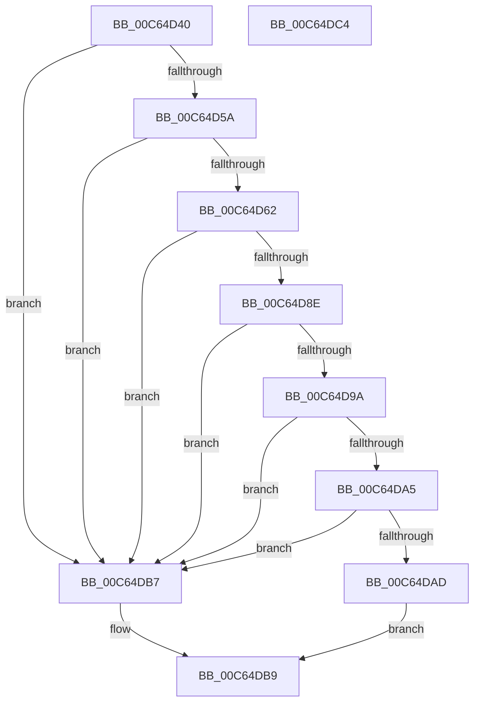

# MmTriageActiveInLastCrash

- RVA: `0x00C64D40`–`0x00C64DC5` (길이 `133` bytes)
- VA: `0x0000000140C64D40`
- 실행 섹션: `INIT`
- PDB 이름 있음: `예`; PDB Function 태그: `아니요`
- unwind 정보 RVA: `0x0008C33C`
- 디코드: `42`개 명령, `133/133` bytes 표시
- 미해석 바이트: `0` (있으면 어셈블리에 `.byte`로 보존)

> 이 문서는 커널 이미지의 기계어와 PDB 기호를 분석해 생성했습니다. 4번과 5번은 함수 원형과 자료형을 바이너리 사용 방식에서 추정한 C 해석이며 원본 소스 복구 결과는 아닙니다.

## 1. Dependencies

- 직접 호출 지점: **2**; 고유 호출 대상: **2**
- 직접 호출자로 확인된 함수: **1**
- RIP 상대 이미지 참조: **1**

### Outgoing calls
- `0x00C64D85` → [TriageGetBugcheckData](TriageGetBugcheckData_function_00C6F98C.md) (function, `0x00C6F98C`)
- `0x00C64D91` → [TriagepVerifyDump](TriagepVerifyDump_function_00C6FA80.md) (function, `0x00C6FA80`)

### Direct callers
- [VfTriageSystem](../C4/VfTriageSystem_function_00C4CB34.md) at `0x00C4CCEA`

### Static image references
- `0x00C64D9A` → RVA `0x00E0F1B0` (`.data`; read)

## 2. Other-region calls and transfers

- 다른 실행 섹션으로 향하는 call: **0**
- 별도 외부 분기/꼬리 이동을 확인하지 못했습니다.

## 3. Assembly (complete function range)

```asm
00C64D40  4C 8B DC                        mov r11, rsp
00C64D43  49 89 5B 08                     mov qword ptr [r11 + 8], rbx
00C64D47  57                              push rdi
00C64D48  48 83 EC 60                     sub rsp, 0x60
00C64D4C  48 8B 81 F0 00 00 00            mov rax, qword ptr [rcx + 0xf0]
00C64D53  33 DB                           xor ebx, ebx
00C64D55  48 85 C0                        test rax, rax
00C64D58  74 5D                           je 0x140c64db7
00C64D5A  81 38 30 11 00 00               cmp dword ptr [rax], 0x1130
00C64D60  72 55                           jb 0x140c64db7
00C64D62  48 8B 78 28                     mov rdi, qword ptr [rax + 0x28]
00C64D66  4D 8D 4B D8                     lea r9, [r11 - 0x28]
00C64D6A  49 8D 43 E8                     lea rax, [r11 - 0x18]
00C64D6E  48 8B CF                        mov rcx, rdi
00C64D71  49 89 43 C0                     mov qword ptr [r11 - 0x40], rax
00C64D75  4D 8D 43 D0                     lea r8, [r11 - 0x30]
00C64D79  49 8D 43 E0                     lea rax, [r11 - 0x20]
00C64D7D  49 8D 53 C8                     lea rdx, [r11 - 0x38]
00C64D81  49 89 43 B8                     mov qword ptr [r11 - 0x48], rax
00C64D85  E8 02 AC 00 00                  call 0x140c6f98c
00C64D8A  85 C0                           test eax, eax
00C64D8C  78 29                           js 0x140c64db7
00C64D8E  48 8B CF                        mov rcx, rdi
00C64D91  E8 EA AC 00 00                  call 0x140c6fa80
00C64D96  84 C0                           test al, al
00C64D98  74 1D                           je 0x140c64db7
00C64D9A  8B 05 10 A4 1A 00               mov eax, dword ptr [rip + 0x1aa410]
00C64DA0  48 03 C7                        add rax, rdi
00C64DA3  74 12                           je 0x140c64db7
00C64DA5  8B 48 14                        mov ecx, dword ptr [rax + 0x14]
00C64DA8  48 03 CF                        add rcx, rdi
00C64DAB  74 0A                           je 0x140c64db7
00C64DAD  39 59 0C                        cmp dword ptr [rcx + 0xc], ebx
00C64DB0  0F 95 C3                        setne bl
00C64DB3  8B C3                           mov eax, ebx
00C64DB5  EB 02                           jmp 0x140c64db9
00C64DB7  33 C0                           xor eax, eax
00C64DB9  48 8B 5C 24 70                  mov rbx, qword ptr [rsp + 0x70]
00C64DBE  48 83 C4 60                     add rsp, 0x60
00C64DC2  5F                              pop rdi
00C64DC3  C3                              ret
00C64DC4  CC                              int3
```

## 4. C-style interpretation (structured pseudocode)

```c
__int64 __fastcall MmTriageActiveInLastCrash(__int64 a1)
{
    __int64 result;
    __int64 v_rbx;
    __int64 v_rsp;
    unsigned __int64 v_stack_p8;

    *(unsigned __int64 *)(v_rsp + 8) = v_rbx;
    v_rsp = (v_rsp) - (96);
    v_rbx = 0;
    if (*(unsigned __int64 *)(a1 + 240) == 0) goto loc_00C64DB7;
    if ((*(unsigned int *)(*(unsigned __int64 *)(a1 + 240))) < 0x1130ULL) goto loc_00C64DB7;
    *(unsigned __int64 *)(v_rsp - 64) = v_rsp - 24;
    *(unsigned __int64 *)(v_rsp - 72) = v_rsp - 32;
    result = TriageGetBugcheckData(*(unsigned __int64 *)(*(unsigned __int64 *)(a1 + 240) + 40), v_rsp - 56, v_rsp - 48, v_rsp - 40);
    if (sign_flag) goto loc_00C64DB7;
    result = TriagepVerifyDump(*(unsigned __int64 *)(*(unsigned __int64 *)(a1 + 240) + 40), v_rsp - 56, v_rsp - 48, v_rsp - 40);
    if ((unsigned __int8)(result) == 0) goto loc_00C64DB7;
    result = ((unsigned int)(*(unsigned int *)(v_rip + 1745936))) + (*(unsigned __int64 *)(*(unsigned __int64 *)(a1 + 240) + 40));
    if (condition_is_equal) goto loc_00C64DB7;
    a1 = ((unsigned int)(*(unsigned int *)(result + 20))) + (*(unsigned __int64 *)(*(unsigned __int64 *)(a1 + 240) + 40));
    if (condition_is_equal) goto loc_00C64DB7;
    v_rbx = ((*(unsigned int *)(a1 + 12)) != 0) ? 1 : 0;
    goto loc_00C64DB9;
loc_00C64DB7:
    result = 0;
loc_00C64DB9:
    v_rsp = (v_rsp) + (96);
    return result;
}
```

## 5. (Beta) C Style

```c
int64_t MmTriageActiveInLastCrash(void *Arg1)
{
    uint8_t *arg1 = (uint8_t *)Arg1;

    int64_t result;
    int64_t local_rbx;
    int64_t local_rsp;
    uint64_t v_stack_p8;

    *(uint64_t *)(local_rsp + 0x8) = local_rbx;
    local_rsp = (local_rsp) - (96);
    local_rbx = 0;
    if (*(uint64_t *)(arg1 + 0xF0) == 0) goto loc_00C64DB7;
    if ((*(uint32_t *)(*(uint64_t *)(arg1 + 0xF0))) < 0x1130ULL) goto loc_00C64DB7;
    *(uint64_t *)(local_rsp - 0x40) = local_rsp - 24;
    *(uint64_t *)(local_rsp - 0x48) = local_rsp - 32;
    result = TriageGetBugcheckData(*(uint64_t *)(*(uint64_t *)(arg1 + 0xF0) + 0x28), local_rsp - 56, local_rsp - 48, local_rsp - 40);
    if (sign_flag) goto loc_00C64DB7;
    result = TriagepVerifyDump(*(uint64_t *)(*(uint64_t *)(arg1 + 0xF0) + 0x28), local_rsp - 56, local_rsp - 48, local_rsp - 40);
    if ((uint8_t)(result) == 0) goto loc_00C64DB7;
    result = ((uint32_t)(*(uint32_t *)(v_rip + 0x1AA410))) + (*(uint64_t *)(*(uint64_t *)(arg1 + 0xF0) + 0x28));
    if (condition_is_equal) goto loc_00C64DB7;
    Arg1 = ((uint32_t)(*(uint32_t *)(result + 0x14))) + (*(uint64_t *)(*(uint64_t *)(arg1 + 0xF0) + 0x28));
    if (condition_is_equal) goto loc_00C64DB7;
    local_rbx = ((*(uint32_t *)(arg1 + 0xC)) != 0) ? 1 : 0;
    goto loc_00C64DB9;
loc_00C64DB7:
    result = 0;
loc_00C64DB9:
    local_rsp = (local_rsp) + (96);
    return result;
}
```

### 관측된 메모리 오프셋

구조체 형식이 확인되지 않은 접근은 인자 기준의 오프셋으로만 기록했습니다.

| 기준 인자 | 오프셋 표현 | 폭 (bit) | 접근 |
|---|---:|---:|---|
| `Arg1` | `+ 0xF0` | `64` | `R` |

## 6. Execution-region graph

[열기: 2D/3D 그래프와 함수 탐색 컨트롤 패널](../../../control-panel.html?section=init&rva=0x00C64D40&view=graph)

- 2D 그래프는 위에서 아래로 흐르고, 3D 그래프는 빈 공간을 드래그해 회전합니다. Shift+드래그는 이동, 휠은 확대·축소, 함수 노드 선택은 대상 보고서 이동입니다.

### Static fallback


