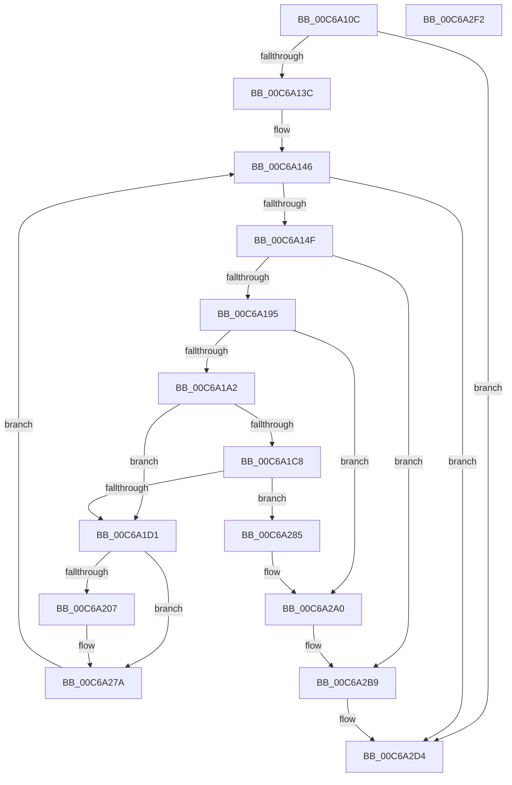

# MmUpdateSlabRangeType

- RVA: `0x00C6A10C`–`0x00C6A2F3` (길이 `487` bytes)
- VA: `0x0000000140C6A10C`
- 실행 섹션: `INIT`
- PDB 이름 있음: `예`; PDB Function 태그: `아니요`
- unwind 정보 RVA: `0x000AC264`
- 디코드: `117`개 명령, `487/487` bytes 표시
- 미해석 바이트: `0` (있으면 어셈블리에 `.byte`로 보존)

> 이 문서는 커널 이미지의 기계어와 PDB 기호를 분석해 생성했습니다. 4번과 5번은 함수 원형과 자료형을 바이너리 사용 방식에서 추정한 C 해석이며 원본 소스 복구 결과는 아닙니다.

## 1. Dependencies

- 직접 호출 지점: **10**; 고유 호출 대상: **8**
- 직접 호출자로 확인된 함수: **1**
- RIP 상대 이미지 참조: **5**

### Outgoing calls
- `0x00C6A152` → [MiPageToNode](../../text/33/MiPageToNode_function_00338CD0.md) (function, `0x00338CD0`)
- `0x00C6A182` → [MiEnumerateSlabAllocatorsEx](../../text/47/MiEnumerateSlabAllocatorsEx_function_004746F8.md) (function, `0x004746F8`)
- `0x00C6A20B` → [ExAcquireSpinLockExclusive](../../text/24/ExAcquireSpinLockExclusive_function_00248690.md) (function, `0x00248690`)
- `0x00C6A21F` → [MiRemoveSlabEntry](../../text/44/MiRemoveSlabEntry_function_0044CF08.md) (function, `0x0044CF08`)
- `0x00C6A22A` → [MiReleaseSpinLockExclusive](../../text/24/MiReleaseSpinLockExclusive_function_002482C0.md) (function, `0x002482C0`)
- `0x00C6A255` → [MiSetSlabTypeIdentifiers](../../text/49/MiSetSlabTypeIdentifiers_function_00498AC8.md) (function, `0x00498AC8`)
- `0x00C6A26E` → [MiInsertSlabEntry](../../text/37/MiInsertSlabEntry_function_00378AF4.md) (function, `0x00378AF4`)
- `0x00C6A29A` → [KeBugCheckEx](../../text/4F/KeBugCheckEx_function_004FD660.md) (function, `0x004FD660`)
- `0x00C6A2B3` → [KeBugCheckEx](../../text/4F/KeBugCheckEx_function_004FD660.md) (function, `0x004FD660`)
- `0x00C6A2CE` → [KeBugCheckEx](../../text/4F/KeBugCheckEx_function_004FD660.md) (function, `0x004FD660`)

### Direct callers
- [sub_006F88AE](../../text/6F/Unknown_function_006F88AE.md) at `0x006F8F50`

### Static image references
- `0x00C6A128` → RVA `0x00E38D04` (`.data`; read)
- `0x00C6A13F` → RVA `0x00000000` (`image boundary/outside`; read)
- `0x00C6A167` → RVA `0x00C6A080` (`MiUpdateSlabRangeTypeHelper`; read)
- `0x00C6A173` → RVA `0x00E38D00` (`.data`; read)
- `0x00C6A1E7` → RVA `0x00E38D10` (`.data`; read)

## 2. Other-region calls and transfers

- 다른 실행 섹션으로 향하는 call: **10**
  - `0x00C6A152` → [MiPageToNode](../../text/33/MiPageToNode_function_00338CD0.md) (`INIT` → `.text`)
  - `0x00C6A182` → [MiEnumerateSlabAllocatorsEx](../../text/47/MiEnumerateSlabAllocatorsEx_function_004746F8.md) (`INIT` → `.text`)
  - `0x00C6A20B` → [ExAcquireSpinLockExclusive](../../text/24/ExAcquireSpinLockExclusive_function_00248690.md) (`INIT` → `.text`)
  - `0x00C6A21F` → [MiRemoveSlabEntry](../../text/44/MiRemoveSlabEntry_function_0044CF08.md) (`INIT` → `.text`)
  - `0x00C6A22A` → [MiReleaseSpinLockExclusive](../../text/24/MiReleaseSpinLockExclusive_function_002482C0.md) (`INIT` → `.text`)
  - `0x00C6A255` → [MiSetSlabTypeIdentifiers](../../text/49/MiSetSlabTypeIdentifiers_function_00498AC8.md) (`INIT` → `.text`)
  - `0x00C6A26E` → [MiInsertSlabEntry](../../text/37/MiInsertSlabEntry_function_00378AF4.md) (`INIT` → `.text`)
  - `0x00C6A29A` → [KeBugCheckEx](../../text/4F/KeBugCheckEx_function_004FD660.md) (`INIT` → `.text`)
  - `0x00C6A2B3` → [KeBugCheckEx](../../text/4F/KeBugCheckEx_function_004FD660.md) (`INIT` → `.text`)
  - `0x00C6A2CE` → [KeBugCheckEx](../../text/4F/KeBugCheckEx_function_004FD660.md) (`INIT` → `.text`)
- 별도 외부 분기/꼬리 이동을 확인하지 못했습니다.

## 3. Assembly (complete function range)

```asm
00C6A10C  48 89 5C 24 08                  mov qword ptr [rsp + 8], rbx
00C6A111  48 89 6C 24 10                  mov qword ptr [rsp + 0x10], rbp
00C6A116  48 89 74 24 18                  mov qword ptr [rsp + 0x18], rsi
00C6A11B  57                              push rdi
00C6A11C  41 54                           push r12
00C6A11E  41 55                           push r13
00C6A120  41 56                           push r14
00C6A122  41 57                           push r15
00C6A124  48 83 EC 40                     sub rsp, 0x40
00C6A128  8B 05 D6 EB 1C 00               mov eax, dword ptr [rip + 0x1cebd6]
00C6A12E  48 8B EA                        mov rbp, rdx
00C6A131  48 8B F1                        mov rsi, rcx
00C6A134  A8 08                           test al, 8
00C6A136  0F 84 98 01 00 00               je 0x140c6a2d4
00C6A13C  4D 63 E0                        movsxd r12, r8d
00C6A13F  48 8D 3D BA 5E 39 FF            lea rdi, [rip - 0xc6a146]
00C6A146  48 85 ED                        test rbp, rbp
00C6A149  0F 84 85 01 00 00               je 0x140c6a2d4
00C6A14F  48 8B CE                        mov rcx, rsi
00C6A152  E8 79 EB 6C FF                  call 0x140338cd0
00C6A157  48 83 64 24 38 00               and qword ptr [rsp + 0x38], 0
00C6A15D  4C 8D 44 24 30                  lea r8, [rsp + 0x30]
00C6A162  44 8B C8                        mov r9d, eax
00C6A165  8B D8                           mov ebx, eax
00C6A167  48 8D 15 12 FF FF FF            lea rdx, [rip - 0xee]
00C6A16E  48 89 74 24 30                  mov qword ptr [rsp + 0x30], rsi
00C6A173  48 8D 0D 86 EB 1C 00            lea rcx, [rip + 0x1ceb86]
00C6A17A  C7 44 24 20 09 00 00 00         mov dword ptr [rsp + 0x20], 9
00C6A182  E8 71 A5 80 FF                  call 0x1404746f8
00C6A187  4C 8B 7C 24 38                  mov r15, qword ptr [rsp + 0x38]
00C6A18C  4D 85 FF                        test r15, r15
00C6A18F  0F 84 24 01 00 00               je 0x140c6a2b9
00C6A195  4D 8B 4F 28                     mov r9, qword ptr [r15 + 0x28]
00C6A199  4C 3B CE                        cmp r9, rsi
00C6A19C  0F 85 FE 00 00 00               jne 0x140c6a2a0
00C6A1A2  4D 8B 77 38                     mov r14, qword ptr [r15 + 0x38]
00C6A1A6  41 8B 86 88 00 00 00            mov eax, dword ptr [r14 + 0x88]
00C6A1AD  48 C1 E8 04                     shr rax, 4
00C6A1B1  83 E0 03                        and eax, 3
00C6A1B4  44 8B AC C7 60 1C 01 00         mov r13d, dword ptr [rdi + rax*8 + 0x11c60]
00C6A1BC  49 63 86 80 00 00 00            movsxd rax, dword ptr [r14 + 0x80]
00C6A1C3  83 F8 04                        cmp eax, 4
00C6A1C6  77 09                           ja 0x140c6a1d1
00C6A1C8  83 F8 02                        cmp eax, 2
00C6A1CB  0F 85 B4 00 00 00               jne 0x140c6a285
00C6A1D1  4A 63 84 A7 A8 AF 03 00         movsxd rax, dword ptr [rdi + r12*4 + 0x3afa8]
00C6A1D9  48 69 C8 E8 00 00 00            imul rcx, rax, 0xe8
00C6A1E0  4C 69 C3 80 DF 00 00            imul r8, rbx, 0xdf80
00C6A1E7  48 8B 05 22 EB 1C 00            mov rax, qword ptr [rip + 0x1ceb22]
00C6A1EE  48 05 50 3D 00 00               add rax, 0x3d50
00C6A1F4  48 03 C1                        add rax, rcx
00C6A1F7  49 03 C0                        add rax, r8
00C6A1FA  48 89 84 24 88 00 00 00         mov qword ptr [rsp + 0x88], rax
00C6A202  49 3B C6                        cmp rax, r14
00C6A205  74 73                           je 0x140c6a27a
00C6A207  49 8D 4E 10                     lea rcx, [r14 + 0x10]
00C6A20B  E8 80 E4 5D FF                  call 0x140248690
00C6A210  4D 8B C7                        mov r8, r15
00C6A213  48 8D 0D E6 EA 1C 00            lea rcx, [rip + 0x1ceae6]
00C6A21A  49 8B D6                        mov rdx, r14
00C6A21D  8A D8                           mov bl, al
00C6A21F  E8 E4 2C 7E FF                  call 0x14044cf08
00C6A224  8A D3                           mov dl, bl
00C6A226  49 8D 4E 10                     lea rcx, [r14 + 0x10]
00C6A22A  E8 91 E0 5D FF                  call 0x1402482c0
00C6A22F  41 8B 47 5C                     mov eax, dword ptr [r15 + 0x5c]
00C6A233  49 8B D5                        mov rdx, r13
00C6A236  48 8B 9C 24 88 00 00 00         mov rbx, qword ptr [rsp + 0x88]
00C6A23E  45 33 C9                        xor r9d, r9d
00C6A241  49 8B 4F 28                     mov rcx, qword ptr [r15 + 0x28]
00C6A245  D1 E8                           shr eax, 1
00C6A247  83 E0 01                        and eax, 1
00C6A24A  44 8B 83 80 00 00 00            mov r8d, dword ptr [rbx + 0x80]
00C6A251  89 44 24 20                     mov dword ptr [rsp + 0x20], eax
00C6A255  E8 6E E8 82 FF                  call 0x140498ac8
00C6A25A  45 33 C9                        xor r9d, r9d
00C6A25D  49 89 5F 38                     mov qword ptr [r15 + 0x38], rbx
00C6A261  4D 8B C7                        mov r8, r15
00C6A264  48 8D 0D 95 EA 1C 00            lea rcx, [rip + 0x1cea95]
00C6A26B  48 8B D3                        mov rdx, rbx
00C6A26E  E8 81 E8 70 FF                  call 0x140378af4
00C6A273  48 8D 3D 86 5D 39 FF            lea rdi, [rip - 0xc6a27a]
00C6A27A  49 2B ED                        sub rbp, r13
00C6A27D  49 03 F5                        add rsi, r13
00C6A280  E9 C1 FE FF FF                  jmp 0x140c6a146
00C6A285  4D 8B CE                        mov r9, r14
00C6A288  48 89 44 24 20                  mov qword ptr [rsp + 0x20], rax
00C6A28D  4C 8B C6                        mov r8, rsi
00C6A290  BA 15 03 03 03                  mov edx, 0x3030315
00C6A295  B9 1A 00 00 00                  mov ecx, 0x1a
00C6A29A  E8 C1 33 89 FF                  call 0x1404fd660
00C6A29F  CC                              int3
00C6A2A0  48 83 64 24 20 00               and qword ptr [rsp + 0x20], 0
00C6A2A6  4C 8B C6                        mov r8, rsi
00C6A2A9  BA 14 03 03 03                  mov edx, 0x3030314
00C6A2AE  B9 1A 00 00 00                  mov ecx, 0x1a
00C6A2B3  E8 A8 33 89 FF                  call 0x1404fd660
00C6A2B8  CC                              int3
00C6A2B9  4C 8B CD                        mov r9, rbp
00C6A2BC  4C 89 64 24 20                  mov qword ptr [rsp + 0x20], r12
00C6A2C1  4C 8B C6                        mov r8, rsi
00C6A2C4  BA 13 03 03 03                  mov edx, 0x3030313
00C6A2C9  B9 1A 00 00 00                  mov ecx, 0x1a
00C6A2CE  E8 8D 33 89 FF                  call 0x1404fd660
00C6A2D3  CC                              int3
00C6A2D4  4C 8D 5C 24 40                  lea r11, [rsp + 0x40]
00C6A2D9  49 8B 5B 30                     mov rbx, qword ptr [r11 + 0x30]
00C6A2DD  49 8B 6B 38                     mov rbp, qword ptr [r11 + 0x38]
00C6A2E1  49 8B 73 40                     mov rsi, qword ptr [r11 + 0x40]
00C6A2E5  49 8B E3                        mov rsp, r11
00C6A2E8  41 5F                           pop r15
00C6A2EA  41 5E                           pop r14
00C6A2EC  41 5D                           pop r13
00C6A2EE  41 5C                           pop r12
00C6A2F0  5F                              pop rdi
00C6A2F1  C3                              ret
00C6A2F2  CC                              int3
```

## 4. C-style interpretation (structured pseudocode)

```c
__int64 __fastcall MmUpdateSlabRangeType(__int64 a1, __int64 a2, int a3)
{
    __int64 result;
    __int64 v_rbp;
    __int64 v_rbx;
    __int64 v_rdi;
    __int64 v_rsi;
    __int64 v_rsp;
    unsigned __int64 v_stack_m28;
    unsigned __int64 v_stack_m30;
    unsigned __int64 v_stack_m38;
    unsigned int v_stack_m48;
    unsigned __int64 v_stack_p10;
    unsigned __int64 v_stack_p18;
    unsigned __int64 v_stack_p20;
    unsigned __int64 v_stack_p8;

    v_stack_p8 = v_rbx;
    v_stack_p10 = v_rbp;
    v_stack_p18 = v_rsi;
    v_rsp = (v_rsp) - (64);
    if ((((unsigned __int8)((unsigned int)(*(unsigned int *)(v_rip + 1895382)))) & (8)) == 0) goto loc_00C6A2D4;
loc_00C6A146:
    if (a2 == 0) goto loc_00C6A2D4;
    result = MiPageToNode(a1, a2, a3, a4);
    v_stack_m38 = a1;
    v_stack_m48 = 9;
    result = MiEnumerateSlabAllocatorsEx(v_rip + 1895302, v_rip - 238, v_stack_m38, (unsigned int)((unsigned int)(result)));
    if (v_stack_m30 == 0) goto loc_00C6A2B9;
    if ((*(unsigned __int64 *)(v_stack_m30 + 40)) != a1) goto loc_00C6A2A0;
    result = ((unsigned int)(*(unsigned int *)(*(unsigned __int64 *)(v_stack_m30 + 56) + 136))) >> (4);
    result = (unsigned int)((result) & (3));
    if (((unsigned int)((int)(*(unsigned int *)(*(unsigned __int64 *)(v_stack_m30 + 56) + 128)))) > 4) goto loc_00C6A1D1;
    if (((unsigned int)((int)(*(unsigned int *)(*(unsigned __int64 *)(v_stack_m30 + 56) + 128)))) != 2) goto loc_00C6A285;
loc_00C6A1D1:
    a1 = (v_rip + 1895302) * ((int)(*(unsigned int *)(v_rip - 13017414 + (int)(a3) * 4 + 241576)));
    a3 = (v_stack_m38) * ((unsigned int)((unsigned int)(result)));
    result = (*(unsigned __int64 *)(v_rip + 1895202)) + (0x3D50ULL);
    result = (result) + (a1);
    result = (result) + (a3);
    v_stack_p20 = result;
    v_rbx = (unsigned int)((unsigned int)(result));
    v_rdi = v_rip - 13017414;
    if (result != (*(unsigned __int64 *)(v_stack_m30 + 56))) {
        a1 = *(unsigned __int64 *)(v_stack_m30 + 56) + 16;
        result = ExAcquireSpinLockExclusive(a1, v_rip - 238, a3, *(unsigned __int64 *)(v_stack_m30 + 40));
        a3 = v_stack_m30;
        a1 = v_rip + 1895142;
        a2 = *(unsigned __int64 *)(v_stack_m30 + 56);
        v_rbx = (unsigned __int8)(result);
        result = MiRemoveSlabEntry(a1, a2, a3, *(unsigned __int64 *)(v_stack_m30 + 40));
        a2 = (unsigned __int8)(v_rbx);
        a1 = *(unsigned __int64 *)(v_stack_m30 + 56) + 16;
        result = MiReleaseSpinLockExclusive(a1, a2, a3, *(unsigned __int64 *)(v_stack_m30 + 40));
        result = *(unsigned int *)(v_stack_m30 + 92);
        a2 = (unsigned int)(*(unsigned int *)(v_rip - 13017414 + result * 8 + 72800));
        v_rbx = v_stack_p20;
        a4 = 0;
        a1 = *(unsigned __int64 *)(v_stack_m30 + 40);
        result = (unsigned int)((result) >> (1));
        result = (unsigned int)((result) & (1));
        a3 = *(unsigned int *)(v_rbx + 128);
        v_stack_m48 = (unsigned int)(result);
        result = MiSetSlabTypeIdentifiers(a1, a2, a3, a4);
        a4 = 0;
        *(unsigned __int64 *)(v_stack_m30 + 56) = v_rbx;
        a3 = v_stack_m30;
        a1 = v_rip + 1895061;
        a2 = v_rbx;
        result = MiInsertSlabEntry(a1, a2, a3, a4);
        v_rdi = v_rip - 13017722;
    }
    v_rbp = (a2) - ((unsigned int)(*(unsigned int *)(v_rip - 13017414 + result * 8 + 72800)));
    v_rsi = (a1) + ((unsigned int)(*(unsigned int *)(v_rip - 13017414 + result * 8 + 72800)));
    goto loc_00C6A146;
loc_00C6A285:
    v_stack_m48 = result;
    result = KeBugCheckEx(26, (unsigned int)(0x3030315ULL), v_rsi, *(unsigned __int64 *)(v_stack_m30 + 56));
loc_00C6A2A0:
    result = KeBugCheckEx(26, (unsigned int)(0x3030314ULL), v_rsi, *(unsigned __int64 *)(v_stack_m30 + 56));
loc_00C6A2B9:
    v_stack_m48 = (int)(a3);
    result = KeBugCheckEx(26, (unsigned int)(0x3030313ULL), v_rsi, v_rbp);
loc_00C6A2D4:
    return result;
}
```

## 5. (Beta) C Style

```c
int64_t MmUpdateSlabRangeType(int64_t Arg1, int64_t Arg2, int32_t Arg3)
{
    int64_t result;
    int64_t local_rbp;
    int64_t local_rbx;
    int64_t local_rdi;
    int64_t local_rsi;
    int64_t local_rsp;
    uint64_t v_stack_m28;
    uint64_t v_stack_m30;
    uint64_t v_stack_m38;
    uint32_t v_stack_m48;
    uint64_t v_stack_p10;
    uint64_t v_stack_p18;
    uint64_t v_stack_p20;
    uint64_t v_stack_p8;

    v_stack_p8 = local_rbx;
    v_stack_p10 = local_rbp;
    v_stack_p18 = local_rsi;
    local_rsp = (local_rsp) - (64);
    if ((((uint8_t)((uint32_t)(*(uint32_t *)(v_rip + 0x1CEBD6)))) & (8)) == 0) goto loc_00C6A2D4;
loc_00C6A146:
    if (Arg2 == 0) goto loc_00C6A2D4;
    result = MiPageToNode(Arg1, Arg2, Arg3, a4);
    v_stack_m38 = Arg1;
    v_stack_m48 = 9;
    result = MiEnumerateSlabAllocatorsEx(v_rip + 1895302, v_rip - 238, v_stack_m38, (uint32_t)((uint32_t)(result)));
    if (v_stack_m30 == 0) goto loc_00C6A2B9;
    if ((*(uint64_t *)(v_stack_m30 + 0x28)) != Arg1) goto loc_00C6A2A0;
    result = ((uint32_t)(*(uint32_t *)(*(uint64_t *)(v_stack_m30 + 0x38) + 0x88))) >> (4);
    result = (uint32_t)((result) & (3));
    if (((uint32_t)((int32_t)(*(uint32_t *)(*(uint64_t *)(v_stack_m30 + 0x38) + 0x80)))) > 4) goto loc_00C6A1D1;
    if (((uint32_t)((int32_t)(*(uint32_t *)(*(uint64_t *)(v_stack_m30 + 0x38) + 0x80)))) != 2) goto loc_00C6A285;
loc_00C6A1D1:
    Arg1 = (v_rip + 1895302) * ((int32_t)(*(uint32_t *)(v_rip - 0xC6A146 + (int32_t)(Arg3) * 4 + 0x3AFA8)));
    Arg3 = (v_stack_m38) * ((uint32_t)((uint32_t)(result)));
    result = (*(uint64_t *)(v_rip + 0x1CEB22)) + (0x3D50ULL);
    result = (result) + (Arg1);
    result = (result) + (Arg3);
    v_stack_p20 = result;
    local_rbx = (uint32_t)((uint32_t)(result));
    local_rdi = v_rip - 13017414;
    if (result != (*(uint64_t *)(v_stack_m30 + 0x38))) {
        Arg1 = *(uint64_t *)(v_stack_m30 + 0x38) + 16;
        result = ExAcquireSpinLockExclusive(Arg1, v_rip - 238, Arg3, *(uint64_t *)(v_stack_m30 + 0x28));
        Arg3 = v_stack_m30;
        Arg1 = v_rip + 1895142;
        Arg2 = *(uint64_t *)(v_stack_m30 + 0x38);
        local_rbx = (uint8_t)(result);
        result = MiRemoveSlabEntry(Arg1, Arg2, Arg3, *(uint64_t *)(v_stack_m30 + 0x28));
        Arg2 = (uint8_t)(local_rbx);
        Arg1 = *(uint64_t *)(v_stack_m30 + 0x38) + 16;
        result = MiReleaseSpinLockExclusive(Arg1, Arg2, Arg3, *(uint64_t *)(v_stack_m30 + 0x28));
        result = *(uint32_t *)(v_stack_m30 + 0x5C);
        Arg2 = (uint32_t)(*(uint32_t *)(v_rip - 0xC6A146 + result * 8 + 0x11C60));
        local_rbx = v_stack_p20;
        a4 = 0;
        Arg1 = *(uint64_t *)(v_stack_m30 + 0x28);
        result = (uint32_t)((result) >> (1));
        result = (uint32_t)((result) & (1));
        Arg3 = *(uint32_t *)(local_rbx + 0x80);
        v_stack_m48 = (uint32_t)(result);
        result = MiSetSlabTypeIdentifiers(Arg1, Arg2, Arg3, a4);
        a4 = 0;
        *(uint64_t *)(v_stack_m30 + 0x38) = local_rbx;
        Arg3 = v_stack_m30;
        Arg1 = v_rip + 1895061;
        Arg2 = local_rbx;
        result = MiInsertSlabEntry(Arg1, Arg2, Arg3, a4);
        local_rdi = v_rip - 13017722;
    }
    local_rbp = (Arg2) - ((uint32_t)(*(uint32_t *)(v_rip - 0xC6A146 + result * 8 + 0x11C60)));
    local_rsi = (Arg1) + ((uint32_t)(*(uint32_t *)(v_rip - 0xC6A146 + result * 8 + 0x11C60)));
    goto loc_00C6A146;
loc_00C6A285:
    v_stack_m48 = result;
    result = KeBugCheckEx(26, (uint32_t)(0x3030315ULL), local_rsi, *(uint64_t *)(v_stack_m30 + 0x38));
loc_00C6A2A0:
    result = KeBugCheckEx(26, (uint32_t)(0x3030314ULL), local_rsi, *(uint64_t *)(v_stack_m30 + 0x38));
loc_00C6A2B9:
    v_stack_m48 = (int32_t)(Arg3);
    result = KeBugCheckEx(26, (uint32_t)(0x3030313ULL), local_rsi, local_rbp);
loc_00C6A2D4:
    return result;
}
```

## 6. Execution-region graph

[열기: 2D/3D 그래프와 함수 탐색 컨트롤 패널](../../../control-panel.html?section=init&rva=0x00C6A10C&view=graph)

- 2D 그래프는 위에서 아래로 흐르고, 3D 그래프는 빈 공간을 드래그해 회전합니다. Shift+드래그는 이동, 휠은 확대·축소, 함수 노드 선택은 대상 보고서 이동입니다.

### Static fallback


