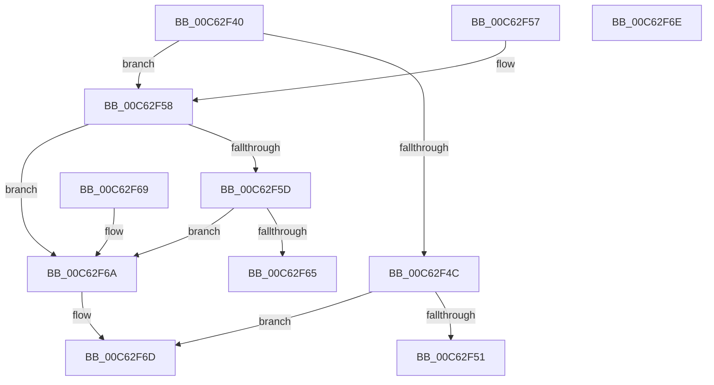

# MxBootSortConsumedPages

- RVA: `0x00C62F40`–`0x00C62F6F` (길이 `47` bytes)
- VA: `0x0000000140C62F40`
- 실행 섹션: `INIT`
- PDB 이름 있음: `예`; PDB Function 태그: `아니요`
- unwind 정보 RVA: `0x000DB714`
- 디코드: `20`개 명령, `47/47` bytes 표시
- 미해석 바이트: `0` (있으면 어셈블리에 `.byte`로 보존)

> 이 문서는 커널 이미지의 기계어와 PDB 기호를 분석해 생성했습니다. 4번과 5번은 함수 원형과 자료형을 바이너리 사용 방식에서 추정한 C 해석이며 원본 소스 복구 결과는 아닙니다.

## 1. Dependencies

- 직접 호출 지점: **0**; 고유 호출 대상: **0**
- 직접 호출자로 확인된 함수: **0**
- RIP 상대 이미지 참조: **0**

### Outgoing calls
- 직접 디코드된 call 명령이 없습니다.

### Direct callers
- 이 함수 시작 RVA로 연결되는 직접 call은 확인되지 않았습니다. 간접 호출은 완전히 역산할 수 없습니다.

### Static image references
- 디코드된 RIP-relative 메모리 참조가 없습니다.

## 2. Other-region calls and transfers

- 다른 실행 섹션으로 향하는 call: **0**
- 별도 외부 분기/꼬리 이동을 확인하지 못했습니다.

## 3. Assembly (complete function range)

```asm
00C62F40  4C 8B 42 28                     mov r8, qword ptr [rdx + 0x28]
00C62F44  33 C0                           xor eax, eax
00C62F46  48 39 41 28                     cmp qword ptr [rcx + 0x28], rax
00C62F4A  75 0C                           jne 0x140c62f58
00C62F4C  4D 85 C0                        test r8, r8
00C62F4F  74 1C                           je 0x140c62f6d
00C62F51  B8 01 00 00 00                  mov eax, 1
00C62F56  C3                              ret
00C62F57  CC                              int3
00C62F58  4D 85 C0                        test r8, r8
00C62F5B  74 0D                           je 0x140c62f6a
00C62F5D  48 8B 09                        mov rcx, qword ptr [rcx]
00C62F60  48 3B 0A                        cmp rcx, qword ptr [rdx]
00C62F63  72 05                           jb 0x140c62f6a
00C62F65  0F 97 C0                        seta al
00C62F68  C3                              ret
00C62F69  CC                              int3
00C62F6A  83 C8 FF                        or eax, 0xffffffff
00C62F6D  C3                              ret
00C62F6E  CC                              int3
```

## 4. C-style interpretation (structured pseudocode)

```c
__int64 __fastcall MxBootSortConsumedPages(__int64 a1, __int64 a2)
{
    __int64 result;

    result = 0;
    if ((*(unsigned __int64 *)(a1 + 40)) != 0) goto loc_00C62F58;
    if (*(unsigned __int64 *)(a2 + 40) == 0) goto loc_00C62F6D;
    return 1;
loc_00C62F58:
    if (*(unsigned __int64 *)(a2 + 40) == 0) goto loc_00C62F6A;
    if ((*(unsigned __int64 *)(a1)) < (*(unsigned __int64 *)(a2))) goto loc_00C62F6A;
    result = ((*(unsigned __int64 *)(a1)) > (*(unsigned __int64 *)(a2))) ? 1 : 0;
    return result;
loc_00C62F6A:
    result = (unsigned int)((result) | (0xFFFFFFFFULL));
loc_00C62F6D:
    return result;
}
```

## 5. (Beta) C Style

```c
int64_t MxBootSortConsumedPages(void *Arg1, void *Arg2)
{
    uint8_t *arg1 = (uint8_t *)Arg1;
    uint8_t *arg2 = (uint8_t *)Arg2;

    int64_t result;

    result = 0;
    if ((*(uint64_t *)(arg1 + 0x28)) != 0) goto loc_00C62F58;
    if (*(uint64_t *)(arg2 + 0x28) == 0) goto loc_00C62F6D;
    return 1;
loc_00C62F58:
    if (*(uint64_t *)(arg2 + 0x28) == 0) goto loc_00C62F6A;
    if ((*(uint64_t *)(arg1)) < (*(uint64_t *)(arg2))) goto loc_00C62F6A;
    result = ((*(uint64_t *)(arg1)) > (*(uint64_t *)(arg2))) ? 1 : 0;
    return result;
loc_00C62F6A:
    result = (uint32_t)((result) | (0xFFFFFFFFULL));
loc_00C62F6D:
    return result;
}
```

### 관측된 메모리 오프셋

구조체 형식이 확인되지 않은 접근은 인자 기준의 오프셋으로만 기록했습니다.

| 기준 인자 | 오프셋 표현 | 폭 (bit) | 접근 |
|---|---:|---:|---|
| `Arg1` | `+ 0x0` | `64` | `R` |
| `Arg1` | `+ 0x28` | `64` | `R` |
| `Arg2` | `+ 0x0` | `64` | `R` |
| `Arg2` | `+ 0x28` | `64` | `R` |

## 6. Execution-region graph

[열기: 2D/3D 그래프와 함수 탐색 컨트롤 패널](../../../control-panel.html?section=init&rva=0x00C62F40&view=graph)

- 2D 그래프는 위에서 아래로 흐르고, 3D 그래프는 빈 공간을 드래그해 회전합니다. Shift+드래그는 이동, 휠은 확대·축소, 함수 노드 선택은 대상 보고서 이동입니다.

### Static fallback


