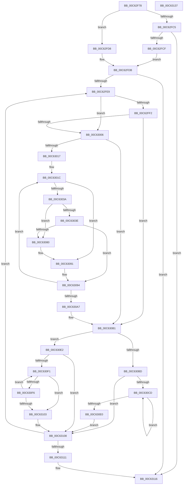

# MxComputeFreeNodeDescriptorRequirements

- RVA: `0x00C62F78`–`0x00C63138` (길이 `448` bytes)
- VA: `0x0000000140C62F78`
- 실행 섹션: `INIT`
- PDB 이름 있음: `예`; PDB Function 태그: `아니요`
- unwind 정보 RVA: `0x000BE6C8`
- 디코드: `127`개 명령, `448/448` bytes 표시
- 미해석 바이트: `0` (있으면 어셈블리에 `.byte`로 보존)

> 이 문서는 커널 이미지의 기계어와 PDB 기호를 분석해 생성했습니다. 4번과 5번은 함수 원형과 자료형을 바이너리 사용 방식에서 추정한 C 해석이며 원본 소스 복구 결과는 아닙니다.

## 1. Dependencies

- 직접 호출 지점: **5**; 고유 호출 대상: **4**
- 직접 호출자로 확인된 함수: **1**
- RIP 상대 이미지 참조: **0**

### Outgoing calls
- `0x00C62F9D` → [memset](../../text/6C/memset_function_006C6C40.md) (function, `0x006C6C40`)
- `0x00C63022` → [MiRestrictRangeToNode](../../text/40/MiRestrictRangeToNode_function_0040199C.md) (function, `0x0040199C`)
- `0x00C6302D` → [MiPageToNode](../../text/33/MiPageToNode_function_00338CD0.md) (function, `0x00338CD0`)
- `0x00C63088` → [MxComputePfnPagesNeeded](MxComputePfnPagesNeeded_function_00C63140.md) (function, `0x00C63140`)
- `0x00C63119` → [MxComputePfnPagesNeeded](MxComputePfnPagesNeeded_function_00C63140.md) (function, `0x00C63140`)

### Direct callers
- [MiInitializeLoaderDescriptors](MiInitializeLoaderDescriptors_function_00C625B4.md) at `0x00C625D7`

### Static image references
- 디코드된 RIP-relative 메모리 참조가 없습니다.

## 2. Other-region calls and transfers

- 다른 실행 섹션으로 향하는 call: **3**
  - `0x00C62F9D` → [memset](../../text/6C/memset_function_006C6C40.md) (`INIT` → `.text`)
  - `0x00C63022` → [MiRestrictRangeToNode](../../text/40/MiRestrictRangeToNode_function_0040199C.md) (`INIT` → `.text`)
  - `0x00C6302D` → [MiPageToNode](../../text/33/MiPageToNode_function_00338CD0.md) (`INIT` → `.text`)
- 별도 외부 분기/꼬리 이동을 확인하지 못했습니다.

## 3. Assembly (complete function range)

```asm
00C62F78  48 89 5C 24 18                  mov qword ptr [rsp + 0x18], rbx
00C62F7D  55                              push rbp
00C62F7E  56                              push rsi
00C62F7F  57                              push rdi
00C62F80  41 54                           push r12
00C62F82  41 55                           push r13
00C62F84  41 56                           push r14
00C62F86  41 57                           push r15
00C62F88  48 83 EC 20                     sub rsp, 0x20
00C62F8C  4C 8B E2                        mov r12, rdx
00C62F8F  48 8B F1                        mov rsi, rcx
00C62F92  49 8B CC                        mov rcx, r12
00C62F95  33 D2                           xor edx, edx
00C62F97  41 B8 00 02 00 00               mov r8d, 0x200
00C62F9D  E8 9E 3C A6 FF                  call 0x1406c6c40
00C62FA2  48 83 C8 FF                     or rax, 0xffffffffffffffff
00C62FA6  BB FF FF FF FF                  mov ebx, 0xffffffff
00C62FAB  48 81 C6 60 01 00 00            add rsi, 0x160
00C62FB2  48 89 44 24 68                  mov qword ptr [rsp + 0x68], rax
00C62FB7  48 8B C8                        mov rcx, rax
00C62FBA  4C 8B F8                        mov r15, rax
00C62FBD  48 8B 46 08                     mov rax, qword ptr [rsi + 8]
00C62FC1  A8 01                           test al, 1
00C62FC3  74 13                           je 0x140c62fd8
00C62FC5  48 83 F8 01                     cmp rax, 1
00C62FC9  0F 84 47 01 00 00               je 0x140c63116
00C62FCF  48 83 CE 01                     or rsi, 1
00C62FD3  48 33 F0                        xor rsi, rax
00C62FD6  EB 03                           jmp 0x140c62fdb
00C62FD8  48 8B F0                        mov rsi, rax
00C62FDB  48 89 74 24 60                  mov qword ptr [rsp + 0x60], rsi
00C62FE0  48 85 F6                        test rsi, rsi
00C62FE3  0F 84 2D 01 00 00               je 0x140c63116
00C62FE9  48 63 46 18                     movsxd rax, dword ptr [rsi + 0x18]
00C62FED  83 F8 2C                        cmp eax, 0x2c
00C62FF0  77 14                           ja 0x140c63006
00C62FF2  48 B9 48 00 C0 C0 C5 15 00 00   movabs rcx, 0x15c5c0c00048
00C62FFC  48 0F A3 C1                     bt rcx, rax
00C63000  0F 82 AB 00 00 00               jb 0x140c630b1
00C63006  48 8B 6E 28                     mov rbp, qword ptr [rsi + 0x28]
00C6300A  4C 8B 76 20                     mov r14, qword ptr [rsi + 0x20]
00C6300E  48 85 ED                        test rbp, rbp
00C63011  0F 84 9A 00 00 00               je 0x140c630b1
00C63017  48 8B 74 24 68                  mov rsi, qword ptr [rsp + 0x68]
00C6301C  48 8B D5                        mov rdx, rbp
00C6301F  49 8B CE                        mov rcx, r14
00C63022  E8 75 E9 79 FF                  call 0x14040199c
00C63027  49 8B CE                        mov rcx, r14
00C6302A  4C 8B E8                        mov r13, rax
00C6302D  E8 9E 5C 6D FF                  call 0x140338cd0
00C63032  8B F8                           mov edi, eax
00C63034  49 83 FF FF                     cmp r15, -1
00C63038  74 57                           je 0x140c63091
00C6303A  3B FB                           cmp edi, ebx
00C6303C  75 42                           jne 0x140c63080
00C6303E  4F 8D 04 7F                     lea r8, [r15 + r15*2]
00C63042  BA F8 FF FF 3F                  mov edx, 0x3ffffff8
00C63047  49 C1 E0 04                     shl r8, 4
00C6304B  49 C1 E8 12                     shr r8, 0x12
00C6304F  4C 23 C2                        and r8, rdx
00C63052  48 B8 08 00 00 40 FB F6 FF FF   movabs rax, 0xfffff6fb40000008
00C6305C  4C 03 C0                        add r8, rax
00C6305F  4B 8D 04 76                     lea rax, [r14 + r14*2]
00C63063  48 C1 E0 04                     shl rax, 4
00C63067  48 C1 E8 12                     shr rax, 0x12
00C6306B  48 23 C2                        and rax, rdx
00C6306E  48 B9 00 00 00 40 FB F6 FF FF   movabs rcx, 0xfffff6fb40000000
00C63078  48 03 C1                        add rax, rcx
00C6307B  4C 3B C0                        cmp r8, rax
00C6307E  73 14                           jae 0x140c63094
00C63080  49 8B D7                        mov rdx, r15
00C63083  8B DB                           mov ebx, ebx
00C63085  48 8B CE                        mov rcx, rsi
00C63088  E8 B3 00 00 00                  call 0x140c63140
00C6308D  49 01 04 DC                     add qword ptr [r12 + rbx*8], rax
00C63091  49 8B F6                        mov rsi, r14
00C63094  4F 8D 3C 2E                     lea r15, [r14 + r13]
00C63098  48 8B DF                        mov rbx, rdi
00C6309B  4D 8B F7                        mov r14, r15
00C6309E  49 2B ED                        sub rbp, r13
00C630A1  0F 85 75 FF FF FF               jne 0x140c6301c
00C630A7  48 89 74 24 68                  mov qword ptr [rsp + 0x68], rsi
00C630AC  48 8B 74 24 60                  mov rsi, qword ptr [rsp + 0x60]
00C630B1  48 8B 46 08                     mov rax, qword ptr [rsi + 8]
00C630B5  48 8B CE                        mov rcx, rsi
00C630B8  48 85 C0                        test rax, rax
00C630BB  74 25                           je 0x140c630e2
00C630BD  48 8B 08                        mov rcx, qword ptr [rax]
00C630C0  48 8B F0                        mov rsi, rax
00C630C3  48 89 44 24 60                  mov qword ptr [rsp + 0x60], rax
00C630C8  48 85 C9                        test rcx, rcx
00C630CB  74 3B                           je 0x140c63108
00C630CD  48 8B 01                        mov rax, qword ptr [rcx]
00C630D0  48 8B F1                        mov rsi, rcx
00C630D3  48 89 4C 24 60                  mov qword ptr [rsp + 0x60], rcx
00C630D8  48 8B C8                        mov rcx, rax
00C630DB  48 85 C0                        test rax, rax
00C630DE  75 ED                           jne 0x140c630cd
00C630E0  EB 26                           jmp 0x140c63108
00C630E2  48 8B 76 10                     mov rsi, qword ptr [rsi + 0x10]
00C630E6  48 83 E6 FC                     and rsi, 0xfffffffffffffffc
00C630EA  48 89 74 24 60                  mov qword ptr [rsp + 0x60], rsi
00C630EF  74 17                           je 0x140c63108
00C630F1  48 39 0E                        cmp qword ptr [rsi], rcx
00C630F4  74 0D                           je 0x140c63103
00C630F6  48 8B CE                        mov rcx, rsi
00C630F9  48 8B 76 10                     mov rsi, qword ptr [rsi + 0x10]
00C630FD  48 83 E6 FC                     and rsi, 0xfffffffffffffffc
00C63101  75 EE                           jne 0x140c630f1
00C63103  48 89 74 24 60                  mov qword ptr [rsp + 0x60], rsi
00C63108  48 85 F6                        test rsi, rsi
00C6310B  0F 85 D8 FE FF FF               jne 0x140c62fe9
00C63111  48 8B 4C 24 68                  mov rcx, qword ptr [rsp + 0x68]
00C63116  49 8B D7                        mov rdx, r15
00C63119  E8 22 00 00 00                  call 0x140c63140
00C6311E  49 01 04 DC                     add qword ptr [r12 + rbx*8], rax
00C63122  48 8B 5C 24 70                  mov rbx, qword ptr [rsp + 0x70]
00C63127  48 83 C4 20                     add rsp, 0x20
00C6312B  41 5F                           pop r15
00C6312D  41 5E                           pop r14
00C6312F  41 5D                           pop r13
00C63131  41 5C                           pop r12
00C63133  5F                              pop rdi
00C63134  5E                              pop rsi
00C63135  5D                              pop rbp
00C63136  C3                              ret
00C63137  CC                              int3
```

## 4. C-style interpretation (structured pseudocode)

```c
__int64 __fastcall MxComputeFreeNodeDescriptorRequirements(__int64 a1, __int64 a2)
{
    __int64 result;
    __int64 v_rbp;
    __int64 v_rsi;
    __int64 v_rsp;
    unsigned __int64 v_stack_p10;
    unsigned __int64 v_stack_p18;
    unsigned __int64 v_stack_p8;

    v_stack_p18 = v_rbx;
    v_rsp = (v_rsp) - (32);
    a2 = 0;
    result = memset(a2, a2, 512, a4);
    result = (result) | (-1);
    v_rsi = (a1) + (352);
    v_stack_p10 = result;
    if ((((unsigned __int8)(*(unsigned __int64 *)(v_rsi + 8))) & (1)) == 0) goto loc_00C62FD8;
    if ((*(unsigned __int64 *)(v_rsi + 8)) == 1) goto loc_00C63116;
    v_rsi = (v_rsi) | (1);
    v_rsi = (v_rsi) ^ (*(unsigned __int64 *)(v_rsi + 8));
    goto loc_00C62FDB;
loc_00C62FD8:
loc_00C62FDB:
    v_stack_p8 = *(unsigned __int64 *)(v_rsi + 8);
    if (*(unsigned __int64 *)(v_rsi + 8) == 0) goto loc_00C63116;
loc_00C62FE9:
    if (((unsigned int)((int)(*(unsigned int *)(*(unsigned __int64 *)(v_rsi + 8) + 24)))) > 44) goto loc_00C63006;
    if (((unsigned int)((int)(*(unsigned int *)(*(unsigned __int64 *)(v_rsi + 8) + 24)))) < 44) goto loc_00C630B1;
loc_00C63006:
    if (*(unsigned __int64 *)(*(unsigned __int64 *)(v_rsi + 8) + 40) == 0) goto loc_00C630B1;
loc_00C6301C:
    result = MiRestrictRangeToNode(*(unsigned __int64 *)(*(unsigned __int64 *)(v_rsi + 8) + 32), *(unsigned __int64 *)(*(unsigned __int64 *)(v_rsi + 8) + 40), 512, a4);
    result = MiPageToNode(*(unsigned __int64 *)(*(unsigned __int64 *)(v_rsi + 8) + 32), *(unsigned __int64 *)(*(unsigned __int64 *)(v_rsi + 8) + 40), 512, a4);
    if (result == -1) goto loc_00C63091;
    if (((unsigned int)((unsigned int)((unsigned int)(result)))) != ((unsigned int)((unsigned int)(0xFFFFFFFFULL)))) goto loc_00C63080;
    a3 = (result + result * 2) << (4);
    a3 = (a3) >> (18);
    a3 = (a3) & ((unsigned int)(0x3FFFFFF8ULL));
    a3 = (a3) + (result);
    result = (*(unsigned __int64 *)(*(unsigned __int64 *)(v_rsi + 8) + 32) + *(unsigned __int64 *)(*(unsigned __int64 *)(v_rsi + 8) + 32) * 2) << (4);
    result = (result) >> (18);
    result = (result) & ((unsigned int)(0x3FFFFFF8ULL));
    result = (result) + (*(unsigned __int64 *)(*(unsigned __int64 *)(v_rsi + 8) + 32));
    if (a3 >= result) goto loc_00C63094;
loc_00C63080:
    result = MxComputePfnPagesNeeded(v_stack_p10, result, a3, a4);
loc_00C63091:
loc_00C63094:
    v_rbp = (*(unsigned __int64 *)(*(unsigned __int64 *)(v_rsi + 8) + 40)) - (result);
    if (condition_is_not_equal) goto loc_00C6301C;
    v_stack_p10 = *(unsigned __int64 *)(*(unsigned __int64 *)(v_rsi + 8) + 32);
loc_00C630B1:
    if (*(unsigned __int64 *)(v_stack_p8 + 8) == 0) goto loc_00C630E2;
    v_stack_p8 = *(unsigned __int64 *)(v_stack_p8 + 8);
    if (*(unsigned __int64 *)(*(unsigned __int64 *)(v_stack_p8 + 8)) == 0) goto loc_00C63108;
loc_00C630CD:
    v_stack_p8 = *(unsigned __int64 *)(*(unsigned __int64 *)(v_stack_p8 + 8));
    if (*(unsigned __int64 *)(*(unsigned __int64 *)(*(unsigned __int64 *)(v_stack_p8 + 8))) != 0) goto loc_00C630CD;
    goto loc_00C63108;
loc_00C630E2:
    v_rsi = (*(unsigned __int64 *)(*(unsigned __int64 *)(*(unsigned __int64 *)(v_stack_p8 + 8)) + 16)) & (-4);
    v_stack_p8 = v_rsi;
    if (condition_is_equal) goto loc_00C63108;
loc_00C630F1:
    if ((*(unsigned __int64 *)(v_rsi)) == (*(unsigned __int64 *)(*(unsigned __int64 *)(*(unsigned __int64 *)(v_stack_p8 + 8))))) goto loc_00C63103;
    v_rsi = (*(unsigned __int64 *)(v_rsi + 16)) & (-4);
    if (condition_is_not_equal) goto loc_00C630F1;
loc_00C63103:
    v_stack_p8 = v_rsi;
loc_00C63108:
    if (v_rsi != 0) goto loc_00C62FE9;
loc_00C63116:
    result = MxComputePfnPagesNeeded(v_stack_p10, *(unsigned __int64 *)(*(unsigned __int64 *)(v_rsi + 8) + 32) + result * 1, a3, a4);
    v_rsp = (v_rsp) + (32);
    return result;
}
```

## 5. (Beta) C Style

```c
int64_t MxComputeFreeNodeDescriptorRequirements(void *Arg1, void *Arg2)
{
    uint8_t *arg1 = (uint8_t *)Arg1;
    uint8_t *arg2 = (uint8_t *)Arg2;

    int64_t result;
    int64_t local_rbp;
    int64_t local_rsi;
    int64_t local_rsp;
    uint64_t v_stack_p10;
    uint64_t v_stack_p18;
    uint64_t v_stack_p8;

    v_stack_p18 = local_rbx;
    local_rsp = (local_rsp) - (32);
    Arg2 = 0;
    result = memset(Arg2, Arg2, 512, a4);
    result = (result) | (-1);
    local_rsi = (Arg1) + (352);
    v_stack_p10 = result;
    if ((((uint8_t)(*(uint64_t *)(local_rsi + 0x8))) & (1)) == 0) goto loc_00C62FD8;
    if ((*(uint64_t *)(local_rsi + 0x8)) == 1) goto loc_00C63116;
    local_rsi = (local_rsi) | (1);
    local_rsi = (local_rsi) ^ (*(uint64_t *)(local_rsi + 0x8));
    goto loc_00C62FDB;
loc_00C62FD8:
loc_00C62FDB:
    v_stack_p8 = *(uint64_t *)(local_rsi + 0x8);
    if (*(uint64_t *)(local_rsi + 0x8) == 0) goto loc_00C63116;
loc_00C62FE9:
    if (((uint32_t)((int32_t)(*(uint32_t *)(*(uint64_t *)(local_rsi + 0x8) + 0x18)))) > 44) goto loc_00C63006;
    if (((uint32_t)((int32_t)(*(uint32_t *)(*(uint64_t *)(local_rsi + 0x8) + 0x18)))) < 44) goto loc_00C630B1;
loc_00C63006:
    if (*(uint64_t *)(*(uint64_t *)(local_rsi + 0x8) + 0x28) == 0) goto loc_00C630B1;
loc_00C6301C:
    result = MiRestrictRangeToNode(*(uint64_t *)(*(uint64_t *)(local_rsi + 0x8) + 0x20), *(uint64_t *)(*(uint64_t *)(local_rsi + 0x8) + 0x28), 512, a4);
    result = MiPageToNode(*(uint64_t *)(*(uint64_t *)(local_rsi + 0x8) + 0x20), *(uint64_t *)(*(uint64_t *)(local_rsi + 0x8) + 0x28), 512, a4);
    if (result == -1) goto loc_00C63091;
    if (((uint32_t)((uint32_t)((uint32_t)(result)))) != ((uint32_t)((uint32_t)(0xFFFFFFFFULL)))) goto loc_00C63080;
    a3 = (result + result * 2) << (4);
    a3 = (a3) >> (18);
    a3 = (a3) & ((uint32_t)(0x3FFFFFF8ULL));
    a3 = (a3) + (result);
    result = (*(uint64_t *)(*(uint64_t *)(local_rsi + 0x8) + 0x20) + *(uint64_t *)(*(uint64_t *)(local_rsi + 0x8) + 0x20) * 2) << (4);
    result = (result) >> (18);
    result = (result) & ((uint32_t)(0x3FFFFFF8ULL));
    result = (result) + (*(uint64_t *)(*(uint64_t *)(local_rsi + 0x8) + 0x20));
    if (a3 >= result) goto loc_00C63094;
loc_00C63080:
    result = MxComputePfnPagesNeeded(v_stack_p10, result, a3, a4);
loc_00C63091:
loc_00C63094:
    local_rbp = (*(uint64_t *)(*(uint64_t *)(local_rsi + 0x8) + 0x28)) - (result);
    if (condition_is_not_equal) goto loc_00C6301C;
    v_stack_p10 = *(uint64_t *)(*(uint64_t *)(local_rsi + 0x8) + 0x20);
loc_00C630B1:
    if (*(uint64_t *)(v_stack_p8 + 0x8) == 0) goto loc_00C630E2;
    v_stack_p8 = *(uint64_t *)(v_stack_p8 + 0x8);
    if (*(uint64_t *)(*(uint64_t *)(v_stack_p8 + 0x8)) == 0) goto loc_00C63108;
loc_00C630CD:
    v_stack_p8 = *(uint64_t *)(*(uint64_t *)(v_stack_p8 + 0x8));
    if (*(uint64_t *)(*(uint64_t *)(*(uint64_t *)(v_stack_p8 + 0x8))) != 0) goto loc_00C630CD;
    goto loc_00C63108;
loc_00C630E2:
    local_rsi = (*(uint64_t *)(*(uint64_t *)(*(uint64_t *)(v_stack_p8 + 0x8)) + 0x10)) & (-4);
    v_stack_p8 = local_rsi;
    if (condition_is_equal) goto loc_00C63108;
loc_00C630F1:
    if ((*(uint64_t *)(local_rsi)) == (*(uint64_t *)(*(uint64_t *)(*(uint64_t *)(v_stack_p8 + 0x8))))) goto loc_00C63103;
    local_rsi = (*(uint64_t *)(local_rsi + 0x10)) & (-4);
    if (condition_is_not_equal) goto loc_00C630F1;
loc_00C63103:
    v_stack_p8 = local_rsi;
loc_00C63108:
    if (local_rsi != 0) goto loc_00C62FE9;
loc_00C63116:
    result = MxComputePfnPagesNeeded(v_stack_p10, *(uint64_t *)(*(uint64_t *)(local_rsi + 0x8) + 0x20) + result * 1, a3, a4);
    local_rsp = (local_rsp) + (32);
    return result;
}
```

### 관측된 메모리 오프셋

구조체 형식이 확인되지 않은 접근은 인자 기준의 오프셋으로만 기록했습니다.

| 기준 인자 | 오프셋 표현 | 폭 (bit) | 접근 |
|---|---:|---:|---|
| `Arg1` | `+ 0x8` | `64` | `R` |
| `Arg2` | `+ 0x0 + rbx*8` | `64` | `R/W` |

## 6. Execution-region graph

[열기: 2D/3D 그래프와 함수 탐색 컨트롤 패널](../../../control-panel.html?section=init&rva=0x00C62F78&view=graph)

- 2D 그래프는 위에서 아래로 흐르고, 3D 그래프는 빈 공간을 드래그해 회전합니다. Shift+드래그는 이동, 휠은 확대·축소, 함수 노드 선택은 대상 보고서 이동입니다.

### Static fallback


