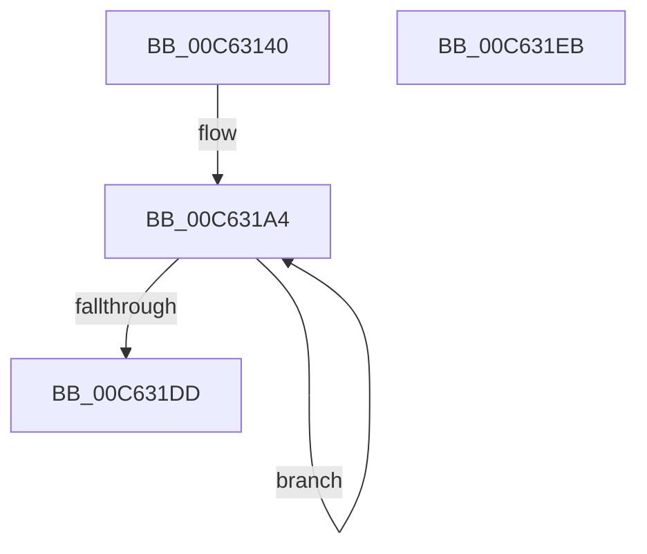

# MxComputePfnPagesNeeded

- RVA: `0x00C63140`–`0x00C631EC` (길이 `172` bytes)
- VA: `0x0000000140C63140`
- 실행 섹션: `INIT`
- PDB 이름 있음: `예`; PDB Function 태그: `아니요`
- unwind 정보 RVA: `0x000950EC`
- 디코드: `43`개 명령, `172/172` bytes 표시
- 미해석 바이트: `0` (있으면 어셈블리에 `.byte`로 보존)

> 이 문서는 커널 이미지의 기계어와 PDB 기호를 분석해 생성했습니다. 4번과 5번은 함수 원형과 자료형을 바이너리 사용 방식에서 추정한 C 해석이며 원본 소스 복구 결과는 아닙니다.

## 1. Dependencies

- 직접 호출 지점: **0**; 고유 호출 대상: **0**
- 직접 호출자로 확인된 함수: **1**
- RIP 상대 이미지 참조: **0**

### Outgoing calls
- 직접 디코드된 call 명령이 없습니다.

### Direct callers
- [MxComputeFreeNodeDescriptorRequirements](MxComputeFreeNodeDescriptorRequirements_function_00C62F78.md) at `0x00C63088`
- [MxComputeFreeNodeDescriptorRequirements](MxComputeFreeNodeDescriptorRequirements_function_00C62F78.md) at `0x00C63119`

### Static image references
- 디코드된 RIP-relative 메모리 참조가 없습니다.

## 2. Other-region calls and transfers

- 다른 실행 섹션으로 향하는 call: **0**
- 별도 외부 분기/꼬리 이동을 확인하지 못했습니다.

## 3. Assembly (complete function range)

```asm
00C63140  48 89 5C 24 08                  mov qword ptr [rsp + 8], rbx
00C63145  48 89 7C 24 10                  mov qword ptr [rsp + 0x10], rdi
00C6314A  4C 8D 04 49                     lea r8, [rcx + rcx*2]
00C6314E  BB F8 FF FF 3F                  mov ebx, 0x3ffffff8
00C63153  49 C1 E0 04                     shl r8, 4
00C63157  45 33 D2                        xor r10d, r10d
00C6315A  49 C1 E8 12                     shr r8, 0x12
00C6315E  41 BB 00 02 00 00               mov r11d, 0x200
00C63164  4C 23 C3                        and r8, rbx
00C63167  48 B9 00 00 00 40 FB F6 FF FF   movabs rcx, 0xfffff6fb40000000
00C63171  48 8B C1                        mov rax, rcx
00C63174  4C 8D 0C 52                     lea r9, [rdx + rdx*2]
00C63178  4C 03 C0                        add r8, rax
00C6317B  49 C1 E1 04                     shl r9, 4
00C6317F  49 C1 E9 12                     shr r9, 0x12
00C63183  4C 23 CB                        and r9, rbx
00C63186  48 8B C1                        mov rax, rcx
00C63189  4C 03 C8                        add r9, rax
00C6318C  48 BB 00 00 00 00 80 F6 FF FF   movabs rbx, 0xfffff68000000000
00C63196  41 8D 52 03                     lea edx, [r10 + 3]
00C6319A  48 BF F8 FF FF FF 7F 00 00 00   movabs rdi, 0x7ffffffff8
00C631A4  49 8B C1                        mov rax, r9
00C631A7  49 2B C0                        sub rax, r8
00C631AA  49 C1 E8 09                     shr r8, 9
00C631AE  48 C1 F8 03                     sar rax, 3
00C631B2  4C 23 C7                        and r8, rdi
00C631B5  48 FF C0                        inc rax
00C631B8  49 0F AF C3                     imul rax, r11
00C631BC  4C 03 D0                        add r10, rax
00C631BF  48 8B C3                        mov rax, rbx
00C631C2  49 C1 E9 09                     shr r9, 9
00C631C6  4C 03 C0                        add r8, rax
00C631C9  4C 23 CF                        and r9, rdi
00C631CC  48 8B CB                        mov rcx, rbx
00C631CF  4C 03 C9                        add r9, rcx
00C631D2  41 BB 01 00 00 00               mov r11d, 1
00C631D8  49 2B D3                        sub rdx, r11
00C631DB  75 C7                           jne 0x140c631a4
00C631DD  48 8B 5C 24 08                  mov rbx, qword ptr [rsp + 8]
00C631E2  49 8B C2                        mov rax, r10
00C631E5  48 8B 7C 24 10                  mov rdi, qword ptr [rsp + 0x10]
00C631EA  C3                              ret
00C631EB  CC                              int3
```

## 4. C-style interpretation (structured pseudocode)

```c
__int64 __fastcall MxComputePfnPagesNeeded(__int64 a1, __int64 a2)
{
    __int64 result;
    __int64 v_r10;
    unsigned __int64 v_stack_p10;
    unsigned __int64 v_stack_p8;

    v_stack_p8 = v_rbx;
    v_stack_p10 = v_rdi;
    a3 = (a1 + a1 * 2) << (4);
    v_r10 = 0;
    a3 = (a3) >> (18);
    a3 = (a3) & ((unsigned int)(0x3FFFFFF8ULL));
    a3 = (a3) + (a1);
    a4 = (a2 + a2 * 2) << (4);
    a4 = (a4) >> (18);
    a4 = (a4) & ((unsigned int)(0x3FFFFFF8ULL));
    a4 = (a4) + (a1);
loc_00C631A4:
    result = (a4) - (a3);
    a3 = (a3) >> (9);
    result = (result) >> (3);
    a3 = (a3) & (v_rdi);
    result = (result) + 1;
    result = (result) * (512);
    v_r10 = (v_r10) + (result);
    a4 = (a4) >> (9);
    a3 = (a3) + ((unsigned int)(0x3FFFFFF8ULL));
    a4 = (a4) & (v_rdi);
    a4 = (a4) + ((unsigned int)(0x3FFFFFF8ULL));
    a2 = (v_r10 + 3) - (1);
    if (condition_is_not_equal) goto loc_00C631A4;
    return v_r10;
}
```

## 5. (Beta) C Style

```c
int64_t MxComputePfnPagesNeeded(void *Arg1, void *Arg2)
{
    uint8_t *arg1 = (uint8_t *)Arg1;
    uint8_t *arg2 = (uint8_t *)Arg2;

    int64_t result;
    int64_t local_r10;
    uint64_t v_stack_p10;
    uint64_t v_stack_p8;

    v_stack_p8 = local_rbx;
    v_stack_p10 = local_rdi;
    a3 = (Arg1 + Arg1 * 2) << (4);
    local_r10 = 0;
    a3 = (a3) >> (18);
    a3 = (a3) & ((uint32_t)(0x3FFFFFF8ULL));
    a3 = (a3) + (Arg1);
    a4 = (Arg2 + Arg2 * 2) << (4);
    a4 = (a4) >> (18);
    a4 = (a4) & ((uint32_t)(0x3FFFFFF8ULL));
    a4 = (a4) + (Arg1);
loc_00C631A4:
    result = (a4) - (a3);
    a3 = (a3) >> (9);
    result = (result) >> (3);
    a3 = (a3) & (local_rdi);
    result = (result) + 1;
    result = (result) * (512);
    local_r10 = (local_r10) + (result);
    a4 = (a4) >> (9);
    a3 = (a3) + ((uint32_t)(0x3FFFFFF8ULL));
    a4 = (a4) & (local_rdi);
    a4 = (a4) + ((uint32_t)(0x3FFFFFF8ULL));
    Arg2 = (local_r10 + 3) - (1);
    if (condition_is_not_equal) goto loc_00C631A4;
    return local_r10;
}
```

### 관측된 메모리 오프셋

구조체 형식이 확인되지 않은 접근은 인자 기준의 오프셋으로만 기록했습니다.

| 기준 인자 | 오프셋 표현 | 폭 (bit) | 접근 |
|---|---:|---:|---|
| `Arg1` | `+ 0x0 + rcx*2` | `64` | `R` |
| `Arg2` | `+ 0x0 + rdx*2` | `64` | `R` |

## 6. Execution-region graph

[열기: 2D/3D 그래프와 함수 탐색 컨트롤 패널](../../../control-panel.html?section=init&rva=0x00C63140&view=graph)

- 2D 그래프는 위에서 아래로 흐르고, 3D 그래프는 빈 공간을 드래그해 회전합니다. Shift+드래그는 이동, 휠은 확대·축소, 함수 노드 선택은 대상 보고서 이동입니다.

### Static fallback


