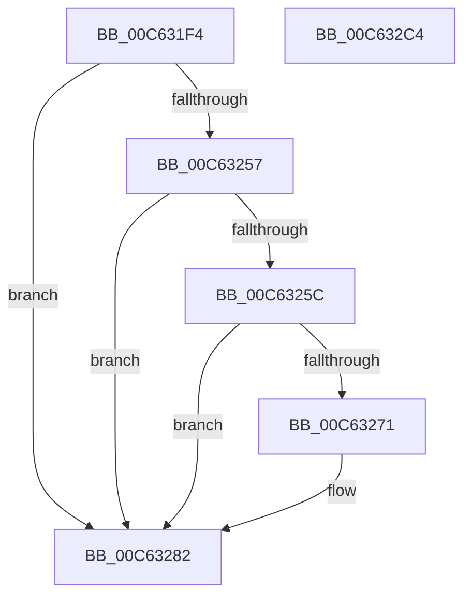

# MxCopyPage

- RVA: `0x00C631F4`–`0x00C632C5` (길이 `209` bytes)
- VA: `0x0000000140C631F4`
- 실행 섹션: `INIT`
- PDB 이름 있음: `예`; PDB Function 태그: `아니요`
- unwind 정보 RVA: `0x000BD140`
- 디코드: `54`개 명령, `209/209` bytes 표시
- 미해석 바이트: `0` (있으면 어셈블리에 `.byte`로 보존)

> 이 문서는 커널 이미지의 기계어와 PDB 기호를 분석해 생성했습니다. 4번과 5번은 함수 원형과 자료형을 바이너리 사용 방식에서 추정한 C 해석이며 원본 소스 복구 결과는 아닙니다.

## 1. Dependencies

- 직접 호출 지점: **5**; 고유 호출 대상: **5**
- 직접 호출자로 확인된 함수: **1**
- RIP 상대 이미지 참조: **2**

### Outgoing calls
- `0x00C6320C` → [MxGetPhase0Mapping](../BE/MxGetPhase0Mapping_function_00BEF000.md) (function, `0x00BEF000`)
- `0x00C63244` → [MiMakeValidPte](../../text/2C/MiMakeValidPte_function_002C5590.md) (function, `0x002C5590`)
- `0x00C6327D` → [MiCheckLinearProtectedPteAccessedBit](../../text/29/MiCheckLinearProtectedPteAccessedBit_function_00292D80.md) (function, `0x00292D80`)
- `0x00C63291` → [MiCopyPtes](../../text/46/MiCopyPtes_function_0046C84C.md) (function, `0x0046C84C`)
- `0x00C632AC` → [MiFlushSingleTbEntry](../../text/28/MiFlushSingleTbEntry_function_0028E730.md) (function, `0x0028E730`)

### Direct callers
- [sub_006F15CE](../../text/6F/Unknown_function_006F15CE.md) at `0x006F1687`

### Static image references
- `0x00C63249` → RVA `0x00FC6A88` (`ALMOSTRO`; read)
- `0x00C63296` → RVA `0x00010880` (`.rdata`; read)

## 2. Other-region calls and transfers

- 다른 실행 섹션으로 향하는 call: **4**
  - `0x00C63244` → [MiMakeValidPte](../../text/2C/MiMakeValidPte_function_002C5590.md) (`INIT` → `.text`)
  - `0x00C6327D` → [MiCheckLinearProtectedPteAccessedBit](../../text/29/MiCheckLinearProtectedPteAccessedBit_function_00292D80.md) (`INIT` → `.text`)
  - `0x00C63291` → [MiCopyPtes](../../text/46/MiCopyPtes_function_0046C84C.md) (`INIT` → `.text`)
  - `0x00C632AC` → [MiFlushSingleTbEntry](../../text/28/MiFlushSingleTbEntry_function_0028E730.md) (`INIT` → `.text`)
- 별도 외부 분기/꼬리 이동을 확인하지 못했습니다.

## 3. Assembly (complete function range)

```asm
00C631F4  48 89 5C 24 08                  mov qword ptr [rsp + 8], rbx
00C631F9  48 89 6C 24 10                  mov qword ptr [rsp + 0x10], rbp
00C631FE  56                              push rsi
00C631FF  57                              push rdi
00C63200  41 56                           push r14
00C63202  48 83 EC 20                     sub rsp, 0x20
00C63206  48 8B EA                        mov rbp, rdx
00C63209  48 8B D9                        mov rbx, rcx
00C6320C  E8 EF BD F8 FF                  call 0x140bef000
00C63211  48 8B F8                        mov rdi, rax
00C63214  49 BE 00 00 00 00 80 F6 FF FF   movabs r14, 0xfffff68000000000
00C6321E  48 8B F0                        mov rsi, rax
00C63221  48 C1 EF 09                     shr rdi, 9
00C63225  48 B8 F8 FF FF FF 7F 00 00 00   movabs rax, 0x7ffffffff8
00C6322F  48 23 F8                        and rdi, rax
00C63232  4D 8B C6                        mov r8, r14
00C63235  49 03 F8                        add rdi, r8
00C63238  48 8B D3                        mov rdx, rbx
00C6323B  48 8B CF                        mov rcx, rdi
00C6323E  41 B8 04 00 00 A0               mov r8d, 0xa0000004
00C63244  E8 47 23 66 FF                  call 0x1402c5590
00C63249  48 0F BA 25 36 38 36 00 24      bt qword ptr [rip + 0x363836], 0x24
00C63252  48 8B D8                        mov rbx, rax
00C63255  73 2B                           jae 0x140c63282
00C63257  F6 C3 20                        test bl, 0x20
00C6325A  75 26                           jne 0x140c63282
00C6325C  49 8B C6                        mov rax, r14
00C6325F  48 B9 00 00 00 00 40 00 00 00   movabs rcx, 0x4000000000
00C63269  48 03 C1                        add rax, rcx
00C6326C  48 3B F8                        cmp rdi, rax
00C6326F  72 11                           jb 0x140c63282
00C63271  41 B8 80 00 00 00               mov r8d, 0x80
00C63277  48 8B D3                        mov rdx, rbx
00C6327A  48 8B CF                        mov rcx, rdi
00C6327D  E8 FE FA 62 FF                  call 0x140292d80
00C63282  41 B8 00 02 00 00               mov r8d, 0x200
00C63288  48 89 1F                        mov qword ptr [rdi], rbx
00C6328B  48 8B D5                        mov rdx, rbp
00C6328E  48 8B CE                        mov rcx, rsi
00C63291  E8 B6 95 80 FF                  call 0x14046c84c
00C63296  48 8B 05 E3 D5 3A FF            mov rax, qword ptr [rip - 0xc52a1d]
00C6329D  BA 02 00 00 00                  mov edx, 2
00C632A2  48 8B CE                        mov rcx, rsi
00C632A5  48 89 07                        mov qword ptr [rdi], rax
00C632A8  44 8D 42 FF                     lea r8d, [rdx - 1]
00C632AC  E8 7F B4 62 FF                  call 0x14028e730
00C632B1  48 8B 5C 24 40                  mov rbx, qword ptr [rsp + 0x40]
00C632B6  48 8B 6C 24 48                  mov rbp, qword ptr [rsp + 0x48]
00C632BB  48 83 C4 20                     add rsp, 0x20
00C632BF  41 5E                           pop r14
00C632C1  5F                              pop rdi
00C632C2  5E                              pop rsi
00C632C3  C3                              ret
00C632C4  CC                              int3
```

## 4. C-style interpretation (structured pseudocode)

```c
__int64 __fastcall MxCopyPage(__int64 a1, __int64 a2)
{
    __int64 result;
    __int64 v_rdi;
    __int64 v_rsp;
    unsigned __int64 v_stack_p10;
    unsigned __int64 v_stack_p8;

    v_stack_p8 = v_rbx;
    v_stack_p10 = v_rbp;
    v_rsp = (v_rsp) - (32);
    result = MxGetPhase0Mapping(a1, a2, a3, a4);
    v_rdi = (result) >> (9);
    v_rdi = (v_rdi) & (result);
    v_rdi = (v_rdi) + (v_r14);
    result = MiMakeValidPte(v_rdi, a1, (unsigned int)(0xA0000004ULL), a4);
    if (condition_is_above_or_equal) goto loc_00C63282;
    if ((((unsigned __int8)(result)) & (32)) != 0) goto loc_00C63282;
    result = (v_r14) + (v_rdi);
    if (v_rdi >= result) {
        a3 = 128;
        a2 = result;
        a1 = v_rdi;
        result = MiCheckLinearProtectedPteAccessedBit(a1, a2, a3, a4);
    }
    *(unsigned __int64 *)(v_rdi) = result;
    result = MiCopyPtes(result, a2, 512, a4);
    *(unsigned __int64 *)(v_rdi) = *(unsigned __int64 *)(v_rip - 12921373);
    result = MiFlushSingleTbEntry(result, 2, 2 - 1, a4);
    v_rsp = (v_rsp) + (32);
    return result;
}
```

## 5. (Beta) C Style

```c
int64_t MxCopyPage(int64_t Arg1, int64_t Arg2)
{
    int64_t result;
    int64_t local_rdi;
    int64_t local_rsp;
    uint64_t v_stack_p10;
    uint64_t v_stack_p8;

    v_stack_p8 = local_rbx;
    v_stack_p10 = local_rbp;
    local_rsp = (local_rsp) - (32);
    result = MxGetPhase0Mapping(Arg1, Arg2, a3, a4);
    local_rdi = (result) >> (9);
    local_rdi = (local_rdi) & (result);
    local_rdi = (local_rdi) + (local_r14);
    result = MiMakeValidPte(local_rdi, Arg1, (uint32_t)(0xA0000004ULL), a4);
    if (condition_is_above_or_equal) goto loc_00C63282;
    if ((((uint8_t)(result)) & (32)) != 0) goto loc_00C63282;
    result = (local_r14) + (local_rdi);
    if (local_rdi >= result) {
        a3 = 128;
        Arg2 = result;
        Arg1 = local_rdi;
        result = MiCheckLinearProtectedPteAccessedBit(Arg1, Arg2, a3, a4);
    }
    *(uint64_t *)(local_rdi) = result;
    result = MiCopyPtes(result, Arg2, 512, a4);
    *(uint64_t *)(local_rdi) = *(uint64_t *)(v_rip - 0xC52A1D);
    result = MiFlushSingleTbEntry(result, 2, 2 - 1, a4);
    local_rsp = (local_rsp) + (32);
    return result;
}
```

## 6. Execution-region graph

[열기: 2D/3D 그래프와 함수 탐색 컨트롤 패널](../../../control-panel.html?section=init&rva=0x00C631F4&view=graph)

- 2D 그래프는 위에서 아래로 흐르고, 3D 그래프는 빈 공간을 드래그해 회전합니다. Shift+드래그는 이동, 휠은 확대·축소, 함수 노드 선택은 대상 보고서 이동입니다.

### Static fallback


