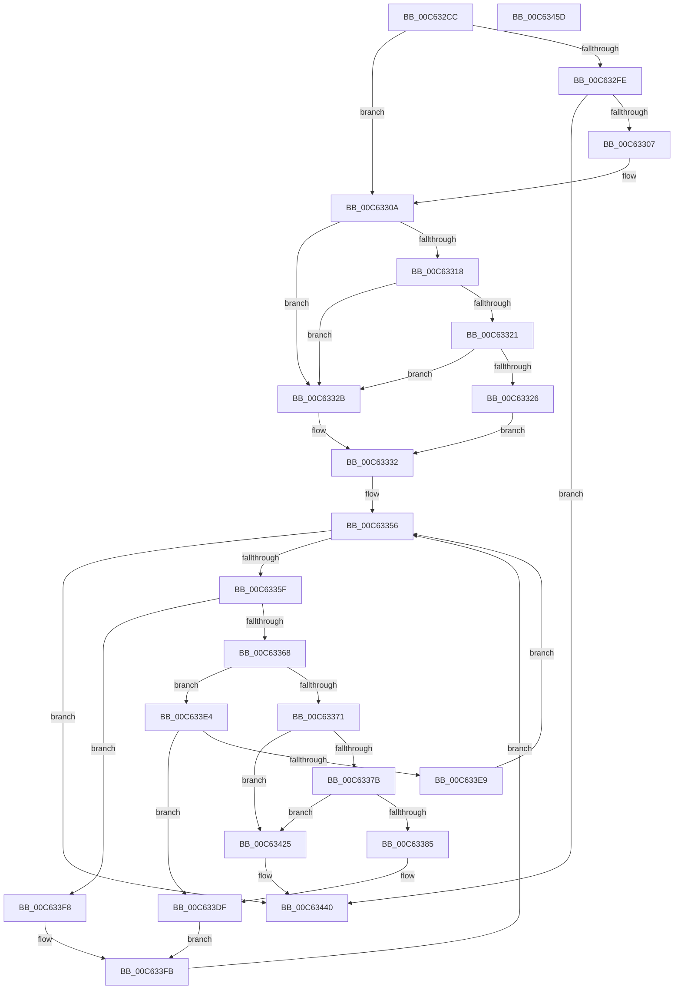

# MxCreateFreePfns

- RVA: `0x00C632CC`–`0x00C6345E` (길이 `402` bytes)
- VA: `0x0000000140C632CC`
- 실행 섹션: `INIT`
- PDB 이름 있음: `예`; PDB Function 태그: `아니요`
- unwind 정보 RVA: `0x0008C2BC`
- 디코드: `110`개 명령, `402/402` bytes 표시
- 미해석 바이트: `0` (있으면 어셈블리에 `.byte`로 보존)

> 이 문서는 커널 이미지의 기계어와 PDB 기호를 분석해 생성했습니다. 4번과 5번은 함수 원형과 자료형을 바이너리 사용 방식에서 추정한 C 해석이며 원본 소스 복구 결과는 아닙니다.

## 1. Dependencies

- 직접 호출 지점: **3**; 고유 호출 대상: **3**
- 직접 호출자로 확인된 함수: **3**
- RIP 상대 이미지 참조: **1**

### Outgoing calls
- `0x00C633B1` → [MiFreeEmptyBootPageTable](MiFreeEmptyBootPageTable_function_00C62370.md) (function, `0x00C62370`)
- `0x00C63407` → [MxInsertFreePages](MxInsertFreePages_function_00C63AD0.md) (function, `0x00C63AD0`)
- `0x00C6343A` → [KeBugCheckEx](../../text/4F/KeBugCheckEx_function_004FD660.md) (function, `0x004FD660`)

### Direct callers
- [MiCreateDescriptorPfns](MiCreateDescriptorPfns_function_00C61D74.md) at `0x00C61E84`
- [MiCreateFreePfns](MiCreateFreePfns_function_00C61F8C.md) at `0x00C6202E`
- [MiCreateFreePfns](MiCreateFreePfns_function_00C61F8C.md) at `0x00C62069`
- [MxReleaseFreeDescriptor](MxReleaseFreeDescriptor_function_00C640D4.md) at `0x00C64130`
- [MxReleaseFreeDescriptor](MxReleaseFreeDescriptor_function_00C640D4.md) at `0x00C6416B`
- [MxReleaseFreeDescriptor](MxReleaseFreeDescriptor_function_00C640D4.md) at `0x00C64190`

### Static image references
- `0x00C63396` → RVA `0x00010880` (`.rdata`; read)

## 2. Other-region calls and transfers

- 다른 실행 섹션으로 향하는 call: **1**
  - `0x00C6343A` → [KeBugCheckEx](../../text/4F/KeBugCheckEx_function_004FD660.md) (`INIT` → `.text`)
- 별도 외부 분기/꼬리 이동을 확인하지 못했습니다.

## 3. Assembly (complete function range)

```asm
00C632CC  48 89 5C 24 10                  mov qword ptr [rsp + 0x10], rbx
00C632D1  48 89 6C 24 18                  mov qword ptr [rsp + 0x18], rbp
00C632D6  48 89 74 24 20                  mov qword ptr [rsp + 0x20], rsi
00C632DB  57                              push rdi
00C632DC  41 54                           push r12
00C632DE  41 55                           push r13
00C632E0  41 56                           push r14
00C632E2  41 57                           push r15
00C632E4  48 83 EC 30                     sub rsp, 0x30
00C632E8  48 8B 59 20                     mov rbx, qword ptr [rcx + 0x20]
00C632EC  45 33 F6                        xor r14d, r14d
00C632EF  48 8B 71 28                     mov rsi, qword ptr [rcx + 0x28]
00C632F3  41 BD 01 00 00 00               mov r13d, 1
00C632F9  48 85 DB                        test rbx, rbx
00C632FC  75 0C                           jne 0x140c6330a
00C632FE  49 2B F5                        sub rsi, r13
00C63301  0F 84 39 01 00 00               je 0x140c63440
00C63307  41 8B DD                        mov ebx, r13d
00C6330A  8B 51 18                        mov edx, dword ptr [rcx + 0x18]
00C6330D  B9 FF FF FF 1F                  mov ecx, 0x1fffffff
00C63312  0F BA E2 1D                     bt edx, 0x1d
00C63316  73 13                           jae 0x140c6332b
00C63318  8B C2                           mov eax, edx
00C6331A  23 C1                           and eax, ecx
00C6331C  83 F8 02                        cmp eax, 2
00C6331F  74 0A                           je 0x140c6332b
00C63321  83 F8 18                        cmp eax, 0x18
00C63324  74 05                           je 0x140c6332b
00C63326  45 8B E5                        mov r12d, r13d
00C63329  EB 07                           jmp 0x140c63332
00C6332B  8B C2                           mov eax, edx
00C6332D  45 8B E6                        mov r12d, r14d
00C63330  23 C1                           and eax, ecx
00C63332  45 8B FE                        mov r15d, r14d
00C63335  48 8D 3C 5B                     lea rdi, [rbx + rbx*2]
00C63339  83 F8 18                        cmp eax, 0x18
00C6333C  41 0F 95 C7                     setne r15b
00C63340  48 C1 E7 04                     shl rdi, 4
00C63344  45 03 FD                        add r15d, r13d
00C63347  48 B9 00 00 00 00 00 DE FF FF   movabs rcx, 0xffffde0000000000
00C63351  48 03 F9                        add rdi, rcx
00C63354  8B E8                           mov ebp, eax
00C63356  48 85 F6                        test rsi, rsi
00C63359  0F 84 E1 00 00 00               je 0x140c63440
00C6335F  45 85 E4                        test r12d, r12d
00C63362  0F 84 90 00 00 00               je 0x140c633f8
00C63368  8B 47 20                        mov eax, dword ptr [rdi + 0x20]
00C6336B  66 41 3B C5                     cmp ax, r13w
00C6336F  75 73                           jne 0x140c633e4
00C63371  48 83 FD 02                     cmp rbp, 2
00C63375  0F 84 AA 00 00 00               je 0x140c63425
00C6337B  48 83 FD 18                     cmp rbp, 0x18
00C6337F  0F 84 A0 00 00 00               je 0x140c63425
00C63385  48 8B 4F 08                     mov rcx, qword ptr [rdi + 8]
00C63389  48 B8 00 00 00 00 00 00 00 80   movabs rax, 0x8000000000000000
00C63393  48 0B C8                        or rcx, rax
00C63396  48 8B 05 E3 D4 3A FF            mov rax, qword ptr [rip - 0xc52b1d]
00C6339D  48 89 01                        mov qword ptr [rcx], rax
00C633A0  48 B8 FF FF FF FF FF 00 00 00   movabs rax, 0xffffffffff
00C633AA  48 8B 4F 28                     mov rcx, qword ptr [rdi + 0x28]
00C633AE  48 23 C8                        and rcx, rax
00C633B1  E8 BA EF FF FF                  call 0x140c62370
00C633B6  48 8B 47 18                     mov rax, qword ptr [rdi + 0x18]
00C633BA  48 B9 00 00 00 00 00 00 00 C0   movabs rcx, 0xc000000000000000
00C633C4  48 23 C1                        and rax, rcx
00C633C7  48 89 47 18                     mov qword ptr [rdi + 0x18], rax
00C633CB  8B 47 20                        mov eax, dword ptr [rdi + 0x20]
00C633CE  89 44 24 60                     mov dword ptr [rsp + 0x60], eax
00C633D2  66 44 89 74 24 60               mov word ptr [rsp + 0x60], r14w
00C633D8  8B 44 24 60                     mov eax, dword ptr [rsp + 0x60]
00C633DC  89 47 20                        mov dword ptr [rdi + 0x20], eax
00C633DF  4D 8B F5                        mov r14, r13
00C633E2  EB 17                           jmp 0x140c633fb
00C633E4  66 85 C0                        test ax, ax
00C633E7  74 F6                           je 0x140c633df
00C633E9  49 03 DD                        add rbx, r13
00C633EC  48 83 C7 30                     add rdi, 0x30
00C633F0  49 2B F5                        sub rsi, r13
00C633F3  E9 5E FF FF FF                  jmp 0x140c63356
00C633F8  4C 8B F6                        mov r14, rsi
00C633FB  45 8B CC                        mov r9d, r12d
00C633FE  45 8B C7                        mov r8d, r15d
00C63401  49 8B D6                        mov rdx, r14
00C63404  48 8B CB                        mov rcx, rbx
00C63407  E8 C4 06 00 00                  call 0x140c63ad0
00C6340C  4B 8D 04 76                     lea rax, [r14 + r14*2]
00C63410  49 03 DE                        add rbx, r14
00C63413  48 C1 E0 04                     shl rax, 4
00C63417  49 2B F6                        sub rsi, r14
00C6341A  48 03 F8                        add rdi, rax
00C6341D  45 33 F6                        xor r14d, r14d
00C63420  E9 31 FF FF FF                  jmp 0x140c63356
00C63425  4C 8B CD                        mov r9, rbp
00C63428  4C 89 74 24 20                  mov qword ptr [rsp + 0x20], r14
00C6342D  4C 8B C3                        mov r8, rbx
00C63430  BA 19 03 03 03                  mov edx, 0x3030319
00C63435  B9 1A 00 00 00                  mov ecx, 0x1a
00C6343A  E8 21 A2 89 FF                  call 0x1404fd660
00C6343F  CC                              int3
00C63440  48 8B 5C 24 68                  mov rbx, qword ptr [rsp + 0x68]
00C63445  48 8B 6C 24 70                  mov rbp, qword ptr [rsp + 0x70]
00C6344A  48 8B 74 24 78                  mov rsi, qword ptr [rsp + 0x78]
00C6344F  48 83 C4 30                     add rsp, 0x30
00C63453  41 5F                           pop r15
00C63455  41 5E                           pop r14
00C63457  41 5D                           pop r13
00C63459  41 5C                           pop r12
00C6345B  5F                              pop rdi
00C6345C  C3                              ret
00C6345D  CC                              int3
```

## 4. C-style interpretation (structured pseudocode)

```c
__int64 __fastcall MxCreateFreePfns(__int64 a1)
{
    __int64 result;
    __int64 v_r14;
    __int64 v_r15;
    __int64 v_rbx;
    __int64 v_rdi;
    __int64 v_rsi;
    __int64 v_rsp;
    unsigned __int64 v_stack_m38;
    unsigned __int64 v_stack_p10;
    unsigned __int64 v_stack_p18;
    unsigned __int64 v_stack_p20;
    unsigned int v_stack_p8;

    v_stack_p10 = v_rbx;
    v_stack_p18 = v_rbp;
    v_stack_p20 = v_rsi;
    v_rsp = (v_rsp) - (48);
    v_r14 = 0;
    if (*(unsigned __int64 *)(a1 + 32) != 0) goto loc_00C6330A;
    v_rsi = (*(unsigned __int64 *)(a1 + 40)) - (1);
    if (condition_is_equal) goto loc_00C63440;
loc_00C6330A:
    if (condition_is_above_or_equal) goto loc_00C6332B;
    result = (unsigned int)(((unsigned int)((unsigned int)((unsigned int)(*(unsigned int *)(a1 + 24))))) & ((unsigned int)((unsigned int)(0x1FFFFFFFULL))));
    if (((unsigned int)(result)) == 2) goto loc_00C6332B;
    if (((unsigned int)(result)) == 24) goto loc_00C6332B;
    goto loc_00C63332;
loc_00C6332B:
    result = (unsigned int)(((unsigned int)((unsigned int)((unsigned int)(*(unsigned int *)(a1 + 24))))) & ((unsigned int)((unsigned int)(0x1FFFFFFFULL))));
loc_00C63332:
    v_r15 = (((unsigned int)(result)) != 24) ? 1 : 0;
    v_rdi = (1 + 1 * 2) << (4);
    v_r15 = (unsigned int)((v_r15) + (1));
    v_rdi = (v_rdi) + ((unsigned int)(0x1FFFFFFFULL));
loc_00C63356:
    if (v_rsi == 0) goto loc_00C63440;
    if (0 == 0) goto loc_00C633F8;
    if (((unsigned __int16)((unsigned int)(*(unsigned int *)(v_rdi + 32)))) != 1) goto loc_00C633E4;
    if (((unsigned int)((unsigned int)(result))) == 2) goto loc_00C63425;
    if (((unsigned int)((unsigned int)(result))) == 24) goto loc_00C63425;
    a1 = (*(unsigned __int64 *)(v_rdi + 8)) | ((unsigned int)(*(unsigned int *)(v_rdi + 32)));
    *(unsigned __int64 *)(a1) = *(unsigned __int64 *)(v_rip - 12921629);
    a1 = (*(unsigned __int64 *)(v_rdi + 40)) & (*(unsigned __int64 *)(v_rip - 12921629));
    result = MiFreeEmptyBootPageTable(a1, (unsigned int)(*(unsigned int *)(a1 + 24)), a3, a4);
    result = (*(unsigned __int64 *)(v_rdi + 24)) & (a1);
    *(unsigned __int64 *)(v_rdi + 24) = result;
    v_stack_p8 = (unsigned int)((unsigned int)(*(unsigned int *)(v_rdi + 32)));
    v_stack_p8 = 0;
    *(unsigned int *)(v_rdi + 32) = (unsigned int)((unsigned int)(v_stack_p8));
loc_00C633DF:
    goto loc_00C633FB;
loc_00C633E4:
    if ((unsigned __int16)((unsigned int)(v_stack_p8)) == 0) goto loc_00C633DF;
    v_rbx = (1) + (1);
    v_rdi = (v_rdi) + (48);
    v_rsi = (v_rsi) - (1);
    goto loc_00C63356;
loc_00C633F8:
loc_00C633FB:
    result = MxInsertFreePages(v_rbx, v_rsi, (unsigned int)((unsigned int)(v_r15)), 0);
    v_rbx = (v_rbx) + (v_rsi);
    result = (v_rsi + v_rsi * 2) << (4);
    v_rsi = (v_rsi) - (v_rsi);
    v_rdi = (v_rdi) + (result);
    v_r14 = 0;
    goto loc_00C63356;
loc_00C63425:
    v_stack_m38 = 0;
    result = KeBugCheckEx(26, (unsigned int)(0x3030319ULL), v_rbx, (unsigned int)((unsigned int)(result)));
loc_00C63440:
    v_rsp = (v_rsp) + (48);
    return result;
}
```

## 5. (Beta) C Style

```c
int64_t MxCreateFreePfns(void *Arg1)
{
    uint8_t *arg1 = (uint8_t *)Arg1;

    int64_t result;
    int64_t local_r14;
    int64_t local_r15;
    int64_t local_rbx;
    int64_t local_rdi;
    int64_t local_rsi;
    int64_t local_rsp;
    uint64_t v_stack_m38;
    uint64_t v_stack_p10;
    uint64_t v_stack_p18;
    uint64_t v_stack_p20;
    uint32_t v_stack_p8;

    v_stack_p10 = local_rbx;
    v_stack_p18 = local_rbp;
    v_stack_p20 = local_rsi;
    local_rsp = (local_rsp) - (48);
    local_r14 = 0;
    if (*(uint64_t *)(arg1 + 0x20) != 0) goto loc_00C6330A;
    local_rsi = (*(uint64_t *)(arg1 + 0x28)) - (1);
    if (condition_is_equal) goto loc_00C63440;
loc_00C6330A:
    if (condition_is_above_or_equal) goto loc_00C6332B;
    result = (uint32_t)(((uint32_t)((uint32_t)((uint32_t)(*(uint32_t *)(arg1 + 0x18))))) & ((uint32_t)((uint32_t)(0x1FFFFFFFULL))));
    if (((uint32_t)(result)) == 2) goto loc_00C6332B;
    if (((uint32_t)(result)) == 24) goto loc_00C6332B;
    goto loc_00C63332;
loc_00C6332B:
    result = (uint32_t)(((uint32_t)((uint32_t)((uint32_t)(*(uint32_t *)(arg1 + 0x18))))) & ((uint32_t)((uint32_t)(0x1FFFFFFFULL))));
loc_00C63332:
    local_r15 = (((uint32_t)(result)) != 24) ? 1 : 0;
    local_rdi = (1 + 1 * 2) << (4);
    local_r15 = (uint32_t)((local_r15) + (1));
    local_rdi = (local_rdi) + ((uint32_t)(0x1FFFFFFFULL));
loc_00C63356:
    if (local_rsi == 0) goto loc_00C63440;
    if (0 == 0) goto loc_00C633F8;
    if (((uint16_t)((uint32_t)(*(uint32_t *)(local_rdi + 0x20)))) != 1) goto loc_00C633E4;
    if (((uint32_t)((uint32_t)(result))) == 2) goto loc_00C63425;
    if (((uint32_t)((uint32_t)(result))) == 24) goto loc_00C63425;
    Arg1 = (*(uint64_t *)(local_rdi + 0x8)) | ((uint32_t)(*(uint32_t *)(local_rdi + 0x20)));
    *(uint64_t *)(arg1) = *(uint64_t *)(v_rip - 0xC52B1D);
    Arg1 = (*(uint64_t *)(local_rdi + 0x28)) & (*(uint64_t *)(v_rip - 0xC52B1D));
    result = MiFreeEmptyBootPageTable(Arg1, (uint32_t)(*(uint32_t *)(arg1 + 0x18)), a3, a4);
    result = (*(uint64_t *)(local_rdi + 0x18)) & (Arg1);
    *(uint64_t *)(local_rdi + 0x18) = result;
    v_stack_p8 = (uint32_t)((uint32_t)(*(uint32_t *)(local_rdi + 0x20)));
    v_stack_p8 = 0;
    *(uint32_t *)(local_rdi + 0x20) = (uint32_t)((uint32_t)(v_stack_p8));
loc_00C633DF:
    goto loc_00C633FB;
loc_00C633E4:
    if ((uint16_t)((uint32_t)(v_stack_p8)) == 0) goto loc_00C633DF;
    local_rbx = (1) + (1);
    local_rdi = (local_rdi) + (48);
    local_rsi = (local_rsi) - (1);
    goto loc_00C63356;
loc_00C633F8:
loc_00C633FB:
    result = MxInsertFreePages(local_rbx, local_rsi, (uint32_t)((uint32_t)(local_r15)), 0);
    local_rbx = (local_rbx) + (local_rsi);
    result = (local_rsi + local_rsi * 2) << (4);
    local_rsi = (local_rsi) - (local_rsi);
    local_rdi = (local_rdi) + (result);
    local_r14 = 0;
    goto loc_00C63356;
loc_00C63425:
    v_stack_m38 = 0;
    result = KeBugCheckEx(26, (uint32_t)(0x3030319ULL), local_rbx, (uint32_t)((uint32_t)(result)));
loc_00C63440:
    local_rsp = (local_rsp) + (48);
    return result;
}
```

### 관측된 메모리 오프셋

구조체 형식이 확인되지 않은 접근은 인자 기준의 오프셋으로만 기록했습니다.

| 기준 인자 | 오프셋 표현 | 폭 (bit) | 접근 |
|---|---:|---:|---|
| `Arg1` | `+ 0x18` | `32` | `R` |
| `Arg1` | `+ 0x20` | `64` | `R` |
| `Arg1` | `+ 0x28` | `64` | `R` |

## 6. Execution-region graph

[열기: 2D/3D 그래프와 함수 탐색 컨트롤 패널](../../../control-panel.html?section=init&rva=0x00C632CC&view=graph)

- 2D 그래프는 위에서 아래로 흐르고, 3D 그래프는 빈 공간을 드래그해 회전합니다. Shift+드래그는 이동, 휠은 확대·축소, 함수 노드 선택은 대상 보고서 이동입니다.

### Static fallback


