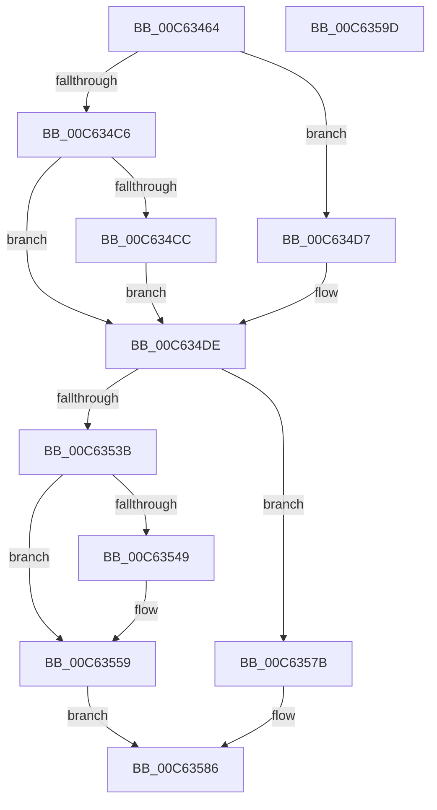

# MxCreatePfn

- RVA: `0x00C63464`–`0x00C6359E` (길이 `314` bytes)
- VA: `0x0000000140C63464`
- 실행 섹션: `INIT`
- PDB 이름 있음: `예`; PDB Function 태그: `아니요`
- unwind 정보 RVA: `0x000D0580`
- 디코드: `85`개 명령, `314/314` bytes 표시
- 미해석 바이트: `0` (있으면 어셈블리에 `.byte`로 보존)

> 이 문서는 커널 이미지의 기계어와 PDB 기호를 분석해 생성했습니다. 4번과 5번은 함수 원형과 자료형을 바이너리 사용 방식에서 추정한 C 해석이며 원본 소스 복구 결과는 아닙니다.

## 1. Dependencies

- 직접 호출 지점: **2**; 고유 호출 대상: **2**
- 직접 호출자로 확인된 함수: **1**
- RIP 상대 이미지 참조: **0**

### Outgoing calls
- `0x00C634B3` → [MiMakeDemandZeroPte](../../text/33/MiMakeDemandZeroPte_function_00337A00.md) (function, `0x00337A00`)
- `0x00C63517` → [MiCopyPfnEntryRaw](../../text/44/MiCopyPfnEntryRaw_function_00448500.md) (function, `0x00448500`)

### Direct callers
- [MxCreatePfnsForPtes](MxCreatePfnsForPtes_function_00C635B0.md) at `0x00C63746`

### Static image references
- 디코드된 RIP-relative 메모리 참조가 없습니다.

## 2. Other-region calls and transfers

- 다른 실행 섹션으로 향하는 call: **2**
  - `0x00C634B3` → [MiMakeDemandZeroPte](../../text/33/MiMakeDemandZeroPte_function_00337A00.md) (`INIT` → `.text`)
  - `0x00C63517` → [MiCopyPfnEntryRaw](../../text/44/MiCopyPfnEntryRaw_function_00448500.md) (`INIT` → `.text`)
- 별도 외부 분기/꼬리 이동을 확인하지 못했습니다.

## 3. Assembly (complete function range)

```asm
00C63464  48 89 5C 24 10                  mov qword ptr [rsp + 0x10], rbx
00C63469  48 89 7C 24 18                  mov qword ptr [rsp + 0x18], rdi
00C6346E  55                              push rbp
00C6346F  48 8B EC                        mov rbp, rsp
00C63472  48 83 EC 50                     sub rsp, 0x50
00C63476  0F 57 C0                        xorps xmm0, xmm0
00C63479  48 B8 FF FF FF FF FF 00 00 00   movabs rax, 0xffffffffff
00C63483  0F 11 45 F0                     movups xmmword ptr [rbp - 0x10], xmm0
00C63487  4C 23 C8                        and r9, rax
00C6348A  BF 01 00 00 00                  mov edi, 1
00C6348F  8A 45 F2                        mov al, byte ptr [rbp - 0xe]
00C63492  4C 8B D9                        mov r11, rcx
00C63495  24 FE                           and al, 0xfe
00C63497  4C 89 4D F8                     mov qword ptr [rbp - 8], r9
00C6349B  0C 06                           or al, 6
00C6349D  0F 11 45 D0                     movups xmmword ptr [rbp - 0x30], xmm0
00C634A1  8D 4F 03                        lea ecx, [rdi + 3]
00C634A4  88 45 F2                        mov byte ptr [rbp - 0xe], al
00C634A7  0F 11 45 E0                     movups xmmword ptr [rbp - 0x20], xmm0
00C634AB  48 89 55 D8                     mov qword ptr [rbp - 0x28], rdx
00C634AF  48 89 7D E8                     mov qword ptr [rbp - 0x18], rdi
00C634B3  E8 48 45 6D FF                  call 0x140337a00
00C634B8  8D 5F 01                        lea ebx, [rdi + 1]
00C634BB  4C 8B C8                        mov r9, rax
00C634BE  8B CF                           mov ecx, edi
00C634C0  41 F6 C0 10                     test r8b, 0x10
00C634C4  75 11                           jne 0x140c634d7
00C634C6  41 F6 C0 08                     test r8b, 8
00C634CA  74 12                           je 0x140c634de
00C634CC  8B CB                           mov ecx, ebx
00C634CE  49 81 C9 00 03 00 00            or r9, 0x300
00C634D5  EB 07                           jmp 0x140c634de
00C634D7  33 C9                           xor ecx, ecx
00C634D9  49 0F BA E9 08                  bts r9, 8
00C634DE  8B 45 F0                        mov eax, dword ptr [rbp - 0x10]
00C634E1  4F 8D 14 5B                     lea r10, [r11 + r11*2]
00C634E5  89 45 10                        mov dword ptr [rbp + 0x10], eax
00C634E8  C1 E8 10                        shr eax, 0x10
00C634EB  24 3F                           and al, 0x3f
00C634ED  C0 E1 06                        shl cl, 6
00C634F0  0A C1                           or al, cl
00C634F2  49 C1 E2 04                     shl r10, 4
00C634F6  88 45 12                        mov byte ptr [rbp + 0x12], al
00C634F9  8B 45 10                        mov eax, dword ptr [rbp + 0x10]
00C634FC  89 45 F0                        mov dword ptr [rbp - 0x10], eax
00C634FF  80 4D F2 10                     or byte ptr [rbp - 0xe], 0x10
00C63503  48 B8 00 00 00 00 00 DE FF FF   movabs rax, 0xffffde0000000000
00C6350D  4C 03 D0                        add r10, rax
00C63510  48 8D 55 D0                     lea rdx, [rbp - 0x30]
00C63514  49 8B CA                        mov rcx, r10
00C63517  E8 E4 4F 7E FF                  call 0x140448500
00C6351C  4D 89 4A 10                     mov qword ptr [r10 + 0x10], r9
00C63520  48 B9 00 00 00 00 00 00 40 00   movabs rcx, 0x40000000000000
00C6352A  49 8B 42 28                     mov rax, qword ptr [r10 + 0x28]
00C6352E  48 0B C1                        or rax, rcx
00C63531  83 7D 30 00                     cmp dword ptr [rbp + 0x30], 0
00C63535  49 89 42 28                     mov qword ptr [r10 + 0x28], rax
00C63539  74 40                           je 0x140c6357b
00C6353B  49 8B C3                        mov rax, r11
00C6353E  48 25 00 FE FF FF               and rax, 0xfffffffffffffe00
00C63544  4C 3B D8                        cmp r11, rax
00C63547  75 10                           jne 0x140c63559
00C63549  41 8B 42 24                     mov eax, dword ptr [r10 + 0x24]
00C6354D  0F BA F0 1B                     btr eax, 0x1b
00C63551  0F BA E8 1C                     bts eax, 0x1c
00C63555  41 89 42 24                     mov dword ptr [r10 + 0x24], eax
00C63559  49 8B 42 28                     mov rax, qword ptr [r10 + 0x28]
00C6355D  48 B9 00 00 00 00 00 01 00 00   movabs rcx, 0x10000000000
00C63567  48 0B C1                        or rax, rcx
00C6356A  49 89 42 28                     mov qword ptr [r10 + 0x28], rax
00C6356E  41 8B 42 20                     mov eax, dword ptr [r10 + 0x20]
00C63572  89 45 30                        mov dword ptr [rbp + 0x30], eax
00C63575  66 89 5D 30                     mov word ptr [rbp + 0x30], bx
00C63579  EB 0B                           jmp 0x140c63586
00C6357B  41 8B 42 20                     mov eax, dword ptr [r10 + 0x20]
00C6357F  89 45 30                        mov dword ptr [rbp + 0x30], eax
00C63582  66 89 7D 30                     mov word ptr [rbp + 0x30], di
00C63586  8B 45 30                        mov eax, dword ptr [rbp + 0x30]
00C63589  48 8B 5C 24 68                  mov rbx, qword ptr [rsp + 0x68]
00C6358E  48 8B 7C 24 70                  mov rdi, qword ptr [rsp + 0x70]
00C63593  41 89 42 20                     mov dword ptr [r10 + 0x20], eax
00C63597  48 83 C4 50                     add rsp, 0x50
00C6359B  5D                              pop rbp
00C6359C  C3                              ret
00C6359D  CC                              int3
```

## 4. C-style interpretation (structured pseudocode)

```c
__int64 __fastcall MxCreatePfn(__int64 a1, __int64 a2, unsigned __int8 a3, __int64 a4, unsigned int a5)
{
    __int64 result;
    __int64 v_r10;
    __int64 v_rsp;
    unsigned __int64 v_stack_m10;
    unsigned __int8 v_stack_m16;
    unsigned __int64 v_stack_m18;
    unsigned __int64 v_stack_m20;
    unsigned __int64 v_stack_m28;
    unsigned __int64 v_stack_m30;
    unsigned __int64 v_stack_m38;
    unsigned __int64 v_stack_p10;
    unsigned __int64 v_stack_p18;
    unsigned int v_stack_p28;
    unsigned int v_stack_p8;
    unsigned __int8 v_stack_pA;

    v_stack_p10 = v_rbx;
    v_stack_p18 = v_rdi;
    v_rsp = (v_rsp) - (80);
    v_stack_m18 = v_xmm0;
    a4 = (a4) & (result);
    result = (unsigned __int8)((v_stack_m16) & (254));
    v_stack_m10 = a4;
    result = (unsigned __int8)((result) | (6));
    v_stack_m38 = v_xmm0;
    v_stack_m16 = (unsigned __int8)(result);
    v_stack_m28 = v_xmm0;
    v_stack_m30 = a2;
    v_stack_m20 = 1;
    result = MiMakeDemandZeroPte(1 + 3, a2, a3, a4);
    if (((a3) & (16)) != 0) goto loc_00C634D7;
    if (((a3) & (8)) == 0) goto loc_00C634DE;
    a4 = (result) | (768);
    goto loc_00C634DE;
loc_00C634D7:
    a1 = 0;
loc_00C634DE:
    v_stack_p8 = (unsigned int)((unsigned int)(v_stack_m18));
    result = (unsigned int)(((unsigned int)(v_stack_m18)) >> (16));
    result = (unsigned __int8)((result) & (63));
    a1 = (unsigned __int8)((a1) << (6));
    result = (unsigned __int8)((result) | ((unsigned __int8)(a1)));
    v_r10 = (a1 + a1 * 2) << (4);
    v_stack_pA = (unsigned __int8)(result);
    v_stack_m18 = (unsigned int)((unsigned int)(v_stack_p8));
    v_r10 = (v_r10) + ((unsigned int)(v_stack_p8));
    result = MiCopyPfnEntryRaw(v_r10, v_stack_m38, a3, a4);
    *(unsigned __int64 *)(v_r10 + 16) = a4;
    result = (*(unsigned __int64 *)(v_r10 + 40)) | (v_r10);
    *(unsigned __int64 *)(v_r10 + 40) = result;
    if (a5 == 0) goto loc_00C6357B;
    result = (a1) & (-512);
    if (a1 == result) {
        result = *(unsigned int *)(v_r10 + 36);
        *(unsigned int *)(v_r10 + 36) = (unsigned int)(result);
    }
    result = (*(unsigned __int64 *)(v_r10 + 40)) | (v_r10);
    *(unsigned __int64 *)(v_r10 + 40) = result;
    v_stack_p28 = (unsigned int)((unsigned int)(*(unsigned int *)(v_r10 + 32)));
    v_stack_p28 = (unsigned __int16)(1 + 1);
    goto loc_00C63586;
loc_00C6357B:
    v_stack_p28 = (unsigned int)((unsigned int)(*(unsigned int *)(v_r10 + 32)));
    v_stack_p28 = 1;
loc_00C63586:
    *(unsigned int *)(v_r10 + 32) = (unsigned int)((unsigned int)(a5));
    v_rsp = (v_rsp) + (80);
    return (unsigned int)(a5);
}
```

## 5. (Beta) C Style

```c
int64_t MxCreatePfn(int64_t Arg1, int64_t Arg2, uint8_t Arg3, int64_t Arg4, uint32_t Arg5)
{
    int64_t result;
    int64_t local_r10;
    int64_t local_rsp;
    uint64_t v_stack_m10;
    uint8_t v_stack_m16;
    uint64_t v_stack_m18;
    uint64_t v_stack_m20;
    uint64_t v_stack_m28;
    uint64_t v_stack_m30;
    uint64_t v_stack_m38;
    uint64_t v_stack_p10;
    uint64_t v_stack_p18;
    uint32_t v_stack_p28;
    uint32_t v_stack_p8;
    uint8_t v_stack_pA;

    v_stack_p10 = local_rbx;
    v_stack_p18 = local_rdi;
    local_rsp = (local_rsp) - (80);
    v_stack_m18 = v_xmm0;
    Arg4 = (Arg4) & (result);
    result = (uint8_t)((v_stack_m16) & (254));
    v_stack_m10 = Arg4;
    result = (uint8_t)((result) | (6));
    v_stack_m38 = v_xmm0;
    v_stack_m16 = (uint8_t)(result);
    v_stack_m28 = v_xmm0;
    v_stack_m30 = Arg2;
    v_stack_m20 = 1;
    result = MiMakeDemandZeroPte(1 + 3, Arg2, Arg3, Arg4);
    if (((Arg3) & (16)) != 0) goto loc_00C634D7;
    if (((Arg3) & (8)) == 0) goto loc_00C634DE;
    Arg4 = (result) | (768);
    goto loc_00C634DE;
loc_00C634D7:
    Arg1 = 0;
loc_00C634DE:
    v_stack_p8 = (uint32_t)((uint32_t)(v_stack_m18));
    result = (uint32_t)(((uint32_t)(v_stack_m18)) >> (16));
    result = (uint8_t)((result) & (63));
    Arg1 = (uint8_t)((Arg1) << (6));
    result = (uint8_t)((result) | ((uint8_t)(Arg1)));
    local_r10 = (Arg1 + Arg1 * 2) << (4);
    v_stack_pA = (uint8_t)(result);
    v_stack_m18 = (uint32_t)((uint32_t)(v_stack_p8));
    local_r10 = (local_r10) + ((uint32_t)(v_stack_p8));
    result = MiCopyPfnEntryRaw(local_r10, v_stack_m38, Arg3, Arg4);
    *(uint64_t *)(local_r10 + 0x10) = Arg4;
    result = (*(uint64_t *)(local_r10 + 0x28)) | (local_r10);
    *(uint64_t *)(local_r10 + 0x28) = result;
    if (Arg5 == 0) goto loc_00C6357B;
    result = (Arg1) & (-512);
    if (Arg1 == result) {
        result = *(uint32_t *)(local_r10 + 0x24);
        *(uint32_t *)(local_r10 + 0x24) = (uint32_t)(result);
    }
    result = (*(uint64_t *)(local_r10 + 0x28)) | (local_r10);
    *(uint64_t *)(local_r10 + 0x28) = result;
    v_stack_p28 = (uint32_t)((uint32_t)(*(uint32_t *)(local_r10 + 0x20)));
    v_stack_p28 = (uint16_t)(1 + 1);
    goto loc_00C63586;
loc_00C6357B:
    v_stack_p28 = (uint32_t)((uint32_t)(*(uint32_t *)(local_r10 + 0x20)));
    v_stack_p28 = 1;
loc_00C63586:
    *(uint32_t *)(local_r10 + 0x20) = (uint32_t)((uint32_t)(Arg5));
    local_rsp = (local_rsp) + (80);
    return (uint32_t)(Arg5);
}
```

## 6. Execution-region graph

[열기: 2D/3D 그래프와 함수 탐색 컨트롤 패널](../../../control-panel.html?section=init&rva=0x00C63464&view=graph)

- 2D 그래프는 위에서 아래로 흐르고, 3D 그래프는 빈 공간을 드래그해 회전합니다. Shift+드래그는 이동, 휠은 확대·축소, 함수 노드 선택은 대상 보고서 이동입니다.

### Static fallback


