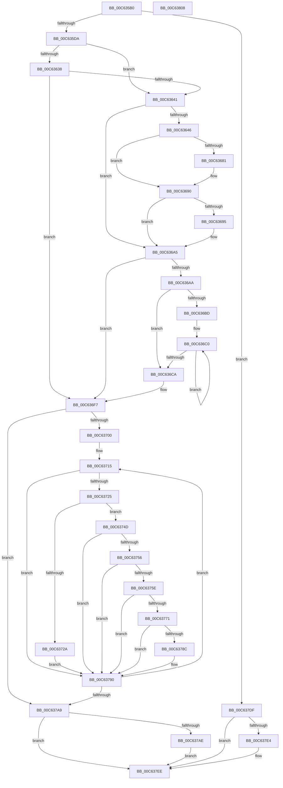

# MxCreatePfnsForPtes

- RVA: `0x00C635B0`–`0x00C63809` (길이 `601` bytes)
- VA: `0x0000000140C635B0`
- 실행 섹션: `INIT`
- PDB 이름 있음: `예`; PDB Function 태그: `아니요`
- unwind 정보 RVA: `0x000D792C`
- 디코드: `156`개 명령, `601/601` bytes 표시
- 미해석 바이트: `0` (있으면 어셈블리에 `.byte`로 보존)

> 이 문서는 커널 이미지의 기계어와 PDB 기호를 분석해 생성했습니다. 4번과 5번은 함수 원형과 자료형을 바이너리 사용 방식에서 추정한 C 해석이며 원본 소스 복구 결과는 아닙니다.

## 1. Dependencies

- 직접 호출 지점: **6**; 고유 호출 대상: **6**
- 직접 호출자로 확인된 함수: **1**
- RIP 상대 이미지 참조: **2**

### Outgoing calls
- `0x00C63604` → [MiGetContainingPageTable](../../text/34/MiGetContainingPageTable_function_003467F0.md) (function, `0x003467F0`)
- `0x00C6369B` → [MiWriteValidPteNewProtection](../../text/28/MiWriteValidPteNewProtection_function_00281810.md) (function, `0x00281810`)
- `0x00C636CD` → [MiGetLeafVa](../../text/27/MiGetLeafVa_function_0027C0A0.md) (function, `0x0027C0A0`)
- `0x00C6371B` → [MiIsRegularMemory](MiIsRegularMemory_function_00C627A8.md) (function, `0x00C627A8`)
- `0x00C63746` → [MxCreatePfn](MxCreatePfn_function_00C63464.md) (function, `0x00C63464`)
- `0x00C637B6` → [MiIncreaseUsedPtesInPfn](../../text/38/MiIncreaseUsedPtesInPfn_function_00382D90.md) (function, `0x00382D90`)

### Direct callers
- [MiInitializePfnsForValidMappings](MiInitializePfnsForValidMappings_function_00C6267C.md) at `0x00C626F6`

### Static image references
- `0x00C6365D` → RVA `0x00E2EE84` (`.data`; read)
- `0x00C637E4` → RVA `0x00010880` (`.rdata`; read)

## 2. Other-region calls and transfers

- 다른 실행 섹션으로 향하는 call: **4**
  - `0x00C63604` → [MiGetContainingPageTable](../../text/34/MiGetContainingPageTable_function_003467F0.md) (`INIT` → `.text`)
  - `0x00C6369B` → [MiWriteValidPteNewProtection](../../text/28/MiWriteValidPteNewProtection_function_00281810.md) (`INIT` → `.text`)
  - `0x00C636CD` → [MiGetLeafVa](../../text/27/MiGetLeafVa_function_0027C0A0.md) (`INIT` → `.text`)
  - `0x00C637B6` → [MiIncreaseUsedPtesInPfn](../../text/38/MiIncreaseUsedPtesInPfn_function_00382D90.md) (`INIT` → `.text`)
- 별도 외부 분기/꼬리 이동을 확인하지 못했습니다.

## 3. Assembly (complete function range)

```asm
00C635B0  48 89 5C 24 08                  mov qword ptr [rsp + 8], rbx
00C635B5  55                              push rbp
00C635B6  56                              push rsi
00C635B7  57                              push rdi
00C635B8  41 54                           push r12
00C635BA  41 55                           push r13
00C635BC  41 56                           push r14
00C635BE  41 57                           push r15
00C635C0  48 83 EC 40                     sub rsp, 0x40
00C635C4  4C 8B 12                        mov r10, qword ptr [rdx]
00C635C7  48 8B FA                        mov rdi, rdx
00C635CA  45 8B F0                        mov r14d, r8d
00C635CD  49 8B DA                        mov rbx, r10
00C635D0  41 F6 C2 01                     test r10b, 1
00C635D4  0F 84 05 02 00 00               je 0x140c637df
00C635DA  48 8B 81 B8 00 00 00            mov rax, qword ptr [rcx + 0xb8]
00C635E1  4D 8B FA                        mov r15, r10
00C635E4  49 C1 EF 0C                     shr r15, 0xc
00C635E8  48 8B CA                        mov rcx, rdx
00C635EB  4C 8B 18                        mov r11, qword ptr [rax]
00C635EE  44 8B 60 08                     mov r12d, dword ptr [rax + 8]
00C635F2  48 B8 FF FF FF FF FF 00 00 00   movabs rax, 0xffffffffff
00C635FC  4C 23 F8                        and r15, rax
00C635FF  4C 89 5C 24 30                  mov qword ptr [rsp + 0x30], r11
00C63604  E8 E7 31 6E FF                  call 0x1403467f0
00C63609  48 89 84 24 98 00 00 00         mov qword ptr [rsp + 0x98], rax
00C63611  48 8D 2C 40                     lea rbp, [rax + rax*2]
00C63615  48 C1 E5 04                     shl rbp, 4
00C63619  48 B8 00 00 00 00 00 DE FF FF   movabs rax, 0xffffde0000000000
00C63623  33 F6                           xor esi, esi
00C63625  4C 8D 6F 08                     lea r13, [rdi + 8]
00C63629  48 03 E8                        add rbp, rax
00C6362C  89 B4 24 88 00 00 00            mov dword ptr [rsp + 0x88], esi
00C63633  45 85 F6                        test r14d, r14d
00C63636  74 09                           je 0x140c63641
00C63638  45 84 D2                        test r10b, r10b
00C6363B  0F 89 B6 00 00 00               jns 0x140c636f7
00C63641  45 85 E4                        test r12d, r12d
00C63644  74 5F                           je 0x140c636a5
00C63646  49 8B CA                        mov rcx, r10
00C63649  48 83 E1 FB                     and rcx, 0xfffffffffffffffb
00C6364D  48 8B D1                        mov rdx, rcx
00C63650  48 0F BA EA 0B                  bts rdx, 0xb
00C63655  41 F6 C2 42                     test r10b, 0x42
00C63659  48 0F 44 D1                     cmove rdx, rcx
00C6365D  0F B6 0D 20 B8 1C 00            movzx ecx, byte ptr [rip + 0x1cb820]
00C63664  48 8B DA                        mov rbx, rdx
00C63667  48 83 CB 20                     or rbx, 0x20
00C6366B  F6 C2 20                        test dl, 0x20
00C6366E  48 0F 45 DA                     cmovne rbx, rdx
00C63672  48 8B C3                        mov rax, rbx
00C63675  48 C1 E8 08                     shr rax, 8
00C63679  83 E0 01                        and eax, 1
00C6367C  48 3B C1                        cmp rax, rcx
00C6367F  74 0F                           je 0x140c63690
00C63681  48 C1 E1 08                     shl rcx, 8
00C63685  48 33 D9                        xor rbx, rcx
00C63688  48 0F BA F3 08                  btr rbx, 8
00C6368D  48 33 D9                        xor rbx, rcx
00C63690  49 3B DA                        cmp rbx, r10
00C63693  74 10                           je 0x140c636a5
00C63695  48 8B D3                        mov rdx, rbx
00C63698  48 8B CF                        mov rcx, rdi
00C6369B  E8 70 E1 61 FF                  call 0x140281810
00C636A0  4C 8B 5C 24 30                  mov r11, qword ptr [rsp + 0x30]
00C636A5  45 85 F6                        test r14d, r14d
00C636A8  74 4D                           je 0x140c636f7
00C636AA  C7 84 24 88 00 00 00 01 00 00 00  mov dword ptr [rsp + 0x88], 1
00C636B5  41 B9 01 00 00 00               mov r9d, 1
00C636BB  7E 0D                           jle 0x140c636ca
00C636BD  49 8B C6                        mov rax, r14
00C636C0  49 C1 E1 09                     shl r9, 9
00C636C4  48 83 E8 01                     sub rax, 1
00C636C8  75 F6                           jne 0x140c636c0
00C636CA  48 8B CF                        mov rcx, rdi
00C636CD  E8 CE 89 61 FF                  call 0x14027c0a0
00C636D2  48 8B F8                        mov rdi, rax
00C636D5  48 B8 F8 FF FF FF 7F 00 00 00   movabs rax, 0x7ffffffff8
00C636DF  48 C1 EF 09                     shr rdi, 9
00C636E3  48 23 F8                        and rdi, rax
00C636E6  48 B8 00 00 00 00 80 F6 FF FF   movabs rax, 0xfffff68000000000
00C636F0  48 03 F8                        add rdi, rax
00C636F3  4E 8D 2C CF                     lea r13, [rdi + r9*8]
00C636F7  49 3B FD                        cmp rdi, r13
00C636FA  0F 83 A9 00 00 00               jae 0x140c637a9
00C63700  4F 8D 34 7F                     lea r14, [r15 + r15*2]
00C63704  49 C1 E6 04                     shl r14, 4
00C63708  48 B8 20 00 00 00 00 DE FF FF   movabs rax, 0xffffde0000000020
00C63712  4C 03 F0                        add r14, rax
00C63715  49 8B D7                        mov rdx, r15
00C63718  49 8B CB                        mov rcx, r11
00C6371B  E8 88 F0 FF FF                  call 0x140c627a8
00C63720  48 85 C0                        test rax, rax
00C63723  74 6B                           je 0x140c63790
00C63725  45 85 E4                        test r12d, r12d
00C63728  74 23                           je 0x140c6374d
00C6372A  8B 84 24 88 00 00 00            mov eax, dword ptr [rsp + 0x88]
00C63731  4C 8B C3                        mov r8, rbx
00C63734  4C 8B 8C 24 98 00 00 00         mov r9, qword ptr [rsp + 0x98]
00C6373C  48 8B D7                        mov rdx, rdi
00C6373F  49 8B CF                        mov rcx, r15
00C63742  89 44 24 20                     mov dword ptr [rsp + 0x20], eax
00C63746  E8 19 FD FF FF                  call 0x140c63464
00C6374B  EB 43                           jmp 0x140c63790
00C6374D  49 8B 46 E8                     mov rax, qword ptr [r14 - 0x18]
00C63751  48 3B C7                        cmp rax, rdi
00C63754  75 3A                           jne 0x140c63790
00C63756  41 8B 06                        mov eax, dword ptr [r14]
00C63759  66 85 C0                        test ax, ax
00C6375C  74 32                           je 0x140c63790
00C6375E  49 8B 46 F8                     mov rax, qword ptr [r14 - 8]
00C63762  48 B9 FF FF FF FF FF FF FF 3F   movabs rcx, 0x3fffffffffffffff
00C6376C  48 85 C1                        test rcx, rax
00C6376F  74 1F                           je 0x140c63790
00C63771  49 8B 46 08                     mov rax, qword ptr [r14 + 8]
00C63775  48 B9 FF FF FF FF FF 00 00 00   movabs rcx, 0xffffffffff
00C6377F  48 23 C1                        and rax, rcx
00C63782  48 3B 84 24 98 00 00 00         cmp rax, qword ptr [rsp + 0x98]
00C6378A  75 04                           jne 0x140c63790
00C6378C  48 8B 45 08                     mov rax, qword ptr [rbp + 8]
00C63790  4C 8B 5C 24 30                  mov r11, qword ptr [rsp + 0x30]
00C63795  49 FF C7                        inc r15
00C63798  49 83 C6 30                     add r14, 0x30
00C6379C  48 83 C7 08                     add rdi, 8
00C637A0  49 3B FD                        cmp rdi, r13
00C637A3  0F 82 6C FF FF FF               jb 0x140c63715
00C637A9  45 85 E4                        test r12d, r12d
00C637AC  74 40                           je 0x140c637ee
00C637AE  BA 01 00 00 00                  mov edx, 1
00C637B3  48 8B CD                        mov rcx, rbp
00C637B6  E8 D5 F5 71 FF                  call 0x140382d90
00C637BB  48 8B 45 18                     mov rax, qword ptr [rbp + 0x18]
00C637BF  48 8D 48 01                     lea rcx, [rax + 1]
00C637C3  48 8B D1                        mov rdx, rcx
00C637C6  48 33 D0                        xor rdx, rax
00C637C9  48 B8 00 00 00 00 00 00 00 C0   movabs rax, 0xc000000000000000
00C637D3  48 23 D0                        and rdx, rax
00C637D6  48 33 D1                        xor rdx, rcx
00C637D9  48 89 55 18                     mov qword ptr [rbp + 0x18], rdx
00C637DD  EB 0F                           jmp 0x140c637ee
00C637DF  4D 85 D2                        test r10, r10
00C637E2  74 0A                           je 0x140c637ee
00C637E4  48 8B 05 95 D0 3A FF            mov rax, qword ptr [rip - 0xc52f6b]
00C637EB  48 89 02                        mov qword ptr [rdx], rax
00C637EE  48 8B 9C 24 80 00 00 00         mov rbx, qword ptr [rsp + 0x80]
00C637F6  33 C0                           xor eax, eax
00C637F8  48 83 C4 40                     add rsp, 0x40
00C637FC  41 5F                           pop r15
00C637FE  41 5E                           pop r14
00C63800  41 5D                           pop r13
00C63802  41 5C                           pop r12
00C63804  5F                              pop rdi
00C63805  5E                              pop rsi
00C63806  5D                              pop rbp
00C63807  C3                              ret
00C63808  CC                              int3
```

## 4. C-style interpretation (structured pseudocode)

```c
__int64 __fastcall MxCreatePfnsForPtes(__int64 a1, __int64 a2, int a3)
{
    __int64 result;
    __int64 v_r11;
    __int64 v_r14;
    __int64 v_r15;
    __int64 v_rbp;
    __int64 v_rbx;
    __int64 v_rdi;
    __int64 v_rsi;
    __int64 v_rsp;
    unsigned __int64 v_stack_m48;
    unsigned int v_stack_m58;
    unsigned int v_stack_p10;
    unsigned __int64 v_stack_p20;
    unsigned __int64 v_stack_p8;

    v_stack_p8 = v_rbx;
    v_rsp = (v_rsp) - (64);
    if ((((unsigned __int8)(*(unsigned __int64 *)(a2))) & (1)) == 0) goto loc_00C637DF;
    v_r15 = (*(unsigned __int64 *)(a2)) >> (12);
    v_r15 = (v_r15) & (*(unsigned __int64 *)(a1 + 184));
    v_stack_m48 = *(unsigned __int64 *)(*(unsigned __int64 *)(a1 + 184));
    result = MiGetContainingPageTable(a2, a2, a3, a4);
    v_stack_p20 = result;
    v_rbp = (result + result * 2) << (4);
    v_rsi = 0;
    v_rbp = (v_rbp) + (result);
    v_stack_p10 = 0;
    if ((unsigned int)((unsigned int)(a3)) == 0) goto loc_00C63641;
    if (!sign_flag) goto loc_00C636F7;
loc_00C63641:
    if ((unsigned int)((unsigned int)(*(unsigned int *)(*(unsigned __int64 *)(a1 + 184) + 8))) == 0) goto loc_00C636A5;
    a1 = (*(unsigned __int64 *)(a2)) & (-5);
    if ((((unsigned __int8)(*(unsigned __int64 *)(a2))) & (66)) == 0) { a1 = a1; }
    v_rbx = (a1) | (32);
    if ((((unsigned __int8)(a1)) & (32)) != 0) { v_rbx = a1; }
    result = (v_rbx) >> (8);
    result = (unsigned int)((result) & (1));
    if (result != (*(unsigned __int8 *)(v_rip + 1882144))) {
        a1 = (*(unsigned __int8 *)(v_rip + 1882144)) << (8);
        v_rbx = (v_rbx) ^ (a1);
        v_rbx = (v_rbx) ^ (a1);
    }
    v_r11 = *(unsigned __int64 *)(*(unsigned __int64 *)(a1 + 184));
    if (v_rbx != (*(unsigned __int64 *)(a2))) {
        a2 = v_rbx;
        a1 = a2;
        result = MiWriteValidPteNewProtection(a1, a2, a3, a4);
        v_r11 = v_stack_m48;
    }
    if ((unsigned int)((unsigned int)(a3)) == 0) goto loc_00C636F7;
    v_stack_p10 = 1;
    if (condition_is_less_or_equal) goto loc_00C636CA;
loc_00C636C0:
    a4 = (1) << (9);
    result = ((unsigned int)(a3)) - (1);
    if (condition_is_not_equal) goto loc_00C636C0;
loc_00C636CA:
    result = MiGetLeafVa(a2, a2, a3, a4);
    v_rdi = (result) >> (9);
    v_rdi = (v_rdi) & (result);
    v_rdi = (v_rdi) + (result);
loc_00C636F7:
    if (v_rdi >= (v_rdi + a4 * 8)) goto loc_00C637A9;
    v_r14 = (v_r15 + v_r15 * 2) << (4);
    v_r14 = (v_r14) + (result);
loc_00C63715:
    result = MiIsRegularMemory(v_r11, v_r15, a3, a4);
    if (result == 0) goto loc_00C63790;
    if ((unsigned int)((unsigned int)(*(unsigned int *)(*(unsigned __int64 *)(a1 + 184) + 8))) == 0) goto loc_00C6374D;
    v_stack_m58 = (unsigned int)((unsigned int)(v_stack_p10));
    result = MxCreatePfn(v_r15, v_rdi, v_rbx, v_stack_p20);
    goto loc_00C63790;
loc_00C6374D:
    if ((*(unsigned __int64 *)(v_r14 - 24)) != v_rdi) goto loc_00C63790;
    if ((unsigned __int16)((unsigned int)(*(unsigned int *)(v_r14))) == 0) goto loc_00C63790;
    if (((v_r15) & (*(unsigned __int64 *)(v_r14 - 8))) == 0) goto loc_00C63790;
    result = (*(unsigned __int64 *)(v_r14 + 8)) & (v_r15);
    if (result == v_stack_p20) {
        result = *(unsigned __int64 *)(v_rbp + 8);
    }
    v_r15 = (v_r15) + 1;
    v_r14 = (v_r14) + (48);
    v_rdi = (v_rdi) + (8);
    if (v_rdi < (v_rdi + a4 * 8)) goto loc_00C63715;
loc_00C637A9:
    if ((unsigned int)((unsigned int)(*(unsigned int *)(*(unsigned __int64 *)(a1 + 184) + 8))) == 0) goto loc_00C637EE;
    result = MiIncreaseUsedPtesInPfn(v_rbp, 1, v_rbx, v_stack_p20);
    a2 = (*(unsigned __int64 *)(v_rbp + 24) + 1) ^ (*(unsigned __int64 *)(v_rbp + 24));
    a2 = (a2) & (*(unsigned __int64 *)(v_rbp + 24));
    a2 = (a2) ^ (*(unsigned __int64 *)(v_rbp + 24) + 1);
    *(unsigned __int64 *)(v_rbp + 24) = a2;
    goto loc_00C637EE;
loc_00C637DF:
    result = *(unsigned __int64 *)(v_rbp + 24);
    if (*(unsigned __int64 *)(a2) != 0) {
        result = *(unsigned __int64 *)(v_rip - 12922731);
        *(unsigned __int64 *)(a2) = result;
    }
    result = 0;
    v_rsp = (v_rsp) + (64);
    return result;
}
```

## 5. (Beta) C Style

```c
int64_t MxCreatePfnsForPtes(void *Arg1, void *Arg2, int32_t Arg3)
{
    uint8_t *arg1 = (uint8_t *)Arg1;
    uint8_t *arg2 = (uint8_t *)Arg2;

    int64_t result;
    int64_t local_r11;
    int64_t local_r14;
    int64_t local_r15;
    int64_t local_rbp;
    int64_t local_rbx;
    int64_t local_rdi;
    int64_t local_rsi;
    int64_t local_rsp;
    uint64_t v_stack_m48;
    uint32_t v_stack_m58;
    uint32_t v_stack_p10;
    uint64_t v_stack_p20;
    uint64_t v_stack_p8;

    v_stack_p8 = local_rbx;
    local_rsp = (local_rsp) - (64);
    if ((((uint8_t)(*(uint64_t *)(arg2))) & (1)) == 0) goto loc_00C637DF;
    local_r15 = (*(uint64_t *)(arg2)) >> (12);
    local_r15 = (local_r15) & (*(uint64_t *)(arg1 + 0xB8));
    v_stack_m48 = *(uint64_t *)(*(uint64_t *)(arg1 + 0xB8));
    result = MiGetContainingPageTable(Arg2, Arg2, Arg3, a4);
    v_stack_p20 = result;
    local_rbp = (result + result * 2) << (4);
    local_rsi = 0;
    local_rbp = (local_rbp) + (result);
    v_stack_p10 = 0;
    if ((uint32_t)((uint32_t)(Arg3)) == 0) goto loc_00C63641;
    if (!sign_flag) goto loc_00C636F7;
loc_00C63641:
    if ((uint32_t)((uint32_t)(*(uint32_t *)(*(uint64_t *)(arg1 + 0xB8) + 0x8))) == 0) goto loc_00C636A5;
    Arg1 = (*(uint64_t *)(arg2)) & (-5);
    if ((((uint8_t)(*(uint64_t *)(arg2))) & (66)) == 0) { Arg1 = Arg1; }
    local_rbx = (Arg1) | (32);
    if ((((uint8_t)(Arg1)) & (32)) != 0) { local_rbx = Arg1; }
    result = (local_rbx) >> (8);
    result = (uint32_t)((result) & (1));
    if (result != (*(uint8_t *)(v_rip + 0x1CB820))) {
        Arg1 = (*(uint8_t *)(v_rip + 0x1CB820)) << (8);
        local_rbx = (local_rbx) ^ (Arg1);
        local_rbx = (local_rbx) ^ (Arg1);
    }
    local_r11 = *(uint64_t *)(*(uint64_t *)(arg1 + 0xB8));
    if (local_rbx != (*(uint64_t *)(arg2))) {
        Arg2 = local_rbx;
        Arg1 = Arg2;
        result = MiWriteValidPteNewProtection(Arg1, Arg2, Arg3, a4);
        local_r11 = v_stack_m48;
    }
    if ((uint32_t)((uint32_t)(Arg3)) == 0) goto loc_00C636F7;
    v_stack_p10 = 1;
    if (condition_is_less_or_equal) goto loc_00C636CA;
loc_00C636C0:
    a4 = (1) << (9);
    result = ((uint32_t)(Arg3)) - (1);
    if (condition_is_not_equal) goto loc_00C636C0;
loc_00C636CA:
    result = MiGetLeafVa(Arg2, Arg2, Arg3, a4);
    local_rdi = (result) >> (9);
    local_rdi = (local_rdi) & (result);
    local_rdi = (local_rdi) + (result);
loc_00C636F7:
    if (local_rdi >= (local_rdi + a4 * 8)) goto loc_00C637A9;
    local_r14 = (local_r15 + local_r15 * 2) << (4);
    local_r14 = (local_r14) + (result);
loc_00C63715:
    result = MiIsRegularMemory(local_r11, local_r15, Arg3, a4);
    if (result == 0) goto loc_00C63790;
    if ((uint32_t)((uint32_t)(*(uint32_t *)(*(uint64_t *)(arg1 + 0xB8) + 0x8))) == 0) goto loc_00C6374D;
    v_stack_m58 = (uint32_t)((uint32_t)(v_stack_p10));
    result = MxCreatePfn(local_r15, local_rdi, local_rbx, v_stack_p20);
    goto loc_00C63790;
loc_00C6374D:
    if ((*(uint64_t *)(local_r14 - 0x18)) != local_rdi) goto loc_00C63790;
    if ((uint16_t)((uint32_t)(*(uint32_t *)(local_r14))) == 0) goto loc_00C63790;
    if (((local_r15) & (*(uint64_t *)(local_r14 - 0x8))) == 0) goto loc_00C63790;
    result = (*(uint64_t *)(local_r14 + 0x8)) & (local_r15);
    if (result == v_stack_p20) {
        result = *(uint64_t *)(local_rbp + 0x8);
    }
    local_r15 = (local_r15) + 1;
    local_r14 = (local_r14) + (48);
    local_rdi = (local_rdi) + (8);
    if (local_rdi < (local_rdi + a4 * 8)) goto loc_00C63715;
loc_00C637A9:
    if ((uint32_t)((uint32_t)(*(uint32_t *)(*(uint64_t *)(arg1 + 0xB8) + 0x8))) == 0) goto loc_00C637EE;
    result = MiIncreaseUsedPtesInPfn(local_rbp, 1, local_rbx, v_stack_p20);
    Arg2 = (*(uint64_t *)(local_rbp + 0x18) + 1) ^ (*(uint64_t *)(local_rbp + 0x18));
    Arg2 = (Arg2) & (*(uint64_t *)(local_rbp + 0x18));
    Arg2 = (Arg2) ^ (*(uint64_t *)(local_rbp + 0x18) + 1);
    *(void **)(local_rbp + 0x18) = Arg2;
    goto loc_00C637EE;
loc_00C637DF:
    result = *(uint64_t *)(local_rbp + 0x18);
    if (*(uint64_t *)(arg2) != 0) {
        result = *(uint64_t *)(v_rip - 0xC52F6B);
        *(uint64_t *)(arg2) = result;
    }
    result = 0;
    local_rsp = (local_rsp) + (64);
    return result;
}
```

### 관측된 메모리 오프셋

구조체 형식이 확인되지 않은 접근은 인자 기준의 오프셋으로만 기록했습니다.

| 기준 인자 | 오프셋 표현 | 폭 (bit) | 접근 |
|---|---:|---:|---|
| `Arg1` | `+ 0xB8` | `64` | `R` |
| `Arg2` | `+ 0x0` | `64` | `R` |
| `Arg2` | `+ 0x0` | `64` | `W` |
| `Arg2` | `+ 0x8` | `64` | `R` |

## 6. Execution-region graph

[열기: 2D/3D 그래프와 함수 탐색 컨트롤 패널](../../../control-panel.html?section=init&rva=0x00C635B0&view=graph)

- 2D 그래프는 위에서 아래로 흐르고, 3D 그래프는 빈 공간을 드래그해 회전합니다. Shift+드래그는 이동, 휠은 확대·축소, 함수 노드 선택은 대상 보고서 이동입니다.

### Static fallback


