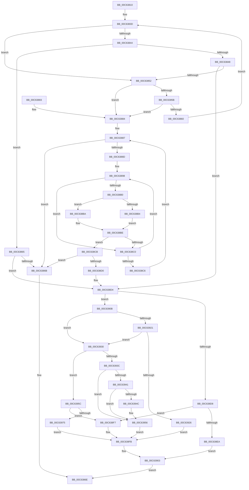

# MxGetNextPage

- RVA: `0x00C63810`–`0x00C63985` (길이 `373` bytes)
- VA: `0x0000000140C63810`
- 실행 섹션: `INIT`
- PDB 이름 있음: `예`; PDB Function 태그: `아니요`
- unwind 정보 RVA: `0x000D7968`
- 디코드: `112`개 명령, `373/373` bytes 표시
- 미해석 바이트: `0` (있으면 어셈블리에 `.byte`로 보존)

> 이 문서는 커널 이미지의 기계어와 PDB 기호를 분석해 생성했습니다. 4번과 5번은 함수 원형과 자료형을 바이너리 사용 방식에서 추정한 C 해석이며 원본 소스 복구 결과는 아닙니다.

## 1. Dependencies

- 직접 호출 지점: **1**; 고유 호출 대상: **1**
- 직접 호출자로 확인된 함수: **1**
- RIP 상대 이미지 참조: **2**

### Outgoing calls
- `0x00C638FE` → [MxBootDescriptorDepleted](MxBootDescriptorDepleted_function_00C62F18.md) (function, `0x00C62F18`)

### Direct callers
- [MxMapVa](MxMapVa_function_00C63EC4.md) at `0x00C63F5E`
- [MxMapVa](MxMapVa_function_00C63EC4.md) at `0x00C63F72`

### Static image references
- `0x00C63826` → RVA `0x010093D0` (`INITDATA`; read)
- `0x00C6388D` → RVA `0x00FC5000` (`ALMOSTRO`; read)

## 2. Other-region calls and transfers

- 다른 실행 섹션으로 향하는 call: **0**
- 별도 외부 분기/꼬리 이동을 확인하지 못했습니다.

## 3. Assembly (complete function range)

```asm
00C63810  48 89 5C 24 08                  mov qword ptr [rsp + 8], rbx
00C63815  48 89 6C 24 10                  mov qword ptr [rsp + 0x10], rbp
00C6381A  48 89 74 24 18                  mov qword ptr [rsp + 0x18], rsi
00C6381F  57                              push rdi
00C63820  48 83 EC 20                     sub rsp, 0x20
00C63824  8B C1                           mov eax, ecx
00C63826  48 8D 2D A3 5B 3A 00            lea rbp, [rip + 0x3a5ba3]
00C6382D  4C 6B D0 38                     imul r10, rax, 0x38
00C63831  8B FA                           mov edi, edx
00C63833  4C 03 D5                        add r10, rbp
00C63836  4D 8B C2                        mov r8, r10
00C63839  49 83 C9 FF                     or r9, 0xffffffffffffffff
00C6383D  49 83 78 08 00                  cmp qword ptr [r8 + 8], 0
00C63842  74 0E                           je 0x140c63852
00C63844  85 FF                           test edi, edi
00C63846  75 1D                           jne 0x140c63865
00C63848  4D 39 48 10                     cmp qword ptr [r8 + 0x10], r9
00C6384C  0F 85 82 00 00 00               jne 0x140c638d4
00C63852  49 8B 40 30                     mov rax, qword ptr [r8 + 0x30]
00C63856  48 85 C0                        test rax, rax
00C63859  74 29                           je 0x140c63884
00C6385B  4D 3B C2                        cmp r8, r10
00C6385E  75 24                           jne 0x140c63884
00C63860  4C 8B C0                        mov r8, rax
00C63863  EB D8                           jmp 0x140c6383d
00C63865  4D 39 48 18                     cmp qword ptr [r8 + 0x18], r9
00C63869  75 69                           jne 0x140c638d4
00C6386B  49 8B C1                        mov rax, r9
00C6386E  48 8B 5C 24 30                  mov rbx, qword ptr [rsp + 0x30]
00C63873  48 8B 6C 24 38                  mov rbp, qword ptr [rsp + 0x38]
00C63878  48 8B 74 24 40                  mov rsi, qword ptr [rsp + 0x40]
00C6387D  48 83 C4 20                     add rsp, 0x20
00C63881  5F                              pop rdi
00C63882  C3                              ret
00C63883  CC                              int3
00C63884  45 33 DB                        xor r11d, r11d
00C63887  41 83 FB 02                     cmp r11d, 2
00C6388B  73 DE                           jae 0x140c6386b
00C6388D  0F B7 35 6C 17 36 00            movzx esi, word ptr [rip + 0x36176c]
00C63894  33 DB                           xor ebx, ebx
00C63896  8B C1                           mov eax, ecx
00C63898  8D 50 01                        lea edx, [rax + 1]
00C6389B  33 C0                           xor eax, eax
00C6389D  3B D6                           cmp edx, esi
00C6389F  0F 45 C2                        cmovne eax, edx
00C638A2  4C 6B C0 38                     imul r8, rax, 0x38
00C638A6  4C 03 C5                        add r8, rbp
00C638A9  49 83 78 28 00                  cmp qword ptr [r8 + 0x28], 0
00C638AE  74 10                           je 0x140c638c0
00C638B0  85 FF                           test edi, edi
00C638B2  74 06                           je 0x140c638ba
00C638B4  4D 39 48 18                     cmp qword ptr [r8 + 0x18], r9
00C638B8  EB 04                           jmp 0x140c638be
00C638BA  4D 39 48 10                     cmp qword ptr [r8 + 0x10], r9
00C638BE  75 0B                           jne 0x140c638cb
00C638C0  FF C3                           inc ebx
00C638C2  3B DE                           cmp ebx, esi
00C638C4  72 D2                           jb 0x140c63898
00C638C6  41 FF C3                        inc r11d
00C638C9  EB BC                           jmp 0x140c63887
00C638CB  4D 85 C0                        test r8, r8
00C638CE  74 9B                           je 0x140c6386b
00C638D0  4D 89 42 30                     mov qword ptr [r10 + 0x30], r8
00C638D4  85 FF                           test edi, edi
00C638D6  74 33                           je 0x140c6390b
00C638D8  49 8B 50 18                     mov rdx, qword ptr [r8 + 0x18]
00C638DC  48 8B C2                        mov rax, rdx
00C638DF  49 2B 00                        sub rax, qword ptr [r8]
00C638E2  48 3D 00 02 00 00               cmp rax, 0x200
00C638E8  72 0D                           jb 0x140c638f7
00C638EA  48 8D 82 00 FE FF FF            lea rax, [rdx - 0x200]
00C638F1  49 89 40 18                     mov qword ptr [r8 + 0x18], rax
00C638F5  EB 0C                           jmp 0x140c63903
00C638F7  4D 89 48 18                     mov qword ptr [r8 + 0x18], r9
00C638FB  49 8B C8                        mov rcx, r8
00C638FE  E8 15 F6 FF FF                  call 0x140c62f18
00C63903  48 8B C2                        mov rax, rdx
00C63906  E9 63 FF FF FF                  jmp 0x140c6386e
00C6390B  49 8B 50 10                     mov rdx, qword ptr [r8 + 0x10]
00C6390F  49 C7 C3 00 FE FF FF            mov r11, 0xfffffffffffffe00
00C63916  48 8B C2                        mov rax, rdx
00C63919  49 23 C3                        and rax, r11
00C6391C  48 3B D0                        cmp rdx, rax
00C6391F  74 0F                           je 0x140c63930
00C63921  49 3B 10                        cmp rdx, qword ptr [r8]
00C63924  74 0A                           je 0x140c63930
00C63926  48 8D 42 FF                     lea rax, [rdx - 1]
00C6392A  49 89 40 10                     mov qword ptr [r8 + 0x10], rax
00C6392E  EB CB                           jmp 0x140c638fb
00C63930  4D 8B 50 18                     mov r10, qword ptr [r8 + 0x18]
00C63934  49 8B 08                        mov rcx, qword ptr [r8]
00C63937  4D 3B D1                        cmp r10, r9
00C6393A  75 20                           jne 0x140c6395c
00C6393C  48 3B D1                        cmp rdx, rcx
00C6393F  74 15                           je 0x140c63956
00C63941  48 8B C1                        mov rax, rcx
00C63944  49 23 C3                        and rax, r11
00C63947  48 3B C8                        cmp rcx, rax
00C6394A  74 0A                           je 0x140c63956
00C6394C  4C 8B C9                        mov r9, rcx
00C6394F  49 81 C9 FF 01 00 00            or r9, 0x1ff
00C63956  4D 89 48 10                     mov qword ptr [r8 + 0x10], r9
00C6395A  EB 9F                           jmp 0x140c638fb
00C6395C  49 8D 82 FF 01 00 00            lea rax, [r10 + 0x1ff]
00C63963  49 89 40 10                     mov qword ptr [r8 + 0x10], rax
00C63967  49 8B C2                        mov rax, r10
00C6396A  48 2B C1                        sub rax, rcx
00C6396D  48 3D 00 02 00 00               cmp rax, 0x200
00C63973  72 82                           jb 0x140c638f7
00C63975  49 8D 82 00 FE FF FF            lea rax, [r10 - 0x200]
00C6397C  49 89 40 18                     mov qword ptr [r8 + 0x18], rax
00C63980  E9 76 FF FF FF                  jmp 0x140c638fb
```

## 4. C-style interpretation (structured pseudocode)

```c
__int64 __fastcall MxGetNextPage(int a1, int a2, __int64 a3, __int64 a4)
{
    __int64 result;
    __int64 v_r10;
    __int64 v_r11;
    __int64 v_rbx;
    __int64 v_rsp;
    unsigned __int64 v_stack_p10;
    unsigned __int64 v_stack_p18;
    unsigned __int64 v_stack_p8;

    v_stack_p8 = v_rbx;
    v_stack_p10 = v_rbp;
    v_stack_p18 = v_rsi;
    v_rsp = (v_rsp) - (32);
    v_r10 = (v_r10) * ((unsigned int)(a1));
    v_r10 = (v_r10) + (v_rip + 3824547);
    a4 = (a4) | (-1);
loc_00C6383D:
    if ((*(unsigned __int64 *)(v_r10 + 8)) == 0) goto loc_00C63852;
    if ((unsigned int)((unsigned int)(a2)) != 0) goto loc_00C63865;
    if ((*(unsigned __int64 *)(v_r10 + 16)) != a4) goto loc_00C638D4;
loc_00C63852:
    if (*(unsigned __int64 *)(v_r10 + 48) == 0) goto loc_00C63884;
    if (v_r10 != v_r10) goto loc_00C63884;
    goto loc_00C6383D;
loc_00C63865:
    if ((*(unsigned __int64 *)(*(unsigned __int64 *)(v_r10 + 48) + 24)) != a4) goto loc_00C638D4;
loc_00C6386B:
loc_00C6386E:
    v_rsp = (v_rsp) + (32);
    return a4;
loc_00C63884:
    v_r11 = 0;
loc_00C63887:
    if (0 >= 2) goto loc_00C6386B;
    v_rbx = 0;
loc_00C63898:
    result = 0;
    if (((unsigned int)((unsigned int)(a1) + 1)) != ((unsigned int)(*(unsigned __int16 *)(v_rip + 3544940)))) { result = (unsigned int)((unsigned int)(a1) + 1); }
    a3 = (*(unsigned __int64 *)(v_r10 + 48)) * (result);
    a3 = (a3) + (v_stack_p10);
    if ((*(unsigned __int64 *)(a3 + 40)) == 0) goto loc_00C638C0;
    if ((unsigned int)((unsigned int)(a2)) == 0) goto loc_00C638BA;
    goto loc_00C638BE;
loc_00C638BA:
loc_00C638BE:
    if ((*(unsigned __int64 *)(a3 + 16)) != a4) goto loc_00C638CB;
loc_00C638C0:
    v_rbx = (unsigned int)((v_rbx) + 1);
    if (((unsigned int)(v_rbx)) < ((unsigned int)(*(unsigned __int16 *)(v_rip + 3544940)))) goto loc_00C63898;
    v_r11 = (unsigned int)((v_r11) + 1);
    goto loc_00C63887;
loc_00C638CB:
    if (a3 == 0) goto loc_00C6386B;
    *(unsigned __int64 *)(v_r10 + 48) = a3;
loc_00C638D4:
    if ((unsigned int)((unsigned int)(a2)) == 0) goto loc_00C6390B;
    result = (*(unsigned __int64 *)(a3 + 24)) - (*(unsigned __int64 *)(a3));
    if (result < 512) goto loc_00C638F7;
    *(unsigned __int64 *)(a3 + 24) = *(unsigned __int64 *)(a3 + 24) - 512;
    goto loc_00C63903;
loc_00C638F7:
    *(unsigned __int64 *)(a3 + 24) = a4;
loc_00C638FB:
    result = MxBootDescriptorDepleted(a3, *(unsigned __int64 *)(a3 + 24), a3, a4);
loc_00C63903:
    goto loc_00C6386E;
loc_00C6390B:
    result = (*(unsigned __int64 *)(a3 + 16)) & (-512);
    if ((*(unsigned __int64 *)(a3 + 16)) == result) goto loc_00C63930;
    if ((*(unsigned __int64 *)(a3 + 16)) == (*(unsigned __int64 *)(a3))) goto loc_00C63930;
    *(unsigned __int64 *)(a3 + 16) = *(unsigned __int64 *)(a3 + 16) - 1;
    goto loc_00C638FB;
loc_00C63930:
    if ((*(unsigned __int64 *)(a3 + 24)) != a4) goto loc_00C6395C;
    if ((*(unsigned __int64 *)(a3 + 16)) == (*(unsigned __int64 *)(a3))) goto loc_00C63956;
    result = (*(unsigned __int64 *)(a3)) & (-512);
    if ((*(unsigned __int64 *)(a3)) != result) {
        a4 = *(unsigned __int64 *)(a3);
        a4 = (a4) | (511);
    }
    *(unsigned __int64 *)(a3 + 16) = a4;
    goto loc_00C638FB;
loc_00C6395C:
    *(unsigned __int64 *)(a3 + 16) = *(unsigned __int64 *)(a3 + 24) + 511;
    result = (*(unsigned __int64 *)(a3 + 24)) - (*(unsigned __int64 *)(a3));
    if (result < 512) goto loc_00C638F7;
    *(unsigned __int64 *)(a3 + 24) = *(unsigned __int64 *)(a3 + 24) - 512;
    goto loc_00C638FB;
}
```

## 5. (Beta) C Style

```c
int64_t MxGetNextPage(int32_t Arg1, int32_t Arg2, int64_t Arg3, int64_t Arg4)
{
    int64_t result;
    int64_t local_r10;
    int64_t local_r11;
    int64_t local_rbx;
    int64_t local_rsp;
    uint64_t v_stack_p10;
    uint64_t v_stack_p18;
    uint64_t v_stack_p8;

    v_stack_p8 = local_rbx;
    v_stack_p10 = local_rbp;
    v_stack_p18 = local_rsi;
    local_rsp = (local_rsp) - (32);
    local_r10 = (local_r10) * ((uint32_t)(Arg1));
    local_r10 = (local_r10) + (v_rip + 3824547);
    Arg4 = (Arg4) | (-1);
loc_00C6383D:
    if ((*(uint64_t *)(local_r10 + 0x8)) == 0) goto loc_00C63852;
    if ((uint32_t)((uint32_t)(Arg2)) != 0) goto loc_00C63865;
    if ((*(uint64_t *)(local_r10 + 0x10)) != Arg4) goto loc_00C638D4;
loc_00C63852:
    if (*(uint64_t *)(local_r10 + 0x30) == 0) goto loc_00C63884;
    if (local_r10 != local_r10) goto loc_00C63884;
    goto loc_00C6383D;
loc_00C63865:
    if ((*(uint64_t *)(*(uint64_t *)(local_r10 + 0x30) + 0x18)) != Arg4) goto loc_00C638D4;
loc_00C6386B:
loc_00C6386E:
    local_rsp = (local_rsp) + (32);
    return Arg4;
loc_00C63884:
    local_r11 = 0;
loc_00C63887:
    if (0 >= 2) goto loc_00C6386B;
    local_rbx = 0;
loc_00C63898:
    result = 0;
    if (((uint32_t)((uint32_t)(Arg1) + 1)) != ((uint32_t)(*(uint16_t *)(v_rip + 0x36176C)))) { result = (uint32_t)((uint32_t)(Arg1) + 1); }
    Arg3 = (*(uint64_t *)(local_r10 + 0x30)) * (result);
    Arg3 = (Arg3) + (v_stack_p10);
    if ((*(uint64_t *)(Arg3 + 0x28)) == 0) goto loc_00C638C0;
    if ((uint32_t)((uint32_t)(Arg2)) == 0) goto loc_00C638BA;
    goto loc_00C638BE;
loc_00C638BA:
loc_00C638BE:
    if ((*(uint64_t *)(Arg3 + 0x10)) != Arg4) goto loc_00C638CB;
loc_00C638C0:
    local_rbx = (uint32_t)((local_rbx) + 1);
    if (((uint32_t)(local_rbx)) < ((uint32_t)(*(uint16_t *)(v_rip + 0x36176C)))) goto loc_00C63898;
    local_r11 = (uint32_t)((local_r11) + 1);
    goto loc_00C63887;
loc_00C638CB:
    if (Arg3 == 0) goto loc_00C6386B;
    *(uint64_t *)(local_r10 + 0x30) = Arg3;
loc_00C638D4:
    if ((uint32_t)((uint32_t)(Arg2)) == 0) goto loc_00C6390B;
    result = (*(uint64_t *)(Arg3 + 0x18)) - (*(uint64_t *)(Arg3));
    if (result < 512) goto loc_00C638F7;
    *(uint64_t *)(Arg3 + 0x18) = *(uint64_t *)(Arg3 + 0x18) - 512;
    goto loc_00C63903;
loc_00C638F7:
    *(uint64_t *)(Arg3 + 0x18) = Arg4;
loc_00C638FB:
    result = MxBootDescriptorDepleted(Arg3, *(uint64_t *)(Arg3 + 0x18), Arg3, Arg4);
loc_00C63903:
    goto loc_00C6386E;
loc_00C6390B:
    result = (*(uint64_t *)(Arg3 + 0x10)) & (-512);
    if ((*(uint64_t *)(Arg3 + 0x10)) == result) goto loc_00C63930;
    if ((*(uint64_t *)(Arg3 + 0x10)) == (*(uint64_t *)(Arg3))) goto loc_00C63930;
    *(uint64_t *)(Arg3 + 0x10) = *(uint64_t *)(Arg3 + 0x10) - 1;
    goto loc_00C638FB;
loc_00C63930:
    if ((*(uint64_t *)(Arg3 + 0x18)) != Arg4) goto loc_00C6395C;
    if ((*(uint64_t *)(Arg3 + 0x10)) == (*(uint64_t *)(Arg3))) goto loc_00C63956;
    result = (*(uint64_t *)(Arg3)) & (-512);
    if ((*(uint64_t *)(Arg3)) != result) {
        Arg4 = *(uint64_t *)(Arg3);
        Arg4 = (Arg4) | (511);
    }
    *(uint64_t *)(Arg3 + 0x10) = Arg4;
    goto loc_00C638FB;
loc_00C6395C:
    *(uint64_t *)(Arg3 + 0x10) = *(uint64_t *)(Arg3 + 0x18) + 511;
    result = (*(uint64_t *)(Arg3 + 0x18)) - (*(uint64_t *)(Arg3));
    if (result < 512) goto loc_00C638F7;
    *(uint64_t *)(Arg3 + 0x18) = *(uint64_t *)(Arg3 + 0x18) - 512;
    goto loc_00C638FB;
}
```

## 6. Execution-region graph

[열기: 2D/3D 그래프와 함수 탐색 컨트롤 패널](../../../control-panel.html?section=init&rva=0x00C63810&view=graph)

- 2D 그래프는 위에서 아래로 흐르고, 3D 그래프는 빈 공간을 드래그해 회전합니다. Shift+드래그는 이동, 휠은 확대·축소, 함수 노드 선택은 대상 보고서 이동입니다.

### Static fallback


