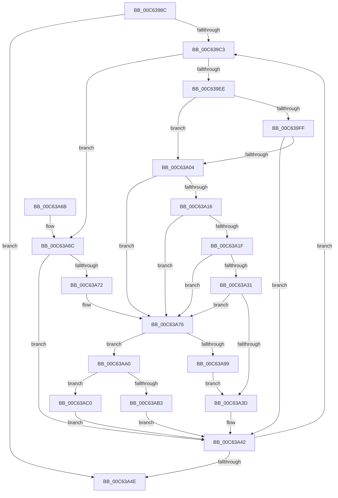

# MxInitializeFreeNodeDescriptors

- RVA: `0x00C6398C`–`0x00C63ACA` (길이 `318` bytes)
- VA: `0x0000000140C6398C`
- 실행 섹션: `INIT`
- PDB 이름 있음: `예`; PDB Function 태그: `아니요`
- unwind 정보 RVA: `0x000D7980`
- 디코드: `92`개 명령, `318/318` bytes 표시
- 미해석 바이트: `0` (있으면 어셈블리에 `.byte`로 보존)

> 이 문서는 커널 이미지의 기계어와 PDB 기호를 분석해 생성했습니다. 4번과 5번은 함수 원형과 자료형을 바이너리 사용 방식에서 추정한 C 해석이며 원본 소스 복구 결과는 아닙니다.

## 1. Dependencies

- 직접 호출 지점: **4**; 고유 호출 대상: **3**
- 직접 호출자로 확인된 함수: **1**
- RIP 상대 이미지 참조: **1**

### Outgoing calls
- `0x00C639C9` → [MiRestrictRangeToNode](../../text/40/MiRestrictRangeToNode_function_0040199C.md) (function, `0x0040199C`)
- `0x00C639D4` → [MiPageToNode](../../text/33/MiPageToNode_function_00338CD0.md) (function, `0x00338CD0`)
- `0x00C63A0D` → [MxPageAlwaysHot](MxPageAlwaysHot_function_00C68920.md) (function, `0x00C68920`)
- `0x00C63A28` → [MxPageAlwaysHot](MxPageAlwaysHot_function_00C68920.md) (function, `0x00C68920`)

### Direct callers
- [MxWalkFreeNodeDescriptors](MxWalkFreeNodeDescriptors_function_00C641B8.md) at `0x00C6426D`

### Static image references
- `0x00C639DB` → RVA `0x010093D0` (`INITDATA`; read)

## 2. Other-region calls and transfers

- 다른 실행 섹션으로 향하는 call: **2**
  - `0x00C639C9` → [MiRestrictRangeToNode](../../text/40/MiRestrictRangeToNode_function_0040199C.md) (`INIT` → `.text`)
  - `0x00C639D4` → [MiPageToNode](../../text/33/MiPageToNode_function_00338CD0.md) (`INIT` → `.text`)
- 별도 외부 분기/꼬리 이동을 확인하지 못했습니다.

## 3. Assembly (complete function range)

```asm
00C6398C  48 8B C4                        mov rax, rsp
00C6398F  48 89 58 08                     mov qword ptr [rax + 8], rbx
00C63993  48 89 68 18                     mov qword ptr [rax + 0x18], rbp
00C63997  48 89 70 20                     mov qword ptr [rax + 0x20], rsi
00C6399B  48 89 50 10                     mov qword ptr [rax + 0x10], rdx
00C6399F  57                              push rdi
00C639A0  41 54                           push r12
00C639A2  41 55                           push r13
00C639A4  41 56                           push r14
00C639A6  41 57                           push r15
00C639A8  48 83 EC 20                     sub rsp, 0x20
00C639AC  4C 8B 79 28                     mov r15, qword ptr [rcx + 0x28]
00C639B0  4C 8B E2                        mov r12, rdx
00C639B3  48 8B 71 20                     mov rsi, qword ptr [rcx + 0x20]
00C639B7  4C 8B E9                        mov r13, rcx
00C639BA  4D 85 FF                        test r15, r15
00C639BD  0F 84 8B 00 00 00               je 0x140c63a4e
00C639C3  49 8B D7                        mov rdx, r15
00C639C6  48 8B CE                        mov rcx, rsi
00C639C9  E8 CE DF 79 FF                  call 0x14040199c
00C639CE  48 8B CE                        mov rcx, rsi
00C639D1  4C 8B F0                        mov r14, rax
00C639D4  E8 F7 52 6D FF                  call 0x140338cd0
00C639D9  8B D8                           mov ebx, eax
00C639DB  48 8D 05 EE 59 3A 00            lea rax, [rip + 0x3a59ee]
00C639E2  48 6B FB 38                     imul rdi, rbx, 0x38
00C639E6  48 03 F8                        add rdi, rax
00C639E9  4D 85 E4                        test r12, r12
00C639EC  74 7E                           je 0x140c63a6c
00C639EE  49 8B 2C DC                     mov rbp, qword ptr [r12 + rbx*8]
00C639F2  48 81 C5 00 40 00 00            add rbp, 0x4000
00C639F9  4C 3B 77 08                     cmp r14, qword ptr [rdi + 8]
00C639FD  73 05                           jae 0x140c63a04
00C639FF  4C 3B F5                        cmp r14, rbp
00C63A02  72 3E                           jb 0x140c63a42
00C63A04  4D 8D 24 36                     lea r12, [r14 + rsi]
00C63A08  49 8D 4C 24 FF                  lea rcx, [r12 - 1]
00C63A0D  E8 0E 4F 00 00                  call 0x140c68920
00C63A12  85 C0                           test eax, eax
00C63A14  75 60                           jne 0x140c63a76
00C63A16  48 8B 4F 08                     mov rcx, qword ptr [rdi + 8]
00C63A1A  48 85 C9                        test rcx, rcx
00C63A1D  74 57                           je 0x140c63a76
00C63A1F  48 8B 07                        mov rax, qword ptr [rdi]
00C63A22  48 FF C8                        dec rax
00C63A25  48 03 C8                        add rcx, rax
00C63A28  E8 F3 4E 00 00                  call 0x140c68920
00C63A2D  85 C0                           test eax, eax
00C63A2F  74 45                           je 0x140c63a76
00C63A31  48 8B 47 08                     mov rax, qword ptr [rdi + 8]
00C63A35  48 03 07                        add rax, qword ptr [rdi]
00C63A38  48 3B C5                        cmp rax, rbp
00C63A3B  72 39                           jb 0x140c63a76
00C63A3D  4C 8B 64 24 58                  mov r12, qword ptr [rsp + 0x58]
00C63A42  49 03 F6                        add rsi, r14
00C63A45  4D 2B FE                        sub r15, r14
00C63A48  0F 85 75 FF FF FF               jne 0x140c639c3
00C63A4E  48 8B 5C 24 50                  mov rbx, qword ptr [rsp + 0x50]
00C63A53  48 8B 6C 24 60                  mov rbp, qword ptr [rsp + 0x60]
00C63A58  48 8B 74 24 68                  mov rsi, qword ptr [rsp + 0x68]
00C63A5D  48 83 C4 20                     add rsp, 0x20
00C63A61  41 5F                           pop r15
00C63A63  41 5E                           pop r14
00C63A65  41 5D                           pop r13
00C63A67  41 5C                           pop r12
00C63A69  5F                              pop rdi
00C63A6A  C3                              ret
00C63A6B  CC                              int3
00C63A6C  4C 3B 77 08                     cmp r14, qword ptr [rdi + 8]
00C63A70  72 D0                           jb 0x140c63a42
00C63A72  4E 8D 24 36                     lea r12, [rsi + r14]
00C63A76  49 8D 4C 24 FF                  lea rcx, [r12 - 1]
00C63A7B  48 89 37                        mov qword ptr [rdi], rsi
00C63A7E  48 89 4F 10                     mov qword ptr [rdi + 0x10], rcx
00C63A82  48 81 E1 00 FE FF FF            and rcx, 0xfffffffffffffe00
00C63A89  4C 89 77 08                     mov qword ptr [rdi + 8], r14
00C63A8D  89 5F 20                        mov dword ptr [rdi + 0x20], ebx
00C63A90  4C 89 6F 28                     mov qword ptr [rdi + 0x28], r13
00C63A94  48 3B CE                        cmp rcx, rsi
00C63A97  73 07                           jae 0x140c63aa0
00C63A99  48 83 4F 18 FF                  or qword ptr [rdi + 0x18], 0xffffffffffffffff
00C63A9E  EB 9D                           jmp 0x140c63a3d
00C63AA0  4C 8B 64 24 58                  mov r12, qword ptr [rsp + 0x58]
00C63AA5  48 8B C1                        mov rax, rcx
00C63AA8  48 2B C6                        sub rax, rsi
00C63AAB  48 3D 00 02 00 00               cmp rax, 0x200
00C63AB1  72 0D                           jb 0x140c63ac0
00C63AB3  48 8D 81 00 FE FF FF            lea rax, [rcx - 0x200]
00C63ABA  48 89 47 18                     mov qword ptr [rdi + 0x18], rax
00C63ABE  EB 82                           jmp 0x140c63a42
00C63AC0  48 83 4F 18 FF                  or qword ptr [rdi + 0x18], 0xffffffffffffffff
00C63AC5  E9 78 FF FF FF                  jmp 0x140c63a42
```

## 4. C-style interpretation (structured pseudocode)

```c
__int64 __fastcall MxInitializeFreeNodeDescriptors(__int64 a1, __int64 a2)
{
    __int64 result;
    __int64 v_r15;
    __int64 v_rbp;
    __int64 v_rdi;
    __int64 v_rsi;
    __int64 v_rsp;
    unsigned __int64 v_stack_p10;
    unsigned __int64 v_stack_p18;
    unsigned __int64 v_stack_p20;
    unsigned __int64 v_stack_p58;
    unsigned __int64 v_stack_p8;

    *(unsigned __int64 *)(v_rsp + 8) = v_rbx;
    *(unsigned __int64 *)(v_rsp + 24) = v_rbp;
    *(unsigned __int64 *)(v_rsp + 32) = v_rsi;
    *(unsigned __int64 *)(v_rsp + 16) = a2;
    v_rsp = (v_rsp) - (32);
    if (*(unsigned __int64 *)(a1 + 40) == 0) goto loc_00C63A4E;
loc_00C639C3:
    result = MiRestrictRangeToNode(*(unsigned __int64 *)(a1 + 32), *(unsigned __int64 *)(a1 + 40), a3, a4);
    result = MiPageToNode(*(unsigned __int64 *)(a1 + 32), *(unsigned __int64 *)(a1 + 40), a3, a4);
    v_rdi = (v_rdi) * ((unsigned int)((unsigned int)(result)));
    v_rdi = (v_rdi) + (v_rip + 3824110);
    if (a2 == 0) goto loc_00C63A6C;
    v_rbp = (*(unsigned __int64 *)(a2 + (unsigned int)((unsigned int)(result)) * 8)) + (0x4000ULL);
    if (result >= (*(unsigned __int64 *)(v_rdi + 8))) goto loc_00C63A04;
    if (result < v_rbp) goto loc_00C63A42;
loc_00C63A04:
    result = MxPageAlwaysHot(result + *(unsigned __int64 *)(a1 + 32) * 1 - 1, *(unsigned __int64 *)(a1 + 40), a3, a4);
    if ((unsigned int)(result) != 0) goto loc_00C63A76;
    if (*(unsigned __int64 *)(v_rdi + 8) == 0) goto loc_00C63A76;
    result = (*(unsigned __int64 *)(v_rdi)) - 1;
    a1 = (*(unsigned __int64 *)(v_rdi + 8)) + (result);
    result = MxPageAlwaysHot(a1, *(unsigned __int64 *)(a1 + 40), a3, a4);
    if ((unsigned int)(result) == 0) goto loc_00C63A76;
    result = (*(unsigned __int64 *)(v_rdi + 8)) + (*(unsigned __int64 *)(v_rdi));
    if (result < v_rbp) goto loc_00C63A76;
loc_00C63A3D:
loc_00C63A42:
    v_rsi = (*(unsigned __int64 *)(a1 + 32)) + (result);
    v_r15 = (*(unsigned __int64 *)(a1 + 40)) - (result);
    if (condition_is_not_equal) goto loc_00C639C3;
loc_00C63A4E:
    v_rsp = (v_rsp) + (32);
    return result;
loc_00C63A6C:
    if (result < (*(unsigned __int64 *)(v_rdi + 8))) goto loc_00C63A42;
loc_00C63A76:
    *(unsigned __int64 *)(v_rdi) = v_stack_p20;
    *(unsigned __int64 *)(v_rdi + 16) = v_stack_p20 + result * 1 - 1;
    a1 = (v_stack_p20 + result * 1 - 1) & (-512);
    *(unsigned __int64 *)(v_rdi + 8) = result;
    *(unsigned int *)(v_rdi + 32) = (unsigned int)(v_stack_p8);
    *(unsigned __int64 *)(v_rdi + 40) = a1;
    if (a1 >= v_stack_p20) goto loc_00C63AA0;
    goto loc_00C63A3D;
loc_00C63AA0:
    result = (a1) - (v_stack_p20);
    if (result < 512) goto loc_00C63AC0;
    *(unsigned __int64 *)(v_rdi + 24) = a1 - 512;
    goto loc_00C63A42;
loc_00C63AC0:
    goto loc_00C63A42;
}
```

## 5. (Beta) C Style

```c
int64_t MxInitializeFreeNodeDescriptors(void *Arg1, int64_t Arg2)
{
    uint8_t *arg1 = (uint8_t *)Arg1;

    int64_t result;
    int64_t local_r15;
    int64_t local_rbp;
    int64_t local_rdi;
    int64_t local_rsi;
    int64_t local_rsp;
    uint64_t v_stack_p10;
    uint64_t v_stack_p18;
    uint64_t v_stack_p20;
    uint64_t v_stack_p58;
    uint64_t v_stack_p8;

    *(uint64_t *)(local_rsp + 0x8) = local_rbx;
    *(uint64_t *)(local_rsp + 0x18) = local_rbp;
    *(uint64_t *)(local_rsp + 0x20) = local_rsi;
    *(uint64_t *)(local_rsp + 0x10) = Arg2;
    local_rsp = (local_rsp) - (32);
    if (*(uint64_t *)(arg1 + 0x28) == 0) goto loc_00C63A4E;
loc_00C639C3:
    result = MiRestrictRangeToNode(*(uint64_t *)(arg1 + 0x20), *(uint64_t *)(arg1 + 0x28), a3, a4);
    result = MiPageToNode(*(uint64_t *)(arg1 + 0x20), *(uint64_t *)(arg1 + 0x28), a3, a4);
    local_rdi = (local_rdi) * ((uint32_t)((uint32_t)(result)));
    local_rdi = (local_rdi) + (v_rip + 3824110);
    if (Arg2 == 0) goto loc_00C63A6C;
    local_rbp = (*(uint64_t *)(Arg2 + (uint32_t)((uint32_t)(result)) * 8)) + (0x4000ULL);
    if (result >= (*(uint64_t *)(local_rdi + 0x8))) goto loc_00C63A04;
    if (result < local_rbp) goto loc_00C63A42;
loc_00C63A04:
    result = MxPageAlwaysHot(result + *(uint64_t *)(arg1 + 0x20) * 1 - 1, *(uint64_t *)(arg1 + 0x28), a3, a4);
    if ((uint32_t)(result) != 0) goto loc_00C63A76;
    if (*(uint64_t *)(local_rdi + 0x8) == 0) goto loc_00C63A76;
    result = (*(uint64_t *)(local_rdi)) - 1;
    Arg1 = (*(uint64_t *)(local_rdi + 0x8)) + (result);
    result = MxPageAlwaysHot(Arg1, *(uint64_t *)(arg1 + 0x28), a3, a4);
    if ((uint32_t)(result) == 0) goto loc_00C63A76;
    result = (*(uint64_t *)(local_rdi + 0x8)) + (*(uint64_t *)(local_rdi));
    if (result < local_rbp) goto loc_00C63A76;
loc_00C63A3D:
loc_00C63A42:
    local_rsi = (*(uint64_t *)(arg1 + 0x20)) + (result);
    local_r15 = (*(uint64_t *)(arg1 + 0x28)) - (result);
    if (condition_is_not_equal) goto loc_00C639C3;
loc_00C63A4E:
    local_rsp = (local_rsp) + (32);
    return result;
loc_00C63A6C:
    if (result < (*(uint64_t *)(local_rdi + 0x8))) goto loc_00C63A42;
loc_00C63A76:
    *(uint64_t *)(local_rdi) = v_stack_p20;
    *(uint64_t *)(local_rdi + 0x10) = v_stack_p20 + result * 1 - 1;
    Arg1 = (v_stack_p20 + result * 1 - 1) & (-512);
    *(uint64_t *)(local_rdi + 0x8) = result;
    *(uint32_t *)(local_rdi + 0x20) = (uint32_t)(v_stack_p8);
    *(void **)(local_rdi + 0x28) = Arg1;
    if (Arg1 >= v_stack_p20) goto loc_00C63AA0;
    goto loc_00C63A3D;
loc_00C63AA0:
    result = (Arg1) - (v_stack_p20);
    if (result < 512) goto loc_00C63AC0;
    *(void **)(local_rdi + 0x18) = Arg1 - 512;
    goto loc_00C63A42;
loc_00C63AC0:
    goto loc_00C63A42;
}
```

### 관측된 메모리 오프셋

구조체 형식이 확인되지 않은 접근은 인자 기준의 오프셋으로만 기록했습니다.

| 기준 인자 | 오프셋 표현 | 폭 (bit) | 접근 |
|---|---:|---:|---|
| `Arg1` | `+ 0x20` | `64` | `R` |
| `Arg1` | `+ 0x28` | `64` | `R` |

## 6. Execution-region graph

[열기: 2D/3D 그래프와 함수 탐색 컨트롤 패널](../../../control-panel.html?section=init&rva=0x00C6398C&view=graph)

- 2D 그래프는 위에서 아래로 흐르고, 3D 그래프는 빈 공간을 드래그해 회전합니다. Shift+드래그는 이동, 휠은 확대·축소, 함수 노드 선택은 대상 보고서 이동입니다.

### Static fallback


