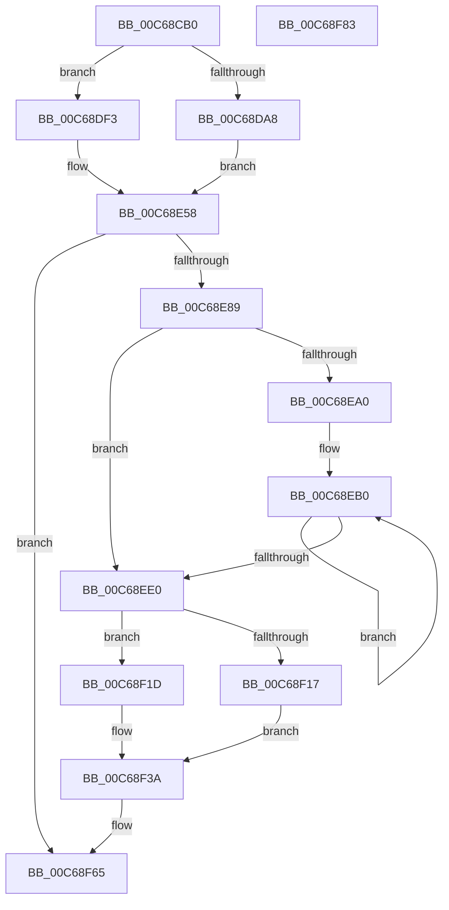

# MxInsertEnclaveBootPages

- RVA: `0x00C68CB0`–`0x00C68F84` (길이 `724` bytes)
- VA: `0x0000000140C68CB0`
- 실행 섹션: `INIT`
- PDB 이름 있음: `예`; PDB Function 태그: `아니요`
- unwind 정보 RVA: `0x000D8DA4`
- 디코드: `190`개 명령, `724/724` bytes 표시
- 미해석 바이트: `0` (있으면 어셈블리에 `.byte`로 보존)

> 이 문서는 커널 이미지의 기계어와 PDB 기호를 분석해 생성했습니다. 4번과 5번은 함수 원형과 자료형을 바이너리 사용 방식에서 추정한 C 해석이며 원본 소스 복구 결과는 아닙니다.

## 1. Dependencies

- 직접 호출 지점: **10**; 고유 호출 대상: **9**
- 직접 호출자로 확인된 함수: **1**
- RIP 상대 이미지 참조: **3**

### Outgoing calls
- `0x00C68D2A` → [MiPageToNode](../../text/33/MiPageToNode_function_00338CD0.md) (function, `0x00338CD0`)
- `0x00C68D46` → [MiDetermineNewPfnHeatState](../../text/45/MiDetermineNewPfnHeatState_function_004586A8.md) (function, `0x004586A8`)
- `0x00C68D51` → [MiSetFreeZeroPfnCold](../../text/37/MiSetFreeZeroPfnCold_function_00379428.md) (function, `0x00379428`)
- `0x00C68D5B` → [MiMakeDemandZeroPte](../../text/33/MiMakeDemandZeroPte_function_00337A00.md) (function, `0x00337A00`)
- `0x00C68D75` → [MiSetPfnContainingFrame](../../text/36/MiSetPfnContainingFrame_function_00363FC0.md) (function, `0x00363FC0`)
- `0x00C68D91` → [MiSetPageTablePfnBuddy](../../text/4A/MiSetPageTablePfnBuddy_function_004A3394.md) (function, `0x004A3394`)
- `0x00C68D9D` → [MiSetPfnIdentity](../../text/2A/MiSetPfnIdentity_function_002A2350.md) (function, `0x002A2350`)
- `0x00C68DFA` → [MiSetPfnContainingFrame](../../text/36/MiSetPfnContainingFrame_function_00363FC0.md) (function, `0x00363FC0`)
- `0x00C68E7A` → [MiCreateInitialPfns](../../text/67/MiCreateInitialPfns_function_00671774.md) (function, `0x00671774`)
- `0x00C68EF8` → [MiGetEnclavePageList](../../text/4A/MiGetEnclavePageList_function_004AEE58.md) (function, `0x004AEE58`)

### Direct callers
- [MiCreateDescriptorPfns](MiCreateDescriptorPfns_function_00C61D74.md) at `0x00C61EE3`

### Static image references
- `0x00C68D3F` → RVA `0x00E38D10` (`.data`; read)
- `0x00C68E50` → RVA `0x00E3D9C0` (`.data`; read/write)
- `0x00C68EEE` → RVA `0x00E38D00` (`.data`; read)

## 2. Other-region calls and transfers

- 다른 실행 섹션으로 향하는 call: **10**
  - `0x00C68D2A` → [MiPageToNode](../../text/33/MiPageToNode_function_00338CD0.md) (`INIT` → `.text`)
  - `0x00C68D46` → [MiDetermineNewPfnHeatState](../../text/45/MiDetermineNewPfnHeatState_function_004586A8.md) (`INIT` → `.text`)
  - `0x00C68D51` → [MiSetFreeZeroPfnCold](../../text/37/MiSetFreeZeroPfnCold_function_00379428.md) (`INIT` → `.text`)
  - `0x00C68D5B` → [MiMakeDemandZeroPte](../../text/33/MiMakeDemandZeroPte_function_00337A00.md) (`INIT` → `.text`)
  - `0x00C68D75` → [MiSetPfnContainingFrame](../../text/36/MiSetPfnContainingFrame_function_00363FC0.md) (`INIT` → `.text`)
  - `0x00C68D91` → [MiSetPageTablePfnBuddy](../../text/4A/MiSetPageTablePfnBuddy_function_004A3394.md) (`INIT` → `.text`)
  - `0x00C68D9D` → [MiSetPfnIdentity](../../text/2A/MiSetPfnIdentity_function_002A2350.md) (`INIT` → `.text`)
  - `0x00C68DFA` → [MiSetPfnContainingFrame](../../text/36/MiSetPfnContainingFrame_function_00363FC0.md) (`INIT` → `.text`)
  - `0x00C68E7A` → [MiCreateInitialPfns](../../text/67/MiCreateInitialPfns_function_00671774.md) (`INIT` → `.text`)
  - `0x00C68EF8` → [MiGetEnclavePageList](../../text/4A/MiGetEnclavePageList_function_004AEE58.md) (`INIT` → `.text`)
- 별도 외부 분기/꼬리 이동을 확인하지 못했습니다.

## 3. Assembly (complete function range)

```asm
00C68CB0  48 89 5C 24 08                  mov qword ptr [rsp + 8], rbx
00C68CB5  48 89 74 24 10                  mov qword ptr [rsp + 0x10], rsi
00C68CBA  48 89 7C 24 20                  mov qword ptr [rsp + 0x20], rdi
00C68CBF  55                              push rbp
00C68CC0  41 54                           push r12
00C68CC2  41 55                           push r13
00C68CC4  41 56                           push r14
00C68CC6  41 57                           push r15
00C68CC8  48 8B EC                        mov rbp, rsp
00C68CCB  48 83 EC 50                     sub rsp, 0x50
00C68CCF  0F 57 C0                        xorps xmm0, xmm0
00C68CD2  48 8B F9                        mov rdi, rcx
00C68CD5  0F 11 45 F0                     movups xmmword ptr [rbp - 0x10], xmm0
00C68CD9  8B 45 F0                        mov eax, dword ptr [rbp - 0x10]
00C68CDC  48 B9 FF FF FF FF FF 07 E0 FF   movabs rcx, 0xffe007ffffffffff
00C68CE6  89 45 40                        mov dword ptr [rbp + 0x40], eax
00C68CE9  45 8B F0                        mov r14d, r8d
00C68CEC  C1 E8 10                        shr eax, 0x10
00C68CEF  48 8B F2                        mov rsi, rdx
00C68CF2  24 3F                           and al, 0x3f
00C68CF4  0C 40                           or al, 0x40
00C68CF6  88 45 42                        mov byte ptr [rbp + 0x42], al
00C68CF9  8B 45 40                        mov eax, dword ptr [rbp + 0x40]
00C68CFC  0F 11 45 D0                     movups xmmword ptr [rbp - 0x30], xmm0
00C68D00  0F 11 45 E0                     movups xmmword ptr [rbp - 0x20], xmm0
00C68D04  89 45 F0                        mov dword ptr [rbp - 0x10], eax
00C68D07  48 8B 45 F8                     mov rax, qword ptr [rbp - 8]
00C68D0B  48 23 C1                        and rax, rcx
00C68D0E  48 B9 00 00 00 00 00 00 40 00   movabs rcx, 0x40000000000000
00C68D18  48 89 45 F8                     mov qword ptr [rbp - 8], rax
00C68D1C  48 8B 45 F8                     mov rax, qword ptr [rbp - 8]
00C68D20  48 0B C1                        or rax, rcx
00C68D23  48 8B CF                        mov rcx, rdi
00C68D26  48 89 45 F8                     mov qword ptr [rbp - 8], rax
00C68D2A  E8 A1 FF 6C FF                  call 0x140338cd0
00C68D2F  8B C8                           mov ecx, eax
00C68D31  BA 03 00 00 00                  mov edx, 3
00C68D36  4C 69 C1 80 DF 00 00            imul r8, rcx, 0xdf80
00C68D3D  33 C9                           xor ecx, ecx
00C68D3F  4C 03 05 CA FF 1C 00            add r8, qword ptr [rip + 0x1cffca]
00C68D46  E8 5D F9 7E FF                  call 0x1404586a8
00C68D4B  8B D0                           mov edx, eax
00C68D4D  48 8D 4D D0                     lea rcx, [rbp - 0x30]
00C68D51  E8 D2 06 71 FF                  call 0x140379428
00C68D56  B9 04 00 00 00                  mov ecx, 4
00C68D5B  E8 A0 EC 6C FF                  call 0x140337a00
00C68D60  48 BB FE FF FF FF 3F 00 00 00   movabs rbx, 0x3ffffffffe
00C68D6A  48 89 45 E0                     mov qword ptr [rbp - 0x20], rax
00C68D6E  48 8B D3                        mov rdx, rbx
00C68D71  48 8D 4D D0                     lea rcx, [rbp - 0x30]
00C68D75  E8 46 B2 6F FF                  call 0x140363fc0
00C68D7A  41 BF 01 00 00 00               mov r15d, 1
00C68D80  48 8D 4D D0                     lea rcx, [rbp - 0x30]
00C68D84  45 8B C7                        mov r8d, r15d
00C68D87  48 BA 01 00 00 00 00 01 00 00   movabs rdx, 0x10000000001
00C68D91  E8 FE A5 83 FF                  call 0x1404a3394
00C68D96  41 8B D7                        mov edx, r15d
00C68D99  48 8D 4D D0                     lea rcx, [rbp - 0x30]
00C68D9D  E8 AE 95 63 FF                  call 0x1402a2350
00C68DA2  41 83 FE 21                     cmp r14d, 0x21
00C68DA6  75 4B                           jne 0x140c68df3
00C68DA8  48 8B 45 E8                     mov rax, qword ptr [rbp - 0x18]
00C68DAC  48 B9 00 00 00 00 00 00 00 C0   movabs rcx, 0xc000000000000000
00C68DB6  48 23 C1                        and rax, rcx
00C68DB9  48 89 45 E8                     mov qword ptr [rbp - 0x18], rax
00C68DBD  8B 45 F0                        mov eax, dword ptr [rbp - 0x10]
00C68DC0  89 45 40                        mov dword ptr [rbp + 0x40], eax
00C68DC3  33 C0                           xor eax, eax
00C68DC5  66 89 45 40                     mov word ptr [rbp + 0x40], ax
00C68DC9  8B 45 40                        mov eax, dword ptr [rbp + 0x40]
00C68DCC  89 45 F0                        mov dword ptr [rbp - 0x10], eax
00C68DCF  8B 45 F0                        mov eax, dword ptr [rbp - 0x10]
00C68DD2  89 45 40                        mov dword ptr [rbp + 0x40], eax
00C68DD5  C1 E8 10                        shr eax, 0x10
00C68DD8  24 FD                           and al, 0xfd
00C68DDA  0C 05                           or al, 5
00C68DDC  88 45 42                        mov byte ptr [rbp + 0x42], al
00C68DDF  8B 45 40                        mov eax, dword ptr [rbp + 0x40]
00C68DE2  89 45 F0                        mov dword ptr [rbp - 0x10], eax
00C68DE5  80 4D F3 10                     or byte ptr [rbp - 0xd], 0x10
00C68DE9  48 C7 45 D8 F8 FF FF FF         mov qword ptr [rbp - 0x28], 0xfffffffffffffff8
00C68DF1  EB 65                           jmp 0x140c68e58
00C68DF3  48 8B D3                        mov rdx, rbx
00C68DF6  48 8D 4D D0                     lea rcx, [rbp - 0x30]
00C68DFA  E8 C1 B1 6F FF                  call 0x140363fc0
00C68DFF  48 8B 45 E8                     mov rax, qword ptr [rbp - 0x18]
00C68E03  48 B9 01 00 00 00 00 00 00 C0   movabs rcx, 0xc000000000000001
00C68E0D  48 23 C1                        and rax, rcx
00C68E10  49 0B C7                        or rax, r15
00C68E13  48 89 45 E8                     mov qword ptr [rbp - 0x18], rax
00C68E17  8B 45 F0                        mov eax, dword ptr [rbp - 0x10]
00C68E1A  89 45 40                        mov dword ptr [rbp + 0x40], eax
00C68E1D  B8 02 00 00 00                  mov eax, 2
00C68E22  66 89 45 40                     mov word ptr [rbp + 0x40], ax
00C68E26  8B 45 40                        mov eax, dword ptr [rbp + 0x40]
00C68E29  89 45 F0                        mov dword ptr [rbp - 0x10], eax
00C68E2C  8B 45 F0                        mov eax, dword ptr [rbp - 0x10]
00C68E2F  89 45 40                        mov dword ptr [rbp + 0x40], eax
00C68E32  C1 E8 10                        shr eax, 0x10
00C68E35  24 FE                           and al, 0xfe
00C68E37  0C 06                           or al, 6
00C68E39  88 45 42                        mov byte ptr [rbp + 0x42], al
00C68E3C  8B 45 40                        mov eax, dword ptr [rbp + 0x40]
00C68E3F  89 45 F0                        mov dword ptr [rbp - 0x10], eax
00C68E42  48 B8 00 00 00 00 80 F6 FF FF   movabs rax, 0xfffff68000000000
00C68E4C  48 89 45 D8                     mov qword ptr [rbp - 0x28], rax
00C68E50  F0 48 01 35 68 4B 1D 00         lock add qword ptr [rip + 0x1d4b68], rsi
00C68E58  48 8D 1C 7F                     lea rbx, [rdi + rdi*2]
00C68E5C  49 BD 00 00 00 00 00 DE FF FF   movabs r13, 0xffffde0000000000
00C68E66  48 C1 E3 04                     shl rbx, 4
00C68E6A  49 8B C5                        mov rax, r13
00C68E6D  48 03 D8                        add rbx, rax
00C68E70  4C 8D 45 D0                     lea r8, [rbp - 0x30]
00C68E74  48 8B CB                        mov rcx, rbx
00C68E77  48 8B D6                        mov rdx, rsi
00C68E7A  E8 F5 88 A0 FF                  call 0x140671774
00C68E7F  41 83 FE 21                     cmp r14d, 0x21
00C68E83  0F 85 DC 00 00 00               jne 0x140c68f65
00C68E89  48 8D 04 37                     lea rax, [rdi + rsi]
00C68E8D  49 BC 00 00 00 00 00 FF FF FF   movabs r12, 0xffffff0000000000
00C68E97  4C 8D 70 FF                     lea r14, [rax - 1]
00C68E9B  49 3B FE                        cmp rdi, r14
00C68E9E  77 40                           ja 0x140c68ee0
00C68EA0  49 8B D6                        mov rdx, r14
00C68EA3  4C 8D 47 FF                     lea r8, [rdi - 1]
00C68EA7  48 2B D7                        sub rdx, rdi
00C68EAA  48 8B F8                        mov rdi, rax
00C68EAD  49 03 D7                        add rdx, r15
00C68EB0  49 8D 40 02                     lea rax, [r8 + 2]
00C68EB4  48 8B C8                        mov rcx, rax
00C68EB7  48 33 0B                        xor rcx, qword ptr [rbx]
00C68EBA  49 23 CC                        and rcx, r12
00C68EBD  48 33 C8                        xor rcx, rax
00C68EC0  48 8B 43 18                     mov rax, qword ptr [rbx + 0x18]
00C68EC4  49 33 C0                        xor rax, r8
00C68EC7  48 89 0B                        mov qword ptr [rbx], rcx
00C68ECA  49 23 C4                        and rax, r12
00C68ECD  49 33 C0                        xor rax, r8
00C68ED0  4D 03 C7                        add r8, r15
00C68ED3  48 89 43 18                     mov qword ptr [rbx + 0x18], rax
00C68ED7  48 83 C3 30                     add rbx, 0x30
00C68EDB  49 2B D7                        sub rdx, r15
00C68EDE  75 D0                           jne 0x140c68eb0
00C68EE0  48 6B C6 D0                     imul rax, rsi, -0x30
00C68EE4  48 2B FE                        sub rdi, rsi
00C68EE7  4C 8D 7B D0                     lea r15, [rbx - 0x30]
00C68EEB  48 03 D8                        add rbx, rax
00C68EEE  48 8D 0D 0B FE 1C 00            lea rcx, [rip + 0x1cfe0b]
00C68EF5  48 8B D7                        mov rdx, rdi
00C68EF8  E8 5B 5F 84 FF                  call 0x1404aee58
00C68EFD  48 8B D0                        mov rdx, rax
00C68F00  F0 48 01 30                     lock add qword ptr [rax], rsi
00C68F04  4C 8B 40 18                     mov r8, qword ptr [rax + 0x18]
00C68F08  49 B9 FF FF FF FF 3F 00 00 00   movabs r9, 0x3fffffffff
00C68F12  4D 3B C1                        cmp r8, r9
00C68F15  75 06                           jne 0x140c68f1d
00C68F17  48 89 78 10                     mov qword ptr [rax + 0x10], rdi
00C68F1B  EB 1D                           jmp 0x140c68f3a
00C68F1D  4B 8D 0C 40                     lea rcx, [r8 + r8*2]
00C68F21  48 C1 E1 04                     shl rcx, 4
00C68F25  49 8B C5                        mov rax, r13
00C68F28  48 03 C8                        add rcx, rax
00C68F2B  48 8B C7                        mov rax, rdi
00C68F2E  48 33 01                        xor rax, qword ptr [rcx]
00C68F31  49 23 C4                        and rax, r12
00C68F34  48 33 C7                        xor rax, rdi
00C68F37  48 89 01                        mov qword ptr [rcx], rax
00C68F3A  48 8B 43 18                     mov rax, qword ptr [rbx + 0x18]
00C68F3E  48 B9 FF FF FF FF 3F FF FF FF   movabs rcx, 0xffffff3fffffffff
00C68F48  49 33 C0                        xor rax, r8
00C68F4B  49 23 C4                        and rax, r12
00C68F4E  49 33 C0                        xor rax, r8
00C68F51  48 89 43 18                     mov qword ptr [rbx + 0x18], rax
00C68F55  49 8B 07                        mov rax, qword ptr [r15]
00C68F58  48 23 C1                        and rax, rcx
00C68F5B  49 0B C1                        or rax, r9
00C68F5E  49 89 07                        mov qword ptr [r15], rax
00C68F61  4C 89 72 18                     mov qword ptr [rdx + 0x18], r14
00C68F65  4C 8D 5C 24 50                  lea r11, [rsp + 0x50]
00C68F6A  49 8B 5B 30                     mov rbx, qword ptr [r11 + 0x30]
00C68F6E  49 8B 73 38                     mov rsi, qword ptr [r11 + 0x38]
00C68F72  49 8B 7B 48                     mov rdi, qword ptr [r11 + 0x48]
00C68F76  49 8B E3                        mov rsp, r11
00C68F79  41 5F                           pop r15
00C68F7B  41 5E                           pop r14
00C68F7D  41 5D                           pop r13
00C68F7F  41 5C                           pop r12
00C68F81  5D                              pop rbp
00C68F82  C3                              ret
00C68F83  CC                              int3
```

## 4. C-style interpretation (structured pseudocode)

```c
__int64 __fastcall MxInsertEnclaveBootPages(__int64 a1, __int64 a2, int a3)
{
    __int64 result;
    __int64 v_rbx;
    __int64 v_rdi;
    __int64 v_rsp;
    unsigned __int64 v_stack_m28;
    unsigned __int64 v_stack_m30;
    unsigned __int8 v_stack_m35;
    unsigned __int64 v_stack_m38;
    unsigned __int64 v_stack_m40;
    unsigned __int64 v_stack_m48;
    unsigned __int64 v_stack_m50;
    unsigned __int64 v_stack_m58;
    unsigned __int64 v_stack_p10;
    unsigned int v_stack_p18;
    unsigned __int8 v_stack_p1A;
    unsigned __int64 v_stack_p20;
    unsigned __int64 v_stack_p8;

    v_stack_p8 = v_rbx;
    v_stack_p10 = v_rsi;
    v_stack_p20 = v_rdi;
    v_rsp = (v_rsp) - (80);
    v_stack_m38 = v_xmm0;
    v_stack_p18 = (unsigned int)((unsigned int)(v_stack_m38));
    result = (unsigned int)(((unsigned int)(v_stack_m38)) >> (16));
    result = (unsigned __int8)((result) & (63));
    result = (unsigned __int8)((result) | (64));
    v_stack_p1A = (unsigned __int8)(result);
    v_stack_m58 = v_xmm0;
    v_stack_m48 = v_xmm0;
    v_stack_m38 = (unsigned int)((unsigned int)(v_stack_p18));
    result = (v_stack_m30) & (a1);
    v_stack_m30 = result;
    result = (v_stack_m30) | (a1);
    v_stack_m30 = result;
    result = MiPageToNode(a1, a2, a3, a4);
    a3 = (a3) * ((unsigned int)((unsigned int)(result)));
    a1 = 0;
    a3 = (a3) + (*(unsigned __int64 *)(v_rip + 1900490));
    result = MiDetermineNewPfnHeatState(a1, 3, a3, a4);
    result = MiSetFreeZeroPfnCold(v_stack_m58, (unsigned int)((unsigned int)(result)), a3, a4);
    result = MiMakeDemandZeroPte(4, (unsigned int)((unsigned int)(result)), a3, a4);
    v_stack_m48 = result;
    result = MiSetPfnContainingFrame(v_stack_m58, v_rbx, a3, a4);
    result = MiSetPageTablePfnBuddy(v_stack_m58, v_rbx, 1, a4);
    result = MiSetPfnIdentity(v_stack_m58, 1, 1, a4);
    if (((unsigned int)((unsigned int)(a3))) != 33) goto loc_00C68DF3;
    result = (v_stack_m40) & (v_stack_m58);
    v_stack_m40 = result;
    v_stack_p18 = (unsigned int)((unsigned int)(v_stack_m38));
    result = 0;
    v_stack_p18 = 0;
    v_stack_m38 = (unsigned int)((unsigned int)(v_stack_p18));
    v_stack_p18 = (unsigned int)((unsigned int)(v_stack_m38));
    result = (unsigned int)(((unsigned int)(v_stack_m38)) >> (16));
    result = (unsigned __int8)((result) & (253));
    result = (unsigned __int8)((result) | (5));
    v_stack_p1A = (unsigned __int8)(result);
    v_stack_m38 = (unsigned int)((unsigned int)(v_stack_p18));
    v_stack_m50 = -8;
    goto loc_00C68E58;
loc_00C68DF3:
    result = MiSetPfnContainingFrame(v_stack_m58, v_rbx, 1, a4);
    result = (v_stack_m40) & (v_stack_m58);
    result = (result) | (1);
    v_stack_m40 = result;
    v_stack_p18 = (unsigned int)((unsigned int)(v_stack_m38));
    v_stack_p18 = 2;
    v_stack_m38 = (unsigned int)((unsigned int)(v_stack_p18));
    v_stack_p18 = (unsigned int)((unsigned int)(v_stack_m38));
    result = (unsigned int)(((unsigned int)(v_stack_m38)) >> (16));
    result = (unsigned __int8)((result) & (254));
    result = (unsigned __int8)((result) | (6));
    v_stack_p1A = (unsigned __int8)(result);
    v_stack_m38 = (unsigned int)((unsigned int)(v_stack_p18));
    v_stack_m50 = (unsigned int)(v_stack_p18);
loc_00C68E58:
    v_rbx = (a1 + a1 * 2) << (4);
    v_rbx = (v_rbx) + (v_r13);
    result = MiCreateInitialPfns(v_rbx, a2, v_stack_m58, a4);
    if (((unsigned int)((unsigned int)(a3))) != 33) goto loc_00C68F65;
    if (0 > (a1 + a2 * 1 - 1)) goto loc_00C68EE0;
    a2 = (a1 + a2 * 1 - 1) - (0);
    a2 = (a2) + (1);
loc_00C68EB0:
    a1 = (a1 - 1 + 2) ^ (*(unsigned __int64 *)(v_rbx));
    a1 = (a1) & (v_r12);
    a1 = (a1) ^ (a1 - 1 + 2);
    result = (*(unsigned __int64 *)(v_rbx + 24)) ^ (a1 - 1);
    *(unsigned __int64 *)(v_rbx) = a1;
    result = (result) & (v_r12);
    result = (result) ^ (a1 - 1);
    a3 = (a1 - 1) + (1);
    *(unsigned __int64 *)(v_rbx + 24) = result;
    v_rbx = (v_rbx) + (48);
    a2 = (a2) - (1);
    if (condition_is_not_equal) goto loc_00C68EB0;
loc_00C68EE0:
    result = (result) * (a2);
    v_rdi = (a1 + a2 * 1) - (a2);
    v_rbx = (v_rbx) + (result);
    result = MiGetEnclavePageList(v_rip + 1900043, v_rdi, a3, a4);
    if ((*(unsigned __int64 *)(result + 24)) != a4) goto loc_00C68F1D;
    *(unsigned __int64 *)(result + 16) = v_rdi;
    goto loc_00C68F3A;
loc_00C68F1D:
    a1 = (*(unsigned __int64 *)(result + 24) + *(unsigned __int64 *)(result + 24) * 2) << (4);
    a1 = (a1) + (v_r13);
    result = (v_rdi) ^ (*(unsigned __int64 *)(a1));
    result = (result) & (v_r12);
    result = (result) ^ (v_rdi);
    *(unsigned __int64 *)(a1) = result;
loc_00C68F3A:
    result = (*(unsigned __int64 *)(v_rbx + 24)) ^ (*(unsigned __int64 *)(result + 24));
    result = (result) & (v_r12);
    result = (result) ^ (*(unsigned __int64 *)(result + 24));
    *(unsigned __int64 *)(v_rbx + 24) = result;
    result = (*(unsigned __int64 *)(v_rbx - 48)) & (a1);
    result = (result) | (a4);
    *(unsigned __int64 *)(v_rbx - 48) = result;
    *(unsigned __int64 *)(result + 24) = a1 + a2 * 1 - 1;
loc_00C68F65:
    return result;
}
```

## 5. (Beta) C Style

```c
int64_t MxInsertEnclaveBootPages(void *Arg1, int64_t Arg2, int32_t Arg3)
{
    uint8_t *arg1 = (uint8_t *)Arg1;

    int64_t result;
    int64_t local_rbx;
    int64_t local_rdi;
    int64_t local_rsp;
    uint64_t v_stack_m28;
    uint64_t v_stack_m30;
    uint8_t v_stack_m35;
    uint64_t v_stack_m38;
    uint64_t v_stack_m40;
    uint64_t v_stack_m48;
    uint64_t v_stack_m50;
    uint64_t v_stack_m58;
    uint64_t v_stack_p10;
    uint32_t v_stack_p18;
    uint8_t v_stack_p1A;
    uint64_t v_stack_p20;
    uint64_t v_stack_p8;

    v_stack_p8 = local_rbx;
    v_stack_p10 = local_rsi;
    v_stack_p20 = local_rdi;
    local_rsp = (local_rsp) - (80);
    v_stack_m38 = v_xmm0;
    v_stack_p18 = (uint32_t)((uint32_t)(v_stack_m38));
    result = (uint32_t)(((uint32_t)(v_stack_m38)) >> (16));
    result = (uint8_t)((result) & (63));
    result = (uint8_t)((result) | (64));
    v_stack_p1A = (uint8_t)(result);
    v_stack_m58 = v_xmm0;
    v_stack_m48 = v_xmm0;
    v_stack_m38 = (uint32_t)((uint32_t)(v_stack_p18));
    result = (v_stack_m30) & (Arg1);
    v_stack_m30 = result;
    result = (v_stack_m30) | (Arg1);
    v_stack_m30 = result;
    result = MiPageToNode(Arg1, Arg2, Arg3, a4);
    Arg3 = (Arg3) * ((uint32_t)((uint32_t)(result)));
    Arg1 = 0;
    Arg3 = (Arg3) + (*(uint64_t *)(v_rip + 0x1CFFCA));
    result = MiDetermineNewPfnHeatState(Arg1, 3, Arg3, a4);
    result = MiSetFreeZeroPfnCold(v_stack_m58, (uint32_t)((uint32_t)(result)), Arg3, a4);
    result = MiMakeDemandZeroPte(4, (uint32_t)((uint32_t)(result)), Arg3, a4);
    v_stack_m48 = result;
    result = MiSetPfnContainingFrame(v_stack_m58, local_rbx, Arg3, a4);
    result = MiSetPageTablePfnBuddy(v_stack_m58, local_rbx, 1, a4);
    result = MiSetPfnIdentity(v_stack_m58, 1, 1, a4);
    if (((uint32_t)((uint32_t)(Arg3))) != 33) goto loc_00C68DF3;
    result = (v_stack_m40) & (v_stack_m58);
    v_stack_m40 = result;
    v_stack_p18 = (uint32_t)((uint32_t)(v_stack_m38));
    result = 0;
    v_stack_p18 = 0;
    v_stack_m38 = (uint32_t)((uint32_t)(v_stack_p18));
    v_stack_p18 = (uint32_t)((uint32_t)(v_stack_m38));
    result = (uint32_t)(((uint32_t)(v_stack_m38)) >> (16));
    result = (uint8_t)((result) & (253));
    result = (uint8_t)((result) | (5));
    v_stack_p1A = (uint8_t)(result);
    v_stack_m38 = (uint32_t)((uint32_t)(v_stack_p18));
    v_stack_m50 = -8;
    goto loc_00C68E58;
loc_00C68DF3:
    result = MiSetPfnContainingFrame(v_stack_m58, local_rbx, 1, a4);
    result = (v_stack_m40) & (v_stack_m58);
    result = (result) | (1);
    v_stack_m40 = result;
    v_stack_p18 = (uint32_t)((uint32_t)(v_stack_m38));
    v_stack_p18 = 2;
    v_stack_m38 = (uint32_t)((uint32_t)(v_stack_p18));
    v_stack_p18 = (uint32_t)((uint32_t)(v_stack_m38));
    result = (uint32_t)(((uint32_t)(v_stack_m38)) >> (16));
    result = (uint8_t)((result) & (254));
    result = (uint8_t)((result) | (6));
    v_stack_p1A = (uint8_t)(result);
    v_stack_m38 = (uint32_t)((uint32_t)(v_stack_p18));
    v_stack_m50 = (uint32_t)(v_stack_p18);
loc_00C68E58:
    local_rbx = (Arg1 + Arg1 * 2) << (4);
    local_rbx = (local_rbx) + (local_r13);
    result = MiCreateInitialPfns(local_rbx, Arg2, v_stack_m58, a4);
    if (((uint32_t)((uint32_t)(Arg3))) != 33) goto loc_00C68F65;
    if (0 > (Arg1 + Arg2 * 1 - 1)) goto loc_00C68EE0;
    Arg2 = (Arg1 + Arg2 * 1 - 1) - (0);
    Arg2 = (Arg2) + (1);
loc_00C68EB0:
    Arg1 = (Arg1 - 1 + 2) ^ (*(uint64_t *)(local_rbx));
    Arg1 = (Arg1) & (local_r12);
    Arg1 = (Arg1) ^ (Arg1 - 1 + 2);
    result = (*(uint64_t *)(local_rbx + 0x18)) ^ (Arg1 - 1);
    *(void **)(local_rbx) = Arg1;
    result = (result) & (local_r12);
    result = (result) ^ (Arg1 - 1);
    Arg3 = (Arg1 - 1) + (1);
    *(uint64_t *)(local_rbx + 0x18) = result;
    local_rbx = (local_rbx) + (48);
    Arg2 = (Arg2) - (1);
    if (condition_is_not_equal) goto loc_00C68EB0;
loc_00C68EE0:
    result = (result) * (Arg2);
    local_rdi = (Arg1 + Arg2 * 1) - (Arg2);
    local_rbx = (local_rbx) + (result);
    result = MiGetEnclavePageList(v_rip + 1900043, local_rdi, Arg3, a4);
    if ((*(uint64_t *)(result + 0x18)) != a4) goto loc_00C68F1D;
    *(uint64_t *)(result + 0x10) = local_rdi;
    goto loc_00C68F3A;
loc_00C68F1D:
    Arg1 = (*(uint64_t *)(result + 0x18) + *(uint64_t *)(result + 0x18) * 2) << (4);
    Arg1 = (Arg1) + (local_r13);
    result = (local_rdi) ^ (*(uint64_t *)(arg1));
    result = (result) & (local_r12);
    result = (result) ^ (local_rdi);
    *(uint64_t *)(arg1) = result;
loc_00C68F3A:
    result = (*(uint64_t *)(local_rbx + 0x18)) ^ (*(uint64_t *)(result + 0x18));
    result = (result) & (local_r12);
    result = (result) ^ (*(uint64_t *)(result + 0x18));
    *(uint64_t *)(local_rbx + 0x18) = result;
    result = (*(uint64_t *)(local_rbx - 0x30)) & (Arg1);
    result = (result) | (a4);
    *(uint64_t *)(local_rbx - 0x30) = result;
    *(void **)(result + 0x18) = Arg1 + Arg2 * 1 - 1;
loc_00C68F65:
    return result;
}
```

### 관측된 메모리 오프셋

구조체 형식이 확인되지 않은 접근은 인자 기준의 오프셋으로만 기록했습니다.

| 기준 인자 | 오프셋 표현 | 폭 (bit) | 접근 |
|---|---:|---:|---|
| `Arg1` | `- 0x1` | `64` | `R` |
| `Arg1` | `+ 0x0 + rdi*2` | `64` | `R` |
| `Arg1` | `+ 0x0 + rsi*1` | `64` | `R` |

## 6. Execution-region graph

[열기: 2D/3D 그래프와 함수 탐색 컨트롤 패널](../../../control-panel.html?section=init&rva=0x00C68CB0&view=graph)

- 2D 그래프는 위에서 아래로 흐르고, 3D 그래프는 빈 공간을 드래그해 회전합니다. Shift+드래그는 이동, 휠은 확대·축소, 함수 노드 선택은 대상 보고서 이동입니다.

### Static fallback


