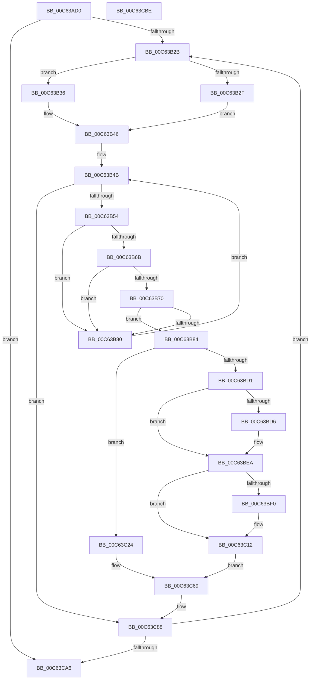

# MxInsertFreePages

- RVA: `0x00C63AD0`–`0x00C63CBF` (길이 `495` bytes)
- VA: `0x0000000140C63AD0`
- 실행 섹션: `INIT`
- PDB 이름 있음: `예`; PDB Function 태그: `아니요`
- unwind 정보 RVA: `0x000D7910`
- 디코드: `135`개 명령, `495/495` bytes 표시
- 미해석 바이트: `0` (있으면 어셈블리에 `.byte`로 보존)

> 이 문서는 커널 이미지의 기계어와 PDB 기호를 분석해 생성했습니다. 4번과 5번은 함수 원형과 자료형을 바이너리 사용 방식에서 추정한 C 해석이며 원본 소스 복구 결과는 아닙니다.

## 1. Dependencies

- 직접 호출 지점: **10**; 고유 호출 대상: **10**
- 직접 호출자로 확인된 함수: **1**
- RIP 상대 이미지 참조: **4**

### Outgoing calls
- `0x00C63B76` → [MiRestrictRangeToNode](../../text/40/MiRestrictRangeToNode_function_0040199C.md) (function, `0x0040199C`)
- `0x00C63B92` → [MiPageToNode](../../text/33/MiPageToNode_function_00338CD0.md) (function, `0x00338CD0`)
- `0x00C63BAB` → [MiDetermineNewPfnHeatState](../../text/45/MiDetermineNewPfnHeatState_function_004586A8.md) (function, `0x004586A8`)
- `0x00C63BE5` → [MiCreatePfnTemplate](../../text/67/MiCreatePfnTemplate_function_00671824.md) (function, `0x00671824`)
- `0x00C63C1D` → [MiCreateInitialPfns](../../text/67/MiCreateInitialPfns_function_00671774.md) (function, `0x00671774`)
- `0x00C63C45` → [MiInitializeAllResidentPageBasePfns](../../text/46/MiInitializeAllResidentPageBasePfns_function_00462AF8.md) (function, `0x00462AF8`)
- `0x00C63C64` → [MiCreateInitialLargeLeafPfns](../../text/44/MiCreateInitialLargeLeafPfns_function_004428E0.md) (function, `0x004428E0`)
- `0x00C63C6C` → [MiLockPageInline](../../text/31/MiLockPageInline_function_0031A340.md) (function, `0x0031A340`)
- `0x00C63C79` → [MiInsertPageInFreeOrZeroedList](../../text/33/MiInsertPageInFreeOrZeroedList_function_00334D20.md) (function, `0x00334D20`)
- `0x00C63C83` → [MiUnlockPage](../../text/31/MiUnlockPage_function_0031A3E0.md) (function, `0x0031A3E0`)

### Direct callers
- [MxCreateFreePfns](MxCreateFreePfns_function_00C632CC.md) at `0x00C63407`

### Static image references
- `0x00C63B36` → RVA `0x00FC6B30` (`ALMOSTRO`; read)
- `0x00C63B54` → RVA `0x00011C60` (`.rdata`; read)
- `0x00C63BA4` → RVA `0x00E38D10` (`.data`; read)
- `0x00C63C33` → RVA `0x00E38D00` (`.data`; read)

## 2. Other-region calls and transfers

- 다른 실행 섹션으로 향하는 call: **10**
  - `0x00C63B76` → [MiRestrictRangeToNode](../../text/40/MiRestrictRangeToNode_function_0040199C.md) (`INIT` → `.text`)
  - `0x00C63B92` → [MiPageToNode](../../text/33/MiPageToNode_function_00338CD0.md) (`INIT` → `.text`)
  - `0x00C63BAB` → [MiDetermineNewPfnHeatState](../../text/45/MiDetermineNewPfnHeatState_function_004586A8.md) (`INIT` → `.text`)
  - `0x00C63BE5` → [MiCreatePfnTemplate](../../text/67/MiCreatePfnTemplate_function_00671824.md) (`INIT` → `.text`)
  - `0x00C63C1D` → [MiCreateInitialPfns](../../text/67/MiCreateInitialPfns_function_00671774.md) (`INIT` → `.text`)
  - `0x00C63C45` → [MiInitializeAllResidentPageBasePfns](../../text/46/MiInitializeAllResidentPageBasePfns_function_00462AF8.md) (`INIT` → `.text`)
  - `0x00C63C64` → [MiCreateInitialLargeLeafPfns](../../text/44/MiCreateInitialLargeLeafPfns_function_004428E0.md) (`INIT` → `.text`)
  - `0x00C63C6C` → [MiLockPageInline](../../text/31/MiLockPageInline_function_0031A340.md) (`INIT` → `.text`)
  - `0x00C63C79` → [MiInsertPageInFreeOrZeroedList](../../text/33/MiInsertPageInFreeOrZeroedList_function_00334D20.md) (`INIT` → `.text`)
  - `0x00C63C83` → [MiUnlockPage](../../text/31/MiUnlockPage_function_0031A3E0.md) (`INIT` → `.text`)
- 별도 외부 분기/꼬리 이동을 확인하지 못했습니다.

## 3. Assembly (complete function range)

```asm
00C63AD0  48 89 5C 24 10                  mov qword ptr [rsp + 0x10], rbx
00C63AD5  44 89 4C 24 20                  mov dword ptr [rsp + 0x20], r9d
00C63ADA  55                              push rbp
00C63ADB  56                              push rsi
00C63ADC  57                              push rdi
00C63ADD  41 54                           push r12
00C63ADF  41 55                           push r13
00C63AE1  41 56                           push r14
00C63AE3  41 57                           push r15
00C63AE5  48 83 EC 70                     sub rsp, 0x70
00C63AE9  0F 57 C0                        xorps xmm0, xmm0
00C63AEC  48 8D 2C 49                     lea rbp, [rcx + rcx*2]
00C63AF0  45 33 ED                        xor r13d, r13d
00C63AF3  48 C1 E5 04                     shl rbp, 4
00C63AF7  0F 11 44 24 40                  movups xmmword ptr [rsp + 0x40], xmm0
00C63AFC  45 8B F5                        mov r14d, r13d
00C63AFF  41 8B C1                        mov eax, r9d
00C63B02  0F 11 44 24 50                  movups xmmword ptr [rsp + 0x50], xmm0
00C63B07  45 8B E0                        mov r12d, r8d
00C63B0A  4C 8B FA                        mov r15, rdx
00C63B0D  0F 11 44 24 60                  movups xmmword ptr [rsp + 0x60], xmm0
00C63B12  48 8B F1                        mov rsi, rcx
00C63B15  48 B9 00 00 00 00 00 DE FF FF   movabs rcx, 0xffffde0000000000
00C63B1F  48 03 E9                        add rbp, rcx
00C63B22  48 85 D2                        test rdx, rdx
00C63B25  0F 84 7B 01 00 00               je 0x140c63ca6
00C63B2B  85 C0                           test eax, eax
00C63B2D  74 07                           je 0x140c63b36
00C63B2F  BB 03 00 00 00                  mov ebx, 3
00C63B34  EB 10                           jmp 0x140c63b46
00C63B36  48 8B 1D F3 2F 36 00            mov rbx, qword ptr [rip + 0x362ff3]
00C63B3D  48 C1 EB 25                     shr rbx, 0x25
00C63B41  F7 D3                           not ebx
00C63B43  83 E3 01                        and ebx, 1
00C63B46  BF 01 00 00 00                  mov edi, 1
00C63B4B  83 FB 04                        cmp ebx, 4
00C63B4E  0F 83 34 01 00 00               jae 0x140c63c88
00C63B54  48 8D 05 05 E1 3A FF            lea rax, [rip - 0xc51efb]
00C63B5B  44 8B EB                        mov r13d, ebx
00C63B5E  4A 8B 3C E8                     mov rdi, qword ptr [rax + r13*8]
00C63B62  48 8D 47 FF                     lea rax, [rdi - 1]
00C63B66  48 85 C6                        test rsi, rax
00C63B69  75 15                           jne 0x140c63b80
00C63B6B  4C 3B FF                        cmp r15, rdi
00C63B6E  72 10                           jb 0x140c63b80
00C63B70  49 8B D7                        mov rdx, r15
00C63B73  48 8B CE                        mov rcx, rsi
00C63B76  E8 21 DE 79 FF                  call 0x14040199c
00C63B7B  48 3B C7                        cmp rax, rdi
00C63B7E  73 04                           jae 0x140c63b84
00C63B80  FF C3                           inc ebx
00C63B82  EB C7                           jmp 0x140c63b4b
00C63B84  48 8D 3D D5 E0 3A FF            lea rdi, [rip - 0xc51f2b]
00C63B8B  48 8B CE                        mov rcx, rsi
00C63B8E  4A 8B 3C EF                     mov rdi, qword ptr [rdi + r13*8]
00C63B92  E8 39 51 6D FF                  call 0x140338cd0
00C63B97  8B C8                           mov ecx, eax
00C63B99  8B D3                           mov edx, ebx
00C63B9B  4C 69 C1 80 DF 00 00            imul r8, rcx, 0xdf80
00C63BA2  33 C9                           xor ecx, ecx
00C63BA4  4C 03 05 65 51 1D 00            add r8, qword ptr [rip + 0x1d5165]
00C63BAB  E8 F8 4A 7F FF                  call 0x1404586a8
00C63BB0  41 8B CC                        mov ecx, r12d
00C63BB3  45 33 ED                        xor r13d, r13d
00C63BB6  0F BA F1 0A                     btr ecx, 0xa
00C63BBA  41 0F BA EC 0A                  bts r12d, 0xa
00C63BBF  85 C0                           test eax, eax
00C63BC1  44 0F 44 E1                     cmove r12d, ecx
00C63BC5  41 8B CD                        mov ecx, r13d
00C63BC8  0F 94 C1                        sete cl
00C63BCB  48 83 FF 01                     cmp rdi, 1
00C63BCF  75 53                           jne 0x140c63c24
00C63BD1  4D 85 F6                        test r14, r14
00C63BD4  75 14                           jne 0x140c63bea
00C63BD6  45 33 C0                        xor r8d, r8d
00C63BD9  48 8D 4C 24 40                  lea rcx, [rsp + 0x40]
00C63BDE  33 D2                           xor edx, edx
00C63BE0  4C 8D 74 24 40                  lea r14, [rsp + 0x40]
00C63BE5  E8 3A DC A0 FF                  call 0x140671824
00C63BEA  41 83 FC 01                     cmp r12d, 1
00C63BEE  75 22                           jne 0x140c63c12
00C63BF0  41 8B 46 20                     mov eax, dword ptr [r14 + 0x20]
00C63BF4  89 84 24 B0 00 00 00            mov dword ptr [rsp + 0xb0], eax
00C63BFB  C1 E8 10                        shr eax, 0x10
00C63BFE  24 F8                           and al, 0xf8
00C63C00  88 84 24 B2 00 00 00            mov byte ptr [rsp + 0xb2], al
00C63C07  8B 84 24 B0 00 00 00            mov eax, dword ptr [rsp + 0xb0]
00C63C0E  41 89 46 20                     mov dword ptr [r14 + 0x20], eax
00C63C12  4D 8B C6                        mov r8, r14
00C63C15  BA 01 00 00 00                  mov edx, 1
00C63C1A  48 8B CD                        mov rcx, rbp
00C63C1D  E8 52 DB A0 FF                  call 0x140671774
00C63C22  EB 45                           jmp 0x140c63c69
00C63C24  44 89 6C 24 30                  mov dword ptr [rsp + 0x30], r13d
00C63C29  44 8B CB                        mov r9d, ebx
00C63C2C  89 4C 24 28                     mov dword ptr [rsp + 0x28], ecx
00C63C30  4C 8B C7                        mov r8, rdi
00C63C33  48 8D 0D C6 50 1D 00            lea rcx, [rip + 0x1d50c6]
00C63C3A  C7 44 24 20 01 00 00 00         mov dword ptr [rsp + 0x20], 1
00C63C42  48 8B D6                        mov rdx, rsi
00C63C45  E8 AE EE 7F FF                  call 0x140462af8
00C63C4A  41 B9 01 00 00 00               mov r9d, 1
00C63C50  44 89 6C 24 28                  mov dword ptr [rsp + 0x28], r13d
00C63C55  44 8B C3                        mov r8d, ebx
00C63C58  66 44 89 6C 24 20               mov word ptr [rsp + 0x20], r13w
00C63C5E  48 8B D7                        mov rdx, rdi
00C63C61  48 8B CE                        mov rcx, rsi
00C63C64  E8 77 EC 7D FF                  call 0x1404428e0
00C63C69  48 8B CD                        mov rcx, rbp
00C63C6C  E8 CF 66 6B FF                  call 0x14031a340
00C63C71  41 8B D4                        mov edx, r12d
00C63C74  48 8B CE                        mov rcx, rsi
00C63C77  8A D8                           mov bl, al
00C63C79  E8 A2 10 6D FF                  call 0x140334d20
00C63C7E  8A D3                           mov dl, bl
00C63C80  48 8B CD                        mov rcx, rbp
00C63C83  E8 58 67 6B FF                  call 0x14031a3e0
00C63C88  48 8D 04 7F                     lea rax, [rdi + rdi*2]
00C63C8C  48 03 F7                        add rsi, rdi
00C63C8F  48 C1 E0 04                     shl rax, 4
00C63C93  48 03 E8                        add rbp, rax
00C63C96  8B 84 24 C8 00 00 00            mov eax, dword ptr [rsp + 0xc8]
00C63C9D  4C 2B FF                        sub r15, rdi
00C63CA0  0F 85 85 FE FF FF               jne 0x140c63b2b
00C63CA6  48 8B 9C 24 B8 00 00 00         mov rbx, qword ptr [rsp + 0xb8]
00C63CAE  48 83 C4 70                     add rsp, 0x70
00C63CB2  41 5F                           pop r15
00C63CB4  41 5E                           pop r14
00C63CB6  41 5D                           pop r13
00C63CB8  41 5C                           pop r12
00C63CBA  5F                              pop rdi
00C63CBB  5E                              pop rsi
00C63CBC  5D                              pop rbp
00C63CBD  C3                              ret
00C63CBE  CC                              int3
```

## 4. C-style interpretation (structured pseudocode)

```c
__int64 __fastcall MxInsertFreePages(__int64 a1, __int64 a2, int a3, int a4)
{
    __int64 result;
    __int64 v_r12;
    __int64 v_r13;
    __int64 v_r14;
    __int64 v_r15;
    __int64 v_rbp;
    __int64 v_rbx;
    __int64 v_rsi;
    __int64 v_rsp;
    unsigned __int64 v_stack_m48;
    unsigned __int64 v_stack_m58;
    unsigned __int64 v_stack_m68;
    unsigned int v_stack_m78;
    unsigned int v_stack_m80;
    unsigned int v_stack_m88;
    unsigned __int64 v_stack_p10;
    unsigned int v_stack_p20;
    unsigned int v_stack_p8;
    unsigned __int8 v_stack_pA;

    v_stack_p10 = v_rbx;
    v_stack_p20 = a4;
    v_rsp = (v_rsp) - (112);
    v_r13 = 0;
    v_rbp = (a1 + a1 * 2) << (4);
    v_stack_m68 = v_xmm0;
    v_stack_m58 = v_xmm0;
    v_stack_m48 = v_xmm0;
    v_rbp = (v_rbp) + (a1);
    if (a2 == 0) goto loc_00C63CA6;
loc_00C63B2B:
    if ((unsigned int)((unsigned int)(a4)) == 0) goto loc_00C63B36;
    goto loc_00C63B46;
loc_00C63B36:
    v_rbx = (*(unsigned __int64 *)(v_rip + 3551219)) >> (37);
    v_rbx = (unsigned int)(~(v_rbx));
    v_rbx = (unsigned int)((v_rbx) & (1));
loc_00C63B46:
loc_00C63B4B:
    if (((unsigned int)(v_rbx)) >= 4) goto loc_00C63C88;
    if (((a1) & (*(unsigned __int64 *)(v_rip - 12918523 + (unsigned int)((unsigned int)(v_rbx)) * 8) - 1)) != 0) goto loc_00C63B80;
    if (a2 < (*(unsigned __int64 *)(v_rip - 12918523 + (unsigned int)((unsigned int)(v_rbx)) * 8))) goto loc_00C63B80;
    result = MiRestrictRangeToNode(a1, a2, a3, a4);
    if (result >= (*(unsigned __int64 *)(v_rip - 12918523 + (unsigned int)((unsigned int)(v_rbx)) * 8))) goto loc_00C63B84;
loc_00C63B80:
    v_rbx = (unsigned int)((v_rbx) + 1);
    goto loc_00C63B4B;
loc_00C63B84:
    result = MiPageToNode(a1, a2, a3, a4);
    a3 = (a3) * ((unsigned int)((unsigned int)(result)));
    a1 = 0;
    a3 = (a3) + (*(unsigned __int64 *)(v_rip + 1921381));
    result = MiDetermineNewPfnHeatState(a1, (unsigned int)((unsigned int)(v_rbx)), a3, a4);
    v_r13 = 0;
    v_r12 = (unsigned int)(a3);
    if ((unsigned int)(result) == 0) { v_r12 = (unsigned int)((unsigned int)((unsigned int)((unsigned int)(a3)))); }
    a1 = ((unsigned int)(result) == 0) ? 1 : 0;
    if ((*(unsigned __int64 *)(v_rip - 12918571 + (unsigned int)((unsigned int)(v_rbx)) * 8)) != 1) goto loc_00C63C24;
    v_r14 = 0;
    if (0 == 0) {
        a3 = 0;
        a1 = v_stack_m68;
        a2 = 0;
        v_r14 = v_stack_m68;
        result = MiCreatePfnTemplate(a1, a2, a3, a4);
    }
    if (((unsigned int)(v_r12)) == 1) {
        result = *(unsigned int *)(v_r14 + 32);
        v_stack_p8 = (unsigned int)(result);
        result = (unsigned int)((result) >> (16));
        result = (unsigned __int8)((result) & (248));
        v_stack_pA = (unsigned __int8)(result);
        result = v_stack_p8;
        *(unsigned int *)(v_r14 + 32) = (unsigned int)(result);
    }
    result = MiCreateInitialPfns(v_rbp, 1, v_r14, a4);
    goto loc_00C63C69;
loc_00C63C24:
    v_stack_m78 = 0;
    v_stack_m80 = (unsigned int)(v_rbp);
    v_stack_m88 = 1;
    result = MiInitializeAllResidentPageBasePfns(v_rip + 1921222, a1, *(unsigned __int64 *)(v_rip - 12918571 + (unsigned int)((unsigned int)(v_rbx)) * 8), (unsigned int)((unsigned int)(v_rbx)));
    v_stack_m80 = 0;
    v_stack_m88 = 0;
    result = MiCreateInitialLargeLeafPfns(a1, *(unsigned __int64 *)(v_rip - 12918571 + (unsigned int)((unsigned int)(v_rbx)) * 8), (unsigned int)((unsigned int)(v_rbx)), 1);
loc_00C63C69:
    result = MiLockPageInline(v_rbp, *(unsigned __int64 *)(v_rip - 12918571 + (unsigned int)((unsigned int)(v_rbx)) * 8), (unsigned int)((unsigned int)(v_rbx)), 1);
    result = MiInsertPageInFreeOrZeroedList(a1, (unsigned int)((unsigned int)(v_r12)), (unsigned int)((unsigned int)(v_rbx)), 1);
    result = MiUnlockPage(v_rbp, (unsigned __int8)((unsigned __int8)(result)), (unsigned int)((unsigned int)(v_rbx)), 1);
loc_00C63C88:
    v_rsi = (a1) + (*(unsigned __int64 *)(v_rip - 12918571 + (unsigned int)((unsigned int)(v_rbx)) * 8));
    result = (*(unsigned __int64 *)(v_rip - 12918571 + (unsigned int)((unsigned int)(v_rbx)) * 8) + *(unsigned __int64 *)(v_rip - 12918571 + (unsigned int)((unsigned int)(v_rbx)) * 8) * 2) << (4);
    v_rbp = (v_rbp) + (result);
    v_r15 = (a2) - (*(unsigned __int64 *)(v_rip - 12918571 + (unsigned int)((unsigned int)(v_rbx)) * 8));
    if (condition_is_not_equal) goto loc_00C63B2B;
loc_00C63CA6:
    v_rsp = (v_rsp) + (112);
    return (unsigned int)(v_stack_p20);
}
```

## 5. (Beta) C Style

```c
int64_t MxInsertFreePages(void *Arg1, int64_t Arg2, int32_t Arg3, int32_t Arg4)
{
    uint8_t *arg1 = (uint8_t *)Arg1;

    int64_t result;
    int64_t local_r12;
    int64_t local_r13;
    int64_t local_r14;
    int64_t local_r15;
    int64_t local_rbp;
    int64_t local_rbx;
    int64_t local_rsi;
    int64_t local_rsp;
    uint64_t v_stack_m48;
    uint64_t v_stack_m58;
    uint64_t v_stack_m68;
    uint32_t v_stack_m78;
    uint32_t v_stack_m80;
    uint32_t v_stack_m88;
    uint64_t v_stack_p10;
    uint32_t v_stack_p20;
    uint32_t v_stack_p8;
    uint8_t v_stack_pA;

    v_stack_p10 = local_rbx;
    v_stack_p20 = Arg4;
    local_rsp = (local_rsp) - (112);
    local_r13 = 0;
    local_rbp = (Arg1 + Arg1 * 2) << (4);
    v_stack_m68 = v_xmm0;
    v_stack_m58 = v_xmm0;
    v_stack_m48 = v_xmm0;
    local_rbp = (local_rbp) + (Arg1);
    if (Arg2 == 0) goto loc_00C63CA6;
loc_00C63B2B:
    if ((uint32_t)((uint32_t)(Arg4)) == 0) goto loc_00C63B36;
    goto loc_00C63B46;
loc_00C63B36:
    local_rbx = (*(uint64_t *)(v_rip + 0x362FF3)) >> (37);
    local_rbx = (uint32_t)(~(local_rbx));
    local_rbx = (uint32_t)((local_rbx) & (1));
loc_00C63B46:
loc_00C63B4B:
    if (((uint32_t)(local_rbx)) >= 4) goto loc_00C63C88;
    if (((Arg1) & (*(uint64_t *)(v_rip - 0xC51EFB + (uint32_t)((uint32_t)(local_rbx)) * 8) - 1)) != 0) goto loc_00C63B80;
    if (Arg2 < (*(uint64_t *)(v_rip - 0xC51EFB + (uint32_t)((uint32_t)(local_rbx)) * 8))) goto loc_00C63B80;
    result = MiRestrictRangeToNode(Arg1, Arg2, Arg3, Arg4);
    if (result >= (*(uint64_t *)(v_rip - 0xC51EFB + (uint32_t)((uint32_t)(local_rbx)) * 8))) goto loc_00C63B84;
loc_00C63B80:
    local_rbx = (uint32_t)((local_rbx) + 1);
    goto loc_00C63B4B;
loc_00C63B84:
    result = MiPageToNode(Arg1, Arg2, Arg3, Arg4);
    Arg3 = (Arg3) * ((uint32_t)((uint32_t)(result)));
    Arg1 = 0;
    Arg3 = (Arg3) + (*(uint64_t *)(v_rip + 0x1D5165));
    result = MiDetermineNewPfnHeatState(Arg1, (uint32_t)((uint32_t)(local_rbx)), Arg3, Arg4);
    local_r13 = 0;
    local_r12 = (uint32_t)(Arg3);
    if ((uint32_t)(result) == 0) { local_r12 = (uint32_t)((uint32_t)((uint32_t)((uint32_t)(Arg3)))); }
    Arg1 = ((uint32_t)(result) == 0) ? 1 : 0;
    if ((*(uint64_t *)(v_rip - 0xC51F2B + (uint32_t)((uint32_t)(local_rbx)) * 8)) != 1) goto loc_00C63C24;
    local_r14 = 0;
    if (0 == 0) {
        Arg3 = 0;
        Arg1 = v_stack_m68;
        Arg2 = 0;
        local_r14 = v_stack_m68;
        result = MiCreatePfnTemplate(Arg1, Arg2, Arg3, Arg4);
    }
    if (((uint32_t)(local_r12)) == 1) {
        result = *(uint32_t *)(local_r14 + 0x20);
        v_stack_p8 = (uint32_t)(result);
        result = (uint32_t)((result) >> (16));
        result = (uint8_t)((result) & (248));
        v_stack_pA = (uint8_t)(result);
        result = v_stack_p8;
        *(uint32_t *)(local_r14 + 0x20) = (uint32_t)(result);
    }
    result = MiCreateInitialPfns(local_rbp, 1, local_r14, Arg4);
    goto loc_00C63C69;
loc_00C63C24:
    v_stack_m78 = 0;
    v_stack_m80 = (uint32_t)(local_rbp);
    v_stack_m88 = 1;
    result = MiInitializeAllResidentPageBasePfns(v_rip + 1921222, Arg1, *(uint64_t *)(v_rip - 0xC51F2B + (uint32_t)((uint32_t)(local_rbx)) * 8), (uint32_t)((uint32_t)(local_rbx)));
    v_stack_m80 = 0;
    v_stack_m88 = 0;
    result = MiCreateInitialLargeLeafPfns(Arg1, *(uint64_t *)(v_rip - 0xC51F2B + (uint32_t)((uint32_t)(local_rbx)) * 8), (uint32_t)((uint32_t)(local_rbx)), 1);
loc_00C63C69:
    result = MiLockPageInline(local_rbp, *(uint64_t *)(v_rip - 0xC51F2B + (uint32_t)((uint32_t)(local_rbx)) * 8), (uint32_t)((uint32_t)(local_rbx)), 1);
    result = MiInsertPageInFreeOrZeroedList(Arg1, (uint32_t)((uint32_t)(local_r12)), (uint32_t)((uint32_t)(local_rbx)), 1);
    result = MiUnlockPage(local_rbp, (uint8_t)((uint8_t)(result)), (uint32_t)((uint32_t)(local_rbx)), 1);
loc_00C63C88:
    local_rsi = (Arg1) + (*(uint64_t *)(v_rip - 0xC51F2B + (uint32_t)((uint32_t)(local_rbx)) * 8));
    result = (*(uint64_t *)(v_rip - 0xC51F2B + (uint32_t)((uint32_t)(local_rbx)) * 8) + *(uint64_t *)(v_rip - 0xC51F2B + (uint32_t)((uint32_t)(local_rbx)) * 8) * 2) << (4);
    local_rbp = (local_rbp) + (result);
    local_r15 = (Arg2) - (*(uint64_t *)(v_rip - 0xC51F2B + (uint32_t)((uint32_t)(local_rbx)) * 8));
    if (condition_is_not_equal) goto loc_00C63B2B;
loc_00C63CA6:
    local_rsp = (local_rsp) + (112);
    return (uint32_t)(v_stack_p20);
}
```

### 관측된 메모리 오프셋

구조체 형식이 확인되지 않은 접근은 인자 기준의 오프셋으로만 기록했습니다.

| 기준 인자 | 오프셋 표현 | 폭 (bit) | 접근 |
|---|---:|---:|---|
| `Arg1` | `+ 0x0 + rcx*2` | `64` | `R` |

## 6. Execution-region graph

[열기: 2D/3D 그래프와 함수 탐색 컨트롤 패널](../../../control-panel.html?section=init&rva=0x00C63AD0&view=graph)

- 2D 그래프는 위에서 아래로 흐르고, 3D 그래프는 빈 공간을 드래그해 회전합니다. Shift+드래그는 이동, 휠은 확대·축소, 함수 노드 선택은 대상 보고서 이동입니다.

### Static fallback


