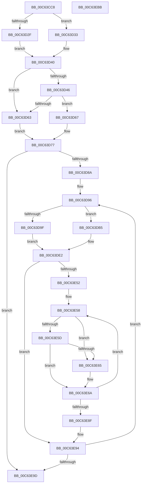

# MxMapPfnRange

- RVA: `0x00C63CC8`–`0x00C63EBC` (길이 `500` bytes)
- VA: `0x0000000140C63CC8`
- 실행 섹션: `INIT`
- PDB 이름 있음: `예`; PDB Function 태그: `아니요`
- unwind 정보 RVA: `0x0007BBB4`
- 디코드: `136`개 명령, `500/500` bytes 표시
- 미해석 바이트: `0` (있으면 어셈블리에 `.byte`로 보존)

> 이 문서는 커널 이미지의 기계어와 PDB 기호를 분석해 생성했습니다. 4번과 5번은 함수 원형과 자료형을 바이너리 사용 방식에서 추정한 C 해석이며 원본 소스 복구 결과는 아닙니다.

## 1. Dependencies

- 직접 호출 지점: **3**; 고유 호출 대상: **3**
- 직접 호출자로 확인된 함수: **1**
- RIP 상대 이미지 참조: **2**

### Outgoing calls
- `0x00C63DBB` → [MiRestrictRangeToNode](../../text/40/MiRestrictRangeToNode_function_0040199C.md) (function, `0x0040199C`)
- `0x00C63DE5` → [MiPageToNode](../../text/33/MiPageToNode_function_00338CD0.md) (function, `0x00338CD0`)
- `0x00C63E73` → [MxMapVa](MxMapVa_function_00C63EC4.md) (function, `0x00C63EC4`)

### Direct callers
- [MiCreateSparsePfnDatabase](MiCreateSparsePfnDatabase_function_00C62088.md) at `0x00C6213B`
- [MiCreateSparsePfnDatabase](MiCreateSparsePfnDatabase_function_00C62088.md) at `0x00C6230A`
- [MiCreateSparsePfnDatabase](MiCreateSparsePfnDatabase_function_00C62088.md) at `0x00C62323`
- [MiCreateSparsePfnDatabase](MiCreateSparsePfnDatabase_function_00C62088.md) at `0x00C62349`

### Static image references
- `0x00C63D9F` → RVA `0x00FC6DE0` (`ALMOSTRO`; read)
- `0x00C63DAC` → RVA `0x00FC6C38` (`ALMOSTRO`; read)

## 2. Other-region calls and transfers

- 다른 실행 섹션으로 향하는 call: **2**
  - `0x00C63DBB` → [MiRestrictRangeToNode](../../text/40/MiRestrictRangeToNode_function_0040199C.md) (`INIT` → `.text`)
  - `0x00C63DE5` → [MiPageToNode](../../text/33/MiPageToNode_function_00338CD0.md) (`INIT` → `.text`)
- 별도 외부 분기/꼬리 이동을 확인하지 못했습니다.

## 3. Assembly (complete function range)

```asm
00C63CC8  48 8B C4                        mov rax, rsp
00C63CCB  48 89 58 10                     mov qword ptr [rax + 0x10], rbx
00C63CCF  48 89 68 18                     mov qword ptr [rax + 0x18], rbp
00C63CD3  48 89 70 20                     mov qword ptr [rax + 0x20], rsi
00C63CD7  57                              push rdi
00C63CD8  41 54                           push r12
00C63CDA  41 55                           push r13
00C63CDC  41 56                           push r14
00C63CDE  41 57                           push r15
00C63CE0  48 83 EC 40                     sub rsp, 0x40
00C63CE4  83 60 C4 00                     and dword ptr [rax - 0x3c], 0
00C63CE8  48 8D 1C 49                     lea rbx, [rcx + rcx*2]
00C63CEC  48 C1 E3 04                     shl rbx, 4
00C63CF0  45 8B E8                        mov r13d, r8d
00C63CF3  48 8B F2                        mov rsi, rdx
00C63CF6  49 BA 00 00 00 00 00 DE FF FF   movabs r10, 0xffffde0000000000
00C63D00  4C 8B F1                        mov r14, rcx
00C63D03  49 8B C2                        mov rax, r10
00C63D06  48 03 D8                        add rbx, rax
00C63D09  48 BA 00 00 00 00 80 F6 FF FF   movabs rdx, 0xfffff68000000000
00C63D13  48 8B C3                        mov rax, rbx
00C63D16  49 C7 C1 00 00 E0 FF            mov r9, 0xffffffffffe00000
00C63D1D  49 23 C1                        and rax, r9
00C63D20  49 B8 F8 FF FF FF 7F 00 00 00   movabs r8, 0x7ffffffff8
00C63D2A  48 3B D8                        cmp rbx, rax
00C63D2D  75 04                           jne 0x140c63d33
00C63D2F  33 DB                           xor ebx, ebx
00C63D31  EB 0D                           jmp 0x140c63d40
00C63D33  48 C1 EB 09                     shr rbx, 9
00C63D37  49 23 D8                        and rbx, r8
00C63D3A  48 8B C2                        mov rax, rdx
00C63D3D  48 03 D8                        add rbx, rax
00C63D40  48 83 FE FF                     cmp rsi, -1
00C63D44  74 1D                           je 0x140c63d63
00C63D46  48 8D 04 31                     lea rax, [rcx + rsi]
00C63D4A  48 8D 3C 40                     lea rdi, [rax + rax*2]
00C63D4E  48 C1 E7 04                     shl rdi, 4
00C63D52  49 8B C2                        mov rax, r10
00C63D55  48 03 F8                        add rdi, rax
00C63D58  48 8B C7                        mov rax, rdi
00C63D5B  49 23 C1                        and rax, r9
00C63D5E  48 3B F8                        cmp rdi, rax
00C63D61  75 04                           jne 0x140c63d67
00C63D63  33 FF                           xor edi, edi
00C63D65  EB 10                           jmp 0x140c63d77
00C63D67  48 FF CF                        dec rdi
00C63D6A  48 C1 EF 09                     shr rdi, 9
00C63D6E  49 23 F8                        and rdi, r8
00C63D71  48 8B C2                        mov rax, rdx
00C63D74  48 03 F8                        add rdi, rax
00C63D77  48 89 5C 24 30                  mov qword ptr [rsp + 0x30], rbx
00C63D7C  48 89 7C 24 38                  mov qword ptr [rsp + 0x38], rdi
00C63D81  48 85 F6                        test rsi, rsi
00C63D84  0F 84 13 01 00 00               je 0x140c63e9d
00C63D8A  4C 8B E2                        mov r12, rdx
00C63D8D  49 C1 E4 19                     shl r12, 0x19
00C63D91  4C 89 64 24 70                  mov qword ptr [rsp + 0x70], r12
00C63D96  4C 8B FE                        mov r15, rsi
00C63D99  48 83 FE FF                     cmp rsi, -1
00C63D9D  75 16                           jne 0x140c63db5
00C63D9F  48 8B 2D 3A 30 36 00            mov rbp, qword ptr [rip + 0x36303a]
00C63DA6  33 F6                           xor esi, esi
00C63DA8  48 C1 E5 0C                     shl rbp, 0xc
00C63DAC  48 03 2D 85 2E 36 00            add rbp, qword ptr [rip + 0x362e85]
00C63DB3  EB 2D                           jmp 0x140c63de2
00C63DB5  48 8B D6                        mov rdx, rsi
00C63DB8  49 8B CE                        mov rcx, r14
00C63DBB  E8 DC DB 79 FF                  call 0x14040199c
00C63DC0  4C 8B F8                        mov r15, rax
00C63DC3  48 2B F0                        sub rsi, rax
00C63DC6  4A 8D 0C 30                     lea rcx, [rax + r14]
00C63DCA  48 B8 00 00 00 00 00 DE FF FF   movabs rax, 0xffffde0000000000
00C63DD4  48 8D 2C 49                     lea rbp, [rcx + rcx*2]
00C63DD8  48 C1 E5 04                     shl rbp, 4
00C63DDC  48 8B C8                        mov rcx, rax
00C63DDF  48 03 E9                        add rbp, rcx
00C63DE2  49 8B CE                        mov rcx, r14
00C63DE5  E8 E6 4E 6D FF                  call 0x140338cd0
00C63DEA  4B 8D 0C 76                     lea rcx, [r14 + r14*2]
00C63DEE  89 44 24 28                     mov dword ptr [rsp + 0x28], eax
00C63DF2  48 C1 E1 04                     shl rcx, 4
00C63DF6  48 B8 00 00 00 00 00 DE FF FF   movabs rax, 0xffffde0000000000
00C63E00  48 8B C0                        mov rax, rax
00C63E03  48 03 C8                        add rcx, rax
00C63E06  48 BA 00 00 00 00 80 F6 FF FF   movabs rdx, 0xfffff68000000000
00C63E10  48 C1 E9 09                     shr rcx, 9
00C63E14  49 B8 F8 FF FF FF 7F 00 00 00   movabs r8, 0x7ffffffff8
00C63E1E  49 23 C8                        and rcx, r8
00C63E21  4D 03 F7                        add r14, r15
00C63E24  48 8B C2                        mov rax, rdx
00C63E27  48 03 C8                        add rcx, rax
00C63E2A  48 FF CD                        dec rbp
00C63E2D  48 C1 ED 09                     shr rbp, 9
00C63E31  49 23 E8                        and rbp, r8
00C63E34  48 8B C2                        mov rax, rdx
00C63E37  48 03 E8                        add rbp, rax
00C63E3A  48 8B C1                        mov rax, rcx
00C63E3D  48 C1 E0 19                     shl rax, 0x19
00C63E41  49 2B C4                        sub rax, r12
00C63E44  48 C1 F8 10                     sar rax, 0x10
00C63E48  48 89 44 24 20                  mov qword ptr [rsp + 0x20], rax
00C63E4D  48 3B CD                        cmp rcx, rbp
00C63E50  77 42                           ja 0x140c63e94
00C63E52  4C 8B FA                        mov r15, rdx
00C63E55  4D 8B E0                        mov r12, r8
00C63E58  48 3B CB                        cmp rcx, rbx
00C63E5B  74 08                           je 0x140c63e65
00C63E5D  41 8B C5                        mov eax, r13d
00C63E60  48 3B CF                        cmp rcx, rdi
00C63E63  75 05                           jne 0x140c63e6a
00C63E65  B8 01 00 00 00                  mov eax, 1
00C63E6A  48 8D 4C 24 20                  lea rcx, [rsp + 0x20]
00C63E6F  89 44 24 2C                     mov dword ptr [rsp + 0x2c], eax
00C63E73  E8 4C 00 00 00                  call 0x140c63ec4
00C63E78  48 8B 4C 24 20                  mov rcx, qword ptr [rsp + 0x20]
00C63E7D  48 C1 E9 09                     shr rcx, 9
00C63E81  49 23 CC                        and rcx, r12
00C63E84  49 8B C7                        mov rax, r15
00C63E87  48 03 C8                        add rcx, rax
00C63E8A  48 3B CD                        cmp rcx, rbp
00C63E8D  76 C9                           jbe 0x140c63e58
00C63E8F  4C 8B 64 24 70                  mov r12, qword ptr [rsp + 0x70]
00C63E94  48 85 F6                        test rsi, rsi
00C63E97  0F 85 F9 FE FF FF               jne 0x140c63d96
00C63E9D  4C 8D 5C 24 40                  lea r11, [rsp + 0x40]
00C63EA2  49 8B 5B 38                     mov rbx, qword ptr [r11 + 0x38]
00C63EA6  49 8B 6B 40                     mov rbp, qword ptr [r11 + 0x40]
00C63EAA  49 8B 73 48                     mov rsi, qword ptr [r11 + 0x48]
00C63EAE  49 8B E3                        mov rsp, r11
00C63EB1  41 5F                           pop r15
00C63EB3  41 5E                           pop r14
00C63EB5  41 5D                           pop r13
00C63EB7  41 5C                           pop r12
00C63EB9  5F                              pop rdi
00C63EBA  C3                              ret
00C63EBB  CC                              int3
```

## 4. C-style interpretation (structured pseudocode)

```c
__int64 __fastcall MxMapPfnRange(__int64 a1, __int64 a2, int a3)
{
    __int64 result;
    __int64 v_r12;
    __int64 v_r14;
    __int64 v_rbp;
    __int64 v_rbx;
    __int64 v_rdi;
    __int64 v_rsi;
    __int64 v_rsp;
    unsigned __int64 v_stack_m28;
    unsigned __int64 v_stack_m30;
    unsigned __int64 v_stack_m38;
    unsigned int v_stack_m3C;
    unsigned int v_stack_m40;
    unsigned __int64 v_stack_m48;
    unsigned __int64 v_stack_p8;

    *(unsigned __int64 *)(v_rsp + 16) = v_rbx;
    *(unsigned __int64 *)(v_rsp + 24) = v_rbp;
    *(unsigned __int64 *)(v_rsp + 32) = v_rsi;
    v_rsp = (v_rsp) - (64);
    v_rbx = (a1 + a1 * 2) << (4);
    v_rbx = (v_rbx) + (v_r10);
    result = (v_rbx) & (0xFFFFFFFFFFE00000ULL);
    if (v_rbx != result) goto loc_00C63D33;
    v_rbx = 0;
    goto loc_00C63D40;
loc_00C63D33:
    v_rbx = (v_rbx) >> (9);
    v_rbx = (v_rbx) & (a3);
    v_rbx = (v_rbx) + (a2);
loc_00C63D40:
    if (a2 == -1) goto loc_00C63D63;
    v_rdi = (a1 + a2 * 1 + a1 + a2 * 1 * 2) << (4);
    v_rdi = (v_rdi) + (v_r10);
    result = (v_rdi) & (0xFFFFFFFFFFE00000ULL);
    if (v_rdi != result) goto loc_00C63D67;
loc_00C63D63:
    v_rdi = 0;
    goto loc_00C63D77;
loc_00C63D67:
    v_rdi = (v_rdi) - 1;
    v_rdi = (v_rdi) >> (9);
    v_rdi = (v_rdi) & (a3);
    v_rdi = (v_rdi) + (a2);
loc_00C63D77:
    v_stack_m38 = v_rbx;
    v_stack_m30 = v_rdi;
    if (a2 == 0) goto loc_00C63E9D;
    v_r12 = (a2) << (25);
    v_stack_p8 = v_r12;
loc_00C63D96:
    if (a2 != -1) goto loc_00C63DB5;
    v_rsi = 0;
    v_rbp = (*(unsigned __int64 *)(v_rip + 3551290)) << (12);
    v_rbp = (v_rbp) + (*(unsigned __int64 *)(v_rip + 3550853));
    goto loc_00C63DE2;
loc_00C63DB5:
    result = MiRestrictRangeToNode(a1, 0, a3, 0xFFFFFFFFFFE00000ULL);
    v_rsi = (v_rsi) - (result);
    v_rbp = (result + a1 * 1 + result + a1 * 1 * 2) << (4);
    v_rbp = (v_rbp) + (result);
loc_00C63DE2:
    result = MiPageToNode(a1, 0, a3, 0xFFFFFFFFFFE00000ULL);
    v_stack_m40 = (unsigned int)(result);
    a1 = (a1 + a1 * 2) << (4);
    a1 = (a1) + (result);
    a1 = (a1) >> (9);
    a1 = (a1) & (a3);
    v_r14 = (a1) + (result);
    a1 = (a1) + (0);
    v_rbp = (v_rbp) - 1;
    v_rbp = (v_rbp) >> (9);
    v_rbp = (v_rbp) & (a3);
    v_rbp = (v_rbp) + (0);
    result = (a1) << (25);
    result = (result) - (v_r12);
    result = (result) >> (16);
    v_stack_m48 = result;
    if (a1 > v_rbp) goto loc_00C63E94;
loc_00C63E58:
    if (a1 == v_rbx) goto loc_00C63E65;
    result = (unsigned int)((unsigned int)((unsigned int)(a3)));
    if (a1 == v_rdi) {
        result = 1;
    }
    v_stack_m3C = (unsigned int)(result);
    result = MxMapVa(v_stack_m48, 0, a3, 0xFFFFFFFFFFE00000ULL);
    a1 = (v_stack_m48) >> (9);
    a1 = (a1) & (a3);
    a1 = (a1) + (0);
    if (a1 <= v_rbp) goto loc_00C63E58;
loc_00C63E94:
    if (v_rsi != 0) goto loc_00C63D96;
loc_00C63E9D:
    return 0;
}
```

## 5. (Beta) C Style

```c
int64_t MxMapPfnRange(void *Arg1, int64_t Arg2, int32_t Arg3)
{
    uint8_t *arg1 = (uint8_t *)Arg1;

    int64_t result;
    int64_t local_r12;
    int64_t local_r14;
    int64_t local_rbp;
    int64_t local_rbx;
    int64_t local_rdi;
    int64_t local_rsi;
    int64_t local_rsp;
    uint64_t v_stack_m28;
    uint64_t v_stack_m30;
    uint64_t v_stack_m38;
    uint32_t v_stack_m3C;
    uint32_t v_stack_m40;
    uint64_t v_stack_m48;
    uint64_t v_stack_p8;

    *(uint64_t *)(local_rsp + 0x10) = local_rbx;
    *(uint64_t *)(local_rsp + 0x18) = local_rbp;
    *(uint64_t *)(local_rsp + 0x20) = local_rsi;
    local_rsp = (local_rsp) - (64);
    local_rbx = (Arg1 + Arg1 * 2) << (4);
    local_rbx = (local_rbx) + (local_r10);
    result = (local_rbx) & (0xFFFFFFFFFFE00000ULL);
    if (local_rbx != result) goto loc_00C63D33;
    local_rbx = 0;
    goto loc_00C63D40;
loc_00C63D33:
    local_rbx = (local_rbx) >> (9);
    local_rbx = (local_rbx) & (Arg3);
    local_rbx = (local_rbx) + (Arg2);
loc_00C63D40:
    if (Arg2 == -1) goto loc_00C63D63;
    local_rdi = (Arg1 + Arg2 * 1 + Arg1 + Arg2 * 1 * 2) << (4);
    local_rdi = (local_rdi) + (local_r10);
    result = (local_rdi) & (0xFFFFFFFFFFE00000ULL);
    if (local_rdi != result) goto loc_00C63D67;
loc_00C63D63:
    local_rdi = 0;
    goto loc_00C63D77;
loc_00C63D67:
    local_rdi = (local_rdi) - 1;
    local_rdi = (local_rdi) >> (9);
    local_rdi = (local_rdi) & (Arg3);
    local_rdi = (local_rdi) + (Arg2);
loc_00C63D77:
    v_stack_m38 = local_rbx;
    v_stack_m30 = local_rdi;
    if (Arg2 == 0) goto loc_00C63E9D;
    local_r12 = (Arg2) << (25);
    v_stack_p8 = local_r12;
loc_00C63D96:
    if (Arg2 != -1) goto loc_00C63DB5;
    local_rsi = 0;
    local_rbp = (*(uint64_t *)(v_rip + 0x36303A)) << (12);
    local_rbp = (local_rbp) + (*(uint64_t *)(v_rip + 0x362E85));
    goto loc_00C63DE2;
loc_00C63DB5:
    result = MiRestrictRangeToNode(Arg1, 0, Arg3, 0xFFFFFFFFFFE00000ULL);
    local_rsi = (local_rsi) - (result);
    local_rbp = (result + Arg1 * 1 + result + Arg1 * 1 * 2) << (4);
    local_rbp = (local_rbp) + (result);
loc_00C63DE2:
    result = MiPageToNode(Arg1, 0, Arg3, 0xFFFFFFFFFFE00000ULL);
    v_stack_m40 = (uint32_t)(result);
    Arg1 = (Arg1 + Arg1 * 2) << (4);
    Arg1 = (Arg1) + (result);
    Arg1 = (Arg1) >> (9);
    Arg1 = (Arg1) & (Arg3);
    local_r14 = (Arg1) + (result);
    Arg1 = (Arg1) + (0);
    local_rbp = (local_rbp) - 1;
    local_rbp = (local_rbp) >> (9);
    local_rbp = (local_rbp) & (Arg3);
    local_rbp = (local_rbp) + (0);
    result = (Arg1) << (25);
    result = (result) - (local_r12);
    result = (result) >> (16);
    v_stack_m48 = result;
    if (Arg1 > local_rbp) goto loc_00C63E94;
loc_00C63E58:
    if (Arg1 == local_rbx) goto loc_00C63E65;
    result = (uint32_t)((uint32_t)((uint32_t)(Arg3)));
    if (Arg1 == local_rdi) {
        result = 1;
    }
    v_stack_m3C = (uint32_t)(result);
    result = MxMapVa(v_stack_m48, 0, Arg3, 0xFFFFFFFFFFE00000ULL);
    Arg1 = (v_stack_m48) >> (9);
    Arg1 = (Arg1) & (Arg3);
    Arg1 = (Arg1) + (0);
    if (Arg1 <= local_rbp) goto loc_00C63E58;
loc_00C63E94:
    if (local_rsi != 0) goto loc_00C63D96;
loc_00C63E9D:
    return 0;
}
```

### 관측된 메모리 오프셋

구조체 형식이 확인되지 않은 접근은 인자 기준의 오프셋으로만 기록했습니다.

| 기준 인자 | 오프셋 표현 | 폭 (bit) | 접근 |
|---|---:|---:|---|
| `Arg1` | `+ 0x0 + r14*2` | `64` | `R` |
| `Arg1` | `+ 0x0 + rax*2` | `64` | `R` |
| `Arg1` | `+ 0x0 + rcx*2` | `64` | `R` |
| `Arg1` | `+ 0x0 + rsi*1` | `64` | `R` |

## 6. Execution-region graph

[열기: 2D/3D 그래프와 함수 탐색 컨트롤 패널](../../../control-panel.html?section=init&rva=0x00C63CC8&view=graph)

- 2D 그래프는 위에서 아래로 흐르고, 3D 그래프는 빈 공간을 드래그해 회전합니다. Shift+드래그는 이동, 휠은 확대·축소, 함수 노드 선택은 대상 보고서 이동입니다.

### Static fallback


