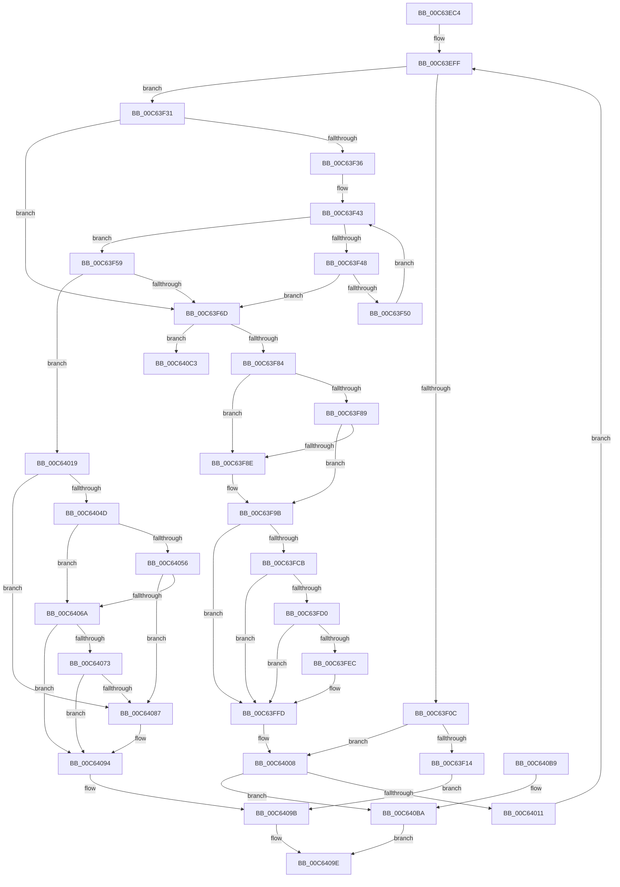

# MxMapVa

- RVA: `0x00C63EC4`–`0x00C640CB` (길이 `519` bytes)
- VA: `0x0000000140C63EC4`
- 실행 섹션: `INIT`
- PDB 이름 있음: `예`; PDB Function 태그: `아니요`
- unwind 정보 RVA: `0x000D78D8`
- 디코드: `138`개 명령, `519/519` bytes 표시
- 미해석 바이트: `0` (있으면 어셈블리에 `.byte`로 보존)

> 이 문서는 커널 이미지의 기계어와 PDB 기호를 분석해 생성했습니다. 4번과 5번은 함수 원형과 자료형을 바이너리 사용 방식에서 추정한 C 해석이며 원본 소스 복구 결과는 아닙니다.

## 1. Dependencies

- 직접 호출 지점: **17**; 고유 호출 대상: **10**
- 직접 호출자로 확인된 함수: **1**
- RIP 상대 이미지 참조: **2**

### Outgoing calls
- `0x00C63EF2` → [MiFillPteHierarchy](../../text/3F/MiFillPteHierarchy_function_003F7F90.md) (function, `0x003F7F90`)
- `0x00C63F19` → [MiGetLargePteAddress](../../text/3D/MiGetLargePteAddress_function_003D3300.md) (function, `0x003D3300`)
- `0x00C63F21` → [MiGetLeafVa](../../text/27/MiGetLeafVa_function_0027C0A0.md) (function, `0x0027C0A0`)
- `0x00C63F3B` → [MiGetLargePteAddress](../../text/3D/MiGetLargePteAddress_function_003D3300.md) (function, `0x003D3300`)
- `0x00C63F5E` → [MxGetNextPage](MxGetNextPage_function_00C63810.md) (function, `0x00C63810`)
- `0x00C63F72` → [MxGetNextPage](MxGetNextPage_function_00C63810.md) (function, `0x00C63810`)
- `0x00C63F96` → [MiFillPhysicalPages](../../text/33/MiFillPhysicalPages_function_00332910.md) (function, `0x00332910`)
- `0x00C63FB8` → [MiMakeValidPte](../../text/2C/MiMakeValidPte_function_002C5590.md) (function, `0x002C5590`)
- `0x00C63FF8` → [MiCheckLinearProtectedPteAccessedBit](../../text/29/MiCheckLinearProtectedPteAccessedBit_function_00292D80.md) (function, `0x00292D80`)
- `0x00C64028` → [MiWriteLargePte](../../text/2C/MiWriteLargePte_function_002C6DE0.md) (function, `0x002C6DE0`)
- `0x00C64033` → [MiGetLeafVa](../../text/27/MiGetLeafVa_function_0027C0A0.md) (function, `0x0027C0A0`)
- `0x00C64056` → [MiGetLeafVa](../../text/27/MiGetLeafVa_function_0027C0A0.md) (function, `0x0027C0A0`)
- `0x00C64060` → [MiGetLargePteAddress](../../text/3D/MiGetLargePteAddress_function_003D3300.md) (function, `0x003D3300`)
- `0x00C64073` → [MiGetLeafVa](../../text/27/MiGetLeafVa_function_0027C0A0.md) (function, `0x0027C0A0`)
- `0x00C6407D` → [MiGetLargePteAddress](../../text/3D/MiGetLargePteAddress_function_003D3300.md) (function, `0x003D3300`)
- `0x00C6408F` → [KeZeroPages](../../text/6B/KeZeroPages_function_006BA070.md) (function, `0x006BA070`)
- `0x00C640C5` → [MxInstallMoreMemory](../../text/67/MxInstallMoreMemory_function_00671A04.md) (function, `0x00671A04`)

### Direct callers
- [MxMapPfnRange](MxMapPfnRange_function_00C63CC8.md) at `0x00C63E73`

### Static image references
- `0x00C63FBD` → RVA `0x00FC6A88` (`ALMOSTRO`; read)
- `0x00C64000` → RVA `0x00E376F8` (`.data`; read/write)

## 2. Other-region calls and transfers

- 다른 실행 섹션으로 향하는 call: **15**
  - `0x00C63EF2` → [MiFillPteHierarchy](../../text/3F/MiFillPteHierarchy_function_003F7F90.md) (`INIT` → `.text`)
  - `0x00C63F19` → [MiGetLargePteAddress](../../text/3D/MiGetLargePteAddress_function_003D3300.md) (`INIT` → `.text`)
  - `0x00C63F21` → [MiGetLeafVa](../../text/27/MiGetLeafVa_function_0027C0A0.md) (`INIT` → `.text`)
  - `0x00C63F3B` → [MiGetLargePteAddress](../../text/3D/MiGetLargePteAddress_function_003D3300.md) (`INIT` → `.text`)
  - `0x00C63F96` → [MiFillPhysicalPages](../../text/33/MiFillPhysicalPages_function_00332910.md) (`INIT` → `.text`)
  - `0x00C63FB8` → [MiMakeValidPte](../../text/2C/MiMakeValidPte_function_002C5590.md) (`INIT` → `.text`)
  - `0x00C63FF8` → [MiCheckLinearProtectedPteAccessedBit](../../text/29/MiCheckLinearProtectedPteAccessedBit_function_00292D80.md) (`INIT` → `.text`)
  - `0x00C64028` → [MiWriteLargePte](../../text/2C/MiWriteLargePte_function_002C6DE0.md) (`INIT` → `.text`)
  - `0x00C64033` → [MiGetLeafVa](../../text/27/MiGetLeafVa_function_0027C0A0.md) (`INIT` → `.text`)
  - `0x00C64056` → [MiGetLeafVa](../../text/27/MiGetLeafVa_function_0027C0A0.md) (`INIT` → `.text`)
  - `0x00C64060` → [MiGetLargePteAddress](../../text/3D/MiGetLargePteAddress_function_003D3300.md) (`INIT` → `.text`)
  - `0x00C64073` → [MiGetLeafVa](../../text/27/MiGetLeafVa_function_0027C0A0.md) (`INIT` → `.text`)
  - `0x00C6407D` → [MiGetLargePteAddress](../../text/3D/MiGetLargePteAddress_function_003D3300.md) (`INIT` → `.text`)
  - `0x00C6408F` → [KeZeroPages](../../text/6B/KeZeroPages_function_006BA070.md) (`INIT` → `.text`)
  - `0x00C640C5` → [MxInstallMoreMemory](../../text/67/MxInstallMoreMemory_function_00671A04.md) (`INIT` → `.text`)
- 별도 외부 분기/꼬리 이동을 확인하지 못했습니다.

## 3. Assembly (complete function range)

```asm
00C63EC4  48 8B C4                        mov rax, rsp
00C63EC7  48 89 58 08                     mov qword ptr [rax + 8], rbx
00C63ECB  48 89 68 10                     mov qword ptr [rax + 0x10], rbp
00C63ECF  48 89 70 18                     mov qword ptr [rax + 0x18], rsi
00C63ED3  48 89 78 20                     mov qword ptr [rax + 0x20], rdi
00C63ED7  41 56                           push r14
00C63ED9  48 83 EC 40                     sub rsp, 0x40
00C63EDD  48 8B F9                        mov rdi, rcx
00C63EE0  48 8D 50 D8                     lea rdx, [rax - 0x28]
00C63EE4  48 8B 09                        mov rcx, qword ptr [rcx]
00C63EE7  0F 57 C0                        xorps xmm0, xmm0
00C63EEA  0F 11 40 D8                     movups xmmword ptr [rax - 0x28], xmm0
00C63EEE  0F 11 40 E8                     movups xmmword ptr [rax - 0x18], xmm0
00C63EF2  E8 99 40 79 FF                  call 0x1403f7f90
00C63EF7  BE 03 00 00 00                  mov esi, 3
00C63EFC  8D 6E FE                        lea ebp, [rsi - 2]
00C63EFF  4C 8B 74 F4 20                  mov r14, qword ptr [rsp + rsi*8 + 0x20]
00C63F04  49 8B 06                        mov rax, qword ptr [r14]
00C63F07  40 84 C5                        test bpl, al
00C63F0A  74 25                           je 0x140c63f31
00C63F0C  84 C0                           test al, al
00C63F0E  0F 89 F4 00 00 00               jns 0x140c64008
00C63F14  48 8B 0F                        mov rcx, qword ptr [rdi]
00C63F17  8B D5                           mov edx, ebp
00C63F19  E8 E2 F3 76 FF                  call 0x1403d3300
00C63F1E  48 8B C8                        mov rcx, rax
00C63F21  E8 7A 81 61 FF                  call 0x14027c0a0
00C63F26  48 05 00 00 20 00               add rax, 0x200000
00C63F2C  E9 6A 01 00 00                  jmp 0x140c6409b
00C63F31  48 3B F5                        cmp rsi, rbp
00C63F34  75 37                           jne 0x140c63f6d
00C63F36  48 8B 0F                        mov rcx, qword ptr [rdi]
00C63F39  8B D5                           mov edx, ebp
00C63F3B  E8 C0 F3 76 FF                  call 0x1403d3300
00C63F40  48 8B D5                        mov rdx, rbp
00C63F43  48 85 D2                        test rdx, rdx
00C63F46  74 11                           je 0x140c63f59
00C63F48  48 8B 08                        mov rcx, qword ptr [rax]
00C63F4B  48 85 C9                        test rcx, rcx
00C63F4E  75 1D                           jne 0x140c63f6d
00C63F50  48 83 C0 08                     add rax, 8
00C63F54  48 2B D5                        sub rdx, rbp
00C63F57  EB EA                           jmp 0x140c63f43
00C63F59  8B 4F 08                        mov ecx, dword ptr [rdi + 8]
00C63F5C  8B D5                           mov edx, ebp
00C63F5E  E8 AD F8 FF FF                  call 0x140c63810
00C63F63  48 83 F8 FF                     cmp rax, -1
00C63F67  0F 85 AC 00 00 00               jne 0x140c64019
00C63F6D  8B 4F 08                        mov ecx, dword ptr [rdi + 8]
00C63F70  33 D2                           xor edx, edx
00C63F72  E8 99 F8 FF FF                  call 0x140c63810
00C63F77  48 8B D8                        mov rbx, rax
00C63F7A  48 83 F8 FF                     cmp rax, -1
00C63F7E  0F 84 3F 01 00 00               je 0x140c640c3
00C63F84  48 85 F6                        test rsi, rsi
00C63F87  75 05                           jne 0x140c63f8e
00C63F89  39 77 0C                        cmp dword ptr [rdi + 0xc], esi
00C63F8C  74 0D                           je 0x140c63f9b
00C63F8E  45 33 C9                        xor r9d, r9d
00C63F91  48 8B D3                        mov rdx, rbx
00C63F94  33 C9                           xor ecx, ecx
00C63F96  E8 75 E9 6C FF                  call 0x140332910
00C63F9B  48 8B C6                        mov rax, rsi
00C63F9E  48 8B D3                        mov rdx, rbx
00C63FA1  48 F7 D8                        neg rax
00C63FA4  49 8B CE                        mov rcx, r14
00C63FA7  45 1B C0                        sbb r8d, r8d
00C63FAA  41 81 E0 00 00 00 E8            and r8d, 0xe8000000
00C63FB1  41 81 C0 04 00 00 B0            add r8d, 0xb0000004
00C63FB8  E8 D3 15 66 FF                  call 0x1402c5590
00C63FBD  48 0F BA 25 C2 2A 36 00 24      bt qword ptr [rip + 0x362ac2], 0x24
00C63FC6  48 8B D8                        mov rbx, rax
00C63FC9  73 32                           jae 0x140c63ffd
00C63FCB  F6 C3 20                        test bl, 0x20
00C63FCE  75 2D                           jne 0x140c63ffd
00C63FD0  48 B8 00 00 00 00 80 F6 FF FF   movabs rax, 0xfffff68000000000
00C63FDA  48 B9 00 00 00 00 40 00 00 00   movabs rcx, 0x4000000000
00C63FE4  48 03 C1                        add rax, rcx
00C63FE7  4C 3B F0                        cmp r14, rax
00C63FEA  72 11                           jb 0x140c63ffd
00C63FEC  41 B8 80 00 00 00               mov r8d, 0x80
00C63FF2  48 8B D3                        mov rdx, rbx
00C63FF5  49 8B CE                        mov rcx, r14
00C63FF8  E8 83 ED 62 FF                  call 0x140292d80
00C63FFD  49 89 1E                        mov qword ptr [r14], rbx
00C64000  F0 48 01 2D F0 36 1D 00         lock add qword ptr [rip + 0x1d36f0], rbp
00C64008  48 85 F6                        test rsi, rsi
00C6400B  0F 84 A9 00 00 00               je 0x140c640ba
00C64011  48 2B F5                        sub rsi, rbp
00C64014  E9 E6 FE FF FF                  jmp 0x140c63eff
00C64019  48 8B 0F                        mov rcx, qword ptr [rdi]
00C6401C  41 B9 04 00 00 B4               mov r9d, 0xb4000004
00C64022  44 8B C5                        mov r8d, ebp
00C64025  48 8B D0                        mov rdx, rax
00C64028  E8 B3 2D 66 FF                  call 0x1402c6de0
00C6402D  48 8B C8                        mov rcx, rax
00C64030  4C 8B D0                        mov r10, rax
00C64033  E8 68 80 61 FF                  call 0x14027c0a0
00C64038  48 8B D8                        mov rbx, rax
00C6403B  F0 48 81 05 B1 36 1D 00 00 02 00 00  lock add qword ptr [rip + 0x1d36b1], 0x200
00C64047  83 7F 0C 00                     cmp dword ptr [rdi + 0xc], 0
00C6404B  75 3A                           jne 0x140c64087
00C6404D  48 8B 4F 10                     mov rcx, qword ptr [rdi + 0x10]
00C64051  48 85 C9                        test rcx, rcx
00C64054  74 14                           je 0x140c6406a
00C64056  E8 45 80 61 FF                  call 0x14027c0a0
00C6405B  48 8B C8                        mov rcx, rax
00C6405E  8B D5                           mov edx, ebp
00C64060  E8 9B F2 76 FF                  call 0x1403d3300
00C64065  4C 3B D0                        cmp r10, rax
00C64068  76 1D                           jbe 0x140c64087
00C6406A  48 8B 4F 18                     mov rcx, qword ptr [rdi + 0x18]
00C6406E  48 85 C9                        test rcx, rcx
00C64071  74 21                           je 0x140c64094
00C64073  E8 28 80 61 FF                  call 0x14027c0a0
00C64078  48 8B C8                        mov rcx, rax
00C6407B  8B D5                           mov edx, ebp
00C6407D  E8 7E F2 76 FF                  call 0x1403d3300
00C64082  4C 3B D0                        cmp r10, rax
00C64085  72 0D                           jb 0x140c64094
00C64087  BA 00 00 20 00                  mov edx, 0x200000
00C6408C  48 8B CB                        mov rcx, rbx
00C6408F  E8 DC 5F A5 FF                  call 0x1406ba070
00C64094  48 8D 83 00 00 20 00            lea rax, [rbx + 0x200000]
00C6409B  48 89 07                        mov qword ptr [rdi], rax
00C6409E  48 8B 5C 24 50                  mov rbx, qword ptr [rsp + 0x50]
00C640A3  48 8B 6C 24 58                  mov rbp, qword ptr [rsp + 0x58]
00C640A8  48 8B 74 24 60                  mov rsi, qword ptr [rsp + 0x60]
00C640AD  48 8B 7C 24 68                  mov rdi, qword ptr [rsp + 0x68]
00C640B2  48 83 C4 40                     add rsp, 0x40
00C640B6  41 5E                           pop r14
00C640B8  C3                              ret
00C640B9  CC                              int3
00C640BA  48 81 07 00 10 00 00            add qword ptr [rdi], 0x1000
00C640C1  EB DB                           jmp 0x140c6409e
00C640C3  33 C9                           xor ecx, ecx
00C640C5  E8 3A D9 A0 FF                  call 0x140671a04
00C640CA  CC                              int3
```

## 4. C-style interpretation (structured pseudocode)

```c
__int64 __fastcall MxMapVa(__int64 a1, __int64 a2, int a3, int a4)
{
    __int64 result;
    __int64 v_rsi;
    __int64 v_rsp;
    unsigned __int64 v_stack_p10;
    unsigned __int64 v_stack_p18;
    unsigned __int64 v_stack_p20;
    unsigned __int64 v_stack_p8;

    *(unsigned __int64 *)(v_rsp + 8) = v_rbx;
    *(unsigned __int64 *)(v_rsp + 16) = v_rbp;
    *(unsigned __int64 *)(v_rsp + 24) = v_rsi;
    *(unsigned __int64 *)(v_rsp + 32) = v_rdi;
    v_rsp = (v_rsp) - (64);
    *(unsigned __int64 *)(v_rsp - 40) = v_xmm0;
    *(unsigned __int64 *)(v_rsp - 24) = v_xmm0;
    result = MiFillPteHierarchy(*(unsigned __int64 *)(a1), v_rsp - 40, a3, a4);
loc_00C63EFF:
    if ((((unsigned __int8)(3 - 2)) & ((unsigned __int8)(*(unsigned __int64 *)(*(unsigned __int64 *)(v_rsp + 3 * 8 + 32))))) == 0) goto loc_00C63F31;
    if (!sign_flag) goto loc_00C64008;
    result = MiGetLargePteAddress(*(unsigned __int64 *)(a1), (unsigned int)((unsigned int)(3 - 2)), a3, a4);
    result = MiGetLeafVa(result, (unsigned int)((unsigned int)(3 - 2)), a3, a4);
    result = (result) + (0x200000ULL);
    goto loc_00C6409B;
loc_00C63F31:
    if (3 != (3 - 2)) goto loc_00C63F6D;
    result = MiGetLargePteAddress(*(unsigned __int64 *)(a1), (unsigned int)((unsigned int)(3 - 2)), a3, a4);
loc_00C63F43:
    if (3 - 2 == 0) goto loc_00C63F59;
    if (*(unsigned __int64 *)(result) != 0) goto loc_00C63F6D;
    result = (result) + (8);
    a2 = (3 - 2) - (3 - 2);
    goto loc_00C63F43;
loc_00C63F59:
    result = MxGetNextPage((unsigned int)(*(unsigned int *)(a1 + 8)), (unsigned int)((unsigned int)(3 - 2)), a3, a4);
    if (result != -1) goto loc_00C64019;
loc_00C63F6D:
    a2 = 0;
    result = MxGetNextPage((unsigned int)(*(unsigned int *)(a1 + 8)), a2, a3, a4);
    if (result == -1) goto loc_00C640C3;
    if (3 != 0) goto loc_00C63F8E;
    if ((*(unsigned int *)(a1 + 12)) != 3) {
        a4 = 0;
        a2 = result;
        a1 = 0;
        result = MiFillPhysicalPages(a1, a2, a3, a4);
    }
    result = -(3);
    a3 = (unsigned int)((a3) & (0xE8000000ULL));
    a3 = (unsigned int)((a3) + (0xB0000004ULL));
    result = MiMakeValidPte(*(unsigned __int64 *)(v_rsp + 3 * 8 + 32), result, a3, a4);
    if (condition_is_above_or_equal) goto loc_00C63FFD;
    if ((((unsigned __int8)(result)) & (32)) != 0) goto loc_00C63FFD;
    result = (result) + (*(unsigned __int64 *)(v_rsp + 3 * 8 + 32));
    if ((*(unsigned __int64 *)(v_rsp + 3 * 8 + 32)) >= result) {
        a3 = 128;
        a2 = result;
        a1 = *(unsigned __int64 *)(v_rsp + 3 * 8 + 32);
        result = MiCheckLinearProtectedPteAccessedBit(a1, a2, a3, a4);
    }
    *(unsigned __int64 *)(*(unsigned __int64 *)(v_rsp + 3 * 8 + 32)) = result;
loc_00C64008:
    if (3 == 0) goto loc_00C640BA;
    v_rsi = (3) - (3 - 2);
    goto loc_00C63EFF;
loc_00C64019:
    result = MiWriteLargePte(*(unsigned __int64 *)(a1), result, (unsigned int)((unsigned int)(3 - 2)), (unsigned int)(0xB4000004ULL));
    result = MiGetLeafVa(result, result, (unsigned int)((unsigned int)(3 - 2)), (unsigned int)(0xB4000004ULL));
    if ((*(unsigned int *)(a1 + 12)) != 0) goto loc_00C64087;
    if (*(unsigned __int64 *)(a1 + 16) == 0) goto loc_00C6406A;
    result = MiGetLeafVa(*(unsigned __int64 *)(a1 + 16), result, (unsigned int)((unsigned int)(3 - 2)), (unsigned int)(0xB4000004ULL));
    result = MiGetLargePteAddress(result, (unsigned int)((unsigned int)(3 - 2)), (unsigned int)((unsigned int)(3 - 2)), (unsigned int)(0xB4000004ULL));
    if (result <= result) goto loc_00C64087;
loc_00C6406A:
    if (*(unsigned __int64 *)(a1 + 24) == 0) goto loc_00C64094;
    result = MiGetLeafVa(*(unsigned __int64 *)(a1 + 24), (unsigned int)((unsigned int)(3 - 2)), (unsigned int)((unsigned int)(3 - 2)), (unsigned int)(0xB4000004ULL));
    result = MiGetLargePteAddress(result, (unsigned int)((unsigned int)(3 - 2)), (unsigned int)((unsigned int)(3 - 2)), (unsigned int)(0xB4000004ULL));
    if (result >= result) {
        a2 = 0x200000ULL;
        a1 = result;
        result = KeZeroPages(a1, a2, (unsigned int)((unsigned int)(3 - 2)), (unsigned int)(0xB4000004ULL));
    }
loc_00C6409B:
    *(unsigned __int64 *)(a1) = result + 2097152;
loc_00C6409E:
    v_rsp = (v_rsp) + (64);
    return result + 2097152;
loc_00C640BA:
    goto loc_00C6409E;
loc_00C640C3:
    a1 = 0;
    result = MxInstallMoreMemory(a1, a2, (unsigned int)((unsigned int)(3 - 2)), (unsigned int)(0xB4000004ULL));
    return result;
}
```

## 5. (Beta) C Style

```c
int64_t MxMapVa(void *Arg1, int64_t Arg2, int32_t Arg3, int32_t Arg4)
{
    uint8_t *arg1 = (uint8_t *)Arg1;

    int64_t result;
    int64_t local_rsi;
    int64_t local_rsp;
    uint64_t v_stack_p10;
    uint64_t v_stack_p18;
    uint64_t v_stack_p20;
    uint64_t v_stack_p8;

    *(uint64_t *)(local_rsp + 0x8) = local_rbx;
    *(uint64_t *)(local_rsp + 0x10) = local_rbp;
    *(uint64_t *)(local_rsp + 0x18) = local_rsi;
    *(uint64_t *)(local_rsp + 0x20) = local_rdi;
    local_rsp = (local_rsp) - (64);
    *(uint64_t *)(local_rsp - 0x28) = v_xmm0;
    *(uint64_t *)(local_rsp - 0x18) = v_xmm0;
    result = MiFillPteHierarchy(*(uint64_t *)(arg1), local_rsp - 40, Arg3, Arg4);
loc_00C63EFF:
    if ((((uint8_t)(3 - 2)) & ((uint8_t)(*(uint64_t *)(*(uint64_t *)(local_rsp + 0x3 * 8 + 0x20))))) == 0) goto loc_00C63F31;
    if (!sign_flag) goto loc_00C64008;
    result = MiGetLargePteAddress(*(uint64_t *)(arg1), (uint32_t)((uint32_t)(3 - 2)), Arg3, Arg4);
    result = MiGetLeafVa(result, (uint32_t)((uint32_t)(3 - 2)), Arg3, Arg4);
    result = (result) + (0x200000ULL);
    goto loc_00C6409B;
loc_00C63F31:
    if (3 != (3 - 2)) goto loc_00C63F6D;
    result = MiGetLargePteAddress(*(uint64_t *)(arg1), (uint32_t)((uint32_t)(3 - 2)), Arg3, Arg4);
loc_00C63F43:
    if (3 - 2 == 0) goto loc_00C63F59;
    if (*(uint64_t *)(result) != 0) goto loc_00C63F6D;
    result = (result) + (8);
    Arg2 = (3 - 2) - (3 - 2);
    goto loc_00C63F43;
loc_00C63F59:
    result = MxGetNextPage((uint32_t)(*(uint32_t *)(arg1 + 0x8)), (uint32_t)((uint32_t)(3 - 2)), Arg3, Arg4);
    if (result != -1) goto loc_00C64019;
loc_00C63F6D:
    Arg2 = 0;
    result = MxGetNextPage((uint32_t)(*(uint32_t *)(arg1 + 0x8)), Arg2, Arg3, Arg4);
    if (result == -1) goto loc_00C640C3;
    if (3 != 0) goto loc_00C63F8E;
    if ((*(uint32_t *)(arg1 + 0xC)) != 3) {
        Arg4 = 0;
        Arg2 = result;
        Arg1 = 0;
        result = MiFillPhysicalPages(Arg1, Arg2, Arg3, Arg4);
    }
    result = -(3);
    Arg3 = (uint32_t)((Arg3) & (0xE8000000ULL));
    Arg3 = (uint32_t)((Arg3) + (0xB0000004ULL));
    result = MiMakeValidPte(*(uint64_t *)(local_rsp + 0x3 * 8 + 0x20), result, Arg3, Arg4);
    if (condition_is_above_or_equal) goto loc_00C63FFD;
    if ((((uint8_t)(result)) & (32)) != 0) goto loc_00C63FFD;
    result = (result) + (*(uint64_t *)(local_rsp + 0x3 * 8 + 0x20));
    if ((*(uint64_t *)(local_rsp + 0x3 * 8 + 0x20)) >= result) {
        Arg3 = 128;
        Arg2 = result;
        Arg1 = *(uint64_t *)(local_rsp + 0x3 * 8 + 0x20);
        result = MiCheckLinearProtectedPteAccessedBit(Arg1, Arg2, Arg3, Arg4);
    }
    *(uint64_t *)(*(uint64_t *)(local_rsp + 0x3 * 8 + 0x20)) = result;
loc_00C64008:
    if (3 == 0) goto loc_00C640BA;
    local_rsi = (3) - (3 - 2);
    goto loc_00C63EFF;
loc_00C64019:
    result = MiWriteLargePte(*(uint64_t *)(arg1), result, (uint32_t)((uint32_t)(3 - 2)), (uint32_t)(0xB4000004ULL));
    result = MiGetLeafVa(result, result, (uint32_t)((uint32_t)(3 - 2)), (uint32_t)(0xB4000004ULL));
    if ((*(uint32_t *)(arg1 + 0xC)) != 0) goto loc_00C64087;
    if (*(uint64_t *)(arg1 + 0x10) == 0) goto loc_00C6406A;
    result = MiGetLeafVa(*(uint64_t *)(arg1 + 0x10), result, (uint32_t)((uint32_t)(3 - 2)), (uint32_t)(0xB4000004ULL));
    result = MiGetLargePteAddress(result, (uint32_t)((uint32_t)(3 - 2)), (uint32_t)((uint32_t)(3 - 2)), (uint32_t)(0xB4000004ULL));
    if (result <= result) goto loc_00C64087;
loc_00C6406A:
    if (*(uint64_t *)(arg1 + 0x18) == 0) goto loc_00C64094;
    result = MiGetLeafVa(*(uint64_t *)(arg1 + 0x18), (uint32_t)((uint32_t)(3 - 2)), (uint32_t)((uint32_t)(3 - 2)), (uint32_t)(0xB4000004ULL));
    result = MiGetLargePteAddress(result, (uint32_t)((uint32_t)(3 - 2)), (uint32_t)((uint32_t)(3 - 2)), (uint32_t)(0xB4000004ULL));
    if (result >= result) {
        Arg2 = 0x200000ULL;
        Arg1 = result;
        result = KeZeroPages(Arg1, Arg2, (uint32_t)((uint32_t)(3 - 2)), (uint32_t)(0xB4000004ULL));
    }
loc_00C6409B:
    *(uint64_t *)(arg1) = result + 2097152;
loc_00C6409E:
    local_rsp = (local_rsp) + (64);
    return result + 2097152;
loc_00C640BA:
    goto loc_00C6409E;
loc_00C640C3:
    Arg1 = 0;
    result = MxInstallMoreMemory(Arg1, Arg2, (uint32_t)((uint32_t)(3 - 2)), (uint32_t)(0xB4000004ULL));
    return result;
}
```

### 관측된 메모리 오프셋

구조체 형식이 확인되지 않은 접근은 인자 기준의 오프셋으로만 기록했습니다.

| 기준 인자 | 오프셋 표현 | 폭 (bit) | 접근 |
|---|---:|---:|---|
| `Arg1` | `+ 0x0` | `64` | `R` |
| `Arg1` | `+ 0x0` | `64` | `R/W` |
| `Arg1` | `+ 0x0` | `64` | `W` |
| `Arg1` | `+ 0x8` | `32` | `R` |
| `Arg1` | `+ 0xC` | `32` | `R` |
| `Arg1` | `+ 0x10` | `64` | `R` |
| `Arg1` | `+ 0x18` | `64` | `R` |

## 6. Execution-region graph

[열기: 2D/3D 그래프와 함수 탐색 컨트롤 패널](../../../control-panel.html?section=init&rva=0x00C63EC4&view=graph)

- 2D 그래프는 위에서 아래로 흐르고, 3D 그래프는 빈 공간을 드래그해 회전합니다. Shift+드래그는 이동, 휠은 확대·축소, 함수 노드 선택은 대상 보고서 이동입니다.

### Static fallback


