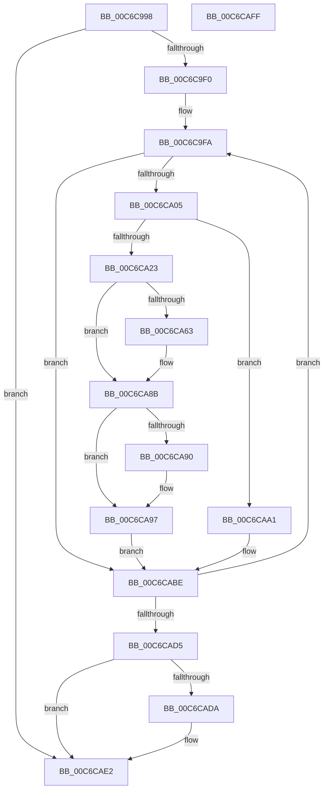

# MxMarkActiveDriverBits

- RVA: `0x00C6C998`–`0x00C6CB00` (길이 `360` bytes)
- VA: `0x0000000140C6C998`
- 실행 섹션: `INIT`
- PDB 이름 있음: `예`; PDB Function 태그: `아니요`
- unwind 정보 RVA: `0x0008C20C`
- 디코드: `96`개 명령, `360/360` bytes 표시
- 미해석 바이트: `0` (있으면 어셈블리에 `.byte`로 보존)

> 이 문서는 커널 이미지의 기계어와 PDB 기호를 분석해 생성했습니다. 4번과 5번은 함수 원형과 자료형을 바이너리 사용 방식에서 추정한 C 해석이며 원본 소스 복구 결과는 아닙니다.

## 1. Dependencies

- 직접 호출 지점: **3**; 고유 호출 대상: **3**
- 직접 호출자로 확인된 함수: **2**
- RIP 상대 이미지 참조: **1**

### Outgoing calls
- `0x00C6CA77` → [MiSplitBitmapPages](../../text/3B/MiSplitBitmapPages_function_003B4A34.md) (function, `0x003B4A34`)
- `0x00C6CA86` → [KeZeroSinglePage](../../text/6B/KeZeroSinglePage_function_006BA030.md) (function, `0x006BA030`)
- `0x00C6CAB9` → [MxMarkActiveDriverBits](MxMarkActiveDriverBits_function_00C6C998.md) (function, `0x00C6C998`)

### Direct callers
- [MiInitializeSystemImageRegion](MiInitializeSystemImageRegion_function_00C6C05C.md) at `0x00C6C116`
- [MxMarkActiveDriverBits](MxMarkActiveDriverBits_function_00C6C998.md) at `0x00C6CAB9`

### Static image references
- `0x00C6CADA` → RVA `0x00E376E0` (`.data`; read/write)

## 2. Other-region calls and transfers

- 다른 실행 섹션으로 향하는 call: **2**
  - `0x00C6CA77` → [MiSplitBitmapPages](../../text/3B/MiSplitBitmapPages_function_003B4A34.md) (`INIT` → `.text`)
  - `0x00C6CA86` → [KeZeroSinglePage](../../text/6B/KeZeroSinglePage_function_006BA030.md) (`INIT` → `.text`)
- 별도 외부 분기/꼬리 이동을 확인하지 못했습니다.

## 3. Assembly (complete function range)

```asm
00C6C998  48 89 5C 24 08                  mov qword ptr [rsp + 8], rbx
00C6C99D  48 89 6C 24 10                  mov qword ptr [rsp + 0x10], rbp
00C6C9A2  48 89 74 24 18                  mov qword ptr [rsp + 0x18], rsi
00C6C9A7  57                              push rdi
00C6C9A8  41 54                           push r12
00C6C9AA  41 55                           push r13
00C6C9AC  41 56                           push r14
00C6C9AE  41 57                           push r15
00C6C9B0  48 83 EC 30                     sub rsp, 0x30
00C6C9B4  4C 63 AC 24 80 00 00 00         movsxd r13, dword ptr [rsp + 0x80]
00C6C9BC  33 F6                           xor esi, esi
00C6C9BE  4D 8B D5                        mov r10, r13
00C6C9C1  48 8B FA                        mov rdi, rdx
00C6C9C4  4D 03 D2                        add r10, r10
00C6C9C7  4D 8B F8                        mov r15, r8
00C6C9CA  4D 8B E1                        mov r12, r9
00C6C9CD  4C 8B F1                        mov r14, rcx
00C6C9D0  4B 8B 04 D1                     mov rax, qword ptr [r9 + r10*8]
00C6C9D4  48 3B D0                        cmp rdx, rax
00C6C9D7  48 0F 42 F8                     cmovb rdi, rax
00C6C9DB  4B 8B 44 D1 08                  mov rax, qword ptr [r9 + r10*8 + 8]
00C6C9E0  4C 3B C0                        cmp r8, rax
00C6C9E3  4C 0F 47 F8                     cmova r15, rax
00C6C9E7  49 3B FF                        cmp rdi, r15
00C6C9EA  0F 87 F2 00 00 00               ja 0x140c6cae2
00C6C9F0  48 BA 00 00 00 00 80 F6 FF FF   movabs rdx, 0xfffff68000000000
00C6C9FA  48 8B 07                        mov rax, qword ptr [rdi]
00C6C9FD  A8 01                           test al, 1
00C6C9FF  0F 84 B9 00 00 00               je 0x140c6cabe
00C6CA05  48 FF C6                        inc rsi
00C6CA08  48 8B C2                        mov rax, rdx
00C6CA0B  48 C1 E0 19                     shl rax, 0x19
00C6CA0F  48 8B DF                        mov rbx, rdi
00C6CA12  48 C1 E3 19                     shl rbx, 0x19
00C6CA16  48 2B D8                        sub rbx, rax
00C6CA19  48 C1 FB 10                     sar rbx, 0x10
00C6CA1D  41 83 FD 01                     cmp r13d, 1
00C6CA21  75 7E                           jne 0x140c6caa1
00C6CA23  48 C1 E3 19                     shl rbx, 0x19
00C6CA27  48 2B D8                        sub rbx, rax
00C6CA2A  48 B8 F8 FF FF FF 7F 00 00 00   movabs rax, 0x7ffffffff8
00C6CA34  48 C1 FB 10                     sar rbx, 0x10
00C6CA38  49 2B 5E 20                     sub rbx, qword ptr [r14 + 0x20]
00C6CA3C  48 C1 EB 15                     shr rbx, 0x15
00C6CA40  48 8B EB                        mov rbp, rbx
00C6CA43  48 C1 ED 03                     shr rbp, 3
00C6CA47  49 03 6E 08                     add rbp, qword ptr [r14 + 8]
00C6CA4B  48 8B CD                        mov rcx, rbp
00C6CA4E  48 C1 E9 09                     shr rcx, 9
00C6CA52  48 23 C8                        and rcx, rax
00C6CA55  48 8B C2                        mov rax, rdx
00C6CA58  48 8B 04 01                     mov rax, qword ptr [rcx + rax]
00C6CA5C  48 0F BA E0 0B                  bt rax, 0xb
00C6CA61  72 28                           jb 0x140c6ca8b
00C6CA63  4C 8B C3                        mov r8, rbx
00C6CA66  41 8D 4D 0A                     lea ecx, [r13 + 0xa]
00C6CA6A  41 83 E0 07                     and r8d, 7
00C6CA6E  45 33 C9                        xor r9d, r9d
00C6CA71  49 FF C0                        inc r8
00C6CA74  48 8B D5                        mov rdx, rbp
00C6CA77  E8 B8 7F 74 FF                  call 0x1403b4a34
00C6CA7C  48 81 E5 00 F0 FF FF            and rbp, 0xfffffffffffff000
00C6CA83  48 8B CD                        mov rcx, rbp
00C6CA86  E8 A5 D5 A4 FF                  call 0x1406ba030
00C6CA8B  49 39 1E                        cmp qword ptr [r14], rbx
00C6CA8E  77 07                           ja 0x140c6ca97
00C6CA90  48 8D 43 01                     lea rax, [rbx + 1]
00C6CA94  49 89 06                        mov qword ptr [r14], rax
00C6CA97  49 8B 46 08                     mov rax, qword ptr [r14 + 8]
00C6CA9B  48 0F AB 18                     bts qword ptr [rax], rbx
00C6CA9F  EB 1D                           jmp 0x140c6cabe
00C6CAA1  41 8D 45 FF                     lea eax, [r13 - 1]
00C6CAA5  4D 8B CC                        mov r9, r12
00C6CAA8  4C 8D 83 F8 0F 00 00            lea r8, [rbx + 0xff8]
00C6CAAF  89 44 24 20                     mov dword ptr [rsp + 0x20], eax
00C6CAB3  48 8B D3                        mov rdx, rbx
00C6CAB6  49 8B CE                        mov rcx, r14
00C6CAB9  E8 DA FE FF FF                  call 0x140c6c998
00C6CABE  48 83 C7 08                     add rdi, 8
00C6CAC2  48 BA 00 00 00 00 80 F6 FF FF   movabs rdx, 0xfffff68000000000
00C6CACC  49 3B FF                        cmp rdi, r15
00C6CACF  0F 86 25 FF FF FF               jbe 0x140c6c9fa
00C6CAD5  48 85 F6                        test rsi, rsi
00C6CAD8  74 08                           je 0x140c6cae2
00C6CADA  F0 48 01 35 FE AB 1C 00         lock add qword ptr [rip + 0x1cabfe], rsi
00C6CAE2  48 8B 5C 24 60                  mov rbx, qword ptr [rsp + 0x60]
00C6CAE7  48 8B 6C 24 68                  mov rbp, qword ptr [rsp + 0x68]
00C6CAEC  48 8B 74 24 70                  mov rsi, qword ptr [rsp + 0x70]
00C6CAF1  48 83 C4 30                     add rsp, 0x30
00C6CAF5  41 5F                           pop r15
00C6CAF7  41 5E                           pop r14
00C6CAF9  41 5D                           pop r13
00C6CAFB  41 5C                           pop r12
00C6CAFD  5F                              pop rdi
00C6CAFE  C3                              ret
00C6CAFF  CC                              int3
```

## 4. C-style interpretation (structured pseudocode)

```c
__int64 __fastcall MxMarkActiveDriverBits(__int64 a1, __int64 a2, __int64 a3, __int64 a4, unsigned int a5)
{
    __int64 result;
    __int64 v_r10;
    __int64 v_rbp;
    __int64 v_rbx;
    __int64 v_rdi;
    __int64 v_rsi;
    __int64 v_rsp;
    unsigned int v_stack_m38;
    unsigned __int64 v_stack_p10;
    unsigned __int64 v_stack_p18;
    unsigned __int64 v_stack_p8;

    v_stack_p8 = v_rbx;
    v_stack_p10 = v_rbp;
    v_stack_p18 = v_rsi;
    v_rsp = (v_rsp) - (48);
    v_rsi = 0;
    v_r10 = ((int)(a5)) + ((int)(a5));
    if (a2 < (*(unsigned __int64 *)(a4 + v_r10 * 8))) { a2 = *(unsigned __int64 *)(a4 + v_r10 * 8); }
    if (a3 > (*(unsigned __int64 *)(a4 + v_r10 * 8 + 8))) { a3 = *(unsigned __int64 *)(a4 + v_r10 * 8 + 8); }
    if (a2 > a3) goto loc_00C6CAE2;
loc_00C6C9FA:
    if ((((unsigned __int8)(*(unsigned __int64 *)(a2))) & (1)) == 0) goto loc_00C6CABE;
    v_rsi = (v_rsi) + 1;
    result = (a2) << (25);
    v_rbx = (a2) << (25);
    v_rbx = (v_rbx) - (result);
    v_rbx = (v_rbx) >> (16);
    if (((unsigned int)((int)(a5))) != 1) goto loc_00C6CAA1;
    v_rbx = (v_rbx) << (25);
    v_rbx = (v_rbx) - (result);
    v_rbx = (v_rbx) >> (16);
    v_rbx = (v_rbx) - (*(unsigned __int64 *)(a1 + 32));
    v_rbx = (v_rbx) >> (21);
    v_rbp = (v_rbx) >> (3);
    v_rbp = (v_rbp) + (*(unsigned __int64 *)(a1 + 8));
    a1 = (v_rbp) >> (9);
    a1 = (a1) & (result);
    result = *(unsigned __int64 *)(a1 + a2 * 1);
    if (!(condition_is_below)) {
        a3 = v_rbx;
        a1 = (int)(a5) + 10;
        a3 = (unsigned int)((a3) & (7));
        a4 = 0;
        a3 = (a3) + 1;
        a2 = v_rbp;
        result = MiSplitBitmapPages(a1, a2, a3, a4);
        v_rbp = (v_rbp) & (0xFFFFFFFFFFFFF000ULL);
        a1 = v_rbp;
        result = KeZeroSinglePage(a1, a2, a3, a4);
    }
    if ((*(unsigned __int64 *)(a1)) <= v_rbx) {
        result = v_rbx + 1;
        *(unsigned __int64 *)(a1) = result;
    }
    goto loc_00C6CABE;
loc_00C6CAA1:
    v_stack_m38 = (unsigned int)((int)(a5) - 1);
    result = MxMarkActiveDriverBits(a1, v_rbx, v_rbx + 4088, 0);
loc_00C6CABE:
    v_rdi = (a2) + (8);
    if (v_rdi <= a3) goto loc_00C6C9FA;
    if (v_rsi != 0) {
    }
    v_rsp = (v_rsp) + (48);
    return result;
}
```

## 5. (Beta) C Style

```c
int64_t MxMarkActiveDriverBits(void *Arg1, int64_t Arg2, int64_t Arg3, void *Arg4, uint32_t Arg5)
{
    uint8_t *arg1 = (uint8_t *)Arg1;
    uint8_t *arg4 = (uint8_t *)Arg4;

    int64_t result;
    int64_t local_r10;
    int64_t local_rbp;
    int64_t local_rbx;
    int64_t local_rdi;
    int64_t local_rsi;
    int64_t local_rsp;
    uint32_t v_stack_m38;
    uint64_t v_stack_p10;
    uint64_t v_stack_p18;
    uint64_t v_stack_p8;

    v_stack_p8 = local_rbx;
    v_stack_p10 = local_rbp;
    v_stack_p18 = local_rsi;
    local_rsp = (local_rsp) - (48);
    local_rsi = 0;
    local_r10 = ((int32_t)(Arg5)) + ((int32_t)(Arg5));
    if (Arg2 < (*(uint64_t *)(arg4 + local_r10 * 8))) { Arg2 = *(uint64_t *)(arg4 + local_r10 * 8); }
    if (Arg3 > (*(uint64_t *)(arg4 + local_r10 * 8 + 0x8))) { Arg3 = *(uint64_t *)(arg4 + local_r10 * 8 + 0x8); }
    if (Arg2 > Arg3) goto loc_00C6CAE2;
loc_00C6C9FA:
    if ((((uint8_t)(*(uint64_t *)(Arg2))) & (1)) == 0) goto loc_00C6CABE;
    local_rsi = (local_rsi) + 1;
    result = (Arg2) << (25);
    local_rbx = (Arg2) << (25);
    local_rbx = (local_rbx) - (result);
    local_rbx = (local_rbx) >> (16);
    if (((uint32_t)((int32_t)(Arg5))) != 1) goto loc_00C6CAA1;
    local_rbx = (local_rbx) << (25);
    local_rbx = (local_rbx) - (result);
    local_rbx = (local_rbx) >> (16);
    local_rbx = (local_rbx) - (*(uint64_t *)(arg1 + 0x20));
    local_rbx = (local_rbx) >> (21);
    local_rbp = (local_rbx) >> (3);
    local_rbp = (local_rbp) + (*(uint64_t *)(arg1 + 0x8));
    Arg1 = (local_rbp) >> (9);
    Arg1 = (Arg1) & (result);
    result = *(uint64_t *)(arg1 + Arg2 * 1);
    if (!(condition_is_below)) {
        Arg3 = local_rbx;
        Arg1 = (int32_t)(Arg5) + 10;
        Arg3 = (uint32_t)((Arg3) & (7));
        Arg4 = 0;
        Arg3 = (Arg3) + 1;
        Arg2 = local_rbp;
        result = MiSplitBitmapPages(Arg1, Arg2, Arg3, Arg4);
        local_rbp = (local_rbp) & (0xFFFFFFFFFFFFF000ULL);
        Arg1 = local_rbp;
        result = KeZeroSinglePage(Arg1, Arg2, Arg3, Arg4);
    }
    if ((*(uint64_t *)(arg1)) <= local_rbx) {
        result = local_rbx + 1;
        *(uint64_t *)(arg1) = result;
    }
    goto loc_00C6CABE;
loc_00C6CAA1:
    v_stack_m38 = (uint32_t)((int32_t)(Arg5) - 1);
    result = MxMarkActiveDriverBits(Arg1, local_rbx, local_rbx + 4088, 0);
loc_00C6CABE:
    local_rdi = (Arg2) + (8);
    if (local_rdi <= Arg3) goto loc_00C6C9FA;
    if (local_rsi != 0) {
    }
    local_rsp = (local_rsp) + (48);
    return result;
}
```

### 관측된 메모리 오프셋

구조체 형식이 확인되지 않은 접근은 인자 기준의 오프셋으로만 기록했습니다.

| 기준 인자 | 오프셋 표현 | 폭 (bit) | 접근 |
|---|---:|---:|---|
| `Arg1` | `+ 0x0` | `64` | `R` |
| `Arg1` | `+ 0x0` | `64` | `W` |
| `Arg1` | `+ 0x8` | `64` | `R` |
| `Arg1` | `+ 0x20` | `64` | `R` |
| `Arg4` | `+ 0x0 + r10*8` | `64` | `R` |
| `Arg4` | `+ 0x8 + r10*8` | `64` | `R` |

## 6. Execution-region graph

[열기: 2D/3D 그래프와 함수 탐색 컨트롤 패널](../../../control-panel.html?section=init&rva=0x00C6C998&view=graph)

- 2D 그래프는 위에서 아래로 흐르고, 3D 그래프는 빈 공간을 드래그해 회전합니다. Shift+드래그는 이동, 휠은 확대·축소, 함수 노드 선택은 대상 보고서 이동입니다.

### Static fallback


