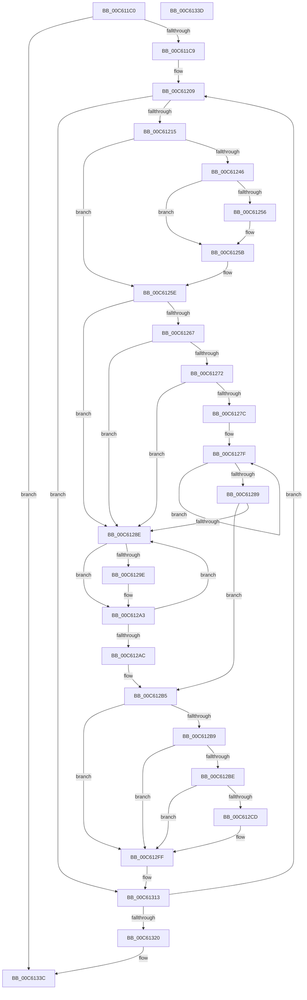

# MxMarkValidMappings

- RVA: `0x00C611C0`–`0x00C6133E` (길이 `382` bytes)
- VA: `0x0000000140C611C0`
- 실행 섹션: `INIT`
- PDB 이름 있음: `예`; PDB Function 태그: `아니요`
- unwind 정보 RVA: `0x000D77B4`
- 디코드: `101`개 명령, `382/382` bytes 표시
- 미해석 바이트: `0` (있으면 어셈블리에 `.byte`로 보존)

> 이 문서는 커널 이미지의 기계어와 PDB 기호를 분석해 생성했습니다. 4번과 5번은 함수 원형과 자료형을 바이너리 사용 방식에서 추정한 C 해석이며 원본 소스 복구 결과는 아닙니다.

## 1. Dependencies

- 직접 호출 지점: **3**; 고유 호출 대상: **2**
- 직접 호출자로 확인된 함수: **2**
- RIP 상대 이미지 참조: **0**

### Outgoing calls
- `0x00C6124C` → [MiIsRegularMemory](MiIsRegularMemory_function_00C627A8.md) (function, `0x00C627A8`)
- `0x00C61294` → [MiIsRegularMemory](MiIsRegularMemory_function_00C627A8.md) (function, `0x00C627A8`)
- `0x00C612FA` → [MxMarkValidMappings](MxMarkValidMappings_function_00C611C0.md) (function, `0x00C611C0`)

### Direct callers
- [MiInitNucleus](../C5/MiInitNucleus_function_00C5FD38.md) at `0x00C60075`
- [MxMarkValidMappings](MxMarkValidMappings_function_00C611C0.md) at `0x00C612FA`

### Static image references
- 디코드된 RIP-relative 메모리 참조가 없습니다.

## 2. Other-region calls and transfers

- 다른 실행 섹션으로 향하는 call: **0**
- 별도 외부 분기/꼬리 이동을 확인하지 못했습니다.

## 3. Assembly (complete function range)

```asm
00C611C0  48 3B CA                        cmp rcx, rdx
00C611C3  0F 87 73 01 00 00               ja 0x140c6133c
00C611C9  48 89 5C 24 08                  mov qword ptr [rsp + 8], rbx
00C611CE  48 89 6C 24 10                  mov qword ptr [rsp + 0x10], rbp
00C611D3  48 89 74 24 18                  mov qword ptr [rsp + 0x18], rsi
00C611D8  57                              push rdi
00C611D9  41 54                           push r12
00C611DB  41 55                           push r13
00C611DD  41 56                           push r14
00C611DF  41 57                           push r15
00C611E1  48 83 EC 20                     sub rsp, 0x20
00C611E5  41 8B E8                        mov ebp, r8d
00C611E8  4C 8B E2                        mov r12, rdx
00C611EB  49 B8 FF FF FF FF FF 00 00 00   movabs r8, 0xffffffffff
00C611F5  48 BA 00 00 00 00 80 F6 FF FF   movabs rdx, 0xfffff68000000000
00C611FF  4D 8B F9                        mov r15, r9
00C61202  48 8B F1                        mov rsi, rcx
00C61205  49 83 CD FF                     or r13, 0xffffffffffffffff
00C61209  48 8B 1E                        mov rbx, qword ptr [rsi]
00C6120C  F6 C3 01                        test bl, 1
00C6120F  0F 84 FE 00 00 00               je 0x140c61313
00C61215  4C 8B F3                        mov r14, rbx
00C61218  48 8B CE                        mov rcx, rsi
00C6121B  49 C1 EE 0C                     shr r14, 0xc
00C6121F  48 B8 F8 FF FF FF 7F 00 00 00   movabs rax, 0x7ffffffff8
00C61229  48 C1 E9 09                     shr rcx, 9
00C6122D  4D 23 F0                        and r14, r8
00C61230  48 23 C8                        and rcx, rax
00C61233  48 8B C2                        mov rax, rdx
00C61236  48 8B 3C 01                     mov rdi, qword ptr [rcx + rax]
00C6123A  48 C1 EF 0C                     shr rdi, 0xc
00C6123E  49 23 F8                        and rdi, r8
00C61241  49 3B FD                        cmp rdi, r13
00C61244  74 18                           je 0x140c6125e
00C61246  48 8B D7                        mov rdx, rdi
00C61249  49 8B CF                        mov rcx, r15
00C6124C  E8 57 15 00 00                  call 0x140c627a8
00C61251  48 85 C0                        test rax, rax
00C61254  74 05                           je 0x140c6125b
00C61256  0F BA 68 18 1D                  bts dword ptr [rax + 0x18], 0x1d
00C6125B  4C 8B EF                        mov r13, rdi
00C6125E  BF 01 00 00 00                  mov edi, 1
00C61263  85 ED                           test ebp, ebp
00C61265  74 27                           je 0x140c6128e
00C61267  48 8B CB                        mov rcx, rbx
00C6126A  81 E1 80 00 00 00               and ecx, 0x80
00C61270  74 1C                           je 0x140c6128e
00C61272  BF 00 02 00 00                  mov edi, 0x200
00C61277  83 FD 01                        cmp ebp, 1
00C6127A  74 12                           je 0x140c6128e
00C6127C  8D 55 FF                        lea edx, [rbp - 1]
00C6127F  48 C1 E7 09                     shl rdi, 9
00C61283  48 83 EA 01                     sub rdx, 1
00C61287  75 F6                           jne 0x140c6127f
00C61289  48 85 FF                        test rdi, rdi
00C6128C  74 27                           je 0x140c612b5
00C6128E  49 8B D6                        mov rdx, r14
00C61291  49 8B CF                        mov rcx, r15
00C61294  E8 0F 15 00 00                  call 0x140c627a8
00C61299  48 85 C0                        test rax, rax
00C6129C  74 05                           je 0x140c612a3
00C6129E  0F BA 68 18 1D                  bts dword ptr [rax + 0x18], 0x1d
00C612A3  49 FF C6                        inc r14
00C612A6  48 83 EF 01                     sub rdi, 1
00C612AA  75 E2                           jne 0x140c6128e
00C612AC  48 8B CB                        mov rcx, rbx
00C612AF  81 E1 80 00 00 00               and ecx, 0x80
00C612B5  85 ED                           test ebp, ebp
00C612B7  74 46                           je 0x140c612ff
00C612B9  48 85 C9                        test rcx, rcx
00C612BC  75 41                           jne 0x140c612ff
00C612BE  48 B8 68 DF BE 7D FB F6 FF FF   movabs rax, 0xfffff6fb7dbedf68
00C612C8  48 3B F0                        cmp rsi, rax
00C612CB  74 32                           je 0x140c612ff
00C612CD  48 8B CE                        mov rcx, rsi
00C612D0  48 B8 00 00 00 00 80 F6 FF FF   movabs rax, 0xfffff68000000000
00C612DA  48 C1 E1 19                     shl rcx, 0x19
00C612DE  48 8B C0                        mov rax, rax
00C612E1  48 C1 E0 19                     shl rax, 0x19
00C612E5  44 8D 45 FF                     lea r8d, [rbp - 1]
00C612E9  48 2B C8                        sub rcx, rax
00C612EC  4D 8B CF                        mov r9, r15
00C612EF  48 C1 F9 10                     sar rcx, 0x10
00C612F3  48 8D 91 F8 0F 00 00            lea rdx, [rcx + 0xff8]
00C612FA  E8 C1 FE FF FF                  call 0x140c611c0
00C612FF  49 B8 FF FF FF FF FF 00 00 00   movabs r8, 0xffffffffff
00C61309  48 BA 00 00 00 00 80 F6 FF FF   movabs rdx, 0xfffff68000000000
00C61313  48 83 C6 08                     add rsi, 8
00C61317  49 3B F4                        cmp rsi, r12
00C6131A  0F 86 E9 FE FF FF               jbe 0x140c61209
00C61320  48 8B 5C 24 50                  mov rbx, qword ptr [rsp + 0x50]
00C61325  48 8B 6C 24 58                  mov rbp, qword ptr [rsp + 0x58]
00C6132A  48 8B 74 24 60                  mov rsi, qword ptr [rsp + 0x60]
00C6132F  48 83 C4 20                     add rsp, 0x20
00C61333  41 5F                           pop r15
00C61335  41 5E                           pop r14
00C61337  41 5D                           pop r13
00C61339  41 5C                           pop r12
00C6133B  5F                              pop rdi
00C6133C  C3                              ret
00C6133D  CC                              int3
```

## 4. C-style interpretation (structured pseudocode)

```c
__int64 __fastcall MxMarkValidMappings(__int64 a1, __int64 a2, int a3, __int64 a4)
{
    __int64 result;
    __int64 v_r13;
    __int64 v_r14;
    __int64 v_rdi;
    __int64 v_rsi;
    __int64 v_rsp;
    unsigned __int64 v_stack_p10;
    unsigned __int64 v_stack_p18;
    unsigned __int64 v_stack_p8;

    if (a1 > a2) goto loc_00C6133C;
    v_stack_p8 = v_rbx;
    v_stack_p10 = v_rbp;
    v_stack_p18 = v_rsi;
    v_rsp = (v_rsp) - (32);
    v_r13 = (v_r13) | (-1);
loc_00C61209:
    if ((((unsigned __int8)(*(unsigned __int64 *)(a1))) & (1)) == 0) goto loc_00C61313;
    v_r14 = (*(unsigned __int64 *)(a1)) >> (12);
    a1 = (a1) >> (9);
    v_r14 = (v_r14) & (a3);
    a1 = (a1) & (result);
    v_rdi = (*(unsigned __int64 *)(a1 + a2 * 1)) >> (12);
    v_rdi = (v_rdi) & (a3);
    if (v_rdi == v_r13) goto loc_00C6125E;
    result = MiIsRegularMemory(a4, v_rdi, a3, a4);
    if (result != 0) {
    }
loc_00C6125E:
    if ((unsigned int)((unsigned int)(a3)) == 0) goto loc_00C6128E;
    a1 = (unsigned int)((*(unsigned __int64 *)(a1)) & (128));
    if (condition_is_equal) goto loc_00C6128E;
    if (((unsigned int)((unsigned int)(a3))) == 1) goto loc_00C6128E;
loc_00C6127F:
    v_rdi = (512) << (9);
    a2 = ((unsigned int)(a3) - 1) - (1);
    if (condition_is_not_equal) goto loc_00C6127F;
    if (v_rdi == 0) goto loc_00C612B5;
loc_00C6128E:
    result = MiIsRegularMemory(a4, v_r14, a3, a4);
    if (result != 0) {
    }
    v_r14 = (v_r14) + 1;
    v_rdi = (v_rdi) - (1);
    if (condition_is_not_equal) goto loc_00C6128E;
    a1 = (unsigned int)((*(unsigned __int64 *)(a1)) & (128));
loc_00C612B5:
    if ((unsigned int)((unsigned int)(a3)) == 0) goto loc_00C612FF;
    if (a1 != 0) goto loc_00C612FF;
    if (a1 != result) {
        a1 = a1;
        a1 = (a1) << (25);
        result = result;
        result = (result) << (25);
        a3 = (unsigned int)(a3) - 1;
        a1 = (a1) - (result);
        a4 = a4;
        a1 = (a1) >> (16);
        a2 = a1 + 4088;
        result = MxMarkValidMappings(a1, a2, a3, a4);
    }
loc_00C61313:
    v_rsi = (a1) + (8);
    if (v_rsi <= a2) goto loc_00C61209;
    v_rsp = (v_rsp) + (32);
loc_00C6133C:
    return result;
}
```

## 5. (Beta) C Style

```c
int64_t MxMarkValidMappings(int64_t Arg1, int64_t Arg2, int32_t Arg3, int64_t Arg4)
{
    int64_t result;
    int64_t local_r13;
    int64_t local_r14;
    int64_t local_rdi;
    int64_t local_rsi;
    int64_t local_rsp;
    uint64_t v_stack_p10;
    uint64_t v_stack_p18;
    uint64_t v_stack_p8;

    if (Arg1 > Arg2) goto loc_00C6133C;
    v_stack_p8 = local_rbx;
    v_stack_p10 = local_rbp;
    v_stack_p18 = local_rsi;
    local_rsp = (local_rsp) - (32);
    local_r13 = (local_r13) | (-1);
loc_00C61209:
    if ((((uint8_t)(*(uint64_t *)(Arg1))) & (1)) == 0) goto loc_00C61313;
    local_r14 = (*(uint64_t *)(Arg1)) >> (12);
    Arg1 = (Arg1) >> (9);
    local_r14 = (local_r14) & (Arg3);
    Arg1 = (Arg1) & (result);
    local_rdi = (*(uint64_t *)(Arg1 + Arg2 * 1)) >> (12);
    local_rdi = (local_rdi) & (Arg3);
    if (local_rdi == local_r13) goto loc_00C6125E;
    result = MiIsRegularMemory(Arg4, local_rdi, Arg3, Arg4);
    if (result != 0) {
    }
loc_00C6125E:
    if ((uint32_t)((uint32_t)(Arg3)) == 0) goto loc_00C6128E;
    Arg1 = (uint32_t)((*(uint64_t *)(Arg1)) & (128));
    if (condition_is_equal) goto loc_00C6128E;
    if (((uint32_t)((uint32_t)(Arg3))) == 1) goto loc_00C6128E;
loc_00C6127F:
    local_rdi = (512) << (9);
    Arg2 = ((uint32_t)(Arg3) - 1) - (1);
    if (condition_is_not_equal) goto loc_00C6127F;
    if (local_rdi == 0) goto loc_00C612B5;
loc_00C6128E:
    result = MiIsRegularMemory(Arg4, local_r14, Arg3, Arg4);
    if (result != 0) {
    }
    local_r14 = (local_r14) + 1;
    local_rdi = (local_rdi) - (1);
    if (condition_is_not_equal) goto loc_00C6128E;
    Arg1 = (uint32_t)((*(uint64_t *)(Arg1)) & (128));
loc_00C612B5:
    if ((uint32_t)((uint32_t)(Arg3)) == 0) goto loc_00C612FF;
    if (Arg1 != 0) goto loc_00C612FF;
    if (Arg1 != result) {
        Arg1 = Arg1;
        Arg1 = (Arg1) << (25);
        result = result;
        result = (result) << (25);
        Arg3 = (uint32_t)(Arg3) - 1;
        Arg1 = (Arg1) - (result);
        Arg4 = Arg4;
        Arg1 = (Arg1) >> (16);
        Arg2 = Arg1 + 4088;
        result = MxMarkValidMappings(Arg1, Arg2, Arg3, Arg4);
    }
loc_00C61313:
    local_rsi = (Arg1) + (8);
    if (local_rsi <= Arg2) goto loc_00C61209;
    local_rsp = (local_rsp) + (32);
loc_00C6133C:
    return result;
}
```

## 6. Execution-region graph

[열기: 2D/3D 그래프와 함수 탐색 컨트롤 패널](../../../control-panel.html?section=init&rva=0x00C611C0&view=graph)

- 2D 그래프는 위에서 아래로 흐르고, 3D 그래프는 빈 공간을 드래그해 회전합니다. Shift+드래그는 이동, 휠은 확대·축소, 함수 노드 선택은 대상 보고서 이동입니다.

### Static fallback


