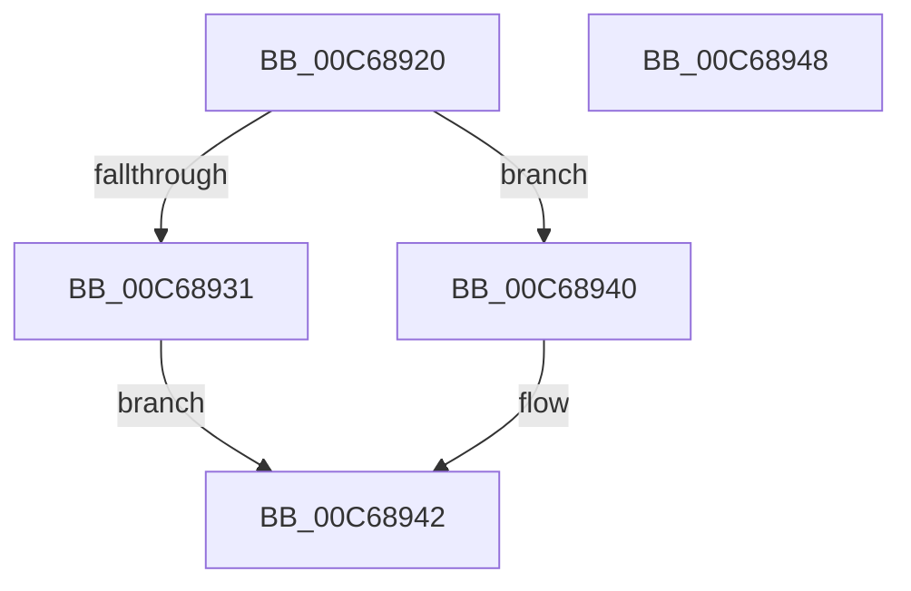

# MxPageAlwaysHot

- RVA: `0x00C68920`–`0x00C68949` (길이 `41` bytes)
- VA: `0x0000000140C68920`
- 실행 섹션: `INIT`
- PDB 이름 있음: `예`; PDB Function 태그: `아니요`
- unwind 정보 RVA: `0x0005CF00`
- 디코드: `15`개 명령, `41/41` bytes 표시
- 미해석 바이트: `0` (있으면 어셈블리에 `.byte`로 보존)

> 이 문서는 커널 이미지의 기계어와 PDB 기호를 분석해 생성했습니다. 4번과 5번은 함수 원형과 자료형을 바이너리 사용 방식에서 추정한 C 해석이며 원본 소스 복구 결과는 아닙니다.

## 1. Dependencies

- 직접 호출 지점: **1**; 고유 호출 대상: **1**
- 직접 호출자로 확인된 함수: **1**
- RIP 상대 이미지 참조: **1**

### Outgoing calls
- `0x00C68931` → [MiSearchChannelTable](../../text/33/MiSearchChannelTable_function_0033BE24.md) (function, `0x0033BE24`)

### Direct callers
- [MxInitializeFreeNodeDescriptors](MxInitializeFreeNodeDescriptors_function_00C6398C.md) at `0x00C63A0D`
- [MxInitializeFreeNodeDescriptors](MxInitializeFreeNodeDescriptors_function_00C6398C.md) at `0x00C63A28`

### Static image references
- `0x00C68928` → RVA `0x00E2DC28` (`.data`; read)

## 2. Other-region calls and transfers

- 다른 실행 섹션으로 향하는 call: **1**
  - `0x00C68931` → [MiSearchChannelTable](../../text/33/MiSearchChannelTable_function_0033BE24.md) (`INIT` → `.text`)
- 별도 외부 분기/꼬리 이동을 확인하지 못했습니다.

## 3. Assembly (complete function range)

```asm
00C68920  40 53                           push rbx
00C68922  48 83 EC 20                     sub rsp, 0x20
00C68926  33 DB                           xor ebx, ebx
00C68928  48 39 1D F9 52 1C 00            cmp qword ptr [rip + 0x1c52f9], rbx
00C6892F  74 0F                           je 0x140c68940
00C68931  E8 EE 34 6D FF                  call 0x14033be24
00C68936  38 58 0E                        cmp byte ptr [rax + 0xe], bl
00C68939  0F 94 C3                        sete bl
00C6893C  8B C3                           mov eax, ebx
00C6893E  EB 02                           jmp 0x140c68942
00C68940  33 C0                           xor eax, eax
00C68942  48 83 C4 20                     add rsp, 0x20
00C68946  5B                              pop rbx
00C68947  C3                              ret
00C68948  CC                              int3
```

## 4. C-style interpretation (structured pseudocode)

```c
__int64 __fastcall MxPageAlwaysHot(void)
{
    __int64 result;
    __int64 v_rbx;
    __int64 v_rsp;

    v_rsp = (v_rsp) - (32);
    v_rbx = 0;
    if ((*(unsigned __int64 *)(v_rip + 1856249)) == 0) goto loc_00C68940;
    result = MiSearchChannelTable(a1, a2, a3, a4);
    v_rbx = ((*(unsigned __int8 *)(result + 14)) == 0) ? 1 : 0;
    goto loc_00C68942;
loc_00C68940:
    result = 0;
loc_00C68942:
    v_rsp = (v_rsp) + (32);
    return result;
}
```

## 5. (Beta) C Style

```c
void MxPageAlwaysHot(void)
{
    int64_t result;
    int64_t local_rbx;
    int64_t local_rsp;

    local_rsp = (local_rsp) - (32);
    local_rbx = 0;
    if ((*(uint64_t *)(v_rip + 0x1C52F9)) == 0) goto loc_00C68940;
    result = MiSearchChannelTable(a1, a2, a3, a4);
    local_rbx = ((*(uint8_t *)(result + 0xE)) == 0) ? 1 : 0;
    goto loc_00C68942;
loc_00C68940:
    result = 0;
loc_00C68942:
    local_rsp = (local_rsp) + (32);
    return result;
}
```

## 6. Execution-region graph

[열기: 2D/3D 그래프와 함수 탐색 컨트롤 패널](../../../control-panel.html?section=init&rva=0x00C68920&view=graph)

- 2D 그래프는 위에서 아래로 흐르고, 3D 그래프는 빈 공간을 드래그해 회전합니다. Shift+드래그는 이동, 휠은 확대·축소, 함수 노드 선택은 대상 보고서 이동입니다.

### Static fallback


