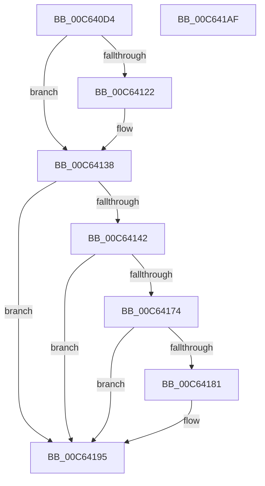

# MxReleaseFreeDescriptor

- RVA: `0x00C640D4`–`0x00C641B0` (길이 `220` bytes)
- VA: `0x0000000140C640D4`
- 실행 섹션: `INIT`
- PDB 이름 있음: `예`; PDB Function 태그: `아니요`
- unwind 정보 RVA: `0x000D78F4`
- 디코드: `62`개 명령, `220/220` bytes 표시
- 미해석 바이트: `0` (있으면 어셈블리에 `.byte`로 보존)

> 이 문서는 커널 이미지의 기계어와 PDB 기호를 분석해 생성했습니다. 4번과 5번은 함수 원형과 자료형을 바이너리 사용 방식에서 추정한 C 해석이며 원본 소스 복구 결과는 아닙니다.

## 1. Dependencies

- 직접 호출 지점: **3**; 고유 호출 대상: **1**
- 직접 호출자로 확인된 함수: **1**
- RIP 상대 이미지 참조: **0**

### Outgoing calls
- `0x00C64130` → [MxCreateFreePfns](MxCreateFreePfns_function_00C632CC.md) (function, `0x00C632CC`)
- `0x00C6416B` → [MxCreateFreePfns](MxCreateFreePfns_function_00C632CC.md) (function, `0x00C632CC`)
- `0x00C64190` → [MxCreateFreePfns](MxCreateFreePfns_function_00C632CC.md) (function, `0x00C632CC`)

### Direct callers
- [MiCreateFreePfns](MiCreateFreePfns_function_00C61F8C.md) at `0x00C62039`

### Static image references
- 디코드된 RIP-relative 메모리 참조가 없습니다.

## 2. Other-region calls and transfers

- 다른 실행 섹션으로 향하는 call: **0**
- 별도 외부 분기/꼬리 이동을 확인하지 못했습니다.

## 3. Assembly (complete function range)

```asm
00C640D4  48 8B C4                        mov rax, rsp
00C640D7  48 89 58 08                     mov qword ptr [rax + 8], rbx
00C640DB  48 89 70 10                     mov qword ptr [rax + 0x10], rsi
00C640DF  48 89 78 18                     mov qword ptr [rax + 0x18], rdi
00C640E3  4C 89 70 20                     mov qword ptr [rax + 0x20], r14
00C640E7  55                              push rbp
00C640E8  48 8B EC                        mov rbp, rsp
00C640EB  48 83 EC 50                     sub rsp, 0x50
00C640EF  48 83 65 D0 00                  and qword ptr [rbp - 0x30], 0
00C640F4  48 8B F9                        mov rdi, rcx
00C640F7  83 65 EC 00                     and dword ptr [rbp - 0x14], 0
00C640FB  33 F6                           xor esi, esi
00C640FD  48 8B 09                        mov rcx, qword ptr [rcx]
00C64100  0F 57 C0                        xorps xmm0, xmm0
00C64103  F3 0F 7F 45 D8                  movdqu xmmword ptr [rbp - 0x28], xmm0
00C64108  48 8B 47 18                     mov rax, qword ptr [rdi + 0x18]
00C6410C  BB 00 02 00 00                  mov ebx, 0x200
00C64111  48 89 4D F0                     mov qword ptr [rbp - 0x10], rcx
00C64115  44 8D 76 01                     lea r14d, [rsi + 1]
00C64119  89 55 E8                        mov dword ptr [rbp - 0x18], edx
00C6411C  48 83 F8 FF                     cmp rax, -1
00C64120  74 16                           je 0x140c64138
00C64122  48 2B C1                        sub rax, rcx
00C64125  48 8D 4D D0                     lea rcx, [rbp - 0x30]
00C64129  48 03 C3                        add rax, rbx
00C6412C  48 89 45 F8                     mov qword ptr [rbp - 8], rax
00C64130  E8 97 F1 FF FF                  call 0x140c632cc
00C64135  41 8B F6                        mov esi, r14d
00C64138  48 8B 57 10                     mov rdx, qword ptr [rdi + 0x10]
00C6413C  48 83 FA FF                     cmp rdx, -1
00C64140  74 53                           je 0x140c64195
00C64142  48 8B 0F                        mov rcx, qword ptr [rdi]
00C64145  48 8B C2                        mov rax, rdx
00C64148  48 25 00 FE FF FF               and rax, 0xfffffffffffffe00
00C6414E  48 3B C1                        cmp rax, rcx
00C64151  48 0F 47 C8                     cmova rcx, rax
00C64155  41 0F 46 F6                     cmovbe esi, r14d
00C64159  48 2B D1                        sub rdx, rcx
00C6415C  48 89 4D F0                     mov qword ptr [rbp - 0x10], rcx
00C64160  49 03 D6                        add rdx, r14
00C64163  48 8D 4D D0                     lea rcx, [rbp - 0x30]
00C64167  48 89 55 F8                     mov qword ptr [rbp - 8], rdx
00C6416B  E8 5C F1 FF FF                  call 0x140c632cc
00C64170  85 F6                           test esi, esi
00C64172  75 21                           jne 0x140c64195
00C64174  48 8B 0F                        mov rcx, qword ptr [rdi]
00C64177  48 8B C1                        mov rax, rcx
00C6417A  25 FF 01 00 00                  and eax, 0x1ff
00C6417F  74 14                           je 0x140c64195
00C64181  48 2B D8                        sub rbx, rax
00C64184  48 89 4D F0                     mov qword ptr [rbp - 0x10], rcx
00C64188  48 8D 4D D0                     lea rcx, [rbp - 0x30]
00C6418C  48 89 5D F8                     mov qword ptr [rbp - 8], rbx
00C64190  E8 37 F1 FF FF                  call 0x140c632cc
00C64195  48 8B 5C 24 60                  mov rbx, qword ptr [rsp + 0x60]
00C6419A  48 8B 74 24 68                  mov rsi, qword ptr [rsp + 0x68]
00C6419F  48 8B 7C 24 70                  mov rdi, qword ptr [rsp + 0x70]
00C641A4  4C 8B 74 24 78                  mov r14, qword ptr [rsp + 0x78]
00C641A9  48 83 C4 50                     add rsp, 0x50
00C641AD  5D                              pop rbp
00C641AE  C3                              ret
00C641AF  CC                              int3
```

## 4. C-style interpretation (structured pseudocode)

```c
__int64 __fastcall MxReleaseFreeDescriptor(__int64 a1, int a2)
{
    __int64 result;
    __int64 v_rbx;
    __int64 v_rsi;
    __int64 v_rsp;
    unsigned __int64 v_stack_m10;
    unsigned __int64 v_stack_m18;
    unsigned int v_stack_m1C;
    unsigned int v_stack_m20;
    unsigned __int64 v_stack_m30;
    unsigned __int64 v_stack_m38;
    unsigned __int64 v_stack_p10;
    unsigned __int64 v_stack_p18;
    unsigned __int64 v_stack_p20;
    unsigned __int64 v_stack_p8;

    *(unsigned __int64 *)(v_rsp + 8) = v_rbx;
    *(unsigned __int64 *)(v_rsp + 16) = v_rsi;
    *(unsigned __int64 *)(v_rsp + 24) = v_rdi;
    *(unsigned __int64 *)(v_rsp + 32) = v_r14;
    v_rsp = (v_rsp) - (80);
    v_rsi = 0;
    v_stack_m30 = v_xmm0;
    v_stack_m18 = *(unsigned __int64 *)(a1);
    v_stack_m20 = a2;
    result = *(unsigned __int64 *)(a1 + 24);
    if ((*(unsigned __int64 *)(a1 + 24)) != -1) {
        result = (*(unsigned __int64 *)(a1 + 24)) - (*(unsigned __int64 *)(a1));
        a1 = v_stack_m38;
        result = (result) + (512);
        v_stack_m10 = result;
        result = MxCreateFreePfns(a1, a2, a3, a4);
        v_rsi = (unsigned int)(v_rsi + 1);
    }
    if ((*(unsigned __int64 *)(a1 + 16)) == -1) goto loc_00C64195;
    result = (*(unsigned __int64 *)(a1 + 16)) & (-512);
    a1 = *(unsigned __int64 *)(a1);
    if (result > (*(unsigned __int64 *)(a1))) { a1 = result; }
    if (result <= (*(unsigned __int64 *)(a1))) { v_rsi = (unsigned int)(v_rsi + 1); }
    a2 = (*(unsigned __int64 *)(a1 + 16)) - (a1);
    v_stack_m18 = a1;
    a2 = (a2) + (v_rsi + 1);
    v_stack_m10 = a2;
    result = MxCreateFreePfns(v_stack_m38, a2, a3, a4);
    if ((unsigned int)(v_rsi) != 0) goto loc_00C64195;
    result = (unsigned int)((*(unsigned __int64 *)(a1)) & (511));
    v_rbx = 512;
    if (!(condition_is_equal)) {
        v_rbx = (512) - (result);
        v_stack_m18 = *(unsigned __int64 *)(a1);
        a1 = v_stack_m38;
        v_stack_m10 = v_rbx;
        result = MxCreateFreePfns(a1, a2, a3, a4);
    }
    v_rsp = (v_rsp) + (80);
    return result;
}
```

## 5. (Beta) C Style

```c
int64_t MxReleaseFreeDescriptor(void *Arg1, int32_t Arg2)
{
    uint8_t *arg1 = (uint8_t *)Arg1;

    int64_t result;
    int64_t local_rbx;
    int64_t local_rsi;
    int64_t local_rsp;
    uint64_t v_stack_m10;
    uint64_t v_stack_m18;
    uint32_t v_stack_m1C;
    uint32_t v_stack_m20;
    uint64_t v_stack_m30;
    uint64_t v_stack_m38;
    uint64_t v_stack_p10;
    uint64_t v_stack_p18;
    uint64_t v_stack_p20;
    uint64_t v_stack_p8;

    *(uint64_t *)(local_rsp + 0x8) = local_rbx;
    *(uint64_t *)(local_rsp + 0x10) = local_rsi;
    *(uint64_t *)(local_rsp + 0x18) = local_rdi;
    *(uint64_t *)(local_rsp + 0x20) = local_r14;
    local_rsp = (local_rsp) - (80);
    local_rsi = 0;
    v_stack_m30 = v_xmm0;
    v_stack_m18 = *(uint64_t *)(arg1);
    v_stack_m20 = Arg2;
    result = *(uint64_t *)(arg1 + 0x18);
    if ((*(uint64_t *)(arg1 + 0x18)) != -1) {
        result = (*(uint64_t *)(arg1 + 0x18)) - (*(uint64_t *)(arg1));
        Arg1 = v_stack_m38;
        result = (result) + (512);
        v_stack_m10 = result;
        result = MxCreateFreePfns(Arg1, Arg2, a3, a4);
        local_rsi = (uint32_t)(local_rsi + 1);
    }
    if ((*(uint64_t *)(arg1 + 0x10)) == -1) goto loc_00C64195;
    result = (*(uint64_t *)(arg1 + 0x10)) & (-512);
    Arg1 = *(uint64_t *)(arg1);
    if (result > (*(uint64_t *)(arg1))) { Arg1 = result; }
    if (result <= (*(uint64_t *)(arg1))) { local_rsi = (uint32_t)(local_rsi + 1); }
    Arg2 = (*(uint64_t *)(arg1 + 0x10)) - (Arg1);
    v_stack_m18 = Arg1;
    Arg2 = (Arg2) + (local_rsi + 1);
    v_stack_m10 = Arg2;
    result = MxCreateFreePfns(v_stack_m38, Arg2, a3, a4);
    if ((uint32_t)(local_rsi) != 0) goto loc_00C64195;
    result = (uint32_t)((*(uint64_t *)(arg1)) & (511));
    local_rbx = 512;
    if (!(condition_is_equal)) {
        local_rbx = (512) - (result);
        v_stack_m18 = *(uint64_t *)(arg1);
        Arg1 = v_stack_m38;
        v_stack_m10 = local_rbx;
        result = MxCreateFreePfns(Arg1, Arg2, a3, a4);
    }
    local_rsp = (local_rsp) + (80);
    return result;
}
```

### 관측된 메모리 오프셋

구조체 형식이 확인되지 않은 접근은 인자 기준의 오프셋으로만 기록했습니다.

| 기준 인자 | 오프셋 표현 | 폭 (bit) | 접근 |
|---|---:|---:|---|
| `Arg1` | `+ 0x0` | `64` | `R` |
| `Arg1` | `+ 0x10` | `64` | `R` |
| `Arg1` | `+ 0x18` | `64` | `R` |

## 6. Execution-region graph

[열기: 2D/3D 그래프와 함수 탐색 컨트롤 패널](../../../control-panel.html?section=init&rva=0x00C640D4&view=graph)

- 2D 그래프는 위에서 아래로 흐르고, 3D 그래프는 빈 공간을 드래그해 회전합니다. Shift+드래그는 이동, 휠은 확대·축소, 함수 노드 선택은 대상 보고서 이동입니다.

### Static fallback


