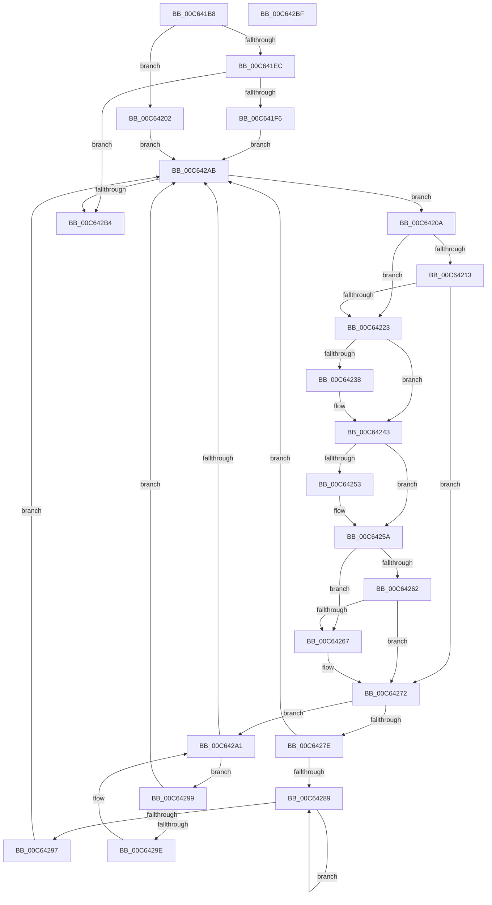

# MxWalkFreeNodeDescriptors

- RVA: `0x00C641B8`–`0x00C642C0` (길이 `264` bytes)
- VA: `0x0000000140C641B8`
- 실행 섹션: `INIT`
- PDB 이름 있음: `예`; PDB Function 태그: `아니요`
- unwind 정보 RVA: `0x0005CAAC`
- 디코드: `70`개 명령, `264/264` bytes 표시
- 미해석 바이트: `0` (있으면 어셈블리에 `.byte`로 보존)

> 이 문서는 커널 이미지의 기계어와 PDB 기호를 분석해 생성했습니다. 4번과 5번은 함수 원형과 자료형을 바이너리 사용 방식에서 추정한 C 해석이며 원본 소스 복구 결과는 아닙니다.

## 1. Dependencies

- 직접 호출 지점: **1**; 고유 호출 대상: **1**
- 직접 호출자로 확인된 함수: **1**
- RIP 상대 이미지 참조: **7**

### Outgoing calls
- `0x00C6426D` → [MxInitializeFreeNodeDescriptors](MxInitializeFreeNodeDescriptors_function_00C6398C.md) (function, `0x00C6398C`)

### Direct callers
- [MiInitializeLoaderDescriptors](MiInitializeLoaderDescriptors_function_00C625B4.md) at `0x00C625E4`
- [MiInitializeLoaderDescriptors](MiInitializeLoaderDescriptors_function_00C625B4.md) at `0x00C62629`

### Static image references
- `0x00C641C2` → RVA `0x00E3D550` (`.data`; read/write)
- `0x00C641D1` → RVA `0x00E3D540` (`.data`; read/write)
- `0x00C641DC` → RVA `0x00E3D548` (`.data`; read/write)
- `0x00C6422F` → RVA `0x00E3D548` (`.data`; read)
- `0x00C6423C` → RVA `0x00E3D548` (`.data`; write)
- `0x00C6424A` → RVA `0x00E3D540` (`.data`; read)
- `0x00C64253` → RVA `0x00E3D540` (`.data`; write)

## 2. Other-region calls and transfers

- 다른 실행 섹션으로 향하는 call: **0**
- 별도 외부 분기/꼬리 이동을 확인하지 못했습니다.

## 3. Assembly (complete function range)

```asm
00C641B8  48 89 5C 24 08                  mov qword ptr [rsp + 8], rbx
00C641BD  57                              push rdi
00C641BE  48 83 EC 20                     sub rsp, 0x20
00C641C2  48 83 25 86 93 1D 00 00         and qword ptr [rip + 0x1d9386], 0
00C641CA  48 8D 99 60 01 00 00            lea rbx, [rcx + 0x160]
00C641D1  48 83 0D 67 93 1D 00 FF         or qword ptr [rip + 0x1d9367], 0xffffffffffffffff
00C641D9  48 8B FA                        mov rdi, rdx
00C641DC  48 83 25 64 93 1D 00 00         and qword ptr [rip + 0x1d9364], 0
00C641E4  48 8B 43 08                     mov rax, qword ptr [rbx + 8]
00C641E8  A8 01                           test al, 1
00C641EA  74 16                           je 0x140c64202
00C641EC  48 83 F8 01                     cmp rax, 1
00C641F0  0F 84 BE 00 00 00               je 0x140c642b4
00C641F6  48 83 CB 01                     or rbx, 1
00C641FA  48 33 D8                        xor rbx, rax
00C641FD  E9 A9 00 00 00                  jmp 0x140c642ab
00C64202  48 8B D8                        mov rbx, rax
00C64205  E9 A1 00 00 00                  jmp 0x140c642ab
00C6420A  48 63 43 18                     movsxd rax, dword ptr [rbx + 0x18]
00C6420E  83 F8 2C                        cmp eax, 0x2c
00C64211  77 10                           ja 0x140c64223
00C64213  48 B9 48 00 C0 C0 C5 15 00 00   movabs rcx, 0x15c5c0c00048
00C6421D  48 0F A3 C1                     bt rcx, rax
00C64221  72 4F                           jb 0x140c64272
00C64223  48 8B 4B 20                     mov rcx, qword ptr [rbx + 0x20]
00C64227  4C 8B 43 28                     mov r8, qword ptr [rbx + 0x28]
00C6422B  49 8D 14 08                     lea rdx, [r8 + rcx]
00C6422F  48 3B 15 12 93 1D 00            cmp rdx, qword ptr [rip + 0x1d9312]
00C64236  76 0B                           jbe 0x140c64243
00C64238  48 8D 42 FF                     lea rax, [rdx - 1]
00C6423C  48 89 05 05 93 1D 00            mov qword ptr [rip + 0x1d9305], rax
00C64243  4C 01 05 06 93 1D 00            add qword ptr [rip + 0x1d9306], r8
00C6424A  48 3B 0D EF 92 1D 00            cmp rcx, qword ptr [rip + 0x1d92ef]
00C64251  73 07                           jae 0x140c6425a
00C64253  48 89 0D E6 92 1D 00            mov qword ptr [rip + 0x1d92e6], rcx
00C6425A  8B 43 18                        mov eax, dword ptr [rbx + 0x18]
00C6425D  83 F8 02                        cmp eax, 2
00C64260  74 05                           je 0x140c64267
00C64262  83 F8 18                        cmp eax, 0x18
00C64265  75 0B                           jne 0x140c64272
00C64267  48 8B D7                        mov rdx, rdi
00C6426A  48 8B CB                        mov rcx, rbx
00C6426D  E8 1A F7 FF FF                  call 0x140c6398c
00C64272  48 8B 43 08                     mov rax, qword ptr [rbx + 8]
00C64276  48 8B CB                        mov rcx, rbx
00C64279  48 85 C0                        test rax, rax
00C6427C  74 23                           je 0x140c642a1
00C6427E  48 8B 08                        mov rcx, qword ptr [rax]
00C64281  48 8B D8                        mov rbx, rax
00C64284  48 85 C9                        test rcx, rcx
00C64287  74 22                           je 0x140c642ab
00C64289  48 8B 01                        mov rax, qword ptr [rcx]
00C6428C  48 8B D9                        mov rbx, rcx
00C6428F  48 8B C8                        mov rcx, rax
00C64292  48 85 C0                        test rax, rax
00C64295  75 F2                           jne 0x140c64289
00C64297  EB 12                           jmp 0x140c642ab
00C64299  48 39 0B                        cmp qword ptr [rbx], rcx
00C6429C  74 0D                           je 0x140c642ab
00C6429E  48 8B CB                        mov rcx, rbx
00C642A1  48 8B 5B 10                     mov rbx, qword ptr [rbx + 0x10]
00C642A5  48 83 E3 FC                     and rbx, 0xfffffffffffffffc
00C642A9  75 EE                           jne 0x140c64299
00C642AB  48 85 DB                        test rbx, rbx
00C642AE  0F 85 56 FF FF FF               jne 0x140c6420a
00C642B4  48 8B 5C 24 30                  mov rbx, qword ptr [rsp + 0x30]
00C642B9  48 83 C4 20                     add rsp, 0x20
00C642BD  5F                              pop rdi
00C642BE  C3                              ret
00C642BF  CC                              int3
```

## 4. C-style interpretation (structured pseudocode)

```c
__int64 __fastcall MxWalkFreeNodeDescriptors(__int64 a1, __int64 a2)
{
    __int64 result;
    __int64 v_rbx;
    __int64 v_rsp;
    unsigned __int64 v_stack_p8;

    v_stack_p8 = v_rbx;
    v_rsp = (v_rsp) - (32);
    if ((((unsigned __int8)(*(unsigned __int64 *)(a1 + 352 + 8))) & (1)) == 0) goto loc_00C64202;
    if ((*(unsigned __int64 *)(a1 + 352 + 8)) == 1) goto loc_00C642B4;
    v_rbx = (a1 + 352) | (1);
    v_rbx = (v_rbx) ^ (*(unsigned __int64 *)(a1 + 352 + 8));
    goto loc_00C642AB;
loc_00C64202:
    goto loc_00C642AB;
loc_00C6420A:
    if (((unsigned int)((int)(*(unsigned int *)(*(unsigned __int64 *)(a1 + 352 + 8) + 24)))) > 44) goto loc_00C64223;
    if (((unsigned int)((int)(*(unsigned int *)(*(unsigned __int64 *)(a1 + 352 + 8) + 24)))) < 44) goto loc_00C64272;
loc_00C64223:
    result = (int)(*(unsigned int *)(*(unsigned __int64 *)(a1 + 352 + 8) + 24));
    if ((*(unsigned __int64 *)(*(unsigned __int64 *)(a1 + 352 + 8) + 40) + *(unsigned __int64 *)(*(unsigned __int64 *)(a1 + 352 + 8) + 32) * 1) >= = (*(unsigned __int64 *)(v_rip + 1938194))) {
        result = *(unsigned __int64 *)(*(unsigned __int64 *)(a1 + 352 + 8) + 40) + *(unsigned __int64 *)(*(unsigned __int64 *)(a1 + 352 + 8) + 32) * 1 - 1;
        *(unsigned __int64 *)(v_rip + 1938181) = result;
    }
    if ((*(unsigned __int64 *)(*(unsigned __int64 *)(a1 + 352 + 8) + 32)) < (*(unsigned __int64 *)(v_rip + 1938159))) {
        *(unsigned __int64 *)(v_rip + 1938150) = *(unsigned __int64 *)(*(unsigned __int64 *)(a1 + 352 + 8) + 32);
    }
    if (((unsigned int)((unsigned int)(*(unsigned int *)(*(unsigned __int64 *)(a1 + 352 + 8) + 24)))) == 2) goto loc_00C64267;
    result = (unsigned int)(*(unsigned int *)(*(unsigned __int64 *)(a1 + 352 + 8) + 24));
    if (((unsigned int)((unsigned int)(*(unsigned int *)(*(unsigned __int64 *)(a1 + 352 + 8) + 24)))) == 24) {
        a2 = a2;
        a1 = *(unsigned __int64 *)(a1 + 352 + 8);
        result = MxInitializeFreeNodeDescriptors(a1, a2, *(unsigned __int64 *)(*(unsigned __int64 *)(a1 + 352 + 8) + 40), a4);
    }
    if (*(unsigned __int64 *)(*(unsigned __int64 *)(a1 + 352 + 8) + 8) == 0) goto loc_00C642A1;
    if (*(unsigned __int64 *)(*(unsigned __int64 *)(*(unsigned __int64 *)(a1 + 352 + 8) + 8)) == 0) goto loc_00C642AB;
loc_00C64289:
    if (*(unsigned __int64 *)(*(unsigned __int64 *)(*(unsigned __int64 *)(*(unsigned __int64 *)(a1 + 352 + 8) + 8))) != 0) goto loc_00C64289;
    goto loc_00C642AB;
loc_00C64299:
    if ((*(unsigned __int64 *)(*(unsigned __int64 *)(*(unsigned __int64 *)(*(unsigned __int64 *)(a1 + 352 + 8) + 8)))) == (*(unsigned __int64 *)(*(unsigned __int64 *)(*(unsigned __int64 *)(*(unsigned __int64 *)(a1 + 352 + 8) + 8))))) goto loc_00C642AB;
loc_00C642A1:
    v_rbx = (*(unsigned __int64 *)(*(unsigned __int64 *)(*(unsigned __int64 *)(*(unsigned __int64 *)(a1 + 352 + 8) + 8)) + 16)) & (-4);
    if (condition_is_not_equal) goto loc_00C64299;
loc_00C642AB:
    if (v_rbx != 0) goto loc_00C6420A;
loc_00C642B4:
    v_rsp = (v_rsp) + (32);
    return *(unsigned __int64 *)(*(unsigned __int64 *)(*(unsigned __int64 *)(*(unsigned __int64 *)(a1 + 352 + 8) + 8)));
}
```

## 5. (Beta) C Style

```c
int64_t MxWalkFreeNodeDescriptors(void *Arg1, int64_t Arg2)
{
    uint8_t *arg1 = (uint8_t *)Arg1;

    int64_t result;
    int64_t local_rbx;
    int64_t local_rsp;
    uint64_t v_stack_p8;

    v_stack_p8 = local_rbx;
    local_rsp = (local_rsp) - (32);
    if ((((uint8_t)(*(uint64_t *)(arg1 + 0x160 + 0x8))) & (1)) == 0) goto loc_00C64202;
    if ((*(uint64_t *)(arg1 + 0x160 + 0x8)) == 1) goto loc_00C642B4;
    local_rbx = (Arg1 + 352) | (1);
    local_rbx = (local_rbx) ^ (*(uint64_t *)(arg1 + 0x160 + 0x8));
    goto loc_00C642AB;
loc_00C64202:
    goto loc_00C642AB;
loc_00C6420A:
    if (((uint32_t)((int32_t)(*(uint32_t *)(*(uint64_t *)(arg1 + 0x160 + 0x8) + 0x18)))) > 44) goto loc_00C64223;
    if (((uint32_t)((int32_t)(*(uint32_t *)(*(uint64_t *)(arg1 + 0x160 + 0x8) + 0x18)))) < 44) goto loc_00C64272;
loc_00C64223:
    result = (int32_t)(*(uint32_t *)(*(uint64_t *)(arg1 + 0x160 + 0x8) + 0x18));
    if ((*(uint64_t *)(*(uint64_t *)(arg1 + 0x160 + 0x8) + 0x28) + *(uint64_t *)(*(uint64_t *)(arg1 + 0x160 + 0x8) + 0x20) * 1) >= = (*(uint64_t *)(v_rip + 0x1D9312))) {
        result = *(uint64_t *)(*(uint64_t *)(arg1 + 0x160 + 0x8) + 0x28) + *(uint64_t *)(*(uint64_t *)(arg1 + 0x160 + 0x8) + 0x20) * 1 - 1;
        *(uint64_t *)(v_rip + 0x1D9305) = result;
    }
    if ((*(uint64_t *)(*(uint64_t *)(arg1 + 0x160 + 0x8) + 0x20)) < (*(uint64_t *)(v_rip + 0x1D92EF))) {
        *(uint64_t *)(v_rip + 0x1D92E6) = *(uint64_t *)(*(uint64_t *)(arg1 + 0x160 + 0x8) + 0x20);
    }
    if (((uint32_t)((uint32_t)(*(uint32_t *)(*(uint64_t *)(arg1 + 0x160 + 0x8) + 0x18)))) == 2) goto loc_00C64267;
    result = (uint32_t)(*(uint32_t *)(*(uint64_t *)(arg1 + 0x160 + 0x8) + 0x18));
    if (((uint32_t)((uint32_t)(*(uint32_t *)(*(uint64_t *)(arg1 + 0x160 + 0x8) + 0x18)))) == 24) {
        Arg2 = Arg2;
        Arg1 = *(uint64_t *)(arg1 + 0x160 + 0x8);
        result = MxInitializeFreeNodeDescriptors(Arg1, Arg2, *(uint64_t *)(*(uint64_t *)(arg1 + 0x160 + 0x8) + 0x28), a4);
    }
    if (*(uint64_t *)(*(uint64_t *)(arg1 + 0x160 + 0x8) + 0x8) == 0) goto loc_00C642A1;
    if (*(uint64_t *)(*(uint64_t *)(*(uint64_t *)(arg1 + 0x160 + 0x8) + 0x8)) == 0) goto loc_00C642AB;
loc_00C64289:
    if (*(uint64_t *)(*(uint64_t *)(*(uint64_t *)(*(uint64_t *)(arg1 + 0x160 + 0x8) + 0x8))) != 0) goto loc_00C64289;
    goto loc_00C642AB;
loc_00C64299:
    if ((*(uint64_t *)(*(uint64_t *)(*(uint64_t *)(*(uint64_t *)(arg1 + 0x160 + 0x8) + 0x8)))) == (*(uint64_t *)(*(uint64_t *)(*(uint64_t *)(*(uint64_t *)(arg1 + 0x160 + 0x8) + 0x8))))) goto loc_00C642AB;
loc_00C642A1:
    local_rbx = (*(uint64_t *)(*(uint64_t *)(*(uint64_t *)(*(uint64_t *)(arg1 + 0x160 + 0x8) + 0x8)) + 0x10)) & (-4);
    if (condition_is_not_equal) goto loc_00C64299;
loc_00C642AB:
    if (local_rbx != 0) goto loc_00C6420A;
loc_00C642B4:
    local_rsp = (local_rsp) + (32);
    return *(uint64_t *)(*(uint64_t *)(*(uint64_t *)(*(uint64_t *)(arg1 + 0x160 + 0x8) + 0x8)));
}
```

### 관측된 메모리 오프셋

구조체 형식이 확인되지 않은 접근은 인자 기준의 오프셋으로만 기록했습니다.

| 기준 인자 | 오프셋 표현 | 폭 (bit) | 접근 |
|---|---:|---:|---|
| `Arg1` | `+ 0x8` | `64` | `R` |
| `Arg1` | `+ 0x160` | `64` | `R` |

## 6. Execution-region graph

[열기: 2D/3D 그래프와 함수 탐색 컨트롤 패널](../../../control-panel.html?section=init&rva=0x00C641B8&view=graph)

- 2D 그래프는 위에서 아래로 흐르고, 3D 그래프는 빈 공간을 드래그해 회전합니다. Shift+드래그는 이동, 휠은 확대·축소, 함수 노드 선택은 대상 보고서 이동입니다.

### Static fallback


