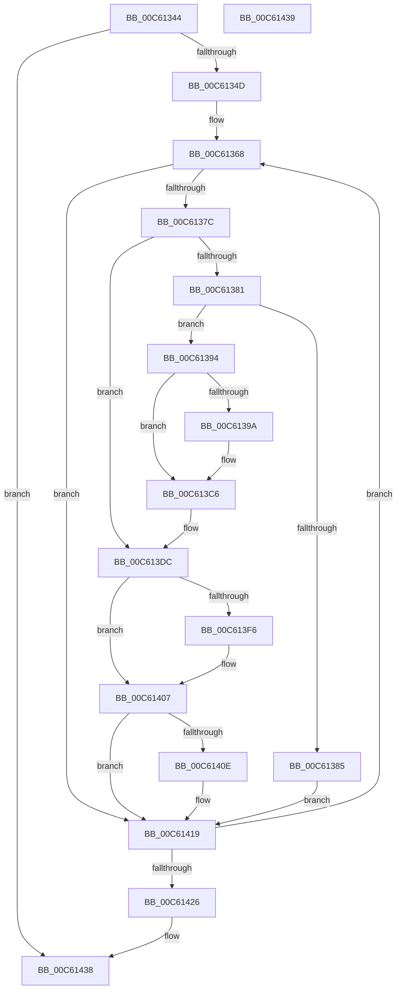

# MxZeroBootMappings

- RVA: `0x00C61344`–`0x00C6143A` (길이 `246` bytes)
- VA: `0x0000000140C61344`
- 실행 섹션: `INIT`
- PDB 이름 있음: `예`; PDB Function 태그: `아니요`
- unwind 정보 RVA: `0x000D77F0`
- 디코드: `66`개 명령, `246/246` bytes 표시
- 미해석 바이트: `0` (있으면 어셈블리에 `.byte`로 보존)

> 이 문서는 커널 이미지의 기계어와 PDB 기호를 분석해 생성했습니다. 4번과 5번은 함수 원형과 자료형을 바이너리 사용 방식에서 추정한 C 해석이며 원본 소스 복구 결과는 아닙니다.

## 1. Dependencies

- 직접 호출 지점: **6**; 고유 호출 대상: **6**
- 직접 호출자로 확인된 함수: **2**
- RIP 상대 이미지 참조: **1**

### Outgoing calls
- `0x00C6136B` → [MI_READ_PTE_LOCK_FREE](../../text/28/MI_READ_PTE_LOCK_FREE_function_002828A0.md) (function, `0x002828A0`)
- `0x00C613C1` → [MxZeroBootMappings](MxZeroBootMappings_function_00C61344.md) (function, `0x00C61344`)
- `0x00C613D7` → [MiFreeBootPageTable](../C5/MiFreeBootPageTable_function_00C5FC10.md) (function, `0x00C5FC10`)
- `0x00C613ED` → [MiPteInShadowRange](../../text/23/MiPteInShadowRange_function_0023FB00.md) (function, `0x0023FB00`)
- `0x00C613FB` → [MiSanitizeShadowPxe](../../text/29/MiSanitizeShadowPxe_function_00294B68.md) (function, `0x00294B68`)
- `0x00C61414` → [MiWritePteShadow](../../text/29/MiWritePteShadow_function_00294EAC.md) (function, `0x00294EAC`)

### Direct callers
- [MiInitNucleus](../C5/MiInitNucleus_function_00C5FD38.md) at `0x00C60230`
- [MxZeroBootMappings](MxZeroBootMappings_function_00C61344.md) at `0x00C613C1`

### Static image references
- `0x00C61385` → RVA `0x00010880` (`.rdata`; read)

## 2. Other-region calls and transfers

- 다른 실행 섹션으로 향하는 call: **4**
  - `0x00C6136B` → [MI_READ_PTE_LOCK_FREE](../../text/28/MI_READ_PTE_LOCK_FREE_function_002828A0.md) (`INIT` → `.text`)
  - `0x00C613ED` → [MiPteInShadowRange](../../text/23/MiPteInShadowRange_function_0023FB00.md) (`INIT` → `.text`)
  - `0x00C613FB` → [MiSanitizeShadowPxe](../../text/29/MiSanitizeShadowPxe_function_00294B68.md) (`INIT` → `.text`)
  - `0x00C61414` → [MiWritePteShadow](../../text/29/MiWritePteShadow_function_00294EAC.md) (`INIT` → `.text`)
- 별도 외부 분기/꼬리 이동을 확인하지 못했습니다.

## 3. Assembly (complete function range)

```asm
00C61344  48 3B CA                        cmp rcx, rdx
00C61347  0F 83 EB 00 00 00               jae 0x140c61438
00C6134D  48 89 5C 24 18                  mov qword ptr [rsp + 0x18], rbx
00C61352  48 89 6C 24 20                  mov qword ptr [rsp + 0x20], rbp
00C61357  56                              push rsi
00C61358  57                              push rdi
00C61359  41 56                           push r14
00C6135B  48 83 EC 20                     sub rsp, 0x20
00C6135F  45 8B F0                        mov r14d, r8d
00C61362  48 8B EA                        mov rbp, rdx
00C61365  48 8B F9                        mov rdi, rcx
00C61368  48 8B CF                        mov rcx, rdi
00C6136B  E8 30 15 62 FF                  call 0x1402828a0
00C61370  48 8B D8                        mov rbx, rax
00C61373  48 85 C0                        test rax, rax
00C61376  0F 84 9D 00 00 00               je 0x140c61419
00C6137C  F6 C3 01                        test bl, 1
00C6137F  74 5B                           je 0x140c613dc
00C61381  84 DB                           test bl, bl
00C61383  79 0F                           jns 0x140c61394
00C61385  48 8B 05 F4 F4 3A FF            mov rax, qword ptr [rip - 0xc50b0c]
00C6138C  48 89 07                        mov qword ptr [rdi], rax
00C6138F  E9 85 00 00 00                  jmp 0x140c61419
00C61394  41 83 FE 01                     cmp r14d, 1
00C61398  7E 2C                           jle 0x140c613c6
00C6139A  48 8B CF                        mov rcx, rdi
00C6139D  48 C1 E1 19                     shl rcx, 0x19
00C613A1  48 B8 00 00 00 00 80 F6 FF FF   movabs rax, 0xfffff68000000000
00C613AB  48 C1 E0 19                     shl rax, 0x19
00C613AF  45 8D 46 FF                     lea r8d, [r14 - 1]
00C613B3  48 2B C8                        sub rcx, rax
00C613B6  48 C1 F9 10                     sar rcx, 0x10
00C613BA  48 8D 91 00 10 00 00            lea rdx, [rcx + 0x1000]
00C613C1  E8 7E FF FF FF                  call 0x140c61344
00C613C6  48 C1 EB 0C                     shr rbx, 0xc
00C613CA  48 B9 FF FF FF FF FF 00 00 00   movabs rcx, 0xffffffffff
00C613D4  48 23 CB                        and rcx, rbx
00C613D7  E8 34 E8 FF FF                  call 0x140c5fc10
00C613DC  48 8B 1D 9D F4 3A FF            mov rbx, qword ptr [rip - 0xc50b63]
00C613E3  48 8B CF                        mov rcx, rdi
00C613E6  48 89 5C 24 40                  mov qword ptr [rsp + 0x40], rbx
00C613EB  33 F6                           xor esi, esi
00C613ED  E8 0E E7 5D FF                  call 0x14023fb00
00C613F2  85 C0                           test eax, eax
00C613F4  74 11                           je 0x140c61407
00C613F6  48 8D 54 24 40                  lea rdx, [rsp + 0x40]
00C613FB  E8 68 37 63 FF                  call 0x140294b68
00C61400  48 8B 5C 24 40                  mov rbx, qword ptr [rsp + 0x40]
00C61405  8B F0                           mov esi, eax
00C61407  48 89 1F                        mov qword ptr [rdi], rbx
00C6140A  85 F6                           test esi, esi
00C6140C  74 0B                           je 0x140c61419
00C6140E  48 8B D3                        mov rdx, rbx
00C61411  48 8B CF                        mov rcx, rdi
00C61414  E8 93 3A 63 FF                  call 0x140294eac
00C61419  48 83 C7 08                     add rdi, 8
00C6141D  48 3B FD                        cmp rdi, rbp
00C61420  0F 82 42 FF FF FF               jb 0x140c61368
00C61426  48 8B 5C 24 50                  mov rbx, qword ptr [rsp + 0x50]
00C6142B  48 8B 6C 24 58                  mov rbp, qword ptr [rsp + 0x58]
00C61430  48 83 C4 20                     add rsp, 0x20
00C61434  41 5E                           pop r14
00C61436  5F                              pop rdi
00C61437  5E                              pop rsi
00C61438  C3                              ret
00C61439  CC                              int3
```

## 4. C-style interpretation (structured pseudocode)

```c
__int64 __fastcall MxZeroBootMappings(__int64 a1, __int64 a2, int a3)
{
    __int64 result;
    __int64 v_rbx;
    __int64 v_rdi;
    __int64 v_rsi;
    __int64 v_rsp;
    unsigned __int64 v_stack_p18;
    unsigned __int64 v_stack_p20;
    unsigned __int64 v_stack_p8;

    if (a1 >= a2) goto loc_00C61438;
    v_stack_p18 = v_rbx;
    v_stack_p20 = v_rbp;
    v_rsp = (v_rsp) - (32);
loc_00C61368:
    result = MI_READ_PTE_LOCK_FREE(a1, a2, a3, a4);
    if (result == 0) goto loc_00C61419;
    if ((((unsigned __int8)(result)) & (1)) == 0) goto loc_00C613DC;
    if (!sign_flag) goto loc_00C61394;
    *(unsigned __int64 *)(a1) = *(unsigned __int64 *)(v_rip - 12913420);
    goto loc_00C61419;
loc_00C61394:
    result = *(unsigned __int64 *)(v_rip - 12913420);
    if (((unsigned int)((unsigned int)(a3))) >= = 1) {
        a1 = a1;
        a1 = (a1) << (25);
        result = (*(unsigned __int64 *)(v_rip - 12913420)) << (25);
        a3 = (unsigned int)(a3) - 1;
        a1 = (a1) - (result);
        a1 = (a1) >> (16);
        a2 = a1 + 4096;
        result = MxZeroBootMappings(a1, a2, a3, a4);
    }
    v_rbx = (result) >> (12);
    a1 = (a1) & (v_rbx);
    result = MiFreeBootPageTable(a1, a2, a3, a4);
loc_00C613DC:
    v_stack_p8 = *(unsigned __int64 *)(v_rip - 12913507);
    v_rsi = 0;
    result = MiPteInShadowRange(a1, a2, a3, a4);
    v_rbx = *(unsigned __int64 *)(v_rip - 12913507);
    if ((unsigned int)(result) != 0) {
        a2 = v_stack_p8;
        result = MiSanitizeShadowPxe(a1, a2, a3, a4);
        v_rbx = v_stack_p8;
        v_rsi = (unsigned int)(result);
    }
    *(unsigned __int64 *)(a1) = v_rbx;
    if ((unsigned int)(v_rsi) != 0) {
        a2 = v_rbx;
        a1 = a1;
        result = MiWritePteShadow(a1, a2, a3, a4);
    }
    v_rdi = (a1) + (8);
    if (v_rdi < a2) goto loc_00C61368;
    v_rsp = (v_rsp) + (32);
loc_00C61438:
    return result;
}
```

## 5. (Beta) C Style

```c
int64_t MxZeroBootMappings(int64_t Arg1, int64_t Arg2, int32_t Arg3)
{
    int64_t result;
    int64_t local_rbx;
    int64_t local_rdi;
    int64_t local_rsi;
    int64_t local_rsp;
    uint64_t v_stack_p18;
    uint64_t v_stack_p20;
    uint64_t v_stack_p8;

    if (Arg1 >= Arg2) goto loc_00C61438;
    v_stack_p18 = local_rbx;
    v_stack_p20 = local_rbp;
    local_rsp = (local_rsp) - (32);
loc_00C61368:
    result = MI_READ_PTE_LOCK_FREE(Arg1, Arg2, Arg3, a4);
    if (result == 0) goto loc_00C61419;
    if ((((uint8_t)(result)) & (1)) == 0) goto loc_00C613DC;
    if (!sign_flag) goto loc_00C61394;
    *(uint64_t *)(Arg1) = *(uint64_t *)(v_rip - 0xC50B0C);
    goto loc_00C61419;
loc_00C61394:
    result = *(uint64_t *)(v_rip - 0xC50B0C);
    if (((uint32_t)((uint32_t)(Arg3))) >= = 1) {
        Arg1 = Arg1;
        Arg1 = (Arg1) << (25);
        result = (*(uint64_t *)(v_rip - 0xC50B0C)) << (25);
        Arg3 = (uint32_t)(Arg3) - 1;
        Arg1 = (Arg1) - (result);
        Arg1 = (Arg1) >> (16);
        Arg2 = Arg1 + 4096;
        result = MxZeroBootMappings(Arg1, Arg2, Arg3, a4);
    }
    local_rbx = (result) >> (12);
    Arg1 = (Arg1) & (local_rbx);
    result = MiFreeBootPageTable(Arg1, Arg2, Arg3, a4);
loc_00C613DC:
    v_stack_p8 = *(uint64_t *)(v_rip - 0xC50B63);
    local_rsi = 0;
    result = MiPteInShadowRange(Arg1, Arg2, Arg3, a4);
    local_rbx = *(uint64_t *)(v_rip - 0xC50B63);
    if ((uint32_t)(result) != 0) {
        Arg2 = v_stack_p8;
        result = MiSanitizeShadowPxe(Arg1, Arg2, Arg3, a4);
        local_rbx = v_stack_p8;
        local_rsi = (uint32_t)(result);
    }
    *(uint64_t *)(Arg1) = local_rbx;
    if ((uint32_t)(local_rsi) != 0) {
        Arg2 = local_rbx;
        Arg1 = Arg1;
        result = MiWritePteShadow(Arg1, Arg2, Arg3, a4);
    }
    local_rdi = (Arg1) + (8);
    if (local_rdi < Arg2) goto loc_00C61368;
    local_rsp = (local_rsp) + (32);
loc_00C61438:
    return result;
}
```

## 6. Execution-region graph

[열기: 2D/3D 그래프와 함수 탐색 컨트롤 패널](../../../control-panel.html?section=init&rva=0x00C61344&view=graph)

- 2D 그래프는 위에서 아래로 흐르고, 3D 그래프는 빈 공간을 드래그해 회전합니다. Shift+드래그는 이동, 휠은 확대·축소, 함수 노드 선택은 대상 보고서 이동입니다.

### Static fallback


