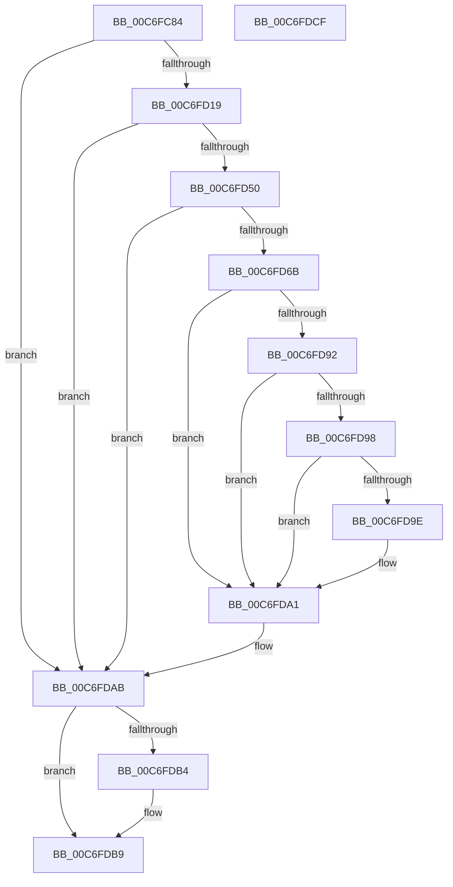

# QueryRegistryHideMachine

- RVA: `0x00C6FC84`–`0x00C6FDD0` (길이 `332` bytes)
- VA: `0x0000000140C6FC84`
- 실행 섹션: `INIT`
- PDB 이름 있음: `예`; PDB Function 태그: `아니요`
- unwind 정보 RVA: `0x000BAE94`
- 디코드: `90`개 명령, `332/332` bytes 표시
- 미해석 바이트: `0` (있으면 어셈블리에 `.byte`로 보존)

> 이 문서는 커널 이미지의 기계어와 PDB 기호를 분석해 생성했습니다. 4번과 5번은 함수 원형과 자료형을 바이너리 사용 방식에서 추정한 C 해석이며 원본 소스 복구 결과는 아닙니다.

## 1. Dependencies

- 직접 호출 지점: **8**; 고유 호출 대상: **7**
- 직접 호출자로 확인된 함수: **1**
- RIP 상대 이미지 참조: **2**

### Outgoing calls
- `0x00C6FCB0` → [wcslen](../../text/50/wcslen_function_00501BA0.md) (function, `0x00501BA0`)
- `0x00C6FD0C` → [ZwOpenKey](../../text/6A/ZwOpenKey_function_006AD310.md) (function, `0x006AD310`)
- `0x00C6FD24` → [RtlInitUnicodeString](../../text/42/RtlInitUnicodeString_function_0042A780.md) (function, `0x0042A780`)
- `0x00C6FD44` → [ZwQueryValueKey](../../text/6A/ZwQueryValueKey_function_006AD3B0.md) (function, `0x006AD3B0`)
- `0x00C6FD5E` → [ExAllocatePool2](../../poolcode/B8/ExAllocatePool2_function_00B820F0.md) (function, `0x00B820F0`)
- `0x00C6FD89` → [ZwQueryValueKey](../../text/6A/ZwQueryValueKey_function_006AD3B0.md) (function, `0x006AD3B0`)
- `0x00C6FDA6` → [ExFreePoolWithTag](../../poolcode/B8/ExFreePoolWithTag_function_00B82870.md) (function, `0x00B82870`)
- `0x00C6FDB4` → [ZwClose](../../text/6A/ZwClose_function_006AD2B0.md) (function, `0x006AD2B0`)

### Direct callers
- [StartFirstUserProcess](../C7/StartFirstUserProcess_function_00C70848.md) at `0x00C70882`

### Static image references
- `0x00C6FC96` → RVA `0x00C78DB0` (` ?? ::PBOPGDP::`string'`; read)
- `0x00C6FD19` → RVA `0x00C78E40` (` ?? ::PBOPGDP::`string'`; read)

## 2. Other-region calls and transfers

- 다른 실행 섹션으로 향하는 call: **8**
  - `0x00C6FCB0` → [wcslen](../../text/50/wcslen_function_00501BA0.md) (`INIT` → `.text`)
  - `0x00C6FD0C` → [ZwOpenKey](../../text/6A/ZwOpenKey_function_006AD310.md) (`INIT` → `.text`)
  - `0x00C6FD24` → [RtlInitUnicodeString](../../text/42/RtlInitUnicodeString_function_0042A780.md) (`INIT` → `.text`)
  - `0x00C6FD44` → [ZwQueryValueKey](../../text/6A/ZwQueryValueKey_function_006AD3B0.md) (`INIT` → `.text`)
  - `0x00C6FD5E` → [ExAllocatePool2](../../poolcode/B8/ExAllocatePool2_function_00B820F0.md) (`INIT` → `POOLCODE`)
  - `0x00C6FD89` → [ZwQueryValueKey](../../text/6A/ZwQueryValueKey_function_006AD3B0.md) (`INIT` → `.text`)
  - `0x00C6FDA6` → [ExFreePoolWithTag](../../poolcode/B8/ExFreePoolWithTag_function_00B82870.md) (`INIT` → `POOLCODE`)
  - `0x00C6FDB4` → [ZwClose](../../text/6A/ZwClose_function_006AD2B0.md) (`INIT` → `.text`)
- 별도 외부 분기/꼬리 이동을 확인하지 못했습니다.

## 3. Assembly (complete function range)

```asm
00C6FC84  48 89 5C 24 18                  mov qword ptr [rsp + 0x18], rbx
00C6FC89  55                              push rbp
00C6FC8A  57                              push rdi
00C6FC8B  41 56                           push r14
00C6FC8D  48 8B EC                        mov rbp, rsp
00C6FC90  48 83 EC 70                     sub rsp, 0x70
00C6FC94  33 C0                           xor eax, eax
00C6FC96  48 8D 0D 13 91 00 00            lea rcx, [rip + 0x9113]
00C6FC9D  21 45 20                        and dword ptr [rbp + 0x20], eax
00C6FCA0  33 FF                           xor edi, edi
00C6FCA2  48 21 45 28                     and qword ptr [rbp + 0x28], rax
00C6FCA6  21 45 C4                        and dword ptr [rbp - 0x3c], eax
00C6FCA9  89 45 D4                        mov dword ptr [rbp - 0x2c], eax
00C6FCAC  48 89 4D C8                     mov qword ptr [rbp - 0x38], rcx
00C6FCB0  E8 EB 1E 89 FF                  call 0x140501ba0
00C6FCB5  48 03 C0                        add rax, rax
00C6FCB8  C7 45 D0 30 00 00 00            mov dword ptr [rbp - 0x30], 0x30
00C6FCBF  48 3D FE FF 00 00               cmp rax, 0xfffe
00C6FCC5  C7 45 E8 40 02 00 00            mov dword ptr [rbp - 0x18], 0x240
00C6FCCC  B9 FC FF 00 00                  mov ecx, 0xfffc
00C6FCD1  44 8D 77 02                     lea r14d, [rdi + 2]
00C6FCD5  48 0F 43 C1                     cmovae rax, rcx
00C6FCD9  4C 8D 45 D0                     lea r8, [rbp - 0x30]
00C6FCDD  21 7D D4                        and dword ptr [rbp - 0x2c], edi
00C6FCE0  48 8D 4D 28                     lea rcx, [rbp + 0x28]
00C6FCE4  21 7D EC                        and dword ptr [rbp - 0x14], edi
00C6FCE7  0F 57 C0                        xorps xmm0, xmm0
00C6FCEA  48 21 7D D8                     and qword ptr [rbp - 0x28], rdi
00C6FCEE  BA 19 00 02 00                  mov edx, 0x20019
00C6FCF3  66 89 45 C0                     mov word ptr [rbp - 0x40], ax
00C6FCF7  66 41 03 C6                     add ax, r14w
00C6FCFB  66 89 45 C2                     mov word ptr [rbp - 0x3e], ax
00C6FCFF  48 8D 45 C0                     lea rax, [rbp - 0x40]
00C6FD03  48 89 45 E0                     mov qword ptr [rbp - 0x20], rax
00C6FD07  F3 0F 7F 45 F0                  movdqu xmmword ptr [rbp - 0x10], xmm0
00C6FD0C  E8 FF D5 A3 FF                  call 0x1406ad310
00C6FD11  85 C0                           test eax, eax
00C6FD13  0F 88 92 00 00 00               js 0x140c6fdab
00C6FD19  48 8D 15 20 91 00 00            lea rdx, [rip + 0x9120]
00C6FD20  48 8D 4D C0                     lea rcx, [rbp - 0x40]
00C6FD24  E8 57 AA 7B FF                  call 0x14042a780
00C6FD29  48 8B 4D 28                     mov rcx, qword ptr [rbp + 0x28]
00C6FD2D  48 8D 45 20                     lea rax, [rbp + 0x20]
00C6FD31  48 89 44 24 28                  mov qword ptr [rsp + 0x28], rax
00C6FD36  48 8D 55 C0                     lea rdx, [rbp - 0x40]
00C6FD3A  21 7C 24 20                     and dword ptr [rsp + 0x20], edi
00C6FD3E  45 33 C9                        xor r9d, r9d
00C6FD41  45 8B C6                        mov r8d, r14d
00C6FD44  E8 67 D6 A3 FF                  call 0x1406ad3b0
00C6FD49  3D 23 00 00 C0                  cmp eax, 0xc0000023
00C6FD4E  75 5B                           jne 0x140c6fdab
00C6FD50  8B 55 20                        mov edx, dword ptr [rbp + 0x20]
00C6FD53  B9 00 01 00 00                  mov ecx, 0x100
00C6FD58  41 B8 49 6E 69 74               mov r8d, 0x74696e49
00C6FD5E  E8 8D 23 F1 FF                  call 0x140b820f0
00C6FD63  48 8B D8                        mov rbx, rax
00C6FD66  48 85 C0                        test rax, rax
00C6FD69  74 40                           je 0x140c6fdab
00C6FD6B  8B 4D 20                        mov ecx, dword ptr [rbp + 0x20]
00C6FD6E  48 8D 45 20                     lea rax, [rbp + 0x20]
00C6FD72  48 89 44 24 28                  mov qword ptr [rsp + 0x28], rax
00C6FD77  48 8D 55 C0                     lea rdx, [rbp - 0x40]
00C6FD7B  89 4C 24 20                     mov dword ptr [rsp + 0x20], ecx
00C6FD7F  4C 8B CB                        mov r9, rbx
00C6FD82  48 8B 4D 28                     mov rcx, qword ptr [rbp + 0x28]
00C6FD86  45 8B C6                        mov r8d, r14d
00C6FD89  E8 22 D6 A3 FF                  call 0x1406ad3b0
00C6FD8E  85 C0                           test eax, eax
00C6FD90  78 0F                           js 0x140c6fda1
00C6FD92  83 7B 04 04                     cmp dword ptr [rbx + 4], 4
00C6FD96  75 09                           jne 0x140c6fda1
00C6FD98  83 7B 08 04                     cmp dword ptr [rbx + 8], 4
00C6FD9C  75 03                           jne 0x140c6fda1
00C6FD9E  8B 7B 0C                        mov edi, dword ptr [rbx + 0xc]
00C6FDA1  33 D2                           xor edx, edx
00C6FDA3  48 8B CB                        mov rcx, rbx
00C6FDA6  E8 C5 2A F1 FF                  call 0x140b82870
00C6FDAB  48 8B 4D 28                     mov rcx, qword ptr [rbp + 0x28]
00C6FDAF  48 85 C9                        test rcx, rcx
00C6FDB2  74 05                           je 0x140c6fdb9
00C6FDB4  E8 F7 D4 A3 FF                  call 0x1406ad2b0
00C6FDB9  48 8B 9C 24 A0 00 00 00         mov rbx, qword ptr [rsp + 0xa0]
00C6FDC1  85 FF                           test edi, edi
00C6FDC3  0F 95 C0                        setne al
00C6FDC6  48 83 C4 70                     add rsp, 0x70
00C6FDCA  41 5E                           pop r14
00C6FDCC  5F                              pop rdi
00C6FDCD  5D                              pop rbp
00C6FDCE  C3                              ret
00C6FDCF  CC                              int3
```

## 4. C-style interpretation (structured pseudocode)

```c
__int64 __fastcall QueryRegistryHideMachine(__int64 a1, __int64 a2, __int64 a3, int a4)
{
    __int64 result;
    __int64 v_rdi;
    __int64 v_rsp;
    unsigned __int64 v_stack_m28;
    unsigned int v_stack_m2C;
    unsigned int v_stack_m30;
    unsigned __int64 v_stack_m38;
    unsigned __int64 v_stack_m40;
    unsigned int v_stack_m44;
    unsigned int v_stack_m48;
    unsigned __int64 v_stack_m50;
    unsigned int v_stack_m54;
    unsigned __int16 v_stack_m56;
    unsigned __int16 v_stack_m58;
    unsigned __int64 v_stack_m60;
    unsigned int v_stack_m68;
    unsigned __int64 v_stack_p10;
    unsigned __int64 v_stack_p18;
    unsigned int v_stack_p8;

    v_stack_p18 = v_rbx;
    v_rsp = (v_rsp) - (112);
    result = 0;
    v_rdi = 0;
    v_stack_m44 = 0;
    v_stack_m50 = v_rip + 37139;
    result = wcslen(v_rip + 37139, a2, a3, a4);
    result = (result) + (result);
    v_stack_m48 = 48;
    v_stack_m30 = 576;
    if (result >= 0xFFFEULL) { result = (unsigned int)(0xFFFCULL); }
    v_stack_m58 = (unsigned __int16)(result);
    result = (unsigned __int16)((result) + ((unsigned __int16)(v_rdi + 2)));
    v_stack_m56 = (unsigned __int16)(result);
    v_stack_m38 = v_stack_m58;
    v_stack_m28 = v_xmm0;
    result = ZwOpenKey(v_stack_p10, (unsigned int)(0x20019ULL), v_stack_m48, a4);
    if (sign_flag) goto loc_00C6FDAB;
    result = RtlInitUnicodeString(v_stack_m58, v_rip + 37152, v_stack_m48, a4);
    v_stack_m60 = v_stack_p8;
    a4 = 0;
    result = ZwQueryValueKey(v_stack_p10, v_stack_m58, (unsigned int)((unsigned int)(v_rdi + 2)), a4);
    if (((unsigned int)(result)) != 0xC0000023ULL) goto loc_00C6FDAB;
    result = ExAllocatePool2(256, (unsigned int)(v_stack_p8), (unsigned int)(0x74696E49ULL), a4);
    if (result == 0) goto loc_00C6FDAB;
    v_stack_m60 = v_stack_p8;
    v_stack_m68 = (unsigned int)((unsigned int)(v_stack_p8));
    result = ZwQueryValueKey(v_stack_p10, v_stack_m58, (unsigned int)((unsigned int)(v_rdi + 2)), result);
    if (sign_flag) goto loc_00C6FDA1;
    if ((*(unsigned int *)(result + 4)) != 4) goto loc_00C6FDA1;
    if ((*(unsigned int *)(result + 8)) == 4) {
        v_rdi = *(unsigned int *)(result + 12);
    }
    a2 = 0;
    result = ExFreePoolWithTag(result, a2, (unsigned int)((unsigned int)(v_rdi + 2)), result);
loc_00C6FDAB:
    if (v_stack_p10 != 0) {
        result = ZwClose(v_stack_p10, a2, (unsigned int)((unsigned int)(v_rdi + 2)), result);
    }
    result = ((unsigned int)(v_rdi) != 0) ? 1 : 0;
    v_rsp = (v_rsp) + (112);
    return result;
}
```

## 5. (Beta) C Style

```c
int64_t QueryRegistryHideMachine(int64_t Arg1, int64_t Arg2, int64_t Arg3, int32_t Arg4)
{
    int64_t result;
    int64_t local_rdi;
    int64_t local_rsp;
    uint64_t v_stack_m28;
    uint32_t v_stack_m2C;
    uint32_t v_stack_m30;
    uint64_t v_stack_m38;
    uint64_t v_stack_m40;
    uint32_t v_stack_m44;
    uint32_t v_stack_m48;
    uint64_t v_stack_m50;
    uint32_t v_stack_m54;
    uint16_t v_stack_m56;
    uint16_t v_stack_m58;
    uint64_t v_stack_m60;
    uint32_t v_stack_m68;
    uint64_t v_stack_p10;
    uint64_t v_stack_p18;
    uint32_t v_stack_p8;

    v_stack_p18 = local_rbx;
    local_rsp = (local_rsp) - (112);
    result = 0;
    local_rdi = 0;
    v_stack_m44 = 0;
    v_stack_m50 = v_rip + 37139;
    result = wcslen(v_rip + 37139, Arg2, Arg3, Arg4);
    result = (result) + (result);
    v_stack_m48 = 48;
    v_stack_m30 = 576;
    if (result >= 0xFFFEULL) { result = (uint32_t)(0xFFFCULL); }
    v_stack_m58 = (uint16_t)(result);
    result = (uint16_t)((result) + ((uint16_t)(local_rdi + 2)));
    v_stack_m56 = (uint16_t)(result);
    v_stack_m38 = v_stack_m58;
    v_stack_m28 = v_xmm0;
    result = ZwOpenKey(v_stack_p10, (uint32_t)(0x20019ULL), v_stack_m48, Arg4);
    if (sign_flag) goto loc_00C6FDAB;
    result = RtlInitUnicodeString(v_stack_m58, v_rip + 37152, v_stack_m48, Arg4);
    v_stack_m60 = v_stack_p8;
    Arg4 = 0;
    result = ZwQueryValueKey(v_stack_p10, v_stack_m58, (uint32_t)((uint32_t)(local_rdi + 2)), Arg4);
    if (((uint32_t)(result)) != 0xC0000023ULL) goto loc_00C6FDAB;
    result = ExAllocatePool2(256, (uint32_t)(v_stack_p8), (uint32_t)(0x74696E49ULL), Arg4);
    if (result == 0) goto loc_00C6FDAB;
    v_stack_m60 = v_stack_p8;
    v_stack_m68 = (uint32_t)((uint32_t)(v_stack_p8));
    result = ZwQueryValueKey(v_stack_p10, v_stack_m58, (uint32_t)((uint32_t)(local_rdi + 2)), result);
    if (sign_flag) goto loc_00C6FDA1;
    if ((*(uint32_t *)(result + 0x4)) != 4) goto loc_00C6FDA1;
    if ((*(uint32_t *)(result + 0x8)) == 4) {
        local_rdi = *(uint32_t *)(result + 0xC);
    }
    Arg2 = 0;
    result = ExFreePoolWithTag(result, Arg2, (uint32_t)((uint32_t)(local_rdi + 2)), result);
loc_00C6FDAB:
    if (v_stack_p10 != 0) {
        result = ZwClose(v_stack_p10, Arg2, (uint32_t)((uint32_t)(local_rdi + 2)), result);
    }
    result = ((uint32_t)(local_rdi) != 0) ? 1 : 0;
    local_rsp = (local_rsp) + (112);
    return result;
}
```

## 6. Execution-region graph

[열기: 2D/3D 그래프와 함수 탐색 컨트롤 패널](../../../control-panel.html?section=init&rva=0x00C6FC84&view=graph)

- 2D 그래프는 위에서 아래로 흐르고, 3D 그래프는 빈 공간을 드래그해 회전합니다. Shift+드래그는 이동, 휠은 확대·축소, 함수 노드 선택은 대상 보고서 이동입니다.

### Static fallback


