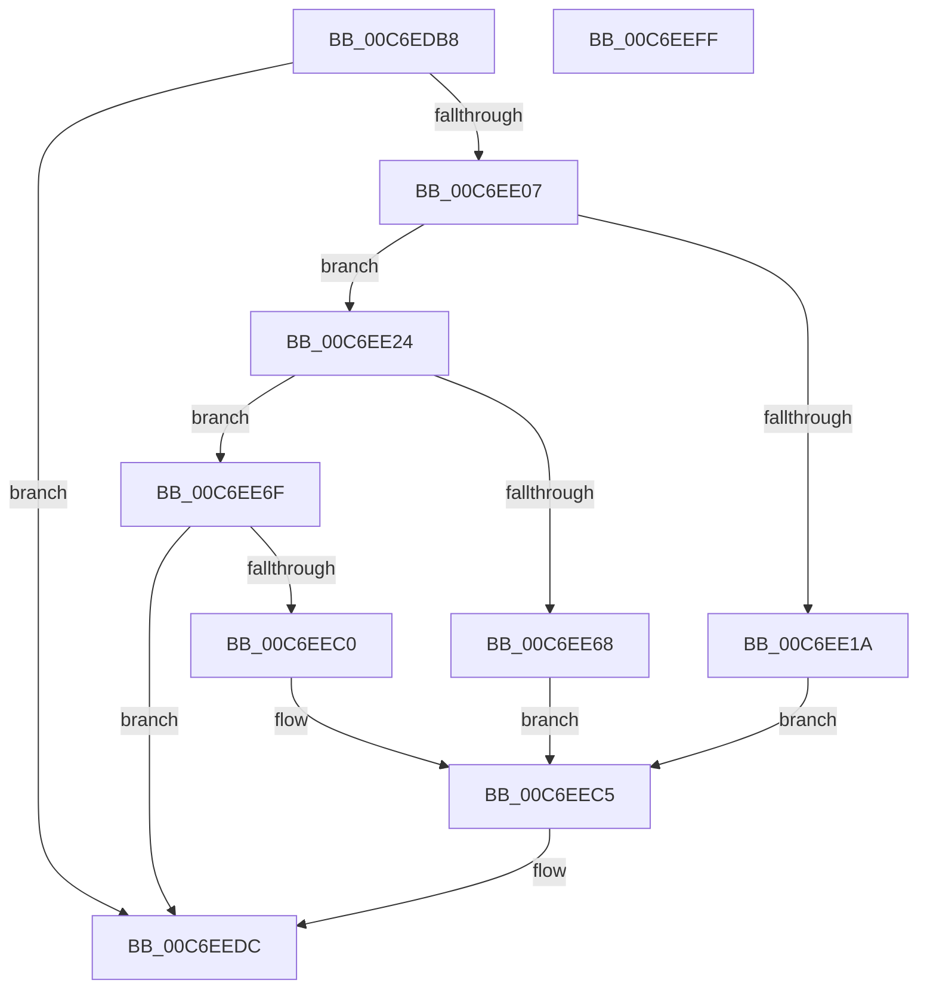

# RamdiskCreateSymbolicLink

- RVA: `0x00C6EDB8`–`0x00C6EF00` (길이 `328` bytes)
- VA: `0x0000000140C6EDB8`
- 실행 섹션: `INIT`
- PDB 이름 있음: `예`; PDB Function 태그: `아니요`
- unwind 정보 RVA: `0x000DB30C`
- 디코드: `79`개 명령, `328/328` bytes 표시
- 미해석 바이트: `0` (있으면 어셈블리에 `.byte`로 보존)

> 이 문서는 커널 이미지의 기계어와 PDB 기호를 분석해 생성했습니다. 4번과 5번은 함수 원형과 자료형을 바이너리 사용 방식에서 추정한 C 해석이며 원본 소스 복구 결과는 아닙니다.

## 1. Dependencies

- 직접 호출 지점: **11**; 고유 호출 대상: **10**
- 직접 호출자로 확인된 함수: **1**
- RIP 상대 이미지 참조: **3**

### Outgoing calls
- `0x00C6EE0F` → [RtlStringFromGUID](../../page/91/RtlStringFromGUID_function_00914BA0.md) (function, `0x00914BA0`)
- `0x00C6EE3C` → [RtlStringCbPrintfA](../../text/53/RtlStringCbPrintfA_function_0053BC0C.md) (function, `0x0053BC0C`)
- `0x00C6EE4B` → [RtlInitAnsiString](../../text/47/RtlInitAnsiString_function_00470F40.md) (function, `0x00470F40`)
- `0x00C6EE5D` → [RtlAnsiStringToUnicodeString](../../page/90/RtlAnsiStringToUnicodeString_function_0090BEA0.md) (function, `0x0090BEA0`)
- `0x00C6EE84` → [RtlStringCbPrintfW](../../text/40/RtlStringCbPrintfW_function_0040FB40.md) (function, `0x0040FB40`)
- `0x00C6EE92` → [RtlInitUnicodeString](../../text/42/RtlInitUnicodeString_function_0042A780.md) (function, `0x0042A780`)
- `0x00C6EEA1` → [IoCreateSymbolicLink](../../page/A3/IoCreateSymbolicLink_function_00A33760.md) (function, `0x00A33760`)
- `0x00C6EEAD` → [RtlFreeAnsiString](../../page/9C/RtlFreeAnsiString_function_009C0800.md) (function, `0x009C0800`)
- `0x00C6EEB7` → [RtlFreeAnsiString](../../page/9C/RtlFreeAnsiString_function_009C0800.md) (function, `0x009C0800`)
- `0x00C6EED6` → [KeBugCheckEx](../../text/4F/KeBugCheckEx_function_004FD660.md) (function, `0x004FD660`)
- `0x00C6EEE5` → [_security_check_cookie](../../text/6A/_security_check_cookie_function_006AC640.md) (function, `0x006AC640`)

### Direct callers
- [RamdiskInitialize](RamdiskInitialize_function_00C6EF08.md) at `0x00C6EF51`

### Static image references
- `0x00C6EDCF` → RVA `0x00E0A740` (`.data`; read)
- `0x00C6EE2B` → RVA `0x00C79A00` (` ?? ::PBOPGDP::`string'`; read)
- `0x00C6EE79` → RVA `0x00C7EA10` (` ?? ::PBOPGDP::`string'`; read)

## 2. Other-region calls and transfers

- 다른 실행 섹션으로 향하는 call: **11**
  - `0x00C6EE0F` → [RtlStringFromGUID](../../page/91/RtlStringFromGUID_function_00914BA0.md) (`INIT` → `PAGE`)
  - `0x00C6EE3C` → [RtlStringCbPrintfA](../../text/53/RtlStringCbPrintfA_function_0053BC0C.md) (`INIT` → `.text`)
  - `0x00C6EE4B` → [RtlInitAnsiString](../../text/47/RtlInitAnsiString_function_00470F40.md) (`INIT` → `.text`)
  - `0x00C6EE5D` → [RtlAnsiStringToUnicodeString](../../page/90/RtlAnsiStringToUnicodeString_function_0090BEA0.md) (`INIT` → `PAGE`)
  - `0x00C6EE84` → [RtlStringCbPrintfW](../../text/40/RtlStringCbPrintfW_function_0040FB40.md) (`INIT` → `.text`)
  - `0x00C6EE92` → [RtlInitUnicodeString](../../text/42/RtlInitUnicodeString_function_0042A780.md) (`INIT` → `.text`)
  - `0x00C6EEA1` → [IoCreateSymbolicLink](../../page/A3/IoCreateSymbolicLink_function_00A33760.md) (`INIT` → `PAGE`)
  - `0x00C6EEAD` → [RtlFreeAnsiString](../../page/9C/RtlFreeAnsiString_function_009C0800.md) (`INIT` → `PAGE`)
  - `0x00C6EEB7` → [RtlFreeAnsiString](../../page/9C/RtlFreeAnsiString_function_009C0800.md) (`INIT` → `PAGE`)
  - `0x00C6EED6` → [KeBugCheckEx](../../text/4F/KeBugCheckEx_function_004FD660.md) (`INIT` → `.text`)
  - `0x00C6EEE5` → [_security_check_cookie](../../text/6A/_security_check_cookie_function_006AC640.md) (`INIT` → `.text`)
- 별도 외부 분기/꼬리 이동을 확인하지 못했습니다.

## 3. Assembly (complete function range)

```asm
00C6EDB8  48 89 5C 24 18                  mov qword ptr [rsp + 0x18], rbx
00C6EDBD  48 89 7C 24 20                  mov qword ptr [rsp + 0x20], rdi
00C6EDC2  55                              push rbp
00C6EDC3  48 8D 6C 24 F0                  lea rbp, [rsp - 0x10]
00C6EDC8  48 81 EC 10 01 00 00            sub rsp, 0x110
00C6EDCF  48 8B 05 6A B9 19 00            mov rax, qword ptr [rip + 0x19b96a]
00C6EDD6  48 33 C4                        xor rax, rsp
00C6EDD9  48 89 45 00                     mov qword ptr [rbp], rax
00C6EDDD  80 7A 10 00                     cmp byte ptr [rdx + 0x10], 0
00C6EDE1  0F 57 C0                        xorps xmm0, xmm0
00C6EDE4  0F 57 C9                        xorps xmm1, xmm1
00C6EDE7  48 8B C2                        mov rax, rdx
00C6EDEA  0F 11 44 24 30                  movups xmmword ptr [rsp + 0x30], xmm0
00C6EDEF  48 8B F9                        mov rdi, rcx
00C6EDF2  0F 11 4C 24 50                  movups xmmword ptr [rsp + 0x50], xmm1
00C6EDF7  0F 11 44 24 40                  movups xmmword ptr [rsp + 0x40], xmm0
00C6EDFC  0F 11 4C 24 60                  movups xmmword ptr [rsp + 0x60], xmm1
00C6EE01  0F 85 D5 00 00 00               jne 0x140c6eedc
00C6EE07  48 8D 54 24 30                  lea rdx, [rsp + 0x30]
00C6EE0C  48 8B C8                        mov rcx, rax
00C6EE0F  E8 8C 5D CA FF                  call 0x140914ba0
00C6EE14  8B D8                           mov ebx, eax
00C6EE16  85 C0                           test eax, eax
00C6EE18  79 0A                           jns 0x140c6ee24
00C6EE1A  BA 04 00 00 00                  mov edx, 4
00C6EE1F  E9 A1 00 00 00                  jmp 0x140c6eec5
00C6EE24  4C 8B 8F B8 00 00 00            mov r9, qword ptr [rdi + 0xb8]
00C6EE2B  4C 8D 05 CE AB 00 00            lea r8, [rip + 0xabce]
00C6EE32  BA 14 00 00 00                  mov edx, 0x14
00C6EE37  48 8D 4C 24 70                  lea rcx, [rsp + 0x70]
00C6EE3C  E8 CB CD 8C FF                  call 0x14053bc0c
00C6EE41  48 8D 54 24 70                  lea rdx, [rsp + 0x70]
00C6EE46  48 8D 4C 24 50                  lea rcx, [rsp + 0x50]
00C6EE4B  E8 F0 20 80 FF                  call 0x140470f40
00C6EE50  41 B0 01                        mov r8b, 1
00C6EE53  48 8D 54 24 50                  lea rdx, [rsp + 0x50]
00C6EE58  48 8D 4C 24 40                  lea rcx, [rsp + 0x40]
00C6EE5D  E8 3E D0 C9 FF                  call 0x14090bea0
00C6EE62  8B D8                           mov ebx, eax
00C6EE64  85 C0                           test eax, eax
00C6EE66  79 07                           jns 0x140c6ee6f
00C6EE68  BA 05 00 00 00                  mov edx, 5
00C6EE6D  EB 56                           jmp 0x140c6eec5
00C6EE6F  4C 8D 4C 24 30                  lea r9, [rsp + 0x30]
00C6EE74  BA 6C 00 00 00                  mov edx, 0x6c
00C6EE79  4C 8D 05 90 FB 00 00            lea r8, [rip + 0xfb90]
00C6EE80  48 8D 4D 90                     lea rcx, [rbp - 0x70]
00C6EE84  E8 B7 0C 7A FF                  call 0x14040fb40
00C6EE89  48 8D 55 90                     lea rdx, [rbp - 0x70]
00C6EE8D  48 8D 4C 24 60                  lea rcx, [rsp + 0x60]
00C6EE92  E8 E9 B8 7B FF                  call 0x14042a780
00C6EE97  48 8D 54 24 60                  lea rdx, [rsp + 0x60]
00C6EE9C  48 8D 4C 24 40                  lea rcx, [rsp + 0x40]
00C6EEA1  E8 BA 48 DC FF                  call 0x140a33760
00C6EEA6  48 8D 4C 24 30                  lea rcx, [rsp + 0x30]
00C6EEAB  8B D8                           mov ebx, eax
00C6EEAD  E8 4E 19 D5 FF                  call 0x1409c0800
00C6EEB2  48 8D 4C 24 40                  lea rcx, [rsp + 0x40]
00C6EEB7  E8 44 19 D5 FF                  call 0x1409c0800
00C6EEBC  85 DB                           test ebx, ebx
00C6EEBE  79 1C                           jns 0x140c6eedc
00C6EEC0  BA 06 00 00 00                  mov edx, 6
00C6EEC5  48 83 64 24 20 00               and qword ptr [rsp + 0x20], 0
00C6EECB  45 33 C9                        xor r9d, r9d
00C6EECE  4C 63 C3                        movsxd r8, ebx
00C6EED1  B9 F8 00 00 00                  mov ecx, 0xf8
00C6EED6  E8 85 E7 88 FF                  call 0x1404fd660
00C6EEDB  CC                              int3
00C6EEDC  33 C0                           xor eax, eax
00C6EEDE  48 8B 4D 00                     mov rcx, qword ptr [rbp]
00C6EEE2  48 33 CC                        xor rcx, rsp
00C6EEE5  E8 56 D7 A3 FF                  call 0x1406ac640
00C6EEEA  4C 8D 9C 24 10 01 00 00         lea r11, [rsp + 0x110]
00C6EEF2  49 8B 5B 20                     mov rbx, qword ptr [r11 + 0x20]
00C6EEF6  49 8B 7B 28                     mov rdi, qword ptr [r11 + 0x28]
00C6EEFA  49 8B E3                        mov rsp, r11
00C6EEFD  5D                              pop rbp
00C6EEFE  C3                              ret
00C6EEFF  CC                              int3
```

## 4. C-style interpretation (structured pseudocode)

```c
__int64 __fastcall RamdiskCreateSymbolicLink(__int64 a1, __int64 a2)
{
    __int64 result;
    __int64 v_rsp;
    unsigned __int64 v_stack_m18;
    unsigned __int64 v_stack_m8;
    unsigned __int64 v_stack_m88;
    unsigned __int64 v_stack_mA8;
    unsigned __int64 v_stack_mB8;
    unsigned __int64 v_stack_mC8;
    unsigned __int64 v_stack_mD8;
    unsigned __int64 v_stack_mE8;
    unsigned __int64 v_stack_mF8;
    unsigned __int64 v_stack_p18;
    unsigned __int64 v_stack_p20;

    v_stack_p18 = v_rbx;
    v_stack_p20 = v_rdi;
    v_rsp = (v_rsp) - (272);
    result = (*(unsigned __int64 *)(v_rip + 1685866)) ^ (v_rsp);
    v_stack_m18 = result;
    v_stack_mE8 = v_xmm0;
    v_stack_mC8 = v_xmm1;
    v_stack_mD8 = v_xmm0;
    v_stack_mB8 = v_xmm1;
    if ((*(unsigned __int8 *)(a2 + 16)) != 0) goto loc_00C6EEDC;
    result = RtlStringFromGUID(a2, v_stack_mE8, a3, a4);
    if (!sign_flag) goto loc_00C6EE24;
    goto loc_00C6EEC5;
loc_00C6EE24:
    result = RtlStringCbPrintfA(v_stack_mA8, 20, v_rip + 43982, *(unsigned __int64 *)(a1 + 184));
    result = RtlInitAnsiString(v_stack_mC8, v_stack_mA8, v_rip + 43982, *(unsigned __int64 *)(a1 + 184));
    result = RtlAnsiStringToUnicodeString(v_stack_mD8, v_stack_mC8, 1, *(unsigned __int64 *)(a1 + 184));
    if (!sign_flag) goto loc_00C6EE6F;
    goto loc_00C6EEC5;
loc_00C6EE6F:
    result = RtlStringCbPrintfW(v_stack_m88, 108, v_rip + 64400, v_stack_mE8);
    result = RtlInitUnicodeString(v_stack_mB8, v_stack_m88, v_rip + 64400, v_stack_mE8);
    result = IoCreateSymbolicLink(v_stack_mD8, v_stack_mB8, v_rip + 64400, v_stack_mE8);
    result = RtlFreeAnsiString(v_stack_mE8, v_stack_mB8, v_rip + 64400, v_stack_mE8);
    result = RtlFreeAnsiString(v_stack_mD8, v_stack_mB8, v_rip + 64400, v_stack_mE8);
    if (!sign_flag) goto loc_00C6EEDC;
loc_00C6EEC5:
    a4 = 0;
    result = KeBugCheckEx(248, 6, (int)((unsigned int)((unsigned int)((unsigned int)(result)))), a4);
loc_00C6EEDC:
    result = 0;
    a1 = (v_stack_m18) ^ (v_rsp);
    result = _security_check_cookie(a1, 6, (int)((unsigned int)((unsigned int)((unsigned int)(result)))), a4);
    return result;
}
```

## 5. (Beta) C Style

```c
int64_t RamdiskCreateSymbolicLink(void *Arg1, void *Arg2)
{
    uint8_t *arg1 = (uint8_t *)Arg1;
    uint8_t *arg2 = (uint8_t *)Arg2;

    int64_t result;
    int64_t local_rsp;
    uint64_t v_stack_m18;
    uint64_t v_stack_m8;
    uint64_t v_stack_m88;
    uint64_t v_stack_mA8;
    uint64_t v_stack_mB8;
    uint64_t v_stack_mC8;
    uint64_t v_stack_mD8;
    uint64_t v_stack_mE8;
    uint64_t v_stack_mF8;
    uint64_t v_stack_p18;
    uint64_t v_stack_p20;

    v_stack_p18 = local_rbx;
    v_stack_p20 = local_rdi;
    local_rsp = (local_rsp) - (272);
    result = (*(uint64_t *)(v_rip + 0x19B96A)) ^ (local_rsp);
    v_stack_m18 = result;
    v_stack_mE8 = v_xmm0;
    v_stack_mC8 = v_xmm1;
    v_stack_mD8 = v_xmm0;
    v_stack_mB8 = v_xmm1;
    if ((*(uint8_t *)(arg2 + 0x10)) != 0) goto loc_00C6EEDC;
    result = RtlStringFromGUID(Arg2, v_stack_mE8, a3, a4);
    if (!sign_flag) goto loc_00C6EE24;
    goto loc_00C6EEC5;
loc_00C6EE24:
    result = RtlStringCbPrintfA(v_stack_mA8, 20, v_rip + 43982, *(uint64_t *)(arg1 + 0xB8));
    result = RtlInitAnsiString(v_stack_mC8, v_stack_mA8, v_rip + 43982, *(uint64_t *)(arg1 + 0xB8));
    result = RtlAnsiStringToUnicodeString(v_stack_mD8, v_stack_mC8, 1, *(uint64_t *)(arg1 + 0xB8));
    if (!sign_flag) goto loc_00C6EE6F;
    goto loc_00C6EEC5;
loc_00C6EE6F:
    result = RtlStringCbPrintfW(v_stack_m88, 108, v_rip + 64400, v_stack_mE8);
    result = RtlInitUnicodeString(v_stack_mB8, v_stack_m88, v_rip + 64400, v_stack_mE8);
    result = IoCreateSymbolicLink(v_stack_mD8, v_stack_mB8, v_rip + 64400, v_stack_mE8);
    result = RtlFreeAnsiString(v_stack_mE8, v_stack_mB8, v_rip + 64400, v_stack_mE8);
    result = RtlFreeAnsiString(v_stack_mD8, v_stack_mB8, v_rip + 64400, v_stack_mE8);
    if (!sign_flag) goto loc_00C6EEDC;
loc_00C6EEC5:
    a4 = 0;
    result = KeBugCheckEx(248, 6, (int32_t)((uint32_t)((uint32_t)((uint32_t)(result)))), a4);
loc_00C6EEDC:
    result = 0;
    Arg1 = (v_stack_m18) ^ (local_rsp);
    result = _security_check_cookie(Arg1, 6, (int32_t)((uint32_t)((uint32_t)((uint32_t)(result)))), a4);
    return result;
}
```

### 관측된 메모리 오프셋

구조체 형식이 확인되지 않은 접근은 인자 기준의 오프셋으로만 기록했습니다.

| 기준 인자 | 오프셋 표현 | 폭 (bit) | 접근 |
|---|---:|---:|---|
| `Arg1` | `+ 0xB8` | `64` | `R` |
| `Arg2` | `+ 0x10` | `8` | `R` |

## 6. Execution-region graph

[열기: 2D/3D 그래프와 함수 탐색 컨트롤 패널](../../../control-panel.html?section=init&rva=0x00C6EDB8&view=graph)

- 2D 그래프는 위에서 아래로 흐르고, 3D 그래프는 빈 공간을 드래그해 회전합니다. Shift+드래그는 이동, 휠은 확대·축소, 함수 노드 선택은 대상 보고서 이동입니다.

### Static fallback


