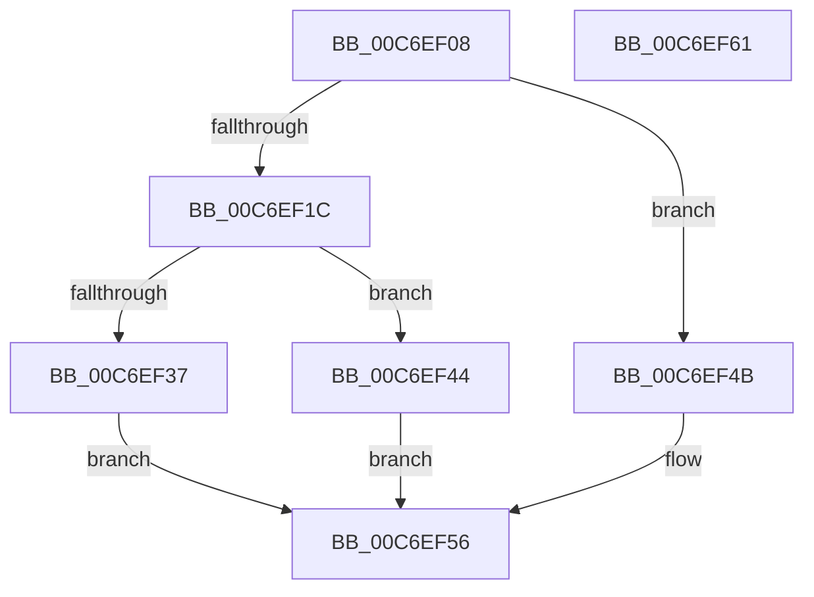

# RamdiskInitialize

- RVA: `0x00C6EF08`–`0x00C6EF62` (길이 `90` bytes)
- VA: `0x0000000140C6EF08`
- 실행 섹션: `INIT`
- PDB 이름 있음: `예`; PDB Function 태그: `아니요`
- unwind 정보 RVA: `0x0005CAAC`
- 디코드: `27`개 명령, `90/90` bytes 표시
- 미해석 바이트: `0` (있으면 어셈블리에 `.byte`로 보존)

> 이 문서는 커널 이미지의 기계어와 PDB 기호를 분석해 생성했습니다. 4번과 5번은 함수 원형과 자료형을 바이너리 사용 방식에서 추정한 C 해석이며 원본 소스 복구 결과는 아닙니다.

## 1. Dependencies

- 직접 호출 지점: **3**; 고유 호출 대상: **3**
- 직접 호출자로 확인된 함수: **1**
- RIP 상대 이미지 참조: **1**

### Outgoing calls
- `0x00C6EF2E` → [memicmp](../../text/52/memicmp_function_00522CB0.md) (function, `0x00522CB0`)
- `0x00C6EF3D` → [RamdiskStart](RamdiskStart_function_00C6EF68.md) (function, `0x00C6EF68`)
- `0x00C6EF51` → [RamdiskCreateSymbolicLink](RamdiskCreateSymbolicLink_function_00C6EDB8.md) (function, `0x00C6EDB8`)

### Direct callers
- [IopInitializeBootDrivers](../C2/IopInitializeBootDrivers_function_00C2E6F4.md) at `0x00C2EDC6`
- [IopInitializeBootDrivers](../C2/IopInitializeBootDrivers_function_00C2E6F4.md) at `0x00C2EDFB`

### Static image references
- `0x00C6EF27` → RVA `0x00C7EA50` (` ?? ::PBOPGDP::`string'`; read)

## 2. Other-region calls and transfers

- 다른 실행 섹션으로 향하는 call: **1**
  - `0x00C6EF2E` → [memicmp](../../text/52/memicmp_function_00522CB0.md) (`INIT` → `.text`)
- 별도 외부 분기/꼬리 이동을 확인하지 못했습니다.

## 3. Assembly (complete function range)

```asm
00C6EF08  48 89 5C 24 08                  mov qword ptr [rsp + 8], rbx
00C6EF0D  57                              push rdi
00C6EF0E  48 83 EC 20                     sub rsp, 0x20
00C6EF12  49 8B F8                        mov rdi, r8
00C6EF15  48 8B DA                        mov rbx, rdx
00C6EF18  85 C9                           test ecx, ecx
00C6EF1A  75 2F                           jne 0x140c6ef4b
00C6EF1C  44 8D 41 08                     lea r8d, [rcx + 8]
00C6EF20  48 8B 8B B8 00 00 00            mov rcx, qword ptr [rbx + 0xb8]
00C6EF27  48 8D 15 22 FB 00 00            lea rdx, [rip + 0xfb22]
00C6EF2E  E8 7D 3D 8B FF                  call 0x140522cb0
00C6EF33  85 C0                           test eax, eax
00C6EF35  75 0D                           jne 0x140c6ef44
00C6EF37  48 8B D7                        mov rdx, rdi
00C6EF3A  48 8B CB                        mov rcx, rbx
00C6EF3D  E8 26 00 00 00                  call 0x140c6ef68
00C6EF42  EB 12                           jmp 0x140c6ef56
00C6EF44  B8 25 02 00 C0                  mov eax, 0xc0000225
00C6EF49  EB 0B                           jmp 0x140c6ef56
00C6EF4B  48 8B D7                        mov rdx, rdi
00C6EF4E  48 8B CB                        mov rcx, rbx
00C6EF51  E8 62 FE FF FF                  call 0x140c6edb8
00C6EF56  48 8B 5C 24 30                  mov rbx, qword ptr [rsp + 0x30]
00C6EF5B  48 83 C4 20                     add rsp, 0x20
00C6EF5F  5F                              pop rdi
00C6EF60  C3                              ret
00C6EF61  CC                              int3
```

## 4. C-style interpretation (structured pseudocode)

```c
__int64 __fastcall RamdiskInitialize(__int64 a1, __int64 a2, __int64 a3)
{
    __int64 result;
    __int64 v_rsp;
    unsigned __int64 v_stack_p8;

    v_stack_p8 = v_rbx;
    v_rsp = (v_rsp) - (32);
    if ((unsigned int)(a1) != 0) goto loc_00C6EF4B;
    result = memicmp(*(unsigned __int64 *)(a2 + 184), v_rip + 64290, a1 + 8, a4);
    if ((unsigned int)(result) != 0) goto loc_00C6EF44;
    result = RamdiskStart(a2, a3, a1 + 8, a4);
    goto loc_00C6EF56;
loc_00C6EF44:
    goto loc_00C6EF56;
loc_00C6EF4B:
    result = RamdiskCreateSymbolicLink(a2, a3, a1 + 8, a4);
loc_00C6EF56:
    v_rsp = (v_rsp) + (32);
    return result;
}
```

## 5. (Beta) C Style

```c
int64_t RamdiskInitialize(int64_t Arg1, void *Arg2, int64_t Arg3)
{
    uint8_t *arg2 = (uint8_t *)Arg2;

    int64_t result;
    int64_t local_rsp;
    uint64_t v_stack_p8;

    v_stack_p8 = local_rbx;
    local_rsp = (local_rsp) - (32);
    if ((uint32_t)(Arg1) != 0) goto loc_00C6EF4B;
    result = memicmp(*(uint64_t *)(arg2 + 0xB8), v_rip + 64290, Arg1 + 8, a4);
    if ((uint32_t)(result) != 0) goto loc_00C6EF44;
    result = RamdiskStart(Arg2, Arg3, Arg1 + 8, a4);
    goto loc_00C6EF56;
loc_00C6EF44:
    goto loc_00C6EF56;
loc_00C6EF4B:
    result = RamdiskCreateSymbolicLink(Arg2, Arg3, Arg1 + 8, a4);
loc_00C6EF56:
    local_rsp = (local_rsp) + (32);
    return result;
}
```

### 관측된 메모리 오프셋

구조체 형식이 확인되지 않은 접근은 인자 기준의 오프셋으로만 기록했습니다.

| 기준 인자 | 오프셋 표현 | 폭 (bit) | 접근 |
|---|---:|---:|---|
| `Arg2` | `+ 0xB8` | `64` | `R` |

## 6. Execution-region graph

[열기: 2D/3D 그래프와 함수 탐색 컨트롤 패널](../../../control-panel.html?section=init&rva=0x00C6EF08&view=graph)

- 2D 그래프는 위에서 아래로 흐르고, 3D 그래프는 빈 공간을 드래그해 회전합니다. Shift+드래그는 이동, 휠은 확대·축소, 함수 노드 선택은 대상 보고서 이동입니다.

### Static fallback


