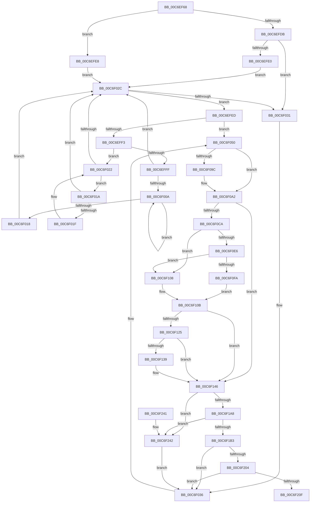

# RamdiskStart

- RVA: `0x00C6EF68`–`0x00C6F24C` (길이 `740` bytes)
- VA: `0x0000000140C6EF68`
- 실행 섹션: `INIT`
- PDB 이름 있음: `예`; PDB Function 태그: `아니요`
- unwind 정보 RVA: `0x000DB32C`
- 디코드: `195`개 명령, `740/740` bytes 표시
- 미해석 바이트: `0` (있으면 어셈블리에 `.byte`로 보존)

> 이 문서는 커널 이미지의 기계어와 PDB 기호를 분석해 생성했습니다. 4번과 5번은 함수 원형과 자료형을 바이너리 사용 방식에서 추정한 C 해석이며 원본 소스 복구 결과는 아닙니다.

## 1. Dependencies

- 직접 호출 지점: **14**; 고유 호출 대상: **10**
- 직접 호출자로 확인된 함수: **1**
- RIP 상대 이미지 참조: **7**

### Outgoing calls
- `0x00C6EFA5` → [memset](../../text/6C/memset_function_006C6C40.md) (function, `0x006C6C40`)
- `0x00C6F04A` → [KeBugCheckEx](../../text/4F/KeBugCheckEx_function_004FD660.md) (function, `0x004FD660`)
- `0x00C6F05E` → [strstr](../../text/4F/strstr_function_004FF680.md) (function, `0x004FF680`)
- `0x00C6F0CD` → [strupr](../../text/4F/strupr_function_004FEEE0.md) (function, `0x004FEEE0`)
- `0x00C6F0DC` → [strstr](../../text/4F/strstr_function_004FF680.md) (function, `0x004FF680`)
- `0x00C6F0F0` → [strstr](../../text/4F/strstr_function_004FF680.md) (function, `0x004FF680`)
- `0x00C6F0FE` → [atol](../../text/4F/atol_function_004FF8D0.md) (function, `0x004FF8D0`)
- `0x00C6F11B` → [strstr](../../text/4F/strstr_function_004FF680.md) (function, `0x004FF680`)
- `0x00C6F12F` → [strstr](../../text/4F/strstr_function_004FF680.md) (function, `0x004FF680`)
- `0x00C6F13D` → [atoi64](../../text/4F/atoi64_function_004FF880.md) (function, `0x004FF880`)
- `0x00C6F199` → [ZwOpenFile](../../text/6A/ZwOpenFile_function_006AD730.md) (function, `0x006AD730`)
- `0x00C6F1EC` → [ZwDeviceIoControlFile](../../text/6A/ZwDeviceIoControlFile_function_006AD1B0.md) (function, `0x006AD1B0`)
- `0x00C6F1F7` → [ZwClose](../../text/6A/ZwClose_function_006AD2B0.md) (function, `0x006AD2B0`)
- `0x00C6F225` → [_security_check_cookie](../../text/6A/_security_check_cookie_function_006AC640.md) (function, `0x006AC640`)

### Direct callers
- [RamdiskInitialize](RamdiskInitialize_function_00C6EF08.md) at `0x00C6EF3D`

### Static image references
- `0x00C6EF80` → RVA `0x00E0A740` (`.data`; read)
- `0x00C6F057` → RVA `0x00C7E770` (` ?? ::PBOPGDP::`string'`; read)
- `0x00C6F0A6` → RVA `0x00027B10` (`.rdata`; read)
- `0x00C6F0D2` → RVA `0x00C7EA40` (` ?? ::PBOPGDP::`string'`; read)
- `0x00C6F0E6` → RVA `0x00C78BD0` (` ?? ::PBOPGDP::`string'`; read)
- `0x00C6F10D` → RVA `0x00C7EA00` (` ?? ::PBOPGDP::`string'`; read)
- `0x00C6F14B` → RVA `0x00C7E9E0` (` ?? ::PBOPGDP::`string'`; read)

## 2. Other-region calls and transfers

- 다른 실행 섹션으로 향하는 call: **14**
  - `0x00C6EFA5` → [memset](../../text/6C/memset_function_006C6C40.md) (`INIT` → `.text`)
  - `0x00C6F04A` → [KeBugCheckEx](../../text/4F/KeBugCheckEx_function_004FD660.md) (`INIT` → `.text`)
  - `0x00C6F05E` → [strstr](../../text/4F/strstr_function_004FF680.md) (`INIT` → `.text`)
  - `0x00C6F0CD` → [strupr](../../text/4F/strupr_function_004FEEE0.md) (`INIT` → `.text`)
  - `0x00C6F0DC` → [strstr](../../text/4F/strstr_function_004FF680.md) (`INIT` → `.text`)
  - `0x00C6F0F0` → [strstr](../../text/4F/strstr_function_004FF680.md) (`INIT` → `.text`)
  - `0x00C6F0FE` → [atol](../../text/4F/atol_function_004FF8D0.md) (`INIT` → `.text`)
  - `0x00C6F11B` → [strstr](../../text/4F/strstr_function_004FF680.md) (`INIT` → `.text`)
  - `0x00C6F12F` → [strstr](../../text/4F/strstr_function_004FF680.md) (`INIT` → `.text`)
  - `0x00C6F13D` → [atoi64](../../text/4F/atoi64_function_004FF880.md) (`INIT` → `.text`)
  - `0x00C6F199` → [ZwOpenFile](../../text/6A/ZwOpenFile_function_006AD730.md) (`INIT` → `.text`)
  - `0x00C6F1EC` → [ZwDeviceIoControlFile](../../text/6A/ZwDeviceIoControlFile_function_006AD1B0.md) (`INIT` → `.text`)
  - `0x00C6F1F7` → [ZwClose](../../text/6A/ZwClose_function_006AD2B0.md) (`INIT` → `.text`)
  - `0x00C6F225` → [_security_check_cookie](../../text/6A/_security_check_cookie_function_006AC640.md) (`INIT` → `.text`)
- 별도 외부 분기/꼬리 이동을 확인하지 못했습니다.

## 3. Assembly (complete function range)

```asm
00C6EF68  48 89 5C 24 18                  mov qword ptr [rsp + 0x18], rbx
00C6EF6D  55                              push rbp
00C6EF6E  56                              push rsi
00C6EF6F  57                              push rdi
00C6EF70  41 56                           push r14
00C6EF72  41 57                           push r15
00C6EF74  48 8D 6C 24 C9                  lea rbp, [rsp - 0x37]
00C6EF79  48 81 EC 00 01 00 00            sub rsp, 0x100
00C6EF80  48 8B 05 B9 B7 19 00            mov rax, qword ptr [rip + 0x19b7b9]
00C6EF87  48 33 C4                        xor rax, rsp
00C6EF8A  48 89 45 27                     mov qword ptr [rbp + 0x27], rax
00C6EF8E  4C 8B F2                        mov r14, rdx
00C6EF91  4C 8B F9                        mov r15, rcx
00C6EF94  33 D2                           xor edx, edx
00C6EF96  48 8D 4D E7                     lea rcx, [rbp - 0x19]
00C6EF9A  0F 57 C0                        xorps xmm0, xmm0
00C6EF9D  0F 11 45 8F                     movups xmmword ptr [rbp - 0x71], xmm0
00C6EFA1  44 8D 42 40                     lea r8d, [rdx + 0x40]
00C6EFA5  E8 96 7C A5 FF                  call 0x1406c6c40
00C6EFAA  33 C0                           xor eax, eax
00C6EFAC  49 8D 9F 60 01 00 00            lea rbx, [r15 + 0x160]
00C6EFB3  48 21 45 87                     and qword ptr [rbp - 0x79], rax
00C6EFB7  0F 57 C0                        xorps xmm0, xmm0
00C6EFBA  48 89 45 CF                     mov qword ptr [rbp - 0x31], rax
00C6EFBE  BF 01 00 00 00                  mov edi, 1
00C6EFC3  89 45 D7                        mov dword ptr [rbp - 0x29], eax
00C6EFC6  48 8B 43 08                     mov rax, qword ptr [rbx + 8]
00C6EFCA  0F 11 45 AF                     movups xmmword ptr [rbp - 0x51], xmm0
00C6EFCE  0F 11 45 BF                     movups xmmword ptr [rbp - 0x41], xmm0
00C6EFD2  0F 11 45 9F                     movups xmmword ptr [rbp - 0x61], xmm0
00C6EFD6  40 84 C7                        test dil, al
00C6EFD9  74 0D                           je 0x140c6efe8
00C6EFDB  48 3B C7                        cmp rax, rdi
00C6EFDE  74 51                           je 0x140c6f031
00C6EFE0  48 0B DF                        or rbx, rdi
00C6EFE3  48 33 D8                        xor rbx, rax
00C6EFE6  EB 44                           jmp 0x140c6f02c
00C6EFE8  48 8B D8                        mov rbx, rax
00C6EFEB  EB 3F                           jmp 0x140c6f02c
00C6EFED  83 7B 18 19                     cmp dword ptr [rbx + 0x18], 0x19
00C6EFF1  74 5D                           je 0x140c6f050
00C6EFF3  48 8B 43 08                     mov rax, qword ptr [rbx + 8]
00C6EFF7  48 8B CB                        mov rcx, rbx
00C6EFFA  48 85 C0                        test rax, rax
00C6EFFD  74 23                           je 0x140c6f022
00C6EFFF  48 8B 08                        mov rcx, qword ptr [rax]
00C6F002  48 8B D8                        mov rbx, rax
00C6F005  48 85 C9                        test rcx, rcx
00C6F008  74 22                           je 0x140c6f02c
00C6F00A  48 8B 01                        mov rax, qword ptr [rcx]
00C6F00D  48 8B D9                        mov rbx, rcx
00C6F010  48 8B C8                        mov rcx, rax
00C6F013  48 85 C0                        test rax, rax
00C6F016  75 F2                           jne 0x140c6f00a
00C6F018  EB 12                           jmp 0x140c6f02c
00C6F01A  48 39 0B                        cmp qword ptr [rbx], rcx
00C6F01D  74 0D                           je 0x140c6f02c
00C6F01F  48 8B CB                        mov rcx, rbx
00C6F022  48 8B 5B 10                     mov rbx, qword ptr [rbx + 0x10]
00C6F026  48 83 E3 FC                     and rbx, 0xfffffffffffffffc
00C6F02A  75 EE                           jne 0x140c6f01a
00C6F02C  48 85 DB                        test rbx, rbx
00C6F02F  75 BC                           jne 0x140c6efed
00C6F031  BB 0D 00 00 C0                  mov ebx, 0xc000000d
00C6F036  48 83 64 24 20 00               and qword ptr [rsp + 0x20], 0
00C6F03C  45 33 C9                        xor r9d, r9d
00C6F03F  4C 63 C3                        movsxd r8, ebx
00C6F042  48 8B D7                        mov rdx, rdi
00C6F045  B9 F8 00 00 00                  mov ecx, 0xf8
00C6F04A  E8 11 E6 88 FF                  call 0x1404fd660
00C6F04F  CC                              int3
00C6F050  49 8B 8F B8 00 00 00            mov rcx, qword ptr [r15 + 0xb8]
00C6F057  48 8D 15 12 F7 00 00            lea rdx, [rip + 0xf712]
00C6F05E  E8 1D 06 89 FF                  call 0x1404ff680
00C6F063  48 85 C0                        test rax, rax
00C6F066  C7 45 E7 40 00 00 00            mov dword ptr [rbp - 0x19], 0x40
00C6F06D  BF 03 00 00 00                  mov edi, 3
00C6F072  40 0F 95 C6                     setne sil
00C6F076  89 7D FB                        mov dword ptr [rbp - 5], edi
00C6F079  48 83 65 FF 00                  and qword ptr [rbp - 1], 0
00C6F07E  83 65 13 00                     and dword ptr [rbp + 0x13], 0
00C6F082  48 83 65 1F 00                  and qword ptr [rbp + 0x1f], 0
00C6F087  48 8B 4B 20                     mov rcx, qword ptr [rbx + 0x20]
00C6F08B  48 89 4D 17                     mov qword ptr [rbp + 0x17], rcx
00C6F08F  33 C9                           xor ecx, ecx
00C6F091  83 C9 02                        or ecx, 2
00C6F094  89 4D FF                        mov dword ptr [rbp - 1], ecx
00C6F097  48 85 C0                        test rax, rax
00C6F09A  74 06                           je 0x140c6f0a2
00C6F09C  83 C9 44                        or ecx, 0x44
00C6F09F  89 4D FF                        mov dword ptr [rbp - 1], ecx
00C6F0A2  83 65 0F 00                     and dword ptr [rbp + 0xf], 0
00C6F0A6  0F 10 05 63 8A 3B FF            movups xmm0, xmmword ptr [rip - 0xc4759d]
00C6F0AD  F3 0F 7F 45 EB                  movdqu xmmword ptr [rbp - 0x15], xmm0
00C6F0B2  48 8B 43 28                     mov rax, qword ptr [rbx + 0x28]
00C6F0B6  49 8B 9F D8 00 00 00            mov rbx, qword ptr [r15 + 0xd8]
00C6F0BD  48 C1 E0 0C                     shl rax, 0xc
00C6F0C1  48 89 45 07                     mov qword ptr [rbp + 7], rax
00C6F0C5  48 85 DB                        test rbx, rbx
00C6F0C8  74 7C                           je 0x140c6f146
00C6F0CA  48 8B CB                        mov rcx, rbx
00C6F0CD  E8 0E FE 88 FF                  call 0x1404feee0
00C6F0D2  48 8D 15 67 F9 00 00            lea rdx, [rip + 0xf967]
00C6F0D9  48 8B CB                        mov rcx, rbx
00C6F0DC  E8 9F 05 89 FF                  call 0x1404ff680
00C6F0E1  48 85 C0                        test rax, rax
00C6F0E4  74 22                           je 0x140c6f108
00C6F0E6  48 8D 15 E3 9A 00 00            lea rdx, [rip + 0x9ae3]
00C6F0ED  48 8B C8                        mov rcx, rax
00C6F0F0  E8 8B 05 89 FF                  call 0x1404ff680
00C6F0F5  48 85 C0                        test rax, rax
00C6F0F8  74 0E                           je 0x140c6f108
00C6F0FA  48 8D 48 01                     lea rcx, [rax + 1]
00C6F0FE  E8 CD 07 89 FF                  call 0x1404ff8d0
00C6F103  89 45 0F                        mov dword ptr [rbp + 0xf], eax
00C6F106  EB 03                           jmp 0x140c6f10b
00C6F108  8B 45 0F                        mov eax, dword ptr [rbp + 0xf]
00C6F10B  8B C0                           mov eax, eax
00C6F10D  48 8D 15 EC F8 00 00            lea rdx, [rip + 0xf8ec]
00C6F114  48 29 45 07                     sub qword ptr [rbp + 7], rax
00C6F118  48 8B CB                        mov rcx, rbx
00C6F11B  E8 60 05 89 FF                  call 0x1404ff680
00C6F120  48 85 C0                        test rax, rax
00C6F123  74 21                           je 0x140c6f146
00C6F125  48 8D 15 A4 9A 00 00            lea rdx, [rip + 0x9aa4]
00C6F12C  48 8B C8                        mov rcx, rax
00C6F12F  E8 4C 05 89 FF                  call 0x1404ff680
00C6F134  48 85 C0                        test rax, rax
00C6F137  74 0D                           je 0x140c6f146
00C6F139  48 8D 48 01                     lea rcx, [rax + 1]
00C6F13D  E8 3E 07 89 FF                  call 0x1404ff880
00C6F142  48 89 45 07                     mov qword ptr [rbp + 7], rax
00C6F146  48 83 65 B7 00                  and qword ptr [rbp - 0x49], 0
00C6F14B  48 8D 05 8E F8 00 00            lea rax, [rip + 0xf88e]
00C6F152  B9 20 00 00 00                  mov ecx, 0x20
00C6F157  48 89 45 97                     mov qword ptr [rbp - 0x69], rax
00C6F15B  89 4C 24 28                     mov dword ptr [rsp + 0x28], ecx
00C6F15F  48 8D 45 8F                     lea rax, [rbp - 0x71]
00C6F163  0F 57 C0                        xorps xmm0, xmm0
00C6F166  48 89 45 BF                     mov qword ptr [rbp - 0x41], rax
00C6F16A  4C 8D 4D 9F                     lea r9, [rbp - 0x61]
00C6F16E  C7 45 8F 1E 00 20 00            mov dword ptr [rbp - 0x71], 0x20001e
00C6F175  4C 8D 45 AF                     lea r8, [rbp - 0x51]
00C6F179  C7 45 AF 30 00 00 00            mov dword ptr [rbp - 0x51], 0x30
00C6F180  BA 00 00 00 C0                  mov edx, 0xc0000000
00C6F185  C7 45 C7 40 02 00 00            mov dword ptr [rbp - 0x39], 0x240
00C6F18C  48 8D 4D 87                     lea rcx, [rbp - 0x79]
00C6F190  89 7C 24 20                     mov dword ptr [rsp + 0x20], edi
00C6F194  F3 0F 7F 45 CF                  movdqu xmmword ptr [rbp - 0x31], xmm0
00C6F199  E8 92 E5 A3 FF                  call 0x1406ad730
00C6F19E  8B D8                           mov ebx, eax
00C6F1A0  85 C0                           test eax, eax
00C6F1A2  0F 88 9A 00 00 00               js 0x140c6f242
00C6F1A8  8B 5D 9F                        mov ebx, dword ptr [rbp - 0x61]
00C6F1AB  85 DB                           test ebx, ebx
00C6F1AD  0F 88 8F 00 00 00               js 0x140c6f242
00C6F1B3  83 64 24 48 00                  and dword ptr [rsp + 0x48], 0
00C6F1B8  48 8D 45 E7                     lea rax, [rbp - 0x19]
00C6F1BC  48 83 64 24 40 00               and qword ptr [rsp + 0x40], 0
00C6F1C2  45 33 C9                        xor r9d, r9d
00C6F1C5  48 8B 4D 87                     mov rcx, qword ptr [rbp - 0x79]
00C6F1C9  45 33 C0                        xor r8d, r8d
00C6F1CC  C7 44 24 38 40 00 00 00         mov dword ptr [rsp + 0x38], 0x40
00C6F1D4  33 D2                           xor edx, edx
00C6F1D6  48 89 44 24 30                  mov qword ptr [rsp + 0x30], rax
00C6F1DB  48 8D 45 9F                     lea rax, [rbp - 0x61]
00C6F1DF  C7 44 24 28 00 00 24 00         mov dword ptr [rsp + 0x28], 0x240000
00C6F1E7  48 89 44 24 20                  mov qword ptr [rsp + 0x20], rax
00C6F1EC  E8 BF DF A3 FF                  call 0x1406ad1b0
00C6F1F1  48 8B 4D 87                     mov rcx, qword ptr [rbp - 0x79]
00C6F1F5  8B D8                           mov ebx, eax
00C6F1F7  E8 B4 E0 A3 FF                  call 0x1406ad2b0
00C6F1FC  85 DB                           test ebx, ebx
00C6F1FE  0F 88 32 FE FF FF               js 0x140c6f036
00C6F204  8B 5D 9F                        mov ebx, dword ptr [rbp - 0x61]
00C6F207  85 DB                           test ebx, ebx
00C6F209  0F 88 27 FE FF FF               js 0x140c6f036
00C6F20F  0F 10 45 EB                     movups xmm0, xmmword ptr [rbp - 0x15]
00C6F213  41 88 76 10                     mov byte ptr [r14 + 0x10], sil
00C6F217  33 C0                           xor eax, eax
00C6F219  F3 41 0F 7F 06                  movdqu xmmword ptr [r14], xmm0
00C6F21E  48 8B 4D 27                     mov rcx, qword ptr [rbp + 0x27]
00C6F222  48 33 CC                        xor rcx, rsp
00C6F225  E8 16 D4 A3 FF                  call 0x1406ac640
00C6F22A  48 8B 9C 24 40 01 00 00         mov rbx, qword ptr [rsp + 0x140]
00C6F232  48 81 C4 00 01 00 00            add rsp, 0x100
00C6F239  41 5F                           pop r15
00C6F23B  41 5E                           pop r14
00C6F23D  5F                              pop rdi
00C6F23E  5E                              pop rsi
00C6F23F  5D                              pop rbp
00C6F240  C3                              ret
00C6F241  CC                              int3
00C6F242  BF 02 00 00 00                  mov edi, 2
00C6F247  E9 EA FD FF FF                  jmp 0x140c6f036
```

## 4. C-style interpretation (structured pseudocode)

```c
__int64 __fastcall RamdiskStart(__int64 a1, __int64 a2, __int64 a3, int a4)
{
    __int64 result;
    __int64 v_rbx;
    __int64 v_rsi;
    __int64 v_rsp;
    unsigned int v_stack_m100;
    unsigned __int64 v_stack_m108;
    unsigned __int64 v_stack_m38;
    unsigned __int64 v_stack_m40;
    unsigned __int64 v_stack_m48;
    unsigned int v_stack_m4C;
    unsigned int v_stack_m50;
    unsigned __int64 v_stack_m58;
    unsigned __int64 v_stack_m5F;
    unsigned __int64 v_stack_m60;
    unsigned int v_stack_m64;
    unsigned __int64 v_stack_m74;
    unsigned __int64 v_stack_m78;
    unsigned int v_stack_m88;
    unsigned __int64 v_stack_m90;
    unsigned int v_stack_m98;
    unsigned __int64 v_stack_mA0;
    unsigned __int64 v_stack_mA8;
    unsigned __int64 v_stack_mB0;
    unsigned __int64 v_stack_mC0;
    unsigned __int64 v_stack_mC8;
    unsigned __int64 v_stack_mD0;
    unsigned __int64 v_stack_mD8;
    unsigned int v_stack_mE0;
    unsigned __int64 v_stack_mE8;
    unsigned int v_stack_mF0;
    unsigned __int64 v_stack_mF8;
    unsigned __int64 v_stack_p18;

    v_stack_p18 = v_rbx;
    v_rsp = (v_rsp) - (256);
    result = (*(unsigned __int64 *)(v_rip + 1685433)) ^ (v_rsp);
    v_stack_m38 = result;
    a2 = 0;
    v_stack_mD0 = v_xmm0;
    result = memset(v_stack_m78, a2, a2 + 64, a4);
    result = 0;
    v_stack_m90 = 0;
    v_stack_m88 = 0;
    v_stack_mB0 = v_xmm0;
    v_stack_mA0 = v_xmm0;
    v_stack_mC0 = v_xmm0;
    if (((1) & ((unsigned __int8)(*(unsigned __int64 *)(a1 + 352 + 8)))) == 0) goto loc_00C6EFE8;
    if ((*(unsigned __int64 *)(a1 + 352 + 8)) == 1) goto loc_00C6F031;
    v_rbx = (a1 + 352) | (1);
    v_rbx = (v_rbx) ^ (*(unsigned __int64 *)(a1 + 352 + 8));
    goto loc_00C6F02C;
loc_00C6EFE8:
    goto loc_00C6F02C;
loc_00C6EFED:
    if ((*(unsigned int *)(*(unsigned __int64 *)(a1 + 352 + 8) + 24)) == 25) goto loc_00C6F050;
    if (*(unsigned __int64 *)(*(unsigned __int64 *)(a1 + 352 + 8) + 8) == 0) goto loc_00C6F022;
    if (*(unsigned __int64 *)(*(unsigned __int64 *)(*(unsigned __int64 *)(a1 + 352 + 8) + 8)) == 0) goto loc_00C6F02C;
loc_00C6F00A:
    if (*(unsigned __int64 *)(*(unsigned __int64 *)(*(unsigned __int64 *)(*(unsigned __int64 *)(a1 + 352 + 8) + 8))) != 0) goto loc_00C6F00A;
    goto loc_00C6F02C;
loc_00C6F01A:
    if ((*(unsigned __int64 *)(*(unsigned __int64 *)(*(unsigned __int64 *)(*(unsigned __int64 *)(a1 + 352 + 8) + 8)))) == (*(unsigned __int64 *)(*(unsigned __int64 *)(*(unsigned __int64 *)(*(unsigned __int64 *)(a1 + 352 + 8) + 8))))) goto loc_00C6F02C;
loc_00C6F022:
    v_rbx = (*(unsigned __int64 *)(*(unsigned __int64 *)(*(unsigned __int64 *)(*(unsigned __int64 *)(a1 + 352 + 8) + 8)) + 16)) & (-4);
    if (condition_is_not_equal) goto loc_00C6F01A;
loc_00C6F02C:
    if (v_rbx != 0) goto loc_00C6EFED;
loc_00C6F031:
loc_00C6F036:
    a4 = 0;
    result = KeBugCheckEx(248, 1, (int)((unsigned int)((unsigned int)(0xC000000DULL))), a4);
loc_00C6F050:
    result = strstr(*(unsigned __int64 *)(a1 + 184), v_rip + 63250, (int)((unsigned int)((unsigned int)(0xC000000DULL))), a4);
    v_stack_m78 = 64;
    v_rsi = (result != 0) ? 1 : 0;
    v_stack_m64 = 3;
    v_stack_m48 = *(unsigned __int64 *)((unsigned int)(0xC000000DULL) + 32);
    a1 = 0;
    a1 = (unsigned int)((a1) | (2));
    v_stack_m60 = (unsigned int)(a1);
    if (result != 0) {
        a1 = (unsigned int)((a1) | (68));
        v_stack_m60 = (unsigned int)(a1);
    }
    v_stack_m74 = v_xmm0;
    result = (*(unsigned __int64 *)((unsigned int)(0xC000000DULL) + 40)) << (12);
    v_stack_m58 = result;
    if (*(unsigned __int64 *)(a1 + 216) == 0) goto loc_00C6F146;
    result = strupr(*(unsigned __int64 *)(a1 + 216), v_rip + 63250, (int)((unsigned int)((unsigned int)(0xC000000DULL))), a4);
    result = strstr(*(unsigned __int64 *)(a1 + 216), v_rip + 63847, (int)((unsigned int)((unsigned int)(0xC000000DULL))), a4);
    if (result == 0) goto loc_00C6F108;
    result = strstr(result, v_rip + 39651, (int)((unsigned int)((unsigned int)(0xC000000DULL))), a4);
    if (result == 0) goto loc_00C6F108;
    result = atol(result + 1, v_rip + 39651, (int)((unsigned int)((unsigned int)(0xC000000DULL))), a4);
    v_stack_m50 = (unsigned int)(result);
    goto loc_00C6F10B;
loc_00C6F108:
loc_00C6F10B:
    result = strstr(*(unsigned __int64 *)(a1 + 216), v_rip + 63724, (int)((unsigned int)((unsigned int)(0xC000000DULL))), a4);
    if (result == 0) goto loc_00C6F146;
    result = strstr(result, v_rip + 39588, (int)((unsigned int)((unsigned int)(0xC000000DULL))), a4);
    if (result != 0) {
        a1 = result + 1;
        result = atoi64(a1, v_rip + 39588, (int)((unsigned int)((unsigned int)(0xC000000DULL))), a4);
        v_stack_m58 = result;
    }
    v_stack_mC8 = v_rip + 63630;
    v_stack_m100 = 32;
    v_stack_mA0 = v_stack_mD0;
    v_stack_mD0 = 0x20001EULL;
    v_stack_mB0 = 48;
    v_stack_m98 = 576;
    v_stack_m108 = 3;
    v_stack_m90 = v_xmm0;
    result = ZwOpenFile(v_stack_mD8, (unsigned int)(0xC0000000ULL), v_stack_mB0, v_stack_mC0);
    if (sign_flag) goto loc_00C6F242;
    if (sign_flag) goto loc_00C6F242;
    a4 = 0;
    a3 = 0;
    v_stack_mF0 = 64;
    a2 = 0;
    v_stack_mF8 = v_stack_m78;
    v_stack_m100 = 0x240000ULL;
    v_stack_m108 = v_stack_mC0;
    result = ZwDeviceIoControlFile(v_stack_mD8, a2, a3, a4);
    result = ZwClose(v_stack_mD8, a2, a3, a4);
    if (sign_flag) goto loc_00C6F036;
    if (sign_flag) goto loc_00C6F036;
    *(unsigned __int8 *)(a2 + 16) = (unsigned __int8)(v_rsi);
    result = 0;
    *(unsigned __int64 *)(a2) = v_xmm0;
    a1 = (v_stack_m38) ^ (v_rsp);
    result = _security_check_cookie(a1, a2, a3, a4);
    v_rsp = (v_rsp) + (256);
    return result;
loc_00C6F242:
    goto loc_00C6F036;
}
```

## 5. (Beta) C Style

```c
int64_t RamdiskStart(void *Arg1, void *Arg2, int64_t Arg3, int32_t Arg4)
{
    uint8_t *arg1 = (uint8_t *)Arg1;
    uint8_t *arg2 = (uint8_t *)Arg2;

    int64_t result;
    int64_t local_rbx;
    int64_t local_rsi;
    int64_t local_rsp;
    uint32_t v_stack_m100;
    uint64_t v_stack_m108;
    uint64_t v_stack_m38;
    uint64_t v_stack_m40;
    uint64_t v_stack_m48;
    uint32_t v_stack_m4C;
    uint32_t v_stack_m50;
    uint64_t v_stack_m58;
    uint64_t v_stack_m5F;
    uint64_t v_stack_m60;
    uint32_t v_stack_m64;
    uint64_t v_stack_m74;
    uint64_t v_stack_m78;
    uint32_t v_stack_m88;
    uint64_t v_stack_m90;
    uint32_t v_stack_m98;
    uint64_t v_stack_mA0;
    uint64_t v_stack_mA8;
    uint64_t v_stack_mB0;
    uint64_t v_stack_mC0;
    uint64_t v_stack_mC8;
    uint64_t v_stack_mD0;
    uint64_t v_stack_mD8;
    uint32_t v_stack_mE0;
    uint64_t v_stack_mE8;
    uint32_t v_stack_mF0;
    uint64_t v_stack_mF8;
    uint64_t v_stack_p18;

    v_stack_p18 = local_rbx;
    local_rsp = (local_rsp) - (256);
    result = (*(uint64_t *)(v_rip + 0x19B7B9)) ^ (local_rsp);
    v_stack_m38 = result;
    Arg2 = 0;
    v_stack_mD0 = v_xmm0;
    result = memset(v_stack_m78, Arg2, Arg2 + 64, Arg4);
    result = 0;
    v_stack_m90 = 0;
    v_stack_m88 = 0;
    v_stack_mB0 = v_xmm0;
    v_stack_mA0 = v_xmm0;
    v_stack_mC0 = v_xmm0;
    if (((1) & ((uint8_t)(*(uint64_t *)(arg1 + 0x160 + 0x8)))) == 0) goto loc_00C6EFE8;
    if ((*(uint64_t *)(arg1 + 0x160 + 0x8)) == 1) goto loc_00C6F031;
    local_rbx = (Arg1 + 352) | (1);
    local_rbx = (local_rbx) ^ (*(uint64_t *)(arg1 + 0x160 + 0x8));
    goto loc_00C6F02C;
loc_00C6EFE8:
    goto loc_00C6F02C;
loc_00C6EFED:
    if ((*(uint32_t *)(*(uint64_t *)(arg1 + 0x160 + 0x8) + 0x18)) == 25) goto loc_00C6F050;
    if (*(uint64_t *)(*(uint64_t *)(arg1 + 0x160 + 0x8) + 0x8) == 0) goto loc_00C6F022;
    if (*(uint64_t *)(*(uint64_t *)(*(uint64_t *)(arg1 + 0x160 + 0x8) + 0x8)) == 0) goto loc_00C6F02C;
loc_00C6F00A:
    if (*(uint64_t *)(*(uint64_t *)(*(uint64_t *)(*(uint64_t *)(arg1 + 0x160 + 0x8) + 0x8))) != 0) goto loc_00C6F00A;
    goto loc_00C6F02C;
loc_00C6F01A:
    if ((*(uint64_t *)(*(uint64_t *)(*(uint64_t *)(*(uint64_t *)(arg1 + 0x160 + 0x8) + 0x8)))) == (*(uint64_t *)(*(uint64_t *)(*(uint64_t *)(*(uint64_t *)(arg1 + 0x160 + 0x8) + 0x8))))) goto loc_00C6F02C;
loc_00C6F022:
    local_rbx = (*(uint64_t *)(*(uint64_t *)(*(uint64_t *)(*(uint64_t *)(arg1 + 0x160 + 0x8) + 0x8)) + 0x10)) & (-4);
    if (condition_is_not_equal) goto loc_00C6F01A;
loc_00C6F02C:
    if (local_rbx != 0) goto loc_00C6EFED;
loc_00C6F031:
loc_00C6F036:
    Arg4 = 0;
    result = KeBugCheckEx(248, 1, (int32_t)((uint32_t)((uint32_t)(0xC000000DULL))), Arg4);
loc_00C6F050:
    result = strstr(*(uint64_t *)(arg1 + 0xB8), v_rip + 63250, (int32_t)((uint32_t)((uint32_t)(0xC000000DULL))), Arg4);
    v_stack_m78 = 64;
    local_rsi = (result != 0) ? 1 : 0;
    v_stack_m64 = 3;
    v_stack_m48 = *(uint64_t *)((uint32_t)(0xC000000DULL) + 0x20);
    Arg1 = 0;
    Arg1 = (uint32_t)((Arg1) | (2));
    v_stack_m60 = (uint32_t)(Arg1);
    if (result != 0) {
        Arg1 = (uint32_t)((Arg1) | (68));
        v_stack_m60 = (uint32_t)(Arg1);
    }
    v_stack_m74 = v_xmm0;
    result = (*(uint64_t *)((uint32_t)(0xC000000DULL) + 0x28)) << (12);
    v_stack_m58 = result;
    if (*(uint64_t *)(arg1 + 0xD8) == 0) goto loc_00C6F146;
    result = strupr(*(uint64_t *)(arg1 + 0xD8), v_rip + 63250, (int32_t)((uint32_t)((uint32_t)(0xC000000DULL))), Arg4);
    result = strstr(*(uint64_t *)(arg1 + 0xD8), v_rip + 63847, (int32_t)((uint32_t)((uint32_t)(0xC000000DULL))), Arg4);
    if (result == 0) goto loc_00C6F108;
    result = strstr(result, v_rip + 39651, (int32_t)((uint32_t)((uint32_t)(0xC000000DULL))), Arg4);
    if (result == 0) goto loc_00C6F108;
    result = atol(result + 1, v_rip + 39651, (int32_t)((uint32_t)((uint32_t)(0xC000000DULL))), Arg4);
    v_stack_m50 = (uint32_t)(result);
    goto loc_00C6F10B;
loc_00C6F108:
loc_00C6F10B:
    result = strstr(*(uint64_t *)(arg1 + 0xD8), v_rip + 63724, (int32_t)((uint32_t)((uint32_t)(0xC000000DULL))), Arg4);
    if (result == 0) goto loc_00C6F146;
    result = strstr(result, v_rip + 39588, (int32_t)((uint32_t)((uint32_t)(0xC000000DULL))), Arg4);
    if (result != 0) {
        Arg1 = result + 1;
        result = atoi64(Arg1, v_rip + 39588, (int32_t)((uint32_t)((uint32_t)(0xC000000DULL))), Arg4);
        v_stack_m58 = result;
    }
    v_stack_mC8 = v_rip + 63630;
    v_stack_m100 = 32;
    v_stack_mA0 = v_stack_mD0;
    v_stack_mD0 = 0x20001EULL;
    v_stack_mB0 = 48;
    v_stack_m98 = 576;
    v_stack_m108 = 3;
    v_stack_m90 = v_xmm0;
    result = ZwOpenFile(v_stack_mD8, (uint32_t)(0xC0000000ULL), v_stack_mB0, v_stack_mC0);
    if (sign_flag) goto loc_00C6F242;
    if (sign_flag) goto loc_00C6F242;
    Arg4 = 0;
    Arg3 = 0;
    v_stack_mF0 = 64;
    Arg2 = 0;
    v_stack_mF8 = v_stack_m78;
    v_stack_m100 = 0x240000ULL;
    v_stack_m108 = v_stack_mC0;
    result = ZwDeviceIoControlFile(v_stack_mD8, Arg2, Arg3, Arg4);
    result = ZwClose(v_stack_mD8, Arg2, Arg3, Arg4);
    if (sign_flag) goto loc_00C6F036;
    if (sign_flag) goto loc_00C6F036;
    *(uint8_t *)(arg2 + 0x10) = (uint8_t)(local_rsi);
    result = 0;
    *(uint64_t *)(arg2) = v_xmm0;
    Arg1 = (v_stack_m38) ^ (local_rsp);
    result = _security_check_cookie(Arg1, Arg2, Arg3, Arg4);
    local_rsp = (local_rsp) + (256);
    return result;
loc_00C6F242:
    goto loc_00C6F036;
}
```

### 관측된 메모리 오프셋

구조체 형식이 확인되지 않은 접근은 인자 기준의 오프셋으로만 기록했습니다.

| 기준 인자 | 오프셋 표현 | 폭 (bit) | 접근 |
|---|---:|---:|---|
| `Arg1` | `+ 0x8` | `64` | `R` |
| `Arg1` | `+ 0xB8` | `64` | `R` |
| `Arg1` | `+ 0xD8` | `64` | `R` |
| `Arg1` | `+ 0x160` | `64` | `R` |
| `Arg2` | `+ 0x0` | `128` | `W` |
| `Arg2` | `+ 0x10` | `8` | `W` |

## 6. Execution-region graph

[열기: 2D/3D 그래프와 함수 탐색 컨트롤 패널](../../../control-panel.html?section=init&rva=0x00C6EF68&view=graph)

- 2D 그래프는 위에서 아래로 흐르고, 3D 그래프는 빈 공간을 드래그해 회전합니다. Shift+드래그는 이동, 휠은 확대·축소, 함수 노드 선택은 대상 보고서 이동입니다.

### Static fallback


