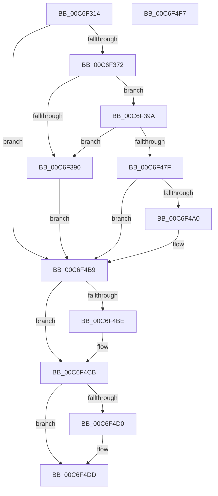

# SbpAddTransportToInstance

- RVA: `0x00C6F314`–`0x00C6F4F8` (길이 `484` bytes)
- VA: `0x0000000140C6F314`
- 실행 섹션: `INIT`
- PDB 이름 있음: `예`; PDB Function 태그: `아니요`
- unwind 정보 RVA: `0x000BE8A0`
- 디코드: `124`개 명령, `484/484` bytes 표시
- 미해석 바이트: `0` (있으면 어셈블리에 `.byte`로 보존)

> 이 문서는 커널 이미지의 기계어와 PDB 기호를 분석해 생성했습니다. 4번과 5번은 함수 원형과 자료형을 바이너리 사용 방식에서 추정한 C 해석이며 원본 소스 복구 결과는 아닙니다.

## 1. Dependencies

- 직접 호출 지점: **7**; 고유 호출 대상: **7**
- 직접 호출자로 확인된 함수: **1**
- RIP 상대 이미지 참조: **2**

### Outgoing calls
- `0x00C6F35F` → [IoGetDeviceObjectPointer](../../page/95/IoGetDeviceObjectPointer_function_00953220.md) (function, `0x00953220`)
- `0x00C6F383` → [ExAllocatePool2](../../poolcode/B8/ExAllocatePool2_function_00B820F0.md) (function, `0x00B820F0`)
- `0x00C6F46E` → [IoBuildDeviceIoControlRequest](../../text/20/IoBuildDeviceIoControlRequest_function_00204FD0.md) (function, `0x00204FD0`)
- `0x00C6F492` → [IofCallDriver](../../text/29/IofCallDriver_function_0029B4B0.md) (function, `0x0029B4B0`)
- `0x00C6F4B1` → [KeWaitForSingleObject](../../text/20/KeWaitForSingleObject_function_0020E6B0.md) (function, `0x0020E6B0`)
- `0x00C6F4C6` → [ObfDereferenceObjectWithTag](../../text/2F/ObfDereferenceObjectWithTag_function_002F78E0.md) (function, `0x002F78E0`)
- `0x00C6F4D8` → [ExFreePoolWithTag](../../poolcode/B8/ExFreePoolWithTag_function_00B82870.md) (function, `0x00B82870`)

### Direct callers
- [IopInitializeBootDrivers](../C2/IopInitializeBootDrivers_function_00C2E6F4.md) at `0x00C2EF45`

### Static image references
- `0x00C6F349` → RVA `0x00B4AF00` (`InstanceName`; read)
- `0x00C6F3BA` → RVA `0x00B59F70` (` ?? ::LBKOJDO::`string'`; read)

## 2. Other-region calls and transfers

- 다른 실행 섹션으로 향하는 call: **7**
  - `0x00C6F35F` → [IoGetDeviceObjectPointer](../../page/95/IoGetDeviceObjectPointer_function_00953220.md) (`INIT` → `PAGE`)
  - `0x00C6F383` → [ExAllocatePool2](../../poolcode/B8/ExAllocatePool2_function_00B820F0.md) (`INIT` → `POOLCODE`)
  - `0x00C6F46E` → [IoBuildDeviceIoControlRequest](../../text/20/IoBuildDeviceIoControlRequest_function_00204FD0.md) (`INIT` → `.text`)
  - `0x00C6F492` → [IofCallDriver](../../text/29/IofCallDriver_function_0029B4B0.md) (`INIT` → `.text`)
  - `0x00C6F4B1` → [KeWaitForSingleObject](../../text/20/KeWaitForSingleObject_function_0020E6B0.md) (`INIT` → `.text`)
  - `0x00C6F4C6` → [ObfDereferenceObjectWithTag](../../text/2F/ObfDereferenceObjectWithTag_function_002F78E0.md) (`INIT` → `.text`)
  - `0x00C6F4D8` → [ExFreePoolWithTag](../../poolcode/B8/ExFreePoolWithTag_function_00B82870.md) (`INIT` → `POOLCODE`)
- 별도 외부 분기/꼬리 이동을 확인하지 못했습니다.

## 3. Assembly (complete function range)

```asm
00C6F314  48 89 5C 24 18                  mov qword ptr [rsp + 0x18], rbx
00C6F319  48 89 74 24 20                  mov qword ptr [rsp + 0x20], rsi
00C6F31E  55                              push rbp
00C6F31F  57                              push rdi
00C6F320  41 56                           push r14
00C6F322  48 8B EC                        mov rbp, rsp
00C6F325  48 81 EC 80 00 00 00            sub rsp, 0x80
00C6F32C  0F 57 C0                        xorps xmm0, xmm0
00C6F32F  4C 8D 4D 20                     lea r9, [rbp + 0x20]
00C6F333  45 33 F6                        xor r14d, r14d
00C6F336  4C 8D 45 28                     lea r8, [rbp + 0x28]
00C6F33A  33 C0                           xor eax, eax
00C6F33C  4C 89 75 28                     mov qword ptr [rbp + 0x28], r14
00C6F340  BA 00 00 00 10                  mov edx, 0x10000000
00C6F345  48 89 45 F0                     mov qword ptr [rbp - 0x10], rax
00C6F349  48 8D 0D B0 BB ED FF            lea rcx, [rip - 0x124450]
00C6F350  4C 89 75 20                     mov qword ptr [rbp + 0x20], r14
00C6F354  0F 11 45 E0                     movups xmmword ptr [rbp - 0x20], xmm0
00C6F358  41 8B FE                        mov edi, r14d
00C6F35B  0F 11 45 D0                     movups xmmword ptr [rbp - 0x30], xmm0
00C6F35F  E8 BC 3E CE FF                  call 0x140953220
00C6F364  48 8B 75 28                     mov rsi, qword ptr [rbp + 0x28]
00C6F368  8B D8                           mov ebx, eax
00C6F36A  85 C0                           test eax, eax
00C6F36C  0F 88 47 01 00 00               js 0x140c6f4b9
00C6F372  BB D0 00 00 00                  mov ebx, 0xd0
00C6F377  41 8D 4E 40                     lea ecx, [r14 + 0x40]
00C6F37B  8B D3                           mov edx, ebx
00C6F37D  41 B8 53 6D 62 42               mov r8d, 0x42626d53
00C6F383  E8 68 2D F1 FF                  call 0x140b820f0
00C6F388  48 8B F8                        mov rdi, rax
00C6F38B  48 85 C0                        test rax, rax
00C6F38E  75 0A                           jne 0x140c6f39a
00C6F390  BB 9A 00 00 C0                  mov ebx, 0xc000009a
00C6F395  E9 1F 01 00 00                  jmp 0x140c6f4b9
00C6F39A  C7 00 10 00 00 00               mov dword ptr [rax], 0x10
00C6F3A0  48 8D 48 0C                     lea rcx, [rax + 0xc]
00C6F3A4  C7 40 04 02 00 00 00            mov dword ptr [rax + 4], 2
00C6F3AB  BA 80 00 00 00                  mov edx, 0x80
00C6F3B0  C7 40 08 C0 00 00 00            mov dword ptr [rax + 8], 0xc0
00C6F3B7  44 8B CB                        mov r9d, ebx
00C6F3BA  48 8D 05 AF AB EE FF            lea rax, [rip - 0x115451]
00C6F3C1  4C 8B C7                        mov r8, rdi
00C6F3C4  0F 10 00                        movups xmm0, xmmword ptr [rax]
00C6F3C7  0F 11 01                        movups xmmword ptr [rcx], xmm0
00C6F3CA  0F 10 48 10                     movups xmm1, xmmword ptr [rax + 0x10]
00C6F3CE  0F 11 49 10                     movups xmmword ptr [rcx + 0x10], xmm1
00C6F3D2  0F 10 40 20                     movups xmm0, xmmword ptr [rax + 0x20]
00C6F3D6  0F 11 41 20                     movups xmmword ptr [rcx + 0x20], xmm0
00C6F3DA  0F 10 48 30                     movups xmm1, xmmword ptr [rax + 0x30]
00C6F3DE  0F 11 49 30                     movups xmmword ptr [rcx + 0x30], xmm1
00C6F3E2  0F 10 40 40                     movups xmm0, xmmword ptr [rax + 0x40]
00C6F3E6  0F 11 41 40                     movups xmmword ptr [rcx + 0x40], xmm0
00C6F3EA  0F 10 48 50                     movups xmm1, xmmword ptr [rax + 0x50]
00C6F3EE  0F 11 49 50                     movups xmmword ptr [rcx + 0x50], xmm1
00C6F3F2  0F 10 40 60                     movups xmm0, xmmword ptr [rax + 0x60]
00C6F3F6  0F 11 41 60                     movups xmmword ptr [rcx + 0x60], xmm0
00C6F3FA  48 03 CA                        add rcx, rdx
00C6F3FD  0F 10 40 70                     movups xmm0, xmmword ptr [rax + 0x70]
00C6F401  48 03 C2                        add rax, rdx
00C6F404  48 8B 55 20                     mov rdx, qword ptr [rbp + 0x20]
00C6F408  0F 11 41 F0                     movups xmmword ptr [rcx - 0x10], xmm0
00C6F40C  0F 10 08                        movups xmm1, xmmword ptr [rax]
00C6F40F  0F 11 09                        movups xmmword ptr [rcx], xmm1
00C6F412  0F 10 40 10                     movups xmm0, xmmword ptr [rax + 0x10]
00C6F416  0F 11 41 10                     movups xmmword ptr [rcx + 0x10], xmm0
00C6F41A  0F 10 48 20                     movups xmm1, xmmword ptr [rax + 0x20]
00C6F41E  0F 11 49 20                     movups xmmword ptr [rcx + 0x20], xmm1
00C6F422  0F 10 40 30                     movups xmm0, xmmword ptr [rax + 0x30]
00C6F426  48 8D 45 E8                     lea rax, [rbp - 0x18]
00C6F42A  0F 11 41 30                     movups xmmword ptr [rcx + 0x30], xmm0
00C6F42E  48 89 45 F0                     mov qword ptr [rbp - 0x10], rax
00C6F432  B9 B0 01 14 00                  mov ecx, 0x1401b0
00C6F437  48 8D 45 E8                     lea rax, [rbp - 0x18]
00C6F43B  66 C7 45 E0 01 00               mov word ptr [rbp - 0x20], 1
00C6F441  48 89 45 E8                     mov qword ptr [rbp - 0x18], rax
00C6F445  48 8D 45 D0                     lea rax, [rbp - 0x30]
00C6F449  48 89 44 24 40                  mov qword ptr [rsp + 0x40], rax
00C6F44E  48 8D 45 E0                     lea rax, [rbp - 0x20]
00C6F452  48 89 44 24 38                  mov qword ptr [rsp + 0x38], rax
00C6F457  44 88 74 24 30                  mov byte ptr [rsp + 0x30], r14b
00C6F45C  44 89 74 24 28                  mov dword ptr [rsp + 0x28], r14d
00C6F461  4C 89 74 24 20                  mov qword ptr [rsp + 0x20], r14
00C6F466  C6 45 E2 06                     mov byte ptr [rbp - 0x1e], 6
00C6F46A  44 89 75 E4                     mov dword ptr [rbp - 0x1c], r14d
00C6F46E  E8 5D 5B 59 FF                  call 0x140204fd0
00C6F473  48 8B D0                        mov rdx, rax
00C6F476  48 85 C0                        test rax, rax
00C6F479  0F 84 11 FF FF FF               je 0x140c6f390
00C6F47F  48 8B 80 B8 00 00 00            mov rax, qword ptr [rax + 0xb8]
00C6F486  48 8B 4D 20                     mov rcx, qword ptr [rbp + 0x20]
00C6F48A  48 89 70 E8                     mov qword ptr [rax - 0x18], rsi
00C6F48E  C6 40 B8 0D                     mov byte ptr [rax - 0x48], 0xd
00C6F492  E8 19 C0 62 FF                  call 0x14029b4b0
00C6F497  8B D8                           mov ebx, eax
00C6F499  3D 03 01 00 00                  cmp eax, 0x103
00C6F49E  75 19                           jne 0x140c6f4b9
00C6F4A0  45 33 C9                        xor r9d, r9d
00C6F4A3  4C 89 74 24 20                  mov qword ptr [rsp + 0x20], r14
00C6F4A8  45 33 C0                        xor r8d, r8d
00C6F4AB  48 8D 4D E0                     lea rcx, [rbp - 0x20]
00C6F4AF  33 D2                           xor edx, edx
00C6F4B1  E8 FA F1 59 FF                  call 0x14020e6b0
00C6F4B6  8B 5D D0                        mov ebx, dword ptr [rbp - 0x30]
00C6F4B9  48 85 F6                        test rsi, rsi
00C6F4BC  74 0D                           je 0x140c6f4cb
00C6F4BE  BA 44 66 6C 74                  mov edx, 0x746c6644
00C6F4C3  48 8B CE                        mov rcx, rsi
00C6F4C6  E8 15 84 68 FF                  call 0x1402f78e0
00C6F4CB  48 85 FF                        test rdi, rdi
00C6F4CE  74 0D                           je 0x140c6f4dd
00C6F4D0  BA 53 6D 62 42                  mov edx, 0x42626d53
00C6F4D5  48 8B CF                        mov rcx, rdi
00C6F4D8  E8 93 33 F1 FF                  call 0x140b82870
00C6F4DD  4C 8D 9C 24 80 00 00 00         lea r11, [rsp + 0x80]
00C6F4E5  8B C3                           mov eax, ebx
00C6F4E7  49 8B 5B 30                     mov rbx, qword ptr [r11 + 0x30]
00C6F4EB  49 8B 73 38                     mov rsi, qword ptr [r11 + 0x38]
00C6F4EF  49 8B E3                        mov rsp, r11
00C6F4F2  41 5E                           pop r14
00C6F4F4  5F                              pop rdi
00C6F4F5  5D                              pop rbp
00C6F4F6  C3                              ret
00C6F4F7  CC                              int3
```

## 4. C-style interpretation (structured pseudocode)

```c
__int64 __fastcall SbpAddTransportToInstance(void)
{
    __int64 result;
    __int64 v_r14;
    __int64 v_rbx;
    __int64 v_rsp;
    unsigned __int64 v_stack_m18;
    unsigned __int64 v_stack_m28;
    unsigned __int64 v_stack_m30;
    unsigned int v_stack_m34;
    unsigned __int8 v_stack_m36;
    unsigned __int64 v_stack_m38;
    unsigned __int64 v_stack_m48;
    unsigned __int64 v_stack_m58;
    unsigned __int64 v_stack_m60;
    unsigned __int8 v_stack_m68;
    unsigned int v_stack_m70;
    unsigned __int64 v_stack_m78;
    unsigned __int64 v_stack_p10;
    unsigned __int64 v_stack_p18;
    unsigned __int64 v_stack_p20;
    unsigned __int64 v_stack_p8;

    v_stack_p18 = v_rbx;
    v_stack_p20 = v_rsi;
    v_rsp = (v_rsp) - (128);
    v_r14 = 0;
    result = 0;
    v_stack_p10 = 0;
    v_stack_m28 = 0;
    v_stack_p8 = 0;
    v_stack_m38 = v_xmm0;
    v_stack_m48 = v_xmm0;
    result = IoGetDeviceObjectPointer(v_rip - 1197136, (unsigned int)(0x10000000ULL), v_stack_p10, v_stack_p8);
    if (sign_flag) goto loc_00C6F4B9;
    result = ExAllocatePool2(v_r14 + 64, 208, (unsigned int)(0x42626D53ULL), v_stack_p8);
    if (result != 0) goto loc_00C6F39A;
loc_00C6F390:
    goto loc_00C6F4B9;
loc_00C6F39A:
    *(unsigned int *)(result) = 16;
    *(unsigned int *)(result + 4) = 2;
    *(unsigned int *)(result + 8) = 192;
    *(unsigned __int64 *)(result + 12) = v_xmm0;
    *(unsigned __int64 *)(result + 12 + 16) = v_xmm1;
    *(unsigned __int64 *)(result + 12 + 32) = v_xmm0;
    *(unsigned __int64 *)(result + 12 + 48) = v_xmm1;
    *(unsigned __int64 *)(result + 12 + 64) = v_xmm0;
    *(unsigned __int64 *)(result + 12 + 80) = v_xmm1;
    *(unsigned __int64 *)(result + 12 + 96) = v_xmm0;
    a1 = (result + 12) + (128);
    result = (v_rip - 1135697) + (128);
    *(unsigned __int64 *)(a1 - 16) = v_xmm0;
    *(unsigned __int64 *)(a1) = v_xmm1;
    *(unsigned __int64 *)(a1 + 16) = v_xmm0;
    *(unsigned __int64 *)(a1 + 32) = v_xmm1;
    *(unsigned __int64 *)(a1 + 48) = v_xmm0;
    v_stack_m28 = v_stack_m30;
    v_stack_m38 = 1;
    v_stack_m30 = v_stack_m30;
    v_stack_m58 = v_stack_m48;
    v_stack_m60 = v_stack_m38;
    v_stack_m68 = 0;
    v_stack_m70 = 0;
    v_stack_m78 = 0;
    v_stack_m36 = 6;
    v_stack_m34 = 0;
    result = IoBuildDeviceIoControlRequest((unsigned int)(0x1401B0ULL), v_stack_p8, result, (unsigned int)((unsigned int)((unsigned int)(0xC000009AULL))));
    if (result == 0) goto loc_00C6F390;
    *(unsigned __int64 *)(*(unsigned __int64 *)(result + 184) - 24) = v_stack_p10;
    *(unsigned __int8 *)(*(unsigned __int64 *)(result + 184) - 72) = 13;
    result = IofCallDriver(v_stack_p8, result, result, (unsigned int)((unsigned int)((unsigned int)(0xC000009AULL))));
    v_rbx = (unsigned int)((unsigned int)(result));
    if (((unsigned int)(result)) == 259) {
        a4 = 0;
        v_stack_m78 = 0;
        a3 = 0;
        a1 = v_stack_m38;
        a2 = 0;
        result = KeWaitForSingleObject(a1, a2, a3, a4);
        v_rbx = v_stack_m48;
    }
    if (v_stack_p10 != 0) {
        a2 = 0x746C6644ULL;
        a1 = v_stack_p10;
        result = ObfDereferenceObjectWithTag(a1, a2, a3, a4);
    }
    if (result != 0) {
        a2 = 0x42626D53ULL;
        a1 = result;
        result = ExFreePoolWithTag(a1, a2, a3, a4);
    }
    return (unsigned int)((unsigned int)(v_rbx));
}
```

## 5. (Beta) C Style

```c
void SbpAddTransportToInstance(void)
{
    int64_t result;
    int64_t local_r14;
    int64_t local_rbx;
    int64_t local_rsp;
    uint64_t v_stack_m18;
    uint64_t v_stack_m28;
    uint64_t v_stack_m30;
    uint32_t v_stack_m34;
    uint8_t v_stack_m36;
    uint64_t v_stack_m38;
    uint64_t v_stack_m48;
    uint64_t v_stack_m58;
    uint64_t v_stack_m60;
    uint8_t v_stack_m68;
    uint32_t v_stack_m70;
    uint64_t v_stack_m78;
    uint64_t v_stack_p10;
    uint64_t v_stack_p18;
    uint64_t v_stack_p20;
    uint64_t v_stack_p8;

    v_stack_p18 = local_rbx;
    v_stack_p20 = local_rsi;
    local_rsp = (local_rsp) - (128);
    local_r14 = 0;
    result = 0;
    v_stack_p10 = 0;
    v_stack_m28 = 0;
    v_stack_p8 = 0;
    v_stack_m38 = v_xmm0;
    v_stack_m48 = v_xmm0;
    result = IoGetDeviceObjectPointer(v_rip - 1197136, (uint32_t)(0x10000000ULL), v_stack_p10, v_stack_p8);
    if (sign_flag) goto loc_00C6F4B9;
    result = ExAllocatePool2(local_r14 + 64, 208, (uint32_t)(0x42626D53ULL), v_stack_p8);
    if (result != 0) goto loc_00C6F39A;
loc_00C6F390:
    goto loc_00C6F4B9;
loc_00C6F39A:
    *(uint32_t *)(result) = 16;
    *(uint32_t *)(result + 0x4) = 2;
    *(uint32_t *)(result + 0x8) = 192;
    *(uint64_t *)(result + 0xC) = v_xmm0;
    *(uint64_t *)(result + 0xC + 0x10) = v_xmm1;
    *(uint64_t *)(result + 0xC + 0x20) = v_xmm0;
    *(uint64_t *)(result + 0xC + 0x30) = v_xmm1;
    *(uint64_t *)(result + 0xC + 0x40) = v_xmm0;
    *(uint64_t *)(result + 0xC + 0x50) = v_xmm1;
    *(uint64_t *)(result + 0xC + 0x60) = v_xmm0;
    a1 = (result + 12) + (128);
    result = (v_rip - 1135697) + (128);
    *(uint64_t *)(a1 - 0x10) = v_xmm0;
    *(uint64_t *)(a1) = v_xmm1;
    *(uint64_t *)(a1 + 0x10) = v_xmm0;
    *(uint64_t *)(a1 + 0x20) = v_xmm1;
    *(uint64_t *)(a1 + 0x30) = v_xmm0;
    v_stack_m28 = v_stack_m30;
    v_stack_m38 = 1;
    v_stack_m30 = v_stack_m30;
    v_stack_m58 = v_stack_m48;
    v_stack_m60 = v_stack_m38;
    v_stack_m68 = 0;
    v_stack_m70 = 0;
    v_stack_m78 = 0;
    v_stack_m36 = 6;
    v_stack_m34 = 0;
    result = IoBuildDeviceIoControlRequest((uint32_t)(0x1401B0ULL), v_stack_p8, result, (uint32_t)((uint32_t)((uint32_t)(0xC000009AULL))));
    if (result == 0) goto loc_00C6F390;
    *(uint64_t *)(*(uint64_t *)(result + 0xB8) - 0x18) = v_stack_p10;
    *(uint8_t *)(*(uint64_t *)(result + 0xB8) - 0x48) = 13;
    result = IofCallDriver(v_stack_p8, result, result, (uint32_t)((uint32_t)((uint32_t)(0xC000009AULL))));
    local_rbx = (uint32_t)((uint32_t)(result));
    if (((uint32_t)(result)) == 259) {
        a4 = 0;
        v_stack_m78 = 0;
        a3 = 0;
        a1 = v_stack_m38;
        a2 = 0;
        result = KeWaitForSingleObject(a1, a2, a3, a4);
        local_rbx = v_stack_m48;
    }
    if (v_stack_p10 != 0) {
        a2 = 0x746C6644ULL;
        a1 = v_stack_p10;
        result = ObfDereferenceObjectWithTag(a1, a2, a3, a4);
    }
    if (result != 0) {
        a2 = 0x42626D53ULL;
        a1 = result;
        result = ExFreePoolWithTag(a1, a2, a3, a4);
    }
    return (uint32_t)((uint32_t)(local_rbx));
}
```

## 6. Execution-region graph

[열기: 2D/3D 그래프와 함수 탐색 컨트롤 패널](../../../control-panel.html?section=init&rva=0x00C6F314&view=graph)

- 2D 그래프는 위에서 아래로 흐르고, 3D 그래프는 빈 공간을 드래그해 회전합니다. Shift+드래그는 이동, 휠은 확대·축소, 함수 노드 선택은 대상 보고서 이동입니다.

### Static fallback


