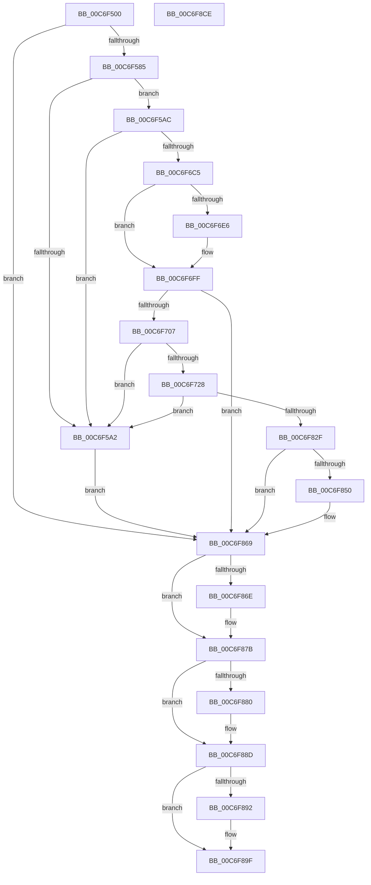

# SbpStartLanman

- RVA: `0x00C6F500`–`0x00C6F8CF` (길이 `975` bytes)
- VA: `0x0000000140C6F500`
- 실행 섹션: `INIT`
- PDB 이름 있음: `예`; PDB Function 태그: `아니요`
- unwind 정보 RVA: `0x000DB350`
- 디코드: `230`개 명령, `975/975` bytes 표시
- 미해석 바이트: `0` (있으면 어셈블리에 `.byte`로 보존)

> 이 문서는 커널 이미지의 기계어와 PDB 기호를 분석해 생성했습니다. 4번과 5번은 함수 원형과 자료형을 바이너리 사용 방식에서 추정한 C 해석이며 원본 소스 복구 결과는 아닙니다.

## 1. Dependencies

- 직접 호출 지점: **13**; 고유 호출 대상: **8**
- 직접 호출자로 확인된 함수: **1**
- RIP 상대 이미지 참조: **5**

### Outgoing calls
- `0x00C6F572` → [IoGetDeviceObjectPointer](../../page/95/IoGetDeviceObjectPointer_function_00953220.md) (function, `0x00953220`)
- `0x00C6F595` → [ExAllocatePool2](../../poolcode/B8/ExAllocatePool2_function_00B820F0.md) (function, `0x00B820F0`)
- `0x00C6F6B4` → [IoBuildDeviceIoControlRequest](../../text/20/IoBuildDeviceIoControlRequest_function_00204FD0.md) (function, `0x00204FD0`)
- `0x00C6F6D8` → [IofCallDriver](../../text/29/IofCallDriver_function_0029B4B0.md) (function, `0x0029B4B0`)
- `0x00C6F6F7` → [KeWaitForSingleObject](../../text/20/KeWaitForSingleObject_function_0020E6B0.md) (function, `0x0020E6B0`)
- `0x00C6F717` → [ExAllocatePool2](../../poolcode/B8/ExAllocatePool2_function_00B820F0.md) (function, `0x00B820F0`)
- `0x00C6F81E` → [IoBuildDeviceIoControlRequest](../../text/20/IoBuildDeviceIoControlRequest_function_00204FD0.md) (function, `0x00204FD0`)
- `0x00C6F842` → [IofCallDriver](../../text/29/IofCallDriver_function_0029B4B0.md) (function, `0x0029B4B0`)
- `0x00C6F861` → [KeWaitForSingleObject](../../text/20/KeWaitForSingleObject_function_0020E6B0.md) (function, `0x0020E6B0`)
- `0x00C6F876` → [ObfDereferenceObjectWithTag](../../text/2F/ObfDereferenceObjectWithTag_function_002F78E0.md) (function, `0x002F78E0`)
- `0x00C6F888` → [ExFreePoolWithTag](../../poolcode/B8/ExFreePoolWithTag_function_00B82870.md) (function, `0x00B82870`)
- `0x00C6F89A` → [ExFreePoolWithTag](../../poolcode/B8/ExFreePoolWithTag_function_00B82870.md) (function, `0x00B82870`)
- `0x00C6F8A8` → [_security_check_cookie](../../text/6A/_security_check_cookie_function_006AC640.md) (function, `0x006AC640`)

### Direct callers
- [IopInitializeBootDrivers](../C2/IopInitializeBootDrivers_function_00C2E6F4.md) at `0x00C2EF33`

### Static image references
- `0x00C6F523` → RVA `0x00E0A740` (`.data`; read)
- `0x00C6F54E` → RVA `0x00B4BC08` (`LanmanRedirectorName`; read)
- `0x00C6F7B7` → RVA `0x00B5A038` (` ?? ::LBKOJDO::`string'`; read)
- `0x00C6F7C2` → RVA `0x00B5A048` (`PAGE`; read)
- `0x00C6F7D2` → RVA `0x00B5A050` (`PAGE`; read)

## 2. Other-region calls and transfers

- 다른 실행 섹션으로 향하는 call: **13**
  - `0x00C6F572` → [IoGetDeviceObjectPointer](../../page/95/IoGetDeviceObjectPointer_function_00953220.md) (`INIT` → `PAGE`)
  - `0x00C6F595` → [ExAllocatePool2](../../poolcode/B8/ExAllocatePool2_function_00B820F0.md) (`INIT` → `POOLCODE`)
  - `0x00C6F6B4` → [IoBuildDeviceIoControlRequest](../../text/20/IoBuildDeviceIoControlRequest_function_00204FD0.md) (`INIT` → `.text`)
  - `0x00C6F6D8` → [IofCallDriver](../../text/29/IofCallDriver_function_0029B4B0.md) (`INIT` → `.text`)
  - `0x00C6F6F7` → [KeWaitForSingleObject](../../text/20/KeWaitForSingleObject_function_0020E6B0.md) (`INIT` → `.text`)
  - `0x00C6F717` → [ExAllocatePool2](../../poolcode/B8/ExAllocatePool2_function_00B820F0.md) (`INIT` → `POOLCODE`)
  - `0x00C6F81E` → [IoBuildDeviceIoControlRequest](../../text/20/IoBuildDeviceIoControlRequest_function_00204FD0.md) (`INIT` → `.text`)
  - `0x00C6F842` → [IofCallDriver](../../text/29/IofCallDriver_function_0029B4B0.md) (`INIT` → `.text`)
  - `0x00C6F861` → [KeWaitForSingleObject](../../text/20/KeWaitForSingleObject_function_0020E6B0.md) (`INIT` → `.text`)
  - `0x00C6F876` → [ObfDereferenceObjectWithTag](../../text/2F/ObfDereferenceObjectWithTag_function_002F78E0.md) (`INIT` → `.text`)
  - `0x00C6F888` → [ExFreePoolWithTag](../../poolcode/B8/ExFreePoolWithTag_function_00B82870.md) (`INIT` → `POOLCODE`)
  - `0x00C6F89A` → [ExFreePoolWithTag](../../poolcode/B8/ExFreePoolWithTag_function_00B82870.md) (`INIT` → `POOLCODE`)
  - `0x00C6F8A8` → [_security_check_cookie](../../text/6A/_security_check_cookie_function_006AC640.md) (`INIT` → `.text`)
- 별도 외부 분기/꼬리 이동을 확인하지 못했습니다.

## 3. Assembly (complete function range)

```asm
00C6F500  48 8B C4                        mov rax, rsp
00C6F503  48 89 58 08                     mov qword ptr [rax + 8], rbx
00C6F507  48 89 70 10                     mov qword ptr [rax + 0x10], rsi
00C6F50B  48 89 78 18                     mov qword ptr [rax + 0x18], rdi
00C6F50F  4C 89 60 20                     mov qword ptr [rax + 0x20], r12
00C6F513  55                              push rbp
00C6F514  41 55                           push r13
00C6F516  41 56                           push r14
00C6F518  48 8D 68 A1                     lea rbp, [rax - 0x5f]
00C6F51C  48 81 EC C0 00 00 00            sub rsp, 0xc0
00C6F523  48 8B 05 16 B2 19 00            mov rax, qword ptr [rip + 0x19b216]
00C6F52A  48 33 C4                        xor rax, rsp
00C6F52D  48 89 45 37                     mov qword ptr [rbp + 0x37], rax
00C6F531  0F 57 C0                        xorps xmm0, xmm0
00C6F534  4C 8D 4D EF                     lea r9, [rbp - 0x11]
00C6F538  45 33 E4                        xor r12d, r12d
00C6F53B  4C 8D 45 F7                     lea r8, [rbp - 9]
00C6F53F  33 C0                           xor eax, eax
00C6F541  4C 89 65 EF                     mov qword ptr [rbp - 0x11], r12
00C6F545  BA 00 00 00 10                  mov edx, 0x10000000
00C6F54A  48 89 45 E7                     mov qword ptr [rbp - 0x19], rax
00C6F54E  48 8D 0D B3 C6 ED FF            lea rcx, [rip - 0x12394d]
00C6F555  89 45 2F                        mov dword ptr [rbp + 0x2f], eax
00C6F558  0F 11 45 D7                     movups xmmword ptr [rbp - 0x29], xmm0
00C6F55C  4C 89 65 F7                     mov qword ptr [rbp - 9], r12
00C6F560  41 8B F4                        mov esi, r12d
00C6F563  0F 11 45 FF                     movups xmmword ptr [rbp - 1], xmm0
00C6F567  41 8B DC                        mov ebx, r12d
00C6F56A  0F 11 45 0F                     movups xmmword ptr [rbp + 0xf], xmm0
00C6F56E  0F 11 45 1F                     movups xmmword ptr [rbp + 0x1f], xmm0
00C6F572  E8 A9 3C CE FF                  call 0x140953220
00C6F577  4C 8B 75 F7                     mov r14, qword ptr [rbp - 9]
00C6F57B  8B F8                           mov edi, eax
00C6F57D  85 C0                           test eax, eax
00C6F57F  0F 88 E4 02 00 00               js 0x140c6f869
00C6F585  BF 8C 00 00 00                  mov edi, 0x8c
00C6F58A  41 B8 53 6D 62 42               mov r8d, 0x42626d53
00C6F590  8B D7                           mov edx, edi
00C6F592  8D 4F B4                        lea ecx, [rdi - 0x4c]
00C6F595  E8 56 2B F1 FF                  call 0x140b820f0
00C6F59A  48 8B D8                        mov rbx, rax
00C6F59D  48 85 C0                        test rax, rax
00C6F5A0  75 0A                           jne 0x140c6f5ac
00C6F5A2  BF 9A 00 00 C0                  mov edi, 0xc000009a
00C6F5A7  E9 BD 02 00 00                  jmp 0x140c6f869
00C6F5AC  83 4B 3C FF                     or dword ptr [rbx + 0x3c], 0xffffffff
00C6F5B0  BA 05 00 00 00                  mov edx, 5
00C6F5B5  89 50 10                        mov dword ptr [rax + 0x10], edx
00C6F5B8  C7 00 10 0E 00 00               mov dword ptr [rax], 0xe10
00C6F5BE  C7 40 08 10 00 00 00            mov dword ptr [rax + 8], 0x10
00C6F5C5  44 8D 6A FC                     lea r13d, [rdx - 4]
00C6F5C9  C7 40 04 FA 00 00 00            mov dword ptr [rax + 4], 0xfa
00C6F5D0  C7 40 0C 58 02 00 00            mov dword ptr [rax + 0xc], 0x258
00C6F5D7  8D 4A 28                        lea ecx, [rdx + 0x28]
00C6F5DA  89 48 14                        mov dword ptr [rax + 0x14], ecx
00C6F5DD  44 8D 42 05                     lea r8d, [rdx + 5]
00C6F5E1  44 89 40 24                     mov dword ptr [rax + 0x24], r8d
00C6F5E5  44 8D 4A 1F                     lea r9d, [rdx + 0x1f]
00C6F5E9  C7 40 18 00 02 00 00            mov dword ptr [rax + 0x18], 0x200
00C6F5F0  C7 40 1C 11 00 00 00            mov dword ptr [rax + 0x1c], 0x11
00C6F5F7  C7 40 20 00 18 00 00            mov dword ptr [rax + 0x20], 0x1800
00C6F5FE  B8 F4 01 00 00                  mov eax, 0x1f4
00C6F603  89 43 28                        mov dword ptr [rbx + 0x28], eax
00C6F606  89 43 30                        mov dword ptr [rbx + 0x30], eax
00C6F609  48 8D 45 DF                     lea rax, [rbp - 0x21]
00C6F60D  44 89 43 2C                     mov dword ptr [rbx + 0x2c], r8d
00C6F611  4C 8D 45 0F                     lea r8, [rbp + 0xf]
00C6F615  89 4B 38                        mov dword ptr [rbx + 0x38], ecx
00C6F618  B9 91 01 14 80                  mov ecx, 0x80140191
00C6F61D  89 53 48                        mov dword ptr [rbx + 0x48], edx
00C6F620  48 8B 55 EF                     mov rdx, qword ptr [rbp - 0x11]
00C6F624  C7 43 34 28 00 00 00            mov dword ptr [rbx + 0x34], 0x28
00C6F62B  C7 43 40 03 00 00 00            mov dword ptr [rbx + 0x40], 3
00C6F632  C7 43 44 14 00 00 00            mov dword ptr [rbx + 0x44], 0x14
00C6F639  48 C7 43 4C 3C 00 00 00         mov qword ptr [rbx + 0x4c], 0x3c
00C6F641  44 89 6B 54                     mov dword ptr [rbx + 0x54], r13d
00C6F645  44 89 6B 58                     mov dword ptr [rbx + 0x58], r13d
00C6F649  44 89 6B 5C                     mov dword ptr [rbx + 0x5c], r13d
00C6F64D  44 89 6B 60                     mov dword ptr [rbx + 0x60], r13d
00C6F651  44 89 6B 64                     mov dword ptr [rbx + 0x64], r13d
00C6F655  44 89 6B 68                     mov dword ptr [rbx + 0x68], r13d
00C6F659  44 89 6B 6C                     mov dword ptr [rbx + 0x6c], r13d
00C6F65D  44 89 6B 70                     mov dword ptr [rbx + 0x70], r13d
00C6F661  44 89 6B 74                     mov dword ptr [rbx + 0x74], r13d
00C6F665  44 89 6B 78                     mov dword ptr [rbx + 0x78], r13d
00C6F669  44 89 6B 7C                     mov dword ptr [rbx + 0x7c], r13d
00C6F66D  44 89 AB 80 00 00 00            mov dword ptr [rbx + 0x80], r13d
00C6F674  4C 89 AB 84 00 00 00            mov qword ptr [rbx + 0x84], r13
00C6F67B  48 89 45 E7                     mov qword ptr [rbp - 0x19], rax
00C6F67F  48 8D 45 DF                     lea rax, [rbp - 0x21]
00C6F683  48 89 45 DF                     mov qword ptr [rbp - 0x21], rax
00C6F687  48 8D 45 FF                     lea rax, [rbp - 1]
00C6F68B  48 89 44 24 40                  mov qword ptr [rsp + 0x40], rax
00C6F690  48 8D 45 D7                     lea rax, [rbp - 0x29]
00C6F694  48 89 44 24 38                  mov qword ptr [rsp + 0x38], rax
00C6F699  44 88 64 24 30                  mov byte ptr [rsp + 0x30], r12b
00C6F69E  89 7C 24 28                     mov dword ptr [rsp + 0x28], edi
00C6F6A2  48 89 5C 24 20                  mov qword ptr [rsp + 0x20], rbx
00C6F6A7  66 44 89 6D D7                  mov word ptr [rbp - 0x29], r13w
00C6F6AC  C6 45 D9 06                     mov byte ptr [rbp - 0x27], 6
00C6F6B0  44 89 65 DB                     mov dword ptr [rbp - 0x25], r12d
00C6F6B4  E8 17 59 59 FF                  call 0x140204fd0
00C6F6B9  48 8B D0                        mov rdx, rax
00C6F6BC  48 85 C0                        test rax, rax
00C6F6BF  0F 84 DD FE FF FF               je 0x140c6f5a2
00C6F6C5  48 8B 80 B8 00 00 00            mov rax, qword ptr [rax + 0xb8]
00C6F6CC  48 8B 4D EF                     mov rcx, qword ptr [rbp - 0x11]
00C6F6D0  4C 89 70 E8                     mov qword ptr [rax - 0x18], r14
00C6F6D4  C6 40 B8 0D                     mov byte ptr [rax - 0x48], 0xd
00C6F6D8  E8 D3 BD 62 FF                  call 0x14029b4b0
00C6F6DD  8B F8                           mov edi, eax
00C6F6DF  3D 03 01 00 00                  cmp eax, 0x103
00C6F6E4  75 19                           jne 0x140c6f6ff
00C6F6E6  45 33 C9                        xor r9d, r9d
00C6F6E9  4C 89 64 24 20                  mov qword ptr [rsp + 0x20], r12
00C6F6EE  45 33 C0                        xor r8d, r8d
00C6F6F1  48 8D 4D D7                     lea rcx, [rbp - 0x29]
00C6F6F5  33 D2                           xor edx, edx
00C6F6F7  E8 B4 EF 59 FF                  call 0x14020e6b0
00C6F6FC  8B 7D FF                        mov edi, dword ptr [rbp - 1]
00C6F6FF  85 FF                           test edi, edi
00C6F701  0F 88 62 01 00 00               js 0x140c6f869
00C6F707  BF 96 00 00 00                  mov edi, 0x96
00C6F70C  41 B8 53 6D 62 42               mov r8d, 0x42626d53
00C6F712  8B D7                           mov edx, edi
00C6F714  8D 4F AA                        lea ecx, [rdi - 0x56]
00C6F717  E8 D4 29 F1 FF                  call 0x140b820f0
00C6F71C  48 8B F0                        mov rsi, rax
00C6F71F  48 85 C0                        test rax, rax
00C6F722  0F 84 7A FE FF FF               je 0x140c6f5a2
00C6F728  44 08 68 51                     or byte ptr [rax + 0x51], r13b
00C6F72C  B9 00 02 00 00                  mov ecx, 0x200
00C6F731  48 8B 55 EF                     mov rdx, qword ptr [rbp - 0x11]
00C6F735  44 8B CF                        mov r9d, edi
00C6F738  44 88 68 74                     mov byte ptr [rax + 0x74], r13b
00C6F73C  4C 8B C6                        mov r8, rsi
00C6F73F  66 C7 40 0C DE 00               mov word ptr [rax + 0xc], 0xde
00C6F745  C6 40 50 1F                     mov byte ptr [rax + 0x50], 0x1f
00C6F749  C7 40 54 80 3A 09 00            mov dword ptr [rax + 0x54], 0x93a80
00C6F750  C7 40 58 0A 00 00 00            mov dword ptr [rax + 0x58], 0xa
00C6F757  8D 47 88                        lea eax, [rdi - 0x78]
00C6F75A  89 46 5C                        mov dword ptr [rsi + 0x5c], eax
00C6F75D  89 46 60                        mov dword ptr [rsi + 0x60], eax
00C6F760  B8 80 70 00 00                  mov eax, 0x7080
00C6F765  89 46 14                        mov dword ptr [rsi + 0x14], eax
00C6F768  89 46 18                        mov dword ptr [rsi + 0x18], eax
00C6F76B  B8 14 00 00 00                  mov eax, 0x14
00C6F770  89 46 20                        mov dword ptr [rsi + 0x20], eax
00C6F773  89 46 28                        mov dword ptr [rsi + 0x28], eax
00C6F776  89 46 40                        mov dword ptr [rsi + 0x40], eax
00C6F779  89 46 48                        mov dword ptr [rsi + 0x48], eax
00C6F77C  89 4E 34                        mov dword ptr [rsi + 0x34], ecx
00C6F77F  89 4E 44                        mov dword ptr [rsi + 0x44], ecx
00C6F782  B9 A0 03 14 00                  mov ecx, 0x1403a0
00C6F787  66 C7 46 76 1A 00               mov word ptr [rsi + 0x76], 0x1a
00C6F78D  C7 46 1C 00 80 00 00            mov dword ptr [rsi + 0x1c], 0x8000
00C6F794  C7 46 24 05 00 00 00            mov dword ptr [rsi + 0x24], 5
00C6F79B  C7 46 2C 00 08 00 00            mov dword ptr [rsi + 0x2c], 0x800
00C6F7A2  C7 46 30 20 00 00 00            mov dword ptr [rsi + 0x30], 0x20
00C6F7A9  C7 46 38 00 00 00 01            mov dword ptr [rsi + 0x38], 0x1000000
00C6F7B0  C7 46 3C 00 00 10 00            mov dword ptr [rsi + 0x3c], 0x100000
00C6F7B7  0F 10 05 7A A8 EE FF            movups xmm0, xmmword ptr [rip - 0x115786]
00C6F7BE  0F 11 46 78                     movups xmmword ptr [rsi + 0x78], xmm0
00C6F7C2  F2 0F 10 05 7E A8 EE FF         movsd xmm0, qword ptr [rip - 0x115782]
00C6F7CA  F2 0F 11 86 88 00 00 00         movsd qword ptr [rsi + 0x88], xmm0
00C6F7D2  0F B7 05 77 A8 EE FF            movzx eax, word ptr [rip - 0x115789]
00C6F7D9  66 89 86 90 00 00 00            mov word ptr [rsi + 0x90], ax
00C6F7E0  48 8D 45 DF                     lea rax, [rbp - 0x21]
00C6F7E4  48 89 45 E7                     mov qword ptr [rbp - 0x19], rax
00C6F7E8  48 8D 45 DF                     lea rax, [rbp - 0x21]
00C6F7EC  48 89 45 DF                     mov qword ptr [rbp - 0x21], rax
00C6F7F0  48 8D 45 FF                     lea rax, [rbp - 1]
00C6F7F4  48 89 44 24 40                  mov qword ptr [rsp + 0x40], rax
00C6F7F9  48 8D 45 D7                     lea rax, [rbp - 0x29]
00C6F7FD  48 89 44 24 38                  mov qword ptr [rsp + 0x38], rax
00C6F802  44 88 64 24 30                  mov byte ptr [rsp + 0x30], r12b
00C6F807  44 89 64 24 28                  mov dword ptr [rsp + 0x28], r12d
00C6F80C  4C 89 64 24 20                  mov qword ptr [rsp + 0x20], r12
00C6F811  66 44 89 6D D7                  mov word ptr [rbp - 0x29], r13w
00C6F816  C6 45 D9 06                     mov byte ptr [rbp - 0x27], 6
00C6F81A  44 89 65 DB                     mov dword ptr [rbp - 0x25], r12d
00C6F81E  E8 AD 57 59 FF                  call 0x140204fd0
00C6F823  48 8B D0                        mov rdx, rax
00C6F826  48 85 C0                        test rax, rax
00C6F829  0F 84 73 FD FF FF               je 0x140c6f5a2
00C6F82F  48 8B 80 B8 00 00 00            mov rax, qword ptr [rax + 0xb8]
00C6F836  48 8B 4D EF                     mov rcx, qword ptr [rbp - 0x11]
00C6F83A  4C 89 70 E8                     mov qword ptr [rax - 0x18], r14
00C6F83E  C6 40 B8 0D                     mov byte ptr [rax - 0x48], 0xd
00C6F842  E8 69 BC 62 FF                  call 0x14029b4b0
00C6F847  8B F8                           mov edi, eax
00C6F849  3D 03 01 00 00                  cmp eax, 0x103
00C6F84E  75 19                           jne 0x140c6f869
00C6F850  45 33 C9                        xor r9d, r9d
00C6F853  4C 89 64 24 20                  mov qword ptr [rsp + 0x20], r12
00C6F858  45 33 C0                        xor r8d, r8d
00C6F85B  48 8D 4D D7                     lea rcx, [rbp - 0x29]
00C6F85F  33 D2                           xor edx, edx
00C6F861  E8 4A EE 59 FF                  call 0x14020e6b0
00C6F866  8B 7D FF                        mov edi, dword ptr [rbp - 1]
00C6F869  4D 85 F6                        test r14, r14
00C6F86C  74 0D                           je 0x140c6f87b
00C6F86E  BA 44 66 6C 74                  mov edx, 0x746c6644
00C6F873  49 8B CE                        mov rcx, r14
00C6F876  E8 65 80 68 FF                  call 0x1402f78e0
00C6F87B  48 85 DB                        test rbx, rbx
00C6F87E  74 0D                           je 0x140c6f88d
00C6F880  BA 53 6D 62 42                  mov edx, 0x42626d53
00C6F885  48 8B CB                        mov rcx, rbx
00C6F888  E8 E3 2F F1 FF                  call 0x140b82870
00C6F88D  48 85 F6                        test rsi, rsi
00C6F890  74 0D                           je 0x140c6f89f
00C6F892  BA 53 6D 62 42                  mov edx, 0x42626d53
00C6F897  48 8B CE                        mov rcx, rsi
00C6F89A  E8 D1 2F F1 FF                  call 0x140b82870
00C6F89F  8B C7                           mov eax, edi
00C6F8A1  48 8B 4D 37                     mov rcx, qword ptr [rbp + 0x37]
00C6F8A5  48 33 CC                        xor rcx, rsp
00C6F8A8  E8 93 CD A3 FF                  call 0x1406ac640
00C6F8AD  4C 8D 9C 24 C0 00 00 00         lea r11, [rsp + 0xc0]
00C6F8B5  49 8B 5B 20                     mov rbx, qword ptr [r11 + 0x20]
00C6F8B9  49 8B 73 28                     mov rsi, qword ptr [r11 + 0x28]
00C6F8BD  49 8B 7B 30                     mov rdi, qword ptr [r11 + 0x30]
00C6F8C1  4D 8B 63 38                     mov r12, qword ptr [r11 + 0x38]
00C6F8C5  49 8B E3                        mov rsp, r11
00C6F8C8  41 5E                           pop r14
00C6F8CA  41 5D                           pop r13
00C6F8CC  5D                              pop rbp
00C6F8CD  C3                              ret
00C6F8CE  CC                              int3
```

## 4. C-style interpretation (structured pseudocode)

```c
__int64 __fastcall SbpStartLanman(void)
{
    __int64 result;
    __int64 v_r12;
    __int64 v_rdi;
    __int64 v_rsp;
    unsigned __int64 v_stack_m18;
    unsigned __int64 v_stack_m98;
    unsigned __int64 v_stack_mA0;
    unsigned __int8 v_stack_mA8;
    unsigned int v_stack_mB0;
    unsigned __int64 v_stack_mB8;

    *(unsigned __int64 *)(v_rsp + 8) = v_rbx;
    *(unsigned __int64 *)(v_rsp + 16) = v_rsi;
    *(unsigned __int64 *)(v_rsp + 24) = v_rdi;
    *(unsigned __int64 *)(v_rsp + 32) = v_r12;
    v_rsp = (v_rsp) - (192);
    result = (*(unsigned __int64 *)(v_rip + 1683990)) ^ (v_rsp);
    *(unsigned __int64 *)(v_rsp - 95 + 55) = result;
    v_r12 = 0;
    result = 0;
    *(unsigned __int64 *)(v_rsp - 95 - 17) = 0;
    *(unsigned __int64 *)(v_rsp - 95 - 25) = 0;
    *(unsigned int *)(v_rsp - 95 + 47) = 0;
    *(unsigned __int64 *)(v_rsp - 95 - 41) = v_xmm0;
    *(unsigned __int64 *)(v_rsp - 95 - 9) = 0;
    *(unsigned __int64 *)(v_rsp - 95 - 1) = v_xmm0;
    *(unsigned __int64 *)(v_rsp - 95 + 15) = v_xmm0;
    *(unsigned __int64 *)(v_rsp - 95 + 31) = v_xmm0;
    result = IoGetDeviceObjectPointer(v_rip - 1194317, (unsigned int)(0x10000000ULL), v_rsp - 95 - 9, v_rsp - 95 - 17);
    if (sign_flag) goto loc_00C6F869;
    result = ExAllocatePool2(140 - 76, 140, (unsigned int)(0x42626D53ULL), v_rsp - 95 - 17);
    if (result != 0) goto loc_00C6F5AC;
loc_00C6F5A2:
    goto loc_00C6F869;
loc_00C6F5AC:
    *(unsigned int *)(result + 16) = 5;
    *(unsigned int *)(result) = 0xE10ULL;
    *(unsigned int *)(result + 8) = 16;
    *(unsigned int *)(result + 4) = 250;
    *(unsigned int *)(result + 12) = 600;
    *(unsigned int *)(result + 20) = (unsigned int)(5 + 40);
    *(unsigned int *)(result + 36) = (unsigned int)(5 + 5);
    *(unsigned int *)(result + 24) = 512;
    *(unsigned int *)(result + 28) = 17;
    *(unsigned int *)(result + 32) = 0x1800ULL;
    *(unsigned int *)(result + 40) = 500;
    *(unsigned int *)(result + 48) = 500;
    *(unsigned int *)(result + 44) = (unsigned int)(5 + 5);
    *(unsigned int *)(result + 56) = (unsigned int)(5 + 40);
    *(unsigned int *)(result + 72) = 5;
    *(unsigned int *)(result + 52) = 40;
    *(unsigned int *)(result + 64) = 3;
    *(unsigned int *)(result + 68) = 20;
    *(unsigned __int64 *)(result + 76) = 60;
    *(unsigned int *)(result + 84) = (unsigned int)(5 - 4);
    *(unsigned int *)(result + 88) = (unsigned int)(5 - 4);
    *(unsigned int *)(result + 92) = (unsigned int)(5 - 4);
    *(unsigned int *)(result + 96) = (unsigned int)(5 - 4);
    *(unsigned int *)(result + 100) = (unsigned int)(5 - 4);
    *(unsigned int *)(result + 104) = (unsigned int)(5 - 4);
    *(unsigned int *)(result + 108) = (unsigned int)(5 - 4);
    *(unsigned int *)(result + 112) = (unsigned int)(5 - 4);
    *(unsigned int *)(result + 116) = (unsigned int)(5 - 4);
    *(unsigned int *)(result + 120) = (unsigned int)(5 - 4);
    *(unsigned int *)(result + 124) = (unsigned int)(5 - 4);
    *(unsigned int *)(result + 128) = (unsigned int)(5 - 4);
    *(unsigned __int64 *)(result + 132) = 5 - 4;
    *(unsigned __int64 *)(v_rsp - 95 - 25) = v_rsp - 95 - 33;
    *(unsigned __int64 *)(v_rsp - 95 - 33) = v_rsp - 95 - 33;
    v_stack_m98 = v_rsp - 95 - 1;
    v_stack_mA0 = v_rsp - 95 - 41;
    v_stack_mA8 = 0;
    v_stack_mB0 = (unsigned int)((unsigned int)(0xC000009AULL));
    v_stack_mB8 = result;
    *(unsigned __int16 *)(v_rsp - 95 - 41) = (unsigned __int16)(5 - 4);
    *(unsigned __int8 *)(v_rsp - 95 - 39) = 6;
    *(unsigned int *)(v_rsp - 95 - 37) = 0;
    result = IoBuildDeviceIoControlRequest((unsigned int)(0x80140191ULL), *(unsigned __int64 *)(v_rsp - 95 - 17), v_rsp - 95 + 15, 5 + 31);
    if (result == 0) goto loc_00C6F5A2;
    *(unsigned __int64 *)(*(unsigned __int64 *)(result + 184) - 24) = *(unsigned __int64 *)(v_rsp - 95 - 9);
    *(unsigned __int8 *)(*(unsigned __int64 *)(result + 184) - 72) = 13;
    result = IofCallDriver(*(unsigned __int64 *)(v_rsp - 95 - 17), result, v_rsp - 95 + 15, 5 + 31);
    v_rdi = (unsigned int)((unsigned int)(result));
    if (((unsigned int)(result)) == 259) {
        a4 = 0;
        v_stack_mB8 = 0;
        a3 = 0;
        a1 = v_rsp - 95 - 41;
        a2 = 0;
        result = KeWaitForSingleObject(a1, a2, a3, a4);
        v_rdi = *(unsigned int *)(v_rsp - 95 - 1);
    }
    if (sign_flag) goto loc_00C6F869;
    result = ExAllocatePool2(150 - 86, 150, (unsigned int)(0x42626D53ULL), a4);
    if (result == 0) goto loc_00C6F5A2;
    *(unsigned __int8 *)(result + 116) = (unsigned __int8)(5 - 4);
    *(unsigned __int16 *)(result + 12) = 222;
    *(unsigned __int8 *)(result + 80) = 31;
    *(unsigned int *)(result + 84) = 0x93A80ULL;
    *(unsigned int *)(result + 88) = 10;
    *(unsigned int *)(result + 92) = (unsigned int)(150 - 120);
    *(unsigned int *)(result + 96) = (unsigned int)(150 - 120);
    *(unsigned int *)(result + 20) = (unsigned int)((unsigned int)(0x7080ULL));
    *(unsigned int *)(result + 24) = (unsigned int)((unsigned int)(0x7080ULL));
    *(unsigned int *)(result + 32) = 20;
    *(unsigned int *)(result + 40) = 20;
    *(unsigned int *)(result + 64) = 20;
    *(unsigned int *)(result + 72) = 20;
    *(unsigned int *)(result + 52) = 512;
    *(unsigned int *)(result + 68) = 512;
    *(unsigned __int16 *)(result + 118) = 26;
    *(unsigned int *)(result + 28) = 0x8000ULL;
    *(unsigned int *)(result + 36) = 5;
    *(unsigned int *)(result + 44) = 0x800ULL;
    *(unsigned int *)(result + 48) = 32;
    *(unsigned int *)(result + 56) = 0x1000000ULL;
    *(unsigned int *)(result + 60) = 0x100000ULL;
    *(unsigned __int64 *)(result + 120) = v_xmm0;
    *(unsigned __int64 *)(result + 136) = v_xmm0;
    *(unsigned __int16 *)(result + 144) = (unsigned __int16)(*(unsigned __int16 *)(v_rip - 1136521));
    *(unsigned __int64 *)(v_rsp - 95 - 25) = v_rsp - 95 - 33;
    *(unsigned __int64 *)(v_rsp - 95 - 33) = v_rsp - 95 - 33;
    v_stack_m98 = v_rsp - 95 - 1;
    v_stack_mA0 = v_rsp - 95 - 41;
    v_stack_mA8 = 0;
    v_stack_mB0 = 0;
    v_stack_mB8 = 0;
    *(unsigned __int16 *)(v_rsp - 95 - 41) = (unsigned __int16)(5 - 4);
    *(unsigned __int8 *)(v_rsp - 95 - 39) = 6;
    *(unsigned int *)(v_rsp - 95 - 37) = 0;
    result = IoBuildDeviceIoControlRequest((unsigned int)(0x1403A0ULL), *(unsigned __int64 *)(v_rsp - 95 - 17), result, 150);
    if (result == 0) goto loc_00C6F5A2;
    *(unsigned __int64 *)(*(unsigned __int64 *)(result + 184) - 24) = *(unsigned __int64 *)(v_rsp - 95 - 9);
    *(unsigned __int8 *)(*(unsigned __int64 *)(result + 184) - 72) = 13;
    result = IofCallDriver(*(unsigned __int64 *)(v_rsp - 95 - 17), result, result, 150);
    v_rdi = (unsigned int)((unsigned int)(result));
    if (((unsigned int)(result)) == 259) {
        a4 = 0;
        v_stack_mB8 = 0;
        a3 = 0;
        a1 = v_rsp - 95 - 41;
        a2 = 0;
        result = KeWaitForSingleObject(a1, a2, a3, a4);
        v_rdi = *(unsigned int *)(v_rsp - 95 - 1);
    }
    if (*(unsigned __int64 *)(v_rsp - 95 - 9) != 0) {
        a2 = 0x746C6644ULL;
        a1 = *(unsigned __int64 *)(v_rsp - 95 - 9);
        result = ObfDereferenceObjectWithTag(a1, a2, a3, a4);
    }
    if (result != 0) {
        a2 = 0x42626D53ULL;
        a1 = result;
        result = ExFreePoolWithTag(a1, a2, a3, a4);
    }
    if (result != 0) {
        a2 = 0x42626D53ULL;
        a1 = result;
        result = ExFreePoolWithTag(a1, a2, a3, a4);
    }
    a1 = (*(unsigned __int64 *)(v_rsp - 95 + 55)) ^ (v_rsp);
    result = _security_check_cookie(a1, a2, a3, a4);
    return result;
}
```

## 5. (Beta) C Style

```c
void SbpStartLanman(void)
{
    int64_t result;
    int64_t local_r12;
    int64_t local_rdi;
    int64_t local_rsp;
    uint64_t v_stack_m18;
    uint64_t v_stack_m98;
    uint64_t v_stack_mA0;
    uint8_t v_stack_mA8;
    uint32_t v_stack_mB0;
    uint64_t v_stack_mB8;

    *(uint64_t *)(local_rsp + 0x8) = local_rbx;
    *(uint64_t *)(local_rsp + 0x10) = local_rsi;
    *(uint64_t *)(local_rsp + 0x18) = local_rdi;
    *(uint64_t *)(local_rsp + 0x20) = local_r12;
    local_rsp = (local_rsp) - (192);
    result = (*(uint64_t *)(v_rip + 0x19B216)) ^ (local_rsp);
    *(uint64_t *)(local_rsp - 0x5F + 0x37) = result;
    local_r12 = 0;
    result = 0;
    *(uint64_t *)(local_rsp - 0x5F - 0x11) = 0;
    *(uint64_t *)(local_rsp - 0x5F - 0x19) = 0;
    *(uint32_t *)(local_rsp - 0x5F + 0x2F) = 0;
    *(uint64_t *)(local_rsp - 0x5F - 0x29) = v_xmm0;
    *(uint64_t *)(local_rsp - 0x5F - 0x9) = 0;
    *(uint64_t *)(local_rsp - 0x5F - 0x1) = v_xmm0;
    *(uint64_t *)(local_rsp - 0x5F + 0xF) = v_xmm0;
    *(uint64_t *)(local_rsp - 0x5F + 0x1F) = v_xmm0;
    result = IoGetDeviceObjectPointer(v_rip - 1194317, (uint32_t)(0x10000000ULL), local_rsp - 95 - 9, local_rsp - 95 - 17);
    if (sign_flag) goto loc_00C6F869;
    result = ExAllocatePool2(140 - 76, 140, (uint32_t)(0x42626D53ULL), local_rsp - 95 - 17);
    if (result != 0) goto loc_00C6F5AC;
loc_00C6F5A2:
    goto loc_00C6F869;
loc_00C6F5AC:
    *(uint32_t *)(result + 0x10) = 5;
    *(uint32_t *)(result) = 0xE10ULL;
    *(uint32_t *)(result + 0x8) = 16;
    *(uint32_t *)(result + 0x4) = 250;
    *(uint32_t *)(result + 0xC) = 600;
    *(uint32_t *)(result + 0x14) = (uint32_t)(5 + 40);
    *(uint32_t *)(result + 0x24) = (uint32_t)(5 + 5);
    *(uint32_t *)(result + 0x18) = 512;
    *(uint32_t *)(result + 0x1C) = 17;
    *(uint32_t *)(result + 0x20) = 0x1800ULL;
    *(uint32_t *)(result + 0x28) = 500;
    *(uint32_t *)(result + 0x30) = 500;
    *(uint32_t *)(result + 0x2C) = (uint32_t)(5 + 5);
    *(uint32_t *)(result + 0x38) = (uint32_t)(5 + 40);
    *(uint32_t *)(result + 0x48) = 5;
    *(uint32_t *)(result + 0x34) = 40;
    *(uint32_t *)(result + 0x40) = 3;
    *(uint32_t *)(result + 0x44) = 20;
    *(uint64_t *)(result + 0x4C) = 60;
    *(uint32_t *)(result + 0x54) = (uint32_t)(5 - 4);
    *(uint32_t *)(result + 0x58) = (uint32_t)(5 - 4);
    *(uint32_t *)(result + 0x5C) = (uint32_t)(5 - 4);
    *(uint32_t *)(result + 0x60) = (uint32_t)(5 - 4);
    *(uint32_t *)(result + 0x64) = (uint32_t)(5 - 4);
    *(uint32_t *)(result + 0x68) = (uint32_t)(5 - 4);
    *(uint32_t *)(result + 0x6C) = (uint32_t)(5 - 4);
    *(uint32_t *)(result + 0x70) = (uint32_t)(5 - 4);
    *(uint32_t *)(result + 0x74) = (uint32_t)(5 - 4);
    *(uint32_t *)(result + 0x78) = (uint32_t)(5 - 4);
    *(uint32_t *)(result + 0x7C) = (uint32_t)(5 - 4);
    *(uint32_t *)(result + 0x80) = (uint32_t)(5 - 4);
    *(uint64_t *)(result + 0x84) = 5 - 4;
    *(uint64_t *)(local_rsp - 0x5F - 0x19) = local_rsp - 95 - 33;
    *(uint64_t *)(local_rsp - 0x5F - 0x21) = local_rsp - 95 - 33;
    v_stack_m98 = local_rsp - 95 - 1;
    v_stack_mA0 = local_rsp - 95 - 41;
    v_stack_mA8 = 0;
    v_stack_mB0 = (uint32_t)((uint32_t)(0xC000009AULL));
    v_stack_mB8 = result;
    *(uint16_t *)(local_rsp - 0x5F - 0x29) = (uint16_t)(5 - 4);
    *(uint8_t *)(local_rsp - 0x5F - 0x27) = 6;
    *(uint32_t *)(local_rsp - 0x5F - 0x25) = 0;
    result = IoBuildDeviceIoControlRequest((uint32_t)(0x80140191ULL), *(uint64_t *)(local_rsp - 0x5F - 0x11), local_rsp - 95 + 15, 5 + 31);
    if (result == 0) goto loc_00C6F5A2;
    *(uint64_t *)(*(uint64_t *)(result + 0xB8) - 0x18) = *(uint64_t *)(local_rsp - 0x5F - 0x9);
    *(uint8_t *)(*(uint64_t *)(result + 0xB8) - 0x48) = 13;
    result = IofCallDriver(*(uint64_t *)(local_rsp - 0x5F - 0x11), result, local_rsp - 95 + 15, 5 + 31);
    local_rdi = (uint32_t)((uint32_t)(result));
    if (((uint32_t)(result)) == 259) {
        a4 = 0;
        v_stack_mB8 = 0;
        a3 = 0;
        a1 = local_rsp - 95 - 41;
        a2 = 0;
        result = KeWaitForSingleObject(a1, a2, a3, a4);
        local_rdi = *(uint32_t *)(local_rsp - 0x5F - 0x1);
    }
    if (sign_flag) goto loc_00C6F869;
    result = ExAllocatePool2(150 - 86, 150, (uint32_t)(0x42626D53ULL), a4);
    if (result == 0) goto loc_00C6F5A2;
    *(uint8_t *)(result + 0x74) = (uint8_t)(5 - 4);
    *(uint16_t *)(result + 0xC) = 222;
    *(uint8_t *)(result + 0x50) = 31;
    *(uint32_t *)(result + 0x54) = 0x93A80ULL;
    *(uint32_t *)(result + 0x58) = 10;
    *(uint32_t *)(result + 0x5C) = (uint32_t)(150 - 120);
    *(uint32_t *)(result + 0x60) = (uint32_t)(150 - 120);
    *(uint32_t *)(result + 0x14) = (uint32_t)((uint32_t)(0x7080ULL));
    *(uint32_t *)(result + 0x18) = (uint32_t)((uint32_t)(0x7080ULL));
    *(uint32_t *)(result + 0x20) = 20;
    *(uint32_t *)(result + 0x28) = 20;
    *(uint32_t *)(result + 0x40) = 20;
    *(uint32_t *)(result + 0x48) = 20;
    *(uint32_t *)(result + 0x34) = 512;
    *(uint32_t *)(result + 0x44) = 512;
    *(uint16_t *)(result + 0x76) = 26;
    *(uint32_t *)(result + 0x1C) = 0x8000ULL;
    *(uint32_t *)(result + 0x24) = 5;
    *(uint32_t *)(result + 0x2C) = 0x800ULL;
    *(uint32_t *)(result + 0x30) = 32;
    *(uint32_t *)(result + 0x38) = 0x1000000ULL;
    *(uint32_t *)(result + 0x3C) = 0x100000ULL;
    *(uint64_t *)(result + 0x78) = v_xmm0;
    *(uint64_t *)(result + 0x88) = v_xmm0;
    *(uint16_t *)(result + 0x90) = (uint16_t)(*(uint16_t *)(v_rip - 0x115789));
    *(uint64_t *)(local_rsp - 0x5F - 0x19) = local_rsp - 95 - 33;
    *(uint64_t *)(local_rsp - 0x5F - 0x21) = local_rsp - 95 - 33;
    v_stack_m98 = local_rsp - 95 - 1;
    v_stack_mA0 = local_rsp - 95 - 41;
    v_stack_mA8 = 0;
    v_stack_mB0 = 0;
    v_stack_mB8 = 0;
    *(uint16_t *)(local_rsp - 0x5F - 0x29) = (uint16_t)(5 - 4);
    *(uint8_t *)(local_rsp - 0x5F - 0x27) = 6;
    *(uint32_t *)(local_rsp - 0x5F - 0x25) = 0;
    result = IoBuildDeviceIoControlRequest((uint32_t)(0x1403A0ULL), *(uint64_t *)(local_rsp - 0x5F - 0x11), result, 150);
    if (result == 0) goto loc_00C6F5A2;
    *(uint64_t *)(*(uint64_t *)(result + 0xB8) - 0x18) = *(uint64_t *)(local_rsp - 0x5F - 0x9);
    *(uint8_t *)(*(uint64_t *)(result + 0xB8) - 0x48) = 13;
    result = IofCallDriver(*(uint64_t *)(local_rsp - 0x5F - 0x11), result, result, 150);
    local_rdi = (uint32_t)((uint32_t)(result));
    if (((uint32_t)(result)) == 259) {
        a4 = 0;
        v_stack_mB8 = 0;
        a3 = 0;
        a1 = local_rsp - 95 - 41;
        a2 = 0;
        result = KeWaitForSingleObject(a1, a2, a3, a4);
        local_rdi = *(uint32_t *)(local_rsp - 0x5F - 0x1);
    }
    if (*(uint64_t *)(local_rsp - 0x5F - 0x9) != 0) {
        a2 = 0x746C6644ULL;
        a1 = *(uint64_t *)(local_rsp - 0x5F - 0x9);
        result = ObfDereferenceObjectWithTag(a1, a2, a3, a4);
    }
    if (result != 0) {
        a2 = 0x42626D53ULL;
        a1 = result;
        result = ExFreePoolWithTag(a1, a2, a3, a4);
    }
    if (result != 0) {
        a2 = 0x42626D53ULL;
        a1 = result;
        result = ExFreePoolWithTag(a1, a2, a3, a4);
    }
    a1 = (*(uint64_t *)(local_rsp - 0x5F + 0x37)) ^ (local_rsp);
    result = _security_check_cookie(a1, a2, a3, a4);
    return result;
}
```

## 6. Execution-region graph

[열기: 2D/3D 그래프와 함수 탐색 컨트롤 패널](../../../control-panel.html?section=init&rva=0x00C6F500&view=graph)

- 2D 그래프는 위에서 아래로 흐르고, 3D 그래프는 빈 공간을 드래그해 회전합니다. Shift+드래그는 이동, 휠은 확대·축소, 함수 노드 선택은 대상 보고서 이동입니다.

### Static fallback


