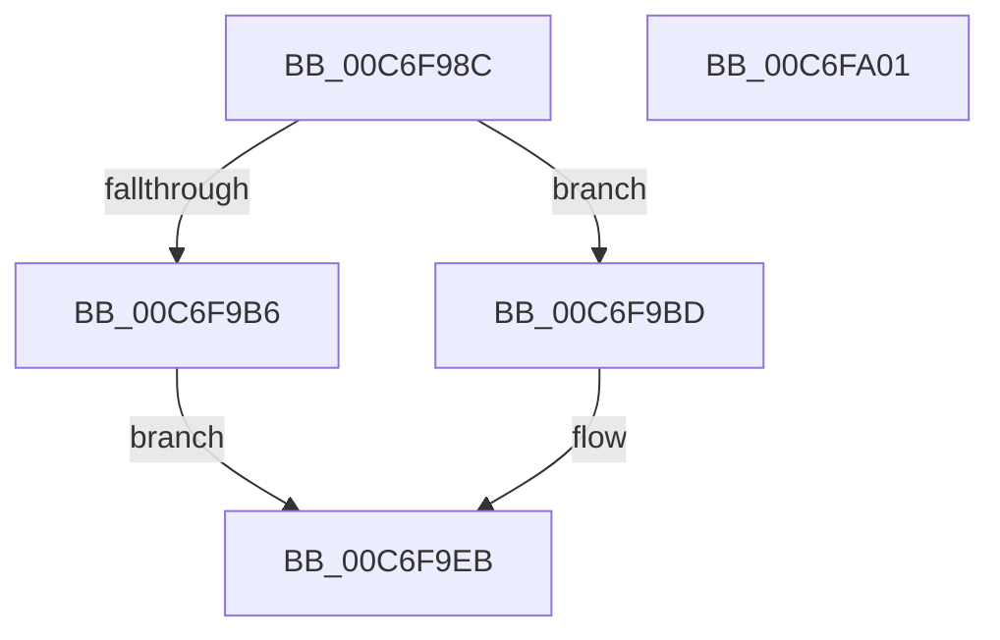

# TriageGetBugcheckData

- RVA: `0x00C6F98C`–`0x00C6FA02` (길이 `118` bytes)
- VA: `0x0000000140C6F98C`
- 실행 섹션: `INIT`
- PDB 이름 있음: `예`; PDB Function 태그: `아니요`
- unwind 정보 RVA: `0x0006F978`
- 디코드: `34`개 명령, `118/118` bytes 표시
- 미해석 바이트: `0` (있으면 어셈블리에 `.byte`로 보존)

> 이 문서는 커널 이미지의 기계어와 PDB 기호를 분석해 생성했습니다. 4번과 5번은 함수 원형과 자료형을 바이너리 사용 방식에서 추정한 C 해석이며 원본 소스 복구 결과는 아닙니다.

## 1. Dependencies

- 직접 호출 지점: **1**; 고유 호출 대상: **1**
- 직접 호출자로 확인된 함수: **2**
- RIP 상대 이미지 참조: **0**

### Outgoing calls
- `0x00C6F9AD` → [TriagepVerifyDump](TriagepVerifyDump_function_00C6FA80.md) (function, `0x00C6FA80`)

### Direct callers
- [VfTriageSystem](../C4/VfTriageSystem_function_00C4CB34.md) at `0x00C4CC32`
- [MmTriageActiveInLastCrash](MmTriageActiveInLastCrash_function_00C64D40.md) at `0x00C64D85`

### Static image references
- 디코드된 RIP-relative 메모리 참조가 없습니다.

## 2. Other-region calls and transfers

- 다른 실행 섹션으로 향하는 call: **0**
- 별도 외부 분기/꼬리 이동을 확인하지 못했습니다.

## 3. Assembly (complete function range)

```asm
00C6F98C  48 89 5C 24 08                  mov qword ptr [rsp + 8], rbx
00C6F991  48 89 74 24 10                  mov qword ptr [rsp + 0x10], rsi
00C6F996  48 89 7C 24 18                  mov qword ptr [rsp + 0x18], rdi
00C6F99B  41 56                           push r14
00C6F99D  48 83 EC 20                     sub rsp, 0x20
00C6F9A1  49 8B F9                        mov rdi, r9
00C6F9A4  49 8B F0                        mov rsi, r8
00C6F9A7  4C 8B F2                        mov r14, rdx
00C6F9AA  48 8B D9                        mov rbx, rcx
00C6F9AD  E8 CE 00 00 00                  call 0x140c6fa80
00C6F9B2  84 C0                           test al, al
00C6F9B4  75 07                           jne 0x140c6f9bd
00C6F9B6  B8 0D 00 00 C0                  mov eax, 0xc000000d
00C6F9BB  EB 2E                           jmp 0x140c6f9eb
00C6F9BD  8B 43 38                        mov eax, dword ptr [rbx + 0x38]
00C6F9C0  41 89 06                        mov dword ptr [r14], eax
00C6F9C3  48 8B 43 40                     mov rax, qword ptr [rbx + 0x40]
00C6F9C7  48 89 06                        mov qword ptr [rsi], rax
00C6F9CA  48 8B 43 48                     mov rax, qword ptr [rbx + 0x48]
00C6F9CE  48 89 07                        mov qword ptr [rdi], rax
00C6F9D1  48 8B 4B 50                     mov rcx, qword ptr [rbx + 0x50]
00C6F9D5  48 8B 44 24 50                  mov rax, qword ptr [rsp + 0x50]
00C6F9DA  48 89 08                        mov qword ptr [rax], rcx
00C6F9DD  48 8B 44 24 58                  mov rax, qword ptr [rsp + 0x58]
00C6F9E2  48 8B 4B 58                     mov rcx, qword ptr [rbx + 0x58]
00C6F9E6  48 89 08                        mov qword ptr [rax], rcx
00C6F9E9  33 C0                           xor eax, eax
00C6F9EB  48 8B 5C 24 30                  mov rbx, qword ptr [rsp + 0x30]
00C6F9F0  48 8B 74 24 38                  mov rsi, qword ptr [rsp + 0x38]
00C6F9F5  48 8B 7C 24 40                  mov rdi, qword ptr [rsp + 0x40]
00C6F9FA  48 83 C4 20                     add rsp, 0x20
00C6F9FE  41 5E                           pop r14
00C6FA00  C3                              ret
00C6FA01  CC                              int3
```

## 4. C-style interpretation (structured pseudocode)

```c
__int64 __fastcall TriageGetBugcheckData(__int64 a1, __int64 a2, __int64 a3, __int64 a4, __int64 a5, __int64 a6)
{
    __int64 result;
    __int64 v_rsp;
    unsigned __int64 v_stack_p10;
    unsigned __int64 v_stack_p18;
    unsigned __int64 v_stack_p8;

    v_stack_p8 = v_rbx;
    v_stack_p10 = v_rsi;
    v_stack_p18 = v_rdi;
    v_rsp = (v_rsp) - (32);
    result = TriagepVerifyDump(a1, a2, a3, a4);
    if ((unsigned __int8)(result) != 0) goto loc_00C6F9BD;
    goto loc_00C6F9EB;
loc_00C6F9BD:
    *(unsigned int *)(a2) = (unsigned int)((unsigned int)(*(unsigned int *)(a1 + 56)));
    *(unsigned __int64 *)(a3) = *(unsigned __int64 *)(a1 + 64);
    *(unsigned __int64 *)(a4) = *(unsigned __int64 *)(a1 + 72);
    *(unsigned __int64 *)(a5) = *(unsigned __int64 *)(a1 + 80);
    *(unsigned __int64 *)(a6) = *(unsigned __int64 *)(a1 + 88);
    result = 0;
loc_00C6F9EB:
    v_rsp = (v_rsp) + (32);
    return result;
}
```

## 5. (Beta) C Style

```c
int64_t TriageGetBugcheckData(void *Arg1, void *Arg2, void *Arg3, void *Arg4, void *Arg5, void *Arg6)
{
    uint8_t *arg1 = (uint8_t *)Arg1;
    uint8_t *arg2 = (uint8_t *)Arg2;
    uint8_t *arg3 = (uint8_t *)Arg3;
    uint8_t *arg4 = (uint8_t *)Arg4;
    uint8_t *arg5 = (uint8_t *)Arg5;
    uint8_t *arg6 = (uint8_t *)Arg6;

    int64_t result;
    int64_t local_rsp;
    uint64_t v_stack_p10;
    uint64_t v_stack_p18;
    uint64_t v_stack_p8;

    v_stack_p8 = local_rbx;
    v_stack_p10 = local_rsi;
    v_stack_p18 = local_rdi;
    local_rsp = (local_rsp) - (32);
    result = TriagepVerifyDump(Arg1, Arg2, Arg3, Arg4);
    if ((uint8_t)(result) != 0) goto loc_00C6F9BD;
    goto loc_00C6F9EB;
loc_00C6F9BD:
    *(uint32_t *)(arg2) = (uint32_t)((uint32_t)(*(uint32_t *)(arg1 + 0x38)));
    *(uint64_t *)(arg3) = *(uint64_t *)(arg1 + 0x40);
    *(uint64_t *)(arg4) = *(uint64_t *)(arg1 + 0x48);
    *(uint64_t *)(arg5) = *(uint64_t *)(arg1 + 0x50);
    *(uint64_t *)(arg6) = *(uint64_t *)(arg1 + 0x58);
    result = 0;
loc_00C6F9EB:
    local_rsp = (local_rsp) + (32);
    return result;
}
```

### 관측된 메모리 오프셋

구조체 형식이 확인되지 않은 접근은 인자 기준의 오프셋으로만 기록했습니다.

| 기준 인자 | 오프셋 표현 | 폭 (bit) | 접근 |
|---|---:|---:|---|
| `Arg1` | `+ 0x38` | `32` | `R` |
| `Arg1` | `+ 0x40` | `64` | `R` |
| `Arg1` | `+ 0x48` | `64` | `R` |
| `Arg1` | `+ 0x50` | `64` | `R` |
| `Arg1` | `+ 0x58` | `64` | `R` |
| `Arg2` | `+ 0x0` | `32` | `W` |
| `Arg3` | `+ 0x0` | `64` | `W` |
| `Arg4` | `+ 0x0` | `64` | `W` |
| `Arg5` | `+ 0x0` | `64` | `W` |
| `Arg6` | `+ 0x0` | `64` | `W` |

## 6. Execution-region graph

[열기: 2D/3D 그래프와 함수 탐색 컨트롤 패널](../../../control-panel.html?section=init&rva=0x00C6F98C&view=graph)

- 2D 그래프는 위에서 아래로 흐르고, 3D 그래프는 빈 공간을 드래그해 회전합니다. Shift+드래그는 이동, 휠은 확대·축소, 함수 노드 선택은 대상 보고서 이동입니다.

### Static fallback


