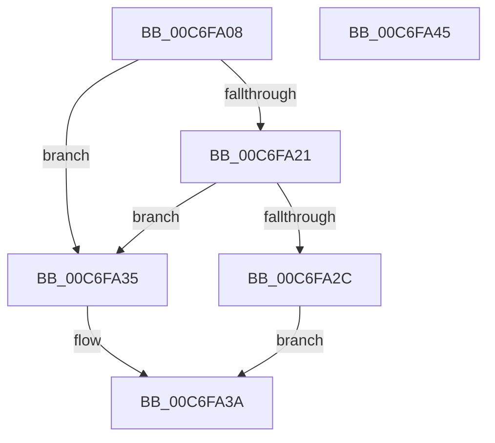

# TriageGetDriverCount

- RVA: `0x00C6FA08`–`0x00C6FA46` (길이 `62` bytes)
- VA: `0x0000000140C6FA08`
- 실행 섹션: `INIT`
- PDB 이름 있음: `예`; PDB Function 태그: `아니요`
- unwind 정보 RVA: `0x0005CAAC`
- 디코드: `21`개 명령, `62/62` bytes 표시
- 미해석 바이트: `0` (있으면 어셈블리에 `.byte`로 보존)

> 이 문서는 커널 이미지의 기계어와 PDB 기호를 분석해 생성했습니다. 4번과 5번은 함수 원형과 자료형을 바이너리 사용 방식에서 추정한 C 해석이며 원본 소스 복구 결과는 아닙니다.

## 1. Dependencies

- 직접 호출 지점: **1**; 고유 호출 대상: **1**
- 직접 호출자로 확인된 함수: **1**
- RIP 상대 이미지 참조: **1**

### Outgoing calls
- `0x00C6FA18` → [TriagepVerifyDump](TriagepVerifyDump_function_00C6FA80.md) (function, `0x00C6FA80`)

### Direct callers
- [ViTriageSameDriversFromDump](../C4/ViTriageSameDriversFromDump_function_00C4D02C.md) at `0x00C4D051`

### Static image references
- `0x00C6FA21` → RVA `0x00E0F1B0` (`.data`; read)

## 2. Other-region calls and transfers

- 다른 실행 섹션으로 향하는 call: **0**
- 별도 외부 분기/꼬리 이동을 확인하지 못했습니다.

## 3. Assembly (complete function range)

```asm
00C6FA08  48 89 5C 24 08                  mov qword ptr [rsp + 8], rbx
00C6FA0D  57                              push rdi
00C6FA0E  48 83 EC 20                     sub rsp, 0x20
00C6FA12  48 8B FA                        mov rdi, rdx
00C6FA15  48 8B D9                        mov rbx, rcx
00C6FA18  E8 63 00 00 00                  call 0x140c6fa80
00C6FA1D  84 C0                           test al, al
00C6FA1F  74 14                           je 0x140c6fa35
00C6FA21  8B 05 89 F7 19 00               mov eax, dword ptr [rip + 0x19f789]
00C6FA27  48 03 C3                        add rax, rbx
00C6FA2A  74 09                           je 0x140c6fa35
00C6FA2C  8B 40 34                        mov eax, dword ptr [rax + 0x34]
00C6FA2F  89 07                           mov dword ptr [rdi], eax
00C6FA31  33 C0                           xor eax, eax
00C6FA33  EB 05                           jmp 0x140c6fa3a
00C6FA35  B8 0D 00 00 C0                  mov eax, 0xc000000d
00C6FA3A  48 8B 5C 24 30                  mov rbx, qword ptr [rsp + 0x30]
00C6FA3F  48 83 C4 20                     add rsp, 0x20
00C6FA43  5F                              pop rdi
00C6FA44  C3                              ret
00C6FA45  CC                              int3
```

## 4. C-style interpretation (structured pseudocode)

```c
__int64 __fastcall TriageGetDriverCount(__int64 a1, __int64 a2)
{
    __int64 result;
    __int64 v_rsp;
    unsigned __int64 v_stack_p8;

    v_stack_p8 = v_rbx;
    v_rsp = (v_rsp) - (32);
    result = TriagepVerifyDump(a1, a2, a3, a4);
    if ((unsigned __int8)(result) == 0) goto loc_00C6FA35;
    result = ((unsigned int)(*(unsigned int *)(v_rip + 1701769))) + (a1);
    if (condition_is_equal) goto loc_00C6FA35;
    *(unsigned int *)(a2) = (unsigned int)((unsigned int)(*(unsigned int *)(result + 52)));
    result = 0;
    goto loc_00C6FA3A;
loc_00C6FA35:
loc_00C6FA3A:
    v_rsp = (v_rsp) + (32);
    return (unsigned int)(0xC000000DULL);
}
```

## 5. (Beta) C Style

```c
int64_t TriageGetDriverCount(int64_t Arg1, void *Arg2)
{
    uint8_t *arg2 = (uint8_t *)Arg2;

    int64_t result;
    int64_t local_rsp;
    uint64_t v_stack_p8;

    v_stack_p8 = local_rbx;
    local_rsp = (local_rsp) - (32);
    result = TriagepVerifyDump(Arg1, Arg2, a3, a4);
    if ((uint8_t)(result) == 0) goto loc_00C6FA35;
    result = ((uint32_t)(*(uint32_t *)(v_rip + 0x19F789))) + (Arg1);
    if (condition_is_equal) goto loc_00C6FA35;
    *(uint32_t *)(arg2) = (uint32_t)((uint32_t)(*(uint32_t *)(result + 0x34)));
    result = 0;
    goto loc_00C6FA3A;
loc_00C6FA35:
loc_00C6FA3A:
    local_rsp = (local_rsp) + (32);
    return (uint32_t)(0xC000000DULL);
}
```

### 관측된 메모리 오프셋

구조체 형식이 확인되지 않은 접근은 인자 기준의 오프셋으로만 기록했습니다.

| 기준 인자 | 오프셋 표현 | 폭 (bit) | 접근 |
|---|---:|---:|---|
| `Arg2` | `+ 0x0` | `32` | `W` |

## 6. Execution-region graph

[열기: 2D/3D 그래프와 함수 탐색 컨트롤 패널](../../../control-panel.html?section=init&rva=0x00C6FA08&view=graph)

- 2D 그래프는 위에서 아래로 흐르고, 3D 그래프는 빈 공간을 드래그해 회전합니다. Shift+드래그는 이동, 휠은 확대·축소, 함수 노드 선택은 대상 보고서 이동입니다.

### Static fallback


