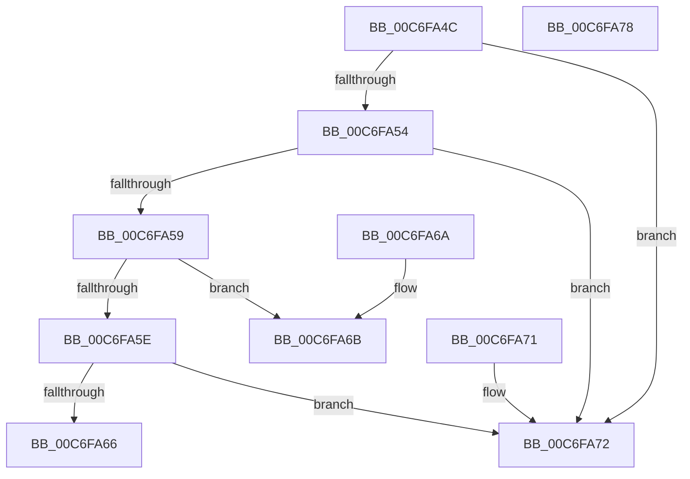

# TriagepGetPageSize

- RVA: `0x00C6FA4C`–`0x00C6FA79` (길이 `45` bytes)
- VA: `0x0000000140C6FA4C`
- 실행 섹션: `INIT`
- PDB 이름 있음: `예`; PDB Function 태그: `아니요`
- unwind 정보 RVA: `0x000DB714`
- 디코드: `17`개 명령, `45/45` bytes 표시
- 미해석 바이트: `0` (있으면 어셈블리에 `.byte`로 보존)

> 이 문서는 커널 이미지의 기계어와 PDB 기호를 분석해 생성했습니다. 4번과 5번은 함수 원형과 자료형을 바이너리 사용 방식에서 추정한 C 해석이며 원본 소스 복구 결과는 아닙니다.

## 1. Dependencies

- 직접 호출 지점: **0**; 고유 호출 대상: **0**
- 직접 호출자로 확인된 함수: **1**
- RIP 상대 이미지 참조: **0**

### Outgoing calls
- 직접 디코드된 call 명령이 없습니다.

### Direct callers
- [TriagepVerifyDump](TriagepVerifyDump_function_00C6FA80.md) at `0x00C6FAA6`

### Static image references
- 디코드된 RIP-relative 메모리 참조가 없습니다.

## 2. Other-region calls and transfers

- 다른 실행 섹션으로 향하는 call: **0**
- 별도 외부 분기/꼬리 이동을 확인하지 못했습니다.

## 3. Assembly (complete function range)

```asm
00C6FA4C  81 E9 4C 01 00 00               sub ecx, 0x14c
00C6FA52  74 1E                           je 0x140c6fa72
00C6FA54  83 E9 78                        sub ecx, 0x78
00C6FA57  74 19                           je 0x140c6fa72
00C6FA59  83 E9 3C                        sub ecx, 0x3c
00C6FA5C  74 0D                           je 0x140c6fa6b
00C6FA5E  81 F9 64 84 00 00               cmp ecx, 0x8464
00C6FA64  74 0C                           je 0x140c6fa72
00C6FA66  83 C8 FF                        or eax, 0xffffffff
00C6FA69  C3                              ret
00C6FA6A  CC                              int3
00C6FA6B  B8 00 20 00 00                  mov eax, 0x2000
00C6FA70  C3                              ret
00C6FA71  CC                              int3
00C6FA72  B8 00 10 00 00                  mov eax, 0x1000
00C6FA77  C3                              ret
00C6FA78  CC                              int3
```

## 4. C-style interpretation (structured pseudocode)

```c
__int64 __fastcall TriagepGetPageSize(int a1)
{
    __int64 result;

    a1 = (unsigned int)((a1) - (332));
    if (condition_is_equal) goto loc_00C6FA72;
    a1 = (unsigned int)((a1) - (120));
    if (condition_is_equal) goto loc_00C6FA72;
    a1 = (unsigned int)((a1) - (60));
    if (condition_is_equal) goto loc_00C6FA6B;
    if (a1 == 0x8464ULL) goto loc_00C6FA72;
    result = (unsigned int)((result) | (0xFFFFFFFFULL));
    return result;
loc_00C6FA6B:
    return (unsigned int)(0x2000ULL);
loc_00C6FA72:
    return (unsigned int)(0x1000ULL);
}
```

## 5. (Beta) C Style

```c
int64_t TriagepGetPageSize(int32_t Arg1)
{
    int64_t result;

    Arg1 = (uint32_t)((Arg1) - (332));
    if (condition_is_equal) goto loc_00C6FA72;
    Arg1 = (uint32_t)((Arg1) - (120));
    if (condition_is_equal) goto loc_00C6FA72;
    Arg1 = (uint32_t)((Arg1) - (60));
    if (condition_is_equal) goto loc_00C6FA6B;
    if (Arg1 == 0x8464ULL) goto loc_00C6FA72;
    result = (uint32_t)((result) | (0xFFFFFFFFULL));
    return result;
loc_00C6FA6B:
    return (uint32_t)(0x2000ULL);
loc_00C6FA72:
    return (uint32_t)(0x1000ULL);
}
```

## 6. Execution-region graph

[열기: 2D/3D 그래프와 함수 탐색 컨트롤 패널](../../../control-panel.html?section=init&rva=0x00C6FA4C&view=graph)

- 2D 그래프는 위에서 아래로 흐르고, 3D 그래프는 빈 공간을 드래그해 회전합니다. Shift+드래그는 이동, 휠은 확대·축소, 함수 노드 선택은 대상 보고서 이동입니다.

### Static fallback


