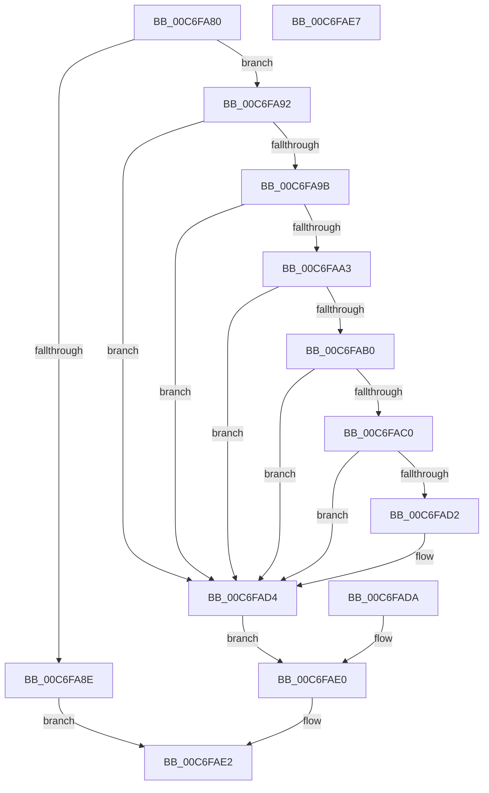

# TriagepVerifyDump

- RVA: `0x00C6FA80`–`0x00C6FAE8` (길이 `104` bytes)
- VA: `0x0000000140C6FA80`
- 실행 섹션: `INIT`
- PDB 이름 있음: `예`; PDB Function 태그: `아니요`
- unwind 정보 RVA: `0x000DB37C`
- 디코드: `30`개 명령, `104/104` bytes 표시
- 미해석 바이트: `0` (있으면 어셈블리에 `.byte`로 보존)

> 이 문서는 커널 이미지의 기계어와 PDB 기호를 분석해 생성했습니다. 4번과 5번은 함수 원형과 자료형을 바이너리 사용 방식에서 추정한 C 해석이며 원본 소스 복구 결과는 아닙니다.

## 1. Dependencies

- 직접 호출 지점: **1**; 고유 호출 대상: **1**
- 직접 호출자로 확인된 함수: **4**
- RIP 상대 이미지 참조: **1**

### Outgoing calls
- `0x00C6FAA6` → [TriagepGetPageSize](TriagepGetPageSize_function_00C6FA4C.md) (function, `0x00C6FA4C`)

### Direct callers
- [TriageGetLoaderEntry](../../text/6A/TriageGetLoaderEntry_function_006A8528.md) at `0x006A8537`
- [MmTriageActiveInLastCrash](MmTriageActiveInLastCrash_function_00C64D40.md) at `0x00C64D91`
- [TriageGetBugcheckData](TriageGetBugcheckData_function_00C6F98C.md) at `0x00C6F9AD`
- [TriageGetDriverCount](TriageGetDriverCount_function_00C6FA08.md) at `0x00C6FA18`

### Static image references
- `0x00C6FAB0` → RVA `0x00E0F1B0` (`.data`; write)

## 2. Other-region calls and transfers

- 다른 실행 섹션으로 향하는 call: **0**
- 별도 외부 분기/꼬리 이동을 확인하지 못했습니다.

## 3. Assembly (complete function range)

```asm
00C6FA80  48 83 EC 38                     sub rsp, 0x38
00C6FA84  4C 8B C1                        mov r8, rcx
00C6FA87  33 D2                           xor edx, edx
00C6FA89  48 85 C9                        test rcx, rcx
00C6FA8C  75 04                           jne 0x140c6fa92
00C6FA8E  32 C0                           xor al, al
00C6FA90  EB 50                           jmp 0x140c6fae2
00C6FA92  81 79 04 44 55 4D 50            cmp dword ptr [rcx + 4], 0x504d5544
00C6FA99  75 39                           jne 0x140c6fad4
00C6FA9B  81 39 50 41 47 45               cmp dword ptr [rcx], 0x45474150
00C6FAA1  75 31                           jne 0x140c6fad4
00C6FAA3  8B 49 30                        mov ecx, dword ptr [rcx + 0x30]
00C6FAA6  E8 A1 FF FF FF                  call 0x140c6fa4c
00C6FAAB  83 F8 FF                        cmp eax, -1
00C6FAAE  74 24                           je 0x140c6fad4
00C6FAB0  89 05 FA F6 19 00               mov dword ptr [rip + 0x19f6fa], eax
00C6FAB6  41 83 B8 98 0F 00 00 04         cmp dword ptr [r8 + 0xf98], 4
00C6FABE  75 14                           jne 0x140c6fad4
00C6FAC0  41 8B 80 04 20 00 00            mov eax, dword ptr [r8 + 0x2004]
00C6FAC7  42 81 7C 00 FC 54 52 47 44      cmp dword ptr [rax + r8 - 4], 0x44475254
00C6FAD0  75 02                           jne 0x140c6fad4
00C6FAD2  B2 01                           mov dl, 1
00C6FAD4  88 54 24 20                     mov byte ptr [rsp + 0x20], dl
00C6FAD8  EB 06                           jmp 0x140c6fae0
00C6FADA  32 D2                           xor dl, dl
00C6FADC  88 54 24 20                     mov byte ptr [rsp + 0x20], dl
00C6FAE0  8A C2                           mov al, dl
00C6FAE2  48 83 C4 38                     add rsp, 0x38
00C6FAE6  C3                              ret
00C6FAE7  CC                              int3
```

## 4. C-style interpretation (structured pseudocode)

```c
__int64 __fastcall TriagepVerifyDump(__int64 a1, int a2)
{
    __int64 result;
    __int64 v_rsp;
    unsigned __int8 v_stack_m18;

    v_rsp = (v_rsp) - (56);
    a2 = 0;
    if (a1 != 0) goto loc_00C6FA92;
    result = 0;
    goto loc_00C6FAE2;
loc_00C6FA92:
    if ((*(unsigned int *)(a1 + 4)) != 0x504D5544ULL) goto loc_00C6FAD4;
    if ((*(unsigned int *)(a1)) != 0x45474150ULL) goto loc_00C6FAD4;
    result = TriagepGetPageSize((unsigned int)(*(unsigned int *)(a1 + 48)), a2, a1, a4);
    if (((unsigned int)(result)) == -1) goto loc_00C6FAD4;
    *(unsigned int *)(v_rip + 1701626) = (unsigned int)(result);
    if ((*(unsigned int *)(a1 + 3992)) != 4) goto loc_00C6FAD4;
    if ((*(unsigned int *)((unsigned int)(*(unsigned int *)(a1 + 8196)) + a1 * 1 - 4)) == 0x44475254ULL) {
        a2 = 1;
    }
    v_stack_m18 = (unsigned __int8)(a2);
    goto loc_00C6FAE0;
loc_00C6FAE0:
loc_00C6FAE2:
    v_rsp = (v_rsp) + (56);
    return (unsigned __int8)(a2);
}
```

## 5. (Beta) C Style

```c
int64_t TriagepVerifyDump(int64_t Arg1, int32_t Arg2)
{
    int64_t result;
    int64_t local_rsp;
    uint8_t v_stack_m18;

    local_rsp = (local_rsp) - (56);
    Arg2 = 0;
    if (Arg1 != 0) goto loc_00C6FA92;
    result = 0;
    goto loc_00C6FAE2;
loc_00C6FA92:
    if ((*(uint32_t *)(Arg1 + 0x4)) != 0x504D5544ULL) goto loc_00C6FAD4;
    if ((*(uint32_t *)(Arg1)) != 0x45474150ULL) goto loc_00C6FAD4;
    result = TriagepGetPageSize((uint32_t)(*(uint32_t *)(Arg1 + 0x30)), Arg2, Arg1, a4);
    if (((uint32_t)(result)) == -1) goto loc_00C6FAD4;
    *(uint32_t *)(v_rip + 0x19F6FA) = (uint32_t)(result);
    if ((*(uint32_t *)(Arg1 + 0xF98)) != 4) goto loc_00C6FAD4;
    if ((*(uint32_t *)((uint32_t)(*(uint32_t *)(Arg1 + 0x2004)) + Arg1 * 1 - 0x4)) == 0x44475254ULL) {
        Arg2 = 1;
    }
    v_stack_m18 = (uint8_t)(Arg2);
    goto loc_00C6FAE0;
loc_00C6FAE0:
loc_00C6FAE2:
    local_rsp = (local_rsp) + (56);
    return (uint8_t)(Arg2);
}
```

## 6. Execution-region graph

[열기: 2D/3D 그래프와 함수 탐색 컨트롤 패널](../../../control-panel.html?section=init&rva=0x00C6FA80&view=graph)

- 2D 그래프는 위에서 아래로 흐르고, 3D 그래프는 빈 공간을 드래그해 회전합니다. Shift+드래그는 이동, 휠은 확대·축소, 함수 노드 선택은 대상 보고서 이동입니다.

### Static fallback


