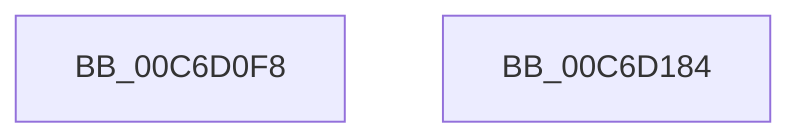

# sub_00C6D0F8

- RVA: `0x00C6D0F8`–`0x00C6D185` (길이 `141` bytes)
- VA: `0x0000000140C6D0F8`
- 실행 섹션: `INIT`
- PDB 이름 있음: `아니요`; PDB Function 태그: `아니요`
- unwind 정보 RVA: `0x0005CF00`
- 디코드: `31`개 명령, `141/141` bytes 표시
- 미해석 바이트: `0` (있으면 어셈블리에 `.byte`로 보존)

> 이 문서는 커널 이미지의 기계어와 PDB 기호를 분석해 생성했습니다. 4번과 5번은 함수 원형과 자료형을 바이너리 사용 방식에서 추정한 C 해석이며 원본 소스 복구 결과는 아닙니다.

## 1. Dependencies

- 직접 호출 지점: **2**; 고유 호출 대상: **2**
- 직접 호출자로 확인된 함수: **1**
- RIP 상대 이미지 참조: **9**

### Outgoing calls
- `0x00C6D10D` → [KiInitializeMutant](../../text/45/KiInitializeMutant_function_00456E9C.md) (function, `0x00456E9C`)
- `0x00C6D14A` → [KeQueryTimeIncrement](../../text/44/KeQueryTimeIncrement_function_0044B4C0.md) (function, `0x0044B4C0`)

### Direct callers
- [sub_009669C4](../../page/96/Unknown_function_009669C4.md) at `0x00966A21`

### Static image references
- `0x00C6D101` → RVA `0x00EF0DE0` (`.data`; read)
- `0x00C6D114` → RVA `0x00EF0DC2` (`.data`; write)
- `0x00C6D11B` → RVA `0x00EF0DC0` (`.data`; write)
- `0x00C6D12C` → RVA `0x00EF0DC4` (`.data`; write)
- `0x00C6D132` → RVA `0x00EF0DC8` (`.data`; read)
- `0x00C6D139` → RVA `0x00EF0DD0` (`.data`; write)
- `0x00C6D140` → RVA `0x00EF0DC8` (`.data`; write)
- `0x00C6D170` → RVA `0x00FD8118` (`PAGEDATA`; write)
- `0x00C6D177` → RVA `0x00FD81B8` (`PAGEDATA`; write)

## 2. Other-region calls and transfers

- 다른 실행 섹션으로 향하는 call: **2**
  - `0x00C6D10D` → [KiInitializeMutant](../../text/45/KiInitializeMutant_function_00456E9C.md) (`INIT` → `.text`)
  - `0x00C6D14A` → [KeQueryTimeIncrement](../../text/44/KeQueryTimeIncrement_function_0044B4C0.md) (`INIT` → `.text`)
- 별도 외부 분기/꼬리 이동을 확인하지 못했습니다.

## 3. Assembly (complete function range)

```asm
00C6D0F8  40 53                           push rbx
00C6D0FA  48 83 EC 20                     sub rsp, 0x20
00C6D0FE  45 33 C9                        xor r9d, r9d
00C6D101  48 8D 0D D8 3C 28 00            lea rcx, [rip + 0x283cd8]
00C6D108  45 33 C0                        xor r8d, r8d
00C6D10B  33 D2                           xor edx, edx
00C6D10D  E8 8A 9D 7E FF                  call 0x140456e9c
00C6D112  33 C0                           xor eax, eax
00C6D114  C6 05 A7 3C 28 00 06            mov byte ptr [rip + 0x283ca7], 6
00C6D11B  66 89 05 9E 3C 28 00            mov word ptr [rip + 0x283c9e], ax
00C6D122  48 BB 20 03 00 00 80 F7 FF FF   movabs rbx, 0xfffff78000000320
00C6D12C  89 05 92 3C 28 00               mov dword ptr [rip + 0x283c92], eax
00C6D132  48 8D 05 8F 3C 28 00            lea rax, [rip + 0x283c8f]
00C6D139  48 89 05 90 3C 28 00            mov qword ptr [rip + 0x283c90], rax
00C6D140  48 89 05 81 3C 28 00            mov qword ptr [rip + 0x283c81], rax
00C6D147  48 8B 1B                        mov rbx, qword ptr [rbx]
00C6D14A  E8 71 E3 7D FF                  call 0x14044b4c0
00C6D14F  8B C8                           mov ecx, eax
00C6D151  48 B8 4B 59 86 38 D6 C5 6D 34   movabs rax, 0x346dc5d63886594b
00C6D15B  48 0F AF CB                     imul rcx, rbx
00C6D15F  48 F7 E9                        imul rcx
00C6D162  48 C1 FA 0B                     sar rdx, 0xb
00C6D166  48 8B C2                        mov rax, rdx
00C6D169  48 C1 E8 3F                     shr rax, 0x3f
00C6D16D  48 03 D0                        add rdx, rax
00C6D170  48 89 15 A1 AF 36 00            mov qword ptr [rip + 0x36afa1], rdx
00C6D177  48 89 15 3A B0 36 00            mov qword ptr [rip + 0x36b03a], rdx
00C6D17E  48 83 C4 20                     add rsp, 0x20
00C6D182  5B                              pop rbx
00C6D183  C3                              ret
00C6D184  CC                              int3
```

## 4. C-style interpretation (structured pseudocode)

```c
__int64 __fastcall sub_00C6D0F8(__int64 a1, int a2, int a3, int a4)
{
    __int64 result;
    __int64 v_rsp;

    v_rsp = (v_rsp) - (32);
    a4 = 0;
    a3 = 0;
    a2 = 0;
    result = KiInitializeMutant(v_rip + 2637016, a2, a3, a4);
    result = 0;
    *(unsigned __int8 *)(v_rip + 2636967) = 6;
    *(unsigned __int16 *)(v_rip + 2636958) = 0;
    *(unsigned int *)(v_rip + 2636946) = 0;
    *(unsigned __int64 *)(v_rip + 2636944) = v_rip + 2636943;
    *(unsigned __int64 *)(v_rip + 2636929) = v_rip + 2636943;
    result = KeQueryTimeIncrement(v_rip + 2637016, a2, a3, a4);
    a1 = ((unsigned int)((unsigned int)(result))) * (*(unsigned __int64 *)(v_rbx));
    a2 = (a2) >> (11);
    result = (a2) >> (63);
    a2 = (a2) + (result);
    *(unsigned __int64 *)(v_rip + 3583905) = a2;
    *(unsigned __int64 *)(v_rip + 3584058) = a2;
    v_rsp = (v_rsp) + (32);
    return result;
}
```

## 5. (Beta) C Style

```c
int64_t sub_00C6D0F8(int64_t Arg1, int32_t Arg2, int32_t Arg3, int32_t Arg4)
{
    int64_t result;
    int64_t local_rsp;

    local_rsp = (local_rsp) - (32);
    Arg4 = 0;
    Arg3 = 0;
    Arg2 = 0;
    result = KiInitializeMutant(v_rip + 2637016, Arg2, Arg3, Arg4);
    result = 0;
    *(uint8_t *)(v_rip + 0x283CA7) = 6;
    *(uint16_t *)(v_rip + 0x283C9E) = 0;
    *(uint32_t *)(v_rip + 0x283C92) = 0;
    *(uint64_t *)(v_rip + 0x283C90) = v_rip + 2636943;
    *(uint64_t *)(v_rip + 0x283C81) = v_rip + 2636943;
    result = KeQueryTimeIncrement(v_rip + 2637016, Arg2, Arg3, Arg4);
    Arg1 = ((uint32_t)((uint32_t)(result))) * (*(uint64_t *)(local_rbx));
    Arg2 = (Arg2) >> (11);
    result = (Arg2) >> (63);
    Arg2 = (Arg2) + (result);
    *(uint64_t *)(v_rip + 0x36AFA1) = Arg2;
    *(uint64_t *)(v_rip + 0x36B03A) = Arg2;
    local_rsp = (local_rsp) + (32);
    return result;
}
```

## 6. Execution-region graph

[열기: 2D/3D 그래프와 함수 탐색 컨트롤 패널](../../../control-panel.html?section=init&rva=0x00C6D0F8&view=graph)

- 2D 그래프는 위에서 아래로 흐르고, 3D 그래프는 빈 공간을 드래그해 회전합니다. Shift+드래그는 이동, 휠은 확대·축소, 함수 노드 선택은 대상 보고서 이동입니다.

### Static fallback


