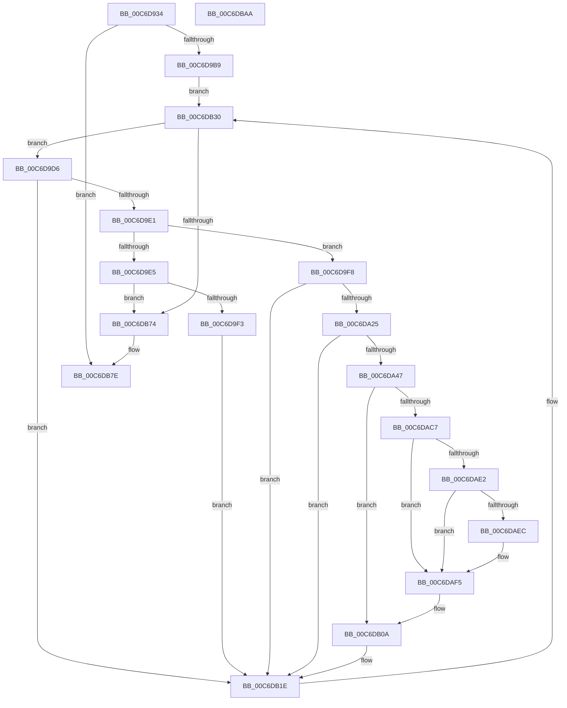

# VhdAutoAttachVirtualDisks

- RVA: `0x00C6D934`–`0x00C6DBAB` (길이 `631` bytes)
- VA: `0x0000000140C6D934`
- 실행 섹션: `INIT`
- PDB 이름 있음: `예`; PDB Function 태그: `아니요`
- unwind 정보 RVA: `0x000DB274`
- 디코드: `145`개 명령, `631/631` bytes 표시
- 미해석 바이트: `0` (있으면 어셈블리에 `.byte`로 보존)

> 이 문서는 커널 이미지의 기계어와 PDB 기호를 분석해 생성했습니다. 4번과 5번은 함수 원형과 자료형을 바이너리 사용 방식에서 추정한 C 해석이며 원본 소스 복구 결과는 아닙니다.

## 1. Dependencies

- 직접 호출 지점: **14**; 고유 호출 대상: **10**
- 직접 호출자로 확인된 함수: **1**
- RIP 상대 이미지 참조: **7**

### Outgoing calls
- `0x00C6D997` → [RtlInitUnicodeString](../../text/42/RtlInitUnicodeString_function_0042A780.md) (function, `0x0042A780`)
- `0x00C6D9AC` → [IopOpenRegistryKeyEx](../../page/A5/IopOpenRegistryKeyEx_function_00A51B44.md) (function, `0x00A51B44`)
- `0x00C6D9CA` → [memset](../../text/6C/memset_function_006C6C40.md) (function, `0x006C6C40`)
- `0x00C6DA18` → [RtlGUIDFromString](../../page/8F/RtlGUIDFromString_function_008F1EF0.md) (function, `0x008F1EF0`)
- `0x00C6DA3A` → [IopOpenRegistryKeyEx](../../page/A5/IopOpenRegistryKeyEx_function_00A51B44.md) (function, `0x00A51B44`)
- `0x00C6DA53` → [memset](../../text/6C/memset_function_006C6C40.md) (function, `0x006C6C40`)
- `0x00C6DABE` → [RtlQueryRegistryValuesEx](../../page/8C/RtlQueryRegistryValuesEx_function_008C8FF0.md) (function, `0x008C8FF0`)
- `0x00C6DB05` → [VhdiAutoAttachOneVhd](../../page/83/VhdiAutoAttachOneVhd_function_0083BCD4.md) (function, `0x0083BCD4`)
- `0x00C6DB0F` → [RtlFreeAnsiString](../../page/9C/RtlFreeAnsiString_function_009C0800.md) (function, `0x009C0800`)
- `0x00C6DB19` → [ZwClose](../../text/6A/ZwClose_function_006AD2B0.md) (function, `0x006AD2B0`)
- `0x00C6DB29` → [memset](../../text/6C/memset_function_006C6C40.md) (function, `0x006C6C40`)
- `0x00C6DB64` → [ZwEnumerateKey](../../text/6A/ZwEnumerateKey_function_006AD710.md) (function, `0x006AD710`)
- `0x00C6DB79` → [ZwClose](../../text/6A/ZwClose_function_006AD2B0.md) (function, `0x006AD2B0`)
- `0x00C6DB88` → [_security_check_cookie](../../text/6A/_security_check_cookie_function_006AC640.md) (function, `0x006AC640`)

### Direct callers
- [IopInitializeBootDrivers](../C2/IopInitializeBootDrivers_function_00C2E6F4.md) at `0x00C2EF7A`

### Static image references
- `0x00C6D956` → RVA `0x00E0A740` (`.data`; read)
- `0x00C6D967` → RVA `0x00E65188` (`.data`; read)
- `0x00C6D973` → RVA `0x00E65190` (`.data`; write)
- `0x00C6D97A` → RVA `0x00C7E830` (` ?? ::PBOPGDP::`string'`; read)
- `0x00C6D98B` → RVA `0x00E65188` (`.data`; write)
- `0x00C6DA5D` → RVA `0x00C7E8E0` (` ?? ::PBOPGDP::`string'`; read)
- `0x00C6DA7C` → RVA `0x00C7E8D0` (` ?? ::PBOPGDP::`string'`; read)

## 2. Other-region calls and transfers

- 다른 실행 섹션으로 향하는 call: **14**
  - `0x00C6D997` → [RtlInitUnicodeString](../../text/42/RtlInitUnicodeString_function_0042A780.md) (`INIT` → `.text`)
  - `0x00C6D9AC` → [IopOpenRegistryKeyEx](../../page/A5/IopOpenRegistryKeyEx_function_00A51B44.md) (`INIT` → `PAGE`)
  - `0x00C6D9CA` → [memset](../../text/6C/memset_function_006C6C40.md) (`INIT` → `.text`)
  - `0x00C6DA18` → [RtlGUIDFromString](../../page/8F/RtlGUIDFromString_function_008F1EF0.md) (`INIT` → `PAGE`)
  - `0x00C6DA3A` → [IopOpenRegistryKeyEx](../../page/A5/IopOpenRegistryKeyEx_function_00A51B44.md) (`INIT` → `PAGE`)
  - `0x00C6DA53` → [memset](../../text/6C/memset_function_006C6C40.md) (`INIT` → `.text`)
  - `0x00C6DABE` → [RtlQueryRegistryValuesEx](../../page/8C/RtlQueryRegistryValuesEx_function_008C8FF0.md) (`INIT` → `PAGE`)
  - `0x00C6DB05` → [VhdiAutoAttachOneVhd](../../page/83/VhdiAutoAttachOneVhd_function_0083BCD4.md) (`INIT` → `PAGE`)
  - `0x00C6DB0F` → [RtlFreeAnsiString](../../page/9C/RtlFreeAnsiString_function_009C0800.md) (`INIT` → `PAGE`)
  - `0x00C6DB19` → [ZwClose](../../text/6A/ZwClose_function_006AD2B0.md) (`INIT` → `.text`)
  - `0x00C6DB29` → [memset](../../text/6C/memset_function_006C6C40.md) (`INIT` → `.text`)
  - `0x00C6DB64` → [ZwEnumerateKey](../../text/6A/ZwEnumerateKey_function_006AD710.md) (`INIT` → `.text`)
  - `0x00C6DB79` → [ZwClose](../../text/6A/ZwClose_function_006AD2B0.md) (`INIT` → `.text`)
  - `0x00C6DB88` → [_security_check_cookie](../../text/6A/_security_check_cookie_function_006AC640.md) (`INIT` → `.text`)
- 별도 외부 분기/꼬리 이동을 확인하지 못했습니다.

## 3. Assembly (complete function range)

```asm
00C6D934  48 8B C4                        mov rax, rsp
00C6D937  48 89 58 08                     mov qword ptr [rax + 8], rbx
00C6D93B  48 89 70 10                     mov qword ptr [rax + 0x10], rsi
00C6D93F  48 89 78 18                     mov qword ptr [rax + 0x18], rdi
00C6D943  4C 89 70 20                     mov qword ptr [rax + 0x20], r14
00C6D947  55                              push rbp
00C6D948  48 8D A8 38 FF FF FF            lea rbp, [rax - 0xc8]
00C6D94F  48 81 EC C0 01 00 00            sub rsp, 0x1c0
00C6D956  48 8B 05 E3 CD 19 00            mov rax, qword ptr [rip + 0x19cde3]
00C6D95D  48 33 C4                        xor rax, rsp
00C6D960  48 89 85 B0 00 00 00            mov qword ptr [rbp + 0xb0], rax
00C6D967  48 8D 05 1A 78 1F 00            lea rax, [rip + 0x1f781a]
00C6D96E  0F 57 C0                        xorps xmm0, xmm0
00C6D971  33 F6                           xor esi, esi
00C6D973  48 89 05 16 78 1F 00            mov qword ptr [rip + 0x1f7816], rax
00C6D97A  48 8D 15 AF 0E 01 00            lea rdx, [rip + 0x10eaf]
00C6D981  48 89 74 24 38                  mov qword ptr [rsp + 0x38], rsi
00C6D986  48 8D 4C 24 68                  lea rcx, [rsp + 0x68]
00C6D98B  48 89 05 F6 77 1F 00            mov qword ptr [rip + 0x1f77f6], rax
00C6D992  0F 11 44 24 68                  movups xmmword ptr [rsp + 0x68], xmm0
00C6D997  E8 E4 CD 7B FF                  call 0x14042a780
00C6D99C  44 8D 4E 08                     lea r9d, [rsi + 8]
00C6D9A0  33 D2                           xor edx, edx
00C6D9A2  4C 8D 44 24 68                  lea r8, [rsp + 0x68]
00C6D9A7  48 8D 4C 24 38                  lea rcx, [rsp + 0x38]
00C6D9AC  E8 93 41 DE FF                  call 0x140a51b44
00C6D9B1  85 C0                           test eax, eax
00C6D9B3  0F 88 C5 01 00 00               js 0x140c6db7e
00C6D9B9  44 8D 76 68                     lea r14d, [rsi + 0x68]
00C6D9BD  33 D2                           xor edx, edx
00C6D9BF  45 8B C6                        mov r8d, r14d
00C6D9C2  48 8D 4D 90                     lea rcx, [rbp - 0x70]
00C6D9C6  8B DE                           mov ebx, esi
00C6D9C8  8B FE                           mov edi, esi
00C6D9CA  E8 71 92 A5 FF                  call 0x1406c6c40
00C6D9CF  33 D2                           xor edx, edx
00C6D9D1  E9 5A 01 00 00                  jmp 0x140c6db30
00C6D9D6  3D 05 00 00 80                  cmp eax, 0x80000005
00C6D9DB  0F 84 3D 01 00 00               je 0x140c6db1e
00C6D9E1  85 C0                           test eax, eax
00C6D9E3  79 13                           jns 0x140c6d9f8
00C6D9E5  FF C3                           inc ebx
00C6D9E7  81 FB E8 03 00 00               cmp ebx, 0x3e8
00C6D9ED  0F 87 81 01 00 00               ja 0x140c6db74
00C6D9F3  E9 26 01 00 00                  jmp 0x140c6db1e
00C6D9F8  48 8D 45 A0                     lea rax, [rbp - 0x60]
00C6D9FC  48 89 44 24 60                  mov qword ptr [rsp + 0x60], rax
00C6DA01  48 8D 54 24 78                  lea rdx, [rsp + 0x78]
00C6DA06  8B 45 9C                        mov eax, dword ptr [rbp - 0x64]
00C6DA09  48 8D 4C 24 58                  lea rcx, [rsp + 0x58]
00C6DA0E  66 89 44 24 58                  mov word ptr [rsp + 0x58], ax
00C6DA13  66 89 44 24 5A                  mov word ptr [rsp + 0x5a], ax
00C6DA18  E8 D3 44 C8 FF                  call 0x1408f1ef0
00C6DA1D  85 C0                           test eax, eax
00C6DA1F  0F 88 F9 00 00 00               js 0x140c6db1e
00C6DA25  48 8B 54 24 38                  mov rdx, qword ptr [rsp + 0x38]
00C6DA2A  4C 8D 44 24 58                  lea r8, [rsp + 0x58]
00C6DA2F  41 B9 01 00 00 00               mov r9d, 1
00C6DA35  48 8D 4C 24 40                  lea rcx, [rsp + 0x40]
00C6DA3A  E8 05 41 DE FF                  call 0x140a51b44
00C6DA3F  85 C0                           test eax, eax
00C6DA41  0F 88 D7 00 00 00               js 0x140c6db1e
00C6DA47  33 D2                           xor edx, edx
00C6DA49  48 8D 4D 00                     lea rcx, [rbp]
00C6DA4D  41 B8 A8 00 00 00               mov r8d, 0xa8
00C6DA53  E8 E8 91 A5 FF                  call 0x1406c6c40
00C6DA58  48 8B 54 24 40                  mov rdx, qword ptr [rsp + 0x40]
00C6DA5D  48 8D 05 7C 0E 01 00            lea rax, [rip + 0x10e7c]
00C6DA64  48 89 45 10                     mov qword ptr [rbp + 0x10], rax
00C6DA68  4C 8D 45 00                     lea r8, [rbp]
00C6DA6C  48 8D 44 24 48                  lea rax, [rsp + 0x48]
00C6DA71  89 74 24 34                     mov dword ptr [rsp + 0x34], esi
00C6DA75  48 89 45 18                     mov qword ptr [rbp + 0x18], rax
00C6DA79  0F 57 C0                        xorps xmm0, xmm0
00C6DA7C  48 8D 05 4D 0E 01 00            lea rax, [rip + 0x10e4d]
00C6DA83  C7 45 08 24 01 00 00            mov dword ptr [rbp + 8], 0x124
00C6DA8A  48 89 45 48                     mov qword ptr [rbp + 0x48], rax
00C6DA8E  45 33 C9                        xor r9d, r9d
00C6DA91  48 8D 44 24 34                  lea rax, [rsp + 0x34]
00C6DA96  C7 45 20 00 00 00 01            mov dword ptr [rbp + 0x20], 0x1000000
00C6DA9D  B9 00 00 00 40                  mov ecx, 0x40000000
00C6DAA2  48 89 45 50                     mov qword ptr [rbp + 0x50], rax
00C6DAA6  0F 11 44 24 48                  movups xmmword ptr [rsp + 0x48], xmm0
00C6DAAB  C7 45 40 20 01 00 00            mov dword ptr [rbp + 0x40], 0x120
00C6DAB2  C7 45 58 00 00 00 04            mov dword ptr [rbp + 0x58], 0x4000000
00C6DAB9  48 89 74 24 20                  mov qword ptr [rsp + 0x20], rsi
00C6DABE  E8 2D B5 C5 FF                  call 0x1408c8ff0
00C6DAC3  85 C0                           test eax, eax
00C6DAC5  78 43                           js 0x140c6db0a
00C6DAC7  0F B7 54 24 48                  movzx edx, word ptr [rsp + 0x48]
00C6DACC  0F B7 44 24 4A                  movzx eax, word ptr [rsp + 0x4a]
00C6DAD1  44 8B C2                        mov r8d, edx
00C6DAD4  4C 8B 54 24 50                  mov r10, qword ptr [rsp + 0x50]
00C6DAD9  48 8D 4A 02                     lea rcx, [rdx + 2]
00C6DADD  48 3B C8                        cmp rcx, rax
00C6DAE0  77 13                           ja 0x140c6daf5
00C6DAE2  49 D1 E8                        shr r8, 1
00C6DAE5  66 43 39 34 42                  cmp word ptr [r10 + r8*2], si
00C6DAEA  74 09                           je 0x140c6daf5
00C6DAEC  66 83 C2 02                     add dx, 2
00C6DAF0  66 89 54 24 48                  mov word ptr [rsp + 0x48], dx
00C6DAF5  44 8B 4C 24 34                  mov r9d, dword ptr [rsp + 0x34]
00C6DAFA  4C 8D 44 24 78                  lea r8, [rsp + 0x78]
00C6DAFF  0F B7 D2                        movzx edx, dx
00C6DB02  49 8B CA                        mov rcx, r10
00C6DB05  E8 CA E1 BC FF                  call 0x14083bcd4
00C6DB0A  48 8D 4C 24 48                  lea rcx, [rsp + 0x48]
00C6DB0F  E8 EC 2C D5 FF                  call 0x1409c0800
00C6DB14  48 8B 4C 24 40                  mov rcx, qword ptr [rsp + 0x40]
00C6DB19  E8 92 F7 A3 FF                  call 0x1406ad2b0
00C6DB1E  FF C7                           inc edi
00C6DB20  48 8D 4D 90                     lea rcx, [rbp - 0x70]
00C6DB24  4D 8B C6                        mov r8, r14
00C6DB27  33 D2                           xor edx, edx
00C6DB29  E8 12 91 A5 FF                  call 0x1406c6c40
00C6DB2E  8B D7                           mov edx, edi
00C6DB30  48 8B 4C 24 38                  mov rcx, qword ptr [rsp + 0x38]
00C6DB35  48 8D 44 24 30                  lea rax, [rsp + 0x30]
00C6DB3A  0F 57 C0                        xorps xmm0, xmm0
00C6DB3D  48 89 44 24 28                  mov qword ptr [rsp + 0x28], rax
00C6DB42  0F 57 C9                        xorps xmm1, xmm1
00C6DB45  44 89 74 24 20                  mov dword ptr [rsp + 0x20], r14d
00C6DB4A  4C 8D 4D 90                     lea r9, [rbp - 0x70]
00C6DB4E  89 74 24 30                     mov dword ptr [rsp + 0x30], esi
00C6DB52  45 33 C0                        xor r8d, r8d
00C6DB55  48 89 74 24 40                  mov qword ptr [rsp + 0x40], rsi
00C6DB5A  0F 11 44 24 78                  movups xmmword ptr [rsp + 0x78], xmm0
00C6DB5F  0F 11 4C 24 58                  movups xmmword ptr [rsp + 0x58], xmm1
00C6DB64  E8 A7 FB A3 FF                  call 0x1406ad710
00C6DB69  3D 1A 00 00 80                  cmp eax, 0x8000001a
00C6DB6E  0F 85 62 FE FF FF               jne 0x140c6d9d6
00C6DB74  48 8B 4C 24 38                  mov rcx, qword ptr [rsp + 0x38]
00C6DB79  E8 32 F7 A3 FF                  call 0x1406ad2b0
00C6DB7E  48 8B 8D B0 00 00 00            mov rcx, qword ptr [rbp + 0xb0]
00C6DB85  48 33 CC                        xor rcx, rsp
00C6DB88  E8 B3 EA A3 FF                  call 0x1406ac640
00C6DB8D  4C 8D 9C 24 C0 01 00 00         lea r11, [rsp + 0x1c0]
00C6DB95  49 8B 5B 10                     mov rbx, qword ptr [r11 + 0x10]
00C6DB99  49 8B 73 18                     mov rsi, qword ptr [r11 + 0x18]
00C6DB9D  49 8B 7B 20                     mov rdi, qword ptr [r11 + 0x20]
00C6DBA1  4D 8B 73 28                     mov r14, qword ptr [r11 + 0x28]
00C6DBA5  49 8B E3                        mov rsp, r11
00C6DBA8  5D                              pop rbp
00C6DBA9  C3                              ret
00C6DBAA  CC                              int3
```

## 4. C-style interpretation (structured pseudocode)

```c
__int64 __fastcall VhdAutoAttachVirtualDisks(void)
{
    __int64 result;
    __int64 v_rbx;
    __int64 v_rdi;
    __int64 v_rsi;
    __int64 v_rsp;
    unsigned __int64 v_stack_m150;
    unsigned __int64 v_stack_m160;
    unsigned __int64 v_stack_m168;
    unsigned __int16 v_stack_m16E;
    unsigned __int64 v_stack_m170;
    unsigned __int64 v_stack_m178;
    unsigned __int16 v_stack_m17E;
    unsigned __int64 v_stack_m180;
    unsigned __int64 v_stack_m188;
    unsigned __int64 v_stack_m190;
    unsigned int v_stack_m194;
    unsigned __int64 v_stack_m198;
    unsigned __int64 v_stack_m1A0;
    unsigned __int64 v_stack_m1A8;
    unsigned __int64 v_stack_m8;

    *(unsigned __int64 *)(v_rsp + 8) = v_rbx;
    *(unsigned __int64 *)(v_rsp + 16) = v_rsi;
    *(unsigned __int64 *)(v_rsp + 24) = v_rdi;
    *(unsigned __int64 *)(v_rsp + 32) = v_r14;
    v_rsp = (v_rsp) - (448);
    result = (*(unsigned __int64 *)(v_rip + 1691107)) ^ (v_rsp);
    *(unsigned __int64 *)(v_rsp - 200 + 176) = result;
    v_rsi = 0;
    *(unsigned __int64 *)(v_rip + 2062358) = v_rip + 2062362;
    v_stack_m190 = 0;
    *(unsigned __int64 *)(v_rip + 2062326) = v_rip + 2062362;
    v_stack_m160 = v_xmm0;
    result = RtlInitUnicodeString(v_stack_m160, v_rip + 69295, a3, a4);
    a2 = 0;
    result = IopOpenRegistryKeyEx(v_stack_m190, a2, v_stack_m160, v_rsi + 8);
    if (sign_flag) goto loc_00C6DB7E;
    a2 = 0;
    result = memset(v_rsp - 200 - 112, a2, (unsigned int)((unsigned int)(v_rsi + 104)), v_rsi + 8);
    a2 = 0;
    goto loc_00C6DB30;
loc_00C6D9D6:
    if (((unsigned int)(result)) == 0x80000005ULL) goto loc_00C6DB1E;
    if (!sign_flag) goto loc_00C6D9F8;
    v_rbx = (unsigned int)((0) + 1);
    if (((unsigned int)(v_rbx)) > 1000) goto loc_00C6DB74;
    goto loc_00C6DB1E;
loc_00C6D9F8:
    v_stack_m168 = v_rsp - 200 - 96;
    v_stack_m170 = (unsigned __int16)((unsigned int)(*(unsigned int *)(v_rsp - 200 - 100)));
    v_stack_m16E = (unsigned __int16)((unsigned int)(*(unsigned int *)(v_rsp - 200 - 100)));
    result = RtlGUIDFromString(v_stack_m170, v_stack_m150, (unsigned int)((unsigned int)(v_rsi + 104)), v_rsi + 8);
    if (sign_flag) goto loc_00C6DB1E;
    result = IopOpenRegistryKeyEx(v_stack_m188, v_stack_m190, v_stack_m170, 1);
    if (sign_flag) goto loc_00C6DB1E;
    a2 = 0;
    result = memset(v_rsp - 200, a2, 168, 1);
    *(unsigned __int64 *)(v_rsp - 200 + 16) = v_rip + 69244;
    v_stack_m194 = 0;
    *(unsigned __int64 *)(v_rsp - 200 + 24) = v_stack_m180;
    *(unsigned int *)(v_rsp - 200 + 8) = 292;
    *(unsigned __int64 *)(v_rsp - 200 + 72) = v_rip + 69197;
    a4 = 0;
    *(unsigned int *)(v_rsp - 200 + 32) = 0x1000000ULL;
    *(unsigned __int64 *)(v_rsp - 200 + 80) = v_stack_m194;
    v_stack_m180 = v_xmm0;
    *(unsigned int *)(v_rsp - 200 + 64) = 288;
    *(unsigned int *)(v_rsp - 200 + 88) = 0x4000000ULL;
    v_stack_m1A8 = 0;
    result = RtlQueryRegistryValuesEx((unsigned int)(0x40000000ULL), v_stack_m188, v_rsp - 200, a4);
    if (sign_flag) goto loc_00C6DB0A;
    if ((v_stack_m180 + 2) > v_stack_m17E) goto loc_00C6DAF5;
    a3 = ((unsigned int)((unsigned int)(v_stack_m180))) >> (1);
    if ((*(unsigned __int16 *)(v_stack_m178 + a3 * 2)) != 0) {
        a2 = (unsigned __int16)((v_stack_m180) + (2));
        v_stack_m180 = (unsigned __int16)(a2);
    }
    result = VhdiAutoAttachOneVhd(v_stack_m178, (unsigned __int16)(a2), v_stack_m150, (unsigned int)(v_stack_m194));
loc_00C6DB0A:
    result = RtlFreeAnsiString(v_stack_m180, (unsigned __int16)(a2), v_stack_m150, (unsigned int)(v_stack_m194));
    result = ZwClose(v_stack_m188, (unsigned __int16)(a2), v_stack_m150, (unsigned int)(v_stack_m194));
loc_00C6DB1E:
    v_rdi = (unsigned int)((0) + 1);
    a2 = 0;
    result = memset(v_rsp - 200 - 112, a2, v_rsi + 104, (unsigned int)(v_stack_m194));
loc_00C6DB30:
    v_stack_m1A0 = v_stack_m198;
    v_stack_m1A8 = (unsigned int)(v_rsi + 104);
    v_stack_m198 = 0;
    a3 = 0;
    v_stack_m188 = 0;
    v_stack_m150 = v_xmm0;
    v_stack_m170 = v_xmm1;
    result = ZwEnumerateKey(v_stack_m190, (unsigned int)((unsigned int)(v_rdi)), a3, v_rsp - 200 - 112);
    if (((unsigned int)(result)) != 0x8000001AULL) goto loc_00C6D9D6;
loc_00C6DB74:
    result = ZwClose(v_stack_m190, (unsigned int)((unsigned int)(v_rdi)), a3, v_rsp - 200 - 112);
loc_00C6DB7E:
    a1 = (*(unsigned __int64 *)(v_rsp - 200 + 176)) ^ (v_rsp);
    result = _security_check_cookie(a1, (unsigned int)((unsigned int)(v_rdi)), a3, v_rsp - 200 - 112);
    return result;
}
```

## 5. (Beta) C Style

```c
void VhdAutoAttachVirtualDisks(void)
{
    int64_t result;
    int64_t local_rbx;
    int64_t local_rdi;
    int64_t local_rsi;
    int64_t local_rsp;
    uint64_t v_stack_m150;
    uint64_t v_stack_m160;
    uint64_t v_stack_m168;
    uint16_t v_stack_m16E;
    uint64_t v_stack_m170;
    uint64_t v_stack_m178;
    uint16_t v_stack_m17E;
    uint64_t v_stack_m180;
    uint64_t v_stack_m188;
    uint64_t v_stack_m190;
    uint32_t v_stack_m194;
    uint64_t v_stack_m198;
    uint64_t v_stack_m1A0;
    uint64_t v_stack_m1A8;
    uint64_t v_stack_m8;

    *(uint64_t *)(local_rsp + 0x8) = local_rbx;
    *(uint64_t *)(local_rsp + 0x10) = local_rsi;
    *(uint64_t *)(local_rsp + 0x18) = local_rdi;
    *(uint64_t *)(local_rsp + 0x20) = local_r14;
    local_rsp = (local_rsp) - (448);
    result = (*(uint64_t *)(v_rip + 0x19CDE3)) ^ (local_rsp);
    *(uint64_t *)(local_rsp - 0xC8 + 0xB0) = result;
    local_rsi = 0;
    *(uint64_t *)(v_rip + 0x1F7816) = v_rip + 2062362;
    v_stack_m190 = 0;
    *(uint64_t *)(v_rip + 0x1F77F6) = v_rip + 2062362;
    v_stack_m160 = v_xmm0;
    result = RtlInitUnicodeString(v_stack_m160, v_rip + 69295, a3, a4);
    a2 = 0;
    result = IopOpenRegistryKeyEx(v_stack_m190, a2, v_stack_m160, local_rsi + 8);
    if (sign_flag) goto loc_00C6DB7E;
    a2 = 0;
    result = memset(local_rsp - 200 - 112, a2, (uint32_t)((uint32_t)(local_rsi + 104)), local_rsi + 8);
    a2 = 0;
    goto loc_00C6DB30;
loc_00C6D9D6:
    if (((uint32_t)(result)) == 0x80000005ULL) goto loc_00C6DB1E;
    if (!sign_flag) goto loc_00C6D9F8;
    local_rbx = (uint32_t)((0) + 1);
    if (((uint32_t)(local_rbx)) > 1000) goto loc_00C6DB74;
    goto loc_00C6DB1E;
loc_00C6D9F8:
    v_stack_m168 = local_rsp - 200 - 96;
    v_stack_m170 = (uint16_t)((uint32_t)(*(uint32_t *)(local_rsp - 0xC8 - 0x64)));
    v_stack_m16E = (uint16_t)((uint32_t)(*(uint32_t *)(local_rsp - 0xC8 - 0x64)));
    result = RtlGUIDFromString(v_stack_m170, v_stack_m150, (uint32_t)((uint32_t)(local_rsi + 104)), local_rsi + 8);
    if (sign_flag) goto loc_00C6DB1E;
    result = IopOpenRegistryKeyEx(v_stack_m188, v_stack_m190, v_stack_m170, 1);
    if (sign_flag) goto loc_00C6DB1E;
    a2 = 0;
    result = memset(local_rsp - 200, a2, 168, 1);
    *(uint64_t *)(local_rsp - 0xC8 + 0x10) = v_rip + 69244;
    v_stack_m194 = 0;
    *(uint64_t *)(local_rsp - 0xC8 + 0x18) = v_stack_m180;
    *(uint32_t *)(local_rsp - 0xC8 + 0x8) = 292;
    *(uint64_t *)(local_rsp - 0xC8 + 0x48) = v_rip + 69197;
    a4 = 0;
    *(uint32_t *)(local_rsp - 0xC8 + 0x20) = 0x1000000ULL;
    *(uint64_t *)(local_rsp - 0xC8 + 0x50) = v_stack_m194;
    v_stack_m180 = v_xmm0;
    *(uint32_t *)(local_rsp - 0xC8 + 0x40) = 288;
    *(uint32_t *)(local_rsp - 0xC8 + 0x58) = 0x4000000ULL;
    v_stack_m1A8 = 0;
    result = RtlQueryRegistryValuesEx((uint32_t)(0x40000000ULL), v_stack_m188, local_rsp - 200, a4);
    if (sign_flag) goto loc_00C6DB0A;
    if ((v_stack_m180 + 2) > v_stack_m17E) goto loc_00C6DAF5;
    a3 = ((uint32_t)((uint32_t)(v_stack_m180))) >> (1);
    if ((*(uint16_t *)(v_stack_m178 + a3 * 2)) != 0) {
        a2 = (uint16_t)((v_stack_m180) + (2));
        v_stack_m180 = (uint16_t)(a2);
    }
    result = VhdiAutoAttachOneVhd(v_stack_m178, (uint16_t)(a2), v_stack_m150, (uint32_t)(v_stack_m194));
loc_00C6DB0A:
    result = RtlFreeAnsiString(v_stack_m180, (uint16_t)(a2), v_stack_m150, (uint32_t)(v_stack_m194));
    result = ZwClose(v_stack_m188, (uint16_t)(a2), v_stack_m150, (uint32_t)(v_stack_m194));
loc_00C6DB1E:
    local_rdi = (uint32_t)((0) + 1);
    a2 = 0;
    result = memset(local_rsp - 200 - 112, a2, local_rsi + 104, (uint32_t)(v_stack_m194));
loc_00C6DB30:
    v_stack_m1A0 = v_stack_m198;
    v_stack_m1A8 = (uint32_t)(local_rsi + 104);
    v_stack_m198 = 0;
    a3 = 0;
    v_stack_m188 = 0;
    v_stack_m150 = v_xmm0;
    v_stack_m170 = v_xmm1;
    result = ZwEnumerateKey(v_stack_m190, (uint32_t)((uint32_t)(local_rdi)), a3, local_rsp - 200 - 112);
    if (((uint32_t)(result)) != 0x8000001AULL) goto loc_00C6D9D6;
loc_00C6DB74:
    result = ZwClose(v_stack_m190, (uint32_t)((uint32_t)(local_rdi)), a3, local_rsp - 200 - 112);
loc_00C6DB7E:
    a1 = (*(uint64_t *)(local_rsp - 0xC8 + 0xB0)) ^ (local_rsp);
    result = _security_check_cookie(a1, (uint32_t)((uint32_t)(local_rdi)), a3, local_rsp - 200 - 112);
    return result;
}
```

## 6. Execution-region graph

[열기: 2D/3D 그래프와 함수 탐색 컨트롤 패널](../../../control-panel.html?section=init&rva=0x00C6D934&view=graph)

- 2D 그래프는 위에서 아래로 흐르고, 3D 그래프는 빈 공간을 드래그해 회전합니다. Shift+드래그는 이동, 휠은 확대·축소, 함수 노드 선택은 대상 보고서 이동입니다.

### Static fallback


