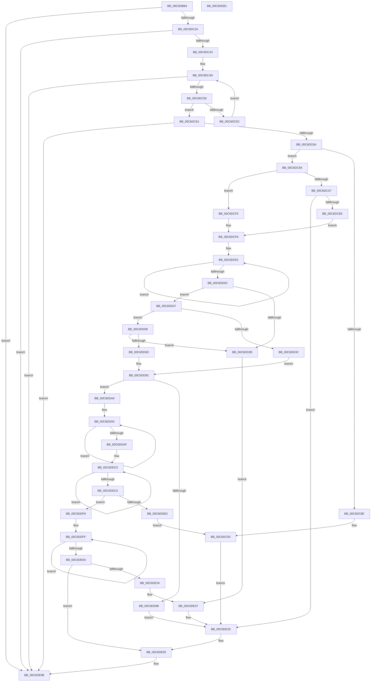

# VhdInitialize

- RVA: `0x00C6DBB4`–`0x00C6DEB2` (길이 `766` bytes)
- VA: `0x0000000140C6DBB4`
- 실행 섹션: `INIT`
- PDB 이름 있음: `예`; PDB Function 태그: `아니요`
- unwind 정보 RVA: `0x000B1698`
- 디코드: `209`개 명령, `766/766` bytes 표시
- 미해석 바이트: `0` (있으면 어셈블리에 `.byte`로 보존)

> 이 문서는 커널 이미지의 기계어와 PDB 기호를 분석해 생성했습니다. 4번과 5번은 함수 원형과 자료형을 바이너리 사용 방식에서 추정한 C 해석이며 원본 소스 복구 결과는 아닙니다.

## 1. Dependencies

- 직접 호출 지점: **16**; 고유 호출 대상: **12**
- 직접 호출자로 확인된 함수: **1**
- RIP 상대 이미지 참조: **9**

### Outgoing calls
- `0x00C6DBEE` → [memset](../../text/6C/memset_function_006C6C40.md) (function, `0x006C6C40`)
- `0x00C6DC1C` → [strstr](../../text/4F/strstr_function_004FF680.md) (function, `0x004FF680`)
- `0x00C6DC35` → [strstr](../../text/4F/strstr_function_004FF680.md) (function, `0x004FF680`)
- `0x00C6DC83` → [VhdiGetDiskParameters](VhdiGetDiskParameters_function_00C6DEB8.md) (function, `0x00C6DEB8`)
- `0x00C6DCDD` → [PnpBootDeviceWait](../../text/5A/PnpBootDeviceWait_function_005A4D68.md) (function, `0x005A4D68`)
- `0x00C6DD1E` → [ExAllocatePool2](../../poolcode/B8/ExAllocatePool2_function_00B820F0.md) (function, `0x00B820F0`)
- `0x00C6DD4F` → [RtlStringCbPrintfW](../../text/40/RtlStringCbPrintfW_function_0040FB40.md) (function, `0x0040FB40`)
- `0x00C6DD64` → [RtlStringFromGUID](../../page/91/RtlStringFromGUID_function_00914BA0.md) (function, `0x00914BA0`)
- `0x00C6DD81` → [RtlStringCbPrintfW](../../text/40/RtlStringCbPrintfW_function_0040FB40.md) (function, `0x0040FB40`)
- `0x00C6DD8D` → [RtlFreeAnsiString](../../page/9C/RtlFreeAnsiString_function_009C0800.md) (function, `0x009C0800`)
- `0x00C6DDB8` → [RtlStringCbCatW](../../text/45/RtlStringCbCatW_function_00453E24.md) (function, `0x00453E24`)
- `0x00C6DDDF` → [VhdiMountVhdFile](../../page/83/VhdiMountVhdFile_function_0083BED0.md) (function, `0x0083BED0`)
- `0x00C6DE25` → [ExAllocatePool2](../../poolcode/B8/ExAllocatePool2_function_00B820F0.md) (function, `0x00B820F0`)
- `0x00C6DE4F` → [KeBugCheckEx](../../text/4F/KeBugCheckEx_function_004FD660.md) (function, `0x004FD660`)
- `0x00C6DE64` → [memcpy](../../text/6C/memcpy_function_006C6840.md) (function, `0x006C6840`)
- `0x00C6DE82` → [memcpy](../../text/6C/memcpy_function_006C6840.md) (function, `0x006C6840`)

### Direct callers
- [IopInitializeBootDrivers](../C2/IopInitializeBootDrivers_function_00C2E6F4.md) at `0x00C2EE16`

### Static image references
- `0x00C6DBFA` → RVA `0x00C7E770` (` ?? ::PBOPGDP::`string'`; read)
- `0x00C6DC2E` → RVA `0x00C7E760` (` ?? ::PBOPGDP::`string'`; read)
- `0x00C6DCBE` → RVA `0x00C6E190` (`VhdiInitializeBootDisk`; read)
- `0x00C6DD40` → RVA `0x00C7E7B0` (` ?? ::PBOPGDP::`string'`; read)
- `0x00C6DD5D` → RVA `0x00027B10` (`.rdata`; read)
- `0x00C6DD77` → RVA `0x00C7E780` (` ?? ::PBOPGDP::`string'`; read)
- `0x00C6DDF6` → RVA `0x00EF00F0` (`.data`; write)
- `0x00C6DE8A` → RVA `0x00E0F19C` (`.data`; write)
- `0x00C6DE90` → RVA `0x00E0A668` (`.data`; write)

## 2. Other-region calls and transfers

- 다른 실행 섹션으로 향하는 call: **15**
  - `0x00C6DBEE` → [memset](../../text/6C/memset_function_006C6C40.md) (`INIT` → `.text`)
  - `0x00C6DC1C` → [strstr](../../text/4F/strstr_function_004FF680.md) (`INIT` → `.text`)
  - `0x00C6DC35` → [strstr](../../text/4F/strstr_function_004FF680.md) (`INIT` → `.text`)
  - `0x00C6DCDD` → [PnpBootDeviceWait](../../text/5A/PnpBootDeviceWait_function_005A4D68.md) (`INIT` → `.text`)
  - `0x00C6DD1E` → [ExAllocatePool2](../../poolcode/B8/ExAllocatePool2_function_00B820F0.md) (`INIT` → `POOLCODE`)
  - `0x00C6DD4F` → [RtlStringCbPrintfW](../../text/40/RtlStringCbPrintfW_function_0040FB40.md) (`INIT` → `.text`)
  - `0x00C6DD64` → [RtlStringFromGUID](../../page/91/RtlStringFromGUID_function_00914BA0.md) (`INIT` → `PAGE`)
  - `0x00C6DD81` → [RtlStringCbPrintfW](../../text/40/RtlStringCbPrintfW_function_0040FB40.md) (`INIT` → `.text`)
  - `0x00C6DD8D` → [RtlFreeAnsiString](../../page/9C/RtlFreeAnsiString_function_009C0800.md) (`INIT` → `PAGE`)
  - `0x00C6DDB8` → [RtlStringCbCatW](../../text/45/RtlStringCbCatW_function_00453E24.md) (`INIT` → `.text`)
  - `0x00C6DDDF` → [VhdiMountVhdFile](../../page/83/VhdiMountVhdFile_function_0083BED0.md) (`INIT` → `PAGE`)
  - `0x00C6DE25` → [ExAllocatePool2](../../poolcode/B8/ExAllocatePool2_function_00B820F0.md) (`INIT` → `POOLCODE`)
  - `0x00C6DE4F` → [KeBugCheckEx](../../text/4F/KeBugCheckEx_function_004FD660.md) (`INIT` → `.text`)
  - `0x00C6DE64` → [memcpy](../../text/6C/memcpy_function_006C6840.md) (`INIT` → `.text`)
  - `0x00C6DE82` → [memcpy](../../text/6C/memcpy_function_006C6840.md) (`INIT` → `.text`)
- 별도 외부 분기/꼬리 이동을 확인하지 못했습니다.

## 3. Assembly (complete function range)

```asm
00C6DBB4  40 55                           push rbp
00C6DBB6  53                              push rbx
00C6DBB7  56                              push rsi
00C6DBB8  57                              push rdi
00C6DBB9  41 54                           push r12
00C6DBBB  41 55                           push r13
00C6DBBD  41 56                           push r14
00C6DBBF  41 57                           push r15
00C6DBC1  48 8D 6C 24 E1                  lea rbp, [rsp - 0x1f]
00C6DBC6  48 81 EC F8 00 00 00            sub rsp, 0xf8
00C6DBCD  0F 57 C0                        xorps xmm0, xmm0
00C6DBD0  48 8B F1                        mov rsi, rcx
00C6DBD3  33 C0                           xor eax, eax
00C6DBD5  48 8D 4D 87                     lea rcx, [rbp - 0x79]
00C6DBD9  33 D2                           xor edx, edx
00C6DBDB  89 45 8B                        mov dword ptr [rbp - 0x75], eax
00C6DBDE  41 B8 8C 00 00 00               mov r8d, 0x8c
00C6DBE4  0F 11 44 24 40                  movups xmmword ptr [rsp + 0x40], xmm0
00C6DBE9  0F 11 44 24 50                  movups xmmword ptr [rsp + 0x50], xmm0
00C6DBEE  E8 4D 90 A5 FF                  call 0x1406c6c40
00C6DBF3  48 8B 8E B8 00 00 00            mov rcx, qword ptr [rsi + 0xb8]
00C6DBFA  48 8D 15 6F 0B 01 00            lea rdx, [rip + 0x10b6f]
00C6DC01  33 FF                           xor edi, edi
00C6DC03  0F 57 C0                        xorps xmm0, xmm0
00C6DC06  0F 11 44 24 30                  movups xmmword ptr [rsp + 0x30], xmm0
00C6DC0B  40 88 7D 67                     mov byte ptr [rbp + 0x67], dil
00C6DC0F  8B DF                           mov ebx, edi
00C6DC11  48 89 7D 77                     mov qword ptr [rbp + 0x77], rdi
00C6DC15  48 89 7D 7F                     mov qword ptr [rbp + 0x7f], rdi
00C6DC19  89 7D 6F                        mov dword ptr [rbp + 0x6f], edi
00C6DC1C  E8 5F 1A 89 FF                  call 0x1404ff680
00C6DC21  48 85 C0                        test rax, rax
00C6DC24  0F 84 71 02 00 00               je 0x140c6de9b
00C6DC2A  48 8D 48 01                     lea rcx, [rax + 1]
00C6DC2E  48 8D 15 2B 0B 01 00            lea rdx, [rip + 0x10b2b]
00C6DC35  E8 46 1A 89 FF                  call 0x1404ff680
00C6DC3A  48 85 C0                        test rax, rax
00C6DC3D  0F 84 58 02 00 00               je 0x140c6de9b
00C6DC43  48 8B 86 E8 00 00 00            mov rax, qword ptr [rsi + 0xe8]
00C6DC4A  48 8B 08                        mov rcx, qword ptr [rax]
00C6DC4D  48 3B C8                        cmp rcx, rax
00C6DC50  0F 84 45 02 00 00               je 0x140c6de9b
00C6DC56  48 39 79 38                     cmp qword ptr [rcx + 0x38], rdi
00C6DC5A  75 05                           jne 0x140c6dc61
00C6DC5C  48 8B 09                        mov rcx, qword ptr [rcx]
00C6DC5F  EB EC                           jmp 0x140c6dc4d
00C6DC61  48 85 C9                        test rcx, rcx
00C6DC64  0F 84 31 02 00 00               je 0x140c6de9b
00C6DC6A  48 8B 49 38                     mov rcx, qword ptr [rcx + 0x38]
00C6DC6E  48 8D 45 77                     lea rax, [rbp + 0x77]
00C6DC72  4C 8D 4D 67                     lea r9, [rbp + 0x67]
00C6DC76  48 89 44 24 20                  mov qword ptr [rsp + 0x20], rax
00C6DC7B  4C 8D 45 7F                     lea r8, [rbp + 0x7f]
00C6DC7F  48 8D 55 87                     lea rdx, [rbp - 0x79]
00C6DC83  E8 30 02 00 00                  call 0x140c6deb8
00C6DC88  8B D8                           mov ebx, eax
00C6DC8A  85 C0                           test eax, eax
00C6DC8C  79 0C                           jns 0x140c6dc9a
00C6DC8E  BF 01 00 00 00                  mov edi, 1
00C6DC93  33 C0                           xor eax, eax
00C6DC95  E9 A2 01 00 00                  jmp 0x140c6de3c
00C6DC9A  44 8A 65 67                     mov r12b, byte ptr [rbp + 0x67]
00C6DC9E  4C 8B 6D 77                     mov r13, qword ptr [rbp + 0x77]
00C6DCA2  45 84 E4                        test r12b, r12b
00C6DCA5  75 4E                           jne 0x140c6dcf5
00C6DCA7  48 8D 45 87                     lea rax, [rbp - 0x79]
00C6DCAB  4C 89 6C 24 50                  mov qword ptr [rsp + 0x50], r13
00C6DCB0  48 89 44 24 40                  mov qword ptr [rsp + 0x40], rax
00C6DCB5  4C 8D 4C 24 40                  lea r9, [rsp + 0x40]
00C6DCBA  48 8B 45 7F                     mov rax, qword ptr [rbp + 0x7f]
00C6DCBE  4C 8D 05 CB 04 00 00            lea r8, [rip + 0x4cb]
00C6DCC5  48 89 44 24 48                  mov qword ptr [rsp + 0x48], rax
00C6DCCA  BF 02 00 00 00                  mov edi, 2
00C6DCCF  48 8D 45 6F                     lea rax, [rbp + 0x6f]
00C6DCD3  8B D7                           mov edx, edi
00C6DCD5  48 8B CE                        mov rcx, rsi
00C6DCD8  48 89 44 24 58                  mov qword ptr [rsp + 0x58], rax
00C6DCDD  E8 86 70 93 FF                  call 0x1405a4d68
00C6DCE2  8B D8                           mov ebx, eax
00C6DCE4  33 C0                           xor eax, eax
00C6DCE6  85 DB                           test ebx, ebx
00C6DCE8  0F 88 4E 01 00 00               js 0x140c6de3c
00C6DCEE  8D 4F 48                        lea ecx, [rdi + 0x48]
00C6DCF1  33 FF                           xor edi, edi
00C6DCF3  EB 05                           jmp 0x140c6dcfa
00C6DCF5  B9 6E 00 00 00                  mov ecx, 0x6e
00C6DCFA  49 83 CF FF                     or r15, 0xffffffffffffffff
00C6DCFE  49 8B C7                        mov rax, r15
00C6DD01  48 FF C0                        inc rax
00C6DD04  66 41 39 7C 45 00               cmp word ptr [r13 + rax*2], di
00C6DD0A  75 F5                           jne 0x140c6dd01
00C6DD0C  8D 04 41                        lea eax, [rcx + rax*2]
00C6DD0F  41 B8 56 68 64 42               mov r8d, 0x42646856
00C6DD15  8B D0                           mov edx, eax
00C6DD17  B9 40 00 00 00                  mov ecx, 0x40
00C6DD1C  8B F8                           mov edi, eax
00C6DD1E  E8 CD 43 F1 FF                  call 0x140b820f0
00C6DD23  4C 8B F0                        mov r14, rax
00C6DD26  48 85 C0                        test rax, rax
00C6DD29  75 0C                           jne 0x140c6dd37
00C6DD2B  BF 03 00 00 00                  mov edi, 3
00C6DD30  33 C0                           xor eax, eax
00C6DD32  E9 00 01 00 00                  jmp 0x140c6de37
00C6DD37  45 84 E4                        test r12b, r12b
00C6DD3A  75 1C                           jne 0x140c6dd58
00C6DD3C  44 8B 4D 6F                     mov r9d, dword ptr [rbp + 0x6f]
00C6DD40  4C 8D 05 69 0A 01 00            lea r8, [rip + 0x10a69]
00C6DD47  BA 4A 00 00 00                  mov edx, 0x4a
00C6DD4C  49 8B CE                        mov rcx, r14
00C6DD4F  E8 EC 1D 7A FF                  call 0x14040fb40
00C6DD54  8B D8                           mov ebx, eax
00C6DD56  EB 3A                           jmp 0x140c6dd92
00C6DD58  48 8D 54 24 30                  lea rdx, [rsp + 0x30]
00C6DD5D  48 8D 0D AC 9D 3B FF            lea rcx, [rip - 0xc46254]
00C6DD64  E8 37 6E CA FF                  call 0x140914ba0
00C6DD69  85 C0                           test eax, eax
00C6DD6B  78 BE                           js 0x140c6dd2b
00C6DD6D  4C 8D 4C 24 30                  lea r9, [rsp + 0x30]
00C6DD72  BA 6E 00 00 00                  mov edx, 0x6e
00C6DD77  4C 8D 05 02 0A 01 00            lea r8, [rip + 0x10a02]
00C6DD7E  49 8B CE                        mov rcx, r14
00C6DD81  E8 BA 1D 7A FF                  call 0x14040fb40
00C6DD86  48 8D 4C 24 30                  lea rcx, [rsp + 0x30]
00C6DD8B  8B D8                           mov ebx, eax
00C6DD8D  E8 6E 2A D5 FF                  call 0x1409c0800
00C6DD92  33 C0                           xor eax, eax
00C6DD94  85 DB                           test ebx, ebx
00C6DD96  79 08                           jns 0x140c6dda0
00C6DD98  8D 78 04                        lea edi, [rax + 4]
00C6DD9B  E9 9C 00 00 00                  jmp 0x140c6de3c
00C6DDA0  49 8B F7                        mov rsi, r15
00C6DDA3  33 DB                           xor ebx, ebx
00C6DDA5  48 FF C6                        inc rsi
00C6DDA8  66 41 39 1C 76                  cmp word ptr [r14 + rsi*2], bx
00C6DDAD  75 F6                           jne 0x140c6dda5
00C6DDAF  4D 8B C5                        mov r8, r13
00C6DDB2  48 8B D7                        mov rdx, rdi
00C6DDB5  49 8B CE                        mov rcx, r14
00C6DDB8  E8 67 60 7E FF                  call 0x140453e24
00C6DDBD  49 8B D7                        mov rdx, r15
00C6DDC0  48 FF C2                        inc rdx
00C6DDC3  66 41 39 1C 56                  cmp word ptr [r14 + rdx*2], bx
00C6DDC8  75 F6                           jne 0x140c6ddc0
00C6DDCA  BF 01 00 00 00                  mov edi, 1
00C6DDCF  48 89 5C 24 20                  mov qword ptr [rsp + 0x20], rbx
00C6DDD4  44 8A CF                        mov r9b, dil
00C6DDD7  03 D2                           add edx, edx
00C6DDD9  45 33 C0                        xor r8d, r8d
00C6DDDC  49 8B CE                        mov rcx, r14
00C6DDDF  E8 EC E0 BC FF                  call 0x14083bed0
00C6DDE4  45 33 C0                        xor r8d, r8d
00C6DDE7  8B D8                           mov ebx, eax
00C6DDE9  85 C0                           test eax, eax
00C6DDEB  79 09                           jns 0x140c6ddf6
00C6DDED  41 8D 78 05                     lea edi, [r8 + 5]
00C6DDF1  E9 9D FE FF FF                  jmp 0x140c6dc93
00C6DDF6  4C 89 35 F3 22 28 00            mov qword ptr [rip + 0x2822f3], r14
00C6DDFD  FF CE                           dec esi
00C6DDFF  49 FF C7                        inc r15
00C6DE02  66 47 39 44 7D 00               cmp word ptr [r13 + r15*2], r8w
00C6DE08  75 F5                           jne 0x140c6ddff
00C6DE0A  41 8D 04 37                     lea eax, [r15 + rsi]
00C6DE0E  B9 40 00 00 00                  mov ecx, 0x40
00C6DE13  8D 04 45 0E 00 00 00            lea eax, [rax*2 + 0xe]
00C6DE1A  41 B8 56 68 64 42               mov r8d, 0x42646856
00C6DE20  8B D0                           mov edx, eax
00C6DE22  89 45 67                        mov dword ptr [rbp + 0x67], eax
00C6DE25  E8 C6 42 F1 FF                  call 0x140b820f0
00C6DE2A  4C 8B E0                        mov r12, rax
00C6DE2D  33 C0                           xor eax, eax
00C6DE2F  4D 85 E4                        test r12, r12
00C6DE32  75 21                           jne 0x140c6de55
00C6DE34  8D 78 07                        lea edi, [rax + 7]
00C6DE37  BB 17 00 00 C0                  mov ebx, 0xc0000017
00C6DE3C  4C 63 C3                        movsxd r8, ebx
00C6DE3F  45 33 C9                        xor r9d, r9d
00C6DE42  48 8B D7                        mov rdx, rdi
00C6DE45  48 89 44 24 20                  mov qword ptr [rsp + 0x20], rax
00C6DE4A  B9 2F 01 00 00                  mov ecx, 0x12f
00C6DE4F  E8 0C F8 88 FF                  call 0x1404fd660
00C6DE54  CC                              int3
00C6DE55  44 8B C6                        mov r8d, esi
00C6DE58  49 8D 56 02                     lea rdx, [r14 + 2]
00C6DE5C  4D 03 C0                        add r8, r8
00C6DE5F  49 8D 4C 24 08                  lea rcx, [r12 + 8]
00C6DE64  E8 D7 89 A5 FF                  call 0x1406c6840
00C6DE69  8D 0C 75 0A 00 00 00            lea ecx, [rsi*2 + 0xa]
00C6DE70  49 8B D5                        mov rdx, r13
00C6DE73  41 89 4C 24 04                  mov dword ptr [r12 + 4], ecx
00C6DE78  45 8D 47 01                     lea r8d, [r15 + 1]
00C6DE7C  49 03 CC                        add rcx, r12
00C6DE7F  4D 03 C0                        add r8, r8
00C6DE82  E8 B9 89 A5 FF                  call 0x1406c6840
00C6DE87  8B 45 67                        mov eax, dword ptr [rbp + 0x67]
00C6DE8A  89 05 0C 13 1A 00               mov dword ptr [rip + 0x1a130c], eax
00C6DE90  4C 89 25 D1 C7 19 00            mov qword ptr [rip + 0x19c7d1], r12
00C6DE97  41 88 3C 24                     mov byte ptr [r12], dil
00C6DE9B  8B C3                           mov eax, ebx
00C6DE9D  48 81 C4 F8 00 00 00            add rsp, 0xf8
00C6DEA4  41 5F                           pop r15
00C6DEA6  41 5E                           pop r14
00C6DEA8  41 5D                           pop r13
00C6DEAA  41 5C                           pop r12
00C6DEAC  5F                              pop rdi
00C6DEAD  5E                              pop rsi
00C6DEAE  5B                              pop rbx
00C6DEAF  5D                              pop rbp
00C6DEB0  C3                              ret
00C6DEB1  CC                              int3
```

## 4. C-style interpretation (structured pseudocode)

```c
__int64 __fastcall VhdInitialize(__int64 a1, int a2)
{
    __int64 result;
    __int64 v_r15;
    __int64 v_rbx;
    __int64 v_rdi;
    __int64 v_rsi;
    __int64 v_rsp;
    unsigned __int64 v_stack_m108;
    unsigned __int64 v_stack_m118;
    unsigned __int64 v_stack_m5F;
    unsigned int v_stack_mD4;
    unsigned __int64 v_stack_mD8;
    unsigned __int64 v_stack_mE0;
    unsigned __int64 v_stack_mE8;
    unsigned __int64 v_stack_mF0;
    unsigned __int64 v_stack_mF8;
    unsigned int v_stack_p10;
    unsigned __int64 v_stack_p18;
    unsigned __int64 v_stack_p20;
    unsigned __int8 v_stack_p8;

    v_rsp = (v_rsp) - (248);
    result = 0;
    a2 = 0;
    v_stack_mD4 = 0;
    v_stack_mF8 = v_xmm0;
    v_stack_mE8 = v_xmm0;
    result = memset(v_stack_mD8, a2, 140, a4);
    v_rdi = 0;
    v_stack_m108 = v_xmm0;
    v_stack_p8 = 0;
    v_stack_p18 = 0;
    v_stack_p20 = 0;
    v_stack_p10 = 0;
    result = strstr(*(unsigned __int64 *)(a1 + 184), v_rip + 68463, 140, a4);
    if (result == 0) goto loc_00C6DE9B;
    result = strstr(result + 1, v_rip + 68395, 140, a4);
    if (result == 0) goto loc_00C6DE9B;
loc_00C6DC4D:
    if ((*(unsigned __int64 *)(*(unsigned __int64 *)(a1 + 232))) == (*(unsigned __int64 *)(a1 + 232))) goto loc_00C6DE9B;
    if ((*(unsigned __int64 *)(*(unsigned __int64 *)(*(unsigned __int64 *)(a1 + 232)) + 56)) != 0) goto loc_00C6DC61;
    goto loc_00C6DC4D;
loc_00C6DC61:
    if (*(unsigned __int64 *)(*(unsigned __int64 *)(*(unsigned __int64 *)(a1 + 232))) == 0) goto loc_00C6DE9B;
    v_stack_m118 = v_stack_p18;
    result = VhdiGetDiskParameters(*(unsigned __int64 *)(*(unsigned __int64 *)(*(unsigned __int64 *)(*(unsigned __int64 *)(a1 + 232))) + 56), v_stack_mD8, v_stack_p20, v_stack_p8);
    if (!sign_flag) goto loc_00C6DC9A;
loc_00C6DC93:
    result = 0;
    goto loc_00C6DE3C;
loc_00C6DC9A:
    if ((unsigned __int8)(v_stack_p8) != 0) goto loc_00C6DCF5;
    v_stack_mE8 = v_stack_p18;
    v_stack_mF8 = v_stack_mD8;
    v_stack_mF0 = v_stack_p20;
    v_stack_mE0 = v_stack_p10;
    result = PnpBootDeviceWait(a1, 2, v_rip + 1227, v_stack_mF8);
    result = 0;
    if (sign_flag) goto loc_00C6DE3C;
    v_rdi = 0;
    goto loc_00C6DCFA;
loc_00C6DCF5:
loc_00C6DCFA:
    v_r15 = (v_r15) | (-1);
loc_00C6DD01:
    result = (v_r15) + 1;
    if ((*(unsigned __int16 *)(v_stack_p18 + result * 2)) != 0) goto loc_00C6DD01;
    result = ExAllocatePool2(64, (unsigned int)((unsigned int)(110 + result * 2)), (unsigned int)(0x42646856ULL), v_stack_mF8);
    if (result != 0) goto loc_00C6DD37;
loc_00C6DD2B:
    result = 0;
    goto loc_00C6DE37;
loc_00C6DD37:
    if ((unsigned __int8)(v_stack_p8) != 0) goto loc_00C6DD58;
    result = RtlStringCbPrintfW(0, 74, v_rip + 68201, (unsigned int)(v_stack_p10));
    goto loc_00C6DD92;
loc_00C6DD58:
    result = RtlStringFromGUID(v_rip - 12870228, v_stack_m108, v_rip + 68201, (unsigned int)(v_stack_p10));
    if (sign_flag) goto loc_00C6DD2B;
    result = RtlStringCbPrintfW(result, 110, v_rip + 68098, v_stack_m108);
    result = RtlFreeAnsiString(v_stack_m108, 110, v_rip + 68098, v_stack_m108);
loc_00C6DD92:
    result = 0;
    if (!sign_flag) goto loc_00C6DDA0;
    goto loc_00C6DE3C;
loc_00C6DDA0:
    v_rbx = 0;
loc_00C6DDA5:
    v_rsi = (v_r15) + 1;
    if ((*(unsigned __int16 *)(result + v_rsi * 2)) != 0) goto loc_00C6DDA5;
    result = RtlStringCbCatW(0, result + 4, v_stack_p18, v_stack_m108);
loc_00C6DDC0:
    a2 = (v_r15) + 1;
    if ((*(unsigned __int16 *)(result + a2 * 2)) != 0) goto loc_00C6DDC0;
    v_stack_m118 = 0;
    a2 = (unsigned int)((a2) + (a2));
    a3 = 0;
    result = VhdiMountVhdFile(result, a2, a3, 1);
    a3 = 0;
    if (!sign_flag) goto loc_00C6DDF6;
    goto loc_00C6DC93;
loc_00C6DDF6:
    *(unsigned __int64 *)(v_rip + 2630387) = result;
    v_rsi = (unsigned int)((v_rsi) - 1);
loc_00C6DDFF:
    v_r15 = (v_r15) + 1;
    if ((*(unsigned __int16 *)(v_stack_p18 + v_r15 * 2)) != 0) goto loc_00C6DDFF;
    v_stack_p8 = (unsigned int)(v_r15 + v_rsi * 1 * 2 + 14);
    result = ExAllocatePool2(64, (unsigned int)((unsigned int)(v_r15 + v_rsi * 1 * 2 + 14)), (unsigned int)(0x42646856ULL), 1);
    result = 0;
    if (0 != 0) goto loc_00C6DE55;
loc_00C6DE37:
loc_00C6DE3C:
    a4 = 0;
    v_stack_m118 = 0;
    result = KeBugCheckEx(303, result + 7, (int)((unsigned int)((unsigned int)(0xC0000017ULL))), a4);
loc_00C6DE55:
    a3 = ((unsigned int)((unsigned int)(v_rsi))) + ((unsigned int)((unsigned int)(v_rsi)));
    result = memcpy(result + 8, result + 2, a3, a4);
    *(unsigned int *)(result + 4) = (unsigned int)(v_rsi * 2 + 10);
    a1 = (v_rsi * 2 + 10) + (result);
    a3 = (v_r15 + 1) + (v_r15 + 1);
    result = memcpy(a1, v_stack_p18, a3, a4);
    *(unsigned int *)(v_rip + 1708812) = (unsigned int)((unsigned int)(v_stack_p8));
    *(unsigned __int64 *)(v_rip + 1689553) = result;
    *(unsigned __int8 *)(result) = (unsigned __int8)(result + 7);
loc_00C6DE9B:
    v_rsp = (v_rsp) + (248);
    return (unsigned int)((unsigned int)((unsigned int)(0xC0000017ULL)));
}
```

## 5. (Beta) C Style

```c
int64_t VhdInitialize(void *Arg1, int32_t Arg2)
{
    uint8_t *arg1 = (uint8_t *)Arg1;

    int64_t result;
    int64_t local_r15;
    int64_t local_rbx;
    int64_t local_rdi;
    int64_t local_rsi;
    int64_t local_rsp;
    uint64_t v_stack_m108;
    uint64_t v_stack_m118;
    uint64_t v_stack_m5F;
    uint32_t v_stack_mD4;
    uint64_t v_stack_mD8;
    uint64_t v_stack_mE0;
    uint64_t v_stack_mE8;
    uint64_t v_stack_mF0;
    uint64_t v_stack_mF8;
    uint32_t v_stack_p10;
    uint64_t v_stack_p18;
    uint64_t v_stack_p20;
    uint8_t v_stack_p8;

    local_rsp = (local_rsp) - (248);
    result = 0;
    Arg2 = 0;
    v_stack_mD4 = 0;
    v_stack_mF8 = v_xmm0;
    v_stack_mE8 = v_xmm0;
    result = memset(v_stack_mD8, Arg2, 140, a4);
    local_rdi = 0;
    v_stack_m108 = v_xmm0;
    v_stack_p8 = 0;
    v_stack_p18 = 0;
    v_stack_p20 = 0;
    v_stack_p10 = 0;
    result = strstr(*(uint64_t *)(arg1 + 0xB8), v_rip + 68463, 140, a4);
    if (result == 0) goto loc_00C6DE9B;
    result = strstr(result + 1, v_rip + 68395, 140, a4);
    if (result == 0) goto loc_00C6DE9B;
loc_00C6DC4D:
    if ((*(uint64_t *)(*(uint64_t *)(arg1 + 0xE8))) == (*(uint64_t *)(arg1 + 0xE8))) goto loc_00C6DE9B;
    if ((*(uint64_t *)(*(uint64_t *)(*(uint64_t *)(arg1 + 0xE8)) + 0x38)) != 0) goto loc_00C6DC61;
    goto loc_00C6DC4D;
loc_00C6DC61:
    if (*(uint64_t *)(*(uint64_t *)(*(uint64_t *)(arg1 + 0xE8))) == 0) goto loc_00C6DE9B;
    v_stack_m118 = v_stack_p18;
    result = VhdiGetDiskParameters(*(uint64_t *)(*(uint64_t *)(*(uint64_t *)(*(uint64_t *)(arg1 + 0xE8))) + 0x38), v_stack_mD8, v_stack_p20, v_stack_p8);
    if (!sign_flag) goto loc_00C6DC9A;
loc_00C6DC93:
    result = 0;
    goto loc_00C6DE3C;
loc_00C6DC9A:
    if ((uint8_t)(v_stack_p8) != 0) goto loc_00C6DCF5;
    v_stack_mE8 = v_stack_p18;
    v_stack_mF8 = v_stack_mD8;
    v_stack_mF0 = v_stack_p20;
    v_stack_mE0 = v_stack_p10;
    result = PnpBootDeviceWait(Arg1, 2, v_rip + 1227, v_stack_mF8);
    result = 0;
    if (sign_flag) goto loc_00C6DE3C;
    local_rdi = 0;
    goto loc_00C6DCFA;
loc_00C6DCF5:
loc_00C6DCFA:
    local_r15 = (local_r15) | (-1);
loc_00C6DD01:
    result = (local_r15) + 1;
    if ((*(uint16_t *)(v_stack_p18 + result * 2)) != 0) goto loc_00C6DD01;
    result = ExAllocatePool2(64, (uint32_t)((uint32_t)(110 + result * 2)), (uint32_t)(0x42646856ULL), v_stack_mF8);
    if (result != 0) goto loc_00C6DD37;
loc_00C6DD2B:
    result = 0;
    goto loc_00C6DE37;
loc_00C6DD37:
    if ((uint8_t)(v_stack_p8) != 0) goto loc_00C6DD58;
    result = RtlStringCbPrintfW(0, 74, v_rip + 68201, (uint32_t)(v_stack_p10));
    goto loc_00C6DD92;
loc_00C6DD58:
    result = RtlStringFromGUID(v_rip - 12870228, v_stack_m108, v_rip + 68201, (uint32_t)(v_stack_p10));
    if (sign_flag) goto loc_00C6DD2B;
    result = RtlStringCbPrintfW(result, 110, v_rip + 68098, v_stack_m108);
    result = RtlFreeAnsiString(v_stack_m108, 110, v_rip + 68098, v_stack_m108);
loc_00C6DD92:
    result = 0;
    if (!sign_flag) goto loc_00C6DDA0;
    goto loc_00C6DE3C;
loc_00C6DDA0:
    local_rbx = 0;
loc_00C6DDA5:
    local_rsi = (local_r15) + 1;
    if ((*(uint16_t *)(result + local_rsi * 2)) != 0) goto loc_00C6DDA5;
    result = RtlStringCbCatW(0, result + 4, v_stack_p18, v_stack_m108);
loc_00C6DDC0:
    Arg2 = (local_r15) + 1;
    if ((*(uint16_t *)(result + Arg2 * 2)) != 0) goto loc_00C6DDC0;
    v_stack_m118 = 0;
    Arg2 = (uint32_t)((Arg2) + (Arg2));
    a3 = 0;
    result = VhdiMountVhdFile(result, Arg2, a3, 1);
    a3 = 0;
    if (!sign_flag) goto loc_00C6DDF6;
    goto loc_00C6DC93;
loc_00C6DDF6:
    *(uint64_t *)(v_rip + 0x2822F3) = result;
    local_rsi = (uint32_t)((local_rsi) - 1);
loc_00C6DDFF:
    local_r15 = (local_r15) + 1;
    if ((*(uint16_t *)(v_stack_p18 + local_r15 * 2)) != 0) goto loc_00C6DDFF;
    v_stack_p8 = (uint32_t)(local_r15 + local_rsi * 1 * 2 + 14);
    result = ExAllocatePool2(64, (uint32_t)((uint32_t)(local_r15 + local_rsi * 1 * 2 + 14)), (uint32_t)(0x42646856ULL), 1);
    result = 0;
    if (0 != 0) goto loc_00C6DE55;
loc_00C6DE37:
loc_00C6DE3C:
    a4 = 0;
    v_stack_m118 = 0;
    result = KeBugCheckEx(303, result + 7, (int32_t)((uint32_t)((uint32_t)(0xC0000017ULL))), a4);
loc_00C6DE55:
    a3 = ((uint32_t)((uint32_t)(local_rsi))) + ((uint32_t)((uint32_t)(local_rsi)));
    result = memcpy(result + 8, result + 2, a3, a4);
    *(uint32_t *)(result + 0x4) = (uint32_t)(local_rsi * 2 + 10);
    Arg1 = (local_rsi * 2 + 10) + (result);
    a3 = (local_r15 + 1) + (local_r15 + 1);
    result = memcpy(Arg1, v_stack_p18, a3, a4);
    *(uint32_t *)(v_rip + 0x1A130C) = (uint32_t)((uint32_t)(v_stack_p8));
    *(uint64_t *)(v_rip + 0x19C7D1) = result;
    *(uint8_t *)(result) = (uint8_t)(result + 7);
loc_00C6DE9B:
    local_rsp = (local_rsp) + (248);
    return (uint32_t)((uint32_t)((uint32_t)(0xC0000017ULL)));
}
```

### 관측된 메모리 오프셋

구조체 형식이 확인되지 않은 접근은 인자 기준의 오프셋으로만 기록했습니다.

| 기준 인자 | 오프셋 표현 | 폭 (bit) | 접근 |
|---|---:|---:|---|
| `Arg1` | `+ 0xB8` | `64` | `R` |
| `Arg1` | `+ 0xE8` | `64` | `R` |

## 6. Execution-region graph

[열기: 2D/3D 그래프와 함수 탐색 컨트롤 패널](../../../control-panel.html?section=init&rva=0x00C6DBB4&view=graph)

- 2D 그래프는 위에서 아래로 흐르고, 3D 그래프는 빈 공간을 드래그해 회전합니다. Shift+드래그는 이동, 휠은 확대·축소, 함수 노드 선택은 대상 보고서 이동입니다.

### Static fallback


