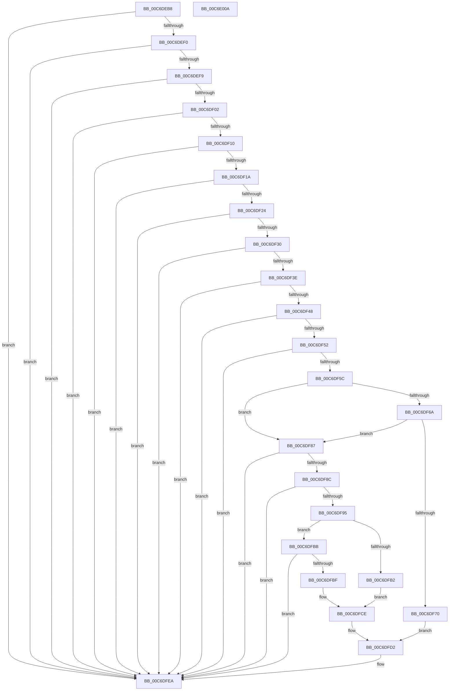

# VhdiGetDiskParameters

- RVA: `0x00C6DEB8`–`0x00C6E00B` (길이 `339` bytes)
- VA: `0x0000000140C6DEB8`
- 실행 섹션: `INIT`
- PDB 이름 있음: `예`; PDB Function 태그: `아니요`
- unwind 정보 RVA: `0x000855B4`
- 디코드: `97`개 명령, `339/339` bytes 표시
- 미해석 바이트: `0` (있으면 어셈블리에 `.byte`로 보존)

> 이 문서는 커널 이미지의 기계어와 PDB 기호를 분석해 생성했습니다. 4번과 5번은 함수 원형과 자료형을 바이너리 사용 방식에서 추정한 C 해석이며 원본 소스 복구 결과는 아닙니다.

## 1. Dependencies

- 직접 호출 지점: **2**; 고유 호출 대상: **1**
- 직접 호출자로 확인된 함수: **2**
- RIP 상대 이미지 참조: **0**

### Outgoing calls
- `0x00C6DF7E` → [memset](../../text/6C/memset_function_006C6C40.md) (function, `0x006C6C40`)
- `0x00C6DFA0` → [memset](../../text/6C/memset_function_006C6C40.md) (function, `0x006C6C40`)

### Direct callers
- [IopGetBootDiskInformationLite](../C2/IopGetBootDiskInformationLite_function_00C2DF64.md) at `0x00C2E16F`
- [VhdInitialize](VhdInitialize_function_00C6DBB4.md) at `0x00C6DC83`

### Static image references
- 디코드된 RIP-relative 메모리 참조가 없습니다.

## 2. Other-region calls and transfers

- 다른 실행 섹션으로 향하는 call: **2**
  - `0x00C6DF7E` → [memset](../../text/6C/memset_function_006C6C40.md) (`INIT` → `.text`)
  - `0x00C6DFA0` → [memset](../../text/6C/memset_function_006C6C40.md) (`INIT` → `.text`)
- 별도 외부 분기/꼬리 이동을 확인하지 못했습니다.

## 3. Assembly (complete function range)

```asm
00C6DEB8  48 8B C4                        mov rax, rsp
00C6DEBB  48 89 58 08                     mov qword ptr [rax + 8], rbx
00C6DEBF  48 89 68 10                     mov qword ptr [rax + 0x10], rbp
00C6DEC3  48 89 70 18                     mov qword ptr [rax + 0x18], rsi
00C6DEC7  4C 89 48 20                     mov qword ptr [rax + 0x20], r9
00C6DECB  57                              push rdi
00C6DECC  41 54                           push r12
00C6DECE  41 55                           push r13
00C6DED0  41 56                           push r14
00C6DED2  41 57                           push r15
00C6DED4  48 83 EC 20                     sub rsp, 0x20
00C6DED8  4D 8B F8                        mov r15, r8
00C6DEDB  48 8B F2                        mov rsi, rdx
00C6DEDE  48 8B D9                        mov rbx, rcx
00C6DEE1  41 BC 0D 00 00 C0               mov r12d, 0xc000000d
00C6DEE7  48 85 C9                        test rcx, rcx
00C6DEEA  0F 84 FA 00 00 00               je 0x140c6dfea
00C6DEF0  48 85 D2                        test rdx, rdx
00C6DEF3  0F 84 F1 00 00 00               je 0x140c6dfea
00C6DEF9  4D 85 C0                        test r8, r8
00C6DEFC  0F 84 E8 00 00 00               je 0x140c6dfea
00C6DF02  4C 8B 6C 24 70                  mov r13, qword ptr [rsp + 0x70]
00C6DF07  4D 85 ED                        test r13, r13
00C6DF0A  0F 84 DA 00 00 00               je 0x140c6dfea
00C6DF10  83 79 04 06                     cmp dword ptr [rcx + 4], 6
00C6DF14  0F 85 D0 00 00 00               jne 0x140c6dfea
00C6DF1A  83 79 24 06                     cmp dword ptr [rcx + 0x24], 6
00C6DF1E  0F 85 C6 00 00 00               jne 0x140c6dfea
00C6DF24  8B 49 0C                        mov ecx, dword ptr [rcx + 0xc]
00C6DF27  83 F9 5C                        cmp ecx, 0x5c
00C6DF2A  0F 82 BA 00 00 00               jb 0x140c6dfea
00C6DF30  8B 43 44                        mov eax, dword ptr [rbx + 0x44]
00C6DF33  83 C0 38                        add eax, 0x38
00C6DF36  3B C8                           cmp ecx, eax
00C6DF38  0F 82 AC 00 00 00               jb 0x140c6dfea
00C6DF3E  83 7B 3C 00                     cmp dword ptr [rbx + 0x3c], 0
00C6DF42  0F 85 A2 00 00 00               jne 0x140c6dfea
00C6DF48  83 7B 4C 05                     cmp dword ptr [rbx + 0x4c], 5
00C6DF4C  0F 85 98 00 00 00               jne 0x140c6dfea
00C6DF52  83 7B 58 05                     cmp dword ptr [rbx + 0x58], 5
00C6DF56  0F 85 8E 00 00 00               jne 0x140c6dfea
00C6DF5C  48 8D 7B 5C                     lea rdi, [rbx + 0x5c]
00C6DF60  8B 07                           mov eax, dword ptr [rdi]
00C6DF62  4C 8D 77 10                     lea r14, [rdi + 0x10]
00C6DF66  85 C0                           test eax, eax
00C6DF68  75 1D                           jne 0x140c6df87
00C6DF6A  41 83 3E 03                     cmp dword ptr [r14], 3
00C6DF6E  75 17                           jne 0x140c6df87
00C6DF70  33 D2                           xor edx, edx
00C6DF72  41 B8 90 00 00 00               mov r8d, 0x90
00C6DF78  48 8B CE                        mov rcx, rsi
00C6DF7B  40 B5 01                        mov bpl, 1
00C6DF7E  E8 BD 8C A5 FF                  call 0x1406c6c40
00C6DF83  33 C0                           xor eax, eax
00C6DF85  EB 4B                           jmp 0x140c6dfd2
00C6DF87  83 F8 06                        cmp eax, 6
00C6DF8A  75 5E                           jne 0x140c6dfea
00C6DF8C  40 32 ED                        xor bpl, bpl
00C6DF8F  83 7F 20 00                     cmp dword ptr [rdi + 0x20], 0
00C6DF93  75 55                           jne 0x140c6dfea
00C6DF95  33 D2                           xor edx, edx
00C6DF97  41 B8 90 00 00 00               mov r8d, 0x90
00C6DF9D  48 8B CE                        mov rcx, rsi
00C6DFA0  E8 9B 8C A5 FF                  call 0x1406c6c40
00C6DFA5  8B 03                           mov eax, dword ptr [rbx]
00C6DFA7  89 46 18                        mov dword ptr [rsi + 0x18], eax
00C6DFAA  8B 47 24                        mov eax, dword ptr [rdi + 0x24]
00C6DFAD  83 F8 01                        cmp eax, 1
00C6DFB0  75 09                           jne 0x140c6dfbb
00C6DFB2  49 8B 06                        mov rax, qword ptr [r14]
00C6DFB5  48 89 46 08                     mov qword ptr [rsi + 8], rax
00C6DFB9  EB 13                           jmp 0x140c6dfce
00C6DFBB  85 C0                           test eax, eax
00C6DFBD  75 2B                           jne 0x140c6dfea
00C6DFBF  C7 06 01 00 00 00               mov dword ptr [rsi], 1
00C6DFC5  41 0F 10 06                     movups xmm0, xmmword ptr [r14]
00C6DFC9  F3 0F 7F 46 30                  movdqu xmmword ptr [rsi + 0x30], xmm0
00C6DFCE  48 8D 47 28                     lea rax, [rdi + 0x28]
00C6DFD2  49 89 07                        mov qword ptr [r15], rax
00C6DFD5  8B 47 08                        mov eax, dword ptr [rdi + 8]
00C6DFD8  48 03 C7                        add rax, rdi
00C6DFDB  49 89 45 00                     mov qword ptr [r13], rax
00C6DFDF  45 33 E4                        xor r12d, r12d
00C6DFE2  48 8B 44 24 68                  mov rax, qword ptr [rsp + 0x68]
00C6DFE7  40 88 28                        mov byte ptr [rax], bpl
00C6DFEA  48 8B 5C 24 50                  mov rbx, qword ptr [rsp + 0x50]
00C6DFEF  41 8B C4                        mov eax, r12d
00C6DFF2  48 8B 6C 24 58                  mov rbp, qword ptr [rsp + 0x58]
00C6DFF7  48 8B 74 24 60                  mov rsi, qword ptr [rsp + 0x60]
00C6DFFC  48 83 C4 20                     add rsp, 0x20
00C6E000  41 5F                           pop r15
00C6E002  41 5E                           pop r14
00C6E004  41 5D                           pop r13
00C6E006  41 5C                           pop r12
00C6E008  5F                              pop rdi
00C6E009  C3                              ret
00C6E00A  CC                              int3
```

## 4. C-style interpretation (structured pseudocode)

```c
__int64 __fastcall VhdiGetDiskParameters(__int64 a1, __int64 a2, __int64 a3, __int64 a4, __int64 a5)
{
    __int64 result;
    __int64 v_r12;
    __int64 v_rbp;
    __int64 v_rsp;
    unsigned __int64 v_stack_p10;
    unsigned __int64 v_stack_p18;
    unsigned __int64 v_stack_p20;
    unsigned __int64 v_stack_p8;

    *(unsigned __int64 *)(v_rsp + 8) = v_rbx;
    *(unsigned __int64 *)(v_rsp + 16) = v_rbp;
    *(unsigned __int64 *)(v_rsp + 24) = v_rsi;
    *(unsigned __int64 *)(v_rsp + 32) = a4;
    v_rsp = (v_rsp) - (32);
    if (a1 == 0) goto loc_00C6DFEA;
    if (a2 == 0) goto loc_00C6DFEA;
    if (a3 == 0) goto loc_00C6DFEA;
    if (a5 == 0) goto loc_00C6DFEA;
    if ((*(unsigned int *)(a1 + 4)) != 6) goto loc_00C6DFEA;
    if ((*(unsigned int *)(a1 + 36)) != 6) goto loc_00C6DFEA;
    if (((unsigned int)((unsigned int)(*(unsigned int *)(a1 + 12)))) < 92) goto loc_00C6DFEA;
    result = (unsigned int)(((unsigned int)(*(unsigned int *)(a1 + 68))) + (56));
    if (((unsigned int)((unsigned int)(*(unsigned int *)(a1 + 12)))) < ((unsigned int)(result))) goto loc_00C6DFEA;
    if ((*(unsigned int *)(a1 + 60)) != 0) goto loc_00C6DFEA;
    if ((*(unsigned int *)(a1 + 76)) != 5) goto loc_00C6DFEA;
    if ((*(unsigned int *)(a1 + 88)) != 5) goto loc_00C6DFEA;
    if ((unsigned int)((unsigned int)(*(unsigned int *)(a1 + 92))) != 0) goto loc_00C6DF87;
    if ((*(unsigned int *)(a1 + 92 + 16)) != 3) goto loc_00C6DF87;
    a2 = 0;
    result = memset(0, a2, 144, a4);
    result = 0;
    goto loc_00C6DFD2;
loc_00C6DF87:
    if (0 != 6) goto loc_00C6DFEA;
    v_rbp = 0;
    if ((*(unsigned int *)(a1 + 92 + 32)) != 0) goto loc_00C6DFEA;
    a2 = 0;
    result = memset(0, a2, 144, a4);
    *(unsigned int *)(a2 + 24) = (unsigned int)((unsigned int)(*(unsigned int *)(a1)));
    if (((unsigned int)((unsigned int)(*(unsigned int *)(a1 + 92 + 36)))) != 1) goto loc_00C6DFBB;
    *(unsigned __int64 *)(a2 + 8) = *(unsigned __int64 *)(a1 + 92 + 16);
    goto loc_00C6DFCE;
loc_00C6DFBB:
    if ((unsigned int)(*(unsigned __int64 *)(a1 + 92 + 16)) != 0) goto loc_00C6DFEA;
    *(unsigned int *)(a2) = 1;
    *(unsigned __int64 *)(a2 + 48) = v_xmm0;
loc_00C6DFCE:
loc_00C6DFD2:
    *(unsigned __int64 *)(a3) = a1 + 92 + 40;
    result = ((unsigned int)(*(unsigned int *)(a1 + 92 + 8))) + (a1 + 92);
    *(unsigned __int64 *)(a5) = result;
    v_r12 = 0;
    *(unsigned __int8 *)(v_stack_p20) = 0;
loc_00C6DFEA:
    v_rsp = (v_rsp) + (32);
    return 0;
}
```

## 5. (Beta) C Style

```c
int64_t VhdiGetDiskParameters(void *Arg1, void *Arg2, void *Arg3, int64_t Arg4, int64_t Arg5)
{
    uint8_t *arg1 = (uint8_t *)Arg1;
    uint8_t *arg2 = (uint8_t *)Arg2;
    uint8_t *arg3 = (uint8_t *)Arg3;

    int64_t result;
    int64_t local_r12;
    int64_t local_rbp;
    int64_t local_rsp;
    uint64_t v_stack_p10;
    uint64_t v_stack_p18;
    uint64_t v_stack_p20;
    uint64_t v_stack_p8;

    *(uint64_t *)(local_rsp + 0x8) = local_rbx;
    *(uint64_t *)(local_rsp + 0x10) = local_rbp;
    *(uint64_t *)(local_rsp + 0x18) = local_rsi;
    *(uint64_t *)(local_rsp + 0x20) = Arg4;
    local_rsp = (local_rsp) - (32);
    if (Arg1 == NULL) goto loc_00C6DFEA;
    if (Arg2 == NULL) goto loc_00C6DFEA;
    if (Arg3 == NULL) goto loc_00C6DFEA;
    if (Arg5 == 0) goto loc_00C6DFEA;
    if ((*(uint32_t *)(arg1 + 0x4)) != 6) goto loc_00C6DFEA;
    if ((*(uint32_t *)(arg1 + 0x24)) != 6) goto loc_00C6DFEA;
    if (((uint32_t)((uint32_t)(*(uint32_t *)(arg1 + 0xC)))) < 92) goto loc_00C6DFEA;
    result = (uint32_t)(((uint32_t)(*(uint32_t *)(arg1 + 0x44))) + (56));
    if (((uint32_t)((uint32_t)(*(uint32_t *)(arg1 + 0xC)))) < ((uint32_t)(result))) goto loc_00C6DFEA;
    if ((*(uint32_t *)(arg1 + 0x3C)) != 0) goto loc_00C6DFEA;
    if ((*(uint32_t *)(arg1 + 0x4C)) != 5) goto loc_00C6DFEA;
    if ((*(uint32_t *)(arg1 + 0x58)) != 5) goto loc_00C6DFEA;
    if ((uint32_t)((uint32_t)(*(uint32_t *)(arg1 + 0x5C))) != 0) goto loc_00C6DF87;
    if ((*(uint32_t *)(arg1 + 0x5C + 0x10)) != 3) goto loc_00C6DF87;
    Arg2 = 0;
    result = memset(0, Arg2, 144, Arg4);
    result = 0;
    goto loc_00C6DFD2;
loc_00C6DF87:
    if (0 != 6) goto loc_00C6DFEA;
    local_rbp = 0;
    if ((*(uint32_t *)(arg1 + 0x5C + 0x20)) != 0) goto loc_00C6DFEA;
    Arg2 = 0;
    result = memset(0, Arg2, 144, Arg4);
    *(uint32_t *)(arg2 + 0x18) = (uint32_t)((uint32_t)(*(uint32_t *)(arg1)));
    if (((uint32_t)((uint32_t)(*(uint32_t *)(arg1 + 0x5C + 0x24)))) != 1) goto loc_00C6DFBB;
    *(uint64_t *)(arg2 + 0x8) = *(uint64_t *)(arg1 + 0x5C + 0x10);
    goto loc_00C6DFCE;
loc_00C6DFBB:
    if ((uint32_t)(*(uint64_t *)(arg1 + 0x5C + 0x10)) != 0) goto loc_00C6DFEA;
    *(uint32_t *)(arg2) = 1;
    *(uint64_t *)(arg2 + 0x30) = v_xmm0;
loc_00C6DFCE:
loc_00C6DFD2:
    *(void **)(arg3) = Arg1 + 92 + 40;
    result = ((uint32_t)(*(uint32_t *)(arg1 + 0x5C + 0x8))) + (Arg1 + 92);
    *(uint64_t *)(Arg5) = result;
    local_r12 = 0;
    *(uint8_t *)(v_stack_p20) = 0;
loc_00C6DFEA:
    local_rsp = (local_rsp) + (32);
    return 0;
}
```

### 관측된 메모리 오프셋

구조체 형식이 확인되지 않은 접근은 인자 기준의 오프셋으로만 기록했습니다.

| 기준 인자 | 오프셋 표현 | 폭 (bit) | 접근 |
|---|---:|---:|---|
| `Arg1` | `+ 0x0` | `32` | `R` |
| `Arg1` | `+ 0x0` | `64` | `R` |
| `Arg1` | `+ 0x0` | `128` | `R` |
| `Arg1` | `+ 0x8` | `32` | `R` |
| `Arg1` | `+ 0x10` | `64` | `R` |
| `Arg1` | `+ 0x20` | `32` | `R` |
| `Arg1` | `+ 0x24` | `32` | `R` |
| `Arg1` | `+ 0x28` | `64` | `R` |
| `Arg1` | `+ 0x3C` | `32` | `R` |
| `Arg1` | `+ 0x44` | `32` | `R` |
| `Arg1` | `+ 0x4C` | `32` | `R` |
| `Arg1` | `+ 0x58` | `32` | `R` |
| `Arg1` | `+ 0x5C` | `64` | `R` |
| `Arg2` | `+ 0x0` | `32` | `W` |
| `Arg2` | `+ 0x8` | `64` | `W` |
| `Arg2` | `+ 0x18` | `32` | `W` |
| `Arg2` | `+ 0x30` | `128` | `W` |
| `Arg3` | `+ 0x0` | `64` | `W` |

## 6. Execution-region graph

[열기: 2D/3D 그래프와 함수 탐색 컨트롤 패널](../../../control-panel.html?section=init&rva=0x00C6DEB8&view=graph)

- 2D 그래프는 위에서 아래로 흐르고, 3D 그래프는 빈 공간을 드래그해 회전합니다. Shift+드래그는 이동, 휠은 확대·축소, 함수 노드 선택은 대상 보고서 이동입니다.

### Static fallback


