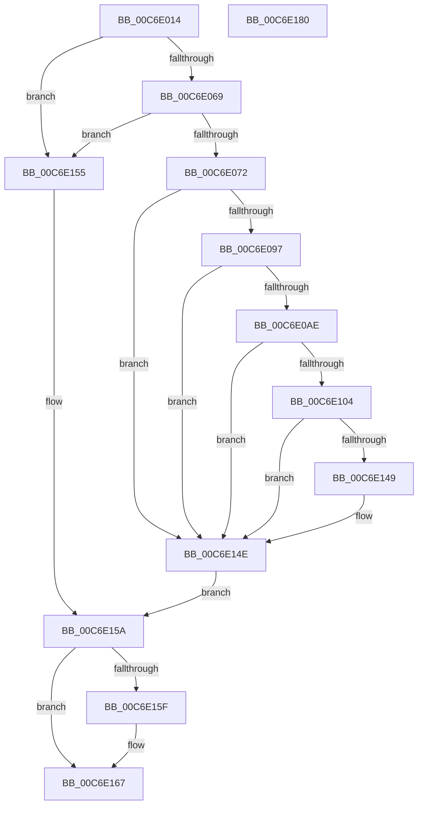

# VhdiGetVolumeNumber

- RVA: `0x00C6E014`–`0x00C6E181` (길이 `365` bytes)
- VA: `0x0000000140C6E014`
- 실행 섹션: `INIT`
- PDB 이름 있음: `예`; PDB Function 태그: `아니요`
- unwind 정보 RVA: `0x000DB218`
- 디코드: `91`개 명령, `365/365` bytes 표시
- 미해석 바이트: `0` (있으면 어셈블리에 `.byte`로 보존)

> 이 문서는 커널 이미지의 기계어와 PDB 기호를 분석해 생성했습니다. 4번과 5번은 함수 원형과 자료형을 바이너리 사용 방식에서 추정한 C 해석이며 원본 소스 복구 결과는 아닙니다.

## 1. Dependencies

- 직접 호출 지점: **6**; 고유 호출 대상: **6**
- 직접 호출자로 확인된 함수: **1**
- RIP 상대 이미지 참조: **2**

### Outgoing calls
- `0x00C6E088` → [RtlStringCbPrintfW](../../text/40/RtlStringCbPrintfW_function_0040FB40.md) (function, `0x0040FB40`)
- `0x00C6E09F` → [RtlInitUnicodeStringEx](../../text/46/RtlInitUnicodeStringEx_function_00463960.md) (function, `0x00463960`)
- `0x00C6E0F9` → [ZwOpenFile](../../text/6A/ZwOpenFile_function_006AD730.md) (function, `0x006AD730`)
- `0x00C6E13E` → [ZwDeviceIoControlFile](../../text/6A/ZwDeviceIoControlFile_function_006AD1B0.md) (function, `0x006AD1B0`)
- `0x00C6E162` → [ZwClose](../../text/6A/ZwClose_function_006AD2B0.md) (function, `0x006AD2B0`)
- `0x00C6E170` → [_security_check_cookie](../../text/6A/_security_check_cookie_function_006AC640.md) (function, `0x006AC640`)

### Direct callers
- [VhdiInitializeBootDisk](VhdiInitializeBootDisk_function_00C6E190.md) at `0x00C6E44E`

### Static image references
- `0x00C6E024` → RVA `0x00E0A740` (`.data`; read)
- `0x00C6E07E` → RVA `0x00C7E7F0` (` ?? ::PBOPGDP::`string'`; read)

## 2. Other-region calls and transfers

- 다른 실행 섹션으로 향하는 call: **6**
  - `0x00C6E088` → [RtlStringCbPrintfW](../../text/40/RtlStringCbPrintfW_function_0040FB40.md) (`INIT` → `.text`)
  - `0x00C6E09F` → [RtlInitUnicodeStringEx](../../text/46/RtlInitUnicodeStringEx_function_00463960.md) (`INIT` → `.text`)
  - `0x00C6E0F9` → [ZwOpenFile](../../text/6A/ZwOpenFile_function_006AD730.md) (`INIT` → `.text`)
  - `0x00C6E13E` → [ZwDeviceIoControlFile](../../text/6A/ZwDeviceIoControlFile_function_006AD1B0.md) (`INIT` → `.text`)
  - `0x00C6E162` → [ZwClose](../../text/6A/ZwClose_function_006AD2B0.md) (`INIT` → `.text`)
  - `0x00C6E170` → [_security_check_cookie](../../text/6A/_security_check_cookie_function_006AC640.md) (`INIT` → `.text`)
- 별도 외부 분기/꼬리 이동을 확인하지 못했습니다.

## 3. Assembly (complete function range)

```asm
00C6E014  40 55                           push rbp
00C6E016  53                              push rbx
00C6E017  57                              push rdi
00C6E018  48 8D 6C 24 C0                  lea rbp, [rsp - 0x40]
00C6E01D  48 81 EC 40 01 00 00            sub rsp, 0x140
00C6E024  48 8B 05 15 C7 19 00            mov rax, qword ptr [rip + 0x19c715]
00C6E02B  48 33 C4                        xor rax, rsp
00C6E02E  48 89 45 30                     mov qword ptr [rbp + 0x30], rax
00C6E032  33 C0                           xor eax, eax
00C6E034  0F 57 C0                        xorps xmm0, xmm0
00C6E037  48 89 44 24 78                  mov qword ptr [rsp + 0x78], rax
00C6E03C  49 8B F9                        mov rdi, r9
00C6E03F  89 45 80                        mov dword ptr [rbp - 0x80], eax
00C6E042  89 45 B8                        mov dword ptr [rbp - 0x48], eax
00C6E045  48 89 44 24 50                  mov qword ptr [rsp + 0x50], rax
00C6E04A  0F 11 45 98                     movups xmmword ptr [rbp - 0x68], xmm0
00C6E04E  0F 11 44 24 58                  movups xmmword ptr [rsp + 0x58], xmm0
00C6E053  0F 11 44 24 68                  movups xmmword ptr [rsp + 0x68], xmm0
00C6E058  0F 11 45 A8                     movups xmmword ptr [rbp - 0x58], xmm0
00C6E05C  0F 11 45 88                     movups xmmword ptr [rbp - 0x78], xmm0
00C6E060  48 85 C9                        test rcx, rcx
00C6E063  0F 84 EC 00 00 00               je 0x140c6e155
00C6E069  4D 85 C9                        test r9, r9
00C6E06C  0F 84 E3 00 00 00               je 0x140c6e155
00C6E072  44 89 44 24 20                  mov dword ptr [rsp + 0x20], r8d
00C6E077  48 8D 4D C0                     lea rcx, [rbp - 0x40]
00C6E07B  44 8B CA                        mov r9d, edx
00C6E07E  4C 8D 05 6B 07 01 00            lea r8, [rip + 0x1076b]
00C6E085  8D 50 64                        lea edx, [rax + 0x64]
00C6E088  E8 B3 1A 7A FF                  call 0x14040fb40
00C6E08D  8B D8                           mov ebx, eax
00C6E08F  85 C0                           test eax, eax
00C6E091  0F 88 B7 00 00 00               js 0x140c6e14e
00C6E097  48 8D 55 C0                     lea rdx, [rbp - 0x40]
00C6E09B  48 8D 4D 88                     lea rcx, [rbp - 0x78]
00C6E09F  E8 BC 58 7F FF                  call 0x140463960
00C6E0A4  8B D8                           mov ebx, eax
00C6E0A6  85 C0                           test eax, eax
00C6E0A8  0F 88 A0 00 00 00               js 0x140c6e14e
00C6E0AE  48 83 64 24 60 00               and qword ptr [rsp + 0x60], 0
00C6E0B4  48 8D 45 88                     lea rax, [rbp - 0x78]
00C6E0B8  0F 57 C0                        xorps xmm0, xmm0
00C6E0BB  C7 44 24 28 20 00 00 00         mov dword ptr [rsp + 0x28], 0x20
00C6E0C3  4C 8D 4D 98                     lea r9, [rbp - 0x68]
00C6E0C7  48 89 44 24 68                  mov qword ptr [rsp + 0x68], rax
00C6E0CC  4C 8D 44 24 58                  lea r8, [rsp + 0x58]
00C6E0D1  C7 44 24 58 30 00 00 00         mov dword ptr [rsp + 0x58], 0x30
00C6E0D9  BA 00 00 10 C0                  mov edx, 0xc0100000
00C6E0DE  C7 44 24 70 40 02 00 00         mov dword ptr [rsp + 0x70], 0x240
00C6E0E6  48 8D 4C 24 50                  lea rcx, [rsp + 0x50]
00C6E0EB  C7 44 24 20 03 00 00 00         mov dword ptr [rsp + 0x20], 3
00C6E0F3  F3 0F 7F 44 24 78               movdqu xmmword ptr [rsp + 0x78], xmm0
00C6E0F9  E8 32 F6 A3 FF                  call 0x1406ad730
00C6E0FE  8B D8                           mov ebx, eax
00C6E100  85 C0                           test eax, eax
00C6E102  78 4A                           js 0x140c6e14e
00C6E104  48 8B 4C 24 50                  mov rcx, qword ptr [rsp + 0x50]
00C6E109  48 8D 45 A8                     lea rax, [rbp - 0x58]
00C6E10D  C7 44 24 48 14 00 00 00         mov dword ptr [rsp + 0x48], 0x14
00C6E115  45 33 C9                        xor r9d, r9d
00C6E118  48 89 44 24 40                  mov qword ptr [rsp + 0x40], rax
00C6E11D  45 33 C0                        xor r8d, r8d
00C6E120  83 64 24 38 00                  and dword ptr [rsp + 0x38], 0
00C6E125  48 8D 45 98                     lea rax, [rbp - 0x68]
00C6E129  48 83 64 24 30 00               and qword ptr [rsp + 0x30], 0
00C6E12F  33 D2                           xor edx, edx
00C6E131  C7 44 24 28 1C 00 56 00         mov dword ptr [rsp + 0x28], 0x56001c
00C6E139  48 89 44 24 20                  mov qword ptr [rsp + 0x20], rax
00C6E13E  E8 6D F0 A3 FF                  call 0x1406ad1b0
00C6E143  8B D8                           mov ebx, eax
00C6E145  85 C0                           test eax, eax
00C6E147  78 05                           js 0x140c6e14e
00C6E149  8B 45 A8                        mov eax, dword ptr [rbp - 0x58]
00C6E14C  89 07                           mov dword ptr [rdi], eax
00C6E14E  48 8B 44 24 50                  mov rax, qword ptr [rsp + 0x50]
00C6E153  EB 05                           jmp 0x140c6e15a
00C6E155  BB 0D 00 00 C0                  mov ebx, 0xc000000d
00C6E15A  48 85 C0                        test rax, rax
00C6E15D  74 08                           je 0x140c6e167
00C6E15F  48 8B C8                        mov rcx, rax
00C6E162  E8 49 F1 A3 FF                  call 0x1406ad2b0
00C6E167  8B C3                           mov eax, ebx
00C6E169  48 8B 4D 30                     mov rcx, qword ptr [rbp + 0x30]
00C6E16D  48 33 CC                        xor rcx, rsp
00C6E170  E8 CB E4 A3 FF                  call 0x1406ac640
00C6E175  48 81 C4 40 01 00 00            add rsp, 0x140
00C6E17C  5F                              pop rdi
00C6E17D  5B                              pop rbx
00C6E17E  5D                              pop rbp
00C6E17F  C3                              ret
00C6E180  CC                              int3
```

## 4. C-style interpretation (structured pseudocode)

```c
__int64 __fastcall VhdiGetVolumeNumber(__int64 a1, int a2, int a3, __int64 a4)
{
    __int64 result;
    __int64 v_rsp;
    unsigned __int64 v_stack_m100;
    unsigned __int64 v_stack_m108;
    unsigned int v_stack_m110;
    unsigned __int64 v_stack_m118;
    unsigned int v_stack_m120;
    unsigned __int64 v_stack_m128;
    unsigned int v_stack_m130;
    unsigned int v_stack_m138;
    unsigned __int64 v_stack_m28;
    unsigned __int64 v_stack_m58;
    unsigned __int64 v_stack_m98;
    unsigned int v_stack_mA0;
    unsigned __int64 v_stack_mB0;
    unsigned __int64 v_stack_mC0;
    unsigned __int64 v_stack_mD0;
    unsigned int v_stack_mD8;
    unsigned __int64 v_stack_mE0;
    unsigned int v_stack_mE8;
    unsigned __int64 v_stack_mF0;
    unsigned __int64 v_stack_mF8;

    v_rsp = (v_rsp) - (320);
    result = (*(unsigned __int64 *)(v_rip + 1689365)) ^ (v_rsp);
    v_stack_m28 = result;
    result = 0;
    v_stack_mE0 = 0;
    v_stack_mD8 = 0;
    v_stack_mA0 = 0;
    v_stack_m108 = 0;
    v_stack_mC0 = v_xmm0;
    v_stack_m100 = v_xmm0;
    v_stack_mF0 = v_xmm0;
    v_stack_mB0 = v_xmm0;
    v_stack_mD0 = v_xmm0;
    if (a1 == 0) goto loc_00C6E155;
    if (a4 == 0) goto loc_00C6E155;
    v_stack_m138 = a3;
    result = RtlStringCbPrintfW(v_stack_m98, result + 100, v_rip + 67435, (unsigned int)(a2));
    if (sign_flag) goto loc_00C6E14E;
    result = RtlInitUnicodeStringEx(v_stack_mD0, v_stack_m98, v_rip + 67435, (unsigned int)(a2));
    if (sign_flag) goto loc_00C6E14E;
    v_stack_m130 = 32;
    v_stack_mF0 = v_stack_mD0;
    v_stack_m100 = 48;
    v_stack_mE8 = 576;
    v_stack_m138 = 3;
    v_stack_mE0 = v_xmm0;
    result = ZwOpenFile(v_stack_m108, (unsigned int)(0xC0100000ULL), v_stack_m100, v_stack_mC0);
    if (sign_flag) goto loc_00C6E14E;
    v_stack_m110 = 20;
    a4 = 0;
    v_stack_m118 = v_stack_mB0;
    a3 = 0;
    a2 = 0;
    v_stack_m130 = 0x56001CULL;
    v_stack_m138 = v_stack_mC0;
    result = ZwDeviceIoControlFile(v_stack_m108, a2, a3, a4);
    if (!(sign_flag)) {
        result = v_stack_mB0;
        *(unsigned int *)(a4) = (unsigned int)(result);
    }
    goto loc_00C6E15A;
loc_00C6E155:
loc_00C6E15A:
    result = v_stack_m108;
    if (v_stack_m108 != 0) {
        a1 = v_stack_m108;
        result = ZwClose(a1, a2, a3, a4);
    }
    a1 = (v_stack_m28) ^ (v_rsp);
    result = _security_check_cookie(a1, a2, a3, a4);
    v_rsp = (v_rsp) + (320);
    return result;
}
```

## 5. (Beta) C Style

```c
int64_t VhdiGetVolumeNumber(int64_t Arg1, int32_t Arg2, int32_t Arg3, void *Arg4)
{
    uint8_t *arg4 = (uint8_t *)Arg4;

    int64_t result;
    int64_t local_rsp;
    uint64_t v_stack_m100;
    uint64_t v_stack_m108;
    uint32_t v_stack_m110;
    uint64_t v_stack_m118;
    uint32_t v_stack_m120;
    uint64_t v_stack_m128;
    uint32_t v_stack_m130;
    uint32_t v_stack_m138;
    uint64_t v_stack_m28;
    uint64_t v_stack_m58;
    uint64_t v_stack_m98;
    uint32_t v_stack_mA0;
    uint64_t v_stack_mB0;
    uint64_t v_stack_mC0;
    uint64_t v_stack_mD0;
    uint32_t v_stack_mD8;
    uint64_t v_stack_mE0;
    uint32_t v_stack_mE8;
    uint64_t v_stack_mF0;
    uint64_t v_stack_mF8;

    local_rsp = (local_rsp) - (320);
    result = (*(uint64_t *)(v_rip + 0x19C715)) ^ (local_rsp);
    v_stack_m28 = result;
    result = 0;
    v_stack_mE0 = 0;
    v_stack_mD8 = 0;
    v_stack_mA0 = 0;
    v_stack_m108 = 0;
    v_stack_mC0 = v_xmm0;
    v_stack_m100 = v_xmm0;
    v_stack_mF0 = v_xmm0;
    v_stack_mB0 = v_xmm0;
    v_stack_mD0 = v_xmm0;
    if (Arg1 == 0) goto loc_00C6E155;
    if (Arg4 == NULL) goto loc_00C6E155;
    v_stack_m138 = Arg3;
    result = RtlStringCbPrintfW(v_stack_m98, result + 100, v_rip + 67435, (uint32_t)(Arg2));
    if (sign_flag) goto loc_00C6E14E;
    result = RtlInitUnicodeStringEx(v_stack_mD0, v_stack_m98, v_rip + 67435, (uint32_t)(Arg2));
    if (sign_flag) goto loc_00C6E14E;
    v_stack_m130 = 32;
    v_stack_mF0 = v_stack_mD0;
    v_stack_m100 = 48;
    v_stack_mE8 = 576;
    v_stack_m138 = 3;
    v_stack_mE0 = v_xmm0;
    result = ZwOpenFile(v_stack_m108, (uint32_t)(0xC0100000ULL), v_stack_m100, v_stack_mC0);
    if (sign_flag) goto loc_00C6E14E;
    v_stack_m110 = 20;
    Arg4 = 0;
    v_stack_m118 = v_stack_mB0;
    Arg3 = 0;
    Arg2 = 0;
    v_stack_m130 = 0x56001CULL;
    v_stack_m138 = v_stack_mC0;
    result = ZwDeviceIoControlFile(v_stack_m108, Arg2, Arg3, Arg4);
    if (!(sign_flag)) {
        result = v_stack_mB0;
        *(uint32_t *)(arg4) = (uint32_t)(result);
    }
    goto loc_00C6E15A;
loc_00C6E155:
loc_00C6E15A:
    result = v_stack_m108;
    if (v_stack_m108 != 0) {
        Arg1 = v_stack_m108;
        result = ZwClose(Arg1, Arg2, Arg3, Arg4);
    }
    Arg1 = (v_stack_m28) ^ (local_rsp);
    result = _security_check_cookie(Arg1, Arg2, Arg3, Arg4);
    local_rsp = (local_rsp) + (320);
    return result;
}
```

### 관측된 메모리 오프셋

구조체 형식이 확인되지 않은 접근은 인자 기준의 오프셋으로만 기록했습니다.

| 기준 인자 | 오프셋 표현 | 폭 (bit) | 접근 |
|---|---:|---:|---|
| `Arg4` | `+ 0x0` | `32` | `W` |

## 6. Execution-region graph

[열기: 2D/3D 그래프와 함수 탐색 컨트롤 패널](../../../control-panel.html?section=init&rva=0x00C6E014&view=graph)

- 2D 그래프는 위에서 아래로 흐르고, 3D 그래프는 빈 공간을 드래그해 회전합니다. Shift+드래그는 이동, 휠은 확대·축소, 함수 노드 선택은 대상 보고서 이동입니다.

### Static fallback


