# VhdiInitializeBootDisk

- RVA: `0x00C6E190`–`0x00C6E4AE` (길이 `798` bytes)
- VA: `0x0000000140C6E190`
- 실행 섹션: `INIT`
- PDB 이름 있음: `예`; PDB Function 태그: `아니요`
- unwind 정보 RVA: `0x000D616C`
- 디코드: `207`개 명령, `798/798` bytes 표시
- 미해석 바이트: `0` (있으면 어셈블리에 `.byte`로 보존)

> 이 문서는 커널 이미지의 기계어와 PDB 기호를 분석해 생성했습니다. 4번과 5번은 함수 원형과 자료형을 바이너리 사용 방식에서 추정한 C 해석이며 원본 소스 복구 결과는 아닙니다.

## 1. Dependencies

- 직접 호출 지점: **18**; 고유 호출 대상: **13**
- 직접 호출자로 확인된 함수: **0**
- RIP 상대 이미지 참조: **2**

### Outgoing calls
- `0x00C6E230` → [RtlCreateUnicodeStringFromAsciiz](../../page/78/RtlCreateUnicodeStringFromAsciiz_function_0078B990.md) (function, `0x0078B990`)
- `0x00C6E243` → [IoGetConfigurationInformation](../../page/71/IoGetConfigurationInformation_function_0071D5A0.md) (function, `0x0071D5A0`)
- `0x00C6E273` → [RtlStringCbPrintfW](../../text/40/RtlStringCbPrintfW_function_0040FB40.md) (function, `0x0040FB40`)
- `0x00C6E288` → [RtlInitUnicodeStringEx](../../text/46/RtlInitUnicodeStringEx_function_00463960.md) (function, `0x00463960`)
- `0x00C6E2C6` → [ZwClose](../../text/6A/ZwClose_function_006AD2B0.md) (function, `0x006AD2B0`)
- `0x00C6E2F4` → [ZwOpenFile](../../text/6A/ZwOpenFile_function_006AD730.md) (function, `0x006AD730`)
- `0x00C6E302` → [VhdiQueryVolumeVhdFilePath](VhdiQueryVolumeVhdFilePath_function_00C6E4B4.md) (function, `0x00C6E4B4`)
- `0x00C6E314` → [ExFreePoolWithTag](../../poolcode/B8/ExFreePoolWithTag_function_00B82870.md) (function, `0x00B82870`)
- `0x00C6E330` → [ExFreePoolWithTag](../../poolcode/B8/ExFreePoolWithTag_function_00B82870.md) (function, `0x00B82870`)
- `0x00C6E347` → [ExAllocatePool2](../../poolcode/B8/ExAllocatePool2_function_00B820F0.md) (function, `0x00B820F0`)
- `0x00C6E386` → [ZwDeviceIoControlFile](../../text/6A/ZwDeviceIoControlFile_function_006AD1B0.md) (function, `0x006AD1B0`)
- `0x00C6E397` → [ExFreePoolWithTag](../../poolcode/B8/ExFreePoolWithTag_function_00B82870.md) (function, `0x00B82870`)
- `0x00C6E3CC` → [RtlCompareMemory](../../text/6B/RtlCompareMemory_function_006BA670.md) (function, `0x006BA670`)
- `0x00C6E3E4` → [RtlCompareMemory](../../text/6B/RtlCompareMemory_function_006BA670.md) (function, `0x006BA670`)
- `0x00C6E44E` → [VhdiGetVolumeNumber](VhdiGetVolumeNumber_function_00C6E014.md) (function, `0x00C6E014`)
- `0x00C6E469` → [ExFreePoolWithTag](../../poolcode/B8/ExFreePoolWithTag_function_00B82870.md) (function, `0x00B82870`)
- `0x00C6E478` → [ZwClose](../../text/6A/ZwClose_function_006AD2B0.md) (function, `0x006AD2B0`)
- `0x00C6E48D` → [_security_check_cookie](../../text/6A/_security_check_cookie_function_006AC640.md) (function, `0x006AC640`)

### Direct callers
- 이 함수 시작 RVA로 연결되는 직접 call은 확인되지 않았습니다. 간접 호출은 완전히 역산할 수 없습니다.

### Static image references
- `0x00C6E1AC` → RVA `0x00E0A740` (`.data`; read)
- `0x00C6E263` → RVA `0x00C79990` (` ?? ::PBOPGDP::`string'`; read)

## 2. Other-region calls and transfers

- 다른 실행 섹션으로 향하는 call: **16**
  - `0x00C6E230` → [RtlCreateUnicodeStringFromAsciiz](../../page/78/RtlCreateUnicodeStringFromAsciiz_function_0078B990.md) (`INIT` → `PAGE`)
  - `0x00C6E243` → [IoGetConfigurationInformation](../../page/71/IoGetConfigurationInformation_function_0071D5A0.md) (`INIT` → `PAGE`)
  - `0x00C6E273` → [RtlStringCbPrintfW](../../text/40/RtlStringCbPrintfW_function_0040FB40.md) (`INIT` → `.text`)
  - `0x00C6E288` → [RtlInitUnicodeStringEx](../../text/46/RtlInitUnicodeStringEx_function_00463960.md) (`INIT` → `.text`)
  - `0x00C6E2C6` → [ZwClose](../../text/6A/ZwClose_function_006AD2B0.md) (`INIT` → `.text`)
  - `0x00C6E2F4` → [ZwOpenFile](../../text/6A/ZwOpenFile_function_006AD730.md) (`INIT` → `.text`)
  - `0x00C6E314` → [ExFreePoolWithTag](../../poolcode/B8/ExFreePoolWithTag_function_00B82870.md) (`INIT` → `POOLCODE`)
  - `0x00C6E330` → [ExFreePoolWithTag](../../poolcode/B8/ExFreePoolWithTag_function_00B82870.md) (`INIT` → `POOLCODE`)
  - `0x00C6E347` → [ExAllocatePool2](../../poolcode/B8/ExAllocatePool2_function_00B820F0.md) (`INIT` → `POOLCODE`)
  - `0x00C6E386` → [ZwDeviceIoControlFile](../../text/6A/ZwDeviceIoControlFile_function_006AD1B0.md) (`INIT` → `.text`)
  - `0x00C6E397` → [ExFreePoolWithTag](../../poolcode/B8/ExFreePoolWithTag_function_00B82870.md) (`INIT` → `POOLCODE`)
  - `0x00C6E3CC` → [RtlCompareMemory](../../text/6B/RtlCompareMemory_function_006BA670.md) (`INIT` → `.text`)
  - `0x00C6E3E4` → [RtlCompareMemory](../../text/6B/RtlCompareMemory_function_006BA670.md) (`INIT` → `.text`)
  - `0x00C6E469` → [ExFreePoolWithTag](../../poolcode/B8/ExFreePoolWithTag_function_00B82870.md) (`INIT` → `POOLCODE`)
  - `0x00C6E478` → [ZwClose](../../text/6A/ZwClose_function_006AD2B0.md) (`INIT` → `.text`)
  - `0x00C6E48D` → [_security_check_cookie](../../text/6A/_security_check_cookie_function_006AC640.md) (`INIT` → `.text`)
- 별도 외부 분기/꼬리 이동을 확인하지 못했습니다.

## 3. Assembly (complete function range)

```asm
00C6E190  48 89 5C 24 20                  mov qword ptr [rsp + 0x20], rbx
00C6E195  55                              push rbp
00C6E196  56                              push rsi
00C6E197  57                              push rdi
00C6E198  41 54                           push r12
00C6E19A  41 55                           push r13
00C6E19C  41 56                           push r14
00C6E19E  41 57                           push r15
00C6E1A0  48 8D 6C 24 C0                  lea rbp, [rsp - 0x40]
00C6E1A5  48 81 EC 40 01 00 00            sub rsp, 0x140
00C6E1AC  48 8B 05 8D C5 19 00            mov rax, qword ptr [rip + 0x19c58d]
00C6E1B3  48 33 C4                        xor rax, rsp
00C6E1B6  48 89 45 30                     mov qword ptr [rbp + 0x30], rax
00C6E1BA  33 C0                           xor eax, eax
00C6E1BC  0F 57 C0                        xorps xmm0, xmm0
00C6E1BF  48 89 45 80                     mov qword ptr [rbp - 0x80], rax
00C6E1C3  0F 57 C9                        xorps xmm1, xmm1
00C6E1C6  89 45 88                        mov dword ptr [rbp - 0x78], eax
00C6E1C9  0F 11 45 90                     movups xmmword ptr [rbp - 0x70], xmm0
00C6E1CD  0F 11 4D A0                     movups xmmword ptr [rbp - 0x60], xmm1
00C6E1D1  0F 11 44 24 60                  movups xmmword ptr [rsp + 0x60], xmm0
00C6E1D6  0F 11 44 24 70                  movups xmmword ptr [rsp + 0x70], xmm0
00C6E1DB  48 85 C9                        test rcx, rcx
00C6E1DE  0F 84 9D 02 00 00               je 0x140c6e481
00C6E1E4  48 85 D2                        test rdx, rdx
00C6E1E7  0F 84 94 02 00 00               je 0x140c6e481
00C6E1ED  4D 85 C0                        test r8, r8
00C6E1F0  0F 84 8B 02 00 00               je 0x140c6e481
00C6E1F6  48 8B 32                        mov rsi, qword ptr [rdx]
00C6E1F9  4C 8B 7A 08                     mov r15, qword ptr [rdx + 8]
00C6E1FD  4C 8B 62 18                     mov r12, qword ptr [rdx + 0x18]
00C6E201  48 85 F6                        test rsi, rsi
00C6E204  0F 84 77 02 00 00               je 0x140c6e481
00C6E20A  4D 85 FF                        test r15, r15
00C6E20D  0F 84 6E 02 00 00               je 0x140c6e481
00C6E213  48 39 42 10                     cmp qword ptr [rdx + 0x10], rax
00C6E217  0F 84 64 02 00 00               je 0x140c6e481
00C6E21D  4D 85 E4                        test r12, r12
00C6E220  0F 84 5B 02 00 00               je 0x140c6e481
00C6E226  48 8B 91 B8 00 00 00            mov rdx, qword ptr [rcx + 0xb8]
00C6E22D  49 8B C8                        mov rcx, r8
00C6E230  E8 5B D7 B1 FF                  call 0x14078b990
00C6E235  84 C0                           test al, al
00C6E237  75 0A                           jne 0x140c6e243
00C6E239  B8 01 00 00 C0                  mov eax, 0xc0000001
00C6E23E  E9 43 02 00 00                  jmp 0x140c6e486
00C6E243  E8 58 F3 AA FF                  call 0x14071d5a0
00C6E248  33 C9                           xor ecx, ecx
00C6E24A  33 DB                           xor ebx, ebx
00C6E24C  45 33 F6                        xor r14d, r14d
00C6E24F  44 8B 28                        mov r13d, dword ptr [rax]
00C6E252  48 89 4C 24 50                  mov qword ptr [rsp + 0x50], rcx
00C6E257  45 3B F5                        cmp r14d, r13d
00C6E25A  0F 83 F7 01 00 00               jae 0x140c6e457
00C6E260  45 8B CE                        mov r9d, r14d
00C6E263  4C 8D 05 26 B7 00 00            lea r8, [rip + 0xb726]
00C6E26A  BA 80 00 00 00                  mov edx, 0x80
00C6E26F  48 8D 4D B0                     lea rcx, [rbp - 0x50]
00C6E273  E8 C8 18 7A FF                  call 0x14040fb40
00C6E278  85 C0                           test eax, eax
00C6E27A  0F 88 99 00 00 00               js 0x140c6e319
00C6E280  48 8D 55 B0                     lea rdx, [rbp - 0x50]
00C6E284  48 8D 4D 90                     lea rcx, [rbp - 0x70]
00C6E288  E8 D3 56 7F FF                  call 0x140463960
00C6E28D  85 C0                           test eax, eax
00C6E28F  0F 88 84 00 00 00               js 0x140c6e319
00C6E295  48 83 64 24 68 00               and qword ptr [rsp + 0x68], 0
00C6E29B  48 8D 45 90                     lea rax, [rbp - 0x70]
00C6E29F  48 8B 4C 24 50                  mov rcx, qword ptr [rsp + 0x50]
00C6E2A4  0F 57 C0                        xorps xmm0, xmm0
00C6E2A7  C7 44 24 60 30 00 00 00         mov dword ptr [rsp + 0x60], 0x30
00C6E2AF  C7 44 24 78 40 02 00 00         mov dword ptr [rsp + 0x78], 0x240
00C6E2B7  48 89 44 24 70                  mov qword ptr [rsp + 0x70], rax
00C6E2BC  F3 0F 7F 45 80                  movdqu xmmword ptr [rbp - 0x80], xmm0
00C6E2C1  48 85 C9                        test rcx, rcx
00C6E2C4  74 0B                           je 0x140c6e2d1
00C6E2C6  E8 E5 EF A3 FF                  call 0x1406ad2b0
00C6E2CB  48 83 64 24 50 00               and qword ptr [rsp + 0x50], 0
00C6E2D1  C7 44 24 28 20 00 00 00         mov dword ptr [rsp + 0x28], 0x20
00C6E2D9  4C 8D 4D A0                     lea r9, [rbp - 0x60]
00C6E2DD  4C 8D 44 24 60                  lea r8, [rsp + 0x60]
00C6E2E2  C7 44 24 20 03 00 00 00         mov dword ptr [rsp + 0x20], 3
00C6E2EA  BA 00 00 10 C0                  mov edx, 0xc0100000
00C6E2EF  48 8D 4C 24 50                  lea rcx, [rsp + 0x50]
00C6E2F4  E8 37 F4 A3 FF                  call 0x1406ad730
00C6E2F9  85 C0                           test eax, eax
00C6E2FB  78 1C                           js 0x140c6e319
00C6E2FD  48 8B 4C 24 50                  mov rcx, qword ptr [rsp + 0x50]
00C6E302  E8 AD 01 00 00                  call 0x140c6e4b4
00C6E307  48 85 C0                        test rax, rax
00C6E30A  74 1A                           je 0x140c6e326
00C6E30C  BA 56 68 64 42                  mov edx, 0x42646856
00C6E311  48 8B C8                        mov rcx, rax
00C6E314  E8 57 45 F1 FF                  call 0x140b82870
00C6E319  48 8B 4C 24 50                  mov rcx, qword ptr [rsp + 0x50]
00C6E31E  41 FF C6                        inc r14d
00C6E321  E9 31 FF FF FF                  jmp 0x140c6e257
00C6E326  48 85 DB                        test rbx, rbx
00C6E329  74 0A                           je 0x140c6e335
00C6E32B  33 D2                           xor edx, edx
00C6E32D  48 8B CB                        mov rcx, rbx
00C6E330  E8 3B 45 F1 FF                  call 0x140b82870
00C6E335  BF 00 10 00 00                  mov edi, 0x1000
00C6E33A  8B D7                           mov edx, edi
00C6E33C  B9 40 00 00 00                  mov ecx, 0x40
00C6E341  41 B8 56 68 64 42               mov r8d, 0x42646856
00C6E347  E8 A4 3D F1 FF                  call 0x140b820f0
00C6E34C  48 8B D8                        mov rbx, rax
00C6E34F  48 85 C0                        test rax, rax
00C6E352  74 C5                           je 0x140c6e319
00C6E354  48 8B 4C 24 50                  mov rcx, qword ptr [rsp + 0x50]
00C6E359  45 33 C9                        xor r9d, r9d
00C6E35C  89 7C 24 48                     mov dword ptr [rsp + 0x48], edi
00C6E360  45 33 C0                        xor r8d, r8d
00C6E363  48 89 44 24 40                  mov qword ptr [rsp + 0x40], rax
00C6E368  33 D2                           xor edx, edx
00C6E36A  83 64 24 38 00                  and dword ptr [rsp + 0x38], 0
00C6E36F  48 8D 45 A0                     lea rax, [rbp - 0x60]
00C6E373  48 83 64 24 30 00               and qword ptr [rsp + 0x30], 0
00C6E379  C7 44 24 28 50 00 07 00         mov dword ptr [rsp + 0x28], 0x70050
00C6E381  48 89 44 24 20                  mov qword ptr [rsp + 0x20], rax
00C6E386  E8 25 EE A3 FF                  call 0x1406ad1b0
00C6E38B  3D 23 00 00 C0                  cmp eax, 0xc0000023
00C6E390  75 0E                           jne 0x140c6e3a0
00C6E392  33 D2                           xor edx, edx
00C6E394  48 8B CB                        mov rcx, rbx
00C6E397  E8 D4 44 F1 FF                  call 0x140b82870
00C6E39C  03 FF                           add edi, edi
00C6E39E  EB 9A                           jmp 0x140c6e33a
00C6E3A0  85 C0                           test eax, eax
00C6E3A2  0F 88 71 FF FF FF               js 0x140c6e319
00C6E3A8  8B 0E                           mov ecx, dword ptr [rsi]
00C6E3AA  39 0B                           cmp dword ptr [rbx], ecx
00C6E3AC  0F 85 67 FF FF FF               jne 0x140c6e319
00C6E3B2  85 C9                           test ecx, ecx
00C6E3B4  74 21                           je 0x140c6e3d7
00C6E3B6  83 F9 01                        cmp ecx, 1
00C6E3B9  0F 85 5A FF FF FF               jne 0x140c6e319
00C6E3BF  48 8D 4B 08                     lea rcx, [rbx + 8]
00C6E3C3  41 B8 10 00 00 00               mov r8d, 0x10
00C6E3C9  49 8B D7                        mov rdx, r15
00C6E3CC  E8 9F C2 A4 FF                  call 0x1406ba670
00C6E3D1  48 83 F8 10                     cmp rax, 0x10
00C6E3D5  EB 16                           jmp 0x140c6e3ed
00C6E3D7  48 8D 4B 08                     lea rcx, [rbx + 8]
00C6E3DB  41 B8 04 00 00 00               mov r8d, 4
00C6E3E1  49 8B D7                        mov rdx, r15
00C6E3E4  E8 87 C2 A4 FF                  call 0x1406ba670
00C6E3E9  48 83 F8 04                     cmp rax, 4
00C6E3ED  0F 85 26 FF FF FF               jne 0x140c6e319
00C6E3F3  44 8B 4B 04                     mov r9d, dword ptr [rbx + 4]
00C6E3F7  45 33 C0                        xor r8d, r8d
00C6E3FA  45 3B C1                        cmp r8d, r9d
00C6E3FD  0F 83 16 FF FF FF               jae 0x140c6e319
00C6E403  8B 03                           mov eax, dword ptr [rbx]
00C6E405  4B 8D 0C C0                     lea rcx, [r8 + r8*8]
00C6E409  48 03 C9                        add rcx, rcx
00C6E40C  85 C0                           test eax, eax
00C6E40E  75 0B                           jne 0x140c6e41b
00C6E410  48 8B 46 08                     mov rax, qword ptr [rsi + 8]
00C6E414  48 39 44 CB 38                  cmp qword ptr [rbx + rcx*8 + 0x38], rax
00C6E419  EB 1C                           jmp 0x140c6e437
00C6E41B  83 F8 01                        cmp eax, 1
00C6E41E  75 19                           jne 0x140c6e439
00C6E420  48 8B 54 CB 60                  mov rdx, qword ptr [rbx + rcx*8 + 0x60]
00C6E425  48 2B 56 30                     sub rdx, qword ptr [rsi + 0x30]
00C6E429  75 09                           jne 0x140c6e434
00C6E42B  48 8B 54 CB 68                  mov rdx, qword ptr [rbx + rcx*8 + 0x68]
00C6E430  48 2B 56 38                     sub rdx, qword ptr [rsi + 0x38]
00C6E434  48 85 D2                        test rdx, rdx
00C6E437  74 05                           je 0x140c6e43e
00C6E439  41 FF C0                        inc r8d
00C6E43C  EB BC                           jmp 0x140c6e3fa
00C6E43E  44 8B 44 CB 48                  mov r8d, dword ptr [rbx + rcx*8 + 0x48]
00C6E443  4D 8B CC                        mov r9, r12
00C6E446  48 8B 4C 24 50                  mov rcx, qword ptr [rsp + 0x50]
00C6E44B  41 8B D6                        mov edx, r14d
00C6E44E  E8 C1 FB FF FF                  call 0x140c6e014
00C6E453  8B F8                           mov edi, eax
00C6E455  EB 0A                           jmp 0x140c6e461
00C6E457  BF 0E 00 00 C0                  mov edi, 0xc000000e
00C6E45C  48 85 DB                        test rbx, rbx
00C6E45F  74 12                           je 0x140c6e473
00C6E461  BA 56 68 64 42                  mov edx, 0x42646856
00C6E466  48 8B CB                        mov rcx, rbx
00C6E469  E8 02 44 F1 FF                  call 0x140b82870
00C6E46E  48 8B 4C 24 50                  mov rcx, qword ptr [rsp + 0x50]
00C6E473  48 85 C9                        test rcx, rcx
00C6E476  74 05                           je 0x140c6e47d
00C6E478  E8 33 EE A3 FF                  call 0x1406ad2b0
00C6E47D  8B C7                           mov eax, edi
00C6E47F  EB 05                           jmp 0x140c6e486
00C6E481  B8 0D 00 00 C0                  mov eax, 0xc000000d
00C6E486  48 8B 4D 30                     mov rcx, qword ptr [rbp + 0x30]
00C6E48A  48 33 CC                        xor rcx, rsp
00C6E48D  E8 AE E1 A3 FF                  call 0x1406ac640
00C6E492  48 8B 9C 24 98 01 00 00         mov rbx, qword ptr [rsp + 0x198]
00C6E49A  48 81 C4 40 01 00 00            add rsp, 0x140
00C6E4A1  41 5F                           pop r15
00C6E4A3  41 5E                           pop r14
00C6E4A5  41 5D                           pop r13
00C6E4A7  41 5C                           pop r12
00C6E4A9  5F                              pop rdi
00C6E4AA  5E                              pop rsi
00C6E4AB  5D                              pop rbp
00C6E4AC  C3                              ret
00C6E4AD  CC                              int3
```

## 4. C-style interpretation (structured pseudocode)

```c
__int64 __fastcall VhdiInitializeBootDisk(__int64 a1, __int64 a2, __int64 a3)
{
    __int64 result;
    __int64 v_r14;
    __int64 v_rbx;
    __int64 v_rdi;
    __int64 v_rsp;
    unsigned int v_stack_m100;
    unsigned __int64 v_stack_m108;
    unsigned __int64 v_stack_m110;
    unsigned __int64 v_stack_m118;
    unsigned __int64 v_stack_m128;
    unsigned int v_stack_m130;
    unsigned __int64 v_stack_m138;
    unsigned int v_stack_m140;
    unsigned __int64 v_stack_m148;
    unsigned int v_stack_m150;
    unsigned int v_stack_m158;
    unsigned __int64 v_stack_m48;
    unsigned __int64 v_stack_m78;
    unsigned __int64 v_stack_mC8;
    unsigned __int64 v_stack_mD8;
    unsigned __int64 v_stack_mE8;
    unsigned int v_stack_mF0;
    unsigned __int64 v_stack_mF8;
    unsigned __int64 v_stack_p20;

    v_stack_p20 = v_rbx;
    v_rsp = (v_rsp) - (320);
    result = (*(unsigned __int64 *)(v_rip + 1688973)) ^ (v_rsp);
    v_stack_m48 = result;
    result = 0;
    v_stack_mF8 = 0;
    v_stack_mF0 = 0;
    v_stack_mE8 = v_xmm0;
    v_stack_mD8 = v_xmm1;
    v_stack_m118 = v_xmm0;
    v_stack_m108 = v_xmm0;
    if (a1 == 0) goto loc_00C6E481;
    if (a2 == 0) goto loc_00C6E481;
    if (a3 == 0) goto loc_00C6E481;
    if (*(unsigned __int64 *)(a2) == 0) goto loc_00C6E481;
    if (*(unsigned __int64 *)(a2 + 8) == 0) goto loc_00C6E481;
    if ((*(unsigned __int64 *)(a2 + 16)) == 0) goto loc_00C6E481;
    if (*(unsigned __int64 *)(a2 + 24) == 0) goto loc_00C6E481;
    result = RtlCreateUnicodeStringFromAsciiz(a3, *(unsigned __int64 *)(a1 + 184), a3, a4);
    if ((unsigned __int8)(result) != 0) goto loc_00C6E243;
    goto loc_00C6E486;
loc_00C6E243:
    result = IoGetConfigurationInformation(a3, *(unsigned __int64 *)(a1 + 184), a3, a4);
    a1 = 0;
    v_rbx = 0;
    v_r14 = 0;
    v_stack_m128 = 0;
loc_00C6E257:
    if (0 >= ((unsigned int)((unsigned int)(*(unsigned int *)(result))))) goto loc_00C6E457;
    result = RtlStringCbPrintfW(v_stack_mC8, 128, v_rip + 46886, 0);
    if (sign_flag) goto loc_00C6E319;
    result = RtlInitUnicodeStringEx(v_stack_mE8, v_stack_mC8, v_rip + 46886, 0);
    if (sign_flag) goto loc_00C6E319;
    v_stack_m118 = 48;
    v_stack_m100 = 576;
    v_stack_m108 = v_stack_mE8;
    v_stack_mF8 = v_xmm0;
    result = v_stack_mE8;
    if (v_stack_m128 != 0) {
        result = ZwClose(v_stack_m128, v_stack_mC8, v_rip + 46886, 0);
    }
    v_stack_m150 = 32;
    v_stack_m158 = 3;
    result = ZwOpenFile(v_stack_m128, (unsigned int)(0xC0100000ULL), v_stack_m118, v_stack_mD8);
    if (sign_flag) goto loc_00C6E319;
    result = VhdiQueryVolumeVhdFilePath(v_stack_m128, (unsigned int)(0xC0100000ULL), v_stack_m118, v_stack_mD8);
    if (result == 0) goto loc_00C6E326;
    result = ExFreePoolWithTag(result, (unsigned int)(0x42646856ULL), v_stack_m118, v_stack_mD8);
loc_00C6E319:
    v_r14 = (unsigned int)((v_r14) + 1);
    goto loc_00C6E257;
loc_00C6E326:
    if (0 != 0) {
        a2 = 0;
        a1 = 0;
        result = ExFreePoolWithTag(a1, a2, v_stack_m118, v_stack_mD8);
    }
loc_00C6E33A:
    result = ExAllocatePool2(64, (unsigned int)((unsigned int)((unsigned int)(0x1000ULL))), (unsigned int)(0x42646856ULL), v_stack_mD8);
    if (result == 0) goto loc_00C6E319;
    a4 = 0;
    v_stack_m130 = (unsigned int)((unsigned int)(0x1000ULL));
    a3 = 0;
    v_stack_m138 = result;
    a2 = 0;
    v_stack_m150 = 0x70050ULL;
    v_stack_m158 = v_stack_mD8;
    result = ZwDeviceIoControlFile(v_stack_m128, a2, a3, a4);
    if (((unsigned int)(result)) != 0xC0000023ULL) goto loc_00C6E3A0;
    a2 = 0;
    result = ExFreePoolWithTag(result, a2, a3, a4);
    v_rdi = (unsigned int)(((unsigned int)(0x1000ULL)) + ((unsigned int)((unsigned int)(0x1000ULL))));
    goto loc_00C6E33A;
loc_00C6E3A0:
    if (sign_flag) goto loc_00C6E319;
    if ((*(unsigned int *)(result)) != ((unsigned int)((unsigned int)(*(unsigned int *)(*(unsigned __int64 *)(a2)))))) goto loc_00C6E319;
    if ((unsigned int)((unsigned int)(*(unsigned int *)(*(unsigned __int64 *)(a2)))) == 0) goto loc_00C6E3D7;
    if (((unsigned int)((unsigned int)(*(unsigned int *)(*(unsigned __int64 *)(a2))))) != 1) goto loc_00C6E319;
    result = RtlCompareMemory(result + 8, *(unsigned __int64 *)(a2 + 8), 16, a4);
    goto loc_00C6E3ED;
loc_00C6E3D7:
    result = RtlCompareMemory(result + 8, *(unsigned __int64 *)(a2 + 8), 4, a4);
loc_00C6E3ED:
    if (result != 4) goto loc_00C6E319;
    a3 = 0;
loc_00C6E3FA:
    if (0 >= ((unsigned int)((unsigned int)(*(unsigned int *)(result + 4))))) goto loc_00C6E319;
    a1 = (a3 + a3 * 8) + (a3 + a3 * 8);
    if ((unsigned int)((unsigned int)(*(unsigned int *)(result))) != 0) goto loc_00C6E41B;
    goto loc_00C6E437;
loc_00C6E41B:
    if (((unsigned int)(*(unsigned __int64 *)(*(unsigned __int64 *)(a2) + 8))) != 1) goto loc_00C6E439;
    a2 = (*(unsigned __int64 *)(result + a1 * 8 + 96)) - (*(unsigned __int64 *)(*(unsigned __int64 *)(a2) + 48));
    if (!(condition_is_not_equal)) {
        a2 = *(unsigned __int64 *)(result + a1 * 8 + 104);
        a2 = (a2) - (*(unsigned __int64 *)(*(unsigned __int64 *)(a2) + 56));
    }
loc_00C6E437:
    if (a2 == 0) goto loc_00C6E43E;
loc_00C6E439:
    a3 = (unsigned int)((a3) + 1);
    goto loc_00C6E3FA;
loc_00C6E43E:
    result = VhdiGetVolumeNumber(v_stack_m128, (unsigned int)((unsigned int)(v_r14)), (unsigned int)(*(unsigned int *)(result + a1 * 8 + 72)), *(unsigned __int64 *)(a2 + 24));
    goto loc_00C6E461;
loc_00C6E457:
    if (result != 0) {
        a2 = 0x42646856ULL;
        a1 = result;
        result = ExFreePoolWithTag(a1, a2, (unsigned int)(*(unsigned int *)(result + a1 * 8 + 72)), *(unsigned __int64 *)(a2 + 24));
        a1 = v_stack_m128;
    }
    if (a1 != 0) {
        result = ZwClose(a1, a2, (unsigned int)(*(unsigned int *)(result + a1 * 8 + 72)), *(unsigned __int64 *)(a2 + 24));
    }
    goto loc_00C6E486;
loc_00C6E481:
loc_00C6E486:
    a1 = (v_stack_m48) ^ (v_rsp);
    result = _security_check_cookie(a1, a2, (unsigned int)(*(unsigned int *)(result + a1 * 8 + 72)), *(unsigned __int64 *)(a2 + 24));
    v_rsp = (v_rsp) + (320);
    return result;
}
```

## 5. (Beta) C Style

```c
int64_t VhdiInitializeBootDisk(int64_t Arg1, int64_t Arg2, int64_t Arg3)
{
    int64_t result;
    int64_t local_r14;
    int64_t local_rbx;
    int64_t local_rdi;
    int64_t local_rsp;
    uint32_t v_stack_m100;
    uint64_t v_stack_m108;
    uint64_t v_stack_m110;
    uint64_t v_stack_m118;
    uint64_t v_stack_m128;
    uint32_t v_stack_m130;
    uint64_t v_stack_m138;
    uint32_t v_stack_m140;
    uint64_t v_stack_m148;
    uint32_t v_stack_m150;
    uint32_t v_stack_m158;
    uint64_t v_stack_m48;
    uint64_t v_stack_m78;
    uint64_t v_stack_mC8;
    uint64_t v_stack_mD8;
    uint64_t v_stack_mE8;
    uint32_t v_stack_mF0;
    uint64_t v_stack_mF8;
    uint64_t v_stack_p20;

    v_stack_p20 = local_rbx;
    local_rsp = (local_rsp) - (320);
    result = (*(uint64_t *)(v_rip + 0x19C58D)) ^ (local_rsp);
    v_stack_m48 = result;
    result = 0;
    v_stack_mF8 = 0;
    v_stack_mF0 = 0;
    v_stack_mE8 = v_xmm0;
    v_stack_mD8 = v_xmm1;
    v_stack_m118 = v_xmm0;
    v_stack_m108 = v_xmm0;
    if (Arg1 == 0) goto loc_00C6E481;
    if (Arg2 == 0) goto loc_00C6E481;
    if (Arg3 == 0) goto loc_00C6E481;
    if (*(uint64_t *)(Arg2) == 0) goto loc_00C6E481;
    if (*(uint64_t *)(Arg2 + 0x8) == 0) goto loc_00C6E481;
    if ((*(uint64_t *)(Arg2 + 0x10)) == 0) goto loc_00C6E481;
    if (*(uint64_t *)(Arg2 + 0x18) == 0) goto loc_00C6E481;
    result = RtlCreateUnicodeStringFromAsciiz(Arg3, *(uint64_t *)(Arg1 + 0xB8), Arg3, a4);
    if ((uint8_t)(result) != 0) goto loc_00C6E243;
    goto loc_00C6E486;
loc_00C6E243:
    result = IoGetConfigurationInformation(Arg3, *(uint64_t *)(Arg1 + 0xB8), Arg3, a4);
    Arg1 = 0;
    local_rbx = 0;
    local_r14 = 0;
    v_stack_m128 = 0;
loc_00C6E257:
    if (0 >= ((uint32_t)((uint32_t)(*(uint32_t *)(result))))) goto loc_00C6E457;
    result = RtlStringCbPrintfW(v_stack_mC8, 128, v_rip + 46886, 0);
    if (sign_flag) goto loc_00C6E319;
    result = RtlInitUnicodeStringEx(v_stack_mE8, v_stack_mC8, v_rip + 46886, 0);
    if (sign_flag) goto loc_00C6E319;
    v_stack_m118 = 48;
    v_stack_m100 = 576;
    v_stack_m108 = v_stack_mE8;
    v_stack_mF8 = v_xmm0;
    result = v_stack_mE8;
    if (v_stack_m128 != 0) {
        result = ZwClose(v_stack_m128, v_stack_mC8, v_rip + 46886, 0);
    }
    v_stack_m150 = 32;
    v_stack_m158 = 3;
    result = ZwOpenFile(v_stack_m128, (uint32_t)(0xC0100000ULL), v_stack_m118, v_stack_mD8);
    if (sign_flag) goto loc_00C6E319;
    result = VhdiQueryVolumeVhdFilePath(v_stack_m128, (uint32_t)(0xC0100000ULL), v_stack_m118, v_stack_mD8);
    if (result == 0) goto loc_00C6E326;
    result = ExFreePoolWithTag(result, (uint32_t)(0x42646856ULL), v_stack_m118, v_stack_mD8);
loc_00C6E319:
    local_r14 = (uint32_t)((local_r14) + 1);
    goto loc_00C6E257;
loc_00C6E326:
    if (0 != 0) {
        Arg2 = 0;
        Arg1 = 0;
        result = ExFreePoolWithTag(Arg1, Arg2, v_stack_m118, v_stack_mD8);
    }
loc_00C6E33A:
    result = ExAllocatePool2(64, (uint32_t)((uint32_t)((uint32_t)(0x1000ULL))), (uint32_t)(0x42646856ULL), v_stack_mD8);
    if (result == 0) goto loc_00C6E319;
    a4 = 0;
    v_stack_m130 = (uint32_t)((uint32_t)(0x1000ULL));
    Arg3 = 0;
    v_stack_m138 = result;
    Arg2 = 0;
    v_stack_m150 = 0x70050ULL;
    v_stack_m158 = v_stack_mD8;
    result = ZwDeviceIoControlFile(v_stack_m128, Arg2, Arg3, a4);
    if (((uint32_t)(result)) != 0xC0000023ULL) goto loc_00C6E3A0;
    Arg2 = 0;
    result = ExFreePoolWithTag(result, Arg2, Arg3, a4);
    local_rdi = (uint32_t)(((uint32_t)(0x1000ULL)) + ((uint32_t)((uint32_t)(0x1000ULL))));
    goto loc_00C6E33A;
loc_00C6E3A0:
    if (sign_flag) goto loc_00C6E319;
    if ((*(uint32_t *)(result)) != ((uint32_t)((uint32_t)(*(uint32_t *)(*(uint64_t *)(Arg2)))))) goto loc_00C6E319;
    if ((uint32_t)((uint32_t)(*(uint32_t *)(*(uint64_t *)(Arg2)))) == 0) goto loc_00C6E3D7;
    if (((uint32_t)((uint32_t)(*(uint32_t *)(*(uint64_t *)(Arg2))))) != 1) goto loc_00C6E319;
    result = RtlCompareMemory(result + 8, *(uint64_t *)(Arg2 + 0x8), 16, a4);
    goto loc_00C6E3ED;
loc_00C6E3D7:
    result = RtlCompareMemory(result + 8, *(uint64_t *)(Arg2 + 0x8), 4, a4);
loc_00C6E3ED:
    if (result != 4) goto loc_00C6E319;
    Arg3 = 0;
loc_00C6E3FA:
    if (0 >= ((uint32_t)((uint32_t)(*(uint32_t *)(result + 0x4))))) goto loc_00C6E319;
    Arg1 = (Arg3 + Arg3 * 8) + (Arg3 + Arg3 * 8);
    if ((uint32_t)((uint32_t)(*(uint32_t *)(result))) != 0) goto loc_00C6E41B;
    goto loc_00C6E437;
loc_00C6E41B:
    if (((uint32_t)(*(uint64_t *)(*(uint64_t *)(Arg2) + 0x8))) != 1) goto loc_00C6E439;
    Arg2 = (*(uint64_t *)(result + Arg1 * 8 + 0x60)) - (*(uint64_t *)(*(uint64_t *)(Arg2) + 0x30));
    if (!(condition_is_not_equal)) {
        Arg2 = *(uint64_t *)(result + Arg1 * 8 + 0x68);
        Arg2 = (Arg2) - (*(uint64_t *)(*(uint64_t *)(Arg2) + 0x38));
    }
loc_00C6E437:
    if (Arg2 == 0) goto loc_00C6E43E;
loc_00C6E439:
    Arg3 = (uint32_t)((Arg3) + 1);
    goto loc_00C6E3FA;
loc_00C6E43E:
    result = VhdiGetVolumeNumber(v_stack_m128, (uint32_t)((uint32_t)(local_r14)), (uint32_t)(*(uint32_t *)(result + Arg1 * 8 + 0x48)), *(uint64_t *)(Arg2 + 0x18));
    goto loc_00C6E461;
loc_00C6E457:
    if (result != 0) {
        Arg2 = 0x42646856ULL;
        Arg1 = result;
        result = ExFreePoolWithTag(Arg1, Arg2, (uint32_t)(*(uint32_t *)(result + Arg1 * 8 + 0x48)), *(uint64_t *)(Arg2 + 0x18));
        Arg1 = v_stack_m128;
    }
    if (Arg1 != 0) {
        result = ZwClose(Arg1, Arg2, (uint32_t)(*(uint32_t *)(result + Arg1 * 8 + 0x48)), *(uint64_t *)(Arg2 + 0x18));
    }
    goto loc_00C6E486;
loc_00C6E481:
loc_00C6E486:
    Arg1 = (v_stack_m48) ^ (local_rsp);
    result = _security_check_cookie(Arg1, Arg2, (uint32_t)(*(uint32_t *)(result + Arg1 * 8 + 0x48)), *(uint64_t *)(Arg2 + 0x18));
    local_rsp = (local_rsp) + (320);
    return result;
}
```

## 6. Execution-region graph

[열기: 2D/3D 그래프와 함수 탐색 컨트롤 패널](../../../control-panel.html?section=init&rva=0x00C6E190&view=graph)

- 2D 그래프는 위에서 아래로 흐르고, 3D 그래프는 빈 공간을 드래그해 회전합니다. Shift+드래그는 이동, 휠은 확대·축소, 함수 노드 선택은 대상 보고서 이동입니다.

### Static fallback

```mermaid
flowchart TD
  bb_00C6E190[BB_00C6E190]
  bb_00C6E1E4[BB_00C6E1E4]
  bb_00C6E1ED[BB_00C6E1ED]
  bb_00C6E1F6[BB_00C6E1F6]
  bb_00C6E20A[BB_00C6E20A]
  bb_00C6E213[BB_00C6E213]
  bb_00C6E21D[BB_00C6E21D]
  bb_00C6E226[BB_00C6E226]
  bb_00C6E239[BB_00C6E239]
  bb_00C6E243[BB_00C6E243]
  bb_00C6E257[BB_00C6E257]
  bb_00C6E260[BB_00C6E260]
  bb_00C6E280[BB_00C6E280]
  bb_00C6E295[BB_00C6E295]
  bb_00C6E2C6[BB_00C6E2C6]
  bb_00C6E2D1[BB_00C6E2D1]
  bb_00C6E2FD[BB_00C6E2FD]
  bb_00C6E30C[BB_00C6E30C]
  bb_00C6E319[BB_00C6E319]
  bb_00C6E326[BB_00C6E326]
  bb_00C6E32B[BB_00C6E32B]
  bb_00C6E335[BB_00C6E335]
  bb_00C6E33A[BB_00C6E33A]
  bb_00C6E354[BB_00C6E354]
  bb_00C6E392[BB_00C6E392]
  bb_00C6E3A0[BB_00C6E3A0]
  bb_00C6E3A8[BB_00C6E3A8]
  bb_00C6E3B2[BB_00C6E3B2]
  bb_00C6E3B6[BB_00C6E3B6]
  bb_00C6E3BF[BB_00C6E3BF]
  bb_00C6E3D7[BB_00C6E3D7]
  bb_00C6E3ED[BB_00C6E3ED]
  bb_00C6E3F3[BB_00C6E3F3]
  bb_00C6E3FA[BB_00C6E3FA]
  bb_00C6E403[BB_00C6E403]
  bb_00C6E410[BB_00C6E410]
  bb_00C6E41B[BB_00C6E41B]
  bb_00C6E420[BB_00C6E420]
  bb_00C6E42B[BB_00C6E42B]
  bb_00C6E434[BB_00C6E434]
  bb_00C6E437[BB_00C6E437]
  bb_00C6E439[BB_00C6E439]
  bb_00C6E43E[BB_00C6E43E]
  bb_00C6E457[BB_00C6E457]
  bb_00C6E461[BB_00C6E461]
  bb_00C6E473[BB_00C6E473]
  bb_00C6E478[BB_00C6E478]
  bb_00C6E47D[BB_00C6E47D]
  bb_00C6E481[BB_00C6E481]
  bb_00C6E486[BB_00C6E486]
  bb_00C6E4AD[BB_00C6E4AD]
  bb_00C6E190 -->|branch| bb_00C6E481
  bb_00C6E190 -->|fallthrough| bb_00C6E1E4
  bb_00C6E1E4 -->|branch| bb_00C6E481
  bb_00C6E1E4 -->|fallthrough| bb_00C6E1ED
  bb_00C6E1ED -->|branch| bb_00C6E481
  bb_00C6E1ED -->|fallthrough| bb_00C6E1F6
  bb_00C6E1F6 -->|branch| bb_00C6E481
  bb_00C6E1F6 -->|fallthrough| bb_00C6E20A
  bb_00C6E20A -->|branch| bb_00C6E481
  bb_00C6E20A -->|fallthrough| bb_00C6E213
  bb_00C6E213 -->|branch| bb_00C6E481
  bb_00C6E213 -->|fallthrough| bb_00C6E21D
  bb_00C6E21D -->|branch| bb_00C6E481
  bb_00C6E21D -->|fallthrough| bb_00C6E226
  bb_00C6E226 -->|branch| bb_00C6E243
  bb_00C6E226 -->|fallthrough| bb_00C6E239
  bb_00C6E239 -->|branch| bb_00C6E486
  bb_00C6E243 -->|flow| bb_00C6E257
  bb_00C6E257 -->|branch| bb_00C6E457
  bb_00C6E257 -->|fallthrough| bb_00C6E260
  bb_00C6E260 -->|branch| bb_00C6E319
  bb_00C6E260 -->|fallthrough| bb_00C6E280
  bb_00C6E280 -->|branch| bb_00C6E319
  bb_00C6E280 -->|fallthrough| bb_00C6E295
  bb_00C6E295 -->|branch| bb_00C6E2D1
  bb_00C6E295 -->|fallthrough| bb_00C6E2C6
  bb_00C6E2C6 -->|flow| bb_00C6E2D1
  bb_00C6E2D1 -->|branch| bb_00C6E319
  bb_00C6E2D1 -->|fallthrough| bb_00C6E2FD
  bb_00C6E2FD -->|branch| bb_00C6E326
  bb_00C6E2FD -->|fallthrough| bb_00C6E30C
  bb_00C6E30C -->|flow| bb_00C6E319
  bb_00C6E319 -->|branch| bb_00C6E257
  bb_00C6E326 -->|branch| bb_00C6E335
  bb_00C6E326 -->|fallthrough| bb_00C6E32B
  bb_00C6E32B -->|flow| bb_00C6E335
  bb_00C6E335 -->|flow| bb_00C6E33A
  bb_00C6E33A -->|branch| bb_00C6E319
  bb_00C6E33A -->|fallthrough| bb_00C6E354
  bb_00C6E354 -->|branch| bb_00C6E3A0
  bb_00C6E354 -->|fallthrough| bb_00C6E392
  bb_00C6E392 -->|branch| bb_00C6E33A
  bb_00C6E3A0 -->|branch| bb_00C6E319
  bb_00C6E3A0 -->|fallthrough| bb_00C6E3A8
  bb_00C6E3A8 -->|branch| bb_00C6E319
  bb_00C6E3A8 -->|fallthrough| bb_00C6E3B2
  bb_00C6E3B2 -->|branch| bb_00C6E3D7
  bb_00C6E3B2 -->|fallthrough| bb_00C6E3B6
  bb_00C6E3B6 -->|branch| bb_00C6E319
  bb_00C6E3B6 -->|fallthrough| bb_00C6E3BF
  bb_00C6E3BF -->|branch| bb_00C6E3ED
  bb_00C6E3D7 -->|flow| bb_00C6E3ED
  bb_00C6E3ED -->|branch| bb_00C6E319
  bb_00C6E3ED -->|fallthrough| bb_00C6E3F3
  bb_00C6E3F3 -->|flow| bb_00C6E3FA
  bb_00C6E3FA -->|branch| bb_00C6E319
  bb_00C6E3FA -->|fallthrough| bb_00C6E403
  bb_00C6E403 -->|branch| bb_00C6E41B
  bb_00C6E403 -->|fallthrough| bb_00C6E410
  bb_00C6E410 -->|branch| bb_00C6E437
  bb_00C6E41B -->|branch| bb_00C6E439
  bb_00C6E41B -->|fallthrough| bb_00C6E420
  bb_00C6E420 -->|branch| bb_00C6E434
  bb_00C6E420 -->|fallthrough| bb_00C6E42B
  bb_00C6E42B -->|flow| bb_00C6E434
  bb_00C6E434 -->|flow| bb_00C6E437
  bb_00C6E437 -->|branch| bb_00C6E43E
  bb_00C6E437 -->|fallthrough| bb_00C6E439
  bb_00C6E439 -->|branch| bb_00C6E3FA
  bb_00C6E43E -->|branch| bb_00C6E461
  bb_00C6E457 -->|branch| bb_00C6E473
  bb_00C6E457 -->|fallthrough| bb_00C6E461
  bb_00C6E461 -->|flow| bb_00C6E473
  bb_00C6E473 -->|branch| bb_00C6E47D
  bb_00C6E473 -->|fallthrough| bb_00C6E478
  bb_00C6E478 -->|flow| bb_00C6E47D
  bb_00C6E47D -->|branch| bb_00C6E486
  bb_00C6E481 -->|flow| bb_00C6E486
```


