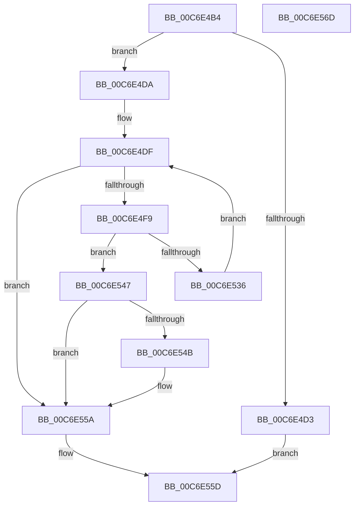

# VhdiQueryVolumeVhdFilePath

- RVA: `0x00C6E4B4`–`0x00C6E56E` (길이 `186` bytes)
- VA: `0x0000000140C6E4B4`
- 실행 섹션: `INIT`
- PDB 이름 있음: `예`; PDB Function 태그: `아니요`
- unwind 정보 RVA: `0x000D0050`
- 디코드: `51`개 명령, `186/186` bytes 표시
- 미해석 바이트: `0` (있으면 어셈블리에 `.byte`로 보존)

> 이 문서는 커널 이미지의 기계어와 PDB 기호를 분석해 생성했습니다. 4번과 5번은 함수 원형과 자료형을 바이너리 사용 방식에서 추정한 C 해석이며 원본 소스 복구 결과는 아닙니다.

## 1. Dependencies

- 직접 호출 지점: **4**; 고유 호출 대상: **3**
- 직접 호출자로 확인된 함수: **1**
- RIP 상대 이미지 참조: **0**

### Outgoing calls
- `0x00C6E4EC` → [ExAllocatePool2](../../poolcode/B8/ExAllocatePool2_function_00B820F0.md) (function, `0x00B820F0`)
- `0x00C6E52A` → [ZwDeviceIoControlFile](../../text/6A/ZwDeviceIoControlFile_function_006AD1B0.md) (function, `0x006AD1B0`)
- `0x00C6E53E` → [ExFreePoolWithTag](../../poolcode/B8/ExFreePoolWithTag_function_00B82870.md) (function, `0x00B82870`)
- `0x00C6E553` → [ExFreePoolWithTag](../../poolcode/B8/ExFreePoolWithTag_function_00B82870.md) (function, `0x00B82870`)

### Direct callers
- [VhdiInitializeBootDisk](VhdiInitializeBootDisk_function_00C6E190.md) at `0x00C6E302`

### Static image references
- 디코드된 RIP-relative 메모리 참조가 없습니다.

## 2. Other-region calls and transfers

- 다른 실행 섹션으로 향하는 call: **4**
  - `0x00C6E4EC` → [ExAllocatePool2](../../poolcode/B8/ExAllocatePool2_function_00B820F0.md) (`INIT` → `POOLCODE`)
  - `0x00C6E52A` → [ZwDeviceIoControlFile](../../text/6A/ZwDeviceIoControlFile_function_006AD1B0.md) (`INIT` → `.text`)
  - `0x00C6E53E` → [ExFreePoolWithTag](../../poolcode/B8/ExFreePoolWithTag_function_00B82870.md) (`INIT` → `POOLCODE`)
  - `0x00C6E553` → [ExFreePoolWithTag](../../poolcode/B8/ExFreePoolWithTag_function_00B82870.md) (`INIT` → `POOLCODE`)
- 별도 외부 분기/꼬리 이동을 확인하지 못했습니다.

## 3. Assembly (complete function range)

```asm
00C6E4B4  48 89 5C 24 08                  mov qword ptr [rsp + 8], rbx
00C6E4B9  48 89 74 24 10                  mov qword ptr [rsp + 0x10], rsi
00C6E4BE  57                              push rdi
00C6E4BF  48 83 EC 60                     sub rsp, 0x60
00C6E4C3  0F 57 C0                        xorps xmm0, xmm0
00C6E4C6  48 8B F1                        mov rsi, rcx
00C6E4C9  0F 11 44 24 50                  movups xmmword ptr [rsp + 0x50], xmm0
00C6E4CE  48 85 C9                        test rcx, rcx
00C6E4D1  75 07                           jne 0x140c6e4da
00C6E4D3  33 C0                           xor eax, eax
00C6E4D5  E9 83 00 00 00                  jmp 0x140c6e55d
00C6E4DA  BF 08 02 00 00                  mov edi, 0x208
00C6E4DF  8B D7                           mov edx, edi
00C6E4E1  B9 40 00 00 00                  mov ecx, 0x40
00C6E4E6  41 B8 56 68 64 42               mov r8d, 0x42646856
00C6E4EC  E8 FF 3B F1 FF                  call 0x140b820f0
00C6E4F1  48 8B D8                        mov rbx, rax
00C6E4F4  48 85 C0                        test rax, rax
00C6E4F7  74 61                           je 0x140c6e55a
00C6E4F9  89 7C 24 48                     mov dword ptr [rsp + 0x48], edi
00C6E4FD  45 33 C9                        xor r9d, r9d
00C6E500  48 89 44 24 40                  mov qword ptr [rsp + 0x40], rax
00C6E505  45 33 C0                        xor r8d, r8d
00C6E508  83 64 24 38 00                  and dword ptr [rsp + 0x38], 0
00C6E50D  48 8D 44 24 50                  lea rax, [rsp + 0x50]
00C6E512  48 83 64 24 30 00               and qword ptr [rsp + 0x30], 0
00C6E518  33 D2                           xor edx, edx
00C6E51A  C7 44 24 28 28 59 2D 00         mov dword ptr [rsp + 0x28], 0x2d5928
00C6E522  48 8B CE                        mov rcx, rsi
00C6E525  48 89 44 24 20                  mov qword ptr [rsp + 0x20], rax
00C6E52A  E8 81 EC A3 FF                  call 0x1406ad1b0
00C6E52F  3D 23 00 00 C0                  cmp eax, 0xc0000023
00C6E534  75 11                           jne 0x140c6e547
00C6E536  BA 56 68 64 42                  mov edx, 0x42646856
00C6E53B  48 8B CB                        mov rcx, rbx
00C6E53E  E8 2D 43 F1 FF                  call 0x140b82870
00C6E543  03 FF                           add edi, edi
00C6E545  EB 98                           jmp 0x140c6e4df
00C6E547  85 C0                           test eax, eax
00C6E549  79 0F                           jns 0x140c6e55a
00C6E54B  BA 56 68 64 42                  mov edx, 0x42646856
00C6E550  48 8B CB                        mov rcx, rbx
00C6E553  E8 18 43 F1 FF                  call 0x140b82870
00C6E558  33 DB                           xor ebx, ebx
00C6E55A  48 8B C3                        mov rax, rbx
00C6E55D  48 8B 5C 24 70                  mov rbx, qword ptr [rsp + 0x70]
00C6E562  48 8B 74 24 78                  mov rsi, qword ptr [rsp + 0x78]
00C6E567  48 83 C4 60                     add rsp, 0x60
00C6E56B  5F                              pop rdi
00C6E56C  C3                              ret
00C6E56D  CC                              int3
```

## 4. C-style interpretation (structured pseudocode)

```c
__int64 __fastcall VhdiQueryVolumeVhdFilePath(__int64 a1, __int64 a2, __int64 a3, int a4)
{
    __int64 result;
    __int64 v_rbx;
    __int64 v_rdi;
    __int64 v_rsp;
    unsigned __int64 v_stack_m18;
    unsigned int v_stack_m20;
    unsigned __int64 v_stack_m28;
    unsigned int v_stack_m30;
    unsigned __int64 v_stack_m38;
    unsigned int v_stack_m40;
    unsigned __int64 v_stack_m48;
    unsigned __int64 v_stack_p10;
    unsigned __int64 v_stack_p8;

    v_stack_p8 = v_rbx;
    v_stack_p10 = v_rsi;
    v_rsp = (v_rsp) - (96);
    v_stack_m18 = v_xmm0;
    if (a1 != 0) goto loc_00C6E4DA;
    result = 0;
    goto loc_00C6E55D;
loc_00C6E4DA:
loc_00C6E4DF:
    result = ExAllocatePool2(64, 520, (unsigned int)(0x42646856ULL), a4);
    if (result == 0) goto loc_00C6E55A;
    v_stack_m20 = 520;
    a4 = 0;
    v_stack_m28 = result;
    a3 = 0;
    a2 = 0;
    v_stack_m40 = 0x2D5928ULL;
    v_stack_m48 = v_stack_m18;
    result = ZwDeviceIoControlFile(a1, a2, a3, a4);
    if (((unsigned int)(result)) != 0xC0000023ULL) goto loc_00C6E547;
    result = ExFreePoolWithTag(result, (unsigned int)(0x42646856ULL), a3, a4);
    v_rdi = (unsigned int)((520) + (520));
    goto loc_00C6E4DF;
loc_00C6E547:
    v_rbx = result;
    if (sign_flag) {
        a2 = 0x42646856ULL;
        a1 = result;
        result = ExFreePoolWithTag(a1, a2, a3, a4);
        v_rbx = 0;
    }
loc_00C6E55D:
    v_rsp = (v_rsp) + (96);
    return 0;
}
```

## 5. (Beta) C Style

```c
int64_t VhdiQueryVolumeVhdFilePath(int64_t Arg1, int64_t Arg2, int64_t Arg3, int32_t Arg4)
{
    int64_t result;
    int64_t local_rbx;
    int64_t local_rdi;
    int64_t local_rsp;
    uint64_t v_stack_m18;
    uint32_t v_stack_m20;
    uint64_t v_stack_m28;
    uint32_t v_stack_m30;
    uint64_t v_stack_m38;
    uint32_t v_stack_m40;
    uint64_t v_stack_m48;
    uint64_t v_stack_p10;
    uint64_t v_stack_p8;

    v_stack_p8 = local_rbx;
    v_stack_p10 = local_rsi;
    local_rsp = (local_rsp) - (96);
    v_stack_m18 = v_xmm0;
    if (Arg1 != 0) goto loc_00C6E4DA;
    result = 0;
    goto loc_00C6E55D;
loc_00C6E4DA:
loc_00C6E4DF:
    result = ExAllocatePool2(64, 520, (uint32_t)(0x42646856ULL), Arg4);
    if (result == 0) goto loc_00C6E55A;
    v_stack_m20 = 520;
    Arg4 = 0;
    v_stack_m28 = result;
    Arg3 = 0;
    Arg2 = 0;
    v_stack_m40 = 0x2D5928ULL;
    v_stack_m48 = v_stack_m18;
    result = ZwDeviceIoControlFile(Arg1, Arg2, Arg3, Arg4);
    if (((uint32_t)(result)) != 0xC0000023ULL) goto loc_00C6E547;
    result = ExFreePoolWithTag(result, (uint32_t)(0x42646856ULL), Arg3, Arg4);
    local_rdi = (uint32_t)((520) + (520));
    goto loc_00C6E4DF;
loc_00C6E547:
    local_rbx = result;
    if (sign_flag) {
        Arg2 = 0x42646856ULL;
        Arg1 = result;
        result = ExFreePoolWithTag(Arg1, Arg2, Arg3, Arg4);
        local_rbx = 0;
    }
loc_00C6E55D:
    local_rsp = (local_rsp) + (96);
    return 0;
}
```

## 6. Execution-region graph

[열기: 2D/3D 그래프와 함수 탐색 컨트롤 패널](../../../control-panel.html?section=init&rva=0x00C6E4B4&view=graph)

- 2D 그래프는 위에서 아래로 흐르고, 3D 그래프는 빈 공간을 드래그해 회전합니다. Shift+드래그는 이동, 휠은 확대·축소, 함수 노드 선택은 대상 보고서 이동입니다.

### Static fallback


