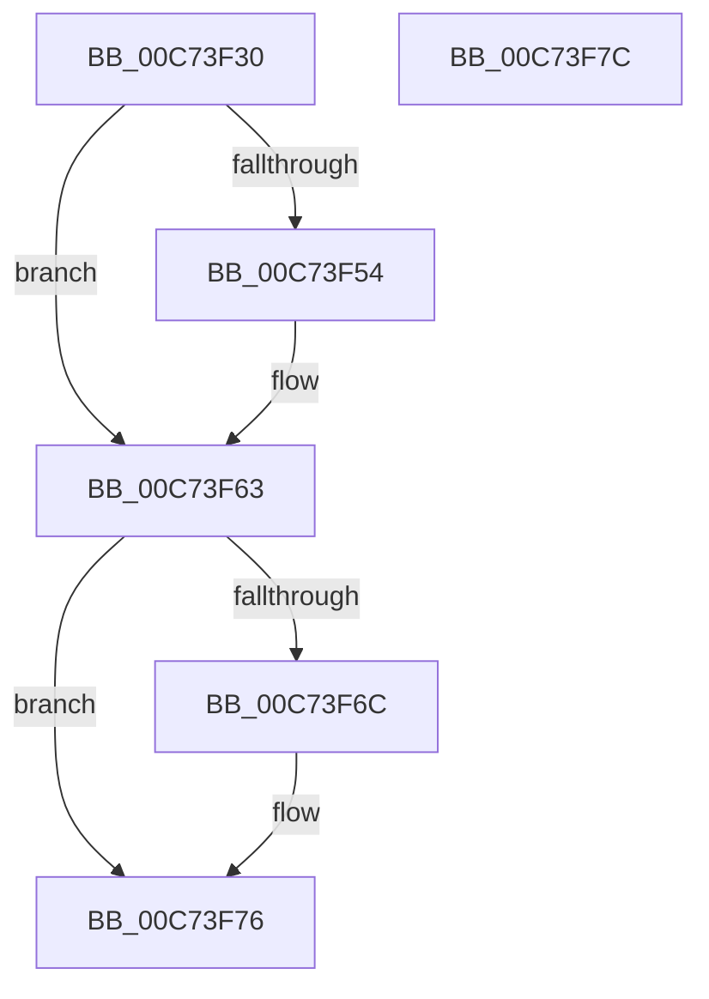

# CmpCloseSystemDriverHiveContext

- RVA: `0x00C73F30`–`0x00C73F7D` (길이 `77` bytes)
- VA: `0x0000000140C73F30`
- 실행 섹션: `INIT`
- PDB 이름 있음: `예`; PDB Function 태그: `아니요`
- unwind 정보 RVA: `0x0005CF00`
- 디코드: `22`개 명령, `77/77` bytes 표시
- 미해석 바이트: `0` (있으면 어셈블리에 `.byte`로 보존)

> 이 문서는 커널 이미지의 기계어와 PDB 기호를 분석해 생성했습니다. 4번과 5번은 함수 원형과 자료형을 바이너리 사용 방식에서 추정한 C 해석이며 원본 소스 복구 결과는 아닙니다.

## 1. Dependencies

- 직접 호출 지점: **3**; 고유 호출 대상: **3**
- 직접 호출자로 확인된 함수: **1**
- RIP 상대 이미지 참조: **0**

### Outgoing calls
- `0x00C73F46` → [RtlFreeAnsiString](../../page/9C/RtlFreeAnsiString_function_009C0800.md) (function, `0x009C0800`)
- `0x00C73F59` → [ObfDereferenceObjectWithTag](../../text/2F/ObfDereferenceObjectWithTag_function_002F78E0.md) (function, `0x002F78E0`)
- `0x00C73F6C` → [ZwClose](../../text/6A/ZwClose_function_006AD2B0.md) (function, `0x006AD2B0`)

### Direct callers
- [CmGetSystemDriverList](CmGetSystemDriverList_function_00C7380C.md) at `0x00C73CBB`
- [CmGetSystemDriverList](CmGetSystemDriverList_function_00C7380C.md) at `0x00C73CCA`
- [CmGetSystemDriverList](CmGetSystemDriverList_function_00C7380C.md) at `0x00C73D01`

### Static image references
- 디코드된 RIP-relative 메모리 참조가 없습니다.

## 2. Other-region calls and transfers

- 다른 실행 섹션으로 향하는 call: **3**
  - `0x00C73F46` → [RtlFreeAnsiString](../../page/9C/RtlFreeAnsiString_function_009C0800.md) (`INIT` → `PAGE`)
  - `0x00C73F59` → [ObfDereferenceObjectWithTag](../../text/2F/ObfDereferenceObjectWithTag_function_002F78E0.md) (`INIT` → `.text`)
  - `0x00C73F6C` → [ZwClose](../../text/6A/ZwClose_function_006AD2B0.md) (`INIT` → `.text`)
- 별도 외부 분기/꼬리 이동을 확인하지 못했습니다.

## 3. Assembly (complete function range)

```asm
00C73F30  40 53                           push rbx
00C73F32  48 83 EC 20                     sub rsp, 0x20
00C73F36  48 83 61 30 00                  and qword ptr [rcx + 0x30], 0
00C73F3B  48 8B D9                        mov rbx, rcx
00C73F3E  83 49 38 FF                     or dword ptr [rcx + 0x38], 0xffffffff
00C73F42  48 83 C1 10                     add rcx, 0x10
00C73F46  E8 B5 C8 D4 FF                  call 0x1409c0800
00C73F4B  48 8B 4B 28                     mov rcx, qword ptr [rbx + 0x28]
00C73F4F  48 85 C9                        test rcx, rcx
00C73F52  74 0F                           je 0x140c73f63
00C73F54  BA 44 66 6C 74                  mov edx, 0x746c6644
00C73F59  E8 82 39 68 FF                  call 0x1402f78e0
00C73F5E  48 83 63 28 00                  and qword ptr [rbx + 0x28], 0
00C73F63  48 8B 4B 20                     mov rcx, qword ptr [rbx + 0x20]
00C73F67  48 85 C9                        test rcx, rcx
00C73F6A  74 0A                           je 0x140c73f76
00C73F6C  E8 3F 93 A3 FF                  call 0x1406ad2b0
00C73F71  48 83 63 20 00                  and qword ptr [rbx + 0x20], 0
00C73F76  48 83 C4 20                     add rsp, 0x20
00C73F7A  5B                              pop rbx
00C73F7B  C3                              ret
00C73F7C  CC                              int3
```

## 4. C-style interpretation (structured pseudocode)

```c
__int64 __fastcall CmpCloseSystemDriverHiveContext(__int64 a1)
{
    __int64 result;
    __int64 v_rsp;

    v_rsp = (v_rsp) - (32);
    a1 = (a1) + (16);
    result = RtlFreeAnsiString(a1, a2, a3, a4);
    if (*(unsigned __int64 *)(a1 + 40) != 0) {
        a2 = 0x746C6644ULL;
        result = ObfDereferenceObjectWithTag(*(unsigned __int64 *)(a1 + 40), a2, a3, a4);
    }
    if (*(unsigned __int64 *)(a1 + 32) != 0) {
        result = ZwClose(*(unsigned __int64 *)(a1 + 32), a2, a3, a4);
    }
    v_rsp = (v_rsp) + (32);
    return result;
}
```

## 5. (Beta) C Style

```c
int64_t CmpCloseSystemDriverHiveContext(void *Arg1)
{
    uint8_t *arg1 = (uint8_t *)Arg1;

    int64_t result;
    int64_t local_rsp;

    local_rsp = (local_rsp) - (32);
    Arg1 = (Arg1) + (16);
    result = RtlFreeAnsiString(Arg1, a2, a3, a4);
    if (*(uint64_t *)(arg1 + 0x28) != 0) {
        a2 = 0x746C6644ULL;
        result = ObfDereferenceObjectWithTag(*(uint64_t *)(arg1 + 0x28), a2, a3, a4);
    }
    if (*(uint64_t *)(arg1 + 0x20) != 0) {
        result = ZwClose(*(uint64_t *)(arg1 + 0x20), a2, a3, a4);
    }
    local_rsp = (local_rsp) + (32);
    return result;
}
```

### 관측된 메모리 오프셋

구조체 형식이 확인되지 않은 접근은 인자 기준의 오프셋으로만 기록했습니다.

| 기준 인자 | 오프셋 표현 | 폭 (bit) | 접근 |
|---|---:|---:|---|
| `Arg1` | `+ 0x20` | `64` | `R` |
| `Arg1` | `+ 0x20` | `64` | `R/W` |
| `Arg1` | `+ 0x28` | `64` | `R` |
| `Arg1` | `+ 0x28` | `64` | `R/W` |
| `Arg1` | `+ 0x30` | `64` | `R/W` |
| `Arg1` | `+ 0x38` | `32` | `R/W` |

## 6. Execution-region graph

[열기: 2D/3D 그래프와 함수 탐색 컨트롤 패널](../../../control-panel.html?section=init&rva=0x00C73F30&view=graph)

- 2D 그래프는 위에서 아래로 흐르고, 3D 그래프는 빈 공간을 드래그해 회전합니다. Shift+드래그는 이동, 휠은 확대·축소, 함수 노드 선택은 대상 보고서 이동입니다.

### Static fallback


