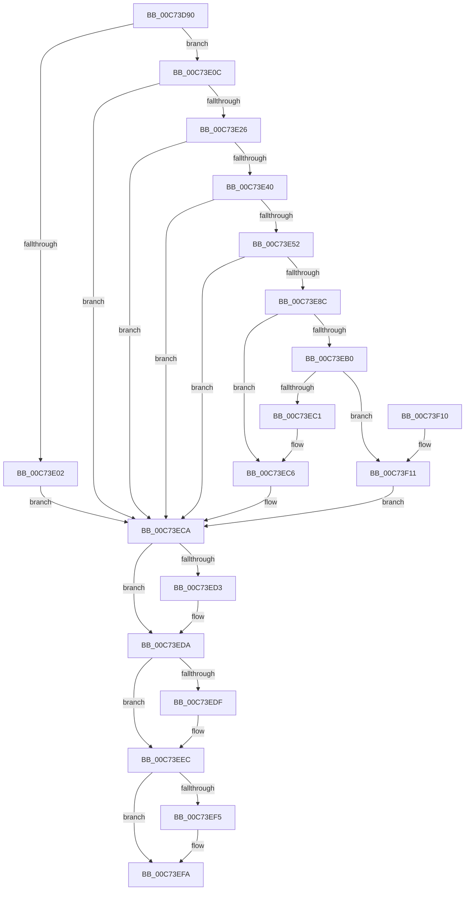

# CmpOpenSystemDriverHiveContext

- RVA: `0x00C73D90`–`0x00C73F27` (길이 `407` bytes)
- VA: `0x0000000140C73D90`
- 실행 섹션: `INIT`
- PDB 이름 있음: `예`; PDB Function 태그: `아니요`
- unwind 정보 RVA: `0x000BC6C4`
- 디코드: `114`개 명령, `407/407` bytes 표시
- 미해석 바이트: `0` (있으면 어셈블리에 `.byte`로 보존)

> 이 문서는 커널 이미지의 기계어와 PDB 기호를 분석해 생성했습니다. 4번과 5번은 함수 원형과 자료형을 바이너리 사용 방식에서 추정한 C 해석이며 원본 소스 복구 결과는 아닙니다.

## 1. Dependencies

- 직접 호출 지점: **10**; 고유 호출 대상: **9**
- 직접 호출자로 확인된 함수: **1**
- RIP 상대 이미지 참조: **2**

### Outgoing calls
- `0x00C73DF4` → [ExAllocatePool2](../../poolcode/B8/ExAllocatePool2_function_00B820F0.md) (function, `0x00B820F0`)
- `0x00C73E17` → [RtlAppendUnicodeStringToString](../../text/40/RtlAppendUnicodeStringToString_function_0040FA50.md) (function, `0x0040FA50`)
- `0x00C73E31` → [RtlAppendUnicodeToString](../../text/40/RtlAppendUnicodeToString_function_0040F990.md) (function, `0x0040F990`)
- `0x00C73E47` → [RtlAppendUnicodeStringToString](../../text/40/RtlAppendUnicodeStringToString_function_0040FA50.md) (function, `0x0040FA50`)
- `0x00C73E81` → [ZwOpenKey](../../text/6A/ZwOpenKey_function_006AD310.md) (function, `0x006AD310`)
- `0x00C73EA5` → [CmObReferenceObjectByHandle](../../pagecmrc/BC/CmObReferenceObjectByHandle_function_00BC9350.md) (function, `0x00BC9350`)
- `0x00C73EB8` → [RtlCreateUnicodeString](../../page/9B/RtlCreateUnicodeString_function_009BD860.md) (function, `0x009BD860`)
- `0x00C73ED5` → [ExFreePoolWithTag](../../poolcode/B8/ExFreePoolWithTag_function_00B82870.md) (function, `0x00B82870`)
- `0x00C73EE7` → [ObfDereferenceObjectWithTag](../../text/2F/ObfDereferenceObjectWithTag_function_002F78E0.md) (function, `0x002F78E0`)
- `0x00C73EF5` → [ZwClose](../../text/6A/ZwClose_function_006AD2B0.md) (function, `0x006AD2B0`)

### Direct callers
- [CmGetSystemDriverList](CmGetSystemDriverList_function_00C7380C.md) at `0x00C7390A`
- [CmGetSystemDriverList](CmGetSystemDriverList_function_00C7380C.md) at `0x00C7392A`
- [CmGetSystemDriverList](CmGetSystemDriverList_function_00C7380C.md) at `0x00C73A4E`

### Static image references
- `0x00C73DC3` → RVA `0x00FD9DD8` (`PAGEDATA`; read)
- `0x00C73E26` → RVA `0x00C7DCE0` (` ?? ::PBOPGDP::`string'`; read)

## 2. Other-region calls and transfers

- 다른 실행 섹션으로 향하는 call: **10**
  - `0x00C73DF4` → [ExAllocatePool2](../../poolcode/B8/ExAllocatePool2_function_00B820F0.md) (`INIT` → `POOLCODE`)
  - `0x00C73E17` → [RtlAppendUnicodeStringToString](../../text/40/RtlAppendUnicodeStringToString_function_0040FA50.md) (`INIT` → `.text`)
  - `0x00C73E31` → [RtlAppendUnicodeToString](../../text/40/RtlAppendUnicodeToString_function_0040F990.md) (`INIT` → `.text`)
  - `0x00C73E47` → [RtlAppendUnicodeStringToString](../../text/40/RtlAppendUnicodeStringToString_function_0040FA50.md) (`INIT` → `.text`)
  - `0x00C73E81` → [ZwOpenKey](../../text/6A/ZwOpenKey_function_006AD310.md) (`INIT` → `.text`)
  - `0x00C73EA5` → [CmObReferenceObjectByHandle](../../pagecmrc/BC/CmObReferenceObjectByHandle_function_00BC9350.md) (`INIT` → `PAGECMRC`)
  - `0x00C73EB8` → [RtlCreateUnicodeString](../../page/9B/RtlCreateUnicodeString_function_009BD860.md) (`INIT` → `PAGE`)
  - `0x00C73ED5` → [ExFreePoolWithTag](../../poolcode/B8/ExFreePoolWithTag_function_00B82870.md) (`INIT` → `POOLCODE`)
  - `0x00C73EE7` → [ObfDereferenceObjectWithTag](../../text/2F/ObfDereferenceObjectWithTag_function_002F78E0.md) (`INIT` → `.text`)
  - `0x00C73EF5` → [ZwClose](../../text/6A/ZwClose_function_006AD2B0.md) (`INIT` → `.text`)
- 별도 외부 분기/꼬리 이동을 확인하지 못했습니다.

## 3. Assembly (complete function range)

```asm
00C73D90  48 89 5C 24 10                  mov qword ptr [rsp + 0x10], rbx
00C73D95  55                              push rbp
00C73D96  56                              push rsi
00C73D97  57                              push rdi
00C73D98  41 56                           push r14
00C73D9A  41 57                           push r15
00C73D9C  48 8B EC                        mov rbp, rsp
00C73D9F  48 83 EC 70                     sub rsp, 0x70
00C73DA3  33 C0                           xor eax, eax
00C73DA5  45 33 FF                        xor r15d, r15d
00C73DA8  48 89 45 F0                     mov qword ptr [rbp - 0x10], rax
00C73DAC  0F 57 C0                        xorps xmm0, xmm0
00C73DAF  89 45 F8                        mov dword ptr [rbp - 8], eax
00C73DB2  48 8B F2                        mov rsi, rdx
00C73DB5  0F B7 01                        movzx eax, word ptr [rcx]
00C73DB8  4C 8B F1                        mov r14, rcx
00C73DBB  66 83 C0 04                     add ax, 4
00C73DBF  44 89 7D C4                     mov dword ptr [rbp - 0x3c], r15d
00C73DC3  66 03 05 0E 60 36 00            add ax, word ptr [rip + 0x36600e]
00C73DCA  B9 00 01 00 00                  mov ecx, 0x100
00C73DCF  0F B7 D0                        movzx edx, ax
00C73DD2  41 B8 43 4D 20 20               mov r8d, 0x20204d43
00C73DD8  66 89 55 C2                     mov word ptr [rbp - 0x3e], dx
00C73DDC  41 8B FF                        mov edi, r15d
00C73DDF  0F 11 45 D0                     movups xmmword ptr [rbp - 0x30], xmm0
00C73DE3  4C 89 7D 40                     mov qword ptr [rbp + 0x40], r15
00C73DE7  0F 11 45 E0                     movups xmmword ptr [rbp - 0x20], xmm0
00C73DEB  4C 89 7D 30                     mov qword ptr [rbp + 0x30], r15
00C73DEF  66 44 89 7D C0                  mov word ptr [rbp - 0x40], r15w
00C73DF4  E8 F7 E2 F0 FF                  call 0x140b820f0
00C73DF9  48 89 45 C8                     mov qword ptr [rbp - 0x38], rax
00C73DFD  48 85 C0                        test rax, rax
00C73E00  75 0A                           jne 0x140c73e0c
00C73E02  BB 17 00 00 C0                  mov ebx, 0xc0000017
00C73E07  E9 BE 00 00 00                  jmp 0x140c73eca
00C73E0C  48 8D 15 C5 5F 36 00            lea rdx, [rip + 0x365fc5]
00C73E13  48 8D 4D C0                     lea rcx, [rbp - 0x40]
00C73E17  E8 34 BC 79 FF                  call 0x14040fa50
00C73E1C  8B D8                           mov ebx, eax
00C73E1E  85 C0                           test eax, eax
00C73E20  0F 88 A4 00 00 00               js 0x140c73eca
00C73E26  48 8D 15 B3 9E 00 00            lea rdx, [rip + 0x9eb3]
00C73E2D  48 8D 4D C0                     lea rcx, [rbp - 0x40]
00C73E31  E8 5A BB 79 FF                  call 0x14040f990
00C73E36  8B D8                           mov ebx, eax
00C73E38  85 C0                           test eax, eax
00C73E3A  0F 88 8A 00 00 00               js 0x140c73eca
00C73E40  49 8B D6                        mov rdx, r14
00C73E43  48 8D 4D C0                     lea rcx, [rbp - 0x40]
00C73E47  E8 04 BC 79 FF                  call 0x14040fa50
00C73E4C  8B D8                           mov ebx, eax
00C73E4E  85 C0                           test eax, eax
00C73E50  78 78                           js 0x140c73eca
00C73E52  48 8D 45 C0                     lea rax, [rbp - 0x40]
00C73E56  C7 45 D0 30 00 00 00            mov dword ptr [rbp - 0x30], 0x30
00C73E5D  0F 57 C0                        xorps xmm0, xmm0
00C73E60  48 89 45 E0                     mov qword ptr [rbp - 0x20], rax
00C73E64  4C 8D 45 D0                     lea r8, [rbp - 0x30]
00C73E68  4C 89 7D D8                     mov qword ptr [rbp - 0x28], r15
00C73E6C  BA 19 00 02 00                  mov edx, 0x20019
00C73E71  C7 45 E8 40 02 00 00            mov dword ptr [rbp - 0x18], 0x240
00C73E78  48 8D 4D 30                     lea rcx, [rbp + 0x30]
00C73E7C  F3 0F 7F 45 F0                  movdqu xmmword ptr [rbp - 0x10], xmm0
00C73E81  E8 8A 94 A3 FF                  call 0x1406ad310
00C73E86  8B D8                           mov ebx, eax
00C73E88  85 C0                           test eax, eax
00C73E8A  78 3E                           js 0x140c73eca
00C73E8C  48 8B 4D 30                     mov rcx, qword ptr [rbp + 0x30]
00C73E90  48 8D 45 40                     lea rax, [rbp + 0x40]
00C73E94  45 33 C9                        xor r9d, r9d
00C73E97  4C 89 7C 24 28                  mov qword ptr [rsp + 0x28], r15
00C73E9C  48 89 44 24 20                  mov qword ptr [rsp + 0x20], rax
00C73EA1  41 8D 51 01                     lea edx, [r9 + 1]
00C73EA5  E8 A6 54 F5 FF                  call 0x140bc9350
00C73EAA  8B D8                           mov ebx, eax
00C73EAC  85 C0                           test eax, eax
00C73EAE  78 16                           js 0x140c73ec6
00C73EB0  49 8B 56 08                     mov rdx, qword ptr [r14 + 8]
00C73EB4  48 8D 4E 10                     lea rcx, [rsi + 0x10]
00C73EB8  E8 A3 99 D4 FF                  call 0x1409bd860
00C73EBD  84 C0                           test al, al
00C73EBF  75 50                           jne 0x140c73f11
00C73EC1  BB 17 00 00 C0                  mov ebx, 0xc0000017
00C73EC6  48 8B 7D 40                     mov rdi, qword ptr [rbp + 0x40]
00C73ECA  48 8B 4D C8                     mov rcx, qword ptr [rbp - 0x38]
00C73ECE  48 85 C9                        test rcx, rcx
00C73ED1  74 07                           je 0x140c73eda
00C73ED3  33 D2                           xor edx, edx
00C73ED5  E8 96 E9 F0 FF                  call 0x140b82870
00C73EDA  48 85 FF                        test rdi, rdi
00C73EDD  74 0D                           je 0x140c73eec
00C73EDF  BA 44 66 6C 74                  mov edx, 0x746c6644
00C73EE4  48 8B CF                        mov rcx, rdi
00C73EE7  E8 F4 39 68 FF                  call 0x1402f78e0
00C73EEC  48 8B 4D 30                     mov rcx, qword ptr [rbp + 0x30]
00C73EF0  48 85 C9                        test rcx, rcx
00C73EF3  74 05                           je 0x140c73efa
00C73EF5  E8 B6 93 A3 FF                  call 0x1406ad2b0
00C73EFA  8B C3                           mov eax, ebx
00C73EFC  48 8B 9C 24 A8 00 00 00         mov rbx, qword ptr [rsp + 0xa8]
00C73F04  48 83 C4 70                     add rsp, 0x70
00C73F08  41 5F                           pop r15
00C73F0A  41 5E                           pop r14
00C73F0C  5F                              pop rdi
00C73F0D  5E                              pop rsi
00C73F0E  5D                              pop rbp
00C73F0F  C3                              ret
00C73F10  CC                              int3
00C73F11  48 8B 45 30                     mov rax, qword ptr [rbp + 0x30]
00C73F15  48 89 46 20                     mov qword ptr [rsi + 0x20], rax
00C73F19  48 8B 45 40                     mov rax, qword ptr [rbp + 0x40]
00C73F1D  48 89 46 28                     mov qword ptr [rsi + 0x28], rax
00C73F21  4C 89 7D 30                     mov qword ptr [rbp + 0x30], r15
00C73F25  EB A3                           jmp 0x140c73eca
```

## 4. C-style interpretation (structured pseudocode)

```c
__int64 __fastcall CmpOpenSystemDriverHiveContext(__int64 a1, __int64 a2, __int64 a3, int a4)
{
    __int64 result;
    __int64 v_r15;
    __int64 v_rsp;
    unsigned int v_stack_m30;
    unsigned __int64 v_stack_m38;
    unsigned int v_stack_m40;
    unsigned __int64 v_stack_m48;
    unsigned __int64 v_stack_m50;
    unsigned __int64 v_stack_m58;
    unsigned __int64 v_stack_m60;
    unsigned int v_stack_m64;
    unsigned __int16 v_stack_m66;
    unsigned __int16 v_stack_m68;
    unsigned __int64 v_stack_m70;
    unsigned __int64 v_stack_m78;
    unsigned __int64 v_stack_p10;
    unsigned __int64 v_stack_p18;
    unsigned __int64 v_stack_p8;

    v_stack_p10 = v_rbx;
    v_rsp = (v_rsp) - (112);
    result = 0;
    v_r15 = 0;
    v_stack_m38 = 0;
    v_stack_m30 = 0;
    result = (unsigned __int16)((*(unsigned __int16 *)(a1)) + (4));
    v_stack_m64 = 0;
    result = (unsigned __int16)((result) + (*(unsigned __int16 *)(v_rip + 3563534)));
    v_stack_m66 = (unsigned __int16)((unsigned __int16)(result));
    v_stack_m58 = v_xmm0;
    v_stack_p18 = 0;
    v_stack_m48 = v_xmm0;
    v_stack_p8 = 0;
    v_stack_m68 = 0;
    result = ExAllocatePool2(256, (unsigned __int16)(result), (unsigned int)(0x20204D43ULL), a4);
    v_stack_m60 = result;
    if (result != 0) goto loc_00C73E0C;
    goto loc_00C73ECA;
loc_00C73E0C:
    result = RtlAppendUnicodeStringToString(v_stack_m68, v_rip + 3563461, (unsigned int)(0x20204D43ULL), a4);
    if (sign_flag) goto loc_00C73ECA;
    result = RtlAppendUnicodeToString(v_stack_m68, v_rip + 40627, (unsigned int)(0x20204D43ULL), a4);
    if (sign_flag) goto loc_00C73ECA;
    result = RtlAppendUnicodeStringToString(v_stack_m68, a1, (unsigned int)(0x20204D43ULL), a4);
    if (sign_flag) goto loc_00C73ECA;
    v_stack_m58 = 48;
    v_stack_m48 = v_stack_m68;
    v_stack_m50 = 0;
    v_stack_m40 = 576;
    v_stack_m38 = v_xmm0;
    result = ZwOpenKey(v_stack_p8, (unsigned int)(0x20019ULL), v_stack_m58, a4);
    if (sign_flag) goto loc_00C73ECA;
    a4 = 0;
    v_stack_m70 = 0;
    v_stack_m78 = v_stack_p18;
    result = CmObReferenceObjectByHandle(v_stack_p8, a4 + 1, v_stack_m58, a4);
    if (sign_flag) goto loc_00C73EC6;
    result = RtlCreateUnicodeString(a2 + 16, *(unsigned __int64 *)(a1 + 8), v_stack_m58, a4);
    if ((unsigned __int8)(result) != 0) goto loc_00C73F11;
loc_00C73EC6:
loc_00C73ECA:
    if (v_stack_m60 != 0) {
        a2 = 0;
        result = ExFreePoolWithTag(v_stack_m60, a2, v_stack_m58, a4);
    }
    if (v_stack_p18 != 0) {
        a2 = 0x746C6644ULL;
        a1 = v_stack_p18;
        result = ObfDereferenceObjectWithTag(a1, a2, v_stack_m58, a4);
    }
    if (v_stack_p8 != 0) {
        result = ZwClose(v_stack_p8, a2, v_stack_m58, a4);
    }
    v_rsp = (v_rsp) + (112);
    return (unsigned int)((unsigned int)((unsigned int)(0xC0000017ULL)));
loc_00C73F11:
    *(unsigned __int64 *)(a2 + 32) = v_stack_p8;
    *(unsigned __int64 *)(a2 + 40) = v_stack_p18;
    v_stack_p8 = 0;
    goto loc_00C73ECA;
}
```

## 5. (Beta) C Style

```c
int64_t CmpOpenSystemDriverHiveContext(void *Arg1, void *Arg2, int64_t Arg3, int32_t Arg4)
{
    uint8_t *arg1 = (uint8_t *)Arg1;
    uint8_t *arg2 = (uint8_t *)Arg2;

    int64_t result;
    int64_t local_r15;
    int64_t local_rsp;
    uint32_t v_stack_m30;
    uint64_t v_stack_m38;
    uint32_t v_stack_m40;
    uint64_t v_stack_m48;
    uint64_t v_stack_m50;
    uint64_t v_stack_m58;
    uint64_t v_stack_m60;
    uint32_t v_stack_m64;
    uint16_t v_stack_m66;
    uint16_t v_stack_m68;
    uint64_t v_stack_m70;
    uint64_t v_stack_m78;
    uint64_t v_stack_p10;
    uint64_t v_stack_p18;
    uint64_t v_stack_p8;

    v_stack_p10 = local_rbx;
    local_rsp = (local_rsp) - (112);
    result = 0;
    local_r15 = 0;
    v_stack_m38 = 0;
    v_stack_m30 = 0;
    result = (uint16_t)((*(uint16_t *)(arg1)) + (4));
    v_stack_m64 = 0;
    result = (uint16_t)((result) + (*(uint16_t *)(v_rip + 0x36600E)));
    v_stack_m66 = (uint16_t)((uint16_t)(result));
    v_stack_m58 = v_xmm0;
    v_stack_p18 = 0;
    v_stack_m48 = v_xmm0;
    v_stack_p8 = 0;
    v_stack_m68 = 0;
    result = ExAllocatePool2(256, (uint16_t)(result), (uint32_t)(0x20204D43ULL), Arg4);
    v_stack_m60 = result;
    if (result != 0) goto loc_00C73E0C;
    goto loc_00C73ECA;
loc_00C73E0C:
    result = RtlAppendUnicodeStringToString(v_stack_m68, v_rip + 3563461, (uint32_t)(0x20204D43ULL), Arg4);
    if (sign_flag) goto loc_00C73ECA;
    result = RtlAppendUnicodeToString(v_stack_m68, v_rip + 40627, (uint32_t)(0x20204D43ULL), Arg4);
    if (sign_flag) goto loc_00C73ECA;
    result = RtlAppendUnicodeStringToString(v_stack_m68, Arg1, (uint32_t)(0x20204D43ULL), Arg4);
    if (sign_flag) goto loc_00C73ECA;
    v_stack_m58 = 48;
    v_stack_m48 = v_stack_m68;
    v_stack_m50 = 0;
    v_stack_m40 = 576;
    v_stack_m38 = v_xmm0;
    result = ZwOpenKey(v_stack_p8, (uint32_t)(0x20019ULL), v_stack_m58, Arg4);
    if (sign_flag) goto loc_00C73ECA;
    Arg4 = 0;
    v_stack_m70 = 0;
    v_stack_m78 = v_stack_p18;
    result = CmObReferenceObjectByHandle(v_stack_p8, Arg4 + 1, v_stack_m58, Arg4);
    if (sign_flag) goto loc_00C73EC6;
    result = RtlCreateUnicodeString(Arg2 + 16, *(uint64_t *)(arg1 + 0x8), v_stack_m58, Arg4);
    if ((uint8_t)(result) != 0) goto loc_00C73F11;
loc_00C73EC6:
loc_00C73ECA:
    if (v_stack_m60 != 0) {
        Arg2 = 0;
        result = ExFreePoolWithTag(v_stack_m60, Arg2, v_stack_m58, Arg4);
    }
    if (v_stack_p18 != 0) {
        Arg2 = 0x746C6644ULL;
        Arg1 = v_stack_p18;
        result = ObfDereferenceObjectWithTag(Arg1, Arg2, v_stack_m58, Arg4);
    }
    if (v_stack_p8 != 0) {
        result = ZwClose(v_stack_p8, Arg2, v_stack_m58, Arg4);
    }
    local_rsp = (local_rsp) + (112);
    return (uint32_t)((uint32_t)((uint32_t)(0xC0000017ULL)));
loc_00C73F11:
    *(uint64_t *)(arg2 + 0x20) = v_stack_p8;
    *(uint64_t *)(arg2 + 0x28) = v_stack_p18;
    v_stack_p8 = 0;
    goto loc_00C73ECA;
}
```

### 관측된 메모리 오프셋

구조체 형식이 확인되지 않은 접근은 인자 기준의 오프셋으로만 기록했습니다.

| 기준 인자 | 오프셋 표현 | 폭 (bit) | 접근 |
|---|---:|---:|---|
| `Arg1` | `+ 0x0` | `16` | `R` |
| `Arg1` | `+ 0x8` | `64` | `R` |
| `Arg2` | `+ 0x10` | `64` | `R` |
| `Arg2` | `+ 0x20` | `64` | `W` |
| `Arg2` | `+ 0x28` | `64` | `W` |

## 6. Execution-region graph

[열기: 2D/3D 그래프와 함수 탐색 컨트롤 패널](../../../control-panel.html?section=init&rva=0x00C73D90&view=graph)

- 2D 그래프는 위에서 아래로 흐르고, 3D 그래프는 빈 공간을 드래그해 회전합니다. Shift+드래그는 이동, 휠은 확대·축소, 함수 노드 선택은 대상 보고서 이동입니다.

### Static fallback


