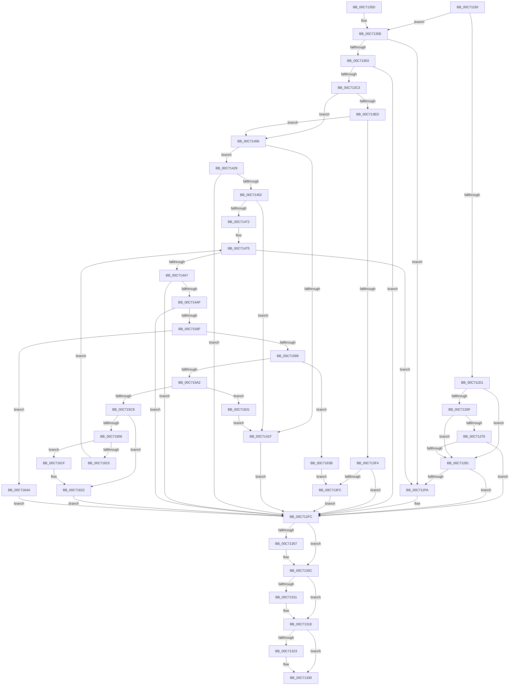

# EmInitSystem

- RVA: `0x00C71150`–`0x00C71659` (길이 `1,289` bytes)
- VA: `0x0000000140C71150`
- 실행 섹션: `INIT`
- PDB 이름 있음: `예`; PDB Function 태그: `아니요`
- unwind 정보 RVA: `0x000BAF20`
- 디코드: `302`개 명령, `1,289/1,289` bytes 표시
- 미해석 바이트: `0` (있으면 어셈블리에 `.byte`로 보존)

> 이 문서는 커널 이미지의 기계어와 PDB 기호를 분석해 생성했습니다. 4번과 5번은 함수 원형과 자료형을 바이너리 사용 방식에서 추정한 C 해석이며 원본 소스 복구 결과는 아닙니다.

## 1. Dependencies

- 직접 호출 지점: **30**; 고유 호출 대상: **15**
- 직접 호출자로 확인된 함수: **2**
- RIP 상대 이미지 참조: **28**

### Outgoing calls
- `0x00C71276` → [EmpParseInfDatabase](../C2/EmpParseInfDatabase_function_00C26934.md) (function, `0x00C26934`)
- `0x00C71281` → [EmpCacheBiosDate](EmpCacheBiosDate_function_00C73258.md) (function, `0x00C73258`)
- `0x00C712A7` → [EmpProviderRegister](../../page/AC/EmpProviderRegister_function_00ACC5D0.md) (function, `0x00ACC5D0`)
- `0x00C712CC` → [EmpProviderRegister](../../page/AC/EmpProviderRegister_function_00ACC5D0.md) (function, `0x00ACC5D0`)
- `0x00C712EF` → [EmpProviderRegister](../../page/AC/EmpProviderRegister_function_00ACC5D0.md) (function, `0x00ACC5D0`)
- `0x00C71307` → [ZwClose](../../text/6A/ZwClose_function_006AD2B0.md) (function, `0x006AD2B0`)
- `0x00C71319` → [ExFreePoolWithTag](../../poolcode/B8/ExFreePoolWithTag_function_00B82870.md) (function, `0x00B82870`)
- `0x00C7132B` → [ExFreePoolWithTag](../../poolcode/B8/ExFreePoolWithTag_function_00B82870.md) (function, `0x00B82870`)
- `0x00C7133C` → [_security_check_cookie](../../text/6A/_security_check_cookie_function_006AC640.md) (function, `0x006AC640`)
- `0x00C7136E` → [RtlInitUnicodeString](../../text/42/RtlInitUnicodeString_function_0042A780.md) (function, `0x0042A780`)
- `0x00C713B4` → [ZwCreateKey](../../text/6A/ZwCreateKey_function_006AD470.md) (function, `0x006AD470`)
- `0x00C713DF` → [ZwQueryKey](../../text/6A/ZwQueryKey_function_006AD390.md) (function, `0x006AD390`)
- `0x00C71412` → [ExAllocatePool2](../../poolcode/B8/ExAllocatePool2_function_00B820F0.md) (function, `0x00B820F0`)
- `0x00C71443` → [ZwQueryKey](../../text/6A/ZwQueryKey_function_006AD390.md) (function, `0x006AD390`)
- `0x00C71465` → [ExAllocatePool2](../../poolcode/B8/ExAllocatePool2_function_00B820F0.md) (function, `0x00B820F0`)
- `0x00C71495` → [ZwEnumerateValueKey](../../text/6A/ZwEnumerateValueKey_function_006AD330.md) (function, `0x006AD330`)
- `0x00C714C9` → [RtlInitUnicodeString](../../text/42/RtlInitUnicodeString_function_0042A780.md) (function, `0x0042A780`)
- `0x00C714D6` → [RtlAppendStringToString](../../page/A9/RtlAppendStringToString_function_00A97740.md) (function, `0x00A97740`)
- `0x00C714EC` → [RtlInitUnicodeString](../../text/42/RtlInitUnicodeString_function_0042A780.md) (function, `0x0042A780`)
- `0x00C714F9` → [RtlAppendStringToString](../../page/A9/RtlAppendStringToString_function_00A97740.md) (function, `0x00A97740`)
- `0x00C71560` → [ZwCreateFile](../../text/6A/ZwCreateFile_function_006ADB70.md) (function, `0x006ADB70`)
- `0x00C7158A` → [ZwQueryInformationFile](../../text/6A/ZwQueryInformationFile_function_006AD2F0.md) (function, `0x006AD2F0`)
- `0x00C715B6` → [ExAllocatePool2](../../poolcode/B8/ExAllocatePool2_function_00B820F0.md) (function, `0x00B820F0`)
- `0x00C715EE` → [ZwReadFile](../../text/6A/ZwReadFile_function_006AD190.md) (function, `0x006AD190`)
- `0x00C715FA` → [ZwClose](../../text/6A/ZwClose_function_006AD2B0.md) (function, `0x006AD2B0`)
- `0x00C7160A` → [EmpParseInfDatabase](../C2/EmpParseInfDatabase_function_00C26934.md) (function, `0x00C26934`)
- `0x00C71627` → [ExFreePoolWithTag](../../poolcode/B8/ExFreePoolWithTag_function_00B82870.md) (function, `0x00B82870`)
- `0x00C71631` → [ZwClose](../../text/6A/ZwClose_function_006AD2B0.md) (function, `0x006AD2B0`)
- `0x00C71640` → [ZwClose](../../text/6A/ZwClose_function_006AD2B0.md) (function, `0x006AD2B0`)
- `0x00C7164F` → [ZwClose](../../text/6A/ZwClose_function_006AD2B0.md) (function, `0x006AD2B0`)

### Direct callers
- [Phase1InitializationDiscard](../C1/Phase1InitializationDiscard_function_00C1C728.md) at `0x00C1D588`
- [Phase1InitializationIoReady](Phase1InitializationIoReady_function_00C70458.md) at `0x00C704F0`

### Static image references
- `0x00C71171` → RVA `0x00E0A740` (`.data`; read)
- `0x00C711D1` → RVA `0x00F8F1F8` (`.data`; read/write)
- `0x00C711D9` → RVA `0x00580B20` (`EmpRuleUpdateWorkerThread`; read)
- `0x00C711E0` → RVA `0x00F8F1D0` (`.data`; write)
- `0x00C711E7` → RVA `0x00F8F188` (`.data`; write)
- `0x00C711EE` → RVA `0x00F8F1E0` (`.data`; write)
- `0x00C711F5` → RVA `0x00F8F200` (`.data`; write)
- `0x00C711FC` → RVA `0x00F8F190` (`.data`; write)
- `0x00C71203` → RVA `0x00F8F198` (`.data`; write)
- `0x00C7120A` → RVA `0x00F8F1A0` (`.data`; write)
- `0x00C71211` → RVA `0x00F8F178` (`.data`; write)
- `0x00C71218` → RVA `0x00F8F168` (`.data`; write)
- `0x00C7121F` → RVA `0x00F8F180` (`.data`; write)
- `0x00C71226` → RVA `0x00F8F170` (`.data`; write)
- `0x00C7122C` → RVA `0x00F8F1D8` (`.data`; write)
- `0x00C71233` → RVA `0x00F8F1C0` (`.data`; write)
- `0x00C71241` → RVA `0x00E65BE0` (`.data`; write)
- `0x00C71248` → RVA `0x00E65BE8` (`.data`; write)
- `0x00C7124E` → RVA `0x00E65BEC` (`.data`; write)
- `0x00C71258` → RVA `0x00E65BD4` (`.data`; write)
- `0x00C7125E` → RVA `0x00E65BDC` (`.data`; write)
- `0x00C71264` → RVA `0x00E65BD8` (`.data`; write)
- `0x00C71295` → RVA `0x000064A0` (`.rdata`; read)
- `0x00C712B9` → RVA `0x00006530` (`.rdata`; read)
- `0x00C712D1` → RVA `0x00F8F120` (`.data`; read)
- `0x00C712E0` → RVA `0x00006410` (`.rdata`; read)
- `0x00C71363` → RVA `0x00C795F0` (` ?? ::PBOPGDP::`string'`; read)
- `0x00C714BA` → RVA `0x00C795C0` (` ?? ::PBOPGDP::`string'`; read)

## 2. Other-region calls and transfers

- 다른 실행 섹션으로 향하는 call: **27**
  - `0x00C712A7` → [EmpProviderRegister](../../page/AC/EmpProviderRegister_function_00ACC5D0.md) (`INIT` → `PAGE`)
  - `0x00C712CC` → [EmpProviderRegister](../../page/AC/EmpProviderRegister_function_00ACC5D0.md) (`INIT` → `PAGE`)
  - `0x00C712EF` → [EmpProviderRegister](../../page/AC/EmpProviderRegister_function_00ACC5D0.md) (`INIT` → `PAGE`)
  - `0x00C71307` → [ZwClose](../../text/6A/ZwClose_function_006AD2B0.md) (`INIT` → `.text`)
  - `0x00C71319` → [ExFreePoolWithTag](../../poolcode/B8/ExFreePoolWithTag_function_00B82870.md) (`INIT` → `POOLCODE`)
  - `0x00C7132B` → [ExFreePoolWithTag](../../poolcode/B8/ExFreePoolWithTag_function_00B82870.md) (`INIT` → `POOLCODE`)
  - `0x00C7133C` → [_security_check_cookie](../../text/6A/_security_check_cookie_function_006AC640.md) (`INIT` → `.text`)
  - `0x00C7136E` → [RtlInitUnicodeString](../../text/42/RtlInitUnicodeString_function_0042A780.md) (`INIT` → `.text`)
  - `0x00C713B4` → [ZwCreateKey](../../text/6A/ZwCreateKey_function_006AD470.md) (`INIT` → `.text`)
  - `0x00C713DF` → [ZwQueryKey](../../text/6A/ZwQueryKey_function_006AD390.md) (`INIT` → `.text`)
  - `0x00C71412` → [ExAllocatePool2](../../poolcode/B8/ExAllocatePool2_function_00B820F0.md) (`INIT` → `POOLCODE`)
  - `0x00C71443` → [ZwQueryKey](../../text/6A/ZwQueryKey_function_006AD390.md) (`INIT` → `.text`)
  - `0x00C71465` → [ExAllocatePool2](../../poolcode/B8/ExAllocatePool2_function_00B820F0.md) (`INIT` → `POOLCODE`)
  - `0x00C71495` → [ZwEnumerateValueKey](../../text/6A/ZwEnumerateValueKey_function_006AD330.md) (`INIT` → `.text`)
  - `0x00C714C9` → [RtlInitUnicodeString](../../text/42/RtlInitUnicodeString_function_0042A780.md) (`INIT` → `.text`)
  - `0x00C714D6` → [RtlAppendStringToString](../../page/A9/RtlAppendStringToString_function_00A97740.md) (`INIT` → `PAGE`)
  - `0x00C714EC` → [RtlInitUnicodeString](../../text/42/RtlInitUnicodeString_function_0042A780.md) (`INIT` → `.text`)
  - `0x00C714F9` → [RtlAppendStringToString](../../page/A9/RtlAppendStringToString_function_00A97740.md) (`INIT` → `PAGE`)
  - `0x00C71560` → [ZwCreateFile](../../text/6A/ZwCreateFile_function_006ADB70.md) (`INIT` → `.text`)
  - `0x00C7158A` → [ZwQueryInformationFile](../../text/6A/ZwQueryInformationFile_function_006AD2F0.md) (`INIT` → `.text`)
  - `0x00C715B6` → [ExAllocatePool2](../../poolcode/B8/ExAllocatePool2_function_00B820F0.md) (`INIT` → `POOLCODE`)
  - `0x00C715EE` → [ZwReadFile](../../text/6A/ZwReadFile_function_006AD190.md) (`INIT` → `.text`)
  - `0x00C715FA` → [ZwClose](../../text/6A/ZwClose_function_006AD2B0.md) (`INIT` → `.text`)
  - `0x00C71627` → [ExFreePoolWithTag](../../poolcode/B8/ExFreePoolWithTag_function_00B82870.md) (`INIT` → `POOLCODE`)
  - `0x00C71631` → [ZwClose](../../text/6A/ZwClose_function_006AD2B0.md) (`INIT` → `.text`)
  - `0x00C71640` → [ZwClose](../../text/6A/ZwClose_function_006AD2B0.md) (`INIT` → `.text`)
  - `0x00C7164F` → [ZwClose](../../text/6A/ZwClose_function_006AD2B0.md) (`INIT` → `.text`)
- 별도 외부 분기/꼬리 이동을 확인하지 못했습니다.

## 3. Assembly (complete function range)

```asm
00C71150  48 89 5C 24 08                  mov qword ptr [rsp + 8], rbx
00C71155  48 89 74 24 18                  mov qword ptr [rsp + 0x18], rsi
00C7115A  55                              push rbp
00C7115B  57                              push rdi
00C7115C  41 54                           push r12
00C7115E  41 55                           push r13
00C71160  41 56                           push r14
00C71162  48 8D AC 24 F0 FE FF FF         lea rbp, [rsp - 0x110]
00C7116A  48 81 EC 10 02 00 00            sub rsp, 0x210
00C71171  48 8B 05 C8 95 19 00            mov rax, qword ptr [rip + 0x1995c8]
00C71178  48 33 C4                        xor rax, rsp
00C7117B  48 89 85 00 01 00 00            mov qword ptr [rbp + 0x100], rax
00C71182  0F 57 C0                        xorps xmm0, xmm0
00C71185  33 C0                           xor eax, eax
00C71187  33 FF                           xor edi, edi
00C71189  48 89 45 F0                     mov qword ptr [rbp - 0x10], rax
00C7118D  48 89 45 C0                     mov qword ptr [rbp - 0x40], rax
00C71191  8B F7                           mov esi, edi
00C71193  89 45 C8                        mov dword ptr [rbp - 0x38], eax
00C71196  44 8B F7                        mov r14d, edi
00C71199  48 83 C8 FF                     or rax, 0xffffffffffffffff
00C7119D  89 7C 24 60                     mov dword ptr [rsp + 0x60], edi
00C711A1  48 89 44 24 70                  mov qword ptr [rsp + 0x70], rax
00C711A6  41 BD 45 4D 69 74               mov r13d, 0x74694d45
00C711AC  48 89 44 24 68                  mov qword ptr [rsp + 0x68], rax
00C711B1  0F 11 45 E0                     movups xmmword ptr [rbp - 0x20], xmm0
00C711B5  0F 11 45 90                     movups xmmword ptr [rbp - 0x70], xmm0
00C711B9  0F 11 45 D0                     movups xmmword ptr [rbp - 0x30], xmm0
00C711BD  0F 11 45 A0                     movups xmmword ptr [rbp - 0x60], xmm0
00C711C1  0F 11 45 B0                     movups xmmword ptr [rbp - 0x50], xmm0
00C711C5  0F 11 45 80                     movups xmmword ptr [rbp - 0x80], xmm0
00C711C9  85 C9                           test ecx, ecx
00C711CB  0F 85 8D 01 00 00               jne 0x140c7135e
00C711D1  0F BA 2D 1F E0 31 00 1F         bts dword ptr [rip + 0x31e01f], 0x1f
00C711D9  48 8D 05 40 F9 90 FF            lea rax, [rip - 0x6f06c0]
00C711E0  48 89 05 E9 DF 31 00            mov qword ptr [rip + 0x31dfe9], rax
00C711E7  48 89 3D 9A DF 31 00            mov qword ptr [rip + 0x31df9a], rdi
00C711EE  48 89 3D EB DF 31 00            mov qword ptr [rip + 0x31dfeb], rdi
00C711F5  48 89 3D 04 E0 31 00            mov qword ptr [rip + 0x31e004], rdi
00C711FC  48 89 3D 8D DF 31 00            mov qword ptr [rip + 0x31df8d], rdi
00C71203  48 89 3D 8E DF 31 00            mov qword ptr [rip + 0x31df8e], rdi
00C7120A  48 89 3D 8F DF 31 00            mov qword ptr [rip + 0x31df8f], rdi
00C71211  48 89 3D 60 DF 31 00            mov qword ptr [rip + 0x31df60], rdi
00C71218  48 89 3D 49 DF 31 00            mov qword ptr [rip + 0x31df49], rdi
00C7121F  48 89 3D 5A DF 31 00            mov qword ptr [rip + 0x31df5a], rdi
00C71226  89 3D 44 DF 31 00               mov dword ptr [rip + 0x31df44], edi
00C7122C  48 89 3D A5 DF 31 00            mov qword ptr [rip + 0x31dfa5], rdi
00C71233  48 89 3D 86 DF 31 00            mov qword ptr [rip + 0x31df86], rdi
00C7123A  48 8B 82 F0 00 00 00            mov rax, qword ptr [rdx + 0xf0]
00C71241  48 89 3D 98 49 1F 00            mov qword ptr [rip + 0x1f4998], rdi
00C71248  89 3D 9A 49 1F 00               mov dword ptr [rip + 0x1f499a], edi
00C7124E  89 3D 98 49 1F 00               mov dword ptr [rip + 0x1f4998], edi
00C71254  48 8B 48 18                     mov rcx, qword ptr [rax + 0x18]
00C71258  89 3D 76 49 1F 00               mov dword ptr [rip + 0x1f4976], edi
00C7125E  89 3D 78 49 1F 00               mov dword ptr [rip + 0x1f4978], edi
00C71264  89 3D 6E 49 1F 00               mov dword ptr [rip + 0x1f496e], edi
00C7126A  48 85 C9                        test rcx, rcx
00C7126D  74 12                           je 0x140c71281
00C7126F  8B 50 20                        mov edx, dword ptr [rax + 0x20]
00C71272  85 D2                           test edx, edx
00C71274  74 0B                           je 0x140c71281
00C71276  E8 B9 56 FB FF                  call 0x140c26934
00C7127B  8B D8                           mov ebx, eax
00C7127D  85 C0                           test eax, eax
00C7127F  78 7B                           js 0x140c712fc
00C71281  E8 D2 1F 00 00                  call 0x140c73258
00C71286  48 8D 44 24 78                  lea rax, [rsp + 0x78]
00C7128B  BB 06 00 00 00                  mov ebx, 6
00C71290  48 89 44 24 28                  mov qword ptr [rsp + 0x28], rax
00C71295  4C 8D 0D 04 52 39 FF            lea r9, [rip - 0xc6adfc]
00C7129C  45 33 C0                        xor r8d, r8d
00C7129F  89 5C 24 20                     mov dword ptr [rsp + 0x20], ebx
00C712A3  33 D2                           xor edx, edx
00C712A5  33 C9                           xor ecx, ecx
00C712A7  E8 24 B3 E5 FF                  call 0x140acc5d0
00C712AC  48 8D 44 24 78                  lea rax, [rsp + 0x78]
00C712B1  45 33 C0                        xor r8d, r8d
00C712B4  48 89 44 24 28                  mov qword ptr [rsp + 0x28], rax
00C712B9  4C 8D 0D 70 52 39 FF            lea r9, [rip - 0xc6ad90]
00C712C0  33 D2                           xor edx, edx
00C712C2  C7 44 24 20 01 00 00 00         mov dword ptr [rsp + 0x20], 1
00C712CA  33 C9                           xor ecx, ecx
00C712CC  E8 FF B2 E5 FF                  call 0x140acc5d0
00C712D1  48 8D 05 48 DE 31 00            lea rax, [rip + 0x31de48]
00C712D8  45 33 C0                        xor r8d, r8d
00C712DB  48 89 44 24 28                  mov qword ptr [rsp + 0x28], rax
00C712E0  4C 8D 0D 29 51 39 FF            lea r9, [rip - 0xc6aed7]
00C712E7  33 D2                           xor edx, edx
00C712E9  89 5C 24 20                     mov dword ptr [rsp + 0x20], ebx
00C712ED  33 C9                           xor ecx, ecx
00C712EF  E8 DC B2 E5 FF                  call 0x140acc5d0
00C712F4  8B D8                           mov ebx, eax
00C712F6  85 C0                           test eax, eax
00C712F8  78 02                           js 0x140c712fc
00C712FA  8B DF                           mov ebx, edi
00C712FC  48 8B 4C 24 70                  mov rcx, qword ptr [rsp + 0x70]
00C71301  48 83 F9 FF                     cmp rcx, -1
00C71305  74 05                           je 0x140c7130c
00C71307  E8 A4 BF A3 FF                  call 0x1406ad2b0
00C7130C  48 85 F6                        test rsi, rsi
00C7130F  74 0D                           je 0x140c7131e
00C71311  BA 45 4D 69 74                  mov edx, 0x74694d45
00C71316  48 8B CE                        mov rcx, rsi
00C71319  E8 52 15 F1 FF                  call 0x140b82870
00C7131E  4D 85 F6                        test r14, r14
00C71321  74 0D                           je 0x140c71330
00C71323  BA 45 4D 69 74                  mov edx, 0x74694d45
00C71328  49 8B CE                        mov rcx, r14
00C7132B  E8 40 15 F1 FF                  call 0x140b82870
00C71330  8B C3                           mov eax, ebx
00C71332  48 8B 8D 00 01 00 00            mov rcx, qword ptr [rbp + 0x100]
00C71339  48 33 CC                        xor rcx, rsp
00C7133C  E8 FF B2 A3 FF                  call 0x1406ac640
00C71341  4C 8D 9C 24 10 02 00 00         lea r11, [rsp + 0x210]
00C71349  49 8B 5B 30                     mov rbx, qword ptr [r11 + 0x30]
00C7134D  49 8B 73 40                     mov rsi, qword ptr [r11 + 0x40]
00C71351  49 8B E3                        mov rsp, r11
00C71354  41 5E                           pop r14
00C71356  41 5D                           pop r13
00C71358  41 5C                           pop r12
00C7135A  5F                              pop rdi
00C7135B  5D                              pop rbp
00C7135C  C3                              ret
00C7135D  CC                              int3
00C7135E  83 F9 01                        cmp ecx, 1
00C71361  75 97                           jne 0x140c712fa
00C71363  48 8D 15 86 82 00 00            lea rdx, [rip + 0x8286]
00C7136A  48 8D 4D 80                     lea rcx, [rbp - 0x80]
00C7136E  E8 0D 94 7B FF                  call 0x14042a780
00C71373  48 8D 45 80                     lea rax, [rbp - 0x80]
00C71377  48 89 7C 24 30                  mov qword ptr [rsp + 0x30], rdi
00C7137C  0F 57 C0                        xorps xmm0, xmm0
00C7137F  89 7C 24 28                     mov dword ptr [rsp + 0x28], edi
00C71383  45 33 C9                        xor r9d, r9d
00C71386  48 89 45 B0                     mov qword ptr [rbp - 0x50], rax
00C7138A  4C 8D 45 A0                     lea r8, [rbp - 0x60]
00C7138E  C7 45 A0 30 00 00 00            mov dword ptr [rbp - 0x60], 0x30
00C71395  BA 19 00 02 00                  mov edx, 0x20019
00C7139A  48 89 7D A8                     mov qword ptr [rbp - 0x58], rdi
00C7139E  48 8D 4C 24 70                  lea rcx, [rsp + 0x70]
00C713A3  C7 45 B8 40 02 00 00            mov dword ptr [rbp - 0x48], 0x240
00C713AA  F3 0F 7F 45 C0                  movdqu xmmword ptr [rbp - 0x40], xmm0
00C713AF  48 89 7C 24 20                  mov qword ptr [rsp + 0x20], rdi
00C713B4  E8 B7 C0 A3 FF                  call 0x1406ad470
00C713B9  8B D8                           mov ebx, eax
00C713BB  85 C0                           test eax, eax
00C713BD  0F 88 39 FF FF FF               js 0x140c712fc
00C713C3  48 8B 4C 24 70                  mov rcx, qword ptr [rsp + 0x70]
00C713C8  48 8D 44 24 60                  lea rax, [rsp + 0x60]
00C713CD  45 33 C9                        xor r9d, r9d
00C713D0  48 89 44 24 20                  mov qword ptr [rsp + 0x20], rax
00C713D5  45 33 C0                        xor r8d, r8d
00C713D8  45 8D 61 02                     lea r12d, [r9 + 2]
00C713DC  41 8B D4                        mov edx, r12d
00C713DF  E8 AC BF A3 FF                  call 0x1406ad390
00C713E4  8B D8                           mov ebx, eax
00C713E6  3D 05 00 00 80                  cmp eax, 0x80000005
00C713EB  74 19                           je 0x140c71406
00C713ED  3D 23 00 00 C0                  cmp eax, 0xc0000023
00C713F2  74 12                           je 0x140c71406
00C713F4  85 C0                           test eax, eax
00C713F6  0F 85 00 FF FF FF               jne 0x140c712fc
00C713FC  BB 01 00 00 C0                  mov ebx, 0xc0000001
00C71401  E9 F6 FE FF FF                  jmp 0x140c712fc
00C71406  8B 54 24 60                     mov edx, dword ptr [rsp + 0x60]
00C7140A  45 8B C5                        mov r8d, r13d
00C7140D  B9 00 01 00 00                  mov ecx, 0x100
00C71412  E8 D9 0C F1 FF                  call 0x140b820f0
00C71417  48 8B F0                        mov rsi, rax
00C7141A  48 85 C0                        test rax, rax
00C7141D  75 0A                           jne 0x140c71429
00C7141F  BB 9A 00 00 C0                  mov ebx, 0xc000009a
00C71424  E9 D3 FE FF FF                  jmp 0x140c712fc
00C71429  44 8B 4C 24 60                  mov r9d, dword ptr [rsp + 0x60]
00C7142E  48 8D 44 24 60                  lea rax, [rsp + 0x60]
00C71433  48 8B 4C 24 70                  mov rcx, qword ptr [rsp + 0x70]
00C71438  4C 8B C6                        mov r8, rsi
00C7143B  41 8B D4                        mov edx, r12d
00C7143E  48 89 44 24 20                  mov qword ptr [rsp + 0x20], rax
00C71443  E8 48 BF A3 FF                  call 0x1406ad390
00C71448  8B D8                           mov ebx, eax
00C7144A  85 C0                           test eax, eax
00C7144C  0F 88 AA FE FF FF               js 0x140c712fc
00C71452  44 8B 66 28                     mov r12d, dword ptr [rsi + 0x28]
00C71456  45 8B C5                        mov r8d, r13d
00C71459  41 83 C4 10                     add r12d, 0x10
00C7145D  B9 00 01 00 00                  mov ecx, 0x100
00C71462  41 8B D4                        mov edx, r12d
00C71465  E8 86 0C F1 FF                  call 0x140b820f0
00C7146A  4C 8B F0                        mov r14, rax
00C7146D  48 85 C0                        test rax, rax
00C71470  74 AD                           je 0x140c7141f
00C71472  44 8B EF                        mov r13d, edi
00C71475  48 8B 4C 24 70                  mov rcx, qword ptr [rsp + 0x70]
00C7147A  48 8D 44 24 60                  lea rax, [rsp + 0x60]
00C7147F  48 89 44 24 28                  mov qword ptr [rsp + 0x28], rax
00C71484  4D 8B CE                        mov r9, r14
00C71487  41 B8 02 00 00 00               mov r8d, 2
00C7148D  44 89 64 24 20                  mov dword ptr [rsp + 0x20], r12d
00C71492  41 8B D5                        mov edx, r13d
00C71495  E8 96 BE A3 FF                  call 0x1406ad330
00C7149A  8B D8                           mov ebx, eax
00C7149C  3D 1A 00 00 80                  cmp eax, 0x8000001a
00C714A1  0F 84 53 FE FF FF               je 0x140c712fa
00C714A7  85 C0                           test eax, eax
00C714A9  0F 88 4D FE FF FF               js 0x140c712fc
00C714AF  48 8D 45 00                     lea rax, [rbp]
00C714B3  C7 45 90 00 00 00 01            mov dword ptr [rbp - 0x70], 0x1000000
00C714BA  48 8D 15 FF 80 00 00            lea rdx, [rip + 0x80ff]
00C714C1  48 89 45 98                     mov qword ptr [rbp - 0x68], rax
00C714C5  48 8D 4D 80                     lea rcx, [rbp - 0x80]
00C714C9  E8 B2 92 7B FF                  call 0x14042a780
00C714CE  48 8D 55 80                     lea rdx, [rbp - 0x80]
00C714D2  48 8D 4D 90                     lea rcx, [rbp - 0x70]
00C714D6  E8 65 62 E2 FF                  call 0x140a97740
00C714DB  41 8B 46 08                     mov eax, dword ptr [r14 + 8]
00C714DF  49 8D 56 0C                     lea rdx, [r14 + 0xc]
00C714E3  48 8D 4D 80                     lea rcx, [rbp - 0x80]
00C714E7  42 88 7C 30 0C                  mov byte ptr [rax + r14 + 0xc], dil
00C714EC  E8 8F 92 7B FF                  call 0x14042a780
00C714F1  48 8D 55 80                     lea rdx, [rbp - 0x80]
00C714F5  48 8D 4D 90                     lea rcx, [rbp - 0x70]
00C714F9  E8 42 62 E2 FF                  call 0x140a97740
00C714FE  89 7C 24 50                     mov dword ptr [rsp + 0x50], edi
00C71502  48 8D 45 90                     lea rax, [rbp - 0x70]
00C71506  48 89 7C 24 48                  mov qword ptr [rsp + 0x48], rdi
00C7150B  4C 8D 4D D0                     lea r9, [rbp - 0x30]
00C7150F  C7 44 24 40 20 00 00 00         mov dword ptr [rsp + 0x40], 0x20
00C71517  4C 8D 45 A0                     lea r8, [rbp - 0x60]
00C7151B  C7 44 24 38 01 00 00 00         mov dword ptr [rsp + 0x38], 1
00C71523  48 8D 4C 24 68                  lea rcx, [rsp + 0x68]
00C71528  C7 44 24 30 01 00 00 00         mov dword ptr [rsp + 0x30], 1
00C71530  0F 57 C0                        xorps xmm0, xmm0
00C71533  C7 44 24 28 80 00 00 00         mov dword ptr [rsp + 0x28], 0x80
00C7153B  BA 89 00 12 00                  mov edx, 0x120089
00C71540  48 89 7C 24 20                  mov qword ptr [rsp + 0x20], rdi
00C71545  C7 45 A0 30 00 00 00            mov dword ptr [rbp - 0x60], 0x30
00C7154C  48 89 7D A8                     mov qword ptr [rbp - 0x58], rdi
00C71550  C7 45 B8 40 02 00 00            mov dword ptr [rbp - 0x48], 0x240
00C71557  48 89 45 B0                     mov qword ptr [rbp - 0x50], rax
00C7155B  F3 0F 7F 45 C0                  movdqu xmmword ptr [rbp - 0x40], xmm0
00C71560  E8 0B C6 A3 FF                  call 0x1406adb70
00C71565  8B D8                           mov ebx, eax
00C71567  85 C0                           test eax, eax
00C71569  0F 88 8D FD FF FF               js 0x140c712fc
00C7156F  48 8B 4C 24 68                  mov rcx, qword ptr [rsp + 0x68]
00C71574  4C 8D 45 E0                     lea r8, [rbp - 0x20]
00C71578  41 B9 18 00 00 00               mov r9d, 0x18
00C7157E  C7 44 24 20 05 00 00 00         mov dword ptr [rsp + 0x20], 5
00C71586  48 8D 55 D0                     lea rdx, [rbp - 0x30]
00C7158A  E8 61 BD A3 FF                  call 0x1406ad2f0
00C7158F  8B D8                           mov ebx, eax
00C71591  85 C0                           test eax, eax
00C71593  0F 88 B1 00 00 00               js 0x140c7164a
00C71599  39 7D EC                        cmp dword ptr [rbp - 0x14], edi
00C7159C  0F 85 99 00 00 00               jne 0x140c7163b
00C715A2  8B 5D E8                        mov ebx, dword ptr [rbp - 0x18]
00C715A5  B9 00 01 00 00                  mov ecx, 0x100
00C715AA  8B D3                           mov edx, ebx
00C715AC  89 5C 24 78                     mov dword ptr [rsp + 0x78], ebx
00C715B0  41 B8 45 4D 69 74               mov r8d, 0x74694d45
00C715B6  E8 35 0B F1 FF                  call 0x140b820f0
00C715BB  48 8B 4C 24 68                  mov rcx, qword ptr [rsp + 0x68]
00C715C0  48 8B F8                        mov rdi, rax
00C715C3  48 85 C0                        test rax, rax
00C715C6  74 69                           je 0x140c71631
00C715C8  48 83 64 24 40 00               and qword ptr [rsp + 0x40], 0
00C715CE  45 33 C9                        xor r9d, r9d
00C715D1  48 83 64 24 38 00               and qword ptr [rsp + 0x38], 0
00C715D7  45 33 C0                        xor r8d, r8d
00C715DA  89 5C 24 30                     mov dword ptr [rsp + 0x30], ebx
00C715DE  33 D2                           xor edx, edx
00C715E0  48 89 44 24 28                  mov qword ptr [rsp + 0x28], rax
00C715E5  48 8D 45 D0                     lea rax, [rbp - 0x30]
00C715E9  48 89 44 24 20                  mov qword ptr [rsp + 0x20], rax
00C715EE  E8 9D BB A3 FF                  call 0x1406ad190
00C715F3  48 8B 4C 24 68                  mov rcx, qword ptr [rsp + 0x68]
00C715F8  8B D8                           mov ebx, eax
00C715FA  E8 B1 BC A3 FF                  call 0x1406ad2b0
00C715FF  48 8B CF                        mov rcx, rdi
00C71602  85 DB                           test ebx, ebx
00C71604  78 1C                           js 0x140c71622
00C71606  8B 54 24 78                     mov edx, dword ptr [rsp + 0x78]
00C7160A  E8 25 53 FB FF                  call 0x140c26934
00C7160F  8B D8                           mov ebx, eax
00C71611  85 C0                           test eax, eax
00C71613  78 0A                           js 0x140c7161f
00C71615  41 FF C5                        inc r13d
00C71618  33 FF                           xor edi, edi
00C7161A  E9 56 FE FF FF                  jmp 0x140c71475
00C7161F  48 8B CF                        mov rcx, rdi
00C71622  BA 45 4D 69 74                  mov edx, 0x74694d45
00C71627  E8 44 12 F1 FF                  call 0x140b82870
00C7162C  E9 CB FC FF FF                  jmp 0x140c712fc
00C71631  E8 7A BC A3 FF                  call 0x1406ad2b0
00C71636  E9 E4 FD FF FF                  jmp 0x140c7141f
00C7163B  48 8B 4C 24 68                  mov rcx, qword ptr [rsp + 0x68]
00C71640  E8 6B BC A3 FF                  call 0x1406ad2b0
00C71645  E9 B2 FD FF FF                  jmp 0x140c713fc
00C7164A  48 8B 4C 24 68                  mov rcx, qword ptr [rsp + 0x68]
00C7164F  E8 5C BC A3 FF                  call 0x1406ad2b0
00C71654  E9 A3 FC FF FF                  jmp 0x140c712fc
```

## 4. C-style interpretation (structured pseudocode)

```c
__int64 __fastcall EmInitSystem(int a1, __int64 a2, int a3)
{
    __int64 result;
    __int64 v_r12;
    __int64 v_r13;
    __int64 v_rbx;
    __int64 v_rdi;
    __int64 v_rsp;
    unsigned __int64 v_stack_m138;
    unsigned __int64 v_stack_m148;
    unsigned int v_stack_m14C;
    unsigned int v_stack_m150;
    unsigned __int64 v_stack_m158;
    unsigned __int64 v_stack_m168;
    unsigned int v_stack_m170;
    unsigned __int64 v_stack_m178;
    unsigned int v_stack_m180;
    unsigned __int64 v_stack_m188;
    unsigned __int64 v_stack_m190;
    unsigned __int64 v_stack_m198;
    unsigned __int64 v_stack_m1A0;
    unsigned __int64 v_stack_m1A8;
    unsigned __int64 v_stack_m1B0;
    unsigned __int64 v_stack_m1B8;
    unsigned __int64 v_stack_m1C0;
    unsigned __int64 v_stack_m1C8;
    unsigned __int64 v_stack_m1D0;
    unsigned int v_stack_m1D8;
    unsigned __int64 v_stack_m1E0;
    unsigned int v_stack_m1E8;
    unsigned __int64 v_stack_m1F0;
    unsigned __int64 v_stack_m210;
    unsigned int v_stack_m218;
    unsigned __int64 v_stack_m28;
    unsigned __int64 v_stack_m38;
    unsigned __int64 v_stack_p18;
    unsigned __int64 v_stack_p8;

    v_stack_p8 = v_rbx;
    v_stack_p18 = v_rsi;
    v_rsp = (v_rsp) - (528);
    result = (*(unsigned __int64 *)(v_rip + 1676744)) ^ (v_rsp);
    v_stack_m38 = result;
    result = 0;
    v_rdi = 0;
    v_stack_m148 = 0;
    v_stack_m178 = 0;
    v_stack_m170 = 0;
    result = (result) | (-1);
    v_stack_m1D8 = 0;
    v_stack_m1C8 = result;
    v_stack_m1D0 = result;
    v_stack_m158 = v_xmm0;
    v_stack_m1A8 = v_xmm0;
    v_stack_m168 = v_xmm0;
    v_stack_m198 = v_xmm0;
    v_stack_m188 = v_xmm0;
    v_stack_m1B8 = v_xmm0;
    if (a1 != 0) goto loc_00C7135E;
    *(unsigned __int64 *)(v_rip + 3268585) = v_rip - 7276224;
    *(unsigned __int64 *)(v_rip + 3268506) = 0;
    *(unsigned __int64 *)(v_rip + 3268587) = 0;
    *(unsigned __int64 *)(v_rip + 3268612) = 0;
    *(unsigned __int64 *)(v_rip + 3268493) = 0;
    *(unsigned __int64 *)(v_rip + 3268494) = 0;
    *(unsigned __int64 *)(v_rip + 3268495) = 0;
    *(unsigned __int64 *)(v_rip + 3268448) = 0;
    *(unsigned __int64 *)(v_rip + 3268425) = 0;
    *(unsigned __int64 *)(v_rip + 3268442) = 0;
    *(unsigned int *)(v_rip + 3268420) = 0;
    *(unsigned __int64 *)(v_rip + 3268517) = 0;
    *(unsigned __int64 *)(v_rip + 3268486) = 0;
    *(unsigned __int64 *)(v_rip + 2050456) = 0;
    *(unsigned int *)(v_rip + 2050458) = 0;
    *(unsigned int *)(v_rip + 2050456) = 0;
    *(unsigned int *)(v_rip + 2050422) = 0;
    *(unsigned int *)(v_rip + 2050424) = 0;
    *(unsigned int *)(v_rip + 2050414) = 0;
    if (*(unsigned __int64 *)(*(unsigned __int64 *)(a2 + 240) + 24) == 0) goto loc_00C71281;
    if ((unsigned int)((unsigned int)(*(unsigned int *)(*(unsigned __int64 *)(a2 + 240) + 32))) == 0) goto loc_00C71281;
    result = EmpParseInfDatabase(*(unsigned __int64 *)(*(unsigned __int64 *)(a2 + 240) + 24), (unsigned int)(*(unsigned int *)(*(unsigned __int64 *)(a2 + 240) + 32)), a3, a4);
    if (sign_flag) goto loc_00C712FC;
loc_00C71281:
    result = EmpCacheBiosDate(*(unsigned __int64 *)(*(unsigned __int64 *)(a2 + 240) + 24), (unsigned int)(*(unsigned int *)(*(unsigned __int64 *)(a2 + 240) + 32)), a3, a4);
    v_stack_m210 = v_stack_m1C0;
    a3 = 0;
    v_stack_m218 = 6;
    a2 = 0;
    a1 = 0;
    result = EmpProviderRegister(a1, a2, a3, v_rip - 13020668);
    a3 = 0;
    v_stack_m210 = v_stack_m1C0;
    a2 = 0;
    v_stack_m218 = 1;
    a1 = 0;
    result = EmpProviderRegister(a1, a2, a3, v_rip - 13020560);
    a3 = 0;
    v_stack_m210 = v_rip + 3268168;
    a2 = 0;
    v_stack_m218 = 6;
    a1 = 0;
    result = EmpProviderRegister(a1, a2, a3, v_rip - 13020887);
    v_rbx = (unsigned int)((unsigned int)(result));
    if (!(sign_flag)) {
        v_rbx = 0;
    }
    if (v_stack_m1C8 != -1) {
        result = ZwClose(v_stack_m1C8, a2, a3, v_rip - 13020887);
    }
    if (0 != 0) {
        a2 = 0x74694D45ULL;
        a1 = 0;
        result = ExFreePoolWithTag(a1, a2, a3, v_rip - 13020887);
    }
    if (0 != 0) {
        a2 = 0x74694D45ULL;
        a1 = 0;
        result = ExFreePoolWithTag(a1, a2, a3, v_rip - 13020887);
    }
    a1 = (v_stack_m38) ^ (v_rsp);
    result = _security_check_cookie(a1, a2, a3, v_rip - 13020887);
    return result;
loc_00C7135E:
    if (a1 != 1) goto loc_00C712FA;
    result = RtlInitUnicodeString(v_stack_m1B8, v_rip + 33414, a3, v_rip - 13020887);
    v_stack_m1E0 = 0;
    v_stack_m1E8 = 0;
    a4 = 0;
    v_stack_m188 = v_stack_m1B8;
    v_stack_m198 = 48;
    v_stack_m190 = 0;
    v_stack_m180 = 576;
    v_stack_m178 = v_xmm0;
    v_stack_m1F0 = 0;
    result = ZwCreateKey(v_stack_m1A0, (unsigned int)(0x20019ULL), v_stack_m198, a4);
    if (sign_flag) goto loc_00C712FC;
    a4 = 0;
    v_stack_m1F0 = v_stack_m1B0;
    a3 = 0;
    result = ZwQueryKey(v_stack_m1A0, (unsigned int)((unsigned int)(a4 + 2)), a3, a4);
    if (((unsigned int)(result)) == 0x80000005ULL) goto loc_00C71406;
    if (((unsigned int)(result)) == 0xC0000023ULL) goto loc_00C71406;
    if ((unsigned int)(result) != 0) goto loc_00C712FC;
loc_00C713FC:
    goto loc_00C712FC;
loc_00C71406:
    result = ExAllocatePool2(256, (unsigned int)(v_stack_m1B0), (unsigned int)((unsigned int)((unsigned int)(0x74694D45ULL))), a4);
    if (result != 0) goto loc_00C71429;
loc_00C7141F:
    goto loc_00C712FC;
loc_00C71429:
    v_stack_m1F0 = v_stack_m1B0;
    result = ZwQueryKey(v_stack_m1A0, (unsigned int)((unsigned int)(a4 + 2)), result, (unsigned int)(v_stack_m1B0));
    if (sign_flag) goto loc_00C712FC;
    v_r12 = (unsigned int)(((unsigned int)(*(unsigned int *)(result + 40))) + (16));
    result = ExAllocatePool2(256, (unsigned int)((unsigned int)(v_r12)), (unsigned int)((unsigned int)((unsigned int)(0x74694D45ULL))), (unsigned int)(v_stack_m1B0));
    if (result == 0) goto loc_00C7141F;
loc_00C71475:
    v_stack_m1E8 = v_stack_m1B0;
    v_stack_m1F0 = (unsigned int)(v_r12);
    result = ZwEnumerateValueKey(v_stack_m1A0, 0, 2, result);
    if (((unsigned int)(result)) == 0x8000001AULL) goto loc_00C712FA;
    if (sign_flag) goto loc_00C712FC;
    v_stack_m1A8 = 0x1000000ULL;
    v_stack_m1A0 = v_stack_m138;
    result = RtlInitUnicodeString(v_stack_m1B8, v_rip + 33023, 2, result);
    result = RtlAppendStringToString(v_stack_m1A8, v_stack_m1B8, 2, result);
    *(unsigned __int8 *)((unsigned int)(*(unsigned int *)(result + 8)) + result * 1 + 12) = 0;
    result = RtlInitUnicodeString(v_stack_m1B8, result + 12, 2, result);
    result = RtlAppendStringToString(v_stack_m1A8, v_stack_m1B8, 2, result);
    v_stack_m1C0 = 0;
    v_stack_m1C8 = 0;
    v_stack_m1D0 = 32;
    v_stack_m1D8 = 1;
    v_stack_m1E0 = 1;
    v_stack_m1E8 = 128;
    v_stack_m1F0 = 0;
    v_stack_m198 = 48;
    v_stack_m190 = 0;
    v_stack_m180 = 576;
    v_stack_m188 = v_stack_m1A8;
    v_stack_m178 = v_xmm0;
    result = ZwCreateFile(v_stack_m1A8, (unsigned int)(0x120089ULL), v_stack_m198, v_stack_m168);
    if (sign_flag) goto loc_00C712FC;
    v_stack_m1F0 = 5;
    result = ZwQueryInformationFile(v_stack_m1A8, v_stack_m168, v_stack_m158, 24);
    if (sign_flag) goto loc_00C7164A;
    if (v_stack_m14C != 0) goto loc_00C7163B;
    v_stack_m198 = (unsigned int)((unsigned int)(v_stack_m150));
    result = ExAllocatePool2(256, (unsigned int)((unsigned int)((unsigned int)(v_stack_m150))), (unsigned int)(0x74694D45ULL), 24);
    if (result == 0) goto loc_00C71631;
    a4 = 0;
    a3 = 0;
    v_stack_m1E0 = (unsigned int)((unsigned int)(v_stack_m150));
    a2 = 0;
    v_stack_m1E8 = result;
    v_stack_m1F0 = v_stack_m168;
    result = ZwReadFile(v_stack_m1A8, a2, a3, a4);
    result = ZwClose(v_stack_m1A8, a2, a3, a4);
    if (sign_flag) goto loc_00C71622;
    result = EmpParseInfDatabase(result, (unsigned int)(v_stack_m198), a3, a4);
    if (sign_flag) goto loc_00C7161F;
    v_r13 = (unsigned int)((0) + 1);
    v_rdi = 0;
    goto loc_00C71475;
loc_00C7161F:
loc_00C71622:
    result = ExFreePoolWithTag(0, (unsigned int)(0x74694D45ULL), a3, a4);
    goto loc_00C712FC;
loc_00C71631:
    result = ZwClose(0, (unsigned int)(0x74694D45ULL), a3, a4);
    goto loc_00C7141F;
loc_00C7163B:
    result = ZwClose(v_stack_m1A8, (unsigned int)(0x74694D45ULL), a3, a4);
    goto loc_00C713FC;
loc_00C7164A:
    result = ZwClose(v_stack_m1A8, (unsigned int)(0x74694D45ULL), a3, a4);
    goto loc_00C712FC;
}
```

## 5. (Beta) C Style

```c
int64_t EmInitSystem(int32_t Arg1, void *Arg2, int32_t Arg3)
{
    uint8_t *arg2 = (uint8_t *)Arg2;

    int64_t result;
    int64_t local_r12;
    int64_t local_r13;
    int64_t local_rbx;
    int64_t local_rdi;
    int64_t local_rsp;
    uint64_t v_stack_m138;
    uint64_t v_stack_m148;
    uint32_t v_stack_m14C;
    uint32_t v_stack_m150;
    uint64_t v_stack_m158;
    uint64_t v_stack_m168;
    uint32_t v_stack_m170;
    uint64_t v_stack_m178;
    uint32_t v_stack_m180;
    uint64_t v_stack_m188;
    uint64_t v_stack_m190;
    uint64_t v_stack_m198;
    uint64_t v_stack_m1A0;
    uint64_t v_stack_m1A8;
    uint64_t v_stack_m1B0;
    uint64_t v_stack_m1B8;
    uint64_t v_stack_m1C0;
    uint64_t v_stack_m1C8;
    uint64_t v_stack_m1D0;
    uint32_t v_stack_m1D8;
    uint64_t v_stack_m1E0;
    uint32_t v_stack_m1E8;
    uint64_t v_stack_m1F0;
    uint64_t v_stack_m210;
    uint32_t v_stack_m218;
    uint64_t v_stack_m28;
    uint64_t v_stack_m38;
    uint64_t v_stack_p18;
    uint64_t v_stack_p8;

    v_stack_p8 = local_rbx;
    v_stack_p18 = local_rsi;
    local_rsp = (local_rsp) - (528);
    result = (*(uint64_t *)(v_rip + 0x1995C8)) ^ (local_rsp);
    v_stack_m38 = result;
    result = 0;
    local_rdi = 0;
    v_stack_m148 = 0;
    v_stack_m178 = 0;
    v_stack_m170 = 0;
    result = (result) | (-1);
    v_stack_m1D8 = 0;
    v_stack_m1C8 = result;
    v_stack_m1D0 = result;
    v_stack_m158 = v_xmm0;
    v_stack_m1A8 = v_xmm0;
    v_stack_m168 = v_xmm0;
    v_stack_m198 = v_xmm0;
    v_stack_m188 = v_xmm0;
    v_stack_m1B8 = v_xmm0;
    if (Arg1 != 0) goto loc_00C7135E;
    *(uint64_t *)(v_rip + 0x31DFE9) = v_rip - 7276224;
    *(uint64_t *)(v_rip + 0x31DF9A) = 0;
    *(uint64_t *)(v_rip + 0x31DFEB) = 0;
    *(uint64_t *)(v_rip + 0x31E004) = 0;
    *(uint64_t *)(v_rip + 0x31DF8D) = 0;
    *(uint64_t *)(v_rip + 0x31DF8E) = 0;
    *(uint64_t *)(v_rip + 0x31DF8F) = 0;
    *(uint64_t *)(v_rip + 0x31DF60) = 0;
    *(uint64_t *)(v_rip + 0x31DF49) = 0;
    *(uint64_t *)(v_rip + 0x31DF5A) = 0;
    *(uint32_t *)(v_rip + 0x31DF44) = 0;
    *(uint64_t *)(v_rip + 0x31DFA5) = 0;
    *(uint64_t *)(v_rip + 0x31DF86) = 0;
    *(uint64_t *)(v_rip + 0x1F4998) = 0;
    *(uint32_t *)(v_rip + 0x1F499A) = 0;
    *(uint32_t *)(v_rip + 0x1F4998) = 0;
    *(uint32_t *)(v_rip + 0x1F4976) = 0;
    *(uint32_t *)(v_rip + 0x1F4978) = 0;
    *(uint32_t *)(v_rip + 0x1F496E) = 0;
    if (*(uint64_t *)(*(uint64_t *)(arg2 + 0xF0) + 0x18) == 0) goto loc_00C71281;
    if ((uint32_t)((uint32_t)(*(uint32_t *)(*(uint64_t *)(arg2 + 0xF0) + 0x20))) == 0) goto loc_00C71281;
    result = EmpParseInfDatabase(*(uint64_t *)(*(uint64_t *)(arg2 + 0xF0) + 0x18), (uint32_t)(*(uint32_t *)(*(uint64_t *)(arg2 + 0xF0) + 0x20)), Arg3, a4);
    if (sign_flag) goto loc_00C712FC;
loc_00C71281:
    result = EmpCacheBiosDate(*(uint64_t *)(*(uint64_t *)(arg2 + 0xF0) + 0x18), (uint32_t)(*(uint32_t *)(*(uint64_t *)(arg2 + 0xF0) + 0x20)), Arg3, a4);
    v_stack_m210 = v_stack_m1C0;
    Arg3 = 0;
    v_stack_m218 = 6;
    Arg2 = 0;
    Arg1 = 0;
    result = EmpProviderRegister(Arg1, Arg2, Arg3, v_rip - 13020668);
    Arg3 = 0;
    v_stack_m210 = v_stack_m1C0;
    Arg2 = 0;
    v_stack_m218 = 1;
    Arg1 = 0;
    result = EmpProviderRegister(Arg1, Arg2, Arg3, v_rip - 13020560);
    Arg3 = 0;
    v_stack_m210 = v_rip + 3268168;
    Arg2 = 0;
    v_stack_m218 = 6;
    Arg1 = 0;
    result = EmpProviderRegister(Arg1, Arg2, Arg3, v_rip - 13020887);
    local_rbx = (uint32_t)((uint32_t)(result));
    if (!(sign_flag)) {
        local_rbx = 0;
    }
    if (v_stack_m1C8 != -1) {
        result = ZwClose(v_stack_m1C8, Arg2, Arg3, v_rip - 13020887);
    }
    if (0 != 0) {
        Arg2 = 0x74694D45ULL;
        Arg1 = 0;
        result = ExFreePoolWithTag(Arg1, Arg2, Arg3, v_rip - 13020887);
    }
    if (0 != 0) {
        Arg2 = 0x74694D45ULL;
        Arg1 = 0;
        result = ExFreePoolWithTag(Arg1, Arg2, Arg3, v_rip - 13020887);
    }
    Arg1 = (v_stack_m38) ^ (local_rsp);
    result = _security_check_cookie(Arg1, Arg2, Arg3, v_rip - 13020887);
    return result;
loc_00C7135E:
    if (Arg1 != 1) goto loc_00C712FA;
    result = RtlInitUnicodeString(v_stack_m1B8, v_rip + 33414, Arg3, v_rip - 13020887);
    v_stack_m1E0 = 0;
    v_stack_m1E8 = 0;
    a4 = 0;
    v_stack_m188 = v_stack_m1B8;
    v_stack_m198 = 48;
    v_stack_m190 = 0;
    v_stack_m180 = 576;
    v_stack_m178 = v_xmm0;
    v_stack_m1F0 = 0;
    result = ZwCreateKey(v_stack_m1A0, (uint32_t)(0x20019ULL), v_stack_m198, a4);
    if (sign_flag) goto loc_00C712FC;
    a4 = 0;
    v_stack_m1F0 = v_stack_m1B0;
    Arg3 = 0;
    result = ZwQueryKey(v_stack_m1A0, (uint32_t)((uint32_t)(a4 + 2)), Arg3, a4);
    if (((uint32_t)(result)) == 0x80000005ULL) goto loc_00C71406;
    if (((uint32_t)(result)) == 0xC0000023ULL) goto loc_00C71406;
    if ((uint32_t)(result) != 0) goto loc_00C712FC;
loc_00C713FC:
    goto loc_00C712FC;
loc_00C71406:
    result = ExAllocatePool2(256, (uint32_t)(v_stack_m1B0), (uint32_t)((uint32_t)((uint32_t)(0x74694D45ULL))), a4);
    if (result != 0) goto loc_00C71429;
loc_00C7141F:
    goto loc_00C712FC;
loc_00C71429:
    v_stack_m1F0 = v_stack_m1B0;
    result = ZwQueryKey(v_stack_m1A0, (uint32_t)((uint32_t)(a4 + 2)), result, (uint32_t)(v_stack_m1B0));
    if (sign_flag) goto loc_00C712FC;
    local_r12 = (uint32_t)(((uint32_t)(*(uint32_t *)(result + 0x28))) + (16));
    result = ExAllocatePool2(256, (uint32_t)((uint32_t)(local_r12)), (uint32_t)((uint32_t)((uint32_t)(0x74694D45ULL))), (uint32_t)(v_stack_m1B0));
    if (result == 0) goto loc_00C7141F;
loc_00C71475:
    v_stack_m1E8 = v_stack_m1B0;
    v_stack_m1F0 = (uint32_t)(local_r12);
    result = ZwEnumerateValueKey(v_stack_m1A0, 0, 2, result);
    if (((uint32_t)(result)) == 0x8000001AULL) goto loc_00C712FA;
    if (sign_flag) goto loc_00C712FC;
    v_stack_m1A8 = 0x1000000ULL;
    v_stack_m1A0 = v_stack_m138;
    result = RtlInitUnicodeString(v_stack_m1B8, v_rip + 33023, 2, result);
    result = RtlAppendStringToString(v_stack_m1A8, v_stack_m1B8, 2, result);
    *(uint8_t *)((uint32_t)(*(uint32_t *)(result + 0x8)) + result * 1 + 0xC) = 0;
    result = RtlInitUnicodeString(v_stack_m1B8, result + 12, 2, result);
    result = RtlAppendStringToString(v_stack_m1A8, v_stack_m1B8, 2, result);
    v_stack_m1C0 = 0;
    v_stack_m1C8 = 0;
    v_stack_m1D0 = 32;
    v_stack_m1D8 = 1;
    v_stack_m1E0 = 1;
    v_stack_m1E8 = 128;
    v_stack_m1F0 = 0;
    v_stack_m198 = 48;
    v_stack_m190 = 0;
    v_stack_m180 = 576;
    v_stack_m188 = v_stack_m1A8;
    v_stack_m178 = v_xmm0;
    result = ZwCreateFile(v_stack_m1A8, (uint32_t)(0x120089ULL), v_stack_m198, v_stack_m168);
    if (sign_flag) goto loc_00C712FC;
    v_stack_m1F0 = 5;
    result = ZwQueryInformationFile(v_stack_m1A8, v_stack_m168, v_stack_m158, 24);
    if (sign_flag) goto loc_00C7164A;
    if (v_stack_m14C != 0) goto loc_00C7163B;
    v_stack_m198 = (uint32_t)((uint32_t)(v_stack_m150));
    result = ExAllocatePool2(256, (uint32_t)((uint32_t)((uint32_t)(v_stack_m150))), (uint32_t)(0x74694D45ULL), 24);
    if (result == 0) goto loc_00C71631;
    a4 = 0;
    Arg3 = 0;
    v_stack_m1E0 = (uint32_t)((uint32_t)(v_stack_m150));
    Arg2 = 0;
    v_stack_m1E8 = result;
    v_stack_m1F0 = v_stack_m168;
    result = ZwReadFile(v_stack_m1A8, Arg2, Arg3, a4);
    result = ZwClose(v_stack_m1A8, Arg2, Arg3, a4);
    if (sign_flag) goto loc_00C71622;
    result = EmpParseInfDatabase(result, (uint32_t)(v_stack_m198), Arg3, a4);
    if (sign_flag) goto loc_00C7161F;
    local_r13 = (uint32_t)((0) + 1);
    local_rdi = 0;
    goto loc_00C71475;
loc_00C7161F:
loc_00C71622:
    result = ExFreePoolWithTag(0, (uint32_t)(0x74694D45ULL), Arg3, a4);
    goto loc_00C712FC;
loc_00C71631:
    result = ZwClose(0, (uint32_t)(0x74694D45ULL), Arg3, a4);
    goto loc_00C7141F;
loc_00C7163B:
    result = ZwClose(v_stack_m1A8, (uint32_t)(0x74694D45ULL), Arg3, a4);
    goto loc_00C713FC;
loc_00C7164A:
    result = ZwClose(v_stack_m1A8, (uint32_t)(0x74694D45ULL), Arg3, a4);
    goto loc_00C712FC;
}
```

### 관측된 메모리 오프셋

구조체 형식이 확인되지 않은 접근은 인자 기준의 오프셋으로만 기록했습니다.

| 기준 인자 | 오프셋 표현 | 폭 (bit) | 접근 |
|---|---:|---:|---|
| `Arg2` | `+ 0xF0` | `64` | `R` |

## 6. Execution-region graph

[열기: 2D/3D 그래프와 함수 탐색 컨트롤 패널](../../../control-panel.html?section=init&rva=0x00C71150&view=graph)

- 2D 그래프는 위에서 아래로 흐르고, 3D 그래프는 빈 공간을 드래그해 회전합니다. Shift+드래그는 이동, 휠은 확대·축소, 함수 노드 선택은 대상 보고서 이동입니다.

### Static fallback


