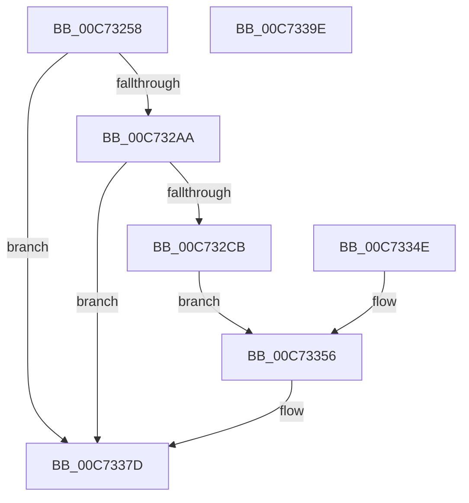

# EmpCacheBiosDate

- RVA: `0x00C73258`–`0x00C7339F` (길이 `327` bytes)
- VA: `0x0000000140C73258`
- 실행 섹션: `INIT`
- PDB 이름 있음: `예`; PDB Function 태그: `아니요`
- unwind 정보 RVA: `0x000BAFB8`
- 디코드: `79`개 명령, `327/327` bytes 표시
- 미해석 바이트: `0` (있으면 어셈블리에 `.byte`로 보존)

> 이 문서는 커널 이미지의 기계어와 PDB 기호를 분석해 생성했습니다. 4번과 5번은 함수 원형과 자료형을 바이너리 사용 방식에서 추정한 C 해석이며 원본 소스 복구 결과는 아닙니다.

## 1. Dependencies

- 직접 호출 지점: **8**; 고유 호출 대상: **6**
- 직접 호출자로 확인된 함수: **1**
- RIP 상대 이미지 참조: **4**

### Outgoing calls
- `0x00C732BA` → [EmpMapPhysicalAddress](../C2/EmpMapPhysicalAddress_function_00C27FA4.md) (function, `0x00C27FA4`)
- `0x00C732E3` → [strtoul](../../text/4F/strtoul_function_004FF3B8.md) (function, `0x004FF3B8`)
- `0x00C73318` → [strtoul](../../text/4F/strtoul_function_004FF3B8.md) (function, `0x004FF3B8`)
- `0x00C73339` → [strtoul](../../text/4F/strtoul_function_004FF3B8.md) (function, `0x004FF3B8`)
- `0x00C73364` → [ZwUnmapViewOfSection](../../text/6A/ZwUnmapViewOfSection_function_006AD610.md) (function, `0x006AD610`)
- `0x00C73370` → [KiUnstackDetachProcess](../../text/21/KiUnstackDetachProcess_function_00217D30.md) (function, `0x00217D30`)
- `0x00C73378` → [ZwClose](../../text/6A/ZwClose_function_006AD2B0.md) (function, `0x006AD2B0`)
- `0x00C73388` → [_security_check_cookie](../../text/6A/_security_check_cookie_function_006AC640.md) (function, `0x006AC640`)

### Direct callers
- [EmInitSystem](EmInitSystem_function_00C71150.md) at `0x00C71281`

### Static image references
- `0x00C73267` → RVA `0x00E0A740` (`.data`; read)
- `0x00C73292` → RVA `0x00F8F160` (`.data`; write)
- `0x00C7329D` → RVA `0x00EFF050` (`.data`; read)
- `0x00C73320` → RVA `0x00F8F160` (`.data`; read/write)

## 2. Other-region calls and transfers

- 다른 실행 섹션으로 향하는 call: **7**
  - `0x00C732E3` → [strtoul](../../text/4F/strtoul_function_004FF3B8.md) (`INIT` → `.text`)
  - `0x00C73318` → [strtoul](../../text/4F/strtoul_function_004FF3B8.md) (`INIT` → `.text`)
  - `0x00C73339` → [strtoul](../../text/4F/strtoul_function_004FF3B8.md) (`INIT` → `.text`)
  - `0x00C73364` → [ZwUnmapViewOfSection](../../text/6A/ZwUnmapViewOfSection_function_006AD610.md) (`INIT` → `.text`)
  - `0x00C73370` → [KiUnstackDetachProcess](../../text/21/KiUnstackDetachProcess_function_00217D30.md) (`INIT` → `.text`)
  - `0x00C73378` → [ZwClose](../../text/6A/ZwClose_function_006AD2B0.md) (`INIT` → `.text`)
  - `0x00C73388` → [_security_check_cookie](../../text/6A/_security_check_cookie_function_006AC640.md) (`INIT` → `.text`)
- 별도 외부 분기/꼬리 이동을 확인하지 못했습니다.

## 3. Assembly (complete function range)

```asm
00C73258  4C 8B DC                        mov r11, rsp
00C7325B  49 89 5B 08                     mov qword ptr [r11 + 8], rbx
00C7325F  57                              push rdi
00C73260  48 81 EC 80 00 00 00            sub rsp, 0x80
00C73267  48 8B 05 D2 74 19 00            mov rax, qword ptr [rip + 0x1974d2]
00C7326E  48 33 C4                        xor rax, rsp
00C73271  48 89 44 24 78                  mov qword ptr [rsp + 0x78], rax
00C73276  0F 57 C0                        xorps xmm0, xmm0
00C73279  0F 11 44 24 48                  movups xmmword ptr [rsp + 0x48], xmm0
00C7327E  0F 11 44 24 58                  movups xmmword ptr [rsp + 0x58], xmm0
00C73283  0F 11 44 24 68                  movups xmmword ptr [rsp + 0x68], xmm0
00C73288  33 FF                           xor edi, edi
00C7328A  49 89 7B B8                     mov qword ptr [r11 - 0x48], rdi
00C7328E  49 89 7B B0                     mov qword ptr [r11 - 0x50], rdi
00C73292  89 3D C8 BE 31 00               mov dword ptr [rip + 0x31bec8], edi
00C73298  40 88 7C 24 32                  mov byte ptr [rsp + 0x32], dil
00C7329D  83 3D AC BD 28 00 01            cmp dword ptr [rip + 0x28bdac], 1
00C732A4  0F 85 D3 00 00 00               jne 0x140c7337d
00C732AA  49 8D 43 C0                     lea rax, [r11 - 0x40]
00C732AE  49 89 43 98                     mov qword ptr [r11 - 0x68], rax
00C732B2  4D 8D 4B B8                     lea r9, [r11 - 0x48]
00C732B6  4D 8D 43 B0                     lea r8, [r11 - 0x50]
00C732BA  E8 E5 4C FB FF                  call 0x140c27fa4
00C732BF  48 8B D8                        mov rbx, rax
00C732C2  48 85 C0                        test rax, rax
00C732C5  0F 84 B2 00 00 00               je 0x140c7337d
00C732CB  0F B7 40 06                     movzx eax, word ptr [rax + 6]
00C732CF  66 89 44 24 30                  mov word ptr [rsp + 0x30], ax
00C732D4  BF 10 00 00 00                  mov edi, 0x10
00C732D9  44 8B C7                        mov r8d, edi
00C732DC  33 D2                           xor edx, edx
00C732DE  48 8D 4C 24 30                  lea rcx, [rsp + 0x30]
00C732E3  E8 D0 C0 88 FF                  call 0x1404ff3b8
00C732E8  8B C8                           mov ecx, eax
00C732EA  3D 80 00 00 00                  cmp eax, 0x80
00C732EF  1B C0                           sbb eax, eax
00C732F1  25 00 00 00 07                  and eax, 0x7000000
00C732F6  05 00 00 00 19                  add eax, 0x19000000
00C732FB  C1 E1 10                        shl ecx, 0x10
00C732FE  03 C1                           add eax, ecx
00C73300  89 05 5A BE 31 00               mov dword ptr [rip + 0x31be5a], eax
00C73306  0F B7 03                        movzx eax, word ptr [rbx]
00C73309  66 89 44 24 30                  mov word ptr [rsp + 0x30], ax
00C7330E  44 8B C7                        mov r8d, edi
00C73311  33 D2                           xor edx, edx
00C73313  48 8D 4C 24 30                  lea rcx, [rsp + 0x30]
00C73318  E8 9B C0 88 FF                  call 0x1404ff3b8
00C7331D  C1 E0 08                        shl eax, 8
00C73320  09 05 3A BE 31 00               or dword ptr [rip + 0x31be3a], eax
00C73326  0F B7 43 03                     movzx eax, word ptr [rbx + 3]
00C7332A  66 89 44 24 30                  mov word ptr [rsp + 0x30], ax
00C7332F  44 8B C7                        mov r8d, edi
00C73332  33 D2                           xor edx, edx
00C73334  48 8D 4C 24 30                  lea rcx, [rsp + 0x30]
00C73339  E8 7A C0 88 FF                  call 0x1404ff3b8
00C7333E  09 05 1C BE 31 00               or dword ptr [rip + 0x31be1c], eax
00C73344  40 B7 01                        mov dil, 1
00C73347  40 88 7C 24 34                  mov byte ptr [rsp + 0x34], dil
00C7334C  EB 08                           jmp 0x140c73356
00C7334E  40 32 FF                        xor dil, dil
00C73351  40 88 7C 24 34                  mov byte ptr [rsp + 0x34], dil
00C73356  48 8B 5C 24 38                  mov rbx, qword ptr [rsp + 0x38]
00C7335B  48 8B 54 24 40                  mov rdx, qword ptr [rsp + 0x40]
00C73360  48 83 C9 FF                     or rcx, 0xffffffffffffffff
00C73364  E8 A7 A2 A3 FF                  call 0x1406ad610
00C73369  33 D2                           xor edx, edx
00C7336B  48 8D 4C 24 48                  lea rcx, [rsp + 0x48]
00C73370  E8 BB 49 5A FF                  call 0x140217d30
00C73375  48 8B CB                        mov rcx, rbx
00C73378  E8 33 9F A3 FF                  call 0x1406ad2b0
00C7337D  40 8A C7                        mov al, dil
00C73380  48 8B 4C 24 78                  mov rcx, qword ptr [rsp + 0x78]
00C73385  48 33 CC                        xor rcx, rsp
00C73388  E8 B3 92 A3 FF                  call 0x1406ac640
00C7338D  48 8B 9C 24 90 00 00 00         mov rbx, qword ptr [rsp + 0x90]
00C73395  48 81 C4 80 00 00 00            add rsp, 0x80
00C7339C  5F                              pop rdi
00C7339D  C3                              ret
00C7339E  CC                              int3
```

## 4. C-style interpretation (structured pseudocode)

```c
__int64 __fastcall EmpCacheBiosDate(__int64 a1, int a2)
{
    __int64 result;
    __int64 v_rdi;
    __int64 v_rsp;
    unsigned __int64 v_stack_m10;
    unsigned __int64 v_stack_m20;
    unsigned __int64 v_stack_m30;
    unsigned __int64 v_stack_m40;
    unsigned __int64 v_stack_m48;
    unsigned __int64 v_stack_m50;
    unsigned __int8 v_stack_m54;
    unsigned __int8 v_stack_m56;
    unsigned __int16 v_stack_m58;
    unsigned __int64 v_stack_p8;

    *(unsigned __int64 *)(v_rsp + 8) = v_rbx;
    v_rsp = (v_rsp) - (128);
    result = (*(unsigned __int64 *)(v_rip + 1668306)) ^ (v_rsp);
    v_stack_m10 = result;
    v_stack_m40 = v_xmm0;
    v_stack_m30 = v_xmm0;
    v_stack_m20 = v_xmm0;
    v_rdi = 0;
    *(unsigned __int64 *)(v_rsp - 72) = 0;
    *(unsigned __int64 *)(v_rsp - 80) = 0;
    *(unsigned int *)(v_rip + 3260104) = 0;
    v_stack_m56 = 0;
    if ((*(unsigned int *)(v_rip + 2669996)) != 1) goto loc_00C7337D;
    *(unsigned __int64 *)(v_rsp - 104) = v_rsp - 64;
    result = EmpMapPhysicalAddress(a1, a2, v_rsp - 80, v_rsp - 72);
    if (result == 0) goto loc_00C7337D;
    v_stack_m58 = (unsigned __int16)(*(unsigned __int16 *)(result + 6));
    a2 = 0;
    result = strtoul(v_stack_m58, a2, 16, v_rsp - 72);
    result = (unsigned int)((result) & (0x7000000ULL));
    result = (unsigned int)((result) + (0x19000000ULL));
    a1 = (unsigned int)(((unsigned int)((unsigned int)(result))) << (16));
    result = (unsigned int)((result) + ((unsigned int)(a1)));
    *(unsigned int *)(v_rip + 3259994) = (unsigned int)(result);
    v_stack_m58 = (unsigned __int16)(*(unsigned __int16 *)(result));
    a2 = 0;
    result = strtoul(v_stack_m58, a2, 16, v_rsp - 72);
    result = (unsigned int)((result) << (8));
    v_stack_m58 = (unsigned __int16)(*(unsigned __int16 *)(result + 3));
    a2 = 0;
    result = strtoul(v_stack_m58, a2, 16, v_rsp - 72);
    v_stack_m54 = 1;
    goto loc_00C73356;
loc_00C73356:
    a1 = (v_stack_m58) | (-1);
    result = ZwUnmapViewOfSection(a1, v_stack_m48, 16, v_rsp - 72);
    a2 = 0;
    result = KiUnstackDetachProcess(v_stack_m40, a2, 16, v_rsp - 72);
    result = ZwClose(v_stack_m50, a2, 16, v_rsp - 72);
loc_00C7337D:
    a1 = (v_stack_m10) ^ (v_rsp);
    result = _security_check_cookie(a1, a2, 16, v_rsp - 72);
    v_rsp = (v_rsp) + (128);
    return result;
}
```

## 5. (Beta) C Style

```c
int64_t EmpCacheBiosDate(int64_t Arg1, int32_t Arg2)
{
    int64_t result;
    int64_t local_rdi;
    int64_t local_rsp;
    uint64_t v_stack_m10;
    uint64_t v_stack_m20;
    uint64_t v_stack_m30;
    uint64_t v_stack_m40;
    uint64_t v_stack_m48;
    uint64_t v_stack_m50;
    uint8_t v_stack_m54;
    uint8_t v_stack_m56;
    uint16_t v_stack_m58;
    uint64_t v_stack_p8;

    *(uint64_t *)(local_rsp + 0x8) = local_rbx;
    local_rsp = (local_rsp) - (128);
    result = (*(uint64_t *)(v_rip + 0x1974D2)) ^ (local_rsp);
    v_stack_m10 = result;
    v_stack_m40 = v_xmm0;
    v_stack_m30 = v_xmm0;
    v_stack_m20 = v_xmm0;
    local_rdi = 0;
    *(uint64_t *)(local_rsp - 0x48) = 0;
    *(uint64_t *)(local_rsp - 0x50) = 0;
    *(uint32_t *)(v_rip + 0x31BEC8) = 0;
    v_stack_m56 = 0;
    if ((*(uint32_t *)(v_rip + 0x28BDAC)) != 1) goto loc_00C7337D;
    *(uint64_t *)(local_rsp - 0x68) = local_rsp - 64;
    result = EmpMapPhysicalAddress(Arg1, Arg2, local_rsp - 80, local_rsp - 72);
    if (result == 0) goto loc_00C7337D;
    v_stack_m58 = (uint16_t)(*(uint16_t *)(result + 0x6));
    Arg2 = 0;
    result = strtoul(v_stack_m58, Arg2, 16, local_rsp - 72);
    result = (uint32_t)((result) & (0x7000000ULL));
    result = (uint32_t)((result) + (0x19000000ULL));
    Arg1 = (uint32_t)(((uint32_t)((uint32_t)(result))) << (16));
    result = (uint32_t)((result) + ((uint32_t)(Arg1)));
    *(uint32_t *)(v_rip + 0x31BE5A) = (uint32_t)(result);
    v_stack_m58 = (uint16_t)(*(uint16_t *)(result));
    Arg2 = 0;
    result = strtoul(v_stack_m58, Arg2, 16, local_rsp - 72);
    result = (uint32_t)((result) << (8));
    v_stack_m58 = (uint16_t)(*(uint16_t *)(result + 0x3));
    Arg2 = 0;
    result = strtoul(v_stack_m58, Arg2, 16, local_rsp - 72);
    v_stack_m54 = 1;
    goto loc_00C73356;
loc_00C73356:
    Arg1 = (v_stack_m58) | (-1);
    result = ZwUnmapViewOfSection(Arg1, v_stack_m48, 16, local_rsp - 72);
    Arg2 = 0;
    result = KiUnstackDetachProcess(v_stack_m40, Arg2, 16, local_rsp - 72);
    result = ZwClose(v_stack_m50, Arg2, 16, local_rsp - 72);
loc_00C7337D:
    Arg1 = (v_stack_m10) ^ (local_rsp);
    result = _security_check_cookie(Arg1, Arg2, 16, local_rsp - 72);
    local_rsp = (local_rsp) + (128);
    return result;
}
```

## 6. Execution-region graph

[열기: 2D/3D 그래프와 함수 탐색 컨트롤 패널](../../../control-panel.html?section=init&rva=0x00C73258&view=graph)

- 2D 그래프는 위에서 아래로 흐르고, 3D 그래프는 빈 공간을 드래그해 회전합니다. Shift+드래그는 이동, 휠은 확대·축소, 함수 노드 선택은 대상 보고서 이동입니다.

### Static fallback


