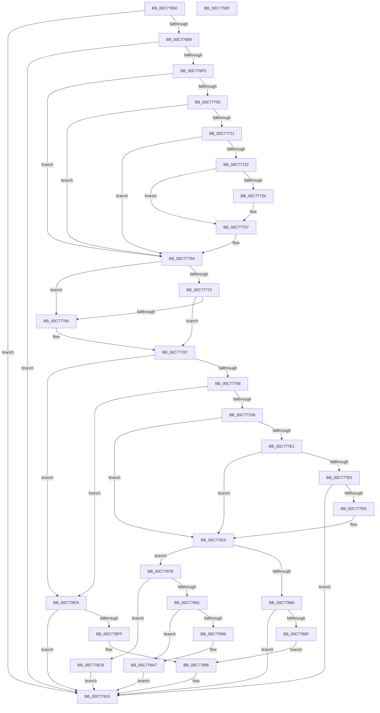

# HalpAcpiTableCacheInit

- RVA: `0x00C77650`–`0x00C77930` (길이 `736` bytes)
- VA: `0x0000000140C77650`
- 실행 섹션: `INIT`
- PDB 이름 있음: `예`; PDB Function 태그: `아니요`
- unwind 정보 RVA: `0x000AA18C`
- 디코드: `186`개 명령, `736/736` bytes 표시
- 미해석 바이트: `0` (있으면 어셈블리에 `.byte`로 보존)

> 이 문서는 커널 이미지의 기계어와 PDB 기호를 분석해 생성했습니다. 4번과 5번은 함수 원형과 자료형을 바이너리 사용 방식에서 추정한 C 해석이며 원본 소스 복구 결과는 아닙니다.

## 1. Dependencies

- 직접 호출 지점: **18**; 고유 호출 대상: **12**
- 직접 호출자로 확인된 함수: **2**
- RIP 상대 이미지 참조: **16**

### Outgoing calls
- `0x00C776E6` → [HalpAcpiFindRsdp](../C1/HalpAcpiFindRsdp_function_00C1DF48.md) (function, `0x00C1DF48`)
- `0x00C77717` → [HalpAcpiCalculateCacheSizeForOverrideTables](../C1/HalpAcpiCalculateCacheSizeForOverrideTables_function_00C1DEF4.md) (function, `0x00C1DEF4`)
- `0x00C77727` → [HalpAcpiAllocateMemory](../../text/53/HalpAcpiAllocateMemory_function_0053ECE0.md) (function, `0x0053ECE0`)
- `0x00C7773C` → [memset](../../text/6C/memset_function_006C6C40.md) (function, `0x006C6C40`)
- `0x00C77752` → [HalpAcpiCacheOverrideTables](../C1/HalpAcpiCacheOverrideTables_function_00C1DE54.md) (function, `0x00C1DE54`)
- `0x00C77764` → [HalpAcpiGetCachedTable](../../text/3F/HalpAcpiGetCachedTable_function_003F6DD4.md) (function, `0x003F6DD4`)
- `0x00C7777A` → [HalpAcpiGetCachedTable](../../text/3F/HalpAcpiGetCachedTable_function_003F6DD4.md) (function, `0x003F6DD4`)
- `0x00C777C7` → [HalpMap](../../text/3F/HalpMap_function_003F88F4.md) (function, `0x003F88F4`)
- `0x00C777F5` → [DbgPrint](../../text/35/DbgPrint_function_00358CB0.md) (function, `0x00358CB0`)
- `0x00C7780F` → [KeBugCheckEx](../../text/4F/KeBugCheckEx_function_004FD660.md) (function, `0x004FD660`)
- `0x00C7782C` → [HalpUnmapVirtualAddress](../../text/3F/HalpUnmapVirtualAddress_function_003F8C30.md) (function, `0x003F8C30`)
- `0x00C77859` → [HalpMap](../../text/3F/HalpMap_function_003F88F4.md) (function, `0x003F88F4`)
- `0x00C77884` → [HalpAcpiCopyBiosTable](../../text/53/HalpAcpiCopyBiosTable_function_0053EDD0.md) (function, `0x0053EDD0`)
- `0x00C7789D` → [DbgPrint](../../text/35/DbgPrint_function_00358CB0.md) (function, `0x00358CB0`)
- `0x00C778C4` → [HalpUnmapVirtualAddress](../../text/3F/HalpUnmapVirtualAddress_function_003F8C30.md) (function, `0x003F8C30`)
- `0x00C778E8` → [HalpUnmapVirtualAddress](../../text/3F/HalpUnmapVirtualAddress_function_003F8C30.md) (function, `0x003F8C30`)
- `0x00C778F3` → [HalpAcpiCacheTable](../../text/53/HalpAcpiCacheTable_function_0053ED64.md) (function, `0x0053ED64`)
- `0x00C77906` → [DbgPrint](../../text/35/DbgPrint_function_00358CB0.md) (function, `0x00358CB0`)

### Direct callers
- [HalpAcpiGetTable](../../text/3F/HalpAcpiGetTable_function_003F6BF8.md) at `0x003F6C65`
- [HalpSetupAcpiPhase0](../C2/HalpSetupAcpiPhase0_function_00C23EDC.md) at `0x00C23EFB`

### Static image references
- `0x00C77672` → RVA `0x00E0F660` (`.data`; read)
- `0x00C77689` → RVA `0x00FC3F60` (`.data`; read)
- `0x00C77690` → RVA `0x00FC3F40` (`.data`; write)
- `0x00C7769A` → RVA `0x00FC3F68` (`.data`; write)
- `0x00C776A5` → RVA `0x00FC3F60` (`.data`; write)
- `0x00C776B3` → RVA `0x00E0F668` (`.data`; write)
- `0x00C776BA` → RVA `0x00E0F660` (`.data`; write)
- `0x00C776C1` → RVA `0x00FC3F48` (`.data`; write)
- `0x00C776C8` → RVA `0x00FC3F50` (`.data`; write)
- `0x00C776CF` → RVA `0x00FC3F58` (`.data`; write)
- `0x00C776D8` → RVA `0x00FC3F5A` (`.data`; write)
- `0x00C776DF` → RVA `0x00FC3F5C` (`.data`; write)
- `0x00C777EE` → RVA `0x000238D0` (`.rdata`; read)
- `0x00C7786F` → RVA `0x00023910` (`.rdata`; read)
- `0x00C77896` → RVA `0x00023948` (`.rdata`; read)
- `0x00C778FF` → RVA `0x00023898` (`.rdata`; read)

## 2. Other-region calls and transfers

- 다른 실행 섹션으로 향하는 call: **15**
  - `0x00C77727` → [HalpAcpiAllocateMemory](../../text/53/HalpAcpiAllocateMemory_function_0053ECE0.md) (`INIT` → `.text`)
  - `0x00C7773C` → [memset](../../text/6C/memset_function_006C6C40.md) (`INIT` → `.text`)
  - `0x00C77764` → [HalpAcpiGetCachedTable](../../text/3F/HalpAcpiGetCachedTable_function_003F6DD4.md) (`INIT` → `.text`)
  - `0x00C7777A` → [HalpAcpiGetCachedTable](../../text/3F/HalpAcpiGetCachedTable_function_003F6DD4.md) (`INIT` → `.text`)
  - `0x00C777C7` → [HalpMap](../../text/3F/HalpMap_function_003F88F4.md) (`INIT` → `.text`)
  - `0x00C777F5` → [DbgPrint](../../text/35/DbgPrint_function_00358CB0.md) (`INIT` → `.text`)
  - `0x00C7780F` → [KeBugCheckEx](../../text/4F/KeBugCheckEx_function_004FD660.md) (`INIT` → `.text`)
  - `0x00C7782C` → [HalpUnmapVirtualAddress](../../text/3F/HalpUnmapVirtualAddress_function_003F8C30.md) (`INIT` → `.text`)
  - `0x00C77859` → [HalpMap](../../text/3F/HalpMap_function_003F88F4.md) (`INIT` → `.text`)
  - `0x00C77884` → [HalpAcpiCopyBiosTable](../../text/53/HalpAcpiCopyBiosTable_function_0053EDD0.md) (`INIT` → `.text`)
  - `0x00C7789D` → [DbgPrint](../../text/35/DbgPrint_function_00358CB0.md) (`INIT` → `.text`)
  - `0x00C778C4` → [HalpUnmapVirtualAddress](../../text/3F/HalpUnmapVirtualAddress_function_003F8C30.md) (`INIT` → `.text`)
  - `0x00C778E8` → [HalpUnmapVirtualAddress](../../text/3F/HalpUnmapVirtualAddress_function_003F8C30.md) (`INIT` → `.text`)
  - `0x00C778F3` → [HalpAcpiCacheTable](../../text/53/HalpAcpiCacheTable_function_0053ED64.md) (`INIT` → `.text`)
  - `0x00C77906` → [DbgPrint](../../text/35/DbgPrint_function_00358CB0.md) (`INIT` → `.text`)
- 별도 외부 분기/꼬리 이동을 확인하지 못했습니다.

## 3. Assembly (complete function range)

```asm
00C77650  4C 8B DC                        mov r11, rsp
00C77653  49 89 5B 08                     mov qword ptr [r11 + 8], rbx
00C77657  49 89 6B 18                     mov qword ptr [r11 + 0x18], rbp
00C7765B  49 89 73 20                     mov qword ptr [r11 + 0x20], rsi
00C7765F  57                              push rdi
00C77660  41 54                           push r12
00C77662  41 55                           push r13
00C77664  41 56                           push r14
00C77666  41 57                           push r15
00C77668  48 83 EC 30                     sub rsp, 0x30
00C7766C  45 33 E4                        xor r12d, r12d
00C7766F  4C 8B F1                        mov r14, rcx
00C77672  4C 39 25 E7 7F 19 00            cmp qword ptr [rip + 0x197fe7], r12
00C77679  41 8B F4                        mov esi, r12d
00C7767C  4D 89 63 10                     mov qword ptr [r11 + 0x10], r12
00C77680  41 8A EC                        mov bpl, r12b
00C77683  0F 85 87 02 00 00               jne 0x140c77910
00C77689  48 8D 05 D0 C8 34 00            lea rax, [rip + 0x34c8d0]
00C77690  C7 05 A6 C8 34 00 01 00 00 00   mov dword ptr [rip + 0x34c8a6], 1
00C7769A  48 89 05 C7 C8 34 00            mov qword ptr [rip + 0x34c8c7], rax
00C776A1  49 8D 53 10                     lea rdx, [r11 + 0x10]
00C776A5  48 89 05 B4 C8 34 00            mov qword ptr [rip + 0x34c8b4], rax
00C776AC  48 8D 05 AD 7F 19 00            lea rax, [rip + 0x197fad]
00C776B3  48 89 05 AE 7F 19 00            mov qword ptr [rip + 0x197fae], rax
00C776BA  48 89 05 9F 7F 19 00            mov qword ptr [rip + 0x197f9f], rax
00C776C1  4C 89 25 80 C8 34 00            mov qword ptr [rip + 0x34c880], r12
00C776C8  44 89 25 81 C8 34 00            mov dword ptr [rip + 0x34c881], r12d
00C776CF  66 C7 05 80 C8 34 00 01 00      mov word ptr [rip + 0x34c880], 1
00C776D8  C6 05 7B C8 34 00 06            mov byte ptr [rip + 0x34c87b], 6
00C776DF  44 89 25 76 C8 34 00            mov dword ptr [rip + 0x34c876], r12d
00C776E6  E8 5D 68 FA FF                  call 0x140c1df48
00C776EB  8B F0                           mov esi, eax
00C776ED  85 C0                           test eax, eax
00C776EF  0F 88 1B 02 00 00               js 0x140c77910
00C776F5  4D 8B BE F0 00 00 00            mov r15, qword ptr [r14 + 0xf0]
00C776FC  49 8B 7F 78                     mov rdi, qword ptr [r15 + 0x78]
00C77700  48 85 FF                        test rdi, rdi
00C77703  74 55                           je 0x140c7775a
00C77705  45 8B BF 80 00 00 00            mov r15d, dword ptr [r15 + 0x80]
00C7770C  45 85 FF                        test r15d, r15d
00C7770F  74 49                           je 0x140c7775a
00C77711  41 8B D7                        mov edx, r15d
00C77714  48 8B CF                        mov rcx, rdi
00C77717  E8 D8 67 FA FF                  call 0x140c1def4
00C7771C  8B D8                           mov ebx, eax
00C7771E  85 C0                           test eax, eax
00C77720  74 38                           je 0x140c7775a
00C77722  8B D3                           mov edx, ebx
00C77724  49 8B CE                        mov rcx, r14
00C77727  E8 B4 75 8C FF                  call 0x14053ece0
00C7772C  4C 8B E0                        mov r12, rax
00C7772F  48 85 C0                        test rax, rax
00C77732  74 23                           je 0x140c77757
00C77734  44 8B C3                        mov r8d, ebx
00C77737  33 D2                           xor edx, edx
00C77739  48 8B C8                        mov rcx, rax
00C7773C  E8 FF F4 A4 FF                  call 0x1406c6c40
00C77741  4C 8B CF                        mov r9, rdi
00C77744  44 89 7C 24 20                  mov dword ptr [rsp + 0x20], r15d
00C77749  44 8B C3                        mov r8d, ebx
00C7774C  49 8B D4                        mov rdx, r12
00C7774F  49 8B CE                        mov rcx, r14
00C77752  E8 FD 66 FA FF                  call 0x140c1de54
00C77757  45 33 E4                        xor r12d, r12d
00C7775A  45 33 C0                        xor r8d, r8d
00C7775D  33 D2                           xor edx, edx
00C7775F  B9 52 53 44 54                  mov ecx, 0x54445352
00C77764  E8 6B F6 77 FF                  call 0x1403f6dd4
00C77769  BF 58 53 44 54                  mov edi, 0x54445358
00C7776E  48 85 C0                        test rax, rax
00C77771  75 11                           jne 0x140c77784
00C77773  45 33 C0                        xor r8d, r8d
00C77776  33 D2                           xor edx, edx
00C77778  8B CF                           mov ecx, edi
00C7777A  E8 55 F6 77 FF                  call 0x1403f6dd4
00C7777F  48 85 C0                        test rax, rax
00C77782  74 03                           je 0x140c77787
00C77784  40 B5 01                        mov bpl, 1
00C77787  48 8B 5C 24 68                  mov rbx, qword ptr [rsp + 0x68]
00C7778C  48 8B 1B                        mov rbx, qword ptr [rbx]
00C7778F  48 83 FB FF                     cmp rbx, -1
00C77793  0F 84 61 01 00 00               je 0x140c778fa
00C77799  45 33 C9                        xor r9d, r9d
00C7779C  4C 89 64 24 28                  mov qword ptr [rsp + 0x28], r12
00C777A1  4C 8B EB                        mov r13, rbx
00C777A4  C7 44 24 20 04 00 00 00         mov dword ptr [rsp + 0x20], 4
00C777AC  41 BF FF 0F 00 00               mov r15d, 0xfff
00C777B2  48 8B CB                        mov rcx, rbx
00C777B5  4D 23 EF                        and r13, r15
00C777B8  45 8D 41 01                     lea r8d, [r9 + 1]
00C777BC  49 8D 95 23 10 00 00            lea rdx, [r13 + 0x1023]
00C777C3  48 C1 EA 0C                     shr rdx, 0xc
00C777C7  E8 28 11 78 FF                  call 0x1403f88f4
00C777CC  48 8B C8                        mov rcx, rax
00C777CF  48 85 C0                        test rax, rax
00C777D2  0F 84 22 01 00 00               je 0x140c778fa
00C777D8  8B 00                           mov eax, dword ptr [rax]
00C777DA  3D 52 53 44 54                  cmp eax, 0x54445352
00C777DF  74 34                           je 0x140c77815
00C777E1  3B C7                           cmp eax, edi
00C777E3  74 30                           je 0x140c77815
00C777E5  40 84 ED                        test bpl, bpl
00C777E8  0F 85 22 01 00 00               jne 0x140c77910
00C777EE  48 8D 0D DB C0 3A FF            lea rcx, [rip - 0xc53f25]
00C777F5  E8 B6 14 6E FF                  call 0x140358cb0
00C777FA  45 33 C9                        xor r9d, r9d
00C777FD  4C 89 64 24 20                  mov qword ptr [rsp + 0x20], r12
00C77802  45 33 C0                        xor r8d, r8d
00C77805  BA 0A 00 01 00                  mov edx, 0x1000a
00C7780A  B9 A5 00 00 00                  mov ecx, 0xa5
00C7780F  E8 4C 5E 88 FF                  call 0x1404fd660
00C77814  CC                              int3
00C77815  8B 79 04                        mov edi, dword ptr [rcx + 4]
00C77818  48 8B D1                        mov rdx, rcx
00C7781B  49 23 D7                        and rdx, r15
00C7781E  45 33 C0                        xor r8d, r8d
00C77821  48 81 C2 23 10 00 00            add rdx, 0x1023
00C77828  48 C1 EA 0C                     shr rdx, 0xc
00C7782C  E8 FF 13 78 FF                  call 0x1403f8c30
00C77831  45 33 C9                        xor r9d, r9d
00C77834  4C 89 64 24 28                  mov qword ptr [rsp + 0x28], r12
00C77839  49 8D 95 FF 0F 00 00            lea rdx, [r13 + 0xfff]
00C77840  C7 44 24 20 04 00 00 00         mov dword ptr [rsp + 0x20], 4
00C77848  48 03 D7                        add rdx, rdi
00C7784B  48 8B CB                        mov rcx, rbx
00C7784E  48 C1 EA 0C                     shr rdx, 0xc
00C77852  44 8B FF                        mov r15d, edi
00C77855  45 8D 41 01                     lea r8d, [r9 + 1]
00C77859  E8 96 10 78 FF                  call 0x1403f88f4
00C7785E  48 8B F8                        mov rdi, rax
00C77861  48 85 C0                        test rax, rax
00C77864  75 15                           jne 0x140c7787b
00C77866  40 84 ED                        test bpl, bpl
00C77869  0F 85 A1 00 00 00               jne 0x140c77910
00C7786F  48 8D 0D 9A C0 3A FF            lea rcx, [rip - 0xc53f66]
00C77876  E9 8B 00 00 00                  jmp 0x140c77906
00C7787B  4C 8B C3                        mov r8, rbx
00C7787E  48 8B D7                        mov rdx, rdi
00C77881  49 8B CE                        mov rcx, r14
00C77884  E8 47 75 8C FF                  call 0x14053edd0
00C77889  48 8B D8                        mov rbx, rax
00C7788C  48 85 C0                        test rax, rax
00C7788F  75 3A                           jne 0x140c778cb
00C77891  40 84 ED                        test bpl, bpl
00C77894  75 11                           jne 0x140c778a7
00C77896  48 8D 0D AB C0 3A FF            lea rcx, [rip - 0xc53f55]
00C7789D  E8 0E 14 6E FF                  call 0x140358cb0
00C778A2  BE 9A 00 00 C0                  mov esi, 0xc000009a
00C778A7  48 8B D7                        mov rdx, rdi
00C778AA  45 33 C0                        xor r8d, r8d
00C778AD  81 E2 FF 0F 00 00               and edx, 0xfff
00C778B3  48 8B CF                        mov rcx, rdi
00C778B6  48 81 C2 FF 0F 00 00            add rdx, 0xfff
00C778BD  49 03 D7                        add rdx, r15
00C778C0  48 C1 EA 0C                     shr rdx, 0xc
00C778C4  E8 67 13 78 FF                  call 0x1403f8c30
00C778C9  EB 45                           jmp 0x140c77910
00C778CB  48 8B D7                        mov rdx, rdi
00C778CE  45 33 C0                        xor r8d, r8d
00C778D1  81 E2 FF 0F 00 00               and edx, 0xfff
00C778D7  48 8B CF                        mov rcx, rdi
00C778DA  48 81 C2 FF 0F 00 00            add rdx, 0xfff
00C778E1  49 03 D7                        add rdx, r15
00C778E4  48 C1 EA 0C                     shr rdx, 0xc
00C778E8  E8 43 13 78 FF                  call 0x1403f8c30
00C778ED  48 8B D3                        mov rdx, rbx
00C778F0  49 8B CE                        mov rcx, r14
00C778F3  E8 6C 74 8C FF                  call 0x14053ed64
00C778F8  EB 16                           jmp 0x140c77910
00C778FA  40 84 ED                        test bpl, bpl
00C778FD  75 11                           jne 0x140c77910
00C778FF  48 8D 0D 92 BF 3A FF            lea rcx, [rip - 0xc5406e]
00C77906  E8 A5 13 6E FF                  call 0x140358cb0
00C7790B  BE 9A 00 00 C0                  mov esi, 0xc000009a
00C77910  48 8B 5C 24 60                  mov rbx, qword ptr [rsp + 0x60]
00C77915  8B C6                           mov eax, esi
00C77917  48 8B 74 24 78                  mov rsi, qword ptr [rsp + 0x78]
00C7791C  48 8B 6C 24 70                  mov rbp, qword ptr [rsp + 0x70]
00C77921  48 83 C4 30                     add rsp, 0x30
00C77925  41 5F                           pop r15
00C77927  41 5E                           pop r14
00C77929  41 5D                           pop r13
00C7792B  41 5C                           pop r12
00C7792D  5F                              pop rdi
00C7792E  C3                              ret
00C7792F  CC                              int3
```

## 4. C-style interpretation (structured pseudocode)

```c
__int64 __fastcall HalpAcpiTableCacheInit(__int64 a1)
{
    __int64 result;
    __int64 v_r12;
    __int64 v_r13;
    __int64 v_rbp;
    __int64 v_rsi;
    __int64 v_rsp;
    unsigned __int64 v_stack_m30;
    unsigned int v_stack_m38;
    unsigned __int64 v_stack_p10;
    unsigned __int64 v_stack_p18;
    unsigned __int64 v_stack_p20;
    unsigned __int64 v_stack_p8;

    *(unsigned __int64 *)(v_rsp + 8) = v_rbx;
    *(unsigned __int64 *)(v_rsp + 24) = v_rbp;
    *(unsigned __int64 *)(v_rsp + 32) = v_rsi;
    v_rsp = (v_rsp) - (48);
    v_r12 = 0;
    *(unsigned __int64 *)(v_rsp + 16) = 0;
    if ((*(unsigned __int64 *)(v_rip + 1671143)) != 0) goto loc_00C77910;
    *(unsigned int *)(v_rip + 3459238) = 1;
    *(unsigned __int64 *)(v_rip + 3459271) = v_rip + 3459280;
    *(unsigned __int64 *)(v_rip + 3459252) = v_rip + 3459280;
    *(unsigned __int64 *)(v_rip + 1671086) = v_rip + 1671085;
    *(unsigned __int64 *)(v_rip + 1671071) = v_rip + 1671085;
    *(unsigned __int64 *)(v_rip + 3459200) = 0;
    *(unsigned int *)(v_rip + 3459201) = 0;
    *(unsigned __int16 *)(v_rip + 3459200) = 1;
    *(unsigned __int8 *)(v_rip + 3459195) = 6;
    *(unsigned int *)(v_rip + 3459190) = 0;
    result = HalpAcpiFindRsdp(a1, v_rsp + 16, a3, a4);
    if (sign_flag) goto loc_00C77910;
    if (*(unsigned __int64 *)(*(unsigned __int64 *)(a1 + 240) + 120) == 0) goto loc_00C7775A;
    if ((unsigned int)((unsigned int)(*(unsigned int *)(*(unsigned __int64 *)(a1 + 240) + 128))) == 0) goto loc_00C7775A;
    result = HalpAcpiCalculateCacheSizeForOverrideTables(*(unsigned __int64 *)(*(unsigned __int64 *)(a1 + 240) + 120), (unsigned int)((unsigned int)((unsigned int)(*(unsigned int *)(*(unsigned __int64 *)(a1 + 240) + 128)))), a3, a4);
    if ((unsigned int)(result) == 0) goto loc_00C7775A;
    result = HalpAcpiAllocateMemory(a1, (unsigned int)((unsigned int)((unsigned int)((unsigned int)(result)))), a3, a4);
    if (result != 0) {
        a3 = (unsigned int)((unsigned int)((unsigned int)(result)));
        a2 = 0;
        a1 = result;
        result = memset(a1, a2, a3, a4);
        a4 = *(unsigned __int64 *)(*(unsigned __int64 *)(a1 + 240) + 120);
        v_stack_m38 = (unsigned int)((unsigned int)(*(unsigned int *)(*(unsigned __int64 *)(a1 + 240) + 128)));
        a3 = (unsigned int)((unsigned int)((unsigned int)(result)));
        a2 = result;
        a1 = a1;
        result = HalpAcpiCacheOverrideTables(a1, a2, a3, a4);
    }
    v_r12 = 0;
loc_00C7775A:
    a3 = 0;
    a2 = 0;
    result = HalpAcpiGetCachedTable((unsigned int)(0x54445352ULL), a2, a3, a4);
    if (result != 0) goto loc_00C77784;
    a3 = 0;
    a2 = 0;
    result = HalpAcpiGetCachedTable((unsigned int)((unsigned int)((unsigned int)(0x54445358ULL))), a2, a3, a4);
    v_rbp = 0;
    if (result != 0) {
        v_rbp = 1;
    }
    if ((*(unsigned __int64 *)(v_stack_p10)) == -1) goto loc_00C778FA;
    a4 = 0;
    v_stack_m30 = 0;
    v_stack_m38 = 4;
    v_r13 = (*(unsigned __int64 *)(v_stack_p10)) & ((unsigned int)(0xFFFULL));
    a2 = (v_r13 + 4131) >> (12);
    result = HalpMap(*(unsigned __int64 *)(v_stack_p10), a2, a4 + 1, a4);
    if (result == 0) goto loc_00C778FA;
    if (((unsigned int)((unsigned int)(*(unsigned int *)(result)))) == 0x54445352ULL) goto loc_00C77815;
    if (((unsigned int)((unsigned int)(*(unsigned int *)(result)))) == ((unsigned int)((unsigned int)(0x54445358ULL)))) goto loc_00C77815;
    if ((unsigned __int8)(v_rbp) != 0) goto loc_00C77910;
    result = DbgPrint(v_rip - 12926757, a2, a4 + 1, a4);
    a4 = 0;
    v_stack_m38 = 0;
    a3 = 0;
    result = KeBugCheckEx(165, (unsigned int)(0x1000AULL), a3, a4);
loc_00C77815:
    a2 = (165) & ((unsigned int)(0xFFFULL));
    a3 = 0;
    a2 = (a2) + (0x1023ULL);
    a2 = (a2) >> (12);
    result = HalpUnmapVirtualAddress(165, a2, a3, a4);
    a4 = 0;
    v_stack_m30 = 0;
    v_stack_m38 = 4;
    a2 = (v_r13 + 4095) + ((unsigned int)(*(unsigned int *)(165 + 4)));
    a2 = (a2) >> (12);
    result = HalpMap(*(unsigned __int64 *)(v_stack_p10), a2, a4 + 1, a4);
    if (result != 0) goto loc_00C7787B;
    if ((unsigned __int8)(v_rbp) != 0) goto loc_00C77910;
    goto loc_00C77906;
loc_00C7787B:
    result = HalpAcpiCopyBiosTable(a1, result, *(unsigned __int64 *)(v_stack_p10), a4);
    if (result != 0) goto loc_00C778CB;
    v_rsi = (unsigned int)((unsigned int)(result));
    if ((unsigned __int8)(v_rbp) == 0) {
        a1 = v_rip - 12926805;
        result = DbgPrint(a1, result, *(unsigned __int64 *)(v_stack_p10), a4);
        v_rsi = 0xC000009AULL;
    }
    a3 = 0;
    a2 = (unsigned int)((result) & (0xFFFULL));
    a2 = (a2) + (0xFFFULL);
    a2 = (a2) + ((unsigned int)((unsigned int)((unsigned int)(*(unsigned int *)(165 + 4)))));
    a2 = (a2) >> (12);
    result = HalpUnmapVirtualAddress(result, a2, a3, a4);
    goto loc_00C77910;
loc_00C778CB:
    a3 = 0;
    a2 = (unsigned int)((result) & (0xFFFULL));
    a2 = (a2) + (0xFFFULL);
    a2 = (a2) + ((unsigned int)((unsigned int)((unsigned int)(*(unsigned int *)(165 + 4)))));
    a2 = (a2) >> (12);
    result = HalpUnmapVirtualAddress(result, a2, a3, a4);
    result = HalpAcpiCacheTable(a1, result, a3, a4);
    goto loc_00C77910;
loc_00C778FA:
    if ((unsigned __int8)(v_rbp) != 0) goto loc_00C77910;
loc_00C77906:
    result = DbgPrint(v_rip - 12927086, result, a3, a4);
loc_00C77910:
    v_rsp = (v_rsp) + (48);
    return (unsigned int)((unsigned int)((unsigned int)(0xC000009AULL)));
}
```

## 5. (Beta) C Style

```c
int64_t HalpAcpiTableCacheInit(void *Arg1)
{
    uint8_t *arg1 = (uint8_t *)Arg1;

    int64_t result;
    int64_t local_r12;
    int64_t local_r13;
    int64_t local_rbp;
    int64_t local_rsi;
    int64_t local_rsp;
    uint64_t v_stack_m30;
    uint32_t v_stack_m38;
    uint64_t v_stack_p10;
    uint64_t v_stack_p18;
    uint64_t v_stack_p20;
    uint64_t v_stack_p8;

    *(uint64_t *)(local_rsp + 0x8) = local_rbx;
    *(uint64_t *)(local_rsp + 0x18) = local_rbp;
    *(uint64_t *)(local_rsp + 0x20) = local_rsi;
    local_rsp = (local_rsp) - (48);
    local_r12 = 0;
    *(uint64_t *)(local_rsp + 0x10) = 0;
    if ((*(uint64_t *)(v_rip + 0x197FE7)) != 0) goto loc_00C77910;
    *(uint32_t *)(v_rip + 0x34C8A6) = 1;
    *(uint64_t *)(v_rip + 0x34C8C7) = v_rip + 3459280;
    *(uint64_t *)(v_rip + 0x34C8B4) = v_rip + 3459280;
    *(uint64_t *)(v_rip + 0x197FAE) = v_rip + 1671085;
    *(uint64_t *)(v_rip + 0x197F9F) = v_rip + 1671085;
    *(uint64_t *)(v_rip + 0x34C880) = 0;
    *(uint32_t *)(v_rip + 0x34C881) = 0;
    *(uint16_t *)(v_rip + 0x34C880) = 1;
    *(uint8_t *)(v_rip + 0x34C87B) = 6;
    *(uint32_t *)(v_rip + 0x34C876) = 0;
    result = HalpAcpiFindRsdp(Arg1, local_rsp + 16, a3, a4);
    if (sign_flag) goto loc_00C77910;
    if (*(uint64_t *)(*(uint64_t *)(arg1 + 0xF0) + 0x78) == 0) goto loc_00C7775A;
    if ((uint32_t)((uint32_t)(*(uint32_t *)(*(uint64_t *)(arg1 + 0xF0) + 0x80))) == 0) goto loc_00C7775A;
    result = HalpAcpiCalculateCacheSizeForOverrideTables(*(uint64_t *)(*(uint64_t *)(arg1 + 0xF0) + 0x78), (uint32_t)((uint32_t)((uint32_t)(*(uint32_t *)(*(uint64_t *)(arg1 + 0xF0) + 0x80)))), a3, a4);
    if ((uint32_t)(result) == 0) goto loc_00C7775A;
    result = HalpAcpiAllocateMemory(Arg1, (uint32_t)((uint32_t)((uint32_t)((uint32_t)(result)))), a3, a4);
    if (result != 0) {
        a3 = (uint32_t)((uint32_t)((uint32_t)(result)));
        a2 = 0;
        Arg1 = result;
        result = memset(Arg1, a2, a3, a4);
        a4 = *(uint64_t *)(*(uint64_t *)(arg1 + 0xF0) + 0x78);
        v_stack_m38 = (uint32_t)((uint32_t)(*(uint32_t *)(*(uint64_t *)(arg1 + 0xF0) + 0x80)));
        a3 = (uint32_t)((uint32_t)((uint32_t)(result)));
        a2 = result;
        Arg1 = Arg1;
        result = HalpAcpiCacheOverrideTables(Arg1, a2, a3, a4);
    }
    local_r12 = 0;
loc_00C7775A:
    a3 = 0;
    a2 = 0;
    result = HalpAcpiGetCachedTable((uint32_t)(0x54445352ULL), a2, a3, a4);
    if (result != 0) goto loc_00C77784;
    a3 = 0;
    a2 = 0;
    result = HalpAcpiGetCachedTable((uint32_t)((uint32_t)((uint32_t)(0x54445358ULL))), a2, a3, a4);
    local_rbp = 0;
    if (result != 0) {
        local_rbp = 1;
    }
    if ((*(uint64_t *)(v_stack_p10)) == -1) goto loc_00C778FA;
    a4 = 0;
    v_stack_m30 = 0;
    v_stack_m38 = 4;
    local_r13 = (*(uint64_t *)(v_stack_p10)) & ((uint32_t)(0xFFFULL));
    a2 = (local_r13 + 4131) >> (12);
    result = HalpMap(*(uint64_t *)(v_stack_p10), a2, a4 + 1, a4);
    if (result == 0) goto loc_00C778FA;
    if (((uint32_t)((uint32_t)(*(uint32_t *)(result)))) == 0x54445352ULL) goto loc_00C77815;
    if (((uint32_t)((uint32_t)(*(uint32_t *)(result)))) == ((uint32_t)((uint32_t)(0x54445358ULL)))) goto loc_00C77815;
    if ((uint8_t)(local_rbp) != 0) goto loc_00C77910;
    result = DbgPrint(v_rip - 12926757, a2, a4 + 1, a4);
    a4 = 0;
    v_stack_m38 = 0;
    a3 = 0;
    result = KeBugCheckEx(165, (uint32_t)(0x1000AULL), a3, a4);
loc_00C77815:
    a2 = (165) & ((uint32_t)(0xFFFULL));
    a3 = 0;
    a2 = (a2) + (0x1023ULL);
    a2 = (a2) >> (12);
    result = HalpUnmapVirtualAddress(165, a2, a3, a4);
    a4 = 0;
    v_stack_m30 = 0;
    v_stack_m38 = 4;
    a2 = (local_r13 + 4095) + ((uint32_t)(*(uint32_t *)(165 + 0x4)));
    a2 = (a2) >> (12);
    result = HalpMap(*(uint64_t *)(v_stack_p10), a2, a4 + 1, a4);
    if (result != 0) goto loc_00C7787B;
    if ((uint8_t)(local_rbp) != 0) goto loc_00C77910;
    goto loc_00C77906;
loc_00C7787B:
    result = HalpAcpiCopyBiosTable(Arg1, result, *(uint64_t *)(v_stack_p10), a4);
    if (result != 0) goto loc_00C778CB;
    local_rsi = (uint32_t)((uint32_t)(result));
    if ((uint8_t)(local_rbp) == 0) {
        Arg1 = v_rip - 12926805;
        result = DbgPrint(Arg1, result, *(uint64_t *)(v_stack_p10), a4);
        local_rsi = 0xC000009AULL;
    }
    a3 = 0;
    a2 = (uint32_t)((result) & (0xFFFULL));
    a2 = (a2) + (0xFFFULL);
    a2 = (a2) + ((uint32_t)((uint32_t)((uint32_t)(*(uint32_t *)(165 + 0x4)))));
    a2 = (a2) >> (12);
    result = HalpUnmapVirtualAddress(result, a2, a3, a4);
    goto loc_00C77910;
loc_00C778CB:
    a3 = 0;
    a2 = (uint32_t)((result) & (0xFFFULL));
    a2 = (a2) + (0xFFFULL);
    a2 = (a2) + ((uint32_t)((uint32_t)((uint32_t)(*(uint32_t *)(165 + 0x4)))));
    a2 = (a2) >> (12);
    result = HalpUnmapVirtualAddress(result, a2, a3, a4);
    result = HalpAcpiCacheTable(Arg1, result, a3, a4);
    goto loc_00C77910;
loc_00C778FA:
    if ((uint8_t)(local_rbp) != 0) goto loc_00C77910;
loc_00C77906:
    result = DbgPrint(v_rip - 12927086, result, a3, a4);
loc_00C77910:
    local_rsp = (local_rsp) + (48);
    return (uint32_t)((uint32_t)((uint32_t)(0xC000009AULL)));
}
```

### 관측된 메모리 오프셋

구조체 형식이 확인되지 않은 접근은 인자 기준의 오프셋으로만 기록했습니다.

| 기준 인자 | 오프셋 표현 | 폭 (bit) | 접근 |
|---|---:|---:|---|
| `Arg1` | `+ 0xF0` | `64` | `R` |

## 6. Execution-region graph

[열기: 2D/3D 그래프와 함수 탐색 컨트롤 패널](../../../control-panel.html?section=init&rva=0x00C77650&view=graph)

- 2D 그래프는 위에서 아래로 흐르고, 3D 그래프는 빈 공간을 드래그해 회전합니다. Shift+드래그는 이동, 휠은 확대·축소, 함수 노드 선택은 대상 보고서 이동입니다.

### Static fallback


