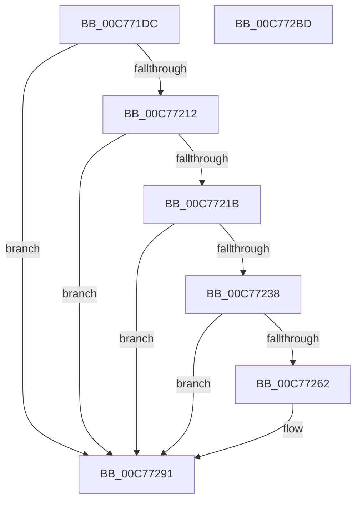

# HalpAllocPhysicalMemoryEx

- RVA: `0x00C771DC`–`0x00C772BE` (길이 `226` bytes)
- VA: `0x0000000140C771DC`
- 실행 섹션: `INIT`
- PDB 이름 있음: `예`; PDB Function 태그: `아니요`
- unwind 정보 RVA: `0x0005D7BC`
- 디코드: `57`개 명령, `226/226` bytes 표시
- 미해석 바이트: `0` (있으면 어셈블리에 `.byte`로 보존)

> 이 문서는 커널 이미지의 기계어와 PDB 기호를 분석해 생성했습니다. 4번과 5번은 함수 원형과 자료형을 바이너리 사용 방식에서 추정한 C 해석이며 원본 소스 복구 결과는 아닙니다.

## 1. Dependencies

- 직접 호출 지점: **4**; 고유 호출 대상: **3**
- 직접 호출자로 확인된 함수: **12**
- RIP 상대 이미지 참조: **7**

### Outgoing calls
- `0x00C7722E` → [HalpAllocPhysicalMemoryInternal](HalpAllocPhysicalMemoryInternal_function_00C772C4.md) (function, `0x00C772C4`)
- `0x00C77255` → [HalpMap](../../text/3F/HalpMap_function_003F88F4.md) (function, `0x003F88F4`)
- `0x00C7726D` → [memset](../../text/6C/memset_function_006C6C40.md) (function, `0x006C6C40`)
- `0x00C7729D` → [HalpAllocPhysicalMemoryInternal](HalpAllocPhysicalMemoryInternal_function_00C772C4.md) (function, `0x00C772C4`)

### Direct callers
- [HalpIommuAllocateAndZeroPageTable](../../text/3F/HalpIommuAllocateAndZeroPageTable_function_003F8B30.md) at `0x003F8B80`
- [HalpAcpiAllocateMemory](../../text/53/HalpAcpiAllocateMemory_function_0053ECE0.md) at `0x0053ED1A`
- [HalpAllocateEarlyPages](../../text/54/HalpAllocateEarlyPages_function_00544770.md) at `0x00544799`
- [HalpMmAllocateAndInsertPageTablePage](../../text/54/HalpMmAllocateAndInsertPageTablePage_function_005448E4.md) at `0x0054490D`
- [HalpMmAllocateMemoryInternal](../../text/54/HalpMmAllocateMemoryInternal_function_00544990.md) at `0x00544A22`
- [ExtEnvAllocatePhysicalMemory](../../text/56/ExtEnvAllocatePhysicalMemory_function_00561124.md) at `0x005611C7`
- [HalpSocApiAllocatePhysicalMemory](../../text/56/HalpSocApiAllocatePhysicalMemory_function_00562CA0.md) at `0x00562CCA`
- [HalpAllocPhysicalMemory](../BE/HalpAllocPhysicalMemory_function_00BEF210.md) at `0x00BEF21A`
- [HalpDmaInitMemory](../C2/HalpDmaInitMemory_function_00C20FC8.md) at `0x00C21052`
- [HalpDmaInitMemory](../C2/HalpDmaInitMemory_function_00C20FC8.md) at `0x00C21080`
- [HalpDmaInitMemory](../C2/HalpDmaInitMemory_function_00C20FC8.md) at `0x00C210E8`
- [HalpDmaInitMemory](../C2/HalpDmaInitMemory_function_00C20FC8.md) at `0x00C21160`
- [HalpBlkAllocateAndShadowMemory](../C2/HalpBlkAllocateAndShadowMemory_function_00C23314.md) at `0x00C2334A`
- [HalpBlkAllocatePageTablePage](../C2/HalpBlkAllocatePageTablePage_function_00C23410.md) at `0x00C2344D`
- [HalpSetupAcpiPhase0](../C2/HalpSetupAcpiPhase0_function_00C23EDC.md) at `0x00C240AC`

### Static image references
- `0x00C771F5` → RVA `0x00E0A784` (`.data`; read)
- `0x00C771FE` → RVA `0x00FC2CB8` (`.data`; read)
- `0x00C77212` → RVA `0x00FC38E0` (`.data`; read)
- `0x00C77226` → RVA `0x00FC38E0` (`.data`; write)
- `0x00C77272` → RVA `0x00FC2CB8` (`.data`; read/write)
- `0x00C77279` → RVA `0x00E03B18` (`.data`; write)
- `0x00C77280` → RVA `0x00E0A784` (`.data`; write)

## 2. Other-region calls and transfers

- 다른 실행 섹션으로 향하는 call: **2**
  - `0x00C77255` → [HalpMap](../../text/3F/HalpMap_function_003F88F4.md) (`INIT` → `.text`)
  - `0x00C7726D` → [memset](../../text/6C/memset_function_006C6C40.md) (`INIT` → `.text`)
- 별도 외부 분기/꼬리 이동을 확인하지 못했습니다.

## 3. Assembly (complete function range)

```asm
00C771DC  48 8B C4                        mov rax, rsp
00C771DF  48 89 58 08                     mov qword ptr [rax + 8], rbx
00C771E3  48 89 68 10                     mov qword ptr [rax + 0x10], rbp
00C771E7  48 89 70 18                     mov qword ptr [rax + 0x18], rsi
00C771EB  48 89 78 20                     mov qword ptr [rax + 0x20], rdi
00C771EF  41 56                           push r14
00C771F1  48 83 EC 30                     sub rsp, 0x30
00C771F5  8B 05 89 35 19 00               mov eax, dword ptr [rip + 0x193589]
00C771FB  41 8B F1                        mov esi, r9d
00C771FE  2B 05 B4 BA 34 00               sub eax, dword ptr [rip + 0x34bab4]
00C77204  41 8B E8                        mov ebp, r8d
00C77207  4C 8B F2                        mov r14, rdx
00C7720A  48 8B F9                        mov rdi, rcx
00C7720D  83 F8 04                        cmp eax, 4
00C77210  77 7F                           ja 0x140c77291
00C77212  80 3D C7 C6 34 00 00            cmp byte ptr [rip + 0x34c6c7], 0
00C77219  75 76                           jne 0x140c77291
00C7721B  BB 01 00 00 00                  mov ebx, 1
00C77220  45 33 C9                        xor r9d, r9d
00C77223  44 8B C3                        mov r8d, ebx
00C77226  88 1D B4 C6 34 00               mov byte ptr [rip + 0x34c6b4], bl
00C7722C  33 D2                           xor edx, edx
00C7722E  E8 91 00 00 00                  call 0x140c772c4
00C77233  48 85 C0                        test rax, rax
00C77236  74 59                           je 0x140c77291
00C77238  48 8B 4C 24 60                  mov rcx, qword ptr [rsp + 0x60]
00C7723D  45 33 C9                        xor r9d, r9d
00C77240  48 89 4C 24 28                  mov qword ptr [rsp + 0x28], rcx
00C77245  44 8B C3                        mov r8d, ebx
00C77248  48 8B C8                        mov rcx, rax
00C7724B  C7 44 24 20 04 00 00 00         mov dword ptr [rsp + 0x20], 4
00C77253  8B D3                           mov edx, ebx
00C77255  E8 9A 16 78 FF                  call 0x1403f88f4
00C7725A  48 8B D8                        mov rbx, rax
00C7725D  48 85 C0                        test rax, rax
00C77260  74 2F                           je 0x140c77291
00C77262  33 D2                           xor edx, edx
00C77264  41 B8 00 10 00 00               mov r8d, 0x1000
00C7726A  48 8B C8                        mov rcx, rax
00C7726D  E8 CE F9 A4 FF                  call 0x1406c6c40
00C77272  83 25 3F BA 34 00 00            and dword ptr [rip + 0x34ba3f], 0
00C77279  48 89 1D 98 C8 18 00            mov qword ptr [rip + 0x18c898], rbx
00C77280  C7 05 FA 34 19 00 55 00 00 00   mov dword ptr [rip + 0x1934fa], 0x55
00C7728A  C6 05 4F C6 34 00 00            mov byte ptr [rip + 0x34c64f], 0
00C77291  44 8B CE                        mov r9d, esi
00C77294  44 8B C5                        mov r8d, ebp
00C77297  49 8B D6                        mov rdx, r14
00C7729A  48 8B CF                        mov rcx, rdi
00C7729D  E8 22 00 00 00                  call 0x140c772c4
00C772A2  48 8B 5C 24 40                  mov rbx, qword ptr [rsp + 0x40]
00C772A7  48 8B 6C 24 48                  mov rbp, qword ptr [rsp + 0x48]
00C772AC  48 8B 74 24 50                  mov rsi, qword ptr [rsp + 0x50]
00C772B1  48 8B 7C 24 58                  mov rdi, qword ptr [rsp + 0x58]
00C772B6  48 83 C4 30                     add rsp, 0x30
00C772BA  41 5E                           pop r14
00C772BC  C3                              ret
00C772BD  CC                              int3
```

## 4. C-style interpretation (structured pseudocode)

```c
__int64 __fastcall HalpAllocPhysicalMemoryEx(__int64 a1, __int64 a2, int a3, int a4, __int64 a5)
{
    __int64 result;
    __int64 v_rsp;
    unsigned __int64 v_stack_m10;
    unsigned int v_stack_m18;
    unsigned __int64 v_stack_p10;
    unsigned __int64 v_stack_p18;
    unsigned __int64 v_stack_p20;
    unsigned __int64 v_stack_p8;

    *(unsigned __int64 *)(v_rsp + 8) = v_rbx;
    *(unsigned __int64 *)(v_rsp + 16) = v_rbp;
    *(unsigned __int64 *)(v_rsp + 24) = v_rsi;
    *(unsigned __int64 *)(v_rsp + 32) = v_rdi;
    v_rsp = (v_rsp) - (48);
    result = (unsigned int)(((unsigned int)(*(unsigned int *)(v_rip + 1652105))) - (*(unsigned int *)(v_rip + 3455668)));
    if (((unsigned int)(result)) > 4) goto loc_00C77291;
    if ((*(unsigned __int8 *)(v_rip + 3458759)) != 0) goto loc_00C77291;
    a4 = 0;
    *(unsigned __int8 *)(v_rip + 3458740) = 1;
    a2 = 0;
    result = HalpAllocPhysicalMemoryInternal(a1, a2, 1, a4);
    if (result == 0) goto loc_00C77291;
    a4 = 0;
    v_stack_m10 = a5;
    v_stack_m18 = 4;
    result = HalpMap(result, 1, 1, a4);
    if (result != 0) {
        a2 = 0;
        a3 = 0x1000ULL;
        a1 = result;
        result = memset(a1, a2, a3, a4);
        *(unsigned __int64 *)(v_rip + 1624216) = result;
        *(unsigned int *)(v_rip + 1651962) = 85;
        *(unsigned __int8 *)(v_rip + 3458639) = 0;
    }
    result = HalpAllocPhysicalMemoryInternal(a1, 0, (unsigned int)((unsigned int)((unsigned int)(a3))), (unsigned int)((unsigned int)((unsigned int)(a4))));
    v_rsp = (v_rsp) + (48);
    return result;
}
```

## 5. (Beta) C Style

```c
int64_t HalpAllocPhysicalMemoryEx(int64_t Arg1, int64_t Arg2, int32_t Arg3, int32_t Arg4, int64_t Arg5)
{
    int64_t result;
    int64_t local_rsp;
    uint64_t v_stack_m10;
    uint32_t v_stack_m18;
    uint64_t v_stack_p10;
    uint64_t v_stack_p18;
    uint64_t v_stack_p20;
    uint64_t v_stack_p8;

    *(uint64_t *)(local_rsp + 0x8) = local_rbx;
    *(uint64_t *)(local_rsp + 0x10) = local_rbp;
    *(uint64_t *)(local_rsp + 0x18) = local_rsi;
    *(uint64_t *)(local_rsp + 0x20) = local_rdi;
    local_rsp = (local_rsp) - (48);
    result = (uint32_t)(((uint32_t)(*(uint32_t *)(v_rip + 0x193589))) - (*(uint32_t *)(v_rip + 0x34BAB4)));
    if (((uint32_t)(result)) > 4) goto loc_00C77291;
    if ((*(uint8_t *)(v_rip + 0x34C6C7)) != 0) goto loc_00C77291;
    Arg4 = 0;
    *(uint8_t *)(v_rip + 0x34C6B4) = 1;
    Arg2 = 0;
    result = HalpAllocPhysicalMemoryInternal(Arg1, Arg2, 1, Arg4);
    if (result == 0) goto loc_00C77291;
    Arg4 = 0;
    v_stack_m10 = Arg5;
    v_stack_m18 = 4;
    result = HalpMap(result, 1, 1, Arg4);
    if (result != 0) {
        Arg2 = 0;
        Arg3 = 0x1000ULL;
        Arg1 = result;
        result = memset(Arg1, Arg2, Arg3, Arg4);
        *(uint64_t *)(v_rip + 0x18C898) = result;
        *(uint32_t *)(v_rip + 0x1934FA) = 85;
        *(uint8_t *)(v_rip + 0x34C64F) = 0;
    }
    result = HalpAllocPhysicalMemoryInternal(Arg1, 0, (uint32_t)((uint32_t)((uint32_t)(Arg3))), (uint32_t)((uint32_t)((uint32_t)(Arg4))));
    local_rsp = (local_rsp) + (48);
    return result;
}
```

## 6. Execution-region graph

[열기: 2D/3D 그래프와 함수 탐색 컨트롤 패널](../../../control-panel.html?section=init&rva=0x00C771DC&view=graph)

- 2D 그래프는 위에서 아래로 흐르고, 3D 그래프는 빈 공간을 드래그해 회전합니다. Shift+드래그는 이동, 휠은 확대·축소, 함수 노드 선택은 대상 보고서 이동입니다.

### Static fallback


