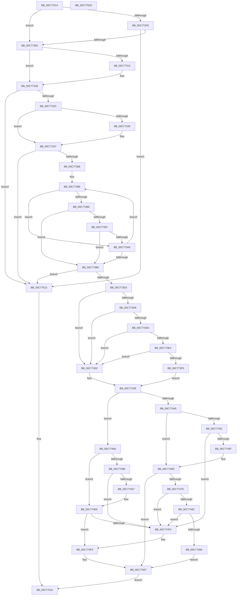

# HalpAllocPhysicalMemoryInternal

- RVA: `0x00C772C4`–`0x00C7752E` (길이 `618` bytes)
- VA: `0x0000000140C772C4`
- 실행 섹션: `INIT`
- PDB 이름 있음: `예`; PDB Function 태그: `아니요`
- unwind 정보 RVA: `0x000BE570`
- 디코드: `169`개 명령, `618/618` bytes 표시
- 미해석 바이트: `0` (있으면 어셈블리에 `.byte`로 보존)

> 이 문서는 커널 이미지의 기계어와 PDB 기호를 분석해 생성했습니다. 4번과 5번은 함수 원형과 자료형을 바이너리 사용 방식에서 추정한 C 해석이며 원본 소스 복구 결과는 아닙니다.

## 1. Dependencies

- 직접 호출 지점: **1**; 고유 호출 대상: **1**
- 직접 호출자로 확인된 함수: **1**
- RIP 상대 이미지 참조: **7**

### Outgoing calls
- `0x00C77380` → [HalpAllocPhysicalMemoryFromDescriptor](../C1/HalpAllocPhysicalMemoryFromDescriptor_function_00C1E954.md) (function, `0x00C1E954`)

### Direct callers
- [HalpAllocPhysicalMemoryEx](HalpAllocPhysicalMemoryEx_function_00C771DC.md) at `0x00C7722E`
- [HalpAllocPhysicalMemoryEx](HalpAllocPhysicalMemoryEx_function_00C771DC.md) at `0x00C7729D`

### Static image references
- `0x00C772E4` → RVA `0x00FC2CB8` (`.data`; read)
- `0x00C772F0` → RVA `0x00E0A784` (`.data`; read)
- `0x00C772F8` → RVA `0x00FC38E0` (`.data`; read)
- `0x00C7732C` → RVA `0x00FC19BA` (`.data`; read)
- `0x00C77411` → RVA `0x00E03B18` (`.data`; read)
- `0x00C77432` → RVA `0x00FC2CB8` (`.data`; write)
- `0x00C7750A` → RVA `0x00FC38E8` (`.data`; read/write)

## 2. Other-region calls and transfers

- 다른 실행 섹션으로 향하는 call: **0**
- 별도 외부 분기/꼬리 이동을 확인하지 못했습니다.

## 3. Assembly (complete function range)

```asm
00C772C4  48 8B C4                        mov rax, rsp
00C772C7  48 89 68 08                     mov qword ptr [rax + 8], rbp
00C772CB  48 89 70 10                     mov qword ptr [rax + 0x10], rsi
00C772CF  44 89 48 20                     mov dword ptr [rax + 0x20], r9d
00C772D3  44 89 40 18                     mov dword ptr [rax + 0x18], r8d
00C772D7  57                              push rdi
00C772D8  41 54                           push r12
00C772DA  41 55                           push r13
00C772DC  41 56                           push r14
00C772DE  41 57                           push r15
00C772E0  48 83 EC 40                     sub rsp, 0x40
00C772E4  8B 05 CE B9 34 00               mov eax, dword ptr [rip + 0x34b9ce]
00C772EA  83 C0 02                        add eax, 2
00C772ED  45 8B D8                        mov r11d, r8d
00C772F0  3B 05 8E 34 19 00               cmp eax, dword ptr [rip + 0x19348e]
00C772F6  76 0D                           jbe 0x140c77305
00C772F8  80 3D E1 C5 34 00 00            cmp byte ptr [rip + 0x34c5e1], 0
00C772FF  0F 84 0E 02 00 00               je 0x140c77513
00C77305  48 83 CD FF                     or rbp, 0xffffffffffffffff
00C77309  41 BC 01 00 00 00               mov r12d, 1
00C7730F  48 85 D2                        test rdx, rdx
00C77312  74 07                           je 0x140c7731b
00C77314  48 8B 2A                        mov rbp, qword ptr [rdx]
00C77317  48 C1 ED 0C                     shr rbp, 0xc
00C7731B  4C 89 5C 24 38                  mov qword ptr [rsp + 0x38], r11
00C77320  4D 8B FB                        mov r15, r11
00C77323  49 3B EB                        cmp rbp, r11
00C77326  0F 82 E7 01 00 00               jb 0x140c77513
00C7732C  80 3D 87 A6 34 00 00            cmp byte ptr [rip + 0x34a687], 0
00C77333  74 12                           je 0x140c77347
00C77335  BA 00 01 00 00                  mov edx, 0x100
00C7733A  48 8B C5                        mov rax, rbp
00C7733D  49 2B C3                        sub rax, r11
00C77340  48 3B C2                        cmp rax, rdx
00C77343  4C 0F 43 E2                     cmovae r12, rdx
00C77347  48 83 C1 20                     add rcx, 0x20
00C7734B  33 FF                           xor edi, edi
00C7734D  45 33 ED                        xor r13d, r13d
00C77350  48 89 4C 24 30                  mov qword ptr [rsp + 0x30], rcx
00C77355  45 33 F6                        xor r14d, r14d
00C77358  33 C0                           xor eax, eax
00C7735A  48 8B 31                        mov rsi, qword ptr [rcx]
00C7735D  48 3B F1                        cmp rsi, rcx
00C77360  0F 84 AD 01 00 00               je 0x140c77513
00C77366  4C 8B F9                        mov r15, rcx
00C77369  44 89 4C 24 20                  mov dword ptr [rsp + 0x20], r9d
00C7736E  4C 8B EF                        mov r13, rdi
00C77371  45 8B CB                        mov r9d, r11d
00C77374  4D 8B C4                        mov r8, r12
00C77377  48 8B D5                        mov rdx, rbp
00C7737A  48 8B CE                        mov rcx, rsi
00C7737D  48 8B FE                        mov rdi, rsi
00C77380  E8 CF 75 FA FF                  call 0x140c1e954
00C77385  48 85 C0                        test rax, rax
00C77388  74 16                           je 0x140c773a0
00C7738A  4C 8B F0                        mov r14, rax
00C7738D  49 C1 EE 0C                     shr r14, 0xc
00C77391  4C 2B 76 20                     sub r14, qword ptr [rsi + 0x20]
00C77395  74 21                           je 0x140c773b8
00C77397  80 3D 42 C5 34 00 00            cmp byte ptr [rip + 0x34c542], 0
00C7739E  74 18                           je 0x140c773b8
00C773A0  48 8B 36                        mov rsi, qword ptr [rsi]
00C773A3  44 8B 9C 24 80 00 00 00         mov r11d, dword ptr [rsp + 0x80]
00C773AB  44 8B 8C 24 88 00 00 00         mov r9d, dword ptr [rsp + 0x88]
00C773B3  49 3B F7                        cmp rsi, r15
00C773B6  75 B1                           jne 0x140c77369
00C773B8  48 8B 4C 24 30                  mov rcx, qword ptr [rsp + 0x30]
00C773BD  4C 8B 7C 24 38                  mov r15, qword ptr [rsp + 0x38]
00C773C2  44 8B 9C 24 80 00 00 00         mov r11d, dword ptr [rsp + 0x80]
00C773CA  48 3B F1                        cmp rsi, rcx
00C773CD  0F 84 40 01 00 00               je 0x140c77513
00C773D3  4D 85 F6                        test r14, r14
00C773D6  75 2A                           jne 0x140c77402
00C773D8  4D 85 ED                        test r13, r13
00C773DB  74 25                           je 0x140c77402
00C773DD  41 83 7D 18 1A                  cmp dword ptr [r13 + 0x18], 0x1a
00C773E2  75 1E                           jne 0x140c77402
00C773E4  4D 8B 45 28                     mov r8, qword ptr [r13 + 0x28]
00C773E8  49 8B 55 20                     mov rdx, qword ptr [r13 + 0x20]
00C773EC  49 03 D0                        add rdx, r8
00C773EF  48 3B 57 20                     cmp rdx, qword ptr [rdi + 0x20]
00C773F3  75 0D                           jne 0x140c77402
00C773F5  4B 8D 0C 38                     lea rcx, [r8 + r15]
00C773F9  45 33 C9                        xor r9d, r9d
00C773FC  49 89 4D 28                     mov qword ptr [r13 + 0x28], rcx
00C77400  EB 37                           jmp 0x140c77439
00C77402  44 8B 05 AF B8 34 00            mov r8d, dword ptr [rip + 0x34b8af]
00C77409  4F 8D 0C 40                     lea r9, [r8 + r8*2]
00C7740D  49 C1 E1 04                     shl r9, 4
00C77411  4C 03 0D 00 C7 18 00            add r9, qword ptr [rip + 0x18c700]
00C77418  4D 89 79 28                     mov qword ptr [r9 + 0x28], r15
00C7741C  48 8B 57 20                     mov rdx, qword ptr [rdi + 0x20]
00C77420  49 03 D6                        add rdx, r14
00C77423  41 C7 41 18 1A 00 00 00         mov dword ptr [r9 + 0x18], 0x1a
00C7742B  41 FF C0                        inc r8d
00C7742E  49 89 51 20                     mov qword ptr [r9 + 0x20], rdx
00C77432  44 89 05 7F B8 34 00            mov dword ptr [rip + 0x34b87f], r8d
00C77439  4C 8B 47 28                     mov r8, qword ptr [rdi + 0x28]
00C7743D  4D 2B C7                        sub r8, r15
00C77440  4D 85 F6                        test r14, r14
00C77443  75 4E                           jne 0x140c77493
00C77445  4C 01 7F 20                     add qword ptr [rdi + 0x20], r15
00C77449  4C 89 47 28                     mov qword ptr [rdi + 0x28], r8
00C7744D  4D 85 C9                        test r9, r9
00C77450  74 1B                           je 0x140c7746d
00C77452  48 8B 4F 08                     mov rcx, qword ptr [rdi + 8]
00C77456  48 39 39                        cmp qword ptr [rcx], rdi
00C77459  0F 85 93 00 00 00               jne 0x140c774f2
00C7745F  49 89 39                        mov qword ptr [r9], rdi
00C77462  49 89 49 08                     mov qword ptr [r9 + 8], rcx
00C77466  4C 89 09                        mov qword ptr [rcx], r9
00C77469  4C 89 4F 08                     mov qword ptr [rdi + 8], r9
00C7746D  48 83 7F 28 00                  cmp qword ptr [rdi + 0x28], 0
00C77472  0F 85 8F 00 00 00               jne 0x140c77507
00C77478  48 8B 17                        mov rdx, qword ptr [rdi]
00C7747B  48 39 7A 08                     cmp qword ptr [rdx + 8], rdi
00C7747F  75 71                           jne 0x140c774f2
00C77481  48 8B 4F 08                     mov rcx, qword ptr [rdi + 8]
00C77485  48 39 39                        cmp qword ptr [rcx], rdi
00C77488  75 68                           jne 0x140c774f2
00C7748A  48 89 11                        mov qword ptr [rcx], rdx
00C7748D  48 89 4A 08                     mov qword ptr [rdx + 8], rcx
00C77491  EB 74                           jmp 0x140c77507
00C77493  4D 2B C6                        sub r8, r14
00C77496  74 4D                           je 0x140c774e5
00C77498  8B 15 1A B8 34 00               mov edx, dword ptr [rip + 0x34b81a]
00C7749E  41 8B CB                        mov ecx, r11d
00C774A1  49 03 CE                        add rcx, r14
00C774A4  4C 8D 14 52                     lea r10, [rdx + rdx*2]
00C774A8  FF C2                           inc edx
00C774AA  49 C1 E2 04                     shl r10, 4
00C774AE  4C 03 15 63 C6 18 00            add r10, qword ptr [rip + 0x18c663]
00C774B5  89 15 FD B7 34 00               mov dword ptr [rip + 0x34b7fd], edx
00C774BB  4D 89 42 28                     mov qword ptr [r10 + 0x28], r8
00C774BF  48 03 4F 20                     add rcx, qword ptr [rdi + 0x20]
00C774C3  49 89 4A 20                     mov qword ptr [r10 + 0x20], rcx
00C774C7  8B 4F 18                        mov ecx, dword ptr [rdi + 0x18]
00C774CA  41 89 4A 18                     mov dword ptr [r10 + 0x18], ecx
00C774CE  48 8B 0F                        mov rcx, qword ptr [rdi]
00C774D1  48 39 79 08                     cmp qword ptr [rcx + 8], rdi
00C774D5  75 1B                           jne 0x140c774f2
00C774D7  49 89 0A                        mov qword ptr [r10], rcx
00C774DA  49 89 7A 08                     mov qword ptr [r10 + 8], rdi
00C774DE  4C 89 51 08                     mov qword ptr [rcx + 8], r10
00C774E2  4C 89 17                        mov qword ptr [rdi], r10
00C774E5  4C 89 77 28                     mov qword ptr [rdi + 0x28], r14
00C774E9  48 8B 0F                        mov rcx, qword ptr [rdi]
00C774EC  48 39 79 08                     cmp qword ptr [rcx + 8], rdi
00C774F0  74 07                           je 0x140c774f9
00C774F2  B9 03 00 00 00                  mov ecx, 3
00C774F7  CD 29                           int 0x29
00C774F9  49 89 09                        mov qword ptr [r9], rcx
00C774FC  49 89 79 08                     mov qword ptr [r9 + 8], rdi
00C77500  4C 89 49 08                     mov qword ptr [rcx + 8], r9
00C77504  4C 89 0F                        mov qword ptr [rdi], r9
00C77507  41 8B CB                        mov ecx, r11d
00C7750A  48 01 0D D7 C3 34 00            add qword ptr [rip + 0x34c3d7], rcx
00C77511  EB 02                           jmp 0x140c77515
00C77513  33 C0                           xor eax, eax
00C77515  48 8B 6C 24 70                  mov rbp, qword ptr [rsp + 0x70]
00C7751A  48 8B 74 24 78                  mov rsi, qword ptr [rsp + 0x78]
00C7751F  48 83 C4 40                     add rsp, 0x40
00C77523  41 5F                           pop r15
00C77525  41 5E                           pop r14
00C77527  41 5D                           pop r13
00C77529  41 5C                           pop r12
00C7752B  5F                              pop rdi
00C7752C  C3                              ret
00C7752D  CC                              int3
```

## 4. C-style interpretation (structured pseudocode)

```c
__int64 __fastcall HalpAllocPhysicalMemoryInternal(__int64 a1, __int64 a2, int a3, int a4)
{
    __int64 result;
    __int64 v_r10;
    __int64 v_r12;
    __int64 v_r13;
    __int64 v_r14;
    __int64 v_rbp;
    __int64 v_rdi;
    __int64 v_rsp;
    unsigned __int64 v_stack_m30;
    unsigned __int64 v_stack_m38;
    unsigned int v_stack_m48;
    unsigned __int64 v_stack_p10;
    unsigned int v_stack_p18;
    unsigned int v_stack_p20;
    unsigned __int64 v_stack_p8;

    *(unsigned __int64 *)(v_rsp + 8) = v_rbp;
    *(unsigned __int64 *)(v_rsp + 16) = v_rsi;
    *(unsigned int *)(v_rsp + 32) = a4;
    *(unsigned int *)(v_rsp + 24) = a3;
    v_rsp = (v_rsp) - (64);
    result = (unsigned int)(((unsigned int)(*(unsigned int *)(v_rip + 3455438))) + (2));
    if (((unsigned int)(result)) <= (*(unsigned int *)(v_rip + 1651854))) goto loc_00C77305;
    if ((*(unsigned __int8 *)(v_rip + 3458529)) == 0) goto loc_00C77513;
loc_00C77305:
    v_rbp = (v_rbp) | (-1);
    if (a2 != 0) {
        v_rbp = *(unsigned __int64 *)(a2);
        v_rbp = (v_rbp) >> (12);
    }
    v_stack_m30 = (unsigned int)(a3);
    if (v_rbp < ((unsigned int)(a3))) goto loc_00C77513;
    v_r12 = 1;
    if ((*(unsigned __int8 *)(v_rip + 3450503)) != 0) {
        a2 = 256;
        result = v_rbp;
        result = (result) - ((unsigned int)(a3));
        v_r12 = 1;
        if (result >= a2) { v_r12 = a2; }
    }
    a1 = (a1) + (32);
    v_rdi = 0;
    v_r13 = 0;
    v_stack_m38 = a1;
    v_r14 = 0;
    result = 0;
    if ((*(unsigned __int64 *)(a1)) == a1) goto loc_00C77513;
loc_00C77369:
    v_stack_m48 = a4;
    result = HalpAllocPhysicalMemoryFromDescriptor(*(unsigned __int64 *)(a1), v_rbp, v_r12, (unsigned int)((unsigned int)((unsigned int)(a3))));
    if (result == 0) goto loc_00C773A0;
    v_r14 = (result) >> (12);
    v_r14 = (v_r14) - (*(unsigned __int64 *)(*(unsigned __int64 *)(a1) + 32));
    if (condition_is_equal) goto loc_00C773B8;
    if ((*(unsigned __int8 *)(v_rip + 3458370)) == 0) goto loc_00C773B8;
loc_00C773A0:
    if ((*(unsigned __int64 *)(*(unsigned __int64 *)(a1))) != a1) goto loc_00C77369;
loc_00C773B8:
    if ((*(unsigned __int64 *)(*(unsigned __int64 *)(a1))) == v_stack_m38) goto loc_00C77513;
    if (v_r14 != 0) goto loc_00C77402;
    if (0 == 0) goto loc_00C77402;
    if ((*(unsigned int *)(0 + 24)) != 26) goto loc_00C77402;
    a2 = (*(unsigned __int64 *)(0 + 32)) + (*(unsigned __int64 *)(0 + 40));
    if (a2 != (*(unsigned __int64 *)(*(unsigned __int64 *)(a1) + 32))) goto loc_00C77402;
    a4 = 0;
    *(unsigned __int64 *)(0 + 40) = *(unsigned __int64 *)(0 + 40) + v_stack_m30 * 1;
    goto loc_00C77439;
loc_00C77402:
    a4 = ((unsigned int)(*(unsigned int *)(v_rip + 3455151)) + (unsigned int)(*(unsigned int *)(v_rip + 3455151)) * 2) << (4);
    a4 = (a4) + (*(unsigned __int64 *)(v_rip + 1623808));
    *(unsigned __int64 *)(a4 + 40) = v_stack_m30;
    a2 = (*(unsigned __int64 *)(*(unsigned __int64 *)(a1) + 32)) + (v_r14);
    *(unsigned int *)(a4 + 24) = 26;
    a3 = (unsigned int)(((unsigned int)(*(unsigned int *)(v_rip + 3455151))) + 1);
    *(unsigned __int64 *)(a4 + 32) = a2;
    *(unsigned int *)(v_rip + 3455103) = a3;
loc_00C77439:
    a3 = (*(unsigned __int64 *)(*(unsigned __int64 *)(a1) + 40)) - (v_stack_m30);
    if (v_r14 != 0) goto loc_00C77493;
    *(unsigned __int64 *)(*(unsigned __int64 *)(a1) + 40) = a3;
    if (a4 == 0) goto loc_00C7746D;
    if ((*(unsigned __int64 *)(*(unsigned __int64 *)(*(unsigned __int64 *)(a1) + 8))) != (*(unsigned __int64 *)(a1))) goto loc_00C774F2;
    *(unsigned __int64 *)(a4) = *(unsigned __int64 *)(a1);
    *(unsigned __int64 *)(a4 + 8) = *(unsigned __int64 *)(*(unsigned __int64 *)(a1) + 8);
    *(unsigned __int64 *)(*(unsigned __int64 *)(*(unsigned __int64 *)(a1) + 8)) = a4;
    *(unsigned __int64 *)(*(unsigned __int64 *)(a1) + 8) = a4;
loc_00C7746D:
    if ((*(unsigned __int64 *)(*(unsigned __int64 *)(a1) + 40)) != 0) goto loc_00C77507;
    if ((*(unsigned __int64 *)(*(unsigned __int64 *)(*(unsigned __int64 *)(a1)) + 8)) != (*(unsigned __int64 *)(a1))) goto loc_00C774F2;
    if ((*(unsigned __int64 *)(*(unsigned __int64 *)(*(unsigned __int64 *)(a1) + 8))) != (*(unsigned __int64 *)(a1))) goto loc_00C774F2;
    *(unsigned __int64 *)(*(unsigned __int64 *)(*(unsigned __int64 *)(a1) + 8)) = *(unsigned __int64 *)(*(unsigned __int64 *)(a1));
    *(unsigned __int64 *)(*(unsigned __int64 *)(*(unsigned __int64 *)(a1)) + 8) = *(unsigned __int64 *)(*(unsigned __int64 *)(a1) + 8);
    goto loc_00C77507;
loc_00C77493:
    a3 = (a3) - (v_r14);
    if (condition_is_equal) goto loc_00C774E5;
    a1 = ((unsigned int)((unsigned int)((unsigned int)(v_stack_p18)))) + (v_r14);
    a2 = (unsigned int)(((unsigned int)(*(unsigned int *)(v_rip + 3455002))) + 1);
    v_r10 = ((unsigned int)(*(unsigned int *)(v_rip + 3455002)) + (unsigned int)(*(unsigned int *)(v_rip + 3455002)) * 2) << (4);
    v_r10 = (v_r10) + (*(unsigned __int64 *)(v_rip + 1623651));
    *(unsigned int *)(v_rip + 3454973) = (unsigned int)(a2);
    *(unsigned __int64 *)(v_r10 + 40) = a3;
    a1 = (a1) + (*(unsigned __int64 *)(*(unsigned __int64 *)(a1) + 32));
    *(unsigned __int64 *)(v_r10 + 32) = a1;
    *(unsigned int *)(v_r10 + 24) = (unsigned int)((unsigned int)(*(unsigned int *)(*(unsigned __int64 *)(a1) + 24)));
    if ((*(unsigned __int64 *)(*(unsigned __int64 *)(*(unsigned __int64 *)(a1)) + 8)) != (*(unsigned __int64 *)(a1))) goto loc_00C774F2;
    *(unsigned __int64 *)(v_r10) = *(unsigned __int64 *)(*(unsigned __int64 *)(a1));
    *(unsigned __int64 *)(v_r10 + 8) = *(unsigned __int64 *)(a1);
    *(unsigned __int64 *)(*(unsigned __int64 *)(*(unsigned __int64 *)(a1)) + 8) = v_r10;
    *(unsigned __int64 *)(*(unsigned __int64 *)(a1)) = v_r10;
loc_00C774E5:
    *(unsigned __int64 *)(*(unsigned __int64 *)(a1) + 40) = v_r14;
    if ((*(unsigned __int64 *)(*(unsigned __int64 *)(*(unsigned __int64 *)(a1)) + 8)) != (*(unsigned __int64 *)(a1))) {
        a1 = 3;
    }
    *(unsigned __int64 *)(a4) = a1;
    *(unsigned __int64 *)(a4 + 8) = *(unsigned __int64 *)(a1);
    *(unsigned __int64 *)(a1 + 8) = a4;
    *(unsigned __int64 *)(*(unsigned __int64 *)(a1)) = a4;
loc_00C77507:
    goto loc_00C77515;
loc_00C77513:
    result = 0;
loc_00C77515:
    v_rsp = (v_rsp) + (64);
    return result;
}
```

## 5. (Beta) C Style

```c
int64_t HalpAllocPhysicalMemoryInternal(void *Arg1, int64_t Arg2, int32_t Arg3, int32_t Arg4)
{
    uint8_t *arg1 = (uint8_t *)Arg1;

    int64_t result;
    int64_t local_r10;
    int64_t local_r12;
    int64_t local_r13;
    int64_t local_r14;
    int64_t local_rbp;
    int64_t local_rdi;
    int64_t local_rsp;
    uint64_t v_stack_m30;
    uint64_t v_stack_m38;
    uint32_t v_stack_m48;
    uint64_t v_stack_p10;
    uint32_t v_stack_p18;
    uint32_t v_stack_p20;
    uint64_t v_stack_p8;

    *(uint64_t *)(local_rsp + 0x8) = local_rbp;
    *(uint64_t *)(local_rsp + 0x10) = local_rsi;
    *(uint32_t *)(local_rsp + 0x20) = Arg4;
    *(uint32_t *)(local_rsp + 0x18) = Arg3;
    local_rsp = (local_rsp) - (64);
    result = (uint32_t)(((uint32_t)(*(uint32_t *)(v_rip + 0x34B9CE))) + (2));
    if (((uint32_t)(result)) <= (*(uint32_t *)(v_rip + 0x19348E))) goto loc_00C77305;
    if ((*(uint8_t *)(v_rip + 0x34C5E1)) == 0) goto loc_00C77513;
loc_00C77305:
    local_rbp = (local_rbp) | (-1);
    if (Arg2 != 0) {
        local_rbp = *(uint64_t *)(Arg2);
        local_rbp = (local_rbp) >> (12);
    }
    v_stack_m30 = (uint32_t)(Arg3);
    if (local_rbp < ((uint32_t)(Arg3))) goto loc_00C77513;
    local_r12 = 1;
    if ((*(uint8_t *)(v_rip + 0x34A687)) != 0) {
        Arg2 = 256;
        result = local_rbp;
        result = (result) - ((uint32_t)(Arg3));
        local_r12 = 1;
        if (result >= Arg2) { local_r12 = Arg2; }
    }
    Arg1 = (Arg1) + (32);
    local_rdi = 0;
    local_r13 = 0;
    v_stack_m38 = Arg1;
    local_r14 = 0;
    result = 0;
    if ((*(uint64_t *)(arg1)) == Arg1) goto loc_00C77513;
loc_00C77369:
    v_stack_m48 = Arg4;
    result = HalpAllocPhysicalMemoryFromDescriptor(*(uint64_t *)(arg1), local_rbp, local_r12, (uint32_t)((uint32_t)((uint32_t)(Arg3))));
    if (result == 0) goto loc_00C773A0;
    local_r14 = (result) >> (12);
    local_r14 = (local_r14) - (*(uint64_t *)(*(uint64_t *)(arg1) + 0x20));
    if (condition_is_equal) goto loc_00C773B8;
    if ((*(uint8_t *)(v_rip + 0x34C542)) == 0) goto loc_00C773B8;
loc_00C773A0:
    if ((*(uint64_t *)(*(uint64_t *)(arg1))) != Arg1) goto loc_00C77369;
loc_00C773B8:
    if ((*(uint64_t *)(*(uint64_t *)(arg1))) == v_stack_m38) goto loc_00C77513;
    if (local_r14 != 0) goto loc_00C77402;
    if (0 == 0) goto loc_00C77402;
    if ((*(uint32_t *)(0 + 0x18)) != 26) goto loc_00C77402;
    Arg2 = (*(uint64_t *)(0 + 0x20)) + (*(uint64_t *)(0 + 0x28));
    if (Arg2 != (*(uint64_t *)(*(uint64_t *)(arg1) + 0x20))) goto loc_00C77402;
    Arg4 = 0;
    *(uint64_t *)(0 + 0x28) = *(uint64_t *)(0 + 0x28) + v_stack_m30 * 1;
    goto loc_00C77439;
loc_00C77402:
    Arg4 = ((uint32_t)(*(uint32_t *)(v_rip + 0x34B8AF)) + (uint32_t)(*(uint32_t *)(v_rip + 0x34B8AF)) * 2) << (4);
    Arg4 = (Arg4) + (*(uint64_t *)(v_rip + 0x18C700));
    *(uint64_t *)(Arg4 + 0x28) = v_stack_m30;
    Arg2 = (*(uint64_t *)(*(uint64_t *)(arg1) + 0x20)) + (local_r14);
    *(uint32_t *)(Arg4 + 0x18) = 26;
    Arg3 = (uint32_t)(((uint32_t)(*(uint32_t *)(v_rip + 0x34B8AF))) + 1);
    *(uint64_t *)(Arg4 + 0x20) = Arg2;
    *(uint32_t *)(v_rip + 0x34B87F) = Arg3;
loc_00C77439:
    Arg3 = (*(uint64_t *)(*(uint64_t *)(arg1) + 0x28)) - (v_stack_m30);
    if (local_r14 != 0) goto loc_00C77493;
    *(uint64_t *)(*(uint64_t *)(arg1) + 0x28) = Arg3;
    if (Arg4 == 0) goto loc_00C7746D;
    if ((*(uint64_t *)(*(uint64_t *)(*(uint64_t *)(arg1) + 0x8))) != (*(uint64_t *)(arg1))) goto loc_00C774F2;
    *(uint64_t *)(Arg4) = *(uint64_t *)(arg1);
    *(uint64_t *)(Arg4 + 0x8) = *(uint64_t *)(*(uint64_t *)(arg1) + 0x8);
    *(uint64_t *)(*(uint64_t *)(*(uint64_t *)(arg1) + 0x8)) = Arg4;
    *(uint64_t *)(*(uint64_t *)(arg1) + 0x8) = Arg4;
loc_00C7746D:
    if ((*(uint64_t *)(*(uint64_t *)(arg1) + 0x28)) != 0) goto loc_00C77507;
    if ((*(uint64_t *)(*(uint64_t *)(*(uint64_t *)(arg1)) + 0x8)) != (*(uint64_t *)(arg1))) goto loc_00C774F2;
    if ((*(uint64_t *)(*(uint64_t *)(*(uint64_t *)(arg1) + 0x8))) != (*(uint64_t *)(arg1))) goto loc_00C774F2;
    *(uint64_t *)(*(uint64_t *)(*(uint64_t *)(arg1) + 0x8)) = *(uint64_t *)(*(uint64_t *)(arg1));
    *(uint64_t *)(*(uint64_t *)(*(uint64_t *)(arg1)) + 0x8) = *(uint64_t *)(*(uint64_t *)(arg1) + 0x8);
    goto loc_00C77507;
loc_00C77493:
    Arg3 = (Arg3) - (local_r14);
    if (condition_is_equal) goto loc_00C774E5;
    Arg1 = ((uint32_t)((uint32_t)((uint32_t)(v_stack_p18)))) + (local_r14);
    Arg2 = (uint32_t)(((uint32_t)(*(uint32_t *)(v_rip + 0x34B81A))) + 1);
    local_r10 = ((uint32_t)(*(uint32_t *)(v_rip + 0x34B81A)) + (uint32_t)(*(uint32_t *)(v_rip + 0x34B81A)) * 2) << (4);
    local_r10 = (local_r10) + (*(uint64_t *)(v_rip + 0x18C663));
    *(uint32_t *)(v_rip + 0x34B7FD) = (uint32_t)(Arg2);
    *(uint64_t *)(local_r10 + 0x28) = Arg3;
    Arg1 = (Arg1) + (*(uint64_t *)(*(uint64_t *)(arg1) + 0x20));
    *(void **)(local_r10 + 0x20) = Arg1;
    *(uint32_t *)(local_r10 + 0x18) = (uint32_t)((uint32_t)(*(uint32_t *)(*(uint64_t *)(arg1) + 0x18)));
    if ((*(uint64_t *)(*(uint64_t *)(*(uint64_t *)(arg1)) + 0x8)) != (*(uint64_t *)(arg1))) goto loc_00C774F2;
    *(uint64_t *)(local_r10) = *(uint64_t *)(*(uint64_t *)(arg1));
    *(uint64_t *)(local_r10 + 0x8) = *(uint64_t *)(arg1);
    *(uint64_t *)(*(uint64_t *)(*(uint64_t *)(arg1)) + 0x8) = local_r10;
    *(uint64_t *)(*(uint64_t *)(arg1)) = local_r10;
loc_00C774E5:
    *(uint64_t *)(*(uint64_t *)(arg1) + 0x28) = local_r14;
    if ((*(uint64_t *)(*(uint64_t *)(*(uint64_t *)(arg1)) + 0x8)) != (*(uint64_t *)(arg1))) {
        Arg1 = 3;
    }
    *(void **)(Arg4) = Arg1;
    *(uint64_t *)(Arg4 + 0x8) = *(uint64_t *)(arg1);
    *(uint64_t *)(arg1 + 0x8) = Arg4;
    *(uint64_t *)(*(uint64_t *)(arg1)) = Arg4;
loc_00C77507:
    goto loc_00C77515;
loc_00C77513:
    result = 0;
loc_00C77515:
    local_rsp = (local_rsp) + (64);
    return result;
}
```

### 관측된 메모리 오프셋

구조체 형식이 확인되지 않은 접근은 인자 기준의 오프셋으로만 기록했습니다.

| 기준 인자 | 오프셋 표현 | 폭 (bit) | 접근 |
|---|---:|---:|---|
| `Arg1` | `+ 0x0` | `64` | `R` |

## 6. Execution-region graph

[열기: 2D/3D 그래프와 함수 탐색 컨트롤 패널](../../../control-panel.html?section=init&rva=0x00C772C4&view=graph)

- 2D 그래프는 위에서 아래로 흐르고, 3D 그래프는 빈 공간을 드래그해 회전합니다. Shift+드래그는 이동, 휠은 확대·축소, 함수 노드 선택은 대상 보고서 이동입니다.

### Static fallback


