# IopInitializeBuiltinDriver

- RVA: `0x00C7625C`–`0x00C76733` (길이 `1,239` bytes)
- VA: `0x0000000140C7625C`
- 실행 섹션: `INIT`
- PDB 이름 있음: `예`; PDB Function 태그: `아니요`
- unwind 정보 RVA: `0x000BDBB8`
- 디코드: `328`개 명령, `1,239/1,239` bytes 표시
- 미해석 바이트: `0` (있으면 어셈블리에 `.byte`로 보존)

> 이 문서는 커널 이미지의 기계어와 PDB 기호를 분석해 생성했습니다. 4번과 5번은 함수 원형과 자료형을 바이너리 사용 방식에서 추정한 C 해석이며 원본 소스 복구 결과는 아닙니다.

## 1. Dependencies

- 직접 호출 지점: **32**; 고유 호출 대상: **24**
- 직접 호출자로 확인된 함수: **1**
- RIP 상대 이미지 참조: **6**

### Outgoing calls
- `0x00C762BD` → [HeadlessKernelAddLogEntry](../../text/4B/HeadlessKernelAddLogEntry_function_004B7DEC.md) (function, `0x004B7DEC`)
- `0x00C76310` → [ObCreateObject](../../page/87/ObCreateObject_function_00872CB0.md) (function, `0x00872CB0`)
- `0x00C76320` → [HeadlessKernelAddLogEntry](../../text/4B/HeadlessKernelAddLogEntry_function_004B7DEC.md) (function, `0x004B7DEC`)
- `0x00C76336` → [memset](../../text/6C/memset_function_006C6C40.md) (function, `0x006C6C40`)
- `0x00C76389` → [ObInsertObject](../../page/8B/ObInsertObject_function_008B9100.md) (function, `0x008B9100`)
- `0x00C763B2` → [ObReferenceObjectByHandle](../../page/86/ObReferenceObjectByHandle_function_00868DB0.md) (function, `0x00868DB0`)
- `0x00C763DA` → [RtlEqualString](../../text/48/RtlEqualString_function_0048BDE0.md) (function, `0x0048BDE0`)
- `0x00C763EC` → [InbvIndicateProgress](../C2/InbvIndicateProgress_function_00C2A4D0.md) (function, `0x00C2A4D0`)
- `0x00C763F3` → [InbvIndicateProgress](../C2/InbvIndicateProgress_function_00C2A4D0.md) (function, `0x00C2A4D0`)
- `0x00C7641D` → [RtlImageNtHeaderEx](../../text/41/RtlImageNtHeaderEx_function_0041EAA0.md) (function, `0x0041EAA0`)
- `0x00C76458` → [ExAllocatePool2](../../poolcode/B8/ExAllocatePool2_function_00B820F0.md) (function, `0x00B820F0`)
- `0x00C76487` → [memcpy](../../text/6C/memcpy_function_006C6840.md) (function, `0x006C6840`)
- `0x00C76519` → [ExAllocatePool2](../../poolcode/B8/ExAllocatePool2_function_00B820F0.md) (function, `0x00B820F0`)
- `0x00C76551` → [memcpy](../../text/6C/memcpy_function_006C6840.md) (function, `0x006C6840`)
- `0x00C7657D` → [IopOpenRegistryKeyEx](../../page/A5/IopOpenRegistryKeyEx_function_00A51B44.md) (function, `0x00A51B44`)
- `0x00C765AE` → [PnpPrepareDriverLoading](../../page/99/PnpPrepareDriverLoading_function_00996CC8.md) (function, `0x00996CC8`)
- `0x00C765B9` → [NtClose](../../page/86/NtClose_function_00868870.md) (function, `0x00868870`)
- `0x00C7660C` → [VfDifCaptureDriverEntry](../../text/4A/VfDifCaptureDriverEntry_function_004A86F8.md) (function, `0x004A86F8`)
- `0x00C76618` → [KseDriverLoadImage](../../page/95/KseDriverLoadImage_function_009588C0.md) (function, `0x009588C0`)
- `0x00C7663F` → [MmReapplyBootPatchImports](../C6/MmReapplyBootPatchImports_function_00C67768.md) (function, `0x00C67768`)
- `0x00C76654` → [guard_dispatch_icall](../../text/6B/guard_dispatch_icall_function_006BAAD0.md) (function, `0x006BAAD0`)
- `0x00C76662` → [VfDifCaptureIoCallbacks](../../text/4A/VfDifCaptureIoCallbacks_function_004A8698.md) (function, `0x004A8698`)
- `0x00C76677` → [KseShimDriverIoCallbacks](../../page/95/KseShimDriverIoCallbacks_function_00958BFC.md) (function, `0x00958BFC`)
- `0x00C76698` → [DbgPrintEx](../../text/35/DbgPrintEx_function_00359290.md) (function, `0x00359290`)
- `0x00C766B2` → [DbgPrintEx](../../text/35/DbgPrintEx_function_00359290.md) (function, `0x00359290`)
- `0x00C766BB` → [NtClose](../../page/86/NtClose_function_00868870.md) (function, `0x00868870`)
- `0x00C766C7` → [IopReadyDeviceObjects](../../page/AA/IopReadyDeviceObjects_function_00AA68A4.md) (function, `0x00AA68A4`)
- `0x00C766D1` → [HeadlessKernelAddLogEntry](../../text/4B/HeadlessKernelAddLogEntry_function_004B7DEC.md) (function, `0x004B7DEC`)
- `0x00C766F1` → [PnpDriverLoadingFailed](../../page/AB/PnpDriverLoadingFailed_function_00AB8928.md) (function, `0x00AB8928`)
- `0x00C766FB` → [HeadlessKernelAddLogEntry](../../text/4B/HeadlessKernelAddLogEntry_function_004B7DEC.md) (function, `0x004B7DEC`)
- `0x00C76703` → [ObMakeTemporaryObject](../../page/A7/ObMakeTemporaryObject_function_00A7F860.md) (function, `0x00A7F860`)
- `0x00C76710` → [ObfDereferenceObjectWithTag](../../text/2F/ObfDereferenceObjectWithTag_function_002F78E0.md) (function, `0x002F78E0`)

### Direct callers
- [PnpInitializeBootStartDriver](PnpInitializeBootStartDriver_function_00C760F0.md) at `0x00C76211`

### Static image references
- `0x00C762CF` → RVA `0x00FC6C78` (`ALMOSTRO`; read)
- `0x00C76358` → RVA `0x0029B590` (`IopInvalidDeviceRequest`; read)
- `0x00C763B7` → RVA `0x00EF54C0` (`.data`; read)
- `0x00C765FE` → RVA `0x00FD9DE8` (`PAGEDATA`; read)
- `0x00C76627` → RVA `0x00C79B90` (` ?? ::PBOPGDP::`string'`; read)
- `0x00C7667E` → RVA `0x00C79B40` (` ?? ::PBOPGDP::`string'`; read)

## 2. Other-region calls and transfers

- 다른 실행 섹션으로 향하는 call: **29**
  - `0x00C762BD` → [HeadlessKernelAddLogEntry](../../text/4B/HeadlessKernelAddLogEntry_function_004B7DEC.md) (`INIT` → `.text`)
  - `0x00C76310` → [ObCreateObject](../../page/87/ObCreateObject_function_00872CB0.md) (`INIT` → `PAGE`)
  - `0x00C76320` → [HeadlessKernelAddLogEntry](../../text/4B/HeadlessKernelAddLogEntry_function_004B7DEC.md) (`INIT` → `.text`)
  - `0x00C76336` → [memset](../../text/6C/memset_function_006C6C40.md) (`INIT` → `.text`)
  - `0x00C76389` → [ObInsertObject](../../page/8B/ObInsertObject_function_008B9100.md) (`INIT` → `PAGE`)
  - `0x00C763B2` → [ObReferenceObjectByHandle](../../page/86/ObReferenceObjectByHandle_function_00868DB0.md) (`INIT` → `PAGE`)
  - `0x00C763DA` → [RtlEqualString](../../text/48/RtlEqualString_function_0048BDE0.md) (`INIT` → `.text`)
  - `0x00C7641D` → [RtlImageNtHeaderEx](../../text/41/RtlImageNtHeaderEx_function_0041EAA0.md) (`INIT` → `.text`)
  - `0x00C76458` → [ExAllocatePool2](../../poolcode/B8/ExAllocatePool2_function_00B820F0.md) (`INIT` → `POOLCODE`)
  - `0x00C76487` → [memcpy](../../text/6C/memcpy_function_006C6840.md) (`INIT` → `.text`)
  - `0x00C76519` → [ExAllocatePool2](../../poolcode/B8/ExAllocatePool2_function_00B820F0.md) (`INIT` → `POOLCODE`)
  - `0x00C76551` → [memcpy](../../text/6C/memcpy_function_006C6840.md) (`INIT` → `.text`)
  - `0x00C7657D` → [IopOpenRegistryKeyEx](../../page/A5/IopOpenRegistryKeyEx_function_00A51B44.md) (`INIT` → `PAGE`)
  - `0x00C765AE` → [PnpPrepareDriverLoading](../../page/99/PnpPrepareDriverLoading_function_00996CC8.md) (`INIT` → `PAGE`)
  - `0x00C765B9` → [NtClose](../../page/86/NtClose_function_00868870.md) (`INIT` → `PAGE`)
  - `0x00C7660C` → [VfDifCaptureDriverEntry](../../text/4A/VfDifCaptureDriverEntry_function_004A86F8.md) (`INIT` → `.text`)
  - `0x00C76618` → [KseDriverLoadImage](../../page/95/KseDriverLoadImage_function_009588C0.md) (`INIT` → `PAGE`)
  - `0x00C76654` → [guard_dispatch_icall](../../text/6B/guard_dispatch_icall_function_006BAAD0.md) (`INIT` → `.text`)
  - `0x00C76662` → [VfDifCaptureIoCallbacks](../../text/4A/VfDifCaptureIoCallbacks_function_004A8698.md) (`INIT` → `.text`)
  - `0x00C76677` → [KseShimDriverIoCallbacks](../../page/95/KseShimDriverIoCallbacks_function_00958BFC.md) (`INIT` → `PAGE`)
  - `0x00C76698` → [DbgPrintEx](../../text/35/DbgPrintEx_function_00359290.md) (`INIT` → `.text`)
  - `0x00C766B2` → [DbgPrintEx](../../text/35/DbgPrintEx_function_00359290.md) (`INIT` → `.text`)
  - `0x00C766BB` → [NtClose](../../page/86/NtClose_function_00868870.md) (`INIT` → `PAGE`)
  - `0x00C766C7` → [IopReadyDeviceObjects](../../page/AA/IopReadyDeviceObjects_function_00AA68A4.md) (`INIT` → `PAGE`)
  - `0x00C766D1` → [HeadlessKernelAddLogEntry](../../text/4B/HeadlessKernelAddLogEntry_function_004B7DEC.md) (`INIT` → `.text`)
  - `0x00C766F1` → [PnpDriverLoadingFailed](../../page/AB/PnpDriverLoadingFailed_function_00AB8928.md) (`INIT` → `PAGE`)
  - `0x00C766FB` → [HeadlessKernelAddLogEntry](../../text/4B/HeadlessKernelAddLogEntry_function_004B7DEC.md) (`INIT` → `.text`)
  - `0x00C76703` → [ObMakeTemporaryObject](../../page/A7/ObMakeTemporaryObject_function_00A7F860.md) (`INIT` → `PAGE`)
  - `0x00C76710` → [ObfDereferenceObjectWithTag](../../text/2F/ObfDereferenceObjectWithTag_function_002F78E0.md) (`INIT` → `.text`)
- 별도 외부 분기/꼬리 이동을 확인하지 못했습니다.

## 3. Assembly (complete function range)

```asm
00C7625C  48 89 5C 24 18                  mov qword ptr [rsp + 0x18], rbx
00C76261  48 89 54 24 10                  mov qword ptr [rsp + 0x10], rdx
00C76266  55                              push rbp
00C76267  56                              push rsi
00C76268  57                              push rdi
00C76269  41 54                           push r12
00C7626B  41 55                           push r13
00C7626D  41 56                           push r14
00C7626F  41 57                           push r15
00C76271  48 8D 6C 24 E9                  lea rbp, [rsp - 0x17]
00C76276  48 81 EC B0 00 00 00            sub rsp, 0xb0
00C7627D  48 8B 45 7F                     mov rax, qword ptr [rbp + 0x7f]
00C76281  33 DB                           xor ebx, ebx
00C76283  4C 8B E2                        mov r12, rdx
00C76286  48 89 5D CF                     mov qword ptr [rbp - 0x31], rbx
00C7628A  4C 8B F1                        mov r14, rcx
00C7628D  48 89 5D B7                     mov qword ptr [rbp - 0x49], rbx
00C76291  48 8B D1                        mov rdx, rcx
00C76294  48 C7 45 DF 30 00 00 00         mov qword ptr [rbp - 0x21], 0x30
00C7629C  8D 4B 01                        lea ecx, [rbx + 1]
00C7629F  48 C7 45 F7 50 00 00 00         mov qword ptr [rbp - 9], 0x50
00C762A7  49 8B F1                        mov rsi, r9
00C762AA  48 89 5D C7                     mov qword ptr [rbp - 0x39], rbx
00C762AE  4D 8B F8                        mov r15, r8
00C762B1  48 89 18                        mov qword ptr [rax], rbx
00C762B4  89 5D BF                        mov dword ptr [rbp - 0x41], ebx
00C762B7  89 5D C3                        mov dword ptr [rbp - 0x3d], ebx
00C762BA  88 5D 57                        mov byte ptr [rbp + 0x57], bl
00C762BD  E8 2A 1B 84 FF                  call 0x1404b7dec
00C762C2  65 48 8B 04 25 88 01 00 00      mov rax, qword ptr gs:[0x188]
00C762CB  4C 8D 45 DF                     lea r8, [rbp - 0x21]
00C762CF  48 8B 15 A2 09 35 00            mov rdx, qword ptr [rip + 0x3509a2]
00C762D6  0F 57 C0                        xorps xmm0, xmm0
00C762D9  41 BD A8 01 00 00               mov r13d, 0x1a8
00C762DF  48 89 5D E7                     mov qword ptr [rbp - 0x19], rbx
00C762E3  45 33 C9                        xor r9d, r9d
00C762E6  4C 89 75 EF                     mov qword ptr [rbp - 0x11], r14
00C762EA  8A 88 32 02 00 00               mov cl, byte ptr [rax + 0x232]
00C762F0  48 8D 45 B7                     lea rax, [rbp - 0x49]
00C762F4  48 89 44 24 40                  mov qword ptr [rsp + 0x40], rax
00C762F9  89 5C 24 38                     mov dword ptr [rsp + 0x38], ebx
00C762FD  89 5C 24 30                     mov dword ptr [rsp + 0x30], ebx
00C76301  44 89 6C 24 28                  mov dword ptr [rsp + 0x28], r13d
00C76306  48 89 5C 24 20                  mov qword ptr [rsp + 0x20], rbx
00C7630B  F3 0F 7F 45 FF                  movdqu xmmword ptr [rbp - 1], xmm0
00C76310  E8 9B C9 BF FF                  call 0x140872cb0
00C76315  8B F8                           mov edi, eax
00C76317  85 C0                           test eax, eax
00C76319  79 0F                           jns 0x140c7632a
00C7631B  33 D2                           xor edx, edx
00C7631D  8D 4A 03                        lea ecx, [rdx + 3]
00C76320  E8 C7 1A 84 FF                  call 0x1404b7dec
00C76325  E9 EB 03 00 00                  jmp 0x140c76715
00C7632A  48 8B 5D B7                     mov rbx, qword ptr [rbp - 0x49]
00C7632E  4D 8B C5                        mov r8, r13
00C76331  48 8B CB                        mov rcx, rbx
00C76334  33 D2                           xor edx, edx
00C76336  E8 05 09 A5 FF                  call 0x1406c6c40
00C7633B  48 8D 83 50 01 00 00            lea rax, [rbx + 0x150]
00C76342  B9 1C 00 00 00                  mov ecx, 0x1c
00C76347  48 89 43 30                     mov qword ptr [rbx + 0x30], rax
00C7634B  48 8D 7B 70                     lea rdi, [rbx + 0x70]
00C7634F  48 89 18                        mov qword ptr [rax], rbx
00C76352  41 BD 04 00 00 00               mov r13d, 4
00C76358  48 8D 05 31 52 62 FF            lea rax, [rip - 0x9dadcf]
00C7635F  45 33 C9                        xor r9d, r9d
00C76362  F3 48 AB                        rep stosq qword ptr [rdi], rax
00C76365  C7 03 04 00 50 01               mov dword ptr [rbx], 0x1500004
00C7636B  48 8D 45 CF                     lea rax, [rbp - 0x31]
00C7636F  4C 89 7B 58                     mov qword ptr [rbx + 0x58], r15
00C76373  45 8D 45 FD                     lea r8d, [r13 - 3]
00C76377  48 89 44 24 28                  mov qword ptr [rsp + 0x28], rax
00C7637C  45 33 FF                        xor r15d, r15d
00C7637F  33 D2                           xor edx, edx
00C76381  4C 89 7C 24 20                  mov qword ptr [rsp + 0x20], r15
00C76386  48 8B CB                        mov rcx, rbx
00C76389  E8 72 2D C4 FF                  call 0x1408b9100
00C7638E  8B F8                           mov edi, eax
00C76390  85 C0                           test eax, eax
00C76392  78 87                           js 0x140c7631b
00C76394  4C 8B 05 DD 08 35 00            mov r8, qword ptr [rip + 0x3508dd]
00C7639B  48 8D 45 D7                     lea rax, [rbp - 0x29]
00C7639F  48 8B 4D CF                     mov rcx, qword ptr [rbp - 0x31]
00C763A3  45 33 C9                        xor r9d, r9d
00C763A6  4C 89 7C 24 28                  mov qword ptr [rsp + 0x28], r15
00C763AB  33 D2                           xor edx, edx
00C763AD  48 89 44 24 20                  mov qword ptr [rsp + 0x20], rax
00C763B2  E8 F9 29 BF FF                  call 0x140868db0
00C763B7  48 8B 3D 02 F1 27 00            mov rdi, qword ptr [rip + 0x27f102]
00C763BE  48 8D 05 FB F0 27 00            lea rax, [rip + 0x27f0fb]
00C763C5  48 3B F8                        cmp rdi, rax
00C763C8  74 29                           je 0x140c763f3
00C763CA  48 85 F6                        test rsi, rsi
00C763CD  74 24                           je 0x140c763f3
00C763CF  48 8D 57 58                     lea rdx, [rdi + 0x58]
00C763D3  41 B0 01                        mov r8b, 1
00C763D6  48 8D 4E 58                     lea rcx, [rsi + 0x58]
00C763DA  E8 01 5A 81 FF                  call 0x14048bde0
00C763DF  84 C0                           test al, al
00C763E1  75 05                           jne 0x140c763e8
00C763E3  48 8B 3F                        mov rdi, qword ptr [rdi]
00C763E6  EB D6                           jmp 0x140c763be
00C763E8  48 89 7B 28                     mov qword ptr [rbx + 0x28], rdi
00C763EC  E8 DF 40 FB FF                  call 0x140c2a4d0
00C763F1  EB 0E                           jmp 0x140c76401
00C763F3  E8 D8 40 FB FF                  call 0x140c2a4d0
00C763F8  48 85 F6                        test rsi, rsi
00C763FB  0F 84 E7 00 00 00               je 0x140c764e8
00C76401  4C 8B 7E 30                     mov r15, qword ptr [rsi + 0x30]
00C76405  4C 8D 4D B7                     lea r9, [rbp - 0x49]
00C76409  33 C9                           xor ecx, ecx
00C7640B  4C 89 7D D7                     mov qword ptr [rbp - 0x29], r15
00C7640F  45 33 C0                        xor r8d, r8d
00C76412  48 89 4D B7                     mov qword ptr [rbp - 0x49], rcx
00C76416  49 8B D7                        mov rdx, r15
00C76419  41 8D 48 01                     lea ecx, [r8 + 1]
00C7641D  E8 7E 86 7A FF                  call 0x14041eaa0
00C76422  48 8B 4D B7                     mov rcx, qword ptr [rbp - 0x49]
00C76426  41 B8 02 00 00 00               mov r8d, 2
00C7642C  4C 89 7B 18                     mov qword ptr [rbx + 0x18], r15
00C76430  8B 41 50                        mov eax, dword ptr [rcx + 0x50]
00C76433  89 43 20                        mov dword ptr [rbx + 0x20], eax
00C76436  66 0F BA 61 5E 0D               bt word ptr [rcx + 0x5e], 0xd
00C7643C  72 04                           jb 0x140c76442
00C7643E  44 09 43 10                     or dword ptr [rbx + 0x10], r8d
00C76442  45 33 FF                        xor r15d, r15d
00C76445  41 0F B7 56 02                  movzx edx, word ptr [r14 + 2]
00C7644A  B9 40 00 00 00                  mov ecx, 0x40
00C7644F  49 03 D0                        add rdx, r8
00C76452  41 B8 49 6F 4E 34               mov r8d, 0x344e6f49
00C76458  E8 93 BC F0 FF                  call 0x140b820f0
00C7645D  48 8B F8                        mov rdi, rax
00C76460  48 85 C0                        test rax, rax
00C76463  74 33                           je 0x140c76498
00C76465  48 89 43 40                     mov qword ptr [rbx + 0x40], rax
00C76469  41 0F B7 4E 02                  movzx ecx, word ptr [r14 + 2]
00C7646E  66 89 4B 3A                     mov word ptr [rbx + 0x3a], cx
00C76472  41 0F B7 0E                     movzx ecx, word ptr [r14]
00C76476  66 89 4B 38                     mov word ptr [rbx + 0x38], cx
00C7647A  45 0F B7 46 02                  movzx r8d, word ptr [r14 + 2]
00C7647F  49 8B 56 08                     mov rdx, qword ptr [r14 + 8]
00C76483  48 8B 4B 40                     mov rcx, qword ptr [rbx + 0x40]
00C76487  E8 B4 03 A5 FF                  call 0x1406c6840
00C7648C  41 0F B7 0E                     movzx ecx, word ptr [r14]
00C76490  48 D1 E9                        shr rcx, 1
00C76493  66 44 89 3C 4F                  mov word ptr [rdi + rcx*2], r15w
00C76498  4C 8B 7B 30                     mov r15, qword ptr [rbx + 0x30]
00C7649C  33 D2                           xor edx, edx
00C7649E  4D 85 E4                        test r12, r12
00C764A1  0F 84 36 01 00 00               je 0x140c765dd
00C764A7  41 0F B7 04 24                  movzx eax, word ptr [r12]
00C764AC  66 85 C0                        test ax, ax
00C764AF  0F 84 28 01 00 00               je 0x140c765dd
00C764B5  49 8B 4C 24 08                  mov rcx, qword ptr [r12 + 8]
00C764BA  44 0F B7 E2                     movzx r12d, dx
00C764BE  48 D1 E8                        shr rax, 1
00C764C1  48 8D 3C 41                     lea rdi, [rcx + rax*2]
00C764C5  66 83 7F FE 5C                  cmp word ptr [rdi - 2], 0x5c
00C764CA  8D 42 02                        lea eax, [rdx + 2]
00C764CD  4C 0F 45 E8                     cmovne r13, rax
00C764D1  49 2B FD                        sub rdi, r13
00C764D4  48 3B F9                        cmp rdi, rcx
00C764D7  74 2A                           je 0x140c76503
00C764D9  66 83 3F 5C                     cmp word ptr [rdi], 0x5c
00C764DD  74 1C                           je 0x140c764fb
00C764DF  66 44 03 E0                     add r12w, ax
00C764E3  48 2B F8                        sub rdi, rax
00C764E6  EB EC                           jmp 0x140c764d4
00C764E8  41 B8 02 00 00 00               mov r8d, 2
00C764EE  4C 89 7D D7                     mov qword ptr [rbp - 0x29], r15
00C764F2  44 09 43 10                     or dword ptr [rbx + 0x10], r8d
00C764F6  E9 4A FF FF FF                  jmp 0x140c76445
00C764FB  48 03 F8                        add rdi, rax
00C764FE  48 3B F9                        cmp rdi, rcx
00C76501  75 04                           jne 0x140c76507
00C76503  66 44 03 E0                     add r12w, ax
00C76507  41 0F B7 D4                     movzx edx, r12w
00C7650B  B9 40 00 00 00                  mov ecx, 0x40
00C76510  48 03 D0                        add rdx, rax
00C76513  41 B8 49 6F 4E 34               mov r8d, 0x344e6f49
00C76519  E8 D2 BB F0 FF                  call 0x140b820f0
00C7651E  33 C9                           xor ecx, ecx
00C76520  48 89 45 B7                     mov qword ptr [rbp - 0x49], rax
00C76524  4D 8D 6F 18                     lea r13, [r15 + 0x18]
00C76528  48 85 C0                        test rax, rax
00C7652B  0F 84 96 00 00 00               je 0x140c765c7
00C76531  B9 02 00 00 00                  mov ecx, 2
00C76536  45 0F B7 C4                     movzx r8d, r12w
00C7653A  41 03 CC                        add ecx, r12d
00C7653D  49 89 47 20                     mov qword ptr [r15 + 0x20], rax
00C76541  66 41 89 4F 1A                  mov word ptr [r15 + 0x1a], cx
00C76546  48 8B D7                        mov rdx, rdi
00C76549  48 8B C8                        mov rcx, rax
00C7654C  66 45 89 65 00                  mov word ptr [r13], r12w
00C76551  E8 EA 02 A5 FF                  call 0x1406c6840
00C76556  41 0F B7 45 00                  movzx eax, word ptr [r13]
00C7655B  45 33 FF                        xor r15d, r15d
00C7655E  48 8B 4D B7                     mov rcx, qword ptr [rbp - 0x49]
00C76562  41 B9 3F 00 0F 00               mov r9d, 0xf003f
00C76568  4C 8B 65 5F                     mov r12, qword ptr [rbp + 0x5f]
00C7656C  33 D2                           xor edx, edx
00C7656E  48 D1 E8                        shr rax, 1
00C76571  4D 8B C4                        mov r8, r12
00C76574  66 44 89 3C 41                  mov word ptr [rcx + rax*2], r15w
00C76579  48 8D 4D C7                     lea rcx, [rbp - 0x39]
00C7657D  E8 C2 B5 DD FF                  call 0x140a51b44
00C76582  8B F8                           mov edi, eax
00C76584  85 C0                           test eax, eax
00C76586  0F 88 2B 01 00 00               js 0x140c766b7
00C7658C  44 0F B6 4D 77                  movzx r9d, byte ptr [rbp + 0x77]
00C76591  48 8D 45 57                     lea rax, [rbp + 0x57]
00C76595  4C 8B 45 D7                     mov r8, qword ptr [rbp - 0x29]
00C76599  49 8B CD                        mov rcx, r13
00C7659C  48 8B 55 C7                     mov rdx, qword ptr [rbp - 0x39]
00C765A0  48 89 44 24 28                  mov qword ptr [rsp + 0x28], rax
00C765A5  48 8D 45 BF                     lea rax, [rbp - 0x41]
00C765A9  48 89 44 24 20                  mov qword ptr [rsp + 0x20], rax
00C765AE  E8 15 07 D2 FF                  call 0x140996cc8
00C765B3  48 8B 4D C7                     mov rcx, qword ptr [rbp - 0x39]
00C765B7  8B F8                           mov edi, eax
00C765B9  E8 B2 22 BF FF                  call 0x140868870
00C765BE  85 FF                           test edi, edi
00C765C0  79 26                           jns 0x140c765e8
00C765C2  E9 F0 00 00 00                  jmp 0x140c766b7
00C765C7  49 89 4F 20                     mov qword ptr [r15 + 0x20], rcx
00C765CB  BF 9A 00 00 C0                  mov edi, 0xc000009a
00C765D0  45 33 FF                        xor r15d, r15d
00C765D3  66 45 89 7D 00                  mov word ptr [r13], r15w
00C765D8  E9 DA 00 00 00                  jmp 0x140c766b7
00C765DD  49 89 57 20                     mov qword ptr [r15 + 0x20], rdx
00C765E1  41 89 57 18                     mov dword ptr [r15 + 0x18], edx
00C765E5  45 33 FF                        xor r15d, r15d
00C765E8  F6 45 BF 01                     test byte ptr [rbp - 0x41], 1
00C765EC  74 05                           je 0x140c765f3
00C765EE  0F BA 6B 10 08                  bts dword ptr [rbx + 0x10], 8
00C765F3  44 38 7D 57                     cmp byte ptr [rbp + 0x57], r15b
00C765F7  74 05                           je 0x140c765fe
00C765F9  0F BA 6B 10 0C                  bts dword ptr [rbx + 0x10], 0xc
00C765FE  48 8D 05 E3 37 36 00            lea rax, [rip + 0x3637e3]
00C76605  48 8B CB                        mov rcx, rbx
00C76608  48 89 43 48                     mov qword ptr [rbx + 0x48], rax
00C7660C  E8 E7 20 83 FF                  call 0x1404a86f8
00C76611  48 8D 55 C3                     lea rdx, [rbp - 0x3d]
00C76615  48 8B CE                        mov rcx, rsi
00C76618  E8 A3 22 CE FF                  call 0x1409588c0
00C7661D  8B F8                           mov edi, eax
00C7661F  85 C0                           test eax, eax
00C76621  79 0D                           jns 0x140c76630
00C76623  89 44 24 20                     mov dword ptr [rsp + 0x20], eax
00C76627  4C 8D 05 62 35 00 00            lea r8, [rip + 0x3562]
00C7662E  EB 77                           jmp 0x140c766a7
00C76630  48 85 F6                        test rsi, rsi
00C76633  74 15                           je 0x140c7664a
00C76635  44 39 7D C3                     cmp dword ptr [rbp - 0x3d], r15d
00C76639  74 0F                           je 0x140c7664a
00C7663B  48 8B 4E 30                     mov rcx, qword ptr [rsi + 0x30]
00C7663F  E8 24 11 FF FF                  call 0x140c67768
00C76644  8B F8                           mov edi, eax
00C76646  85 C0                           test eax, eax
00C76648  78 6D                           js 0x140c766b7
00C7664A  48 8B 43 58                     mov rax, qword ptr [rbx + 0x58]
00C7664E  49 8B D4                        mov rdx, r12
00C76651  48 8B CB                        mov rcx, rbx
00C76654  E8 77 44 A4 FF                  call 0x1406baad0
00C76659  8B F8                           mov edi, eax
00C7665B  85 C0                           test eax, eax
00C7665D  78 1F                           js 0x140c7667e
00C7665F  48 8B CB                        mov rcx, rbx
00C76662  E8 31 20 83 FF                  call 0x1404a8698
00C76667  48 8D 46 48                     lea rax, [rsi + 0x48]
00C7666B  48 8B CB                        mov rcx, rbx
00C7666E  48 F7 DE                        neg rsi
00C76671  4D 1B C0                        sbb r8, r8
00C76674  4C 23 C0                        and r8, rax
00C76677  E8 80 25 CE FF                  call 0x140958bfc
00C7667C  EB 39                           jmp 0x140c766b7
00C7667E  4C 8D 05 BB 34 00 00            lea r8, [rip + 0x34bb]
00C76685  3D 5E 02 00 C0                  cmp eax, 0xc000025e
00C7668A  74 13                           je 0x140c7669f
00C7668C  33 D2                           xor edx, edx
00C7668E  89 44 24 20                     mov dword ptr [rsp + 0x20], eax
00C76692  4D 8B CE                        mov r9, r14
00C76695  8D 4A 65                        lea ecx, [rdx + 0x65]
00C76698  E8 F3 2B 6E FF                  call 0x140359290
00C7669D  EB 18                           jmp 0x140c766b7
00C7669F  C7 44 24 20 5E 02 00 C0         mov dword ptr [rsp + 0x20], 0xc000025e
00C766A7  BA 03 00 00 00                  mov edx, 3
00C766AC  4D 8B CE                        mov r9, r14
00C766AF  8D 4A 62                        lea ecx, [rdx + 0x62]
00C766B2  E8 D9 2B 6E FF                  call 0x140359290
00C766B7  48 8B 4D CF                     mov rcx, qword ptr [rbp - 0x31]
00C766BB  E8 B0 21 BF FF                  call 0x140868870
00C766C0  85 FF                           test edi, edi
00C766C2  78 1B                           js 0x140c766df
00C766C4  48 8B CB                        mov rcx, rbx
00C766C7  E8 D8 01 E3 FF                  call 0x140aa68a4
00C766CC  33 D2                           xor edx, edx
00C766CE  8D 4A 02                        lea ecx, [rdx + 2]
00C766D1  E8 16 17 84 FF                  call 0x1404b7dec
00C766D6  48 8B 45 7F                     mov rax, qword ptr [rbp + 0x7f]
00C766DA  48 89 18                        mov qword ptr [rax], rbx
00C766DD  EB 36                           jmp 0x140c76715
00C766DF  81 FF 5E 02 00 C0               cmp edi, 0xc000025e
00C766E5  74 0F                           je 0x140c766f6
00C766E7  48 8B 53 30                     mov rdx, qword ptr [rbx + 0x30]
00C766EB  33 C9                           xor ecx, ecx
00C766ED  48 83 C2 18                     add rdx, 0x18
00C766F1  E8 32 22 E4 FF                  call 0x140ab8928
00C766F6  33 D2                           xor edx, edx
00C766F8  8D 4A 03                        lea ecx, [rdx + 3]
00C766FB  E8 EC 16 84 FF                  call 0x1404b7dec
00C76700  48 8B CB                        mov rcx, rbx
00C76703  E8 58 91 E0 FF                  call 0x140a7f860
00C76708  BA 44 66 6C 74                  mov edx, 0x746c6644
00C7670D  48 8B CB                        mov rcx, rbx
00C76710  E8 CB 11 68 FF                  call 0x1402f78e0
00C76715  48 8B 9C 24 00 01 00 00         mov rbx, qword ptr [rsp + 0x100]
00C7671D  8B C7                           mov eax, edi
00C7671F  48 81 C4 B0 00 00 00            add rsp, 0xb0
00C76726  41 5F                           pop r15
00C76728  41 5E                           pop r14
00C7672A  41 5D                           pop r13
00C7672C  41 5C                           pop r12
00C7672E  5F                              pop rdi
00C7672F  5E                              pop rsi
00C76730  5D                              pop rbp
00C76731  C3                              ret
00C76732  CC                              int3
```

## 4. C-style interpretation (structured pseudocode)

```c
__int64 __fastcall IopInitializeBuiltinDriver(__int64 a1, __int64 a2, __int64 a3, __int64 a4, unsigned __int8 a5, __int64 a6)
{
    __int64 result;
    __int64 v_r12;
    __int64 v_r13;
    __int64 v_r15;
    __int64 v_rbx;
    __int64 v_rdi;
    __int64 v_rsi;
    __int64 v_rsp;
    unsigned __int64 v_stack_m4F;
    unsigned __int64 v_stack_m50;
    unsigned __int64 v_stack_m58;
    unsigned __int64 v_stack_m60;
    unsigned __int64 v_stack_m68;
    unsigned __int64 v_stack_m70;
    unsigned __int64 v_stack_m78;
    unsigned __int64 v_stack_m80;
    unsigned __int64 v_stack_m88;
    unsigned int v_stack_m8C;
    unsigned int v_stack_m90;
    unsigned __int64 v_stack_m98;
    unsigned __int64 v_stack_mA8;
    unsigned int v_stack_mB0;
    unsigned int v_stack_mB8;
    unsigned int v_stack_mC0;
    unsigned __int64 v_stack_mC8;
    unsigned __int64 v_stack_p10;
    unsigned __int64 v_stack_p18;
    unsigned __int8 v_stack_p8;

    v_stack_p18 = v_rbx;
    v_stack_p10 = a2;
    v_rsp = (v_rsp) - (176);
    v_rbx = 0;
    v_stack_m80 = 0;
    v_stack_m98 = 0;
    v_stack_m70 = 48;
    v_stack_m58 = 80;
    v_stack_m88 = 0;
    *(unsigned __int64 *)(a6) = 0;
    v_stack_m90 = 0;
    v_stack_m8C = 0;
    v_stack_p8 = 0;
    result = HeadlessKernelAddLogEntry(v_rbx + 1, a1, a3, a4);
    v_stack_m68 = 0;
    a4 = 0;
    v_stack_m60 = a1;
    v_stack_mA8 = v_stack_m98;
    v_stack_mB0 = 0;
    v_stack_mB8 = 0;
    v_stack_mC0 = 424;
    v_stack_mC8 = 0;
    v_stack_m50 = v_xmm0;
    result = ObCreateObject(*(unsigned __int8 *)(*(unsigned __int64 *)(gs_base + (0 + 392)) + 562), *(unsigned __int64 *)(v_rip + 3475874), v_stack_m70, a4);
    if (!sign_flag) goto loc_00C7632A;
loc_00C7631B:
    a2 = 0;
    result = HeadlessKernelAddLogEntry(a2 + 3, a2, v_stack_m70, a4);
    goto loc_00C76715;
loc_00C7632A:
    a2 = 0;
    result = memset(v_stack_m98, a2, 424, a4);
    *(unsigned __int64 *)(v_stack_m98 + 48) = v_stack_m98 + 336;
    *(unsigned __int64 *)(v_stack_m98 + 336) = v_stack_m98;
    a4 = 0;
    *(unsigned int *)(v_stack_m98) = 0x1500004ULL;
    *(unsigned __int64 *)(v_stack_m98 + 88) = a3;
    v_stack_mC0 = v_stack_m80;
    v_r15 = 0;
    a2 = 0;
    v_stack_mC8 = 0;
    result = ObInsertObject(v_stack_m98, a2, 4 - 3, a4);
    if (sign_flag) goto loc_00C7631B;
    a4 = 0;
    v_stack_mC0 = 0;
    a2 = 0;
    v_stack_mC8 = v_stack_m78;
    result = ObReferenceObjectByHandle(v_stack_m80, a2, *(unsigned __int64 *)(v_rip + 3475677), a4);
loc_00C763BE:
    if ((*(unsigned __int64 *)(v_rip + 2617602)) == (v_rip + 2617595)) goto loc_00C763F3;
    if (0 == 0) goto loc_00C763F3;
    result = RtlEqualString(a4 + 88, *(unsigned __int64 *)(v_rip + 2617602) + 88, 1, a4);
    if ((unsigned __int8)(result) != 0) goto loc_00C763E8;
    goto loc_00C763BE;
loc_00C763E8:
    *(unsigned __int64 *)(v_stack_m98 + 40) = *(unsigned __int64 *)(*(unsigned __int64 *)(v_rip + 2617602));
    result = InbvIndicateProgress(a4 + 88, *(unsigned __int64 *)(v_rip + 2617602) + 88, 1, a4);
    goto loc_00C76401;
loc_00C763F3:
    result = InbvIndicateProgress(a4 + 88, *(unsigned __int64 *)(v_rip + 2617602) + 88, 1, a4);
    if (0 == 0) goto loc_00C764E8;
loc_00C76401:
    a1 = 0;
    v_stack_m78 = *(unsigned __int64 *)(a4 + 48);
    a3 = 0;
    v_stack_m98 = 0;
    result = RtlImageNtHeaderEx(a3 + 1, *(unsigned __int64 *)(a4 + 48), a3, v_stack_m98);
    *(unsigned __int64 *)(v_stack_m98 + 24) = *(unsigned __int64 *)(a4 + 48);
    *(unsigned int *)(v_stack_m98 + 32) = (unsigned int)((unsigned int)(*(unsigned int *)(v_stack_m98 + 80)));
    if (!(condition_is_below)) {
    }
    v_r15 = 0;
loc_00C76445:
    a2 = (*(unsigned __int16 *)(a1 + 2)) + (2);
    result = ExAllocatePool2(64, a2, (unsigned int)(0x344E6F49ULL), v_stack_m98);
    if (result != 0) {
        *(unsigned __int64 *)(v_stack_m98 + 64) = result;
        a1 = *(unsigned __int16 *)(a1 + 2);
        *(unsigned __int16 *)(v_stack_m98 + 58) = (unsigned __int16)(a1);
        a1 = *(unsigned __int16 *)(a1);
        *(unsigned __int16 *)(v_stack_m98 + 56) = (unsigned __int16)(a1);
        a3 = *(unsigned __int16 *)(a1 + 2);
        a2 = *(unsigned __int64 *)(a1 + 8);
        a1 = *(unsigned __int64 *)(v_stack_m98 + 64);
        result = memcpy(a1, a2, a3, v_stack_m98);
        a1 = *(unsigned __int16 *)(a1);
        a1 = (a1) >> (1);
        *(unsigned __int16 *)(result + a1 * 2) = 0;
    }
    a2 = 0;
    if (0 == 0) goto loc_00C765DD;
    if ((unsigned __int16)(*(unsigned __int16 *)(a2)) == 0) goto loc_00C765DD;
    result = (*(unsigned __int16 *)(a2)) >> (1);
    v_r13 = 4;
    if ((*(unsigned __int16 *)(*(unsigned __int64 *)(a2 + 8) + result * 2 - 2)) != 92) { v_r13 = a2 + 2; }
    v_rdi = (*(unsigned __int64 *)(a2 + 8) + result * 2) - (v_r13);
loc_00C764D4:
    if (v_rdi == (*(unsigned __int64 *)(a2 + 8))) goto loc_00C76503;
    if ((*(unsigned __int16 *)(v_rdi)) == 92) goto loc_00C764FB;
    v_r12 = (unsigned __int16)((0) + ((unsigned __int16)(a2 + 2)));
    v_rdi = (v_rdi) - (a2 + 2);
    goto loc_00C764D4;
loc_00C764E8:
    v_stack_m78 = *(unsigned __int64 *)(v_stack_m98 + 48);
    goto loc_00C76445;
loc_00C764FB:
    v_rdi = (v_rdi) + (a2 + 2);
    if (v_rdi == (*(unsigned __int64 *)(a2 + 8))) {
        v_r12 = (unsigned __int16)((v_r12) + ((unsigned __int16)(a2 + 2)));
    }
    a2 = ((unsigned __int16)(v_r12)) + (a2 + 2);
    result = ExAllocatePool2(64, a2, (unsigned int)(0x344E6F49ULL), v_stack_m98);
    a1 = 0;
    v_stack_m98 = result;
    if (result == 0) goto loc_00C765C7;
    a1 = (unsigned int)((2) + ((unsigned int)(v_r12)));
    *(unsigned __int64 *)(*(unsigned __int64 *)(v_stack_m98 + 48) + 32) = result;
    *(unsigned __int16 *)(*(unsigned __int64 *)(v_stack_m98 + 48) + 26) = (unsigned __int16)(a1);
    *(unsigned __int16 *)(*(unsigned __int64 *)(v_stack_m98 + 48) + 24) = (unsigned __int16)(v_r12);
    result = memcpy(result, v_rdi, (unsigned __int16)(v_r12), v_stack_m98);
    v_r15 = 0;
    a2 = 0;
    result = (*(unsigned __int16 *)(*(unsigned __int64 *)(v_stack_m98 + 48) + 24)) >> (1);
    *(unsigned __int16 *)(v_stack_m98 + result * 2) = 0;
    result = IopOpenRegistryKeyEx(v_stack_m88, a2, v_stack_p10, (unsigned int)(0xF003FULL));
    if (sign_flag) goto loc_00C766B7;
    v_stack_mC0 = v_stack_p8;
    v_stack_mC8 = v_stack_m90;
    result = PnpPrepareDriverLoading(*(unsigned __int64 *)(v_stack_m98 + 48) + 24, v_stack_m88, v_stack_m78, a5);
    result = NtClose(v_stack_m88, v_stack_m88, v_stack_m78, a5);
    if (!sign_flag) goto loc_00C765E8;
    goto loc_00C766B7;
loc_00C765C7:
    *(unsigned __int64 *)(v_r15 + 32) = v_stack_m88;
    v_r15 = 0;
    *(unsigned __int16 *)(*(unsigned __int64 *)(v_stack_m98 + 48) + 24) = 0;
    goto loc_00C766B7;
loc_00C765DD:
    *(unsigned __int64 *)(v_r15 + 32) = v_stack_m88;
    *(unsigned int *)(v_r15 + 24) = (unsigned int)(v_stack_m88);
    v_r15 = 0;
loc_00C765E8:
    if (((v_stack_m90) & (1)) != 0) {
    }
    if (v_stack_p8 != 0) {
    }
    *(unsigned __int64 *)(v_stack_m98 + 72) = v_rip + 3553251;
    result = VfDifCaptureDriverEntry(v_stack_m98, v_stack_m88, v_stack_m78, a5);
    result = KseDriverLoadImage(0, v_stack_m8C, v_stack_m78, a5);
    if (!sign_flag) goto loc_00C76630;
    v_stack_mC8 = (unsigned int)(result);
    goto loc_00C766A7;
loc_00C76630:
    if (0 == 0) goto loc_00C7664A;
    if (v_stack_m8C == 0) goto loc_00C7664A;
    result = MmReapplyBootPatchImports(*(unsigned __int64 *)(a4 + 48), v_stack_m8C, v_rip + 13666, a5);
    if (sign_flag) goto loc_00C766B7;
loc_00C7664A:
    result = guard_dispatch_icall(v_stack_m98, v_stack_p10, v_rip + 13666, a5);
    if (sign_flag) goto loc_00C7667E;
    result = VfDifCaptureIoCallbacks(v_stack_m98, v_stack_p10, v_rip + 13666, a5);
    v_rsi = -(a4);
    a3 = (v_rip + 13666) & (a4 + 72);
    result = KseShimDriverIoCallbacks(v_stack_m98, v_stack_p10, a3, a5);
    goto loc_00C766B7;
loc_00C7667E:
    if (((unsigned int)(result)) == 0xC000025EULL) goto loc_00C7669F;
    a2 = 0;
    v_stack_mC8 = (unsigned int)(result);
    result = DbgPrintEx(a2 + 101, a2, v_rip + 13499, a1);
    goto loc_00C766B7;
loc_00C7669F:
    v_stack_mC8 = 0xC000025EULL;
loc_00C766A7:
    result = DbgPrintEx(3 + 98, 3, v_rip + 13499, a1);
loc_00C766B7:
    result = NtClose(v_stack_m80, 3, v_rip + 13499, a1);
    if (sign_flag) goto loc_00C766DF;
    result = IopReadyDeviceObjects(v_stack_m98, 3, v_rip + 13499, a1);
    a2 = 0;
    result = HeadlessKernelAddLogEntry(a2 + 2, a2, v_rip + 13499, a1);
    *(unsigned __int64 *)(a6) = v_stack_m98;
    goto loc_00C76715;
loc_00C766DF:
    result = a6;
    if (((unsigned int)((unsigned int)((unsigned int)(result)))) != 0xC000025EULL) {
        a2 = *(unsigned __int64 *)(v_stack_m98 + 48);
        a1 = 0;
        a2 = (a2) + (24);
        result = PnpDriverLoadingFailed(a1, a2, v_rip + 13499, a1);
    }
    a2 = 0;
    result = HeadlessKernelAddLogEntry(a2 + 3, a2, v_rip + 13499, a1);
    result = ObMakeTemporaryObject(v_stack_m98, a2, v_rip + 13499, a1);
    result = ObfDereferenceObjectWithTag(v_stack_m98, (unsigned int)(0x746C6644ULL), v_rip + 13499, a1);
loc_00C76715:
    v_rsp = (v_rsp) + (176);
    return (unsigned int)((unsigned int)((unsigned int)((unsigned int)(result))));
}
```

## 5. (Beta) C Style

```c
int64_t IopInitializeBuiltinDriver(void *Arg1, int64_t Arg2, int64_t Arg3, int64_t Arg4, uint8_t Arg5, void *Arg6)
{
    uint8_t *arg1 = (uint8_t *)Arg1;
    uint8_t *arg6 = (uint8_t *)Arg6;

    int64_t result;
    int64_t local_r12;
    int64_t local_r13;
    int64_t local_r15;
    int64_t local_rbx;
    int64_t local_rdi;
    int64_t local_rsi;
    int64_t local_rsp;
    uint64_t v_stack_m4F;
    uint64_t v_stack_m50;
    uint64_t v_stack_m58;
    uint64_t v_stack_m60;
    uint64_t v_stack_m68;
    uint64_t v_stack_m70;
    uint64_t v_stack_m78;
    uint64_t v_stack_m80;
    uint64_t v_stack_m88;
    uint32_t v_stack_m8C;
    uint32_t v_stack_m90;
    uint64_t v_stack_m98;
    uint64_t v_stack_mA8;
    uint32_t v_stack_mB0;
    uint32_t v_stack_mB8;
    uint32_t v_stack_mC0;
    uint64_t v_stack_mC8;
    uint64_t v_stack_p10;
    uint64_t v_stack_p18;
    uint8_t v_stack_p8;

    v_stack_p18 = local_rbx;
    v_stack_p10 = Arg2;
    local_rsp = (local_rsp) - (176);
    local_rbx = 0;
    v_stack_m80 = 0;
    v_stack_m98 = 0;
    v_stack_m70 = 48;
    v_stack_m58 = 80;
    v_stack_m88 = 0;
    *(uint64_t *)(arg6) = 0;
    v_stack_m90 = 0;
    v_stack_m8C = 0;
    v_stack_p8 = 0;
    result = HeadlessKernelAddLogEntry(local_rbx + 1, Arg1, Arg3, Arg4);
    v_stack_m68 = 0;
    Arg4 = 0;
    v_stack_m60 = Arg1;
    v_stack_mA8 = v_stack_m98;
    v_stack_mB0 = 0;
    v_stack_mB8 = 0;
    v_stack_mC0 = 424;
    v_stack_mC8 = 0;
    v_stack_m50 = v_xmm0;
    result = ObCreateObject(*(uint8_t *)(*(uint64_t *)(gs_base + (0 + 0x188)) + 0x232), *(uint64_t *)(v_rip + 0x3509A2), v_stack_m70, Arg4);
    if (!sign_flag) goto loc_00C7632A;
loc_00C7631B:
    Arg2 = 0;
    result = HeadlessKernelAddLogEntry(Arg2 + 3, Arg2, v_stack_m70, Arg4);
    goto loc_00C76715;
loc_00C7632A:
    Arg2 = 0;
    result = memset(v_stack_m98, Arg2, 424, Arg4);
    *(uint64_t *)(v_stack_m98 + 0x30) = v_stack_m98 + 336;
    *(uint64_t *)(v_stack_m98 + 0x150) = v_stack_m98;
    Arg4 = 0;
    *(uint32_t *)(v_stack_m98) = 0x1500004ULL;
    *(uint64_t *)(v_stack_m98 + 0x58) = Arg3;
    v_stack_mC0 = v_stack_m80;
    local_r15 = 0;
    Arg2 = 0;
    v_stack_mC8 = 0;
    result = ObInsertObject(v_stack_m98, Arg2, 4 - 3, Arg4);
    if (sign_flag) goto loc_00C7631B;
    Arg4 = 0;
    v_stack_mC0 = 0;
    Arg2 = 0;
    v_stack_mC8 = v_stack_m78;
    result = ObReferenceObjectByHandle(v_stack_m80, Arg2, *(uint64_t *)(v_rip + 0x3508DD), Arg4);
loc_00C763BE:
    if ((*(uint64_t *)(v_rip + 0x27F102)) == (v_rip + 2617595)) goto loc_00C763F3;
    if (0 == 0) goto loc_00C763F3;
    result = RtlEqualString(Arg4 + 88, *(uint64_t *)(v_rip + 0x27F102) + 88, 1, Arg4);
    if ((uint8_t)(result) != 0) goto loc_00C763E8;
    goto loc_00C763BE;
loc_00C763E8:
    *(uint64_t *)(v_stack_m98 + 0x28) = *(uint64_t *)(*(uint64_t *)(v_rip + 0x27F102));
    result = InbvIndicateProgress(Arg4 + 88, *(uint64_t *)(v_rip + 0x27F102) + 88, 1, Arg4);
    goto loc_00C76401;
loc_00C763F3:
    result = InbvIndicateProgress(Arg4 + 88, *(uint64_t *)(v_rip + 0x27F102) + 88, 1, Arg4);
    if (0 == 0) goto loc_00C764E8;
loc_00C76401:
    Arg1 = 0;
    v_stack_m78 = *(uint64_t *)(Arg4 + 0x30);
    Arg3 = 0;
    v_stack_m98 = 0;
    result = RtlImageNtHeaderEx(Arg3 + 1, *(uint64_t *)(Arg4 + 0x30), Arg3, v_stack_m98);
    *(uint64_t *)(v_stack_m98 + 0x18) = *(uint64_t *)(Arg4 + 0x30);
    *(uint32_t *)(v_stack_m98 + 0x20) = (uint32_t)((uint32_t)(*(uint32_t *)(v_stack_m98 + 0x50)));
    if (!(condition_is_below)) {
    }
    local_r15 = 0;
loc_00C76445:
    Arg2 = (*(uint16_t *)(arg1 + 0x2)) + (2);
    result = ExAllocatePool2(64, Arg2, (uint32_t)(0x344E6F49ULL), v_stack_m98);
    if (result != 0) {
        *(uint64_t *)(v_stack_m98 + 0x40) = result;
        Arg1 = *(uint16_t *)(arg1 + 0x2);
        *(uint16_t *)(v_stack_m98 + 0x3A) = (uint16_t)(Arg1);
        Arg1 = *(uint16_t *)(arg1);
        *(uint16_t *)(v_stack_m98 + 0x38) = (uint16_t)(Arg1);
        Arg3 = *(uint16_t *)(arg1 + 0x2);
        Arg2 = *(uint64_t *)(arg1 + 0x8);
        Arg1 = *(uint64_t *)(v_stack_m98 + 0x40);
        result = memcpy(Arg1, Arg2, Arg3, v_stack_m98);
        Arg1 = *(uint16_t *)(arg1);
        Arg1 = (Arg1) >> (1);
        *(uint16_t *)(result + arg1 * 2) = 0;
    }
    Arg2 = 0;
    if (0 == 0) goto loc_00C765DD;
    if ((uint16_t)(*(uint16_t *)(Arg2)) == 0) goto loc_00C765DD;
    result = (*(uint16_t *)(Arg2)) >> (1);
    local_r13 = 4;
    if ((*(uint16_t *)(*(uint64_t *)(Arg2 + 0x8) + result * 2 - 0x2)) != 92) { local_r13 = Arg2 + 2; }
    local_rdi = (*(uint64_t *)(Arg2 + 0x8) + result * 2) - (local_r13);
loc_00C764D4:
    if (local_rdi == (*(uint64_t *)(Arg2 + 0x8))) goto loc_00C76503;
    if ((*(uint16_t *)(local_rdi)) == 92) goto loc_00C764FB;
    local_r12 = (uint16_t)((0) + ((uint16_t)(Arg2 + 2)));
    local_rdi = (local_rdi) - (Arg2 + 2);
    goto loc_00C764D4;
loc_00C764E8:
    v_stack_m78 = *(uint64_t *)(v_stack_m98 + 0x30);
    goto loc_00C76445;
loc_00C764FB:
    local_rdi = (local_rdi) + (Arg2 + 2);
    if (local_rdi == (*(uint64_t *)(Arg2 + 0x8))) {
        local_r12 = (uint16_t)((local_r12) + ((uint16_t)(Arg2 + 2)));
    }
    Arg2 = ((uint16_t)(local_r12)) + (Arg2 + 2);
    result = ExAllocatePool2(64, Arg2, (uint32_t)(0x344E6F49ULL), v_stack_m98);
    Arg1 = 0;
    v_stack_m98 = result;
    if (result == 0) goto loc_00C765C7;
    Arg1 = (uint32_t)((2) + ((uint32_t)(local_r12)));
    *(uint64_t *)(*(uint64_t *)(v_stack_m98 + 0x30) + 0x20) = result;
    *(uint16_t *)(*(uint64_t *)(v_stack_m98 + 0x30) + 0x1A) = (uint16_t)(Arg1);
    *(uint16_t *)(*(uint64_t *)(v_stack_m98 + 0x30) + 0x18) = (uint16_t)(local_r12);
    result = memcpy(result, local_rdi, (uint16_t)(local_r12), v_stack_m98);
    local_r15 = 0;
    Arg2 = 0;
    result = (*(uint16_t *)(*(uint64_t *)(v_stack_m98 + 0x30) + 0x18)) >> (1);
    *(uint16_t *)(v_stack_m98 + result * 2) = 0;
    result = IopOpenRegistryKeyEx(v_stack_m88, Arg2, v_stack_p10, (uint32_t)(0xF003FULL));
    if (sign_flag) goto loc_00C766B7;
    v_stack_mC0 = v_stack_p8;
    v_stack_mC8 = v_stack_m90;
    result = PnpPrepareDriverLoading(*(uint64_t *)(v_stack_m98 + 0x30) + 24, v_stack_m88, v_stack_m78, Arg5);
    result = NtClose(v_stack_m88, v_stack_m88, v_stack_m78, Arg5);
    if (!sign_flag) goto loc_00C765E8;
    goto loc_00C766B7;
loc_00C765C7:
    *(uint64_t *)(local_r15 + 0x20) = v_stack_m88;
    local_r15 = 0;
    *(uint16_t *)(*(uint64_t *)(v_stack_m98 + 0x30) + 0x18) = 0;
    goto loc_00C766B7;
loc_00C765DD:
    *(uint64_t *)(local_r15 + 0x20) = v_stack_m88;
    *(uint32_t *)(local_r15 + 0x18) = (uint32_t)(v_stack_m88);
    local_r15 = 0;
loc_00C765E8:
    if (((v_stack_m90) & (1)) != 0) {
    }
    if (v_stack_p8 != 0) {
    }
    *(uint64_t *)(v_stack_m98 + 0x48) = v_rip + 3553251;
    result = VfDifCaptureDriverEntry(v_stack_m98, v_stack_m88, v_stack_m78, Arg5);
    result = KseDriverLoadImage(0, v_stack_m8C, v_stack_m78, Arg5);
    if (!sign_flag) goto loc_00C76630;
    v_stack_mC8 = (uint32_t)(result);
    goto loc_00C766A7;
loc_00C76630:
    if (0 == 0) goto loc_00C7664A;
    if (v_stack_m8C == 0) goto loc_00C7664A;
    result = MmReapplyBootPatchImports(*(uint64_t *)(Arg4 + 0x30), v_stack_m8C, v_rip + 13666, Arg5);
    if (sign_flag) goto loc_00C766B7;
loc_00C7664A:
    result = guard_dispatch_icall(v_stack_m98, v_stack_p10, v_rip + 13666, Arg5);
    if (sign_flag) goto loc_00C7667E;
    result = VfDifCaptureIoCallbacks(v_stack_m98, v_stack_p10, v_rip + 13666, Arg5);
    local_rsi = -(Arg4);
    Arg3 = (v_rip + 13666) & (Arg4 + 72);
    result = KseShimDriverIoCallbacks(v_stack_m98, v_stack_p10, Arg3, Arg5);
    goto loc_00C766B7;
loc_00C7667E:
    if (((uint32_t)(result)) == 0xC000025EULL) goto loc_00C7669F;
    Arg2 = 0;
    v_stack_mC8 = (uint32_t)(result);
    result = DbgPrintEx(Arg2 + 101, Arg2, v_rip + 13499, Arg1);
    goto loc_00C766B7;
loc_00C7669F:
    v_stack_mC8 = 0xC000025EULL;
loc_00C766A7:
    result = DbgPrintEx(3 + 98, 3, v_rip + 13499, Arg1);
loc_00C766B7:
    result = NtClose(v_stack_m80, 3, v_rip + 13499, Arg1);
    if (sign_flag) goto loc_00C766DF;
    result = IopReadyDeviceObjects(v_stack_m98, 3, v_rip + 13499, Arg1);
    Arg2 = 0;
    result = HeadlessKernelAddLogEntry(Arg2 + 2, Arg2, v_rip + 13499, Arg1);
    *(uint64_t *)(arg6) = v_stack_m98;
    goto loc_00C76715;
loc_00C766DF:
    result = Arg6;
    if (((uint32_t)((uint32_t)((uint32_t)(result)))) != 0xC000025EULL) {
        Arg2 = *(uint64_t *)(v_stack_m98 + 0x30);
        Arg1 = 0;
        Arg2 = (Arg2) + (24);
        result = PnpDriverLoadingFailed(Arg1, Arg2, v_rip + 13499, Arg1);
    }
    Arg2 = 0;
    result = HeadlessKernelAddLogEntry(Arg2 + 3, Arg2, v_rip + 13499, Arg1);
    result = ObMakeTemporaryObject(v_stack_m98, Arg2, v_rip + 13499, Arg1);
    result = ObfDereferenceObjectWithTag(v_stack_m98, (uint32_t)(0x746C6644ULL), v_rip + 13499, Arg1);
loc_00C76715:
    local_rsp = (local_rsp) + (176);
    return (uint32_t)((uint32_t)((uint32_t)((uint32_t)(result))));
}
```

### 관측된 메모리 오프셋

구조체 형식이 확인되지 않은 접근은 인자 기준의 오프셋으로만 기록했습니다.

| 기준 인자 | 오프셋 표현 | 폭 (bit) | 접근 |
|---|---:|---:|---|
| `Arg1` | `+ 0x0` | `16` | `R` |
| `Arg1` | `+ 0x2` | `16` | `R` |
| `Arg1` | `+ 0x8` | `64` | `R` |
| `Arg6` | `+ 0x0` | `64` | `W` |

## 6. Execution-region graph

[열기: 2D/3D 그래프와 함수 탐색 컨트롤 패널](../../../control-panel.html?section=init&rva=0x00C7625C&view=graph)

- 2D 그래프는 위에서 아래로 흐르고, 3D 그래프는 빈 공간을 드래그해 회전합니다. Shift+드래그는 이동, 휠은 확대·축소, 함수 노드 선택은 대상 보고서 이동입니다.

### Static fallback

```mermaid
flowchart TD
  bb_00C7625C[BB_00C7625C]
  bb_00C7631B[BB_00C7631B]
  bb_00C7632A[BB_00C7632A]
  bb_00C76394[BB_00C76394]
  bb_00C763BE[BB_00C763BE]
  bb_00C763CA[BB_00C763CA]
  bb_00C763CF[BB_00C763CF]
  bb_00C763E3[BB_00C763E3]
  bb_00C763E8[BB_00C763E8]
  bb_00C763F3[BB_00C763F3]
  bb_00C76401[BB_00C76401]
  bb_00C7643E[BB_00C7643E]
  bb_00C76442[BB_00C76442]
  bb_00C76445[BB_00C76445]
  bb_00C76465[BB_00C76465]
  bb_00C76498[BB_00C76498]
  bb_00C764A7[BB_00C764A7]
  bb_00C764B5[BB_00C764B5]
  bb_00C764D4[BB_00C764D4]
  bb_00C764D9[BB_00C764D9]
  bb_00C764DF[BB_00C764DF]
  bb_00C764E8[BB_00C764E8]
  bb_00C764FB[BB_00C764FB]
  bb_00C76503[BB_00C76503]
  bb_00C76507[BB_00C76507]
  bb_00C76531[BB_00C76531]
  bb_00C7658C[BB_00C7658C]
  bb_00C765C2[BB_00C765C2]
  bb_00C765C7[BB_00C765C7]
  bb_00C765DD[BB_00C765DD]
  bb_00C765E8[BB_00C765E8]
  bb_00C765EE[BB_00C765EE]
  bb_00C765F3[BB_00C765F3]
  bb_00C765F9[BB_00C765F9]
  bb_00C765FE[BB_00C765FE]
  bb_00C76623[BB_00C76623]
  bb_00C76630[BB_00C76630]
  bb_00C76635[BB_00C76635]
  bb_00C7663B[BB_00C7663B]
  bb_00C7664A[BB_00C7664A]
  bb_00C7665F[BB_00C7665F]
  bb_00C7667E[BB_00C7667E]
  bb_00C7668C[BB_00C7668C]
  bb_00C7669F[BB_00C7669F]
  bb_00C766A7[BB_00C766A7]
  bb_00C766B7[BB_00C766B7]
  bb_00C766C4[BB_00C766C4]
  bb_00C766DF[BB_00C766DF]
  bb_00C766E7[BB_00C766E7]
  bb_00C766F6[BB_00C766F6]
  bb_00C76715[BB_00C76715]
  bb_00C76732[BB_00C76732]
  bb_00C7625C -->|branch| bb_00C7632A
  bb_00C7625C -->|fallthrough| bb_00C7631B
  bb_00C7631B -->|branch| bb_00C76715
  bb_00C7632A -->|branch| bb_00C7631B
  bb_00C7632A -->|fallthrough| bb_00C76394
  bb_00C76394 -->|flow| bb_00C763BE
  bb_00C763BE -->|branch| bb_00C763F3
  bb_00C763BE -->|fallthrough| bb_00C763CA
  bb_00C763CA -->|branch| bb_00C763F3
  bb_00C763CA -->|fallthrough| bb_00C763CF
  bb_00C763CF -->|branch| bb_00C763E8
  bb_00C763CF -->|fallthrough| bb_00C763E3
  bb_00C763E3 -->|branch| bb_00C763BE
  bb_00C763E8 -->|branch| bb_00C76401
  bb_00C763F3 -->|branch| bb_00C764E8
  bb_00C763F3 -->|fallthrough| bb_00C76401
  bb_00C76401 -->|branch| bb_00C76442
  bb_00C76401 -->|fallthrough| bb_00C7643E
  bb_00C7643E -->|flow| bb_00C76442
  bb_00C76442 -->|flow| bb_00C76445
  bb_00C76445 -->|branch| bb_00C76498
  bb_00C76445 -->|fallthrough| bb_00C76465
  bb_00C76465 -->|flow| bb_00C76498
  bb_00C76498 -->|branch| bb_00C765DD
  bb_00C76498 -->|fallthrough| bb_00C764A7
  bb_00C764A7 -->|branch| bb_00C765DD
  bb_00C764A7 -->|fallthrough| bb_00C764B5
  bb_00C764B5 -->|flow| bb_00C764D4
  bb_00C764D4 -->|branch| bb_00C76503
  bb_00C764D4 -->|fallthrough| bb_00C764D9
  bb_00C764D9 -->|branch| bb_00C764FB
  bb_00C764D9 -->|fallthrough| bb_00C764DF
  bb_00C764DF -->|branch| bb_00C764D4
  bb_00C764E8 -->|branch| bb_00C76445
  bb_00C764FB -->|branch| bb_00C76507
  bb_00C764FB -->|fallthrough| bb_00C76503
  bb_00C76503 -->|flow| bb_00C76507
  bb_00C76507 -->|branch| bb_00C765C7
  bb_00C76507 -->|fallthrough| bb_00C76531
  bb_00C76531 -->|branch| bb_00C766B7
  bb_00C76531 -->|fallthrough| bb_00C7658C
  bb_00C7658C -->|branch| bb_00C765E8
  bb_00C7658C -->|fallthrough| bb_00C765C2
  bb_00C765C2 -->|branch| bb_00C766B7
  bb_00C765C7 -->|branch| bb_00C766B7
  bb_00C765DD -->|flow| bb_00C765E8
  bb_00C765E8 -->|branch| bb_00C765F3
  bb_00C765E8 -->|fallthrough| bb_00C765EE
  bb_00C765EE -->|flow| bb_00C765F3
  bb_00C765F3 -->|branch| bb_00C765FE
  bb_00C765F3 -->|fallthrough| bb_00C765F9
  bb_00C765F9 -->|flow| bb_00C765FE
  bb_00C765FE -->|branch| bb_00C76630
  bb_00C765FE -->|fallthrough| bb_00C76623
  bb_00C76623 -->|branch| bb_00C766A7
  bb_00C76630 -->|branch| bb_00C7664A
  bb_00C76630 -->|fallthrough| bb_00C76635
  bb_00C76635 -->|branch| bb_00C7664A
  bb_00C76635 -->|fallthrough| bb_00C7663B
  bb_00C7663B -->|branch| bb_00C766B7
  bb_00C7663B -->|fallthrough| bb_00C7664A
  bb_00C7664A -->|branch| bb_00C7667E
  bb_00C7664A -->|fallthrough| bb_00C7665F
  bb_00C7665F -->|branch| bb_00C766B7
  bb_00C7667E -->|branch| bb_00C7669F
  bb_00C7667E -->|fallthrough| bb_00C7668C
  bb_00C7668C -->|branch| bb_00C766B7
  bb_00C7669F -->|flow| bb_00C766A7
  bb_00C766A7 -->|flow| bb_00C766B7
  bb_00C766B7 -->|branch| bb_00C766DF
  bb_00C766B7 -->|fallthrough| bb_00C766C4
  bb_00C766C4 -->|branch| bb_00C76715
  bb_00C766DF -->|branch| bb_00C766F6
  bb_00C766DF -->|fallthrough| bb_00C766E7
  bb_00C766E7 -->|flow| bb_00C766F6
  bb_00C766F6 -->|flow| bb_00C76715
```


