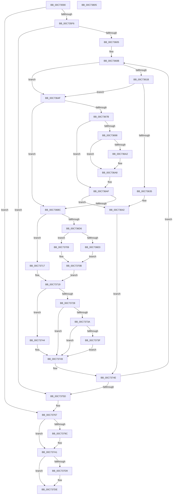

# IopInitializeSystemDrivers

- RVA: `0x00C73590`–`0x00C73806` (길이 `630` bytes)
- VA: `0x0000000140C73590`
- 실행 섹션: `INIT`
- PDB 이름 있음: `예`; PDB Function 태그: `아니요`
- unwind 정보 RVA: `0x000BC6AC`
- 디코드: `170`개 명령, `630/630` bytes 표시
- 미해석 바이트: `0` (있으면 어셈블리에 `.byte`로 보존)

> 이 문서는 커널 이미지의 기계어와 PDB 기호를 분석해 생성했습니다. 4번과 5번은 함수 원형과 자료형을 바이너리 사용 방식에서 추정한 C 해석이며 원본 소스 복구 결과는 아닙니다.

## 1. Dependencies

- 직접 호출 지점: **25**; 고유 호출 대상: **18**
- 직접 호출자로 확인된 함수: **1**
- RIP 상대 이미지 참조: **9**

### Outgoing calls
- `0x00C735CF` → [PnpDiagnosticTrace](../../text/26/PnpDiagnosticTrace_function_0026E384.md) (function, `0x0026E384`)
- `0x00C735D4` → [ExIsManufacturingModeEnabled](../../page/AC/ExIsManufacturingModeEnabled_function_00AC60A0.md) (function, `0x00AC60A0`)
- `0x00C735E5` → [CmGetSystemDriverList](CmGetSystemDriverList_function_00C7380C.md) (function, `0x00C7380C`)
- `0x00C73612` → [IopGetDriverNameFromKeyNode](../../page/99/IopGetDriverNameFromKeyNode_function_00998808.md) (function, `0x00998808`)
- `0x00C7361F` → [IopReferenceDriverObjectByName](../../page/99/IopReferenceDriverObjectByName_function_0099C178.md) (function, `0x0099C178`)
- `0x00C7362B` → [RtlFreeAnsiString](../../page/9C/RtlFreeAnsiString_function_009C0800.md) (function, `0x009C0800`)
- `0x00C7363D` → [ObfDereferenceObjectWithTag](../../text/2F/ObfDereferenceObjectWithTag_function_002F78E0.md) (function, `0x002F78E0`)
- `0x00C73645` → [ZwClose](../../text/6A/ZwClose_function_006AD2B0.md) (function, `0x006AD2B0`)
- `0x00C73672` → [IopOpenRegistryKeyEx](../../page/A5/IopOpenRegistryKeyEx_function_00A51B44.md) (function, `0x00A51B44`)
- `0x00C7368F` → [IopGetRegistryValue](../../page/99/IopGetRegistryValue_function_009990EC.md) (function, `0x009990EC`)
- `0x00C736AA` → [ExFreePoolWithTag](../../poolcode/B8/ExFreePoolWithTag_function_00B82870.md) (function, `0x00B82870`)
- `0x00C736B3` → [ZwClose](../../text/6A/ZwClose_function_006AD2B0.md) (function, `0x006AD2B0`)
- `0x00C736CD` → [IopGetRegistryValue](../../page/99/IopGetRegistryValue_function_009990EC.md) (function, `0x009990EC`)
- `0x00C736FF` → [PipLookupGroupName](../C3/PipLookupGroupName_function_00C31578.md) (function, `0x00C31578`)
- `0x00C73710` → [ExFreePoolWithTag](../../poolcode/B8/ExFreePoolWithTag_function_00B82870.md) (function, `0x00B82870`)
- `0x00C7371C` → [PipCheckDependencies](PipCheckDependencies_function_00C77AE0.md) (function, `0x00C77AE0`)
- `0x00C73731` → [IopLoadDriver](../../page/99/IopLoadDriver_function_00997B54.md) (function, `0x00997B54`)
- `0x00C73744` → [ZwClose](../../text/6A/ZwClose_function_006AD2B0.md) (function, `0x006AD2B0`)
- `0x00C73749` → [InbvIndicateProgress](../C2/InbvIndicateProgress_function_00C2A4D0.md) (function, `0x00C2A4D0`)
- `0x00C73762` → [ExFreePoolWithTag](../../poolcode/B8/ExFreePoolWithTag_function_00B82870.md) (function, `0x00B82870`)
- `0x00C7378E` → [PnpRequestDeviceAction](../../text/47/PnpRequestDeviceAction_function_00477FF8.md) (function, `0x00477FF8`)
- `0x00C7379C` → [PnpWaitForDevicesToStart](../C3/PnpWaitForDevicesToStart_function_00C32930.md) (function, `0x00C32930`)
- `0x00C737C8` → [PnpRequestDeviceAction](../../text/47/PnpRequestDeviceAction_function_00477FF8.md) (function, `0x00477FF8`)
- `0x00C737D9` → [PipFreeGroupTree](../C3/PipFreeGroupTree_function_00C309C4.md) (function, `0x00C309C4`)
- `0x00C737EA` → [PnpDiagnosticTrace](../../text/26/PnpDiagnosticTrace_function_0026E384.md) (function, `0x0026E384`)

### Direct callers
- [IoInitSystem](../C2/IoInitSystem_function_00C2ABB8.md) at `0x00C2ABDF`

### Static image references
- `0x00C735A7` → RVA `0x0001E178` (`.rdata`; read)
- `0x00C735DE` → RVA `0x00EFF070` (`.data`; read)
- `0x00C7364F` → RVA `0x00C7A310` (` ?? ::PBOPGDP::`string'`; read)
- `0x00C73686` → RVA `0x00C7A320` (` ?? ::PBOPGDP::`string'`; read)
- `0x00C736C6` → RVA `0x00C7A180` (` ?? ::PBOPGDP::`string'`; read)
- `0x00C73767` → RVA `0x00F8C438` (`.data`; read)
- `0x00C73793` → RVA `0x00E0A9DC` (`.data`; read)
- `0x00C737CD` → RVA `0x00F8CF10` (`.data`; read)
- `0x00C737E1` → RVA `0x0001E188` (`.rdata`; read)

## 2. Other-region calls and transfers

- 다른 실행 섹션으로 향하는 call: **19**
  - `0x00C735CF` → [PnpDiagnosticTrace](../../text/26/PnpDiagnosticTrace_function_0026E384.md) (`INIT` → `.text`)
  - `0x00C735D4` → [ExIsManufacturingModeEnabled](../../page/AC/ExIsManufacturingModeEnabled_function_00AC60A0.md) (`INIT` → `PAGE`)
  - `0x00C73612` → [IopGetDriverNameFromKeyNode](../../page/99/IopGetDriverNameFromKeyNode_function_00998808.md) (`INIT` → `PAGE`)
  - `0x00C7361F` → [IopReferenceDriverObjectByName](../../page/99/IopReferenceDriverObjectByName_function_0099C178.md) (`INIT` → `PAGE`)
  - `0x00C7362B` → [RtlFreeAnsiString](../../page/9C/RtlFreeAnsiString_function_009C0800.md) (`INIT` → `PAGE`)
  - `0x00C7363D` → [ObfDereferenceObjectWithTag](../../text/2F/ObfDereferenceObjectWithTag_function_002F78E0.md) (`INIT` → `.text`)
  - `0x00C73645` → [ZwClose](../../text/6A/ZwClose_function_006AD2B0.md) (`INIT` → `.text`)
  - `0x00C73672` → [IopOpenRegistryKeyEx](../../page/A5/IopOpenRegistryKeyEx_function_00A51B44.md) (`INIT` → `PAGE`)
  - `0x00C7368F` → [IopGetRegistryValue](../../page/99/IopGetRegistryValue_function_009990EC.md) (`INIT` → `PAGE`)
  - `0x00C736AA` → [ExFreePoolWithTag](../../poolcode/B8/ExFreePoolWithTag_function_00B82870.md) (`INIT` → `POOLCODE`)
  - `0x00C736B3` → [ZwClose](../../text/6A/ZwClose_function_006AD2B0.md) (`INIT` → `.text`)
  - `0x00C736CD` → [IopGetRegistryValue](../../page/99/IopGetRegistryValue_function_009990EC.md) (`INIT` → `PAGE`)
  - `0x00C73710` → [ExFreePoolWithTag](../../poolcode/B8/ExFreePoolWithTag_function_00B82870.md) (`INIT` → `POOLCODE`)
  - `0x00C73731` → [IopLoadDriver](../../page/99/IopLoadDriver_function_00997B54.md) (`INIT` → `PAGE`)
  - `0x00C73744` → [ZwClose](../../text/6A/ZwClose_function_006AD2B0.md) (`INIT` → `.text`)
  - `0x00C73762` → [ExFreePoolWithTag](../../poolcode/B8/ExFreePoolWithTag_function_00B82870.md) (`INIT` → `POOLCODE`)
  - `0x00C7378E` → [PnpRequestDeviceAction](../../text/47/PnpRequestDeviceAction_function_00477FF8.md) (`INIT` → `.text`)
  - `0x00C737C8` → [PnpRequestDeviceAction](../../text/47/PnpRequestDeviceAction_function_00477FF8.md) (`INIT` → `.text`)
  - `0x00C737EA` → [PnpDiagnosticTrace](../../text/26/PnpDiagnosticTrace_function_0026E384.md) (`INIT` → `.text`)
- 별도 외부 분기/꼬리 이동을 확인하지 못했습니다.

## 3. Assembly (complete function range)

```asm
00C73590  48 89 5C 24 20                  mov qword ptr [rsp + 0x20], rbx
00C73595  55                              push rbp
00C73596  56                              push rsi
00C73597  57                              push rdi
00C73598  41 54                           push r12
00C7359A  41 56                           push r14
00C7359C  48 8B EC                        mov rbp, rsp
00C7359F  48 83 EC 70                     sub rsp, 0x70
00C735A3  83 65 30 00                     and dword ptr [rbp + 0x30], 0
00C735A7  48 8D 0D CA AB 3A FF            lea rcx, [rip - 0xc55436]
00C735AE  48 83 65 40 00                  and qword ptr [rbp + 0x40], 0
00C735B3  0F 57 C0                        xorps xmm0, xmm0
00C735B6  48 83 65 38 00                  and qword ptr [rbp + 0x38], 0
00C735BB  0F 57 C9                        xorps xmm1, xmm1
00C735BE  45 33 C0                        xor r8d, r8d
00C735C1  33 D2                           xor edx, edx
00C735C3  0F 11 45 E0                     movups xmmword ptr [rbp - 0x20], xmm0
00C735C7  0F 11 4D D0                     movups xmmword ptr [rbp - 0x30], xmm1
00C735CB  0F 11 45 F0                     movups xmmword ptr [rbp - 0x10], xmm0
00C735CF  E8 B0 AD 5F FF                  call 0x14026e384
00C735D4  E8 C7 2A E5 FF                  call 0x140ac60a0
00C735D9  F6 D8                           neg al
00C735DB  48 1B C9                        sbb rcx, rcx
00C735DE  48 23 0D 8B BA 28 00            and rcx, qword ptr [rip + 0x28ba8b]
00C735E5  E8 22 02 00 00                  call 0x140c7380c
00C735EA  48 8B D8                        mov rbx, rax
00C735ED  48 85 C0                        test rax, rax
00C735F0  0F 84 71 01 00 00               je 0x140c73767
00C735F6  4C 8B F0                        mov r14, rax
00C735F9  48 8B 00                        mov rax, qword ptr [rax]
00C735FC  48 85 C0                        test rax, rax
00C735FF  0F 84 58 01 00 00               je 0x140c7375d
00C73605  41 BC 08 00 00 00               mov r12d, 8
00C7360B  48 8D 55 F0                     lea rdx, [rbp - 0x10]
00C7360F  48 8B C8                        mov rcx, rax
00C73612  E8 F1 51 D2 FF                  call 0x140998808
00C73617  85 C0                           test eax, eax
00C73619  78 34                           js 0x140c7364f
00C7361B  48 8D 4D F0                     lea rcx, [rbp - 0x10]
00C7361F  E8 54 8B D2 FF                  call 0x14099c178
00C73624  48 8D 4D F0                     lea rcx, [rbp - 0x10]
00C73628  48 8B F8                        mov rdi, rax
00C7362B  E8 D0 D1 D4 FF                  call 0x1409c0800
00C73630  48 85 FF                        test rdi, rdi
00C73633  74 1A                           je 0x140c7364f
00C73635  BA 44 66 6C 74                  mov edx, 0x746c6644
00C7363A  48 8B CF                        mov rcx, rdi
00C7363D  E8 9E 42 68 FF                  call 0x1402f78e0
00C73642  48 8B 0B                        mov rcx, qword ptr [rbx]
00C73645  E8 66 9C A3 FF                  call 0x1406ad2b0
00C7364A  E9 FF 00 00 00                  jmp 0x140c7374e
00C7364F  48 8D 05 BA 6C 00 00            lea rax, [rip + 0x6cba]
00C73656  C7 45 D0 08 00 0A 00            mov dword ptr [rbp - 0x30], 0xa0008
00C7365D  48 89 45 D8                     mov qword ptr [rbp - 0x28], rax
00C73661  4C 8D 45 D0                     lea r8, [rbp - 0x30]
00C73665  48 8B 13                        mov rdx, qword ptr [rbx]
00C73668  48 8D 4D 40                     lea rcx, [rbp + 0x40]
00C7366C  41 B9 19 00 02 00               mov r9d, 0x20019
00C73672  E8 CD E4 DD FF                  call 0x140a51b44
00C73677  85 C0                           test eax, eax
00C73679  78 41                           js 0x140c736bc
00C7367B  48 8B 4D 40                     mov rcx, qword ptr [rbp + 0x40]
00C7367F  4C 8D 4D 38                     lea r9, [rbp + 0x38]
00C73683  45 33 C0                        xor r8d, r8d
00C73686  48 8D 15 93 6C 00 00            lea rdx, [rip + 0x6c93]
00C7368D  33 FF                           xor edi, edi
00C7368F  E8 58 5A D2 FF                  call 0x1409990ec
00C73694  85 C0                           test eax, eax
00C73696  78 17                           js 0x140c736af
00C73698  48 8B 4D 38                     mov rcx, qword ptr [rbp + 0x38]
00C7369C  83 79 0C 04                     cmp dword ptr [rcx + 0xc], 4
00C736A0  75 06                           jne 0x140c736a8
00C736A2  8B 41 08                        mov eax, dword ptr [rcx + 8]
00C736A5  8B 3C 08                        mov edi, dword ptr [rax + rcx]
00C736A8  33 D2                           xor edx, edx
00C736AA  E8 C1 F1 F0 FF                  call 0x140b82870
00C736AF  48 8B 4D 40                     mov rcx, qword ptr [rbp + 0x40]
00C736B3  E8 F8 9B A3 FF                  call 0x1406ad2b0
00C736B8  85 FF                           test edi, edi
00C736BA  75 86                           jne 0x140c73642
00C736BC  48 8B 0B                        mov rcx, qword ptr [rbx]
00C736BF  4C 8D 4D 38                     lea r9, [rbp + 0x38]
00C736C3  45 33 C0                        xor r8d, r8d
00C736C6  48 8D 15 B3 6A 00 00            lea rdx, [rip + 0x6ab3]
00C736CD  E8 1A 5A D2 FF                  call 0x1409990ec
00C736D2  85 C0                           test eax, eax
00C736D4  78 41                           js 0x140c73717
00C736D6  48 8B 75 38                     mov rsi, qword ptr [rbp + 0x38]
00C736DA  83 7E 0C 00                     cmp dword ptr [rsi + 0xc], 0
00C736DE  74 29                           je 0x140c73709
00C736E0  0F B7 46 0C                     movzx eax, word ptr [rsi + 0xc]
00C736E4  48 8D 4D E0                     lea rcx, [rbp - 0x20]
00C736E8  66 89 45 E0                     mov word ptr [rbp - 0x20], ax
00C736EC  BA 01 00 00 00                  mov edx, 1
00C736F1  66 89 45 E2                     mov word ptr [rbp - 0x1e], ax
00C736F5  8B 46 08                        mov eax, dword ptr [rsi + 8]
00C736F8  48 03 C6                        add rax, rsi
00C736FB  48 89 45 E8                     mov qword ptr [rbp - 0x18], rax
00C736FF  E8 74 DE FB FF                  call 0x140c31578
00C73704  48 8B F8                        mov rdi, rax
00C73707  EB 02                           jmp 0x140c7370b
00C73709  33 FF                           xor edi, edi
00C7370B  33 D2                           xor edx, edx
00C7370D  48 8B CE                        mov rcx, rsi
00C73710  E8 5B F1 F0 FF                  call 0x140b82870
00C73715  EB 02                           jmp 0x140c73719
00C73717  33 FF                           xor edi, edi
00C73719  48 8B 0B                        mov rcx, qword ptr [rbx]
00C7371C  E8 BF 43 00 00                  call 0x140c77ae0
00C73721  48 8B 0B                        mov rcx, qword ptr [rbx]
00C73724  85 C0                           test eax, eax
00C73726  74 1C                           je 0x140c73744
00C73728  4C 8D 4D 30                     lea r9, [rbp + 0x30]
00C7372C  45 33 C0                        xor r8d, r8d
00C7372F  B2 01                           mov dl, 1
00C73731  E8 1E 44 D2 FF                  call 0x140997b54
00C73736  85 C0                           test eax, eax
00C73738  78 0F                           js 0x140c73749
00C7373A  48 85 FF                        test rdi, rdi
00C7373D  74 0A                           je 0x140c73749
00C7373F  FF 47 1C                        inc dword ptr [rdi + 0x1c]
00C73742  EB 05                           jmp 0x140c73749
00C73744  E8 67 9B A3 FF                  call 0x1406ad2b0
00C73749  E8 82 6D FB FF                  call 0x140c2a4d0
00C7374E  49 03 DC                        add rbx, r12
00C73751  48 8B 03                        mov rax, qword ptr [rbx]
00C73754  48 85 C0                        test rax, rax
00C73757  0F 85 AE FE FF FF               jne 0x140c7360b
00C7375D  33 D2                           xor edx, edx
00C7375F  49 8B CE                        mov rcx, r14
00C73762  E8 09 F1 F0 FF                  call 0x140b82870
00C73767  48 8B 0D CA 8C 31 00            mov rcx, qword ptr [rip + 0x318cca]
00C7376E  45 33 C9                        xor r9d, r9d
00C73771  48 83 64 24 30 00               and qword ptr [rsp + 0x30], 0
00C73777  45 33 C0                        xor r8d, r8d
00C7377A  48 83 64 24 28 00               and qword ptr [rsp + 0x28], 0
00C73780  48 83 64 24 20 00               and qword ptr [rsp + 0x20], 0
00C73786  48 8B 49 20                     mov rcx, qword ptr [rcx + 0x20]
00C7378A  41 8D 51 11                     lea edx, [r9 + 0x11]
00C7378E  E8 65 48 80 FF                  call 0x140477ff8
00C73793  83 3D 42 72 19 00 00            cmp dword ptr [rip + 0x197242], 0
00C7379A  75 05                           jne 0x140c737a1
00C7379C  E8 8F F1 FB FF                  call 0x140c32930
00C737A1  48 8B 0D 90 8C 31 00            mov rcx, qword ptr [rip + 0x318c90]
00C737A8  45 33 C9                        xor r9d, r9d
00C737AB  48 83 64 24 30 00               and qword ptr [rsp + 0x30], 0
00C737B1  45 33 C0                        xor r8d, r8d
00C737B4  48 83 64 24 28 00               and qword ptr [rsp + 0x28], 0
00C737BA  48 83 64 24 20 00               and qword ptr [rsp + 0x20], 0
00C737C0  48 8B 49 20                     mov rcx, qword ptr [rcx + 0x20]
00C737C4  41 8D 51 12                     lea edx, [r9 + 0x12]
00C737C8  E8 2B 48 80 FF                  call 0x140477ff8
00C737CD  48 8B 0D 3C 97 31 00            mov rcx, qword ptr [rip + 0x31973c]
00C737D4  48 85 C9                        test rcx, rcx
00C737D7  74 05                           je 0x140c737de
00C737D9  E8 E6 D1 FB FF                  call 0x140c309c4
00C737DE  45 33 C0                        xor r8d, r8d
00C737E1  48 8D 0D A0 A9 3A FF            lea rcx, [rip - 0xc55660]
00C737E8  33 D2                           xor edx, edx
00C737EA  E8 95 AB 5F FF                  call 0x14026e384
00C737EF  48 8B 9C 24 B8 00 00 00         mov rbx, qword ptr [rsp + 0xb8]
00C737F7  33 C0                           xor eax, eax
00C737F9  48 83 C4 70                     add rsp, 0x70
00C737FD  41 5E                           pop r14
00C737FF  41 5C                           pop r12
00C73801  5F                              pop rdi
00C73802  5E                              pop rsi
00C73803  5D                              pop rbp
00C73804  C3                              ret
00C73805  CC                              int3
```

## 4. C-style interpretation (structured pseudocode)

```c
__int64 __fastcall IopInitializeSystemDrivers(__int64 a1, int a2, int a3)
{
    __int64 result;
    __int64 v_rbx;
    __int64 v_rdi;
    __int64 v_rsp;
    unsigned __int64 v_stack_m38;
    unsigned __int64 v_stack_m40;
    unsigned __int16 v_stack_m46;
    unsigned __int64 v_stack_m48;
    unsigned __int64 v_stack_m50;
    unsigned __int64 v_stack_m58;
    unsigned __int64 v_stack_m68;
    unsigned __int64 v_stack_m70;
    unsigned __int64 v_stack_m78;
    unsigned __int64 v_stack_p10;
    unsigned __int64 v_stack_p18;
    unsigned __int64 v_stack_p20;
    unsigned int v_stack_p8;

    v_stack_p20 = v_rbx;
    v_rsp = (v_rsp) - (112);
    a3 = 0;
    a2 = 0;
    v_stack_m48 = v_xmm0;
    v_stack_m58 = v_xmm1;
    v_stack_m38 = v_xmm0;
    result = PnpDiagnosticTrace(v_rip - 12932150, a2, a3, a4);
    result = ExIsManufacturingModeEnabled(v_rip - 12932150, a2, a3, a4);
    result = (unsigned __int8)(-(result));
    a1 = (v_rip - 12932150) & (*(unsigned __int64 *)(v_rip + 2669195));
    result = CmGetSystemDriverList(a1, a2, a3, a4);
    if (result == 0) goto loc_00C73767;
    if (*(unsigned __int64 *)(result) == 0) goto loc_00C7375D;
loc_00C7360B:
    result = IopGetDriverNameFromKeyNode(*(unsigned __int64 *)(result), v_stack_m38, a3, a4);
    if (sign_flag) goto loc_00C7364F;
    result = IopReferenceDriverObjectByName(v_stack_m38, v_stack_m38, a3, a4);
    result = RtlFreeAnsiString(v_stack_m38, v_stack_m38, a3, a4);
    if (result == 0) goto loc_00C7364F;
    result = ObfDereferenceObjectWithTag(result, (unsigned int)(0x746C6644ULL), a3, a4);
loc_00C73642:
    result = ZwClose(*(unsigned __int64 *)(result), (unsigned int)(0x746C6644ULL), a3, a4);
    goto loc_00C7374E;
loc_00C7364F:
    v_stack_m58 = 0xA0008ULL;
    v_stack_m50 = v_rip + 27834;
    result = IopOpenRegistryKeyEx(v_stack_p18, *(unsigned __int64 *)(result), v_stack_m58, (unsigned int)(0x20019ULL));
    if (sign_flag) goto loc_00C736BC;
    a3 = 0;
    v_rdi = 0;
    result = IopGetRegistryValue(v_stack_p18, v_rip + 27795, a3, v_stack_p10);
    if (sign_flag) goto loc_00C736AF;
    if ((*(unsigned int *)(v_stack_p10 + 12)) == 4) {
        result = *(unsigned int *)(v_stack_p10 + 8);
        v_rdi = *(unsigned int *)(result + v_stack_p10 * 1);
    }
    a2 = 0;
    result = ExFreePoolWithTag(v_stack_p10, a2, a3, v_stack_p10);
loc_00C736AF:
    result = ZwClose(v_stack_p18, a2, a3, v_stack_p10);
    if ((unsigned int)(v_rdi) != 0) goto loc_00C73642;
loc_00C736BC:
    a3 = 0;
    result = IopGetRegistryValue(*(unsigned __int64 *)(result), v_rip + 27315, a3, v_stack_p10);
    if (sign_flag) goto loc_00C73717;
    if ((*(unsigned int *)(v_stack_p10 + 12)) == 0) goto loc_00C73709;
    v_stack_m48 = (unsigned __int16)(*(unsigned __int16 *)(v_stack_p10 + 12));
    v_stack_m46 = (unsigned __int16)(*(unsigned __int16 *)(v_stack_p10 + 12));
    result = ((unsigned int)(*(unsigned int *)(v_stack_p10 + 8))) + (v_stack_p10);
    v_stack_m40 = result;
    result = PipLookupGroupName(v_stack_m48, 1, a3, v_stack_p10);
    goto loc_00C7370B;
loc_00C73709:
    v_rdi = 0;
loc_00C7370B:
    a2 = 0;
    result = ExFreePoolWithTag(v_stack_p10, a2, a3, v_stack_p10);
    goto loc_00C73719;
loc_00C73717:
    v_rdi = 0;
loc_00C73719:
    result = PipCheckDependencies(*(unsigned __int64 *)(result), a2, a3, v_stack_p10);
    if ((unsigned int)(result) == 0) goto loc_00C73744;
    a3 = 0;
    result = IopLoadDriver(*(unsigned __int64 *)(result), 1, a3, v_stack_p8);
    if (sign_flag) goto loc_00C73749;
    if (0 == 0) goto loc_00C73749;
    goto loc_00C73749;
loc_00C73744:
    result = ZwClose(*(unsigned __int64 *)(result), 1, a3, v_stack_p8);
loc_00C73749:
    result = InbvIndicateProgress(*(unsigned __int64 *)(result), 1, a3, v_stack_p8);
loc_00C7374E:
    v_rbx = (result) + (8);
    if (*(unsigned __int64 *)(v_rbx) != 0) goto loc_00C7360B;
loc_00C7375D:
    a2 = 0;
    result = ExFreePoolWithTag(result, a2, a3, v_stack_p8);
loc_00C73767:
    a4 = 0;
    a3 = 0;
    result = PnpRequestDeviceAction(*(unsigned __int64 *)(*(unsigned __int64 *)(v_rip + 3247306) + 32), a4 + 17, a3, a4);
    if ((*(unsigned int *)(v_rip + 1667650)) == 0) {
        result = PnpWaitForDevicesToStart(*(unsigned __int64 *)(*(unsigned __int64 *)(v_rip + 3247306) + 32), a4 + 17, a3, a4);
    }
    a4 = 0;
    a3 = 0;
    result = PnpRequestDeviceAction(*(unsigned __int64 *)(*(unsigned __int64 *)(v_rip + 3247248) + 32), a4 + 18, a3, a4);
    if (*(unsigned __int64 *)(v_rip + 3249980) != 0) {
        result = PipFreeGroupTree(*(unsigned __int64 *)(v_rip + 3249980), a4 + 18, a3, a4);
    }
    a3 = 0;
    a2 = 0;
    result = PnpDiagnosticTrace(v_rip - 12932704, a2, a3, a4);
    result = 0;
    v_rsp = (v_rsp) + (112);
    return result;
}
```

## 5. (Beta) C Style

```c
int64_t IopInitializeSystemDrivers(int64_t Arg1, int32_t Arg2, int32_t Arg3)
{
    int64_t result;
    int64_t local_rbx;
    int64_t local_rdi;
    int64_t local_rsp;
    uint64_t v_stack_m38;
    uint64_t v_stack_m40;
    uint16_t v_stack_m46;
    uint64_t v_stack_m48;
    uint64_t v_stack_m50;
    uint64_t v_stack_m58;
    uint64_t v_stack_m68;
    uint64_t v_stack_m70;
    uint64_t v_stack_m78;
    uint64_t v_stack_p10;
    uint64_t v_stack_p18;
    uint64_t v_stack_p20;
    uint32_t v_stack_p8;

    v_stack_p20 = local_rbx;
    local_rsp = (local_rsp) - (112);
    Arg3 = 0;
    Arg2 = 0;
    v_stack_m48 = v_xmm0;
    v_stack_m58 = v_xmm1;
    v_stack_m38 = v_xmm0;
    result = PnpDiagnosticTrace(v_rip - 12932150, Arg2, Arg3, a4);
    result = ExIsManufacturingModeEnabled(v_rip - 12932150, Arg2, Arg3, a4);
    result = (uint8_t)(-(result));
    Arg1 = (v_rip - 12932150) & (*(uint64_t *)(v_rip + 0x28BA8B));
    result = CmGetSystemDriverList(Arg1, Arg2, Arg3, a4);
    if (result == 0) goto loc_00C73767;
    if (*(uint64_t *)(result) == 0) goto loc_00C7375D;
loc_00C7360B:
    result = IopGetDriverNameFromKeyNode(*(uint64_t *)(result), v_stack_m38, Arg3, a4);
    if (sign_flag) goto loc_00C7364F;
    result = IopReferenceDriverObjectByName(v_stack_m38, v_stack_m38, Arg3, a4);
    result = RtlFreeAnsiString(v_stack_m38, v_stack_m38, Arg3, a4);
    if (result == 0) goto loc_00C7364F;
    result = ObfDereferenceObjectWithTag(result, (uint32_t)(0x746C6644ULL), Arg3, a4);
loc_00C73642:
    result = ZwClose(*(uint64_t *)(result), (uint32_t)(0x746C6644ULL), Arg3, a4);
    goto loc_00C7374E;
loc_00C7364F:
    v_stack_m58 = 0xA0008ULL;
    v_stack_m50 = v_rip + 27834;
    result = IopOpenRegistryKeyEx(v_stack_p18, *(uint64_t *)(result), v_stack_m58, (uint32_t)(0x20019ULL));
    if (sign_flag) goto loc_00C736BC;
    Arg3 = 0;
    local_rdi = 0;
    result = IopGetRegistryValue(v_stack_p18, v_rip + 27795, Arg3, v_stack_p10);
    if (sign_flag) goto loc_00C736AF;
    if ((*(uint32_t *)(v_stack_p10 + 0xC)) == 4) {
        result = *(uint32_t *)(v_stack_p10 + 0x8);
        local_rdi = *(uint32_t *)(result + v_stack_p10 * 1);
    }
    Arg2 = 0;
    result = ExFreePoolWithTag(v_stack_p10, Arg2, Arg3, v_stack_p10);
loc_00C736AF:
    result = ZwClose(v_stack_p18, Arg2, Arg3, v_stack_p10);
    if ((uint32_t)(local_rdi) != 0) goto loc_00C73642;
loc_00C736BC:
    Arg3 = 0;
    result = IopGetRegistryValue(*(uint64_t *)(result), v_rip + 27315, Arg3, v_stack_p10);
    if (sign_flag) goto loc_00C73717;
    if ((*(uint32_t *)(v_stack_p10 + 0xC)) == 0) goto loc_00C73709;
    v_stack_m48 = (uint16_t)(*(uint16_t *)(v_stack_p10 + 0xC));
    v_stack_m46 = (uint16_t)(*(uint16_t *)(v_stack_p10 + 0xC));
    result = ((uint32_t)(*(uint32_t *)(v_stack_p10 + 0x8))) + (v_stack_p10);
    v_stack_m40 = result;
    result = PipLookupGroupName(v_stack_m48, 1, Arg3, v_stack_p10);
    goto loc_00C7370B;
loc_00C73709:
    local_rdi = 0;
loc_00C7370B:
    Arg2 = 0;
    result = ExFreePoolWithTag(v_stack_p10, Arg2, Arg3, v_stack_p10);
    goto loc_00C73719;
loc_00C73717:
    local_rdi = 0;
loc_00C73719:
    result = PipCheckDependencies(*(uint64_t *)(result), Arg2, Arg3, v_stack_p10);
    if ((uint32_t)(result) == 0) goto loc_00C73744;
    Arg3 = 0;
    result = IopLoadDriver(*(uint64_t *)(result), 1, Arg3, v_stack_p8);
    if (sign_flag) goto loc_00C73749;
    if (0 == 0) goto loc_00C73749;
    goto loc_00C73749;
loc_00C73744:
    result = ZwClose(*(uint64_t *)(result), 1, Arg3, v_stack_p8);
loc_00C73749:
    result = InbvIndicateProgress(*(uint64_t *)(result), 1, Arg3, v_stack_p8);
loc_00C7374E:
    local_rbx = (result) + (8);
    if (*(uint64_t *)(local_rbx) != 0) goto loc_00C7360B;
loc_00C7375D:
    Arg2 = 0;
    result = ExFreePoolWithTag(result, Arg2, Arg3, v_stack_p8);
loc_00C73767:
    a4 = 0;
    Arg3 = 0;
    result = PnpRequestDeviceAction(*(uint64_t *)(*(uint64_t *)(v_rip + 0x318CCA) + 0x20), a4 + 17, Arg3, a4);
    if ((*(uint32_t *)(v_rip + 0x197242)) == 0) {
        result = PnpWaitForDevicesToStart(*(uint64_t *)(*(uint64_t *)(v_rip + 0x318CCA) + 0x20), a4 + 17, Arg3, a4);
    }
    a4 = 0;
    Arg3 = 0;
    result = PnpRequestDeviceAction(*(uint64_t *)(*(uint64_t *)(v_rip + 0x318C90) + 0x20), a4 + 18, Arg3, a4);
    if (*(uint64_t *)(v_rip + 0x31973C) != 0) {
        result = PipFreeGroupTree(*(uint64_t *)(v_rip + 0x31973C), a4 + 18, Arg3, a4);
    }
    Arg3 = 0;
    Arg2 = 0;
    result = PnpDiagnosticTrace(v_rip - 12932704, Arg2, Arg3, a4);
    result = 0;
    local_rsp = (local_rsp) + (112);
    return result;
}
```

## 6. Execution-region graph

[열기: 2D/3D 그래프와 함수 탐색 컨트롤 패널](../../../control-panel.html?section=init&rva=0x00C73590&view=graph)

- 2D 그래프는 위에서 아래로 흐르고, 3D 그래프는 빈 공간을 드래그해 회전합니다. Shift+드래그는 이동, 휠은 확대·축소, 함수 노드 선택은 대상 보고서 이동입니다.

### Static fallback


